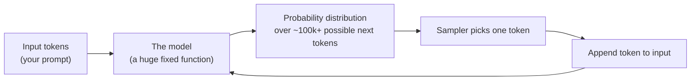
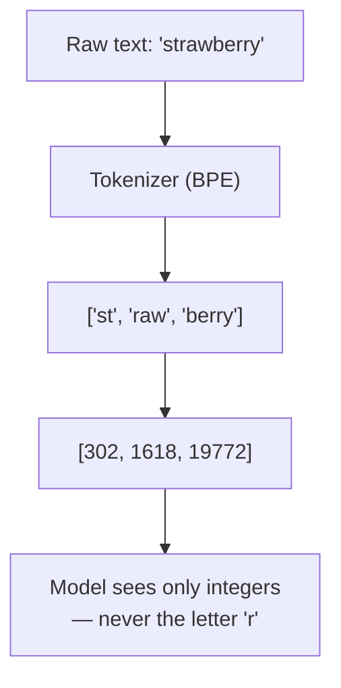
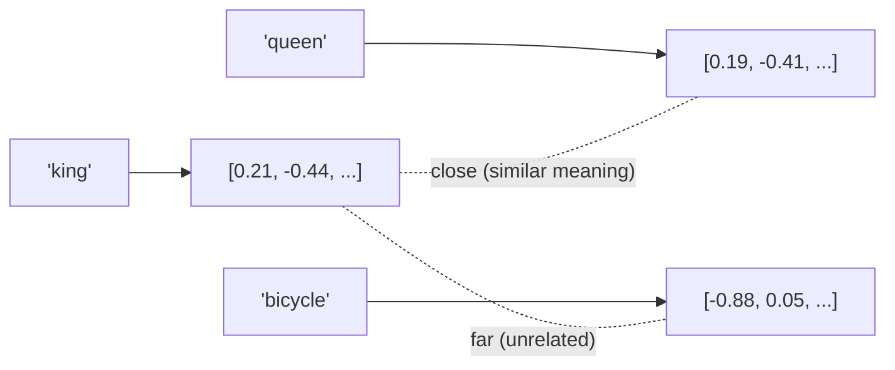
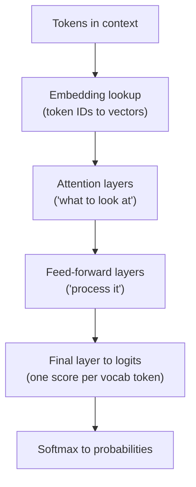
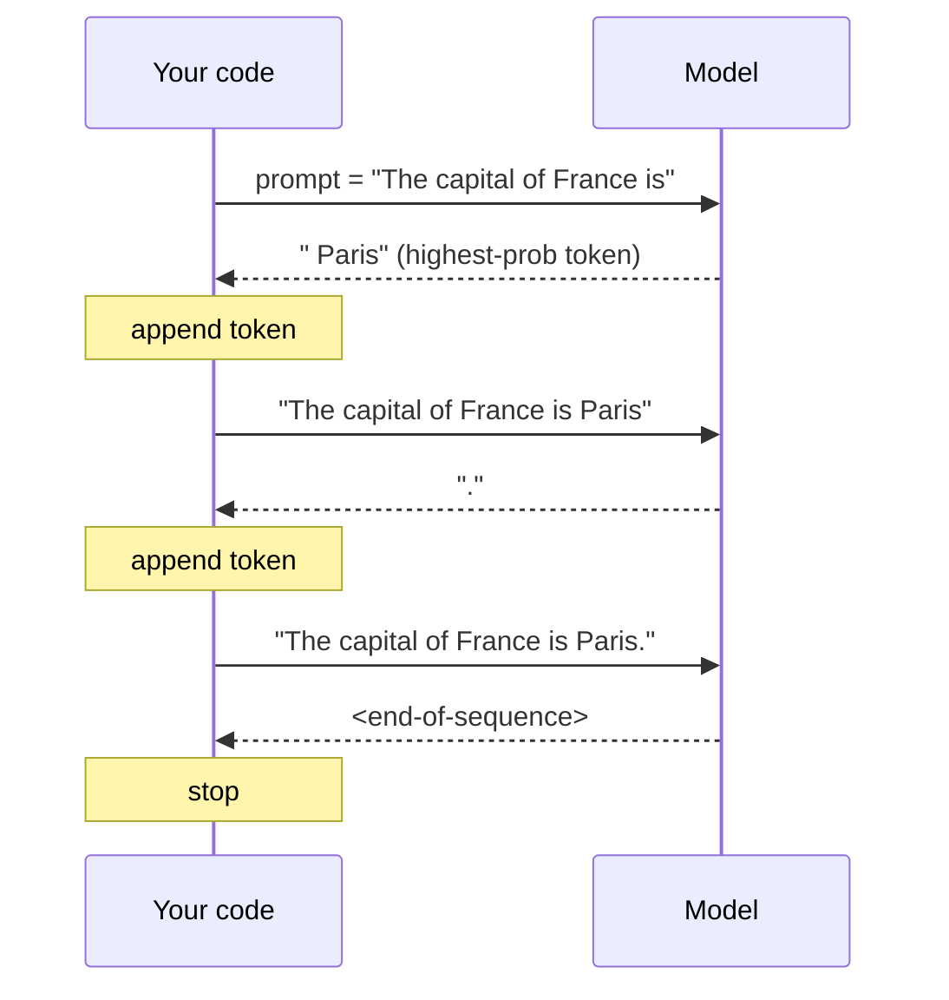
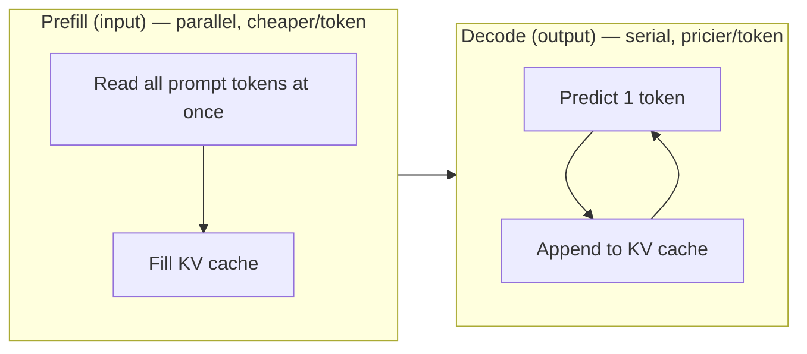
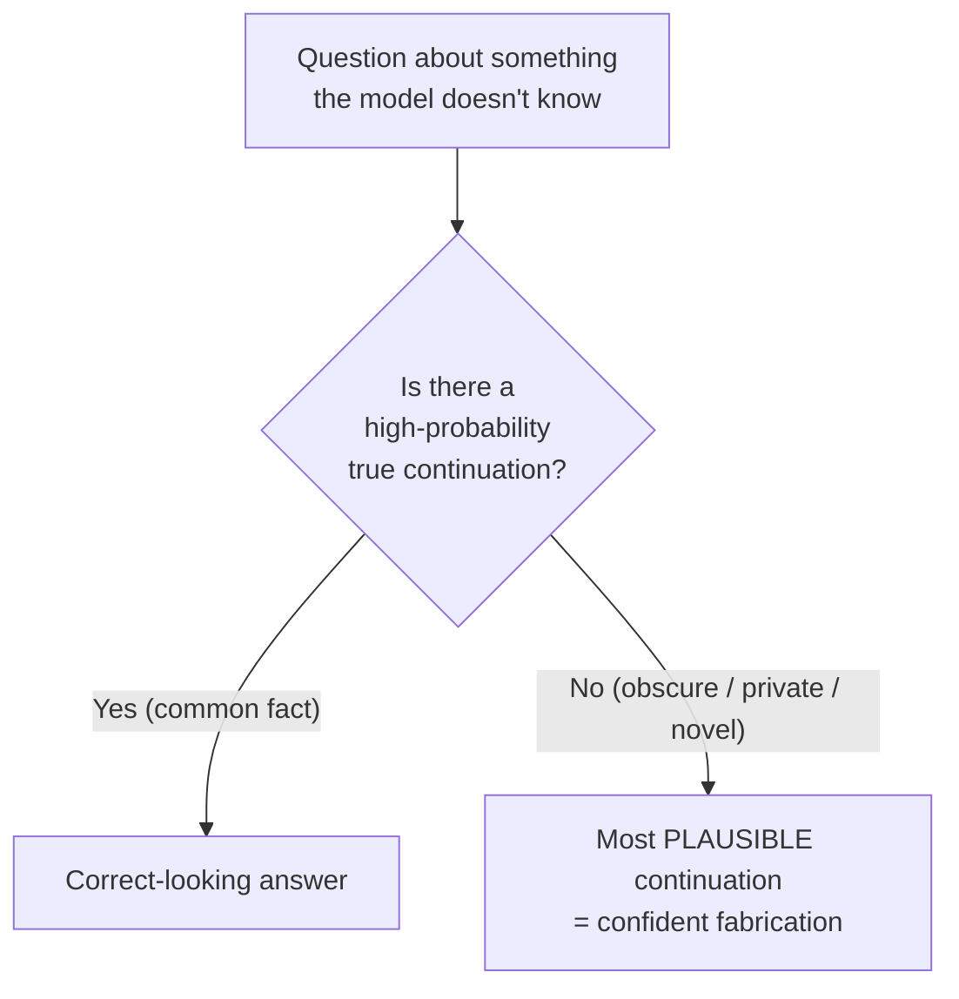

# AI Day 1 — How LLMs Actually Work

> Series: AI Backend Engineering
> Prereqs: You already know Postgres, Redis, Docker, APIs, caching, queues, rate limiting, SOLID, design patterns.
> Goal: Build a correct *mental model* of what an LLM is, so every downstream decision (RAG, evals, cost, prompts) makes sense instead of feeling like superstition.

You don't need to train models. You need to know *why* they behave the way they do, because 80% of production AI bugs are really "the engineer misunderstood the machine." This is the physics day.

---

## Table of Contents
1. [The one-sentence model](#the-one-sentence-model)
2. [Tokens & tokenization](#tokens--tokenization)
3. [Embeddings (a teaser)](#embeddings-a-teaser)
4. [Transformers, conceptually](#transformers-conceptually)
5. [Autoregressive generation: the token loop](#autoregressive-generation-the-token-loop)
6. [The context window & KV cache](#the-context-window--kv-cache)
7. [Why hallucinations happen](#why-hallucinations-happen)
8. [Sampling controls](#sampling-controls)
9. [The Dark Side (recap)](#the-dark-side-recap)
10. [Self-Check](#self-check)
11. [Apply (1 hour)](#apply-1-hour)

---

## The one-sentence model

**An LLM is a function that takes a sequence of tokens and returns a probability distribution over the next token.** Everything else — chat, coding, "reasoning," agents — is that single function called in a loop with clever inputs.

Burn this in. When something goes wrong, ask: *"Given the tokens I fed in, was the most probable next token actually the answer I wanted?"* That question resolves most confusion.


*The entire product is one next-token predictor called repeatedly; there is no hidden database of facts.*

---

## Tokens & tokenization

### Why
Models don't see characters or words. They see **tokens** — integer IDs from a fixed vocabulary (typically 100k–200k entries as of 2026). You are billed per token, latency scales per token, and the context window is measured in tokens. If tokens are the currency, you must know the exchange rate.

> **🤔 Wait — why count tokens at all? Can't I just send the whole document and let the API sort it out?**
> You *can* send it — the API will happily accept it and bill you for every token. Counting isn't about permission, it's about *control*. Tokens are simultaneously your bill, your latency, and your hard context ceiling; skip measuring them and you're flying blind on all three at once.
>
> **✅ Good scenario (where it saves you):** A doc-Q&A SaaS counts tokens before each call and caps retrieved context at ~8k tokens. When a customer uploads a 400-page PDF, the system retrieves the 6 relevant chunks instead of stuffing all 400 pages — the call stays cents and ~2s instead of dollars and 30s, and answer quality goes *up* because the signal isn't buried.
>
> **❌ Bad scenario (the pain without it):** A team estimates cost as `len(text)/4` and ships a "summarize my inbox" feature. Real emails are full of quoted threads, base64 signatures, and non-English text that tokenize 2–3x heavier than the estimate. The first big customer's batch job burns several times the projected budget overnight, and a modest feature quietly becomes a runaway line item nobody catches until finance does.
>
> **When NOT to:** for a fixed, short prompt on English prose that's nowhere near the context limit and not billing-sensitive (an internal prototype, a one-off script), a `/4` napkin estimate is fine — reach for the real tokenizer at any *decision* boundary (truncation, billing, limits).

### What
A **tokenizer** maps text ⟷ token IDs. Modern LLMs use **Byte-Pair Encoding (BPE)** or close variants. BPE starts from bytes and greedily merges the most frequent adjacent pairs into subword units. Common words become one token; rare words fragment.

Rough rule of thumb (English, as of 2026, *verify current*): **1 token ≈ 4 characters ≈ 0.75 words.** So 1,000 tokens ≈ 750 words ≈ 1.5 pages.

- `"the"` → 1 token
- `"tokenization"` → maybe 2–3 tokens (`token`, `ization`)
- `"antidisestablishmentarianism"` → many tokens
- A UUID or base64 blob → lots of tokens (no friendly merges exist)

### The "count the r's in strawberry" failure
Ask a raw model "how many r's in strawberry?" and it may say 2. Not stupidity — **the model never sees letters.** `strawberry` might be the tokens `st`, `raw`, `berry`. Character-level questions are asking someone to count objects they can't see. The lesson generalizes: **anything requiring exact character/position manipulation (reversing strings, counting chars, strict arithmetic on long numbers) is architecturally hard.** Solution in production: give the model a tool (call `len()`, call a calculator, run code) instead of hoping.

### Why non-English costs more
BPE vocabularies are trained mostly on English/code. English packs ~4 chars/token. Many other languages — Hindi, Thai, Arabic, Chinese, or anything in a non-Latin script — tokenize into far more tokens per character, sometimes 2–4x. Same *meaning*, 2–4x the **cost and latency**, and it eats your context window faster. If you serve a multilingual product, budget for it explicitly.


*The model operates on subword integers, which is why letter-level tasks fail and why scripts tokenize unequally.*

### How — count tokens and cost with tiktoken

Naive approach (what juniors do): estimate cost as `len(text) / 4 * price`. Wrong for code, non-English, JSON, and it silently drifts.

Professional approach: count real tokens with the actual tokenizer.

```python
from __future__ import annotations
from dataclasses import dataclass
import tiktoken


@dataclass(frozen=True)
class ModelPricing:
    """USD per 1M tokens. As of 2026 — VERIFY CURRENT before trusting."""
    input_per_m: float
    output_per_m: float
    cached_input_per_m: float  # usually a large discount vs input


# Illustrative July-2026 numbers. VERIFY CURRENT.
PRICING: dict[str, ModelPricing] = {
    "gpt-5.5":        ModelPricing(input_per_m=1.25, output_per_m=10.00, cached_input_per_m=0.13),
    "claude-opus-4.8": ModelPricing(input_per_m=5.00, output_per_m=25.00, cached_input_per_m=0.50),
    "gemini-3.1-pro": ModelPricing(input_per_m=2.50, output_per_m=15.00, cached_input_per_m=0.31),
}


def count_tokens(text: str, encoding_name: str = "o200k_base") -> int:
    """Count tokens using an OpenAI-family BPE tokenizer.

    Note: this is exact only for OpenAI models. Anthropic/Google use their
    own tokenizers; use this as a close *estimate* for them, or call their
    official count-tokens endpoints for billing-grade accuracy.
    """
    enc = tiktoken.get_encoding(encoding_name)
    return len(enc.encode(text))


def estimate_cost(
    prompt: str,
    expected_output_tokens: int,
    model: str,
    cached_fraction: float = 0.0,
) -> float:
    """Estimate USD cost for a single call.

    cached_fraction: portion of the INPUT that is served from provider-side
    prompt cache (see Day 4). 0.0 = nothing cached.
    """
    pricing = PRICING[model]
    in_tokens = count_tokens(prompt)
    cached = int(in_tokens * cached_fraction)
    fresh = in_tokens - cached

    cost = (
        fresh * pricing.input_per_m / 1_000_000
        + cached * pricing.cached_input_per_m / 1_000_000
        + expected_output_tokens * pricing.output_per_m / 1_000_000
    )
    return round(cost, 6)


if __name__ == "__main__":
    prompt = "Summarize the quarterly report in three bullet points." * 50
    for model in PRICING:
        print(f"{model:16} ${estimate_cost(prompt, 400, model):.5f} per call")
```

### When
Count tokens whenever: you're pricing a feature, deciding truncation, comparing models, or debugging "why is this call slow/expensive." Do NOT eyeball it in a spreadsheet with `/4` once you're past prototype.

### Where
Tokenization sits at the boundary of *every* request. In your architecture it belongs in the same layer as your provider client (Day 3) so you can log tokens per call (Day 4) — think of it like a middleware that instruments every outbound LLM request, similar to how you'd wrap DB calls to log query time.

### The Dark Side
- **"Just divide characters by 4."** Fine for a napkin estimate on English prose. Actively wrong for code, JSON, non-English, or when the number drives a billing/limit decision.
- **The common advice "tokens ≈ words" is fine to *communicate* with non-engineers**, but if you build a hard truncation limit on that assumption you'll cut off real content or overflow the context window. Use the real tokenizer at any decision boundary.

---

## Embeddings (a teaser)

### Why
You'll spend Day 5 on this, but you need the seed now because it explains *how* LLMs relate concepts.

### What
An **embedding** is a mapping from text (a word, sentence, document) to a fixed-length vector of floats — e.g., 1,536 or 3,072 dimensions. The magic property: **semantic similarity becomes geometric proximity.** "dog" and "puppy" land near each other; "dog" and "tax return" land far apart. Similarity is usually measured by **cosine similarity** (angle between vectors).


*Embeddings turn 'do these mean the same thing?' into 'are these vectors close?' — the foundation of search and RAG.*

### When / Where
Embeddings power semantic search, retrieval-augmented generation (RAG), clustering, deduplication, and classification. You store them in a vector index (pgvector on your existing Postgres, or a dedicated store). Full treatment: **Day 5**.

### The Dark Side
Embeddings capture *similarity*, not *truth* or *logic*. Two contradictory sentences ("the drug is safe" / "the drug is not safe") can be embedded very close together because they're topically near-identical. Never use raw cosine similarity as a fact-checker.

---

## Transformers, conceptually

No math here — intuition only.

### The core idea: attention = "what to look at"
When processing a token, the model computes, for every other token in context, *how relevant it is to this one*, and blends their information accordingly. That relevance-weighting is **attention**. In "The trophy didn't fit in the suitcase because *it* was too big," attention is how the model links *it* → *trophy* rather than *suitcase*.

Stack many attention layers and you get a network that, at each position, builds an increasingly context-aware representation, culminating in a prediction of the next token.

### What the model actually outputs
The final layer produces a **logit** (raw score) for every token in the vocabulary. A softmax turns those into probabilities. That's the distribution from the one-sentence model at the top.


*Attention decides which earlier tokens matter; the stack ends in a probability for every possible next token.*

### Why this matters for you
- **Attention is roughly quadratic in sequence length.** Doubling context can ~quadruple the attention compute. This is the mechanical reason long context is slow and expensive (details below).
- The model has **no memory between requests.** Each call re-reads the entire prompt from scratch. "The model remembers our conversation" is a *lie you construct* by resending the history every turn (Day 2).

### The Dark Side
Attention is not comprehension. The model can attend to the right tokens and still produce a plausible-but-wrong answer, because it optimizes for likely continuations, not correctness. Don't over-index on "it clearly understood the question."

---

## Autoregressive generation: the token loop

**Autoregressive** = the model generates one token, appends it to the input, and predicts the next — repeating until it emits a stop token or hits a limit.


*Generation is a loop: each new token is fed back in, which is why output tokens cost latency one at a time.*

Consequences you must internalize:
- **Output is generated serially.** This is why streaming exists (Day 3/15) — you show tokens as they arrive instead of waiting for the whole response.
- **Each output token requires a full forward pass** over the growing context. This is why *output tokens are the expensive, slow part* and why long generations feel slow.
- **Errors compound.** A wrong early token conditions everything after it. This is partly why "let's think step by step" helps — it gives the model room to lay down correct intermediate tokens before committing to an answer.

---

## The context window & KV cache

### What
The **context window** is the maximum number of tokens (input + output) the model can consider in a single call — e.g., 200k, 1M, or more as of 2026. It is a hard ceiling, not a suggestion. Overflow and the API errors or silently truncates.

### KV cache — why cost & latency grow with context
During generation, attention needs the Key and Value vectors of every previous token. Recomputing them each step would be brutal, so the model caches them: the **KV cache**. Two facts fall out:

1. **The KV cache grows with context length and consumes GPU memory.** Longer context → more memory → higher serving cost. Providers pass this to you.
2. **Prefill vs decode.** Processing your input prompt ("prefill") is parallel and relatively cheap per token. Generating output ("decode") is serial and dominated by the growing cache. That asymmetry is *why output tokens are priced 3–5x input tokens* (Day 4).


*Input is read in one parallel pass; output is squeezed out one token at a time — the root of the input/output price gap.*

### The "lost in the middle" problem
A huge context window does NOT mean uniform attention across it. Empirically, models recall information best at the **beginning** and **end** of the context, and worst in the **middle** — the "lost in the middle" effect. The **needle-in-a-haystack** test measures this: hide a fact somewhere in a long context and ask for it back.

Practical rules:
- Put the most important instructions and the most relevant retrieved chunks near the **top or bottom**, not buried in the middle of a 300k-token dump.
- More context is not more understanding. Relevant, ordered, compact context beats a giant blob.

> **🤔 Wait — if the model has a 1M-token window, why not just paste everything and skip retrieval?**
> Because a big window is a *capacity*, not a *strategy*. The model attends non-uniformly (lost-in-the-middle), you pay for every token whether it helps or not, and latency scales with what you send. A full window of noise gives worse answers than a small window of signal.
>
> **✅ Good scenario (where it saves you):** A coding assistant retrieves the 8 most relevant files (~12k tokens) for "why does checkout throw on refund?" The model has exactly what it needs, answers in ~3s, costs cents, and cites the right function.
>
> **❌ Bad scenario (when misused):** The same assistant pastes the entire 600k-token monorepo "to be safe." The bug lives in the middle of the dump, the model glosses over it, returns a confident wrong file, the dev trusts it, and the "fix" ships a regression — after a 40s wait and a 50x bill.
>
> **When NOT to:** when the whole relevant input genuinely fits in a few thousand tokens (one short doc, one file), just put it all in context — retrieval machinery is overkill and only adds a failure mode.

### The Dark Side
- **Anthropomorphizing:** "It has a 1M window so I'll just paste the whole codebase." You'll pay for 1M tokens, wait longer, and get *worse* answers because the signal drowns. Retrieve what's relevant (Day 5), don't dump.
- **Assuming bigger context = use all of it.** The right amount of context is the *minimum* that contains the answer. Treat context like a cache working set, not a hard drive.

---

## Why hallucinations happen

### The reframe that governs everything downstream
An LLM is trained to produce **plausible** continuations, not **true** ones. During training it's rewarded for text that looks like its training data. Truth and plausibility usually correlate — but when they diverge (an obscure fact, a made-up API, your internal data it never saw), the model confidently generates the *plausible-sounding* answer. That's a **hallucination**, and it's a feature of the objective, not a bug you can prompt away.


*The model always emits its most plausible continuation; when plausible ≠ true, that's a hallucination.*

> **🤔 Wait — I already told it "do not make anything up, say I don't know if unsure." Why does it still hallucinate?**
> Because hallucination comes from the training *objective* (produce plausible text), not from a missing instruction. The model has no internal "am I sure?" signal to gate on — "I don't know" is just another string it emits when that string happens to be the plausible continuation, which for a confident-sounding question it usually isn't. Instructions nudge the probability a little; they don't install a truth-checker.
>
> **✅ Good scenario (where grounding saves you):** A support chatbot retrieves the actual refund policy and the model answers *from* that text. Now the plausible continuation and the true one coincide, and you can show the cited source so a human can verify.
>
> **❌ Bad scenario (the pain without it):** A bare model is asked "what's our enterprise SLA?" It never saw your internal SLA, so it confidently invents "99.99% with 15-minute response" — which reaches a customer, becomes a contractual expectation, and turns into a support escalation when reality is 99.9%.
>
> **When NOT to over-engineer:** for low-stakes creative tasks (brainstorm slogans, draft a first email) hallucination is cheap or even desirable variety — save the RAG/verify machinery for answers users will act on.

### Why this is the most important slide in the course
Nearly every production AI technique exists to fight this:
- **RAG / grounding (Day 5+):** inject real, retrieved facts so the plausible answer *is* the true one.
- **Tool use (Day 12):** let the model call a source of truth instead of guessing.
- **Evals (later):** measure hallucination rate instead of vibing.
- **Structured output + validation (Day 2):** constrain what it can say.
- **"Cite your sources / say I don't know":** raise the probability of honest refusals.

### The Dark Side
- Turning temperature to 0 reduces *randomness*, not *wrongness*. A deterministic hallucination is still a hallucination.
- "Just tell it not to make things up" helps a little and is not a control. If correctness matters, you must **ground** or **verify**, not ask nicely.

---

## Sampling controls

After the model produces the probability distribution, the **sampler** picks the actual token. These knobs control that pick. They change *behavior*, never *knowledge*.

- **temperature** — scales the distribution's sharpness. `0` ≈ always take the top token (deterministic-ish, focused). Higher (`0.7`–`1.0`) flattens it → more variety and creativity, more risk of drift.
- **top_p (nucleus)** — sample only from the smallest set of tokens whose cumulative probability ≥ p (e.g., 0.9). Cuts the long tail of garbage tokens.
- **top_k** — sample only from the k most likely tokens.
- **frequency_penalty** — lowers probability of tokens already used, proportional to count. Reduces literal repetition.
- **presence_penalty** — lowers probability of any token that appeared at all. Pushes toward new topics.

> Practical note: usually tune **either** temperature **or** top_p, not both. Leave one at its default.

### When to use what

| Task | temperature | top_p | Notes |
|---|---|---|---|
| Data extraction / classification / JSON | `0` – `0.2` | `1.0` | You want the same answer every time. Determinism > flair. |
| Function/tool arg generation | `0` | `1.0` | Must be parseable and stable. |
| Factual Q&A / RAG answers | `0.1` – `0.3` | `1.0` | Low creativity; stay grounded. |
| Summarization | `0.2` – `0.5` | `0.9` | Slight room for fluent phrasing. |
| General chat / assistant | `0.5` – `0.7` | `0.9` | Natural, varied, still coherent. |
| Brainstorming / marketing / naming | `0.8` – `1.0` | `0.9`–`1.0` | Want diversity; you'll filter. |
| Poetry / fiction | `0.9` – `1.1` | `1.0` | Maximize surprise. |

```python
# Extraction: deterministic, parseable
extraction_params = {"temperature": 0.0, "top_p": 1.0}

# Creative naming: diverse candidates
brainstorm_params = {"temperature": 0.9, "top_p": 0.95,
                     "frequency_penalty": 0.3, "presence_penalty": 0.3}
```

### The Dark Side
- **"temperature=0 is deterministic."** Mostly false in practice. Even at 0, floating-point non-determinism, load balancing across GPUs, and MoE routing can produce different outputs across runs. If you *need* reproducibility, pin a `seed` when the provider supports it, and even then treat it as best-effort — not a guarantee. Cache results if you truly need stability.
- **Cranking temperature to "make it smarter."** Temperature never adds knowledge; high temp on a factual task just adds confident noise. The "creative = better" instinct is wrong for extraction and tool calls.

---

## The Dark Side (recap)

The through-line of Day 1: **stop treating the model like a mind.** It's a next-token predictor with no memory, no letters, no notion of truth, and non-uniform attention. Every one of today's "dark side" notes is a variant of the same anthropomorphizing mistake:

| Tempting belief | Reality | What to do |
|---|---|---|
| "It remembers our chat" | Stateless; you resend history | Manage context yourself (Day 2/4) |
| "It can count letters" | Sees tokens, not chars | Give it a tool |
| "1M context = paste everything" | Lost-in-the-middle, huge cost | Retrieve the minimum (Day 5) |
| "temp=0 = deterministic + correct" | Neither guaranteed | Ground + verify + cache |
| "Tell it not to hallucinate" | Not a control | RAG, tools, evals |

---

## Self-Check
1. State the one-sentence model of an LLM. Why does it imply the model is stateless between calls?
2. Why does "how many r's in strawberry" fail, and what's the production fix?
3. You serve users in Hindi and English. Same message, which costs more tokens and roughly why?
4. Explain the prefill/decode split and connect it to why output tokens cost ~3–5x input tokens.
5. What is the KV cache and why does latency/cost grow with context length?
6. Describe "lost in the middle." Where should you place critical instructions in a long prompt?
7. Reframe hallucination in one sentence. Name three downstream techniques that exist to combat it.
8. When would you use temperature 0 vs 0.7? Give a concrete task for each.
9. Why is "temperature=0 is fully deterministic" misleading in production?
10. Why is a giant context window not automatically an upgrade?

---

## Tomorrow
**AI Day 2 — Prompt Engineering:** message roles, few-shot vs chain-of-thought, and structured output done *right* (Pydantic + schema enforcement, not "please return JSON"). We turn today's physics into reliable inputs.

---

## Apply (1 hour)
Build a small CLI, `tokenlab.py`, that:
1. Takes a text file (feed it an English doc AND a non-English doc of similar meaning).
2. Uses `tiktoken` to print token count, char count, and the real chars/token ratio for each. Confirm the non-English penalty with your own eyes.
3. Prints estimated input+output cost across three models from the `PRICING` table (invent a plausible output length).
4. Adds a `--temperature-demo` flag: call any model you have access to 5 times at temp 0 and 5 times at temp 1.0 on the same creative prompt; print the outputs. Observe determinism-ish vs diversity — and note whether temp 0 was *truly* identical every time.
5. Bonus: feed it "How many r's are in strawberry?" and confirm/deny the failure on your model, then re-ask it with an instruction to "count letter by letter, writing each letter on its own line" and see if the extra tokens help.

Write down one sentence: *"The thing that surprised me about how LLMs work is ___."*
