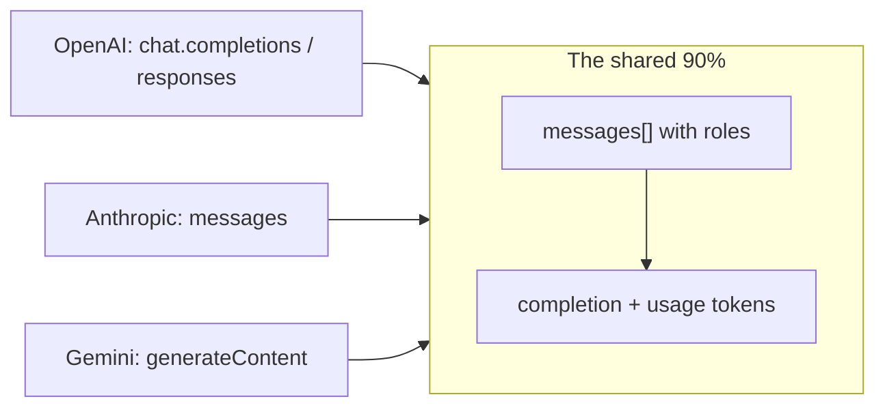
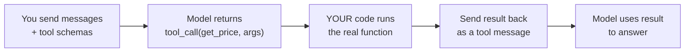
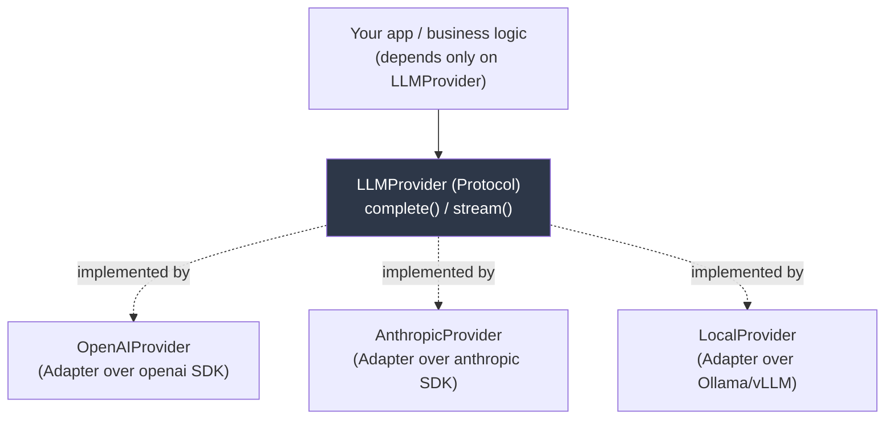

# AI Day 3 — AI APIs & Provider Abstraction

> Series: AI Backend Engineering
> Prereqs: Day 1 (tokens, streaming intuition), Day 2 (message roles, structured output). SysDesign: **Adapter pattern (SysDesign Day 5)**, **Dependency Inversion / DIP (SysDesign Day 2)**, **cache-aside (SysDesign Day 11)**, interfaces & ports/adapters.
> Goal: This is your home turf. LLM providers are just HTTP APIs with quirks. You'll map the three big API shapes, then build a clean provider abstraction so your app depends on an *interface*, not a vendor.

Everything you know about wrapping third-party APIs (payment gateways, SMS providers, storage backends) applies directly. The twist is that LLM providers each have *unique* capabilities, so the abstraction has to be deliberate — not too thin, not too leaky.

---

## Table of Contents
1. [The three big API shapes](#the-three-big-api-shapes)
2. [Streaming basics (intro)](#streaming-basics-intro)
3. [Tool / function calling (intro)](#tool--function-calling-intro)
4. [Local models: Ollama & vLLM](#local-models-ollama--vllm)
5. [The main event: provider-swap architecture](#the-main-event-provider-swap-architecture)
6. [LiteLLM: the batteries-included version](#litellm-the-batteries-included-version)
7. [The Dark Side](#the-dark-side)
8. [Self-Check](#self-check)
9. [Apply (1 hour)](#apply-1-hour)

---

## The three big API shapes

Three ecosystems dominate in 2026: **OpenAI**, **Anthropic**, **Google Gemini**. They are ~90% the same idea — POST a list of role-tagged messages, get a completion back — with cosmetic and a few structural differences. Learn one deeply and the others are pattern-matching.


*All three are 'send role-tagged messages, receive a completion + token usage'; the differences are naming and a few structural choices.*

### OpenAI — Chat Completions and the newer Responses API
```python
from openai import OpenAI
client = OpenAI()

resp = client.chat.completions.create(
    model="gpt-5.5",
    messages=[
        {"role": "system", "content": "You are concise."},
        {"role": "user", "content": "Explain idempotency in one line."},
    ],
    temperature=0.2,
    max_tokens=200,
)
text = resp.choices[0].message.content
usage = resp.usage  # prompt_tokens, completion_tokens, total_tokens
```
The **Responses API** is OpenAI's newer, higher-level surface (built for tools, state, and multimodal). Chat Completions remains the widely-supported lingua franca; many third-party servers speak "OpenAI-compatible." *(Verify current API surface as of 2026.)*

### Anthropic — Messages API
```python
from anthropic import Anthropic
client = Anthropic()

resp = client.messages.create(
    model="claude-opus-4-8",
    system="You are concise.",          # system is a TOP-LEVEL param, not a message
    messages=[
        {"role": "user", "content": "Explain idempotency in one line."},
    ],
    max_tokens=200,                      # REQUIRED here
    temperature=0.2,
)
text = resp.content[0].text             # content is a list of typed blocks
usage = resp.usage                       # input_tokens, output_tokens
```
Key structural differences: `system` is a separate top-level field (not a message role), `max_tokens` is required, and `content` is a **list of typed blocks** (text, tool_use, etc.) rather than a single string. Anthropic also offers **Claude Fable 5**, a cheaper/faster tier — provider families have a size ladder (frontier ↔ mini/fast).

### Google Gemini — generateContent
```python
from google import genai
client = genai.Client()

resp = client.models.generate_content(
    model="gemini-3.1-pro",
    contents="Explain idempotency in one line.",
    config={"system_instruction": "You are concise.",
            "temperature": 0.2, "max_output_tokens": 200},
)
text = resp.text
usage = resp.usage_metadata  # prompt_token_count, candidates_token_count
```
Gemini uses `contents`/`parts`, `system_instruction`, and `candidates`. Different nouns, same shape.

### The comparison you'll actually reference

| Concept | OpenAI | Anthropic | Gemini |
|---|---|---|---|
| Endpoint | `chat.completions` / `responses` | `messages` | `generateContent` |
| System prompt | message with `role:"system"` | top-level `system` param | `system_instruction` in config |
| Max output | `max_tokens` (optional) | `max_tokens` (**required**) | `max_output_tokens` |
| Response body | `choices[0].message.content` (str) | `content[]` (typed blocks) | `candidates[0]...` / `.text` |
| Token usage | `usage.prompt/completion_tokens` | `usage.input/output_tokens` | `usage_metadata.*_token_count` |
| Multi-content | single string | list of blocks | list of parts |

*Takeaway:* the differences are exactly the kind of impedance mismatch the **Adapter pattern** exists to hide.

---

## Streaming basics (intro)

Recall Day 1: output is generated one token at a time. **Streaming** delivers those tokens to you as they're produced, over **Server-Sent Events (SSE)**, instead of blocking until the whole response is done. Why it matters: perceived latency. A user seeing text appear in 200ms feels far faster than waiting 6s for a full answer, even if total time is identical.

```python
# OpenAI streaming — the shape, not the deep dive
stream = client.chat.completions.create(
    model="gpt-5.5",
    messages=[{"role": "user", "content": "Write a haiku about backpressure."}],
    stream=True,
)
for chunk in stream:
    delta = chunk.choices[0].delta.content
    if delta:
        print(delta, end="", flush=True)
```

Each provider streams incremental "delta" events; you accumulate them. **Deep dive — backpressure, cancellation, SSE-to-client fan-out, token accounting on partial streams — is Day 15.** For now: know it exists, know it's SSE, know it changes perceived latency, not cost.

---

## Tool / function calling (intro)

**Tool calling** (aka function calling) lets the model *request* that your code run a function. You describe your functions as JSON schemas; the model, instead of answering directly, returns a structured "call `get_weather(city="Paris")`" request; you execute it and feed the result back (this is Day 2's **ReAct** loop, formalized by the API).


*The model asks to call a function; your code executes it and returns the result — the API-level grounding mechanism.*

Every provider supports it; the schema shape differs (OpenAI `tools`/`tool_calls`, Anthropic `tools`/`tool_use` blocks, Gemini `function_declarations`). This is the foundation of agents and the primary anti-hallucination tool (call a source of truth instead of guessing). **Deep dive — parallel tool calls, the agent loop, error handling, tool-choice forcing — is Day 12.** Today it's context for why the abstraction below must not paper over tool capabilities.

---

## Local models: Ollama & vLLM

You are not forced onto a hosted API. Open-weights models (2026: **DeepSeek V4, Qwen, Llama, GLM-5, MiniMax M2.5**) run on your own hardware.

- **Ollama** — dead-simple local runtime for *development* and small workloads. `ollama run qwen3` and you have a model on `localhost`. It exposes an **OpenAI-compatible** endpoint, so your existing OpenAI client points at it by changing `base_url`. Great for prototyping offline, demos, and CI without burning API credits.
- **vLLM** — high-throughput *serving* engine for production self-hosting. It does efficient batching and KV-cache management (Day 1) to serve many concurrent requests on GPUs, and also exposes an OpenAI-compatible API.

```python
from openai import OpenAI
# Same SDK, self-hosted model — just repoint base_url
local = OpenAI(base_url="http://localhost:11434/v1", api_key="ollama")
resp = local.chat.completions.create(
    model="qwen3", messages=[{"role": "user", "content": "hi"}])
```

### When / why to self-host

| Reason | Explanation |
|---|---|
| **Data sovereignty** | Regulated data (health, finance, gov) that can't leave your network. The strongest driver. |
| **Cost at volume** | Past a high, steady request volume, amortized GPU cost can beat per-token API pricing (do the math — Day 4). |
| **Latency / locality** | No network round-trip to a provider; predictable tail latency; edge/on-prem. |
| **No vendor lock / availability** | Not subject to a provider's rate limits, deprecations, or outages. |
| **Customization** | Fine-tuned weights you own. |

Counter-truths: you now own GPU ops, scaling, patching, and eval — and frontier hosted models are usually *smarter* than open-weights you can afford to serve. Self-hosting is an infra commitment, not a free lunch.

---

## The main event: provider-swap architecture

Here's where your SysDesign training pays off directly. The goal: **your application code must not import `openai` or `anthropic` anywhere.** It depends on an *abstraction*; concrete providers are injected. This is exactly the **Adapter pattern (SysDesign Day 5)** wrapping each vendor SDK behind one interface, driven by **Dependency Inversion (SysDesign Day 2)** — high-level policy depends on the abstraction, not the vendor.

> **🤔 Wait — why build a provider abstraction if I only use OpenAI? Isn't that premature?**
> If you truly have one provider forever, it *is* premature (see Dark Side). But "I only use OpenAI" rarely stays true: a rival's price cut, a capability only Anthropic ships, an outage, or just wanting a `FakeProvider` in tests all create a second consumer of the same call. The real payoff isn't multi-vendor vanity — it's that your business logic never imports a vendor, so swapping, testing, and cost-wrapping all live in one place.
>
> **✅ Good scenario (where it saves you):** A support-chatbot company depends only on `LLMProvider`. When their sole provider has a 3-hour regional outage, they flip the composition root to a backup provider and stay up — while competitors hardcoded to one SDK are down. The same one-line swap injects a `FakeProvider` so tests run with no keys and no network.
>
> **❌ Bad scenario (the pain without it):** A doc-Q&A SaaS scatters `openai.chat.completions.create(...)` across 60 files. When a compliance customer forces adding Anthropic, the "swap" becomes a two-week refactor touching every call site — and their tests still hit the real API, racking up a bill on every CI run.
>
> **When NOT to:** for a spike, a one-provider internal tool, or a bleeding-edge feature the abstraction would hide, call the raw SDK directly — add the port when the *second* consumer (a new provider or a test fake) actually appears.


*High-level code depends on the LLMProvider port; each vendor is an Adapter behind it — textbook Dependency Inversion.*

### Step 1 — define the port (the abstraction)

```python
from __future__ import annotations
from dataclasses import dataclass, field
from typing import Protocol, Iterator, runtime_checkable


@dataclass(frozen=True)
class Message:
    role: str          # "system" | "user" | "assistant"
    content: str


@dataclass(frozen=True)
class Usage:
    input_tokens: int
    output_tokens: int


@dataclass(frozen=True)
class Completion:
    text: str
    usage: Usage
    model: str
    raw: object = field(default=None, repr=False)  # escape hatch: the raw SDK response


@runtime_checkable
class LLMProvider(Protocol):
    """The port. App code depends ONLY on this (DIP, SysDesign Day 2)."""

    def complete(
        self,
        messages: list[Message],
        *,
        model: str,
        temperature: float = 0.2,
        max_tokens: int = 1024,
    ) -> Completion: ...

    def stream(
        self,
        messages: list[Message],
        *,
        model: str,
        temperature: float = 0.2,
        max_tokens: int = 1024,
    ) -> Iterator[str]: ...
```

Using `Protocol` (structural typing) means providers don't even need to inherit — any class with the right methods satisfies the port. (An `ABC` works too if you prefer nominal typing.)

### Step 2 — the Adapters

```python
from openai import OpenAI
from anthropic import Anthropic


class OpenAIProvider:
    """Adapter (SysDesign Day 5) over the OpenAI SDK."""

    def __init__(self, client: OpenAI | None = None) -> None:
        self._client = client or OpenAI()

    def complete(self, messages, *, model, temperature=0.2, max_tokens=1024) -> Completion:
        resp = self._client.chat.completions.create(
            model=model,
            messages=[{"role": m.role, "content": m.content} for m in messages],
            temperature=temperature,
            max_tokens=max_tokens,
        )
        u = resp.usage
        return Completion(
            text=resp.choices[0].message.content or "",
            usage=Usage(u.prompt_tokens, u.completion_tokens),
            model=model,
            raw=resp,
        )

    def stream(self, messages, *, model, temperature=0.2, max_tokens=1024):
        stream = self._client.chat.completions.create(
            model=model,
            messages=[{"role": m.role, "content": m.content} for m in messages],
            temperature=temperature, max_tokens=max_tokens, stream=True,
        )
        for chunk in stream:
            delta = chunk.choices[0].delta.content
            if delta:
                yield delta


class AnthropicProvider:
    """Adapter over the Anthropic SDK. Note the structural differences from Day 3's table."""

    def __init__(self, client: Anthropic | None = None) -> None:
        self._client = client or Anthropic()

    @staticmethod
    def _split_system(messages: list[Message]) -> tuple[str, list[dict[str, str]]]:
        system = "\n".join(m.content for m in messages if m.role == "system")
        rest = [{"role": m.role, "content": m.content}
                for m in messages if m.role != "system"]
        return system, rest

    def complete(self, messages, *, model, temperature=0.2, max_tokens=1024) -> Completion:
        system, rest = self._split_system(messages)          # adapt: system is top-level
        resp = self._client.messages.create(
            model=model, system=system or None, messages=rest,
            temperature=temperature, max_tokens=max_tokens,   # adapt: required here
        )
        return Completion(
            text="".join(b.text for b in resp.content if b.type == "text"),  # adapt: blocks
            usage=Usage(resp.usage.input_tokens, resp.usage.output_tokens),
            model=model,
            raw=resp,
        )

    def stream(self, messages, *, model, temperature=0.2, max_tokens=1024):
        system, rest = self._split_system(messages)
        with self._client.messages.stream(
            model=model, system=system or None, messages=rest,
            temperature=temperature, max_tokens=max_tokens,
        ) as stream:
            for text in stream.text_stream:
                yield text
```

### Step 3 — swap with one line (Dependency Injection)

```python
def summarize(provider: LLMProvider, text: str, *, model: str) -> Completion:
    """Business logic. Notice: no vendor import, no vendor concept. Just the port."""
    return provider.complete(
        [
            Message("system", "Summarize in exactly 3 bullet points."),
            Message("user", text),
        ],
        model=model,
        temperature=0.2,
    )


# Wiring — the ONLY place that knows about concrete vendors (composition root)
provider: LLMProvider = OpenAIProvider()
# provider: LLMProvider = AnthropicProvider()   # <- the entire swap
result = summarize(provider, article, model="gpt-5.5")
```

That single line is the payoff. Your business logic, tests (inject a `FakeProvider`), routing (Day 4's model cascade), and cost wrapper (Day 4) all program against `LLMProvider`. This is DIP made concrete, and it's why backend engineers are dangerous at AI: you already think in ports and adapters.

> Note the `raw` field on `Completion`: a deliberate **escape hatch** so callers who *need* a provider-specific feature can reach the raw response without you widening the whole interface. This is the pragmatic answer to leaky abstractions (see Dark Side).

---

## LiteLLM: the batteries-included version

You don't always have to hand-roll the above. **LiteLLM** is a library that already normalizes 100+ providers to the OpenAI call shape, plus retries, fallbacks, cost tracking, and a proxy/gateway server.

```python
from litellm import completion

# Same call shape regardless of provider; switch by changing the model string
resp = completion(model="anthropic/claude-opus-4-8",
                  messages=[{"role": "user", "content": "hi"}])
resp = completion(model="gpt-5.5", messages=[{"role": "user", "content": "hi"}])
```

When to build your own port vs use LiteLLM:

| Use your own `LLMProvider` port | Use LiteLLM (or a gateway) |
|---|---|
| You want a *tiny* surface tailored to your app | You need many providers *now* |
| Learning / full control / minimal deps | Want retries, fallbacks, cost tracking for free |
| 2–3 providers, stable needs | Central gateway for many teams/keys |

Either way, the *principle* is identical: depend on an abstraction. LiteLLM is just someone else's adapter layer. Wrapping LiteLLM behind your own thin port is a common, sane middle ground.

---

## The Dark Side

| Trap | Why it bites | Guidance |
|---|---|---|
| **Premature abstraction** | You build a 5-provider framework for an app that will only ever use one. YAGNI. The abstraction costs complexity and buys nothing. | If you have one provider and no concrete plan to switch, call the SDK directly. Add the port when the *second* provider (or a fake for tests) appears. |
| **Leaky abstraction** | Each provider has unique gold — Anthropic's prompt caching & tool-use blocks, OpenAI structured outputs & Responses state, Gemini's huge context / multimodal. A lowest-common-denominator interface throws these away. | Design for the *common* path, expose an escape hatch (`raw`) for the special path, and don't pretend features are portable when they aren't. |
| **The unified-gateway tax** | A central LLM gateway adds a network hop, a scaling concern, a single point of failure, and it lags provider features (new params take time to surface). | Worth it for governance/many teams; overkill for one service. Measure the added latency and the feature lag before mandating it. |
| **Assuming behavior is portable** | The interface swaps cleanly, but the *model* doesn't — prompts, formatting, and quality shift (Day 2). | The abstraction moves bytes, not behavior. Re-run your golden-set evals on any new provider before trusting the swap. |

**When the "bad" practice is right:** calling the raw SDK directly (no abstraction) is the *correct* choice for a spike, a one-provider internal tool, or when you need a bleeding-edge feature the abstraction would hide. Abstraction is a cost you pay for optionality — only buy it when you'll use the option.

---

## Self-Check
1. Name the three big API families and their endpoint names. What's the single biggest structural difference between OpenAI and Anthropic message handling?
2. Which SysDesign patterns does the provider port implement, and what does each contribute?
3. Why can you point the OpenAI SDK at Ollama or vLLM with almost no code change?
4. Give three legitimate reasons to self-host an open-weights model, and two real costs of doing so.
5. What is streaming, what transport does it use, and what does it change (and not change)?
6. In one sentence each, what is tool calling and how does it relate to Day 2's ReAct?
7. Why use `Protocol` instead of forcing inheritance from an ABC?
8. What is a leaky abstraction here, and how does the `raw` escape hatch address it without widening the interface?
9. When would you reach for LiteLLM instead of your own port? When not?
10. Give a concrete scenario where writing *no* provider abstraction is the right engineering call.

---

## Tomorrow
**AI Day 4 — Cost & Token Management:** input-vs-output pricing mechanics, context compression, model cascades (cheap-triage → escalate), provider-side prompt caching, batching, and a cost+token tracking decorator wrapped around the exact `LLMProvider` you just built.

---

## Apply (1 hour)
Extend today's code into `llm_provider.py`:
1. Implement the `LLMProvider` Protocol plus `OpenAIProvider` and `AnthropicProvider` (or a `LocalProvider` over Ollama if you lack a second key).
2. Write `summarize(provider, text, *, model)` that imports **no** vendor package. Prove the one-line swap runs against both.
3. Add a `FakeProvider` that returns a canned `Completion` and write a unit test for `summarize` that uses it — no network, no keys. This is why DIP matters.
4. Point an `OpenAIProvider` at Ollama by injecting a client with `base_url="http://localhost:11434/v1"`; run the same `summarize`. Confirm your app code didn't change.
5. Reflection: list one provider-specific feature (prompt caching, tool blocks, structured outputs) your interface currently hides, and decide — extend the port, or use the `raw` escape hatch? Justify in two sentences.
