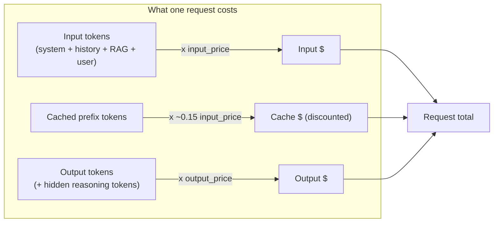
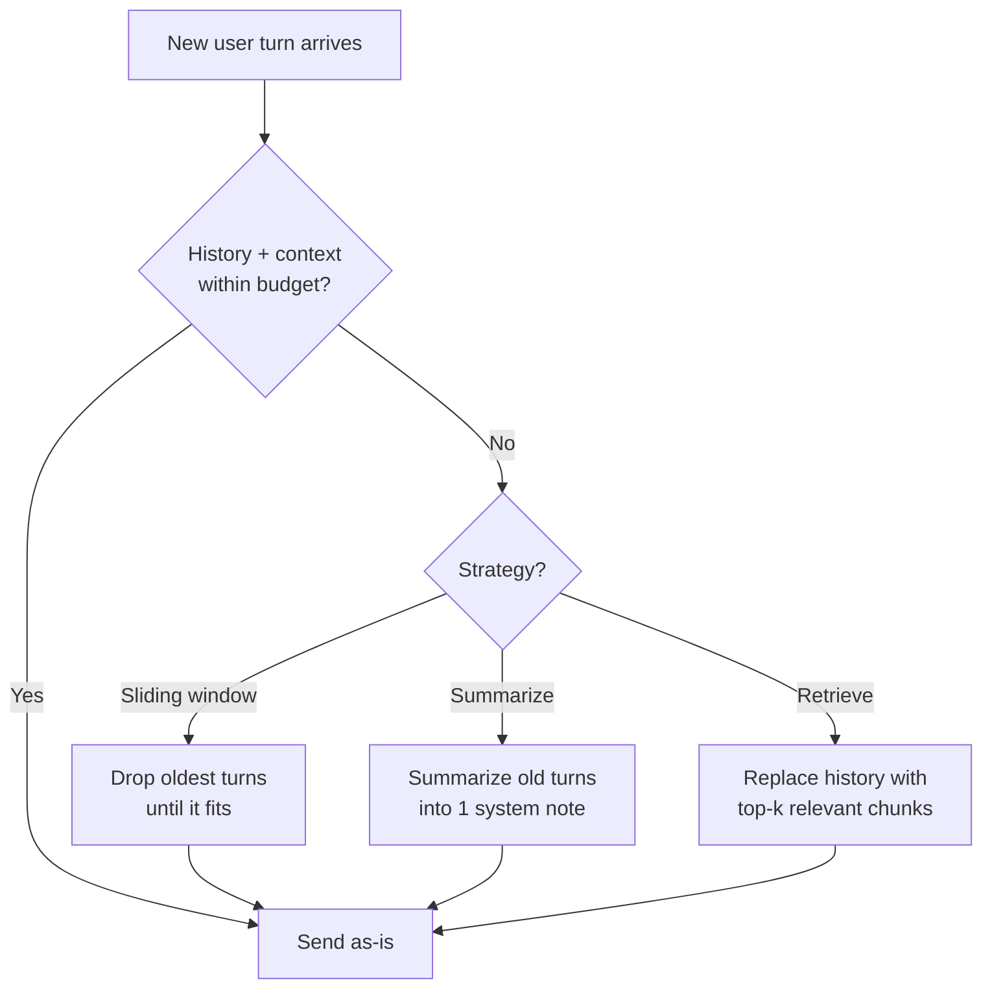
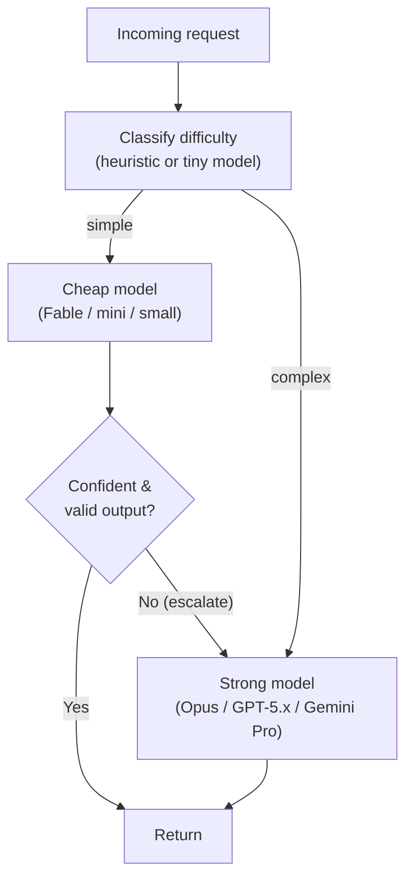
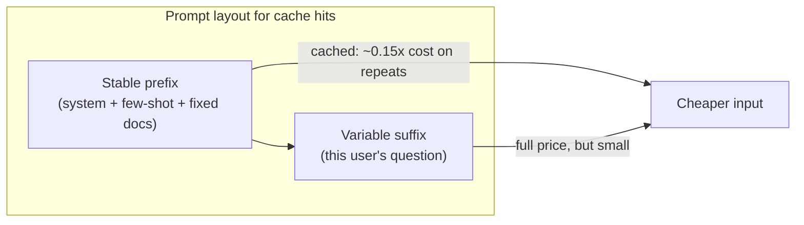
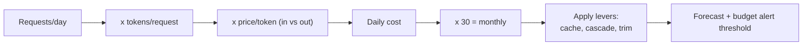
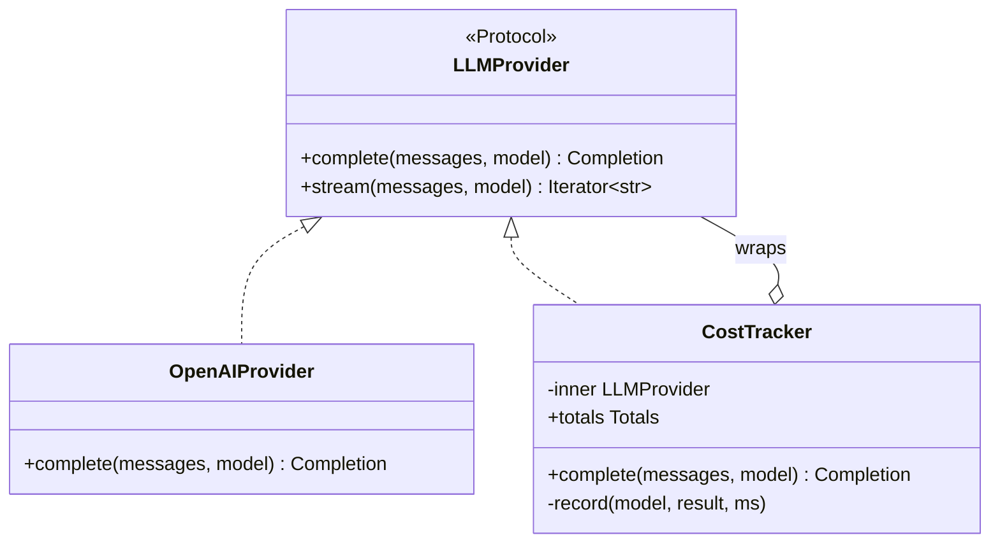

# AI Day 4 — Cost & Token Management

> Series: AI Backend Engineering
> Prereqs: Day 1 (tokens, `usage`, context window, KV cache), Day 3 (the `LLMProvider` port, `Completion`, `Usage`). SysDesign: **back-of-envelope estimation (SysDesign Day 21)**, **cache-aside (SysDesign Day 11)**, **Decorator pattern (SysDesign Day 5)**, rate limiting.
> Goal: Make the LLM a *budgeted* dependency. Know exactly what you pay for, how to cut it without cutting quality, and how to measure spend per request — the same rigor you'd apply to a metered third-party API.

Tokens are money and latency. Every design choice from here on has a dollar attached. This is the day you stop treating the model as free and start treating it like the metered, priced dependency it is — with the same estimation and instrumentation discipline you already use for databases and queues.

---

## Table of Contents
1. [The pricing model](#the-pricing-model)
2. [Token budgeting: count before you send](#token-budgeting-count-before-you-send)
3. [Context compression & truncation](#context-compression--truncation)
4. [Model cascade / routing](#model-cascade--routing)
5. [Prompt caching & batching](#prompt-caching--batching)
6. [A worked cost-estimation drill](#a-worked-cost-estimation-drill)
7. [Building a CostTracker wrapper](#building-a-costtracker-wrapper)
8. [The Dark Side](#the-dark-side)
9. [Self-Check](#self-check)
10. [Tomorrow](#tomorrow)
11. [Apply (1 hour)](#apply-1-hour)

---

## The pricing model

### Why
If you can't decompose an LLM bill, you can't optimize it and you can't forecast it. Finance will ask "what does this feature cost per user?" and "you already know how to answer questions like that — you just need the unit economics.

### What
Hosted LLMs bill **per token**, and — this is the fact everyone forgets — **input and output tokens are priced differently**. Output is typically **3–5x more expensive** than input, because output is generated serially (Day 1: one forward pass per token) while input is processed in parallel during prefill.

Modern pricing has three-to-four line items you must track:

| Line item | What it is | Typical relative cost |
|---|---|---|
| **Input tokens** | Everything you send: system prompt, history, RAG context, user message | Baseline (1x) |
| **Output tokens** | Everything the model generates | ~3–5x input |
| **Cached input tokens** | Repeated prompt prefixes the provider cached server-side | ~0.1–0.25x input (a big discount) |
| **Reasoning tokens** | On "thinking"/reasoning models, hidden intermediate tokens you still pay for as output | Billed as output; can dwarf the visible answer |

> **Illustrative only — verify current pricing before you build.** Model names and prices change monthly. As of mid-2026 the *shape* looks roughly like this (numbers are illustrative ranges per **1M tokens**, not quotes):
>
> | Tier | Example families (verify names) | Input (illustrative) | Output (illustrative) |
> |---|---|---|---|
> | Frontier | GPT-5.x, Claude Opus, Gemini 3.x Pro | ~$3–$15 | ~$15–$75 |
> | Mid / workhorse | Claude Sonnet, GPT-5 mini, Gemini Flash | ~$0.30–$3 | ~$1.50–$15 |
> | Small / fast | Claude Fable, nano/mini tiers | ~$0.05–$0.50 | ~$0.20–$2 |
> | Open-weights self-hosted | Llama, Qwen, DeepSeek V3/R1, GLM | GPU $/hr amortized | GPU $/hr amortized |
>
> Always pull live numbers from the provider's pricing page at build time. Treat any hardcoded price as a config value with an expiry date.


*One request's cost is a weighted sum: cheap cached input, normal input, and expensive output — output usually dominates.*

### When / How / Where
Track cost **per request and per feature** from day one of production, not after the bill surprises you. The `usage` object every provider returns (Day 1, Day 3) is your source of truth — bill against it, not against local estimates. Wire cost accounting into the provider layer (the `CostTracker` below), so it's automatic and central.

### The Dark Side
Fixating on the per-token price of the model is a rookie framing. The number that matters is **cost per successful outcome**. A model that's half the price but needs two retries, a bigger prompt, and a human correction is *more* expensive. Optimize the whole pipeline's cost-per-resolved-task, not the sticker price of one call.

---

## Token budgeting: count before you send

### Why
Cost is decided *before* you hit the API — by how many tokens you choose to send and how many you allow back. Budgeting is proactive; reading the bill is reactive. You want both, but budgeting is where the leverage is.

### What
Token budgeting is treating the context window (Day 1) as a fixed allowance and deciding, per request, how to spend it: `system + history + retrieved_context + user_message + reserve_for_output ≤ window_limit`. You estimate the input side locally (tiktoken from Day 1; Anthropic/Gemini have their own counters) and **cap the output** with `max_tokens` so a runaway generation can't blow your budget.

### How

```python
from __future__ import annotations

import tiktoken


def count_tokens(text: str, model: str = "gpt-4o") -> int:
    try:
        enc = tiktoken.encoding_for_model(model)
    except KeyError:
        enc = tiktoken.get_encoding("o200k_base")
    return len(enc.encode(text))


def fits_budget(
    *,
    parts: dict[str, str],
    window_limit: int,
    reserve_for_output: int,
    model: str = "gpt-4o",
) -> tuple[bool, int]:
    """Return (fits?, input_tokens). Reserve output room so answers don't truncate.

    `parts` is the labelled prompt sections so we can log where the tokens go
    (system vs history vs retrieved context) instead of one opaque number.
    """
    input_tokens = sum(count_tokens(v, model) for v in parts.values())
    budget = window_limit - reserve_for_output
    return input_tokens <= budget, input_tokens


if __name__ == "__main__":
    ok, used = fits_budget(
        parts={
            "system": "You are a support assistant. Be concise.",
            "history": "...(prior turns)...",
            "context": "...(retrieved docs)...",
            "user": "Why was I charged twice?",
        },
        window_limit=128_000,
        reserve_for_output=1_024,
        model="gpt-4o",
    )
    print(f"fits={ok} input_tokens={used}")
```

**Naive vs better:**
- *Naive:* send whatever you have and hope; discover truncation when a user reports a half-finished answer.
- *Better:* budget explicitly, log token counts per section, and set `max_tokens` on every call. You'll spot "the history section is 80% of every prompt" before it becomes a bill.

### Where
Budgeting lives in your prompt-assembly layer, right before the provider call — the same seam where you'll apply compression (next section). Log the per-section token breakdown so you know *what* to compress.

### The Dark Side
Over-precise local counting is a trap: your tiktoken encoding can drift from a new model's real tokenizer, so a local count that's "exactly at the limit" can still overflow. Leave a safety margin (e.g., budget to 90% of the limit) rather than chasing exact counts, and always reconcile with the returned `usage`.

---

## Context compression & truncation

### Why
Chat history and retrieved context grow unbounded. Left alone, every turn gets more expensive than the last and eventually overflows the window. You need a policy for what to keep. (This is a caching/eviction problem — reuse your SysDesign Day 11 intuition.)

### What
Three standard strategies, often combined:

| Strategy | How it works | Keeps | Loses | Cost impact |
|---|---|---|---|---|
| **Sliding window (drop-old)** | Keep the last N turns/tokens, discard the oldest | Recent context, cheap | Early context (the user's original goal) | Bounded, predictable |
| **Summarization (rolling)** | Periodically replace old turns with an LLM-generated summary | Gist of the whole conversation | Detail, exact wording | Extra summarization calls, but shrinks every future prompt |
| **Selective retrieval** | Don't keep history in-context; store it, retrieve only relevant bits per turn (Day 5) | Only what's relevant now | Nothing (it's recallable) | Most efficient; more infra |


*Compression is an eviction policy on the context window — pick per use case, and often combine sliding-window with a rolling summary.*

### How

```python
from __future__ import annotations

from llm_provider import LLMProvider, Message  # from Day 3


def trim_sliding_window(
    history: list[Message], *, max_tokens: int, model: str = "gpt-4o"
) -> list[Message]:
    """Keep the most recent messages that fit; always preserve system messages."""
    from budget import count_tokens  # the Day-4 helper above

    system = [m for m in history if m.role == "system"]
    convo = [m for m in history if m.role != "system"]

    kept: list[Message] = []
    running = sum(count_tokens(m.content, model) for m in system)
    for m in reversed(convo):  # newest first
        t = count_tokens(m.content, model)
        if running + t > max_tokens:
            break
        kept.append(m)
        running += t
    return system + list(reversed(kept))


def summarize_old_turns(
    provider: LLMProvider, old: list[Message], *, model: str
) -> Message:
    """Collapse stale turns into one compact system note (a rolling summary)."""
    transcript = "\n".join(f"{m.role}: {m.content}" for m in old)
    result = provider.complete(
        [
            Message("system", "Summarize this conversation in <=120 tokens. "
                              "Preserve names, decisions, and open questions."),
            Message("user", transcript),
        ],
        model=model,
        temperature=0.0,
        max_tokens=160,
    )
    return Message("system", f"[Summary of earlier conversation]: {result.text}")
```

### When / Where
Sliding window: cheap chat where only recent context matters. Summarization: long assistants where the early goal must survive. Retrieval: knowledge-heavy apps (Day 5). Apply in the prompt-assembly layer, before budgeting confirms it fits.

### The Dark Side
Aggressive truncation silently destroys correctness: drop the turn where the user said "for my *business* account" and the assistant confidently answers for a personal account. Summarization compounds this — each rolling summary loses a little more, and errors accumulate across turns. Compression is lossy; measure quality (evals, later) after enabling it, and never drop the system prompt or the user's stated constraints.

---

## Model cascade / routing

### Why
Most requests are easy; a few are hard. Sending everything to a frontier model is like running every query through your most expensive analytics warehouse — wasteful. Route by difficulty and you can cut cost 5–10x on the easy majority while keeping quality on the hard tail.

> **🤔 Wait — why route at all? Why not just send everything to the smartest model and be done?**
> Because "smartest" is also slowest and priciest, and most traffic doesn't need it. If 80% of your requests are "reset my password"-simple, paying frontier rates on all of them is like sending every support email to your principal engineer. A cascade spends the expensive model only where it changes the answer.
>
> **✅ Good scenario (where it saves you):** A support chatbot routes the easy 75% ("where's my order?", "reset password") to a small model at ~1/20th the cost, and escalates refund disputes and multi-step troubleshooting to a frontier model. Same quality on the hard tail, ~5x lower blended bill, and faster median latency because most replies come from the fast tier.
>
> **❌ Bad scenario (when misused):** A team routes on a brittle keyword heuristic and the cheap model silently mishandles a class of billing questions. The escalation signal never fires, wrong answers reach users for weeks, and when they widen escalation to compensate they now pay for *both* calls on most requests — more than just using the strong model would have cost.
>
> **When NOT to:** for a low-volume feature (a few hundred calls a day) or before you've measured the cheap model's accuracy on your task, skip the cascade and call the strong model directly — the routing complexity and double-call risk aren't worth it until volume makes the savings real.

### What
A **model cascade** (aka router) tries a **cheap/fast model first**, and **escalates to a stronger model** only when the cheap one is low-confidence, the task looks complex, or validation fails. It's the LLM version of a tiered cache: serve most traffic from the cheap tier, fall through to the expensive tier on miss.


*Cheap model handles the easy majority; only low-confidence or complex cases fall through to the expensive model.*

### How

```python
from __future__ import annotations

from dataclasses import dataclass
from llm_provider import LLMProvider, Message, Completion  # from Day 3


@dataclass(frozen=True)
class CascadeConfig:
    cheap_model: str = "claude-fable-5"      # verify current names
    strong_model: str = "claude-opus-4-8"
    escalate_on_low_confidence: bool = True


def looks_complex(user_msg: str) -> bool:
    """Cheap pre-router. Real systems use length, keywords, or a tiny classifier."""
    if len(user_msg) > 1_200:
        return True
    hard = ("prove", "step by step", "reconcile", "legal", "diagnose", "refund dispute")
    return any(k in user_msg.lower() for k in hard)


def cheap_output_is_trustworthy(c: Completion) -> bool:
    """Escalation signal. Prefer real signals: schema-validation pass (Day 2),
    explicit self-reported confidence, or a refusal/uncertainty phrase."""
    low_conf_markers = ("i'm not sure", "i cannot", "as an ai", "unable to determine")
    text = c.text.lower()
    return not any(m in text for m in low_conf_markers) and len(c.text.strip()) > 0


def route(
    provider: LLMProvider, messages: list[Message], cfg: CascadeConfig = CascadeConfig()
) -> Completion:
    user_msg = next((m.content for m in reversed(messages) if m.role == "user"), "")

    if looks_complex(user_msg):
        return provider.complete(messages, model=cfg.strong_model, temperature=0.2)

    cheap = provider.complete(messages, model=cfg.cheap_model, temperature=0.2)
    if cfg.escalate_on_low_confidence and not cheap_output_is_trustworthy(cheap):
        return provider.complete(messages, model=cfg.strong_model, temperature=0.2)
    return cheap
```

Notice this composes cleanly with the Day 3 port: the router *is* an `LLMProvider`-consuming policy, and you could even make it an `LLMProvider` itself (Decorator/Strategy) so callers stay oblivious.

### When / Where
Cascade when you have high volume with a skewed difficulty distribution and a measurable escalation signal. The best signal is **validation** (Day 2's Pydantic/instructor schema pass) or a downstream check, not vibes. Live at the routing layer, wrapping providers.

### The Dark Side
A cascade adds latency and complexity, and a bad escalation heuristic is worse than no cascade: escalate too rarely and you ship the cheap model's mistakes; escalate too often and you pay for *both* calls (cheap + strong) plus routing overhead, costing *more* than just using the strong model. Don't build a cascade before you can measure the cheap model's accuracy on your task — you're optimizing blind otherwise (see Dark Side finale).

---

## Prompt caching & batching

### Why
Two provider-side levers cut cost with almost no quality tradeoff: reusing cached prompt prefixes, and batching non-urgent work. Both are the LLM equivalent of techniques you already use — cache-aside (SysDesign Day 11) and asynchronous queue processing.

> **🤔 Wait — LLM calls are just expensive HTTP calls. Why not cache the responses like I cache any API?**
> Because two different things wear the name "cache" here, and only one is safe. Provider *prompt-prefix* caching reuses the KV state of a shared prefix and still generates a fresh answer — pure win. Application-level *output* caching ("same prompt → return last answer") is a different beast: prompts usually embed per-user data, so a naive key leaks one tenant's answer to another, and answers go stale the moment your knowledge base changes.
>
> **✅ Good scenario (where it saves you):** A doc-Q&A SaaS puts its 1,200-token system prompt and fixed few-shot block *first* and marks it as a cache prefix. Across high QPS the shared prefix bills at ~0.15x, cutting input cost dramatically with zero correctness risk — the per-user question at the end is still answered fresh.
>
> **❌ Bad scenario (when misused):** A team memoizes full responses keyed only on the prompt string to "save money." A template that interpolates the user's name collides across users, and one customer sees another customer's cached account summary — a cross-tenant data leak and a security incident, not a cost win.
>
> **When NOT to:** don't add application-level output caching unless you can prove the key includes user/tenant + prompt version + knowledge-base version and carries a sane TTL — for most apps, prompt-prefix caching alone is the safe lever.

### What
- **Provider prompt caching:** if many requests share a long, identical prefix (a big system prompt, a fixed few-shot block, a static document), providers can cache the KV state (Day 1) for that prefix and charge the cheap "cached input" rate (~0.1–0.25x) on repeats. You mark the stable prefix; you keep the variable part (the user's question) at the end. This is why prompt *order* matters: put the stable, reusable content first.
- **Batch APIs:** for non-real-time workloads (nightly classification, bulk enrichment), providers offer a batch/async tier at a steep discount (often ~50%) in exchange for higher latency (minutes to hours). Same idea as moving work off the request path onto a queue.


*Put stable, reusable content first so the provider can cache its prefix; keep only the small variable part at full price.*

### How (shape only — verify per provider)

```python
# Anthropic-style: mark a cache breakpoint on the stable system content.
# (Names/params change — check current docs. This is the intent, not a contract.)
resp = client.messages.create(
    model="claude-opus-4-8",
    system=[
        {"type": "text", "text": BIG_STABLE_INSTRUCTIONS,
         "cache_control": {"type": "ephemeral"}},   # cache this prefix
    ],
    messages=[{"role": "user", "content": user_question}],  # variable, at the end
    max_tokens=512,
)
# Watch usage for cache_creation / cache_read token fields to confirm hits.
```

### When / Where
Prompt caching: any high-QPS endpoint with a large fixed prompt (support bots, agents with big system prompts). Batching: anything that doesn't need an answer *now*. Both are config/architecture decisions in your provider layer.

### The Dark Side
Caching correctness risks are real. **Application-level response caching** (memoizing "same input → same output") is tempting but dangerous: LLM outputs are non-deterministic, prompts often contain per-user data (leaking one user's cached answer to another is a security incident), and a cached answer goes stale when your knowledge base changes. Provider *prompt-prefix* caching is safe (it only caches the shared prefix, still recomputes your answer); naive *output* caching needs a correct cache key (include user/tenant, prompt version, and knowledge-base version) and a TTL, or it will bite you. Reuse your cache-invalidation discipline from SysDesign Day 11 — this is the hard part of caching, as always.

---

## A worked cost-estimation drill

### Why
This is your SysDesign Day 21 back-of-envelope skill applied to LLMs. Before you build a feature, you should be able to sketch its monthly cost in two minutes and know whether it's a $50 or $50,000 line item.

### What / How — a support bot
Assume (all numbers illustrative — **verify live pricing**):

- Traffic: **10,000 requests/day**
- Per request: **1,500 input tokens** (system + retrieved context + question) and **400 output tokens**
- Model prices (illustrative, per 1M tokens): input **$3.00**, output **$15.00**

**Step 1 — per-request cost:**
```
input:  1,500 tokens  x  $3.00 / 1,000,000  = $0.0045
output:   400 tokens  x $15.00 / 1,000,000  = $0.0060
per request                                  = $0.0105  (~1.05 cents)
```

**Step 2 — daily and monthly:**
```
daily:   10,000 x $0.0105          = $105 / day
monthly: $105 x 30                 = $3,150 / month
```

**Step 3 — apply the levers and re-estimate:**

| Optimization | Effect | New monthly |
|---|---|---|
| Baseline (frontier model) | — | **$3,150** |
| Prompt-cache the 1,200-token static prefix (~0.15x on it) | Input drops ~$0.00306 → ~$0.0011/req | **~$2,000** |
| Cascade: 70% handled by a mid model (~1/5 the price) | Blended per-request cost drops sharply | **~$1,150** |
| Trim retrieved context 1,500 → 900 input tokens | Less input every request | further ~15% off |

Even rough, this tells you *where the money is* (here: output tokens and the static prefix) and which lever pays off first. Note output costs more here despite being fewer tokens — that's the 5x multiplier doing its work.


*Same estimation muscle as SysDesign Day 21: requests × tokens × price → monthly, then subtract the levers.*

### The Dark Side
An estimate built on guessed token counts is fiction. The single biggest error source is assuming average tokens/request — real traffic has a long tail (that one user who pastes a 40-page PDF). Estimate with a realistic distribution or at least a p90, and once live, replace estimates with measured `usage`. And don't optimize the estimate to death before launch: you don't yet know your real traffic shape (see finale).

---

## Building a CostTracker wrapper

### Why
Cost accounting must be automatic, central, and per-request — never sprinkled through business logic. You already know the pattern: wrap the dependency so every call is instrumented without callers changing. This is the **Decorator pattern (SysDesign Day 5)** over the Day 3 `LLMProvider` port, and it's why building that port yesterday pays off today.

### What / How

```python
from __future__ import annotations

import logging
import time
from dataclasses import dataclass, field
from threading import Lock

from llm_provider import LLMProvider, Message, Completion  # from Day 3

logger = logging.getLogger("llm.cost")


@dataclass(frozen=True)
class ModelPrice:
    """Illustrative — load real numbers from config, and give them an expiry."""
    input_per_mtok: float   # USD per 1M input tokens
    output_per_mtok: float  # USD per 1M output tokens


# Verify current pricing at build time; this is config, not truth-in-code.
PRICES: dict[str, ModelPrice] = {
    "claude-opus-4-8": ModelPrice(15.00, 75.00),
    "claude-fable-5": ModelPrice(0.25, 1.25),
    "gpt-5.5": ModelPrice(5.00, 15.00),
}


def cost_usd(model: str, usage) -> float:
    p = PRICES.get(model)
    if p is None:
        logger.warning("no price for model %s; recording 0", model)
        return 0.0
    return (usage.input_tokens * p.input_per_mtok
            + usage.output_tokens * p.output_per_mtok) / 1_000_000


@dataclass
class Totals:
    calls: int = 0
    input_tokens: int = 0
    output_tokens: int = 0
    usd: float = 0.0


class CostTracker:
    """Decorator over any LLMProvider (Day 3). Same interface in, cost logged out.

    Because it *is* an LLMProvider (structural typing / Protocol), callers and the
    cascade router don't know they're wrapped — pure Decorator + DIP.
    """

    def __init__(self, inner: LLMProvider) -> None:
        self._inner = inner
        self._lock = Lock()
        self.totals = Totals()
        self.by_model: dict[str, Totals] = {}

    def complete(
        self, messages: list[Message], *, model: str,
        temperature: float = 0.2, max_tokens: int = 1024,
    ) -> Completion:
        started = time.perf_counter()
        result = self._inner.complete(
            messages, model=model, temperature=temperature, max_tokens=max_tokens
        )
        elapsed_ms = (time.perf_counter() - started) * 1000
        self._record(model, result, elapsed_ms)
        return result

    def stream(self, messages, *, model, temperature=0.2, max_tokens=1024):
        # Streaming complicates accounting: usage may arrive only in the final
        # chunk (or must be estimated). Delegate, and reconcile at stream end.
        yield from self._inner.stream(
            messages, model=model, temperature=temperature, max_tokens=max_tokens
        )

    def _record(self, model: str, result: Completion, elapsed_ms: float) -> None:
        c = cost_usd(model, result.usage)
        with self._lock:
            for bucket in (self.totals, self.by_model.setdefault(model, Totals())):
                bucket.calls += 1
                bucket.input_tokens += result.usage.input_tokens
                bucket.output_tokens += result.usage.output_tokens
                bucket.usd += c
        logger.info(
            "llm_call model=%s in=%d out=%d usd=%.6f ms=%.0f",
            model, result.usage.input_tokens, result.usage.output_tokens, c, elapsed_ms,
        )


if __name__ == "__main__":
    from llm_provider import OpenAIProvider  # Day 3

    provider: LLMProvider = CostTracker(OpenAIProvider())  # one-line wrap
    provider.complete([Message("user", "Explain idempotency in one line.")],
                      model="gpt-5.5")
    print(provider.totals)  # type: ignore[attr-defined]
```


*CostTracker implements the same port it wraps — the Decorator pattern, so instrumentation is transparent to every caller and to the cascade router.*

### When / Where
Wrap at the composition root (the one place that knows concrete providers, from Day 3). Emit per-call structured logs to your existing observability stack (SysDesign Day 20), tag by feature/tenant, and set a budget-alert threshold. Now "cost per feature per day" is a dashboard query, not a mystery.

### The Dark Side
The tracker is only as honest as `PRICES`, which rots the moment a provider changes rates or you use a model not in the map — stale prices produce confidently wrong dashboards. Load prices from versioned config, alert on unknown models, and periodically reconcile your computed spend against the provider's actual invoice. And keep the wrapper thin: a "cost tracker" that also retries, caches, and routes has become a god-object — compose separate decorators (tracker, retrier, cache) instead.

---

## The Dark Side (cross-cutting)

The overarching Day-4 trap is **optimizing cost before you have usage and evals**. It is the most seductive form of premature optimization because it feels responsible.

- **You can't optimize what you can't measure.** Ship the `CostTracker` and a quality eval *first*. Then optimize the biggest, most-measured line item. Guessing which lever matters wastes engineering time and often pessimizes the wrong thing.
- **The cheap model that hallucinates is the expensive model.** A model that's 1/10 the price but wrong 5% more often can cost far more once you count retries, human review, refunds, and reputation. Cost-per-token is a decoy; **cost-per-correct-outcome** is the metric. Always pair a cost cut with a quality check.
- **Caching correctness risks** (from earlier) top the list of "optimizations" that create incidents: stale answers, cross-user leakage, invalidation bugs. The naive "no output cache" approach is frequently the *correct* one until you can prove your cache key and TTL are safe.
- **When the naive approach is right:** for a low-volume internal tool, just call the frontier model directly with a generous `max_tokens` and no cascade, no compression, no output cache. The engineering time to build those optimizations dwarfs the tiny bill. Optimize when volume makes the bill exceed the cost of the engineering to reduce it — not before.

---

## Self-Check
1. Why is output typically 3–5x more expensive than input? Tie it back to Day 1's autoregressive generation.
2. List the line items on a modern LLM bill, including the two most people forget.
3. Write the budgeting inequality for one request against a context window, and explain why you reserve output room.
4. Compare sliding-window vs summarization vs retrieval for context compression: what does each keep and lose?
5. What is the ideal escalation signal in a model cascade, and why is a keyword heuristic risky?
6. When can a cascade cost *more* than just using the strong model?
7. How does prompt layout affect provider prompt-cache hit rate, and why is application-level output caching dangerous?
8. Do the drill: 5,000 req/day, 2,000 input + 500 output tokens, input $1/Mtok, output $8/Mtok — monthly cost?
9. Which SysDesign pattern is `CostTracker`, and why can the cascade router stay oblivious to it?
10. Explain "the cheap model that hallucinates is the expensive model" and why you optimize cost *after* evals.

---

## Tomorrow
**AI Day 5 — Embeddings in Depth:** we cash the Day 1 IOU. Text-to-vector models, cosine similarity, vector databases, and semantic search — the machinery behind "selective retrieval," the compression strategy that beats stuffing the context window and is the foundation of RAG.

---

## Apply (1 hour)
Extend yesterday's `llm_provider.py` into a cost-aware stack:
1. Implement `CostTracker` as a Decorator over your Day 3 `LLMProvider`. Wrap `OpenAIProvider` (or `FakeProvider`) in one line and confirm `summarize()` from Day 3 runs unchanged.
2. Run 20 calls of mixed sizes through it; print `totals` and `by_model`. Verify your computed USD roughly matches `sum(usage)` × your `PRICES`.
3. Implement the `route()` cascade with a cheap and a strong model. Feed it 10 requests (mix simple and complex). Log which tier handled each and the total cost; compare against sending all 10 to the strong model.
4. Do a written back-of-envelope (SysDesign Day 21 style) for a feature you actually want to build: requests/day × tokens × price → monthly. Then estimate the savings from prompt caching + a cascade. Write the two numbers down.
5. Reflection: identify the single biggest line item in your traffic (input, output, or a fat static prefix) and name the *one* lever you'd pull first — and why you would *not* pull the others yet.
