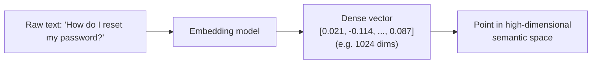
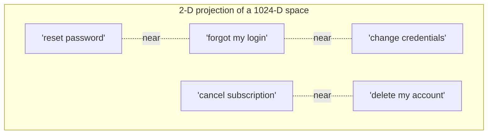
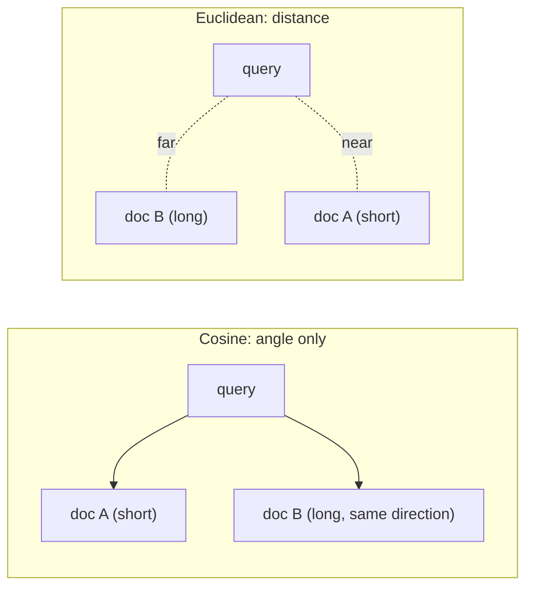
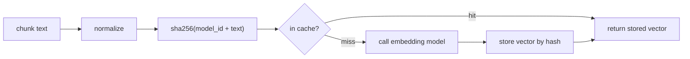

# Day 5 — Embeddings In Depth

> Series: AI Backend Engineering
> Goal: understand what an embedding *really* is, how to choose a model, how similarity is actually computed, and how to make embeddings cheap and correct in production.

## Table of Contents
1. [Why embeddings exist](#1-why-embeddings-exist)
2. [What an embedding really is](#2-what-an-embedding-really-is)
3. [Choosing an embedding model](#3-choosing-an-embedding-model)
4. [Similarity metrics: cosine vs dot vs euclidean](#4-similarity-metrics)
5. [Asymmetric search: query vs document embeddings](#5-asymmetric-search)
6. [Cost, caching, and the content-hash pattern](#6-cost-caching-content-hash)
7. [Python: embed, cosine by hand, brute-force k-NN](#7-python)
8. [The Dark Side of embeddings](#8-the-dark-side)
9. [Day 5 Self-Check](#day-5-self-check)
10. [Tomorrow / Apply](#tomorrow--apply)

---

## 1. Why embeddings exist

**Why.** You already know how to look things up by *exact match*: a `WHERE email = ?` or a B-tree index in PostgreSQL. That machinery is perfect when the key is known and stable. It is useless when the question is *"find me documents that mean roughly the same thing as this sentence."* Keywords fail because language is redundant: "car", "automobile", and "vehicle" are three tokens with one meaning; "Apple stock" and "AAPL share price" share almost no characters. You need a way to turn *meaning* into something a computer can index and compare. That representation is an embedding.

**What.** An embedding is a fixed-length array of floating-point numbers (a *dense vector*) produced by a neural network, such that texts with similar meaning land close together in that vector space. Distance in the space approximates semantic distance in your head.

**When.** Any time you need *fuzzy, meaning-based* retrieval, clustering, deduplication, classification, or recommendation. This is the foundation under semantic search and RAG (Day 8).

**Where.** Embeddings are computed once at ingestion and stored next to (or instead of) the raw text, then compared at query time. In your stack they live in a `vector` column in Postgres (pgvector, Day 7) or a dedicated vector DB.


*Text goes in, a fixed-length vector comes out, and that vector is a coordinate in meaning-space.*

---

## 2. What an embedding really is

**What (mechanically).** A transformer reads your tokens, builds contextual representations, and pools them (mean-pooling or a special `[CLS]`/`<s>` token) into one vector of `d` dimensions — 384, 768, 1024, 1536, 3072 are common. Each dimension is a learned axis. No single axis means "royalty" or "anger"; meaning is *distributed* across all of them. The vector is opaque to humans and only meaningful *relative to other vectors from the same model*.

**Why this matters.** Two consequences fall directly out of that definition, and forgetting them causes 80% of embedding bugs:
1. **Vectors are only comparable within one model.** A vector from `text-embedding-3-large` and a vector from `bge-large` are numbers in unrelated spaces. Never mix them in one index.
2. **The space encodes co-occurrence-driven semantics, not truth.** "The earth is flat" and "The earth is round" are *near* each other — they are about the same topic. Embeddings measure aboutness, not correctness (see Dark Side).

> **🤔 Wait — if embeddings capture *meaning*, why do "the drug is safe" and "the drug is not safe" come back as a near-perfect match?**
> Because embeddings encode what text is *about* (aboutness), not whether it's *true*. Those two sentences share almost every token and topic, so they land right next to each other — the single word flipping the meaning barely moves the vector. Similarity is topical proximity, not logical agreement.
>
> **✅ Good scenario (where it saves you):** An internal knowledge tool uses embeddings to *retrieve* the paragraphs about a drug's safety profile, then hands them to an LLM (and a human) to judge. Aboutness is exactly right for retrieval — it surfaces every on-topic passage regardless of stance, so nothing relevant is missed.
>
> **❌ Bad scenario (when misused):** A team wires cosine similarity straight into a "fact check" — "if the claim is similar to a trusted doc, it's true." A false claim that's topically identical to the true one scores 0.98 and gets marked verified. Aboutness masqueraded as correctness, and a wrong answer shipped with a green check.
>
> **When NOT to:** never use raw similarity as a truth or entailment signal — for "does A contradict B?" you need an NLI model, a reranker, or an LLM judge, not cosine distance.

**The classic intuition** (still useful in 2026 even though modern models are contextual): vector arithmetic like `king - man + woman ≈ queen` worked in static word2vec because relationships became directions in the space. Sentence embeddings generalize this: whole-sentence meaning becomes a location.


*Semantically related phrases cluster; unrelated topics drift apart — that clustering is the whole point.*

---

## 3. Choosing an embedding model

**Why.** The model is the single biggest lever on retrieval quality — bigger than your chunking or your DB. Choose deliberately.

> **🤔 Wait — why not just grab the model at the top of the MTEB leaderboard and move on?**
> Because MTEB is a general benchmark that models are actively tuned to top, and "best on average across everyone's data" rarely means "best on *your* contracts / tickets / code." Leaderboard rank is a starting filter, not a decision — the only ranking that matters is recall on your own labeled pairs.
>
> **✅ Good scenario (where it saves you):** A legal-doc-Q&A SaaS builds a 40-pair query→clause set from real contracts, tests three models, and finds a mid-ranked domain model beats the MTEB #1 on their data by 12 points recall@5 — while using 768 dims instead of 3072, cutting storage and ANN latency too.
>
> **❌ Bad scenario (when misused):** A team defaults to a 3072-dim leaderboard-topping model "because bigger is better," pays 4x storage and slower search, and still gets mediocre retrieval on their niche corpus — a regression they only catch after users complain the search "feels dumb."
>
> **When NOT to:** for a quick prototype or a tiny general-English corpus, take a solid default API model and skip the bake-off — the measurement rigor pays off once retrieval quality or embedding cost actually matters.

**What to look at:**

| Dimension | What it means | Practical guidance (July 2026) |
|---|---|---|
| **Output dimensions** | Length of the vector (384 → 3072) | More dims = more capacity, more storage, slower search. 768–1024 is the sweet spot for most apps. Some models (Matryoshka/MRL) let you *truncate* dims safely. |
| **Context length** | Max tokens per input (512 → 8k+) | Must exceed your chunk size (Day 6). A 512-token model silently *truncates* long chunks — a nasty invisible bug. |
| **Multilingual** | Trained across languages | Needed if your corpus or users are not English-only. Verify the languages are actually covered, not just "supported." |
| **Domain fit** | General vs code/legal/bio | Domain-specific models (e.g. code embeddings) beat general ones on their turf. Test on *your* data. |
| **MTEB score** | Rank on the Massive Text Embedding Benchmark | A *starting filter*, not gospel — benchmarks leak into training and rarely match your domain. |
| **License / hosting** | Open weights vs API | Drives cost, privacy, and lock-in (table below). |

**Open (self-hosted) vs API embeddings:**

| | Open weights (e.g. sentence-transformers, BGE, E5 families) | API (e.g. OpenAI, Cohere, Voyage) |
|---|---|---|
| **Cost model** | Your GPU/CPU + ops time | Per-token, no infra |
| **Privacy** | Data never leaves your VPC | Data goes to a vendor (check DPA) |
| **Latency** | Predictable, local, no network | Network hop + rate limits |
| **Quality ceiling** | Excellent open models exist | Top API models often edge ahead |
| **Ops burden** | You patch, scale, monitor | Vendor's problem |
| **Lock-in / re-embed risk** | You control upgrades | Vendor deprecates → forced re-embed |

**When.** Start with a strong API model to ship fast; move to self-hosted open weights when volume makes the per-token bill or the privacy requirement dominate. This is the same *build-vs-buy* calculus you already apply to any dependency.

**How to actually decide.** Do not trust MTEB. Build a tiny labeled set from your own domain (20–50 query→relevant-doc pairs), embed with 2–3 candidate models, and measure recall@k (Day 9). *Measure before you commit.* Whichever wins on your data wins, full stop.

**The Dark Side.** MTEB is Goodharted — models are tuned to top it. A model can rank #1 globally and be mediocre on your legal contracts. Also beware **dimension bloat**: teams default to 3072-dim "because bigger is better," then pay 4x storage and slower ANN search for a recall gain they never measured.

---

## 4. Similarity metrics

**Why.** Once everything is a vector, "similar" must become a number. There are three common ones, and picking the wrong one (or forgetting to normalize) quietly corrupts every result.

**What each is:**

- **Cosine similarity** — the cosine of the angle between two vectors. Range `[-1, 1]`, higher = more similar. Ignores magnitude, cares only about *direction*.
- **Dot product** — cosine × the two magnitudes. Cares about direction *and* length.
- **Euclidean (L2) distance** — straight-line distance. Lower = more similar.

**The key relationship:** if all vectors are **unit-normalized** (length 1), then cosine, dot product, and (monotonically) Euclidean rank neighbors *identically*. So normalization is the real decision.

| Metric | Sensitive to magnitude? | Use when | Watch out |
|---|---|---|---|
| **Cosine** | No | Default for text; you care about topic not intensity | Must handle zero vectors |
| **Dot product** | Yes | Model was *trained* with dot product (many are); vectors already normalized | Un-normalized vectors let "long" docs dominate |
| **Euclidean** | Yes | Some clustering, image features | Rarely best for raw text embeddings |

**When.** Use whatever the *model card* says it was trained with. Most sentence models are trained for cosine → normalize and use cosine (or equivalently dot on normalized vectors). Matching the training metric matters more than the metric itself.

**How (normalization).** Divide each vector by its L2 norm. Do it once at ingestion so query time is cheap and dot product == cosine.


*Cosine calls A and B equally relevant (same direction); Euclidean penalizes B for being far out — normalize and the two agree.*

**The Dark Side.** Mixing metrics between indexing and querying gives silently wrong rankings that *look* plausible. And an un-normalized dot-product index makes verbose documents win regardless of relevance — a subtle relevance bug that only shows up in aggregate.

---

## 5. Asymmetric search

**Why.** A user query ("password reset?") and a document ("To reset your password, navigate to Settings > Security and click...") are *linguistically different objects* — short vs long, question vs statement. A model that embeds both with one shared function may place them far apart even when they match. **Asymmetric** models fix this.

**What.** Many modern retrieval models expect *different prefixes* for queries and documents, e.g. `"query: ..."` vs `"passage: ..."` (E5 family) or a dedicated `input_type="search_query"` / `"search_document"` flag (Cohere/Voyage APIs). The prefix tells the model which role the text plays so it maps both into a shared answer-space.

- **Symmetric search** — comparing like-with-like (e.g. "find duplicate questions", "find similar products"). Same embedding function both sides.
- **Asymmetric search** — short query → long passage (classic RAG retrieval). Use the model's query/document distinction.

**When.** Use asymmetric prefixes for RAG-style retrieval whenever the model supports them. Use symmetric embedding for dedup/clustering. **How:** read the model card — this is model-specific and getting it wrong (embedding a document with the query prefix) costs measurable recall.

**Where.** At ingestion you embed with the *document* prefix; at query time with the *query* prefix. Two code paths, same model.

**The Dark Side.** The prefixes are invisible and easy to forget — nothing errors, recall just quietly drops. And if you upgrade to a model with different prefix conventions, your entire stored corpus was embedded "wrong" and must be re-embedded.

---

## 6. Cost, caching, content-hash

**Why.** Embeddings are *cheap but not free*. At millions of chunks, re-embedding on every deploy, or re-embedding text you already processed, burns money (API) or GPU-hours (self-hosted) for zero gain. This is exactly the *idempotency + caching* discipline you already apply to expensive backend calls.

**What.** Cache the embedding keyed by a hash of `(model_id, normalized_text)`. Same input + same model → return the stored vector, skip the compute.

**When.** Always, once you are past a toy. Especially for re-ingestion pipelines, retries, and overlapping chunks that repeat text.

**How.** Content hash (SHA-256) of the exact string sent to the model, namespaced by model ID so a model upgrade produces different keys (and correctly forces recompute).


*Content-hash caching turns repeated and retried embeddings into free lookups and makes model upgrades a clean cache-key change.*

**The Dark Side.** Forgetting `model_id` in the key means a model upgrade returns *stale vectors from the old model* — the worst kind of silent bug, because retrieval still "works," just worse. Also: caching un-normalized text (trailing whitespace, casing) fragments the cache and lowers hit rate.

---

## 7. Python

Below: embed sentences, compute cosine *by hand* with numpy (so the metric is not a black box), and do a brute-force k-NN. Uses `sentence-transformers` (open) but the shape is identical for an API — swap the `embed()` body.

```python
from __future__ import annotations

import hashlib
from dataclasses import dataclass

import numpy as np
from numpy.typing import NDArray

# pip install sentence-transformers numpy
from sentence_transformers import SentenceTransformer

# Verify the current recommended model/version when you build this.
_MODEL_ID = "intfloat/e5-base-v2"  # asymmetric: uses "query:" / "passage:" prefixes
_model = SentenceTransformer(_MODEL_ID)


def _sha_key(text: str) -> str:
    """Cache key namespaced by model so upgrades force recompute (Section 6)."""
    normalized = text.strip()
    return hashlib.sha256(f"{_MODEL_ID}::{normalized}".encode()).hexdigest()


_cache: dict[str, NDArray[np.float32]] = {}


def embed(text: str, *, is_query: bool) -> NDArray[np.float32]:
    """Embed one string, normalized to unit length, with content-hash caching.

    is_query drives the asymmetric prefix (Section 5).
    """
    prefix = "query: " if is_query else "passage: "
    payload = prefix + text.strip()
    key = _sha_key(payload)
    if key in _cache:
        return _cache[key]

    raw = _model.encode(payload, normalize_embeddings=True)  # unit vectors
    vec = np.asarray(raw, dtype=np.float32)
    _cache[key] = vec
    return vec


def cosine_similarity(a: NDArray[np.float32], b: NDArray[np.float32]) -> float:
    """Cosine by hand. For unit vectors this equals the dot product."""
    denom = float(np.linalg.norm(a) * np.linalg.norm(b))
    if denom == 0.0:  # guard the zero-vector edge case (Section 4 Dark Side)
        return 0.0
    return float(np.dot(a, b) / denom)


@dataclass
class Hit:
    text: str
    score: float


def brute_force_knn(query: str, documents: list[str], k: int = 3) -> list[Hit]:
    """O(n) exact nearest neighbours. Fine to a few hundred-thousand vectors;
    beyond that you need an ANN index (Day 7)."""
    q = embed(query, is_query=True)
    scored = [
        Hit(text=doc, score=cosine_similarity(q, embed(doc, is_query=False)))
        for doc in documents
    ]
    scored.sort(key=lambda h: h.score, reverse=True)
    return scored[:k]


if __name__ == "__main__":
    corpus = [
        "To reset your password, open Settings > Security.",
        "Our refund policy allows returns within 30 days.",
        "Change your login credentials from the account page.",
        "The office is closed on public holidays.",
    ]
    for hit in brute_force_knn("I forgot my password", corpus, k=2):
        print(f"{hit.score:.3f}  {hit.text}")
    # The two credential-related lines score highest despite sharing few words.
```

**Naive vs better.** The naive version above recomputes document embeddings on every query. The better version embeds the corpus *once* at ingestion, stores the matrix, and does a single vectorized `matrix @ query` (one BLAS call) instead of a Python loop — orders of magnitude faster, and the natural stepping stone to a real vector index:

```python
def build_index(documents: list[str]) -> NDArray[np.float32]:
    """Embed the whole corpus once; stack into an (n, d) matrix."""
    return np.vstack([embed(d, is_query=False) for d in documents])


def search(query: str, matrix: NDArray[np.float32], k: int) -> list[int]:
    q = embed(query, is_query=True)          # unit vector
    scores = matrix @ q                       # unit vectors -> dot == cosine
    return np.argsort(-scores)[:k].tolist()   # top-k indices
```

---

## 8. The Dark Side

- **Semantics, not truth or logic.** Embeddings capture *what text is about*, not whether it is correct or logically entailed. "Paris is the capital of France" and "Paris is not the capital of France" are neighbors. Retrieval can hand your LLM confidently wrong-but-on-topic context. Never treat retrieval as fact-checking.
- **Stale embeddings after a model upgrade.** The day you switch embedding models, *every stored vector is obsolete* — old and new vectors live in incompatible spaces. There is no incremental fix: you must re-embed the entire corpus and rebuild the index. Budget for this; it is not optional, and mixing old+new vectors gives silently degraded, hard-to-debug results.
- **Dimension bloat.** Bigger vectors feel safer but cost linearly in storage and hurt ANN latency/memory. Choose dims from *measured* recall, not vibes. If a model supports Matryoshka truncation, exploit it.
- **Surface-form sensitivity.** Boilerplate, headers, and formatting noise get embedded too — garbage in the text is garbage in the vector (motivates careful chunking, Day 6).

---

## Day 5 Self-Check
1. In one sentence, what does an embedding measure — and what does it *not* measure?
2. Why can you never compare a vector from model A with a vector from model B?
3. If all vectors are unit-normalized, how do cosine, dot product, and Euclidean rankings relate?
4. When would you deliberately choose dot product over cosine?
5. What is asymmetric search and what breaks if you embed a document with the query prefix?
6. Why must `model_id` be part of your embedding cache key?
7. You upgrade your embedding model. What must happen to the existing corpus, and why?
8. Give a concrete failure caused by *not* normalizing vectors with a dot-product index.
9. Why is a top MTEB rank insufficient reason to pick a model for your app?
10. What is dimension bloat and how do you decide the right number of dimensions?

## Tomorrow / Apply

**Tomorrow:** Day 6 — Chunking & Document Processing. Great embeddings on badly chunked text still gives bad retrieval; we fix the input side.

**Apply (1 hour):** Take ~30 short texts from a domain you know. Embed them with two different models (one API, one open). Hand-build a 10-pair query→expected-doc set. Compute recall@1 for each model with your `brute_force_knn`. Which model wins on *your* data — and does it match its MTEB rank? Add content-hash caching and confirm the second run makes zero model calls.
