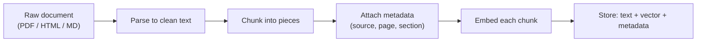
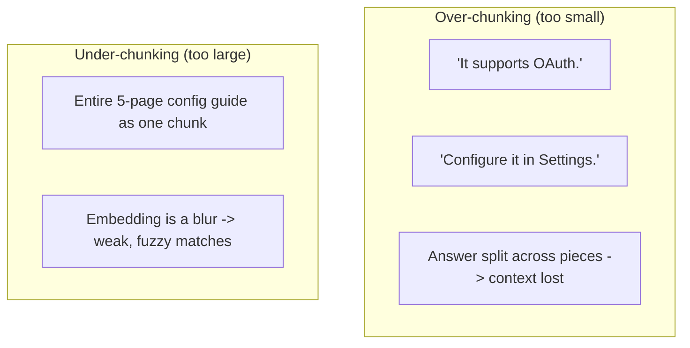
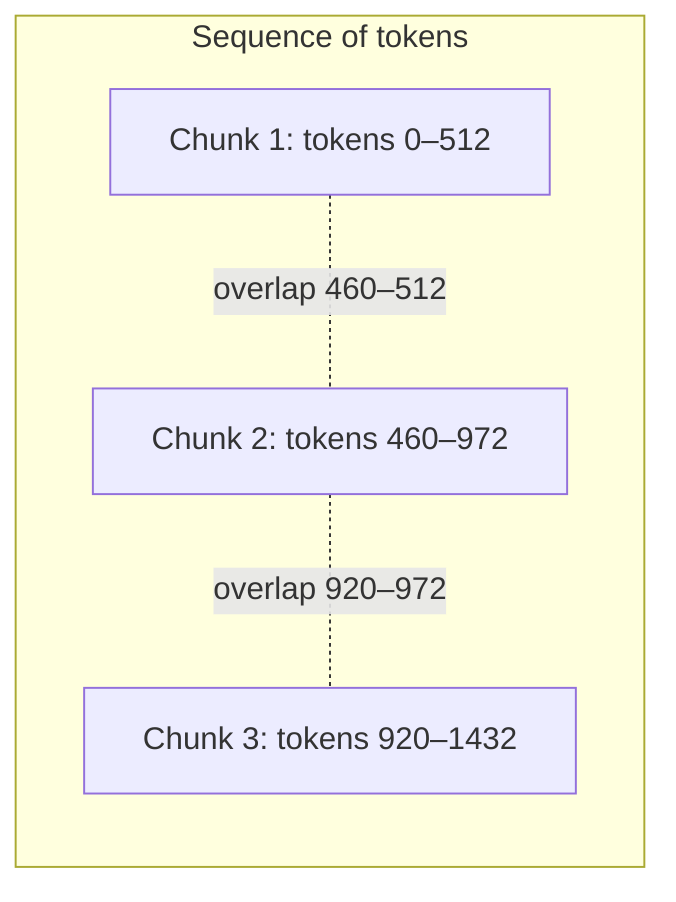
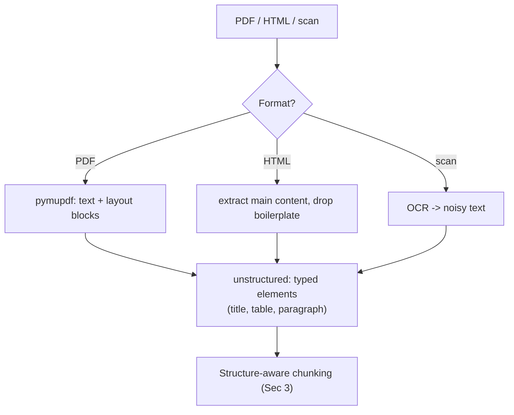

# Day 6 — Chunking & Document Processing

> Series: AI Backend Engineering
> Goal: learn why chunking makes or breaks retrieval, which strategy to pick, how to size and overlap chunks, how to attach metadata, and how to survive real-world messy documents.

## Table of Contents
1. [Why chunking makes or breaks RAG](#1-why-chunking-makes-or-breaks-rag)
2. [What a chunk is (and the granularity trade-off)](#2-what-a-chunk-is)
3. [Chunking strategies (comparison table)](#3-chunking-strategies)
4. [Chunk size vs overlap: how to decide](#4-chunk-size-vs-overlap)
5. [Metadata attachment](#5-metadata-attachment)
6. [Parsing the messy real world](#6-parsing-the-messy-real-world)
7. [Python: recursive chunker + markdown structure-aware chunker](#7-python)
8. [The Dark Side of chunking](#8-the-dark-side)
9. [Day 6 Self-Check](#day-6-self-check)
10. [Tomorrow / Apply](#tomorrow--apply)

---

## 1. Why chunking makes or breaks RAG

**Why.** You cannot embed a 40-page PDF as one vector and expect useful retrieval. One vector for a huge document is an *average* of everything it says — a blurry smear that matches no specific query well. Nor can you feed whole documents to the LLM at query time: context windows are finite and expensive, and stuffing irrelevant text *lowers* answer quality (the "lost in the middle" effect, Day 8). So you split documents into **chunks**: retrieval-sized pieces, each embedded separately.

> **🤔 Wait — models have 200k+ token context windows now. Why chunk at all instead of just pasting the whole document?**
> Two separate reasons, and the big window only addresses one. First, *retrieval*: to find the right document among thousands you need small, focused vectors — one embedding per 40-page PDF is a blurry average that matches nothing sharply. Second, *quality and cost*: even when a doc fits, stuffing the whole thing buries the answer (lost-in-the-middle, Day 1) and you pay for every token. Chunking is about finding and shipping the *relevant* piece, not about window size.
>
> **✅ Good scenario (where it saves you):** A doc-Q&A SaaS over 50,000 support articles chunks each into ~400-token sections. A query retrieves the 5 relevant chunks (~2k tokens) and the LLM answers precisely and cheaply — a task no context window could handle, because 50,000 articles never fit at once.
>
> **❌ Bad scenario (when misused):** A team with a 200k window skips chunking and pastes whole manuals per query. Each call costs dollars and 20s, the supporting sentence sits in the middle where the model glosses over it, and the moment the corpus grows past one window the whole approach falls off a cliff.
>
> **When NOT to:** if your entire corpus is a handful of short documents that reliably fit in context and you only ever ask about one at a time, skip chunking + retrieval and just pass the document — the pipeline is pure overhead there.

Chunking is the hinge of the whole RAG system. Get it wrong and no embedding model, reranker, or vector DB can recover — you either retrieve fragments too small to be meaningful, or blobs too large to be precise.

**What.** Chunking = deciding the *unit of retrieval*. Each chunk becomes one embedding, one row, one candidate result.

**When.** At ingestion, before embedding. It is a preprocessing decision you revisit whenever retrieval quality disappoints.

**Where.** In the ingestion pipeline: `parse → chunk → attach metadata → embed → store`.


*Chunking sits between parsing and embedding — every downstream stage inherits its quality.*

---

## 2. What a chunk is

**The core tension: precision vs recall of retrieval granularity.**

- **Small chunks** (a sentence or two) → each embedding is *focused*, so when it matches, it matches sharply → high **precision**. But a small chunk may lack the surrounding context needed to actually answer, and a single fact spread across sentences gets split.
- **Large chunks** (a page) → each embedding covers more ground so you are more likely to *contain* the answer somewhere → higher **recall**. But the embedding is diluted (averaged over many topics), so it matches queries fuzzily, and you waste context-window budget shipping irrelevant surrounding text to the LLM.

This is the same precision/recall trade-off you know from search and monitoring — here it is controlled by chunk size.


*Both extremes fail differently: fragments lose meaning, blobs dilute relevance.*

---

## 3. Chunking strategies

**Why.** The right split respects the *structure* of the content. Prose, markdown docs, and source code each have natural boundaries; ignoring them cuts sentences and functions in half.

| Strategy | How it splits | Best for | Weakness |
|---|---|---|---|
| **Fixed-size** | Every N characters/tokens, hard cut | Quick baseline; uniform blobs | Cuts mid-word/mid-sentence; ignores meaning |
| **Recursive character** | Try to split on paragraphs, then sentences, then words, then chars — falling back only when a piece is too big | General prose (the sane default) | Still blind to document structure/headings |
| **Sentence / semantic** | Split on sentence boundaries; *semantic* variant groups adjacent sentences by embedding similarity | Dense prose where topic shifts matter | Semantic version is compute-heavy at ingest |
| **Sentence-window** | Embed single sentences but *retrieve with a window* of neighbors around each hit | High precision + restored context | More bookkeeping; store neighbor links |
| **Document-structure-aware (markdown headers, HTML sections)** | Split on headings/sections; keep the heading path as metadata | Docs, wikis, technical manuals | Needs clean structure to exist |
| **Code-aware** | Split on functions/classes via a syntax parser | Source code, config | Language-specific parsing |

**When to pick which.** Start with **recursive character** for arbitrary prose. Upgrade to **structure-aware** the moment your source has real headings (markdown/HTML docs, which is most enterprise content). Use **sentence-window** when you need both precision *and* context. Use **code-aware** for repositories. Reach for **semantic** only after measuring that simpler splits hurt recall — it rarely pays for its ingestion cost.

---

## 4. Chunk size vs overlap

**Why overlap exists.** A hard cut can slice a sentence or a fact in half, so a chunk boundary can *destroy* the very passage that answers a query. **Overlap** — repeating the last M tokens of one chunk at the start of the next — is insurance against boundary loss.

**Concrete guidance (starting points, then measure):**

| Content type | Chunk size (tokens) | Overlap | Rationale |
|---|---|---|---|
| General prose / articles | 256–512 | 10–15% (~50–75) | Balances focus and context |
| Dense technical docs | 512–768 | 15% | Ideas span more sentences |
| FAQ / Q&A pairs | 1 pair per chunk | 0 | Natural atomic unit |
| Code | 1 function/class | 0 (or signature) | Syntactic units are self-contained |
| Chat / transcripts | 5–10 turns | 1–2 turns | Preserve conversational context |

**How to decide (not guess):**
1. Pick a starting size from the table.
2. Build a small eval set (Day 9) of query→expected-answer pairs.
3. Sweep 2–3 sizes and 2 overlap values, measure recall@k.
4. Pick the smallest chunk that keeps recall high — smaller = more precise and cheaper context.

**The overlap cost.** Overlap duplicates text → more chunks → more vectors → more storage and more near-duplicate hits at query time (dedup them, Day 8). Keep it modest.


*Overlapping windows ensure a fact straddling a boundary survives intact in at least one chunk.*

---

## 5. Metadata attachment

**Why.** A chunk without provenance is nearly useless in production. You need to *cite* where an answer came from (Day 8), *filter* retrieval ("only 2026 docs", "only this product"), and *expire* stale content. Metadata is what lets your vector search behave like the filtered, governed queries you already write in SQL.

**What to attach (per chunk):**

| Field | Why you need it |
|---|---|
| `source` / `doc_id` / `url` | Citations, deduplication, deletion by document |
| `title`, `section_path` (e.g. "Security > OAuth") | Context for the LLM; user-facing citation |
| `page` / `position` | Precise citation; ordering |
| `created_at` / `updated_at` | Recency filtering and staleness detection |
| `tenant_id` / `acl` | **Security** — multi-tenant isolation and access control at query time |
| `content_hash` | Idempotent re-ingestion + embedding cache (Day 5) |
| `chunk_index`, `prev_id`/`next_id` | Rebuild context windows / parent-doc (Day 8) |

**When.** Always, at chunking time — you have the structure in hand then; reconstructing it later is painful.

**Where.** Stored alongside the vector. In pgvector these are just ordinary columns you already know how to index and filter (Day 7). **The Dark Side:** metadata quietly becomes a security boundary — forget `tenant_id` filtering and one tenant retrieves another's documents. Treat retrieval filters with the same rigor as `WHERE tenant_id = ?` in your existing app.

---

## 6. Parsing the messy real world

**Why.** Real corpora are not clean text. PDFs have multi-column layouts, headers/footers, page numbers, and tables that linearize into gibberish. HTML is 60% navigation and ad boilerplate. Scanned documents need OCR. Garbage text produces garbage embeddings (Day 5) — *parsing quality caps retrieval quality.*

**What to watch for:**
- **PDF layout** — reading order in multi-column PDFs is not top-to-bottom; naive extraction interleaves columns.
- **Tables** — a table flattened to text loses row/column relationships; consider extracting tables separately.
- **Headers/footers & page numbers** — repeated boilerplate pollutes every chunk; strip it.
- **HTML boilerplate** — nav bars, cookie banners, footers; extract main content only.
- **OCR** — scanned PDFs/images need OCR first, and OCR introduces noise/typos.

**How (tools, without deep-diving):** `pymupdf` (fast, layout-aware PDF text/blocks), and `unstructured` (a higher-level library that detects titles, tables, lists across many formats and hands you typed elements). Use them to get *clean, structured elements*, then apply the chunkers from Section 3. Verify current versions and APIs when you build — these libraries move fast.

**The Dark Side.** Teams skip parsing hygiene, embed raw PDF dumps, and then blame the embedding model when retrieval is bad. The bug was upstream. Also: over-cleaning can strip meaningful structure (removing all headings destroys the section metadata you wanted).


*Normalize every input format into clean, typed elements before chunking — the chunker should never see raw PDF bytes.*

---

## 7. Python

Two implementations: a **recursive character chunker** (the sane default) and a **markdown structure-aware chunker** that carries the header path as metadata.

```python
from __future__ import annotations

import re
from dataclasses import dataclass, field


@dataclass
class Chunk:
    text: str
    metadata: dict[str, object] = field(default_factory=dict)


def recursive_chunk(
    text: str,
    *,
    max_chars: int = 1200,      # rough proxy for ~300 tokens; measure in tokens for real
    overlap: int = 150,
    separators: tuple[str, ...] = ("\n\n", "\n", ". ", " "),
) -> list[Chunk]:
    """Split text by trying the biggest natural boundary first, recursing into
    smaller separators only when a piece is still too large. Adds char overlap.

    Naive fixed-size chunking would hard-cut every `max_chars`; this respects
    paragraph/sentence boundaries and only falls back when forced.
    """
    def _split(segment: str, seps: tuple[str, ...]) -> list[str]:
        if len(segment) <= max_chars:
            return [segment]
        if not seps:                       # no separators left: hard cut
            return [segment[i : i + max_chars] for i in range(0, len(segment), max_chars)]
        sep, rest = seps[0], seps[1:]
        parts = segment.split(sep)
        out: list[str] = []
        buf = ""
        for part in parts:
            candidate = f"{buf}{sep}{part}" if buf else part
            if len(candidate) <= max_chars:
                buf = candidate
            else:
                if buf:
                    out.extend(_split(buf, rest))
                buf = part
        if buf:
            out.extend(_split(buf, rest))
        return out

    pieces = [p.strip() for p in _split(text.strip(), separators) if p.strip()]

    # Add overlap by prepending the tail of the previous piece.
    chunks: list[Chunk] = []
    for i, piece in enumerate(pieces):
        body = piece
        if i > 0 and overlap > 0:
            body = pieces[i - 1][-overlap:] + " " + piece
        chunks.append(Chunk(text=body, metadata={"chunk_index": i}))
    return chunks


_HEADER_RE = re.compile(r"^(#{1,6})\s+(.*)$")


def markdown_chunk(md: str, *, source: str) -> list[Chunk]:
    """Structure-aware: split on markdown headers, carrying the full header path
    (e.g. 'Security > OAuth') into metadata for citations and filtering (Sec 5)."""
    chunks: list[Chunk] = []
    header_stack: list[tuple[int, str]] = []   # (level, title)
    body: list[str] = []

    def flush() -> None:
        text = "\n".join(body).strip()
        if not text:
            return
        path = " > ".join(title for _, title in header_stack)
        chunks.append(
            Chunk(
                text=text,
                metadata={
                    "source": source,
                    "section_path": path or "(root)",
                    "chunk_index": len(chunks),
                },
            )
        )

    for line in md.splitlines():
        m = _HEADER_RE.match(line)
        if m:
            flush()
            body = []
            level = len(m.group(1))
            title = m.group(2).strip()
            # pop deeper-or-equal headers so the stack is the ancestor path
            while header_stack and header_stack[-1][0] >= level:
                header_stack.pop()
            header_stack.append((level, title))
        else:
            body.append(line)
    flush()

    # A real pipeline would then recursive_chunk() any section exceeding max size.
    return chunks


if __name__ == "__main__":
    doc = (
        "# Account\n\n"
        "## Security\n\n"
        "### OAuth\n\n"
        "We support OAuth 2.1. Configure providers under Settings > Security.\n\n"
        "### Passwords\n\n"
        "Reset your password from the account page.\n"
    )
    for c in markdown_chunk(doc, source="account_guide.md"):
        print(c.metadata["section_path"], "->", c.text[:40])
```

**Naive vs better recap.** Naive = `text[i:i+n]` fixed cuts (fast, but slices meaning). Better = recursive, boundary-respecting splits with modest overlap, and — for structured docs — header-aware splitting that preserves the section path as first-class metadata you can later filter and cite on.

---

## 8. The Dark Side

- **Over-chunking.** Chunks so small that each fragment is meaningless in isolation. "It supports up to 100." — 100 what? Retrieval returns the fragment, the LLM has no context, and you get a confident non-answer. Fragments also inflate vector count and cost.
- **Under-chunking.** Chunks so large the embedding averages many topics into a blur; the vector matches everything weakly and nothing strongly, and you burn context-window budget shipping irrelevant text to the model.
- **Chunking when you do not need to.** If a whole document reliably fits in the model's context and you only ever ask about *one* document at a time, chunking + retrieval may be pure overhead — just pass the document. Chunking earns its keep when the corpus is larger than the context window. Do not cargo-cult a RAG pipeline onto a problem long-context solves.
- **Boundary blindness.** Splitting mid-sentence or mid-table silently corrupts meaning; overlap and structure-awareness are the countermeasures.
- **Parsing debt.** Skipping parse hygiene (Section 6) poisons every chunk downstream and gets misdiagnosed as a model problem.

---

## Day 6 Self-Check
1. Why can't you embed a whole 40-page document as a single vector?
2. Explain the precision/recall trade-off in terms of chunk size.
3. When would you choose structure-aware chunking over recursive character chunking?
4. What problem does overlap solve, and what does overlap cost?
5. Give three metadata fields and the concrete production capability each unlocks.
6. Why is `tenant_id` in metadata a *security* concern, not just a nice-to-have?
7. Name two ways real PDFs sabotage naive text extraction.
8. What is sentence-window chunking and what does it buy you?
9. Describe a concrete over-chunking failure and a concrete under-chunking failure.
10. When is chunking + retrieval the *wrong* tool entirely?

## Tomorrow / Apply

**Tomorrow:** Day 7 — Vector Databases. Now that you have clean, metadata-rich chunks with vectors, where do you *put* millions of them and query them fast?

**Apply (1 hour):** Take one real markdown or PDF doc from your the `SystemDesign` folder notes. Run it through `markdown_chunk` (or parse the PDF with pymupdf first). Print each chunk's `section_path` and length. Then chunk the same doc three ways — fixed 1200-char, recursive 1200/150, and markdown-header — and eyeball which chunks would actually answer a real question you have about that doc. Note where each strategy cuts something important.
