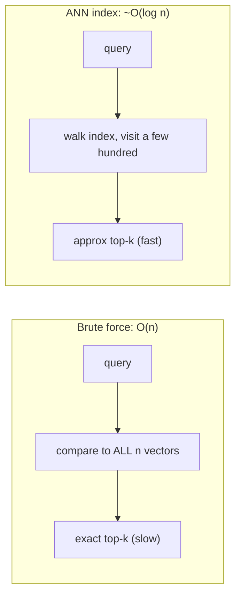
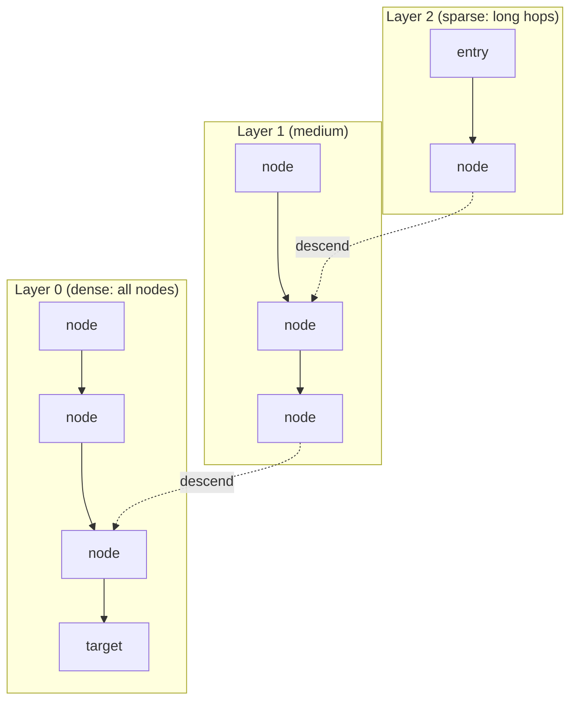
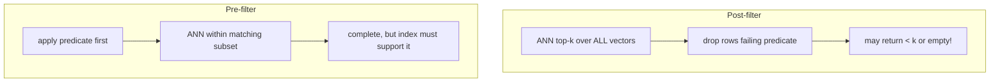
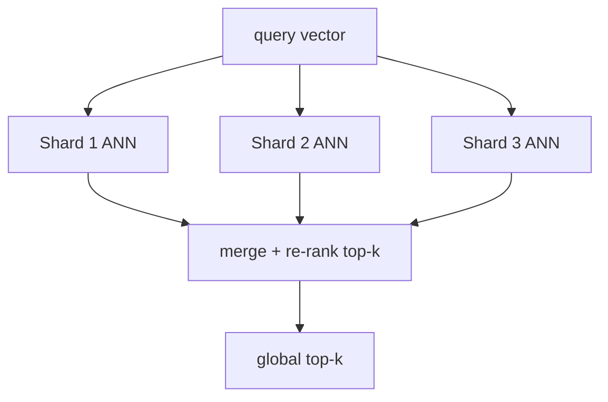

# Day 7 — Vector Databases

> Series: AI Backend Engineering
> Goal: understand what a vector DB does beyond brute force, how ANN indexing (HNSW/IVF) actually works, how to choose among the 2026 options honestly, why metadata filtering is hard, and where the scaling walls are.

## Table of Contents
1. [Why a vector DB (beyond brute force)](#1-why-a-vector-db)
2. [ANN indexing conceptually: HNSW and IVF](#2-ann-indexing)
3. [The recall / speed / memory trade-off](#3-the-tradeoff)
4. [The landscape with honest trade-offs](#4-the-landscape)
5. [Metadata filtering: pre- vs post-filter](#5-metadata-filtering)
6. [Scaling reality: the ~100M wall and sharding](#6-scaling-reality)
7. [Python: pgvector end-to-end](#7-python-pgvector)
8. [The Dark Side of vector DBs](#8-the-dark-side)
9. [Day 7 Self-Check](#day-7-self-check)
10. [Tomorrow / Apply](#tomorrow--apply)

---

## 1. Why a vector DB

**Why.** On Day 5 you did brute-force k-NN: compare the query vector against *every* stored vector. That is `O(n·d)` per query. At 10k vectors it is instant; at 10M vectors of 1024 dims it is ~10 billion multiply-adds per query — hundreds of milliseconds to seconds, single-threaded, per request. It does not survive contact with production traffic. You also need durability, concurrent writes, metadata filtering, and deletes — the same operational concerns you already expect from PostgreSQL.

> **🤔 Wait — Postgres can already store a float array in a column. Why do I need a *vector* database at all?**
> Storing the vector was never the hard part — *searching* it is. A plain array column has no notion of "nearest," so every query degrades to brute force: compare against all N rows, `O(n·d)`. Fine at 10k vectors; it falls over at 10M. A vector index (or pgvector's HNSW) is what turns "scan everything" into "visit a few hundred candidates" — the whole reason the category exists.
>
> **✅ Good scenario (where it saves you):** A knowledge tool with 8M chunks adds a pgvector HNSW index. Filtered semantic queries return in ~15ms p99 instead of the ~2s a sequential scan took — and because it's still Postgres, tenant filters, transactions, and backups come for free.
>
> **❌ Bad scenario (when misused):** A team stores embeddings in a JSON array column and computes cosine in application code per request. It demos fine on 5k rows, then at 3M rows every search takes seconds, the API times out under concurrent load, and they discover the "database" was doing no indexing at all.
>
> **When NOT to:** below ~100k vectors with no concurrency pressure, brute force (or pgvector's *exact* scan) is genuinely fine — don't stand up a dedicated distributed vector store for a corpus that fits in memory and answers in milliseconds anyway.

**What.** A vector database is a system that stores vectors + metadata and answers *approximate* nearest-neighbor (ANN) queries fast, using a specialized **index**. It trades a tiny amount of exactness for orders-of-magnitude speed.

**When.** Beyond ~100k–1M vectors, or whenever you need concurrent writes, filtered search, and low p99 latency. Below that, brute force (or `pgvector` with exact search) is genuinely fine — do not over-build.

**Where.** It is a **derived index**, not your source of truth. Your source of truth is the original documents (in object storage / Postgres); the vector DB is a rebuildable projection, exactly like a search index or a cache.


*Brute force checks everything and is exact; an ANN index checks a tiny fraction and is approximate but fast enough for production.*

---

## 2. ANN indexing

Two index families dominate in 2026: **HNSW** and **IVF** (and quantized variants of both).

### HNSW — Hierarchical Navigable Small World (a graph)

**What.** Build a multi-layer graph where each vector is a node linked to its nearest neighbors. Upper layers are sparse (long-range "express lanes"); lower layers are dense (local roads). A search starts at the top, greedily hops toward the query, and descends layer by layer, ending in a fine local search on the bottom layer.

**Key params:**
- `m` — neighbors per node (graph degree). Higher = better recall, more memory.
- `ef_construction` — candidate list size while *building*. Higher = better graph, slower build.
- `ef_search` — candidate list size while *querying*. Higher = better recall, slower query. **This is your runtime recall/latency dial.**

**Why it dominates.** Excellent recall at low latency, incremental inserts, no training step. Cost: high memory (the whole graph lives in RAM) and expensive-to-tune at very large scale.


*HNSW navigates coarse-to-fine: express lanes on top, local roads at the bottom — like skip-lists in 2-D.*

### IVF — Inverted File (clustered lists)

**What.** Cluster all vectors into `nlist` buckets (via k-means) with a centroid each. At query time, find the `nprobe` closest centroids and only search vectors in those buckets. Often combined with **PQ** (product quantization) to compress vectors — `IVF-PQ` — trading recall for huge memory savings.

**Params:** `nlist` (number of clusters), `nprobe` (clusters searched per query — the recall/speed dial). Needs a **training** step on a sample to learn centroids.

**Why choose IVF.** Lower memory than HNSW (especially with PQ), good for very large static-ish datasets. Cost: needs training, weaker on high-churn data, tuning `nlist`/`nprobe` is fiddly.

---

## 3. The trade-off

Every ANN index trades along three axes. There is no free lunch; you pick a point.

| | HNSW | IVF-Flat | IVF-PQ |
|---|---|---|---|
| **Recall** | Very high | High | Medium (lossy compression) |
| **Query speed** | Very fast | Fast | Fast |
| **Memory** | High (graph in RAM) | Medium | Low (compressed) |
| **Build/insert** | Incremental, no training | Needs training | Needs training |
| **High churn / updates** | Good | OK | Poor |
| **Best when** | Latency + recall matter, RAM available | Large, memory-conscious | Massive scale, memory-bound |

**The rule:** recall, speed, and memory form a triangle — improve one and you pay in another. `ef_search`/`nprobe` let you slide between recall and speed *at runtime* without rebuilding. **Measure recall against a brute-force baseline** on your data before trusting any index (Day 9 gives you recall@k).

---

## 4. The landscape

**Why this table matters.** The vendor pitch is always "we scale to billions." The real decision is *fit*: your existing stack, your scale, your filtering needs, your ops appetite. Honest trade-offs, July 2026 (verify current versions/features when you build — this space moves monthly):

| System | Sweet spot | Honest trade-offs |
|---|---|---|
| **pgvector** | You are *already on PostgreSQL* and want one fewer system. Reuses your SQL, transactions, backups, joins, ACLs. | Pragmatic and often enough. But HNSW tuning gets hard around ~100M vectors, and it competes with OLTP load for the same box. |
| **Qdrant** | Heavy **metadata filtering** + tight **tail latency** (p99). Rust, purpose-built filtering. | Praised for filtered ANN and predictable latency. Another system to run (or its cloud). |
| **Pinecone** | Fully **managed**, scale to **billions**, includes **managed reranking**. Want zero infra. | Vendor lock-in, per-usage cost, data leaves your VPC (check compliance). |
| **Weaviate** | **Multimodal** (text+image), built-in modules, hybrid search. | Heavier footprint; module sprawl if you only need text. |
| **Milvus** | **Very large scale**, GPU indexing, distributed by design. | Operationally complex; overkill for small/medium corpora. |

**How to choose (decision order):**
1. Already on Postgres and < ~10–50M vectors with modest filtering? → **pgvector**. Fewer moving parts beats theoretical scale.
2. Filtering-heavy or strict p99 SLOs? → **Qdrant**.
3. Want it fully managed at big scale, and lock-in/cost are acceptable? → **Pinecone**.
4. Multimodal? → **Weaviate**. Billions + a platform team? → **Milvus**.

Recall the *build-vs-buy* and *"boring technology"* instincts from your System Design work: adding a distributed vector store is real operational surface area. Justify it with numbers, not hype.

---

## 5. Metadata filtering

**Why.** Real queries are "find chunks about OAuth **where** `tenant_id = 42` **and** `updated_at > 2026-01-01`." The semantic search and the structured filter must both hold. You already do the filter half trivially in SQL; the hard part is combining it with ANN.

**Why it is hard for ANN.** The HNSW graph and IVF clusters are built over the *whole* vector space, oblivious to your filter. So:

- **Post-filter** (search then filter): ask the index for top-`k`, then drop rows failing the predicate. Simple, but if the filter is selective (few rows match), your top-`k` may be *entirely* filtered out → empty or under-filled results. You compensate by over-fetching (ask for `k·10`), which is wasteful and still not guaranteed.
- **Pre-filter** (filter then search): restrict to matching rows *first*, then do ANN among them. Correct and complete, but the ANN graph was not built for arbitrary subsets — done naively it degrades toward brute force over the subset.


*Post-filter is cheap but can starve results; pre-filter is correct but demands filter-aware indexing.*

**Why Qdrant is praised.** It integrates the payload filter *into* the graph traversal (filterable HNSW), giving pre-filter correctness without collapsing to brute force — this is precisely why it wins on filtering-heavy workloads. pgvector leans on Postgres: you can combine `WHERE` with the ANN scan, and the planner increasingly handles filtered vector search, though very selective filters still need care.

**How (practical).** Index your filter columns (ordinary B-tree indexes you already know). Prefer the DB's native filtered-search path over hand-rolled post-filtering. Test with your *most selective* real filter — that is where post-filter silently breaks.

---

## 6. Scaling reality

**The ~100M-vector wall.** HNSW keeps the entire graph in RAM. At 100M × 1024 dims × 4 bytes that is ~400GB *just for raw vectors*, plus graph edges — you are into multi-hundred-GB RAM machines. Build times stretch to hours, `ef_construction`/`m` tuning becomes a real project, and a single node stops being enough. This is the practical ceiling where pgvector's simplicity starts to hurt and purpose-built/distributed systems earn their keep.

**Sharding vectors.** Split the corpus across N shards (by tenant, by hash, by time), search each shard's index in parallel, then **merge** the per-shard top-k into a global top-k. This is the same horizontal-partitioning + scatter-gather pattern you know from sharded databases — the twist is that merging approximate results can lose recall at boundaries, so over-fetch per shard.

**Levers before sharding:** reduce dimensions (Matryoshka truncation, Day 5), quantize (IVF-PQ, or HNSW with scalar/binary quantization), or filter by tenant so each query only touches a slice. Exhaust these before adding nodes.


*Scatter-gather over shards is the vector version of the horizontal partitioning you already do in databases.*

---

## 7. Python: pgvector

Because you already run PostgreSQL, `pgvector` reuses everything you know — DDL, indexes, `WHERE`, transactions, backups. Here is the full loop: table + HNSW index, insert, and a **filtered** ANN query.

```python
from __future__ import annotations

import numpy as np
import psycopg
from pgvector.psycopg import register_vector

# pip install "psycopg[binary]" pgvector numpy
# In Postgres once:  CREATE EXTENSION IF NOT EXISTS vector;

DIM = 1024  # must match your embedding model's output dims (Day 5)


def setup(conn: psycopg.Connection) -> None:
    with conn.cursor() as cur:
        cur.execute("CREATE EXTENSION IF NOT EXISTS vector;")
        cur.execute(
            f"""
            CREATE TABLE IF NOT EXISTS chunks (
                id          bigserial PRIMARY KEY,
                doc_id      text        NOT NULL,
                tenant_id   int         NOT NULL,
                section     text,
                updated_at  timestamptz NOT NULL DEFAULT now(),
                content     text        NOT NULL,
                embedding   vector({DIM}) NOT NULL
            );
            """
        )
        # HNSW index. vector_cosine_ops => cosine distance (Day 5: match your metric).
        # m and ef_construction are the build-time recall/memory dials (Section 2).
        cur.execute(
            """
            CREATE INDEX IF NOT EXISTS chunks_embedding_hnsw
            ON chunks USING hnsw (embedding vector_cosine_ops)
            WITH (m = 16, ef_construction = 64);
            """
        )
        # B-tree indexes on filter columns -- ordinary SQL you already know (Section 5).
        cur.execute("CREATE INDEX IF NOT EXISTS chunks_tenant ON chunks (tenant_id);")
    conn.commit()


def insert_chunk(
    conn: psycopg.Connection,
    *, doc_id: str, tenant_id: int, section: str,
    content: str, embedding: np.ndarray,
) -> None:
    with conn.cursor() as cur:
        cur.execute(
            """
            INSERT INTO chunks (doc_id, tenant_id, section, content, embedding)
            VALUES (%s, %s, %s, %s, %s)
            """,
            (doc_id, tenant_id, section, content, embedding),
        )
    conn.commit()


def search(
    conn: psycopg.Connection,
    *, query_vec: np.ndarray, tenant_id: int, k: int = 5,
    ef_search: int = 100,   # runtime recall/latency dial (Section 2)
) -> list[tuple[int, str, float]]:
    """Filtered ANN: cosine distance via the <=> operator, with a tenant filter.
    Combining ANN with a WHERE clause is the pre/post-filter concern from Sec 5 --
    Postgres applies the predicate as part of the scan."""
    with conn.cursor() as cur:
        cur.execute("SET hnsw.ef_search = %s;", (ef_search,))
        cur.execute(
            """
            SELECT id, content, (embedding <=> %s) AS distance
            FROM chunks
            WHERE tenant_id = %s
            ORDER BY embedding <=> %s      -- smaller cosine distance = more similar
            LIMIT %s;
            """,
            (query_vec, tenant_id, query_vec, k),
        )
        return [(r[0], r[1], float(r[2])) for r in cur.fetchall()]


if __name__ == "__main__":
    with psycopg.connect("postgresql://localhost/ai") as conn:
        register_vector(conn)
        setup(conn)
        # embeddings would come from Day 5's embed(); random here for shape only:
        v = np.random.rand(DIM).astype(np.float32)
        insert_chunk(conn, doc_id="d1", tenant_id=42, section="Security > OAuth",
                     content="We support OAuth 2.1.", embedding=v)
        for cid, content, dist in search(conn, query_vec=v, tenant_id=42, k=3):
            print(f"{dist:.4f}  #{cid}  {content}")
```

**Naive vs better.** Naive pgvector usage omits the index (`ORDER BY embedding <=> $1` does an exact sequential scan — correct but `O(n)`). The better version above adds the HNSW index for approximate `~O(log n)` search and exposes `ef_search` so you can trade recall for latency per query without a rebuild. Start with defaults, then tune `m`/`ef_construction`/`ef_search` against a measured recall baseline — never cargo-cult numbers.

---

## 8. The Dark Side

- **Reaching for Pinecone when pgvector suffices.** A managed distributed vector DB is a whole new system: another SLA, another bill, data leaving your VPC, another failure mode, and you *lose* joins/transactions with your primary data. If you are on Postgres and under tens of millions of vectors, pgvector usually wins on total cost of ownership. Add specialized infra only when a measured limit forces it.
- **Cargo-culted index params.** Copy-pasting `m=16, ef_search=200` from a blog with no measurement. The right values depend on your dims, corpus size, and recall target. *Measure recall against brute force*, then tune. Numbers without a baseline are superstition.
- **Treating the vector DB as source of truth.** It is a *derived index* — lossy (ANN is approximate) and rebuildable. Keep canonical documents elsewhere. When you upgrade the embedding model (Day 5) or change chunking (Day 6), you rebuild the whole index from source. If you deleted the source, you are stuck.
- **Ignoring filter selectivity.** Post-filtering with a highly selective predicate silently returns too few results. Test the worst-case filter.
- **Recall blindness in prod.** ANN degrades quietly — no error, just slightly worse answers. Without a periodic recall check you will not notice the index rotting.

---

## Day 7 Self-Check
1. Why does brute-force k-NN stop working in production, and roughly at what scale?
2. Explain HNSW to a colleague in two sentences (layers + greedy descent).
3. What do `ef_construction` and `ef_search` each control, and which one can you change at query time?
4. How does IVF differ from HNSW, and when would you prefer IVF-PQ?
5. State the recall/speed/memory trade-off and how you slide along it at runtime.
6. Why is post-filtering dangerous with a very selective predicate?
7. Why is Qdrant specifically praised for metadata filtering?
8. You are on Postgres with 5M vectors and simple tenant filters — which system, and why?
9. What is the ~100M-vector HNSW wall caused by, and name two levers before you shard?
10. Why is calling the vector DB your "source of truth" a mistake?

## Tomorrow / Apply

**Tomorrow:** Day 8 — RAG, the #1 pattern. We wire embeddings + chunking + this vector index into an end-to-end retrieve-augment-generate pipeline, then fix everywhere naive RAG fails.

**Apply (1 hour):** Stand up local Postgres with the `vector` extension. Create the `chunks` table with the HNSW index. Insert ~500 embedded chunks from your Day 6 output. Run the same query with `ef_search` at 20, 100, and 300; also run the exact (no-index) version. Compare which chunk IDs come back and eyeball recall vs the exact baseline. Then add a selective `WHERE section = ...` filter and confirm you still get a full top-k.
