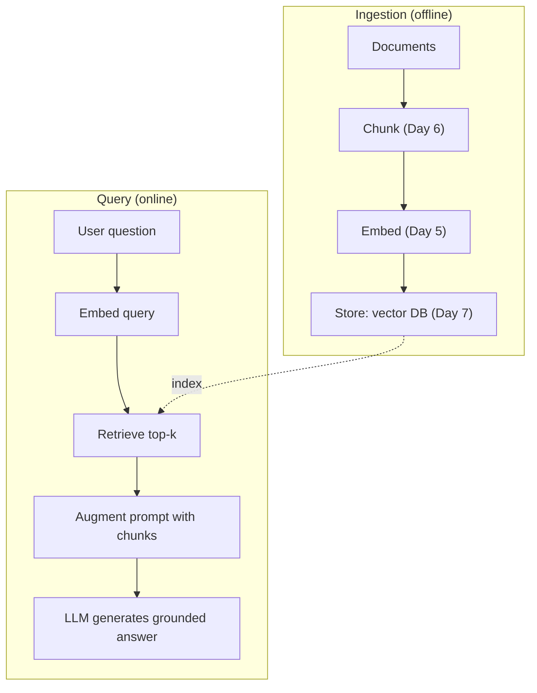
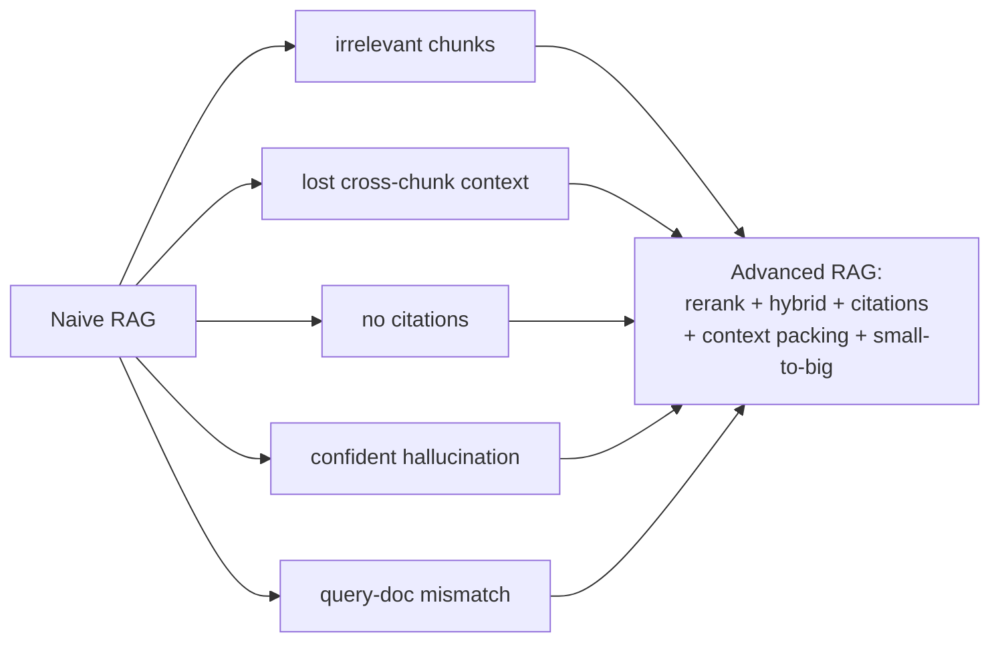
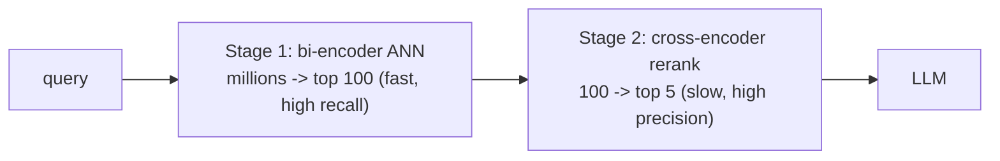
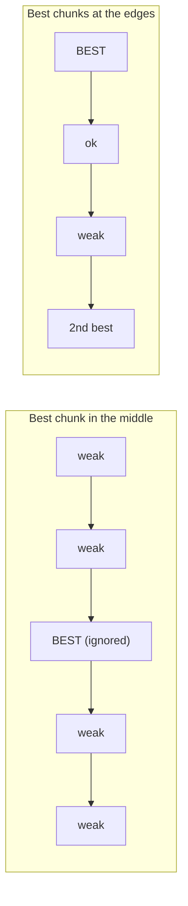
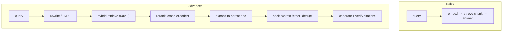
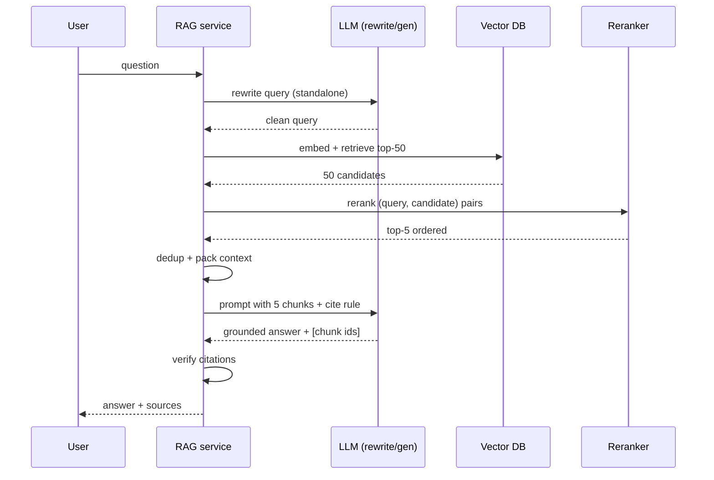

# Day 8 — RAG: The #1 Pattern

> Series: AI Backend Engineering
> Goal: build a full retrieve-augment-generate pipeline end-to-end in raw Python, understand every way naive RAG fails, and fix it with reranking, citations, context packing, and advanced retrieval.

## Table of Contents
1. [Why RAG exists](#1-why-rag-exists)
2. [The full naive pipeline (end-to-end Python)](#2-the-naive-pipeline)
3. [Why naive RAG fails](#3-why-naive-rag-fails)
4. [Reranking: two-stage retrieval](#4-reranking)
5. [Citations & grounding](#5-citations-grounding)
6. [Context packing: lost in the middle, ordering, dedup](#6-context-packing)
7. [Advanced retrieval techniques](#7-advanced-techniques)
8. [The Dark Side of RAG](#8-the-dark-side)
9. [Day 8 Self-Check](#day-8-self-check)
10. [Tomorrow / Apply](#tomorrow--apply)

---

## 1. Why RAG exists

**Why.** An LLM only knows what was in its training data, frozen at a cutoff, with no access to your private documents and a habit of confabulating specifics. You cannot retrain it every time a doc changes, and its context window cannot hold your entire corpus. **Retrieval-Augmented Generation** solves this: fetch the *relevant* passages at query time and put them in the prompt, so the model answers from *provided evidence* instead of memory.

**What.** RAG = a retrieval system (Days 5–7) feeding an LLM. The model becomes a *reasoning-over-supplied-text* engine rather than a knowledge oracle. This is the dominant production pattern for question-answering over private/changing data.

**When.** Your knowledge is private, large, or frequently changing; you need citations; you need answers grounded in specific sources. **When not:** see the Dark Side — sometimes fine-tuning, long-context, or plain SQL is the right tool.

**Where.** Two phases: **ingestion** (offline: parse → chunk → embed → store, Days 6–7) and **query** (online: retrieve → augment → generate).


*RAG is two pipelines sharing one index: build it offline, query it online.*

---

## 2. The naive pipeline

Here is naive RAG end-to-end in raw Python — no framework, so every step is visible. It reuses Day 5's `embed()` and Day 7's pgvector `search()`.

```python
from __future__ import annotations

from dataclasses import dataclass

import numpy as np
# from day05 import embed
# from day07 import search  (pgvector filtered ANN)
from openai import OpenAI   # pip install openai ; verify current model names when you build

client = OpenAI()
_GEN_MODEL = "gpt-5.1-mini"   # placeholder: confirm the current model at build time


@dataclass
class RetrievedChunk:
    chunk_id: int
    content: str
    score: float
    source: str


def retrieve(question: str, *, tenant_id: int, k: int = 5) -> list[RetrievedChunk]:
    """Embed the question and pull top-k chunks from the vector index (Day 7)."""
    q_vec = embed(question, is_query=True)          # Day 5: asymmetric query prefix
    rows = search(query_vec=q_vec, tenant_id=tenant_id, k=k)
    return [
        RetrievedChunk(chunk_id=cid, content=text, score=1.0 - dist, source="?")
        for (cid, text, dist) in rows
    ]


def build_prompt(question: str, chunks: list[RetrievedChunk]) -> list[dict[str, str]]:
    """Augment: stuff retrieved context into the prompt. Note the citation
    instruction and the explicit 'say you don't know' guard (Sections 3 & 5)."""
    context = "\n\n".join(f"[chunk {c.chunk_id}] {c.content}" for c in chunks)
    system = (
        "Answer ONLY from the context below. "
        "Cite the chunk id like [chunk 12] after each claim. "
        "If the context does not contain the answer, say 'I don't know.'"
    )
    user = f"Context:\n{context}\n\nQuestion: {question}"
    return [
        {"role": "system", "content": system},
        {"role": "user", "content": user},
    ]


def rag_answer(question: str, *, tenant_id: int, k: int = 5) -> str:
    chunks = retrieve(question, tenant_id=tenant_id, k=k)
    if not chunks:                     # guard: no context -> do NOT let it improvise
        return "I don't know — no relevant documents found."
    messages = build_prompt(question, chunks)
    resp = client.chat.completions.create(model=_GEN_MODEL, messages=messages)
    return resp.choices[0].message.content or ""


if __name__ == "__main__":
    print(rag_answer("How do I reset my password?", tenant_id=42))
```

That is the whole naive pattern: **embed → retrieve top-k → augment → generate**. It works impressively on a demo and then disappoints on real questions. The rest of this file is *why* and *how to fix it*.

---

## 3. Why naive RAG fails

**Why understand the failures.** RAG's quality is dominated by *retrieval*, and naive retrieval is fragile. Knowing the failure modes tells you exactly which fix to reach for.

> **🤔 Wait — I retrieved real documents and put them in the prompt. Why does RAG *still* return garbage or hallucinate?**
> Because "I did RAG" hides two independent failure points. If *retrieval* hands the model the wrong chunks (or nothing relevant), the model grounds on garbage — or worse, falls back to its memory and confabulates fluently. And even with the right chunk retrieved, poor *packing* can bury it where the model ignores it (lost-in-the-middle, §6). RAG only helps to the degree the *right* evidence actually reaches the model's attention; bolting on a vector DB doesn't guarantee that.
>
> **✅ Good scenario (where it saves you):** A support chatbot retrieves the exact refund-policy chunk, ranks it first, and instructs "answer only from context, else say I don't know." The answer is correct, cites `[chunk 12]`, and a human can verify it — grounding did its job.
>
> **❌ Bad scenario (the pain without it):** A team ships naive top-5 retrieval with no reranker and no empty-result guard. For an out-of-scope question retrieval returns five loosely-related chunks, the model stitches them into a confident wrong policy, and — with no "I don't know" guard — it reaches the customer as fact.
>
> **When NOT to:** if the question is structured ("total revenue in Q2") or the whole relevant material is one document that fits the window, RAG is the wrong tool — use SQL or just pass the document; retrieval only earns its cost over a large, changing, private corpus.

| Failure | What happens | Root cause | Fix (section) |
|---|---|---|---|
| **Irrelevant chunks** | Top-k contains off-topic passages that crowd out good ones | Bi-encoder similarity is coarse | Reranking (§4) |
| **Lost cross-chunk context** | Answer needs two chunks; you only retrieved one, or the chunk is a fragment | Chunking granularity (Day 6) | Parent-doc / small-to-big (§7) |
| **No citations** | User can't verify; you can't audit | Prompt didn't demand them / no verification | Citations & grounding (§5) |
| **Confident wrong answers** | Retrieval returns nothing useful; model fills the gap from memory | No grounding guard; hallucination | "I don't know" guard + grounding (§5, §8) |
| **Query–doc mismatch** | Short question phrased unlike the answer passage | Vocabulary/asymmetry gap | Query rewriting / HyDE / hybrid (§7, Day 9) |
| **Lost in the middle** | Right chunk retrieved but ignored because it sat in the middle of a long prompt | LLM attention bias | Context packing (§6) |

The through-line: **retrieve better, then help the model use what you retrieved.** Everything below is one of those two moves.


*Naive RAG's failure modes all trace back to weak retrieval or poor use of retrieved context.*

---

## 4. Reranking

**Why.** The retriever (a **bi-encoder**) embeds query and documents *independently* — fast, indexable, but it never lets the query and a specific document "look at each other." So its top-20 is roughly right but poorly *ordered*, and the truly best passage is often at rank 7, not 1. A **cross-encoder** reranker fixes ordering by scoring `(query, document)` *jointly*.

> **🤔 Wait — the vector search already sorted results by similarity. Why re-score the same results with a second model?**
> Because the retriever scored query and document *separately* — it never let them interact, so its ordering is only approximate. A cross-encoder reads the query and one passage *together*, catching relevance the bi-encoder's independent embeddings miss. You retrieve wide and cheap for recall, then rerank narrow and expensive for precision — the bi-encoder's rank-1 is often not the real best answer.
>
> **✅ Good scenario (where it saves you):** A doc-Q&A SaaS retrieves 50 candidates and reranks to 5. A chunk the bi-encoder ranked #9 — the one that actually answers the question — gets promoted to #1, and answer accuracy jumps measurably for a few tens of milliseconds of added latency. Reranking is routinely the single highest-ROI RAG upgrade.
>
> **❌ Bad scenario (when misused):** A team adds a reranker by reflex to a system whose real problem is bad chunking, paying the extra model call on every query for no measured gain — and a reranker trained on generic web data even mis-ranks their niche legal corpus, quietly making retrieval *worse*.
>
> **When NOT to:** if your corpus is tiny or the bi-encoder's top-k is already accurate on your eval set, skip reranking — it's pure added latency and cost until you've measured that ordering is actually your bottleneck.

**What (two-stage retrieval):**
1. **Retrieve** (bi-encoder / ANN): cheaply fetch a *candidate set* of ~50–100 from millions. Optimizes recall.
2. **Rerank** (cross-encoder): expensively but accurately re-score just those candidates, keep the top ~5. Optimizes precision.

You cannot run the cross-encoder over the whole corpus (it is `O(n)` model calls, no index possible), and you cannot trust the bi-encoder's ordering alone. Two stages give you the best of both — this is standard in production 2026.


*Retrieve wide and cheap, then rerank narrow and accurate — the two-stage funnel.*

**How (Python).** Retrieve 50, rerank with a cross-encoder, keep 5:

```python
from __future__ import annotations

from sentence_transformers import CrossEncoder  # pip install sentence-transformers

# A cross-encoder scores (query, passage) pairs jointly. Verify current model at build.
_reranker = CrossEncoder("cross-encoder/ms-marco-MiniLM-L-6-v2")


def rerank(
    question: str, candidates: list[RetrievedChunk], *, top_n: int = 5
) -> list[RetrievedChunk]:
    """Re-score candidates with a cross-encoder; return the best top_n.

    Naive RAG skips this and trusts the bi-encoder order. The reranker routinely
    promotes a relevant chunk from rank ~8 to rank 1 -- the single highest-ROI
    upgrade to a RAG system."""
    pairs = [(question, c.content) for c in candidates]
    scores = _reranker.predict(pairs)            # higher = more relevant
    for c, s in zip(candidates, scores):
        c.score = float(s)
    candidates.sort(key=lambda c: c.score, reverse=True)
    return candidates[:top_n]


def rag_answer_v2(question: str, *, tenant_id: int) -> str:
    candidates = retrieve(question, tenant_id=tenant_id, k=50)   # retrieve WIDE
    if not candidates:
        return "I don't know — no relevant documents found."
    best = rerank(question, candidates, top_n=5)                # rerank NARROW
    resp = client.chat.completions.create(
        model=_GEN_MODEL, messages=build_prompt(question, best)
    )
    return resp.choices[0].message.content or ""
```

Managed platforms (e.g. Pinecone, Cohere) offer hosted reranking if you do not want to run the model yourself. **The Dark Side of reranking:** it adds latency (a model call over ~50 pairs) and cost; and a reranker trained on generic web data may misjudge your domain — evaluate it (Day 9) rather than assuming it helps.

---

## 5. Citations & grounding

**Why.** An answer you cannot trace is unusable in any serious setting — support, legal, medical, internal knowledge. Citations let users verify and let you audit. **Grounding** means the answer is *actually* supported by retrieved text, not the model's memory.

**What → How:**
- **Force citations.** Give each chunk a stable id in the prompt (`[chunk 12]`) and instruct the model to cite it after each claim (see `build_prompt`).
- **Verify citations.** Do not trust the model to cite honestly. After generation, parse the cited ids and check each was actually in the context you supplied. Flag or strip uncited claims.
- **The "I don't know" guard.** Explicitly instruct the model to refuse when context lacks the answer, and hard-guard the empty-retrieval case in code (`if not chunks: return "I don't know"`). This is the primary defense against confident hallucination.

```python
import re


def verify_citations(answer: str, allowed_ids: set[int]) -> tuple[bool, set[int]]:
    """Check that every [chunk N] the model cited was actually supplied.
    Hallucinated citations (ids we never gave it) are a grounding red flag."""
    cited = {int(m) for m in re.findall(r"\[chunk (\d+)\]", answer)}
    hallucinated = cited - allowed_ids
    return (len(hallucinated) == 0, hallucinated)
```

**Where.** Verification sits *between* generation and returning the answer to the user. **The Dark Side:** models cite plausibly but incorrectly — attaching `[chunk 12]` to a claim that chunk 12 does not support. Citation *presence* is not citation *correctness*; for high-stakes uses, verify the claim against the chunk text (an extra LLM check or string overlap), not just the id.

---

## 6. Context packing

**Why.** Even with perfect retrieval, *how* you arrange chunks in the prompt changes the answer. LLMs attend unevenly to long contexts.

**Lost in the middle.** Models reliably use information at the **start** and **end** of the context far better than the **middle**. Ten chunks with the best one at position 5 can underperform three chunks with the best one first. So:

- **Order by relevance, and place the strongest chunks at the edges** (best first, second-best last, weaker ones buried in the middle) — or simply send fewer, better chunks.
- **Fewer is often better.** After reranking, 3–5 excellent chunks usually beat 20 mediocre ones. More context = more noise + more cost + more lost-in-the-middle risk.

**Dedup.** Overlap (Day 6) and near-duplicate documents produce redundant chunks that waste budget and can bias the model by repetition. Deduplicate before packing.

```python
def pack_context(chunks: list[RetrievedChunk], *, max_chunks: int = 5) -> list[RetrievedChunk]:
    """Dedup near-identical chunks, then order for the 'lost in the middle' effect:
    strongest at the front and back, weakest in the middle."""
    seen: set[str] = set()
    unique: list[RetrievedChunk] = []
    for c in sorted(chunks, key=lambda c: c.score, reverse=True):
        key = c.content[:120]            # cheap near-dup signature; use a hash/minhash in prod
        if key in seen:
            continue
        seen.add(key)
        unique.append(c)
    top = unique[:max_chunks]
    # interleave: [1st, 3rd, 5th, ..., 4th, 2nd] so best sit at the edges
    front = top[0::2]
    back = top[1::2][::-1]
    return front + back
```


*Put your strongest evidence where the model actually reads it — the start and the end.*

**The Dark Side.** Dumping every retrieved chunk "to be safe" degrades answers (lost-in-the-middle + noise) and inflates cost/latency. More context is not more truth.

---

## 7. Advanced techniques

Reach for these *after* rerank + hybrid (Day 9), and only where measured evals justify them.

- **Query rewriting / expansion.** The raw user query is often underspecified or conversational ("what about the second one?"). Rewrite it into a standalone, retrieval-friendly query (resolve pronouns, add synonyms) with a cheap LLM call before embedding. Fixes query–doc mismatch.
- **HyDE (Hypothetical Document Embeddings).** Ask the LLM to *write a hypothetical answer* to the query, then embed *that* and retrieve with it. Rationale: a fake answer lives in the same "document space" as real passages, so it matches better than a terse question (mitigates asymmetry, Day 5). Cost: an extra generation and risk of the hallucinated answer steering retrieval wrong.
- **Parent-document / small-to-big.** Embed and retrieve on *small* chunks (precise matching) but feed the LLM the *parent* (the surrounding section or full document). Best of both: precise retrieval, complete context. Fixes lost-cross-chunk-context.
- **Contextual retrieval.** Before embedding each chunk, prepend a short LLM-generated summary of the chunk's place in the whole document ("This chunk is from the Security section, discussing OAuth token expiry..."). This disambiguates fragments ("It costs $50" → whose price?) and measurably lifts retrieval. Cost: an LLM call per chunk at ingest, and a re-index if you change the scheme.


*Advanced RAG is a pipeline of targeted fixes, each aimed at one naive failure mode.*

Here is the full query lifecycle as a sequence:


*One question, end to end: rewrite, retrieve wide, rerank narrow, pack, generate, verify.*

---

## 8. The Dark Side

- **RAG when it is the wrong tool.**
  - *Fine-tuning* fits better when you need the model to learn a **style/format/behavior**, not facts.
  - *Long-context* is simpler when the relevant material is one moderate document that fits the window — just pass it; skip the retrieval machinery.
  - *Plain SQL / structured query* is correct when the question is structured ("total revenue in Q2"). Do not embed your way to an answer a `GROUP BY` gives exactly. RAG over a database of numbers is an anti-pattern.
- **RAG cargo-culting.** Bolting on a vector DB, reranker, and HyDE because a blog said so — before measuring that naive retrieval is even the bottleneck. Add complexity only against a measured deficit (Day 9). Every stage adds latency, cost, and failure surface.
- **Retrieval returns nothing → confident hallucination.** The most dangerous failure: retrieval finds nothing relevant, the prompt has no guard, and the model answers fluently and wrongly. Always hard-guard empty/low-score retrieval, instruct "I don't know," and consider a relevance-score threshold below which you refuse.
- **Over-stuffing context.** Covered in §6 — more chunks is not more correctness.
- **Stale index.** Docs change; if ingestion does not re-run, RAG confidently cites outdated content. Treat the index as a derived artifact that must be refreshed (Day 7).

---

## Day 8 Self-Check
1. Draw the naive RAG pipeline from ingestion through generation.
2. Why does retrieval quality dominate RAG answer quality?
3. Explain bi-encoder vs cross-encoder and why two-stage retrieval beats either alone.
4. Roughly how many candidates do you retrieve before reranking, and how many survive?
5. What are the two layers of defense against confident hallucination?
6. Why is citation *presence* not the same as citation *correctness*?
7. What is "lost in the middle" and how do you pack context around it?
8. Contrast HyDE and query rewriting — what problem does each attack?
9. Explain small-to-big / parent-document retrieval and which naive failure it fixes.
10. Name three situations where RAG is the *wrong* tool and say what to use instead.

## Tomorrow / Apply

**Tomorrow:** Day 9 — Hybrid Search & Retrieval Quality. We add keyword (BM25) retrieval, fuse it with dense search via RRF, and — crucially — learn to *measure* retrieval so you know your fixes actually help.

**Apply (1 hour):** Build a minimal RAG over your own the `SystemDesign` folder notes folder. Ingest the markdown files (reuse Day 6's `markdown_chunk`), embed and store them (Day 5 + Day 7 pgvector), then implement `rag_answer_v2` with retrieve-50 → rerank-5 → cite. Ask it five real questions about your own system-design notes. For each, check: did it cite the right file/section? Did it say "I don't know" when it should? Compare answers with and without the reranker.
