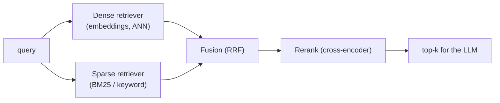
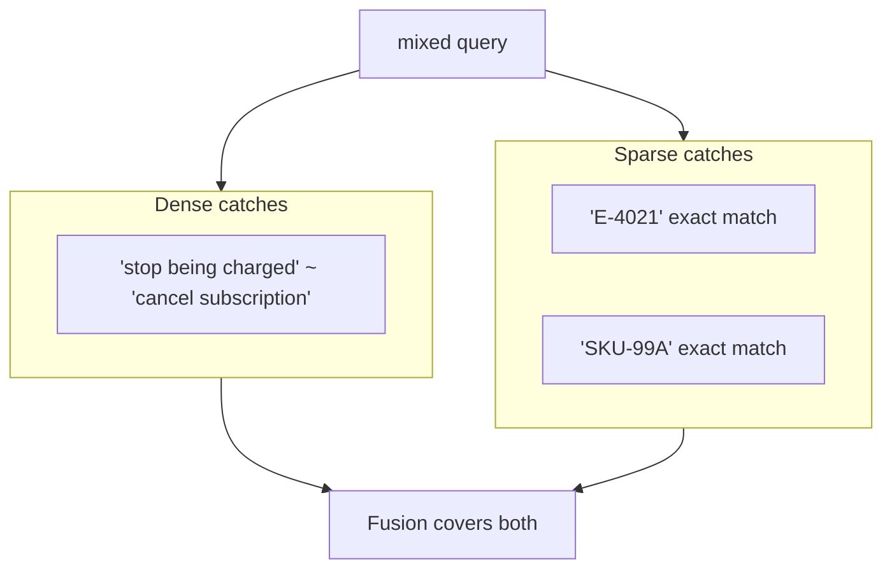
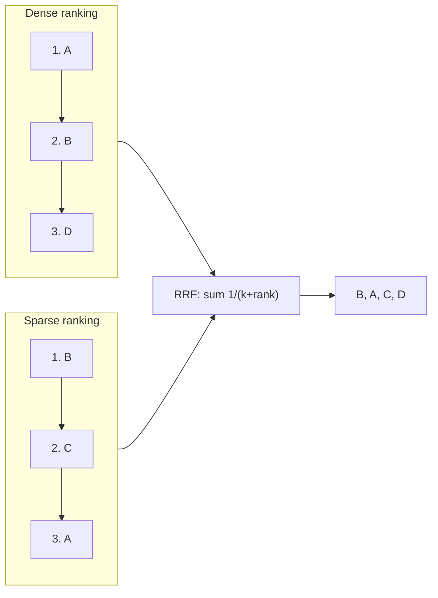
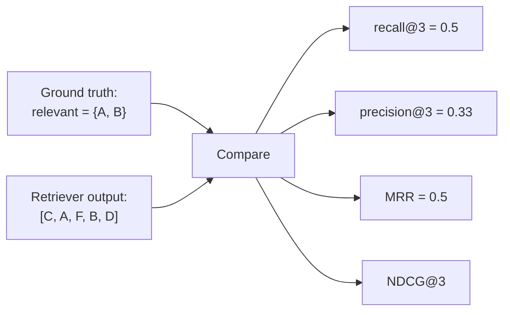

# Day 9 — Hybrid Search & Retrieval Quality

> Series: AI Backend Engineering
> Goal: combine dense (semantic) and sparse (keyword/BM25) retrieval, fuse the results with Reciprocal Rank Fusion, rerank the merged set, and — above all — *measure* retrieval quality with recall@k, precision@k, MRR, and NDCG.

## Table of Contents
1. [Why hybrid search](#1-why-hybrid-search)
2. [Dense vs sparse: what each misses](#2-dense-vs-sparse)
3. [Fusion: Reciprocal Rank Fusion (RRF)](#3-fusion-rrf)
4. [Then rerank the merged set](#4-then-rerank)
5. [Retrieval evaluation: recall@k, precision@k, MRR, NDCG](#5-retrieval-evaluation)
6. [Building a small eval set](#6-building-an-eval-set)
7. [Python: BM25 + vector + RRF + rerank + recall@k](#7-python)
8. [The Dark Side of hybrid & metrics](#8-the-dark-side)
9. [Day 9 Self-Check](#day-9-self-check)
10. [Tomorrow / Apply](#tomorrow--apply)

---

## 1. Why hybrid search

**Why.** Dense embeddings (Day 5) are brilliant at *meaning* and hopeless at *exact tokens*. "Error `E-4021`", a part number `SKU-99A`, a person's surname, a rare acronym — these are precisely the strings a user searches for, and precisely what semantic similarity blurs away, because the embedding smears a rare exact token into "some error code." Meanwhile classic keyword search (BM25) nails exact terms but is blind to synonyms and paraphrase. **Hybrid search** runs both and fuses them, covering each other's blind spots. It is standard in production 2026 for a reason.

**What.** Hybrid retrieval = dense (vector) retrieval + sparse (lexical/BM25) retrieval, combined into one ranked list, usually then reranked (Day 8).

**When.** Almost any real corpus with a mix of natural-language questions *and* exact identifiers, code, names, or jargon. **When not:** small corpora or purely conceptual queries (see Dark Side) — hybrid can be over-engineering.

**Where.** In the retrieval stage, replacing the single vector query from Day 8 with a two-retriever + fusion step.


*Two retrievers with complementary strengths, fused into one list, then reranked.*

> **🤔 Wait — why hybrid search? Isn't semantic/vector search already "smarter" than keyword search?**
> This is the trap everyone falls into after their first RAG demo works. Vector search *is* smarter about **meaning** — and that's exactly why it's dumb about **exact strings**. An embedding compresses "Error `E-4021`" into a fuzzy point near "some payment error," so `E-4021`, `E-4022`, and `E-4051` all land in roughly the same place. The model literally cannot tell them apart. Keyword/BM25 has the opposite problem: it nails `E-4021` and whiffs on "why am I still being charged?" because zero words overlap with "cancel subscription." Hybrid isn't "two search engines because more is better" — it's covering two **disjoint failure modes** with one pass. The smarter your embeddings get, the *worse* they tend to be at rare literal tokens, so this gap doesn't close on its own.

**✅ Good scenario (where it saves you):** A B2B support-agent product indexes 400k help-desk articles full of SKUs, error codes, and API endpoint names. Users paste `E-4021` or `POST /v2/refunds` straight from a stack trace. Dense-only retrieval was returning "close in vibes, wrong in fact" articles ~30% of the time; adding BM25 + RRF lifted recall@5 from 0.71 to 0.93 on the exact-token queries, and deflected support tickets that used to escalate to humans. One fusion step, measurable ticket-deflection dollars.

**❌ Bad scenario (the pain without it):** A doc-Q&A SaaS ships dense-only. A user asks "does plan `TIER-3` include SSO?" The embedding blurs `TIER-3` into "some pricing tier," retrieves the TIER-1 doc, and the LLM confidently answers "yes" — for the wrong tier. Nobody notices because the answer *sounds* right and there's no exact-match signal to catch it. That's a silent wrong-answer incident that erodes trust and shows up later as churn, not as an error log.

**When NOT to:** a small, purely conceptual corpus (say, a few hundred blog posts with no IDs, codes, or rare names) doesn't need hybrid — if dense-only recall is already ~1.0 on your eval set, BM25 just doubles latency and complexity for nothing.

---

## 2. Dense vs sparse

**What each is:**
- **Dense (semantic).** Query and docs become embeddings; similarity = vector closeness. Understands *meaning*: "car" ≈ "automobile", "how to cancel" ≈ "terminate subscription."
- **Sparse (lexical / BM25).** Ranks by term overlap, weighting rare terms higher (IDF) and dampening term-frequency and document-length. Understands *exact tokens*: matches `E-4021` because the literal string appears.

| | Dense (embeddings) | Sparse (BM25) |
|---|---|---|
| **Great at** | Synonyms, paraphrase, concepts, cross-lingual | Exact terms, IDs, codes, rare words, names |
| **Bad at** | Rare exact tokens, out-of-vocabulary strings, precise numbers | Synonyms, paraphrase, semantic intent |
| **Needs** | Embedding model + vector index | Term index (often already in your DB / search engine) |
| **Fails silently on** | "Find ticket `ABC-1234`" (blurs the id) | "How do I stop being charged?" (no keyword overlap with "cancel subscription") |

**Why you need both.** Their failure modes are *disjoint*: dense misses exactly what sparse catches and vice-versa. A query like *"why does error `E-4021` happen on cancellation?"* needs sparse for `E-4021` **and** dense for the concept of cancellation. Neither alone suffices; fused, they cover the query.


*Dense and sparse fail on opposite things — fusing them closes both gaps.*

---

## 3. Fusion (RRF)

**Why.** Dense scores (cosine ~0..1) and BM25 scores (unbounded, corpus-dependent) live on incomparable scales — you cannot just add them. **Reciprocal Rank Fusion** sidesteps this entirely by combining *ranks*, not scores.

**What.** For each document, sum `1 / (k + rank)` across every retriever that returned it, where `rank` is its position (1-based) in that retriever's list and `k` is a small constant (commonly 60). Documents ranked highly by *either* retriever — and especially by *both* — float to the top.

$$\text{RRF}(d) = \sum_{r \in \text{retrievers}} \frac{1}{k + \text{rank}_r(d)}$$

**Why it works so well.** It is scale-free (no normalization needed), robust (one retriever's weird score distribution can't dominate), and rewards agreement (a doc in both top-3s beats a doc that's #1 in one and absent in the other). The constant `k` dampens the influence of very top ranks so lower-ranked-but-agreed-upon docs still surface.

**How (worked micro-example),** `k = 60`:

| Doc | Dense rank | Sparse rank | RRF score |
|---|---|---|---|
| A | 1 | 3 | 1/61 + 1/63 = 0.0323 |
| B | 2 | 1 | 1/62 + 1/61 = 0.0325 |
| C | — | 2 | 1/62 = 0.0161 |
| D | 3 | — | 1/63 = 0.0159 |

B wins: strong in both lists. A is close. C and D, each found by only one retriever, rank lower. That is exactly the behavior you want.


*RRF fuses by rank, so incompatible score scales never enter the equation.*

---

## 4. Then rerank

**Why.** Fusion gives a good *merged candidate set* but still orders by rank arithmetic, not by true query–document relevance. So the pattern connects straight back to Day 8: **hybrid-retrieve wide → RRF-fuse → cross-encoder rerank → top-k.** RRF decides *which* candidates survive; the reranker decides their *final order*. This is the canonical production retrieval stack in 2026.

**How.** Fuse dense+sparse to, say, 50 candidates, then hand those 50 to the Day 8 cross-encoder `rerank()` and keep 5. One extra step, large precision gain.

---

## 5. Retrieval evaluation

**Why (the most important section).** You cannot improve what you do not measure, and RAG teams routinely "tune" chunking, models, and `ef_search` by *vibes*, shipping regressions they never detect. Retrieval metrics are the SLOs of your retrieval layer — the same discipline as the latency/error SLOs from System Design Day 20. **Measure before you tune.**

> **🤔 Wait — why measure retrieval separately? Can't I just eyeball whether the final answer is good?**
> Because when the final answer is wrong, "the answer is bad" tells you *nothing* about *where* it broke — retrieval, reranking, the prompt, or the model. Retrieval metrics isolate one layer: if recall@k is 0.5, half your answers are unanswerable *no matter how good the LLM is*, because the evidence never made it into the context. Eyeballing end answers is also unrepeatable — you can't detect a 3% regression by vibes across 200 queries after you change the chunk size. Retrieval recall is the **ceiling** on answer quality; measuring it turns "the RAG feels worse this week" into "recall@5 dropped from 0.9 to 0.82 when we re-chunked, here's the fix."

**✅ Good scenario (where it saves you):** A research-assistant startup versions a 50-query eval set in git and runs it in CI. An engineer bumps the embedding model to a newer version expecting a win; the eval catches a recall@10 drop from 0.88 to 0.79 on multi-hop queries *before* it ships. They roll back in ten minutes instead of discovering it three weeks later from a spike in "this is useless" thumbs-down.

**❌ Bad scenario (the pain without it):** A team "improves" chunking from 512 to 1024 tokens because it looked cleaner, ships on a Friday, and quietly halves recall on precise lookups (relevant sentences now buried mid-chunk and diluted). No eval set, so nobody notices until a customer escalates a month later — and now there are 40 commits to bisect through to find which one caused it.

**When NOT to:** a one-off internal prototype you'll throw away next week doesn't need a versioned eval harness — a handful of spot-checked queries is enough until it's on a path to real users.

The setup: an eval set of queries, each with a known set of **relevant** chunk ids (ground truth). Run your retriever, compare its ranked output to the ground truth.

**Define each (with a tiny worked example).** Query returns ranked ids `[C, A, F, B, D]`; relevant set = `{A, B}`; evaluate at k=3 (top-3 = `[C, A, F]`).

- **Recall@k** — *of all relevant docs, what fraction appear in the top-k?* Measures "did we even find them." Relevant found in top-3 = `{A}` → **recall@3 = 1/2 = 0.5**. B was at rank 4, missed. Recall is the metric that matters most for RAG: if the answer isn't retrieved, no reranker or LLM can save it.
- **Precision@k** — *of the top-k, what fraction are relevant?* Measures noise. Top-3 has 1 relevant of 3 → **precision@3 = 1/3 ≈ 0.33**.
- **MRR (Mean Reciprocal Rank)** — `1 / rank of the first relevant result`, averaged over queries. First relevant (A) is at rank 2 → **RR = 1/2 = 0.5**. Great when the user needs *one* good answer fast.
- **NDCG@k (Normalized Discounted Cumulative Gain)** — rewards putting relevant docs *higher*, with a logarithmic position discount, normalized so 1.0 = perfect ordering. Handles *graded* relevance (some docs more relevant than others), unlike the binary metrics above. The most holistic single number for ranking quality.

| Metric | Question it answers | Use when |
|---|---|---|
| Recall@k | Did we retrieve the relevant docs at all? | RAG (retrieval is the ceiling on answers) |
| Precision@k | How much noise is in the top-k? | Context budget is tight |
| MRR | How high is the *first* good hit? | One-answer lookups |
| NDCG@k | Is the *whole ordering* good (graded)? | Ranking quality, reranker tuning |


*Every metric is a different lens on the same comparison of ranked output vs ground truth.*

**How to use them.** Track recall@k as your north star for RAG (it caps everything downstream); watch precision@k so you don't drown the LLM in noise; use NDCG to compare rerankers. Establish a baseline, change *one* thing, re-measure.

---

## 6. Building an eval set

**Why.** Public benchmarks (MTEB, BEIR) do not reflect your domain (Day 5). A tiny, honest, *domain-specific* eval set beats a big generic one.

**How (pragmatic recipe):**
1. Collect 30–50 **real queries** — from logs, support tickets, or by asking domain users what they'd actually search.
2. For each, mark the **relevant chunk ids** (ground truth). Bootstrap it: run your current retriever, have a human label which returned chunks are actually relevant (add obvious misses). LLM-assisted labeling is fine for a first pass, but a human must spot-check.
3. Cover the **query mix**: some semantic ("how do I cancel"), some lexical ("error E-4021"), some multi-hop. This is what exposes dense-only or sparse-only weaknesses.
4. Version it in git. Re-run on every retrieval change. This is your regression test for retrieval — treat it like any test suite.

**The Dark Side of eval sets:** a set that's too small or too easy gives false confidence; one built only from queries your current system already answers well bakes in its blind spots. Deliberately include queries you *suspect* it fails.

---

## 7. Python

Full hybrid pipeline in raw Python: BM25 (`rank_bm25`) + dense (Day 5 `embed`) + RRF + rerank (Day 8), plus `recall_at_k`.

```python
from __future__ import annotations

from dataclasses import dataclass

import numpy as np
from rank_bm25 import BM25Okapi          # pip install rank_bm25
# from day05 import embed                # dense embeddings
# from day08 import rerank               # cross-encoder reranker


@dataclass
class Doc:
    chunk_id: int
    text: str


def _tokenize(text: str) -> list[str]:
    return text.lower().split()          # use a real tokenizer in production


def bm25_search(query: str, corpus: list[Doc], k: int) -> list[int]:
    """Sparse retrieval: rank chunk_ids by BM25. Catches exact terms/IDs."""
    bm25 = BM25Okapi([_tokenize(d.text) for d in corpus])
    scores = bm25.get_scores(_tokenize(query))
    order = np.argsort(-scores)[:k]
    return [corpus[i].chunk_id for i in order]


def dense_search(query: str, corpus: list[Doc], matrix: np.ndarray, k: int) -> list[int]:
    """Dense retrieval: cosine over precomputed unit vectors (Day 5). Catches meaning."""
    q = embed(query, is_query=True)
    scores = matrix @ q                   # unit vectors -> dot == cosine
    order = np.argsort(-scores)[:k]
    return [corpus[i].chunk_id for i in order]


def reciprocal_rank_fusion(
    rankings: list[list[int]], *, k: int = 60
) -> list[int]:
    """Fuse multiple ranked id-lists by summing 1/(k + rank). Scale-free (Sec 3)."""
    scores: dict[int, float] = {}
    for ranking in rankings:
        for rank, chunk_id in enumerate(ranking, start=1):
            scores[chunk_id] = scores.get(chunk_id, 0.0) + 1.0 / (k + rank)
    return [cid for cid, _ in sorted(scores.items(), key=lambda x: x[1], reverse=True)]


def hybrid_search(
    query: str, corpus: list[Doc], matrix: np.ndarray, *, candidate_k: int = 50
) -> list[int]:
    """Dense + sparse -> RRF. (Rerank the result with Day 8's rerank() for final order.)"""
    dense = dense_search(query, corpus, matrix, k=candidate_k)
    sparse = bm25_search(query, corpus, k=candidate_k)
    return reciprocal_rank_fusion([dense, sparse])


def recall_at_k(retrieved: list[int], relevant: set[int], k: int) -> float:
    """Fraction of relevant ids present in the top-k (Sec 5). The RAG north star."""
    if not relevant:
        return 0.0
    top_k = set(retrieved[:k])
    return len(top_k & relevant) / len(relevant)


if __name__ == "__main__":
    corpus = [
        Doc(1, "To cancel your subscription, open Settings > Billing."),
        Doc(2, "Error E-4021 occurs when a payment method expires."),
        Doc(3, "You can stop recurring charges from the billing page."),
        Doc(4, "Our office hours are 9 to 5 on weekdays."),
    ]
    matrix = np.vstack([embed(d.text, is_query=False) for d in corpus])

    query = "why does error E-4021 happen when I stop being charged?"
    dense_only = dense_search(query, corpus, matrix, k=3)
    sparse_only = bm25_search(query, corpus, k=3)
    fused = hybrid_search(query, corpus, matrix)

    relevant = {2, 3}   # ground truth: the E-4021 doc AND the stop-charges doc
    print("dense  recall@3:", recall_at_k(dense_only, relevant, 3))
    print("sparse recall@3:", recall_at_k(sparse_only, relevant, 3))
    print("hybrid recall@3:", recall_at_k(fused, relevant, 3))
    # Typically: dense misses the exact 'E-4021', sparse misses 'stop being charged'
    # ~ 'recurring charges'; hybrid recovers both -> highest recall.
```

**Naive vs better.** Naive retrieval is `dense_search` alone. The better version fuses dense + sparse via RRF so exact-token and semantic hits both survive, then (Day 8) reranks the fused candidates. And critically, `recall_at_k` lets you *prove* the upgrade helped on your eval set instead of assuming it.

---

## 8. The Dark Side

- **Hybrid as over-engineering.** On a small corpus, or when queries are purely conceptual (no IDs/codes/rare terms), sparse adds little but doubles retrieval complexity and latency. Measure: if dense-only recall is already ~1.0 on your eval set, hybrid buys nothing. Complexity must be earned.
- **Optimizing metrics that don't move the answer.** Retrieval recall@k is a *proxy* for end-answer quality, not the goal itself. You can grind recall@20 from 0.85 to 0.90 and see zero improvement in what users actually experience — because the reranker or LLM was already handling those cases. Always close the loop: does the retrieval gain move an end-to-end answer-quality eval?
- **Goodhart's law on NDCG.** "When a measure becomes a target, it ceases to be a good measure." Tune aggressively to your NDCG number and you'll overfit to your eval set's quirks — great NDCG, worse real behavior. Keep a held-out eval set, refresh queries, and sanity-check with real user questions.
- **RRF constant cargo-culting.** `k=60` is a common default, not a law. It's a mild dial; don't obsess, but don't assume it's optimal for your rank-list lengths either — it's cheap to sweep.
- **Stale ground truth.** As the corpus changes, labeled relevant ids drift (docs deleted, re-chunked). An eval set silently pointing at dead chunk ids reports garbage metrics. Version and refresh it.

---

## Day 9 Self-Check
1. Give one query dense retrieval fails and one sparse retrieval fails, and explain why.
2. Why can't you simply add dense cosine scores and BM25 scores together?
3. Write the RRF formula and explain why it rewards documents found by both retrievers.
4. For output `[C, A, F, B, D]` with relevant `{A, B}`, compute recall@3, precision@3, and MRR.
5. What does NDCG add over recall/precision, and when do you reach for it?
6. Which single metric is the "north star" for RAG retrieval, and why?
7. Describe the full 2026 retrieval stack from query to top-k for the LLM.
8. How do you build a domain eval set, and why not just use MTEB/BEIR?
9. When is hybrid search over-engineering?
10. Explain Goodhart's law in the context of tuning NDCG.

## Tomorrow / Apply

**Tomorrow:** Day 10 — Frameworks. Now that you understand embeddings, chunking, vector DBs, RAG, and retrieval quality *from first principles*, we introduce LangChain/LlamaIndex and you'll see exactly which of these primitives each framework is wrapping — and where the abstractions leak.

**Apply (1 hour):** Build a 15-query eval set over your `D:\SystemDesign` notes (mix semantic questions and exact-term lookups like specific pattern names or config keys). Label the relevant chunk ids by hand. Measure recall@5 three ways: dense-only, BM25-only, and hybrid (RRF). Then add the Day 8 reranker on the hybrid candidates and measure again. Write down which query *types* each approach won or lost — that table is your retrieval intuition, earned.
