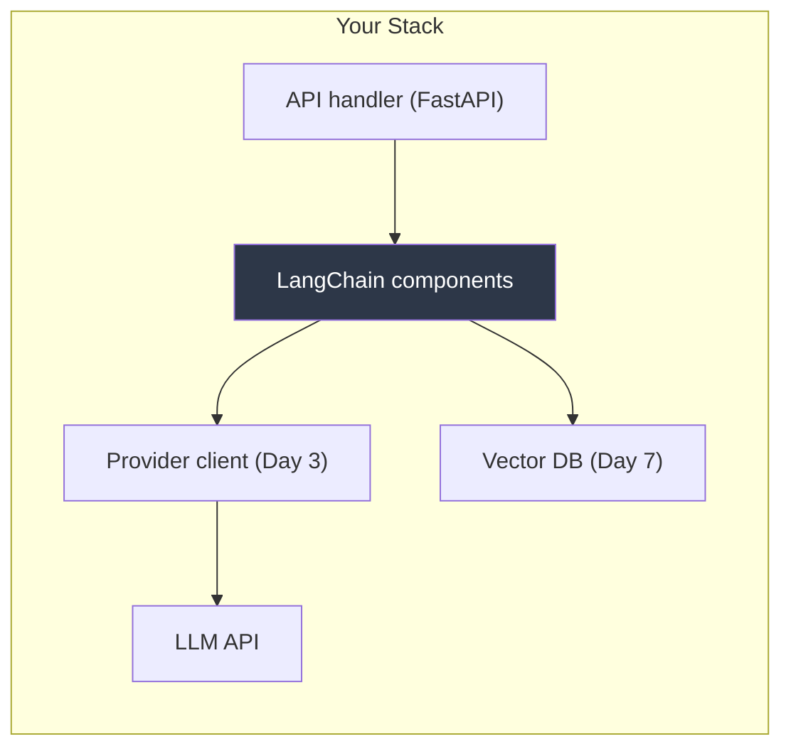
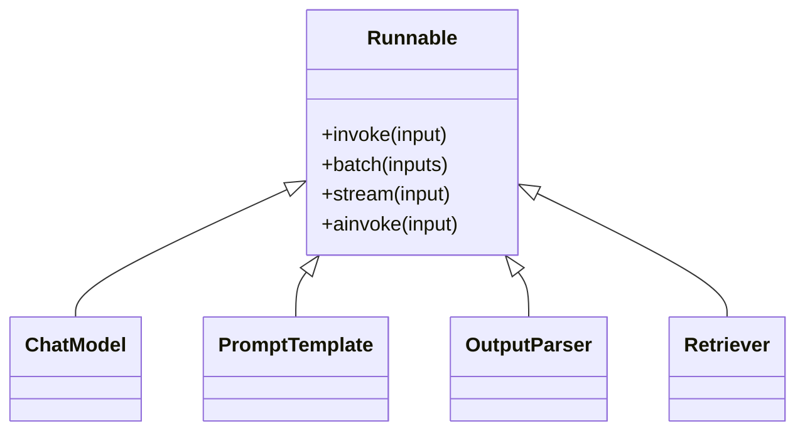
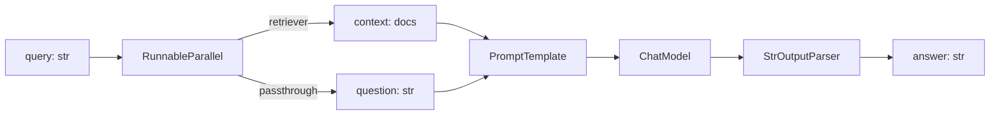
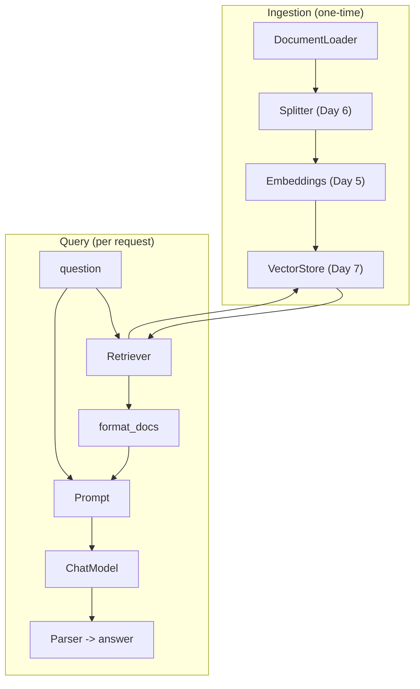
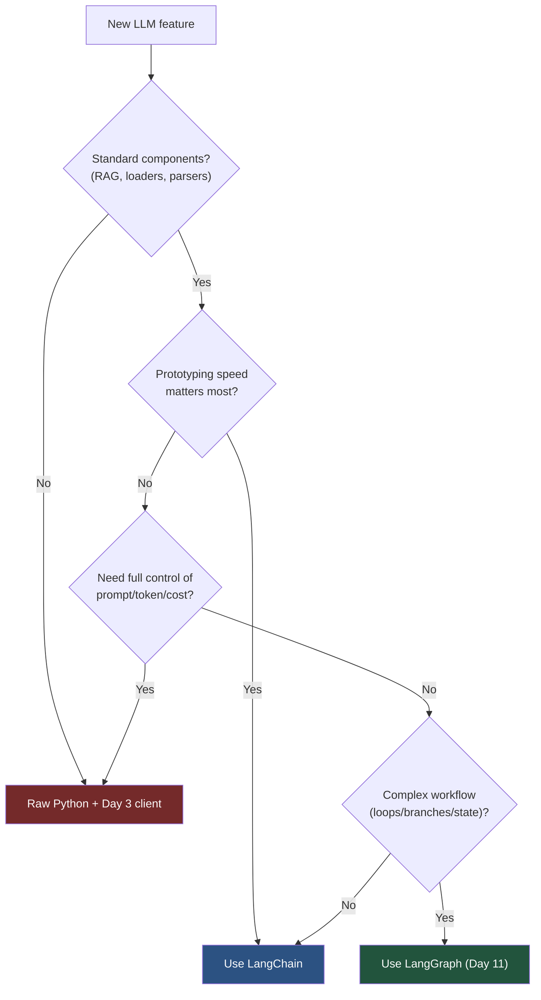
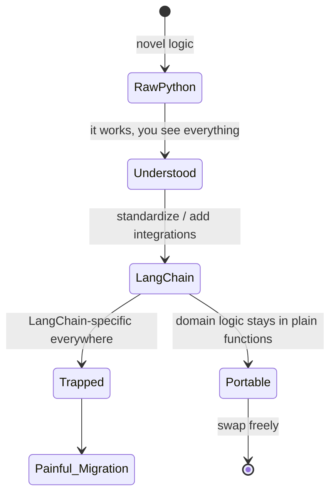

# Day 10 — LangChain (and When Plain Python Wins)

> Series: AI Backend Engineering
>
> **Goal:** Understand what LangChain actually abstracts, re-implement your Day 8 RAG pipeline in it, and develop the judgment to know when the framework earns its keep — and when a for-loop and your Day 3 provider client win.

---

## Table of Contents

1. [The Honest Framing](#1-the-honest-framing)
2. [The Core Abstractions](#2-the-core-abstractions)
3. [LCEL: The Pipe Syntax and Runnables](#3-lcel-the-pipe-syntax-and-runnables)
4. [Re-implementing Day 8 RAG in LangChain](#4-re-implementing-day-8-rag-in-langchain)
5. [Side-by-Side: LOC and Debuggability](#5-side-by-side-loc-and-debuggability)
6. [When LangChain Helps vs When Raw Python Wins](#6-when-langchain-helps-vs-when-raw-python-wins)
7. [The Dark Side](#7-the-dark-side)
8. [Day 10 Self-Check](#8-day-10-self-check)
9. [Tomorrow](#9-tomorrow)
10. [Apply (1 hour)](#10-apply-1-hour)

---

## 1. The Honest Framing

You already built a working RAG pipeline in raw Python on Day 8: a loader, a chunker (Day 6), an embedder (Day 5), a vector DB (Day 7), a retriever, and a prompt-assembly step that fed your Day 3 provider abstraction. It worked. You debugged it with `print()` and a debugger. You saw every token, every prompt, every cost.

So why learn LangChain at all?

**Why.** Because the industry has standardized a *vocabulary* and a *component ecosystem* around it. When a teammate says "swap the retriever" or "add an output parser," they mean specific, composable objects. LangChain (and its orchestration sibling LangGraph, Day 11) both reached **v1.0 in 2026** — they are finally stable enough that the churn that plagued 2023–2024 has largely settled. Most production teams now use **both**: LangChain for the reusable *components* (models, retrievers, parsers, loaders) and LangGraph for the *workflow* (Day 11). Knowing the abstractions means you can read 80% of the AI-backend code you'll encounter.

**What.** LangChain is a library of interoperable interfaces over LLM building blocks — chat models, prompt templates, output parsers, retrievers, document loaders, vector store wrappers — plus **LCEL** (LangChain Expression Language), a composition syntax that wires them together with a `|` pipe operator.

**When.** Reach for it when you want standard components with batteries-included integrations, when prototyping speed matters more than transparency, or when your team already speaks it. Skip it when the task is a single deterministic call, when you need to see and control every prompt/token/cost byte, or when the abstraction cost exceeds what you'd write by hand.

**Where.** In the "components" layer of your stack — below your API handlers, alongside the provider clients you already wrote. LangChain does not replace your web framework, your database, or your auth. It sits where your Day 8 glue code sat.

> Mental model: LangChain is to LLM calls what an ORM is to SQL. It's convenient, standardized, and occasionally hides exactly the thing you need to see. You already know SQL, so you can always drop down. Same principle here.


*LangChain lives in the same slot as your Day 8 glue code — a components layer, not a whole platform.*

> **🤔 Wait — why LangChain when I already built working RAG in plain Python?**
> The honest answer: **for a single linear RAG, you might not need it** — and this note refuses to pretend otherwise. LangChain doesn't make your one pipeline *shorter* (you saw it's ~LOC-neutral). What it buys is **the second, third, and tenth** thing: pre-built loaders for 100+ sources you'd otherwise write by hand, free `.stream()`/`.batch()`/`async` across any chain, one-line provider/vector-DB swaps, and — underrated — a **shared vocabulary** so a new hire reads "add an output parser" and knows exactly what object you mean. The mistake is treating it as all-or-nothing: mature teams use LangChain *components* (models, retrievers, loaders) while keeping their own domain logic in plain functions. It's an ORM for LLM calls — convenient, standardized, and occasionally hides the one byte you need to see.

**✅ Good scenario (where it saves you):** A doc-Q&A SaaS needs to ingest PDFs, Notion, Confluence, Google Drive, and S3 in week one. LangChain's pre-built loaders + splitters + vector-store wrappers turn "three weeks of connector plumbing" into an afternoon, and swapping Pinecone→pgvector to cut cost is a one-line class change instead of a rewrite. The team ships the demo Friday and iterates on retrieval quality instead of glue code.

**❌ Bad scenario (when misused):** A team wraps *every* deterministic single call — a one-shot classification, a fixed template fill — in an LCEL chain "for consistency." Now a prod incident means stepping through `RunnableParallel` frames to find that `context` was a `str` instead of `list[Document]` three components deep, the exact prompt is hidden behind a callback nobody attached, and the token bill can't be traced per call. They inherited framework-debugging-hell for logic that was five readable lines of plain Python.

**When NOT to:** a single deterministic LLM call — a lone classification, a fixed-template summary — doesn't need a chain; one `client.complete()` you can `print()` and breakpoint beats wrapping it in a `Runnable`.

---

## 2. The Core Abstractions

LangChain's power is that everything implements the same `Runnable` interface (more on that in §3). Learn these six object types and you can read most codebases.

### 2.1 Chat Models

**Why.** A uniform wrapper so switching from Anthropic to OpenAI to a local model is one line — the same provider abstraction you hand-rolled on Day 3, now standardized.

```python
from langchain_anthropic import ChatAnthropic
from langchain_core.messages import HumanMessage, SystemMessage

# Verify the current package/model names when you build — the 2026 landscape moves.
model = ChatAnthropic(model="claude-sonnet-4-5", temperature=0.0)

response = model.invoke([
    SystemMessage(content="You are a terse assistant."),
    HumanMessage(content="Define idempotency in one sentence."),
])
print(response.content)
```

**Dark side preview.** `ChatAnthropic(...)` hides the raw request body. When you need to inspect the exact JSON sent (system prompt caching, tool config, beta headers), you're now digging through the wrapper. Your Day 3 client showed you the body directly.

### 2.2 Prompt Templates

**Why.** Separate prompt *structure* from *runtime values*, and get variable validation for free.

```python
from langchain_core.prompts import ChatPromptTemplate

prompt = ChatPromptTemplate.from_messages([
    ("system", "You answer only from CONTEXT. If unknown, say so."),
    ("human", "CONTEXT:\n{context}\n\nQUESTION: {question}"),
])

messages = prompt.invoke({"context": "Redis is in-memory.", "question": "Is Redis on disk?"})
```

**When.** Whenever prompts have variables and you want reuse. **The Dark Side:** template injection — if `{context}` contains untrusted text with its own `{placeholders}`, or a user string breaks your format, you can leak or corrupt the prompt. Sanitize inputs (teaser: Day 19 security).

### 2.3 Output Parsers

**Why.** LLMs return strings; your code wants structured data. Parsers coerce text into JSON, Pydantic models, lists, etc.

```python
from langchain_core.output_parsers import PydanticOutputParser
from pydantic import BaseModel, Field

class Citation(BaseModel):
    answer: str = Field(description="The answer text")
    source_ids: list[str] = Field(description="Chunk IDs used")

parser = PydanticOutputParser(pydantic_object=Citation)
# parser.get_format_instructions() -> inject into the prompt so the model knows the shape
```

**The Dark Side.** Parsers can *silently retry* or *auto-fix* malformed output (e.g., `OutputFixingParser` makes a second LLM call). That's a hidden cost and latency spike you won't see unless you instrument it.

### 2.4 Retrievers

**Why.** A uniform `.invoke(query) -> list[Document]` interface over any backend — the exact retriever role you built on Day 8, now swappable.

### 2.5 Document Loaders and Vector Stores

**Why.** Dozens of pre-built loaders (PDF, HTML, Notion, S3) and vector-store wrappers (pgvector, Pinecone, Chroma, Qdrant) so you don't rewrite ingestion per source.


*Every core object implements one interface — that shared contract is what makes the pipe operator possible.*

---

## 3. LCEL: The Pipe Syntax and Runnables

**Why.** LCEL lets you compose components declaratively with `|`, and you get `invoke`, `batch`, `stream`, and `async` for free across the whole chain. This is the "framework value" LangChain sells.

**What.** A `Runnable` is any object with `.invoke()`. The `|` operator composes them: the output of the left becomes the input of the right — this is just function composition, dressed as a Unix pipe. `RunnablePassthrough` and `RunnableParallel` let you fan data around.

```python
from langchain_core.runnables import RunnableParallel, RunnablePassthrough
from langchain_core.output_parsers import StrOutputParser

chain = (
    RunnableParallel(
        context=retriever,               # query -> docs
        question=RunnablePassthrough(),  # query -> query
    )
    | prompt      # {context, question} -> messages
    | model       # messages -> AIMessage
    | StrOutputParser()   # AIMessage -> str
)

answer: str = chain.invoke("Is Redis persisted to disk?")
```

**How to read it.** Data flows left to right. `RunnableParallel` runs the retriever and the passthrough concurrently, assembling a dict. That dict feeds the prompt, which feeds the model, which feeds the parser.


*The LCEL chain is a directed data-flow graph — elegant to write, but every arrow is a place a value can silently be the wrong shape.*

> **🤔 Wait — why the `|` pipe magic? Isn't `parser(model(prompt(x)))` just plain function composition I already know?**
> Yes — and that's the point, LCEL *is* function composition with a nicer face. The value isn't the syntax; it's that composing with `|` gives you `.invoke()`, `.batch()`, `.stream()`, and `.ainvoke()` on the **whole** chain for free. Write `parser(model(prompt(x)))` by hand and you get streaming and async on *nothing* — you'd re-implement SSE token streaming and concurrency yourself. So the pipe earns its keep exactly when you want those four execution modes without writing them. When you don't (a plain synchronous call), it's ceremony hiding a stack trace.

**✅ Good scenario (where it saves you):** A support-agent product needs the same RAG chain to (a) stream tokens to the web UI, (b) run 500 tickets nightly in a batch job, and (c) serve async under FastAPI. One LCEL chain gives all three from `.stream()`, `.batch()`, `.ainvoke()` — no duplicated pipeline, no hand-rolled SSE.

**❌ Bad scenario (when misused):** A team forces loops and conditional retries into LCEL with nested `RunnableBranch` and `RunnableLambda` hacks. The "chain" becomes an unreadable expression that can't hold state, and debugging why it retried three times means reading library frames — this is precisely the workload that belongs in LangGraph (Day 11), where 70%+ of production agents already live.

**When NOT to:** a linear transform you call once, synchronously, with no streaming or batching need — just call the functions; the pipe adds indirection and buries the stack trace for zero payoff.

**Where.** LCEL shines for linear, stateless transformations. The moment you need loops, branches, retries, or persistent state, LCEL is the wrong tool — that's LangGraph's job (Day 11). LangChain's own 2026 State of Agent Engineering report found **70%+ of production agents use a graph structure**, not linear chains, precisely because real workflows branch.

**The Dark Side.** The `|` operator is elegant until it breaks. A type mismatch three components deep produces a stack trace buried in LCEL internals, not your code. Debugging "why is `context` a string instead of a list of Documents" means stepping through library frames.

---

## 4. Re-implementing Day 8 RAG in LangChain

Here is the RAG you built on Day 8, first in the raw Python you already wrote, then the LangChain equivalent.

### 4.1 Your Day 8 Raw Python (recap)

```python
from my_provider import LLMClient          # your Day 3 abstraction
from my_vectors import VectorStore          # your Day 7 store
from my_embed import embed_query            # your Day 5 embedder

client = LLMClient(provider="anthropic")
store = VectorStore(collection="docs")

def rag_answer(question: str, k: int = 4) -> str:
    q_vec = embed_query(question)
    hits = store.search(q_vec, top_k=k)                  # Day 7
    context = "\n\n".join(h.text for h in hits)          # Day 8 assembly
    prompt = (
        "Answer ONLY from CONTEXT. If unknown, say 'I don't know'.\n"
        f"CONTEXT:\n{context}\n\nQUESTION: {question}"
    )
    # You can SEE the full prompt, count tokens (Day 4), log cost here.
    return client.complete(system="You are precise.", user=prompt)
```

Every step is inspectable. You can `print(prompt)`, count tokens with your Day 4 budgeter, log the exact cost, and set a breakpoint anywhere.

### 4.2 The LangChain Version

```python
from langchain_anthropic import ChatAnthropic
from langchain_core.prompts import ChatPromptTemplate
from langchain_core.output_parsers import StrOutputParser
from langchain_core.runnables import RunnableParallel, RunnablePassthrough
from langchain_community.vectorstores import Chroma
from langchain_openai import OpenAIEmbeddings   # verify package names at build time

embeddings = OpenAIEmbeddings(model="text-embedding-3-small")
store = Chroma(collection_name="docs", embedding_function=embeddings)
retriever = store.as_retriever(search_kwargs={"k": 4})

prompt = ChatPromptTemplate.from_messages([
    ("system", "Answer ONLY from CONTEXT. If unknown, say 'I don't know'."),
    ("human", "CONTEXT:\n{context}\n\nQUESTION: {question}"),
])
model = ChatAnthropic(model="claude-sonnet-4-5", temperature=0.0)

def format_docs(docs) -> str:
    return "\n\n".join(d.page_content for d in docs)

rag_chain = (
    RunnableParallel(
        context=retriever | format_docs,
        question=RunnablePassthrough(),
    )
    | prompt
    | model
    | StrOutputParser()
)

answer = rag_chain.invoke("Is Redis persisted to disk?")
```


*The LangChain RAG maps one-to-one onto the components you already built by hand on Days 5-8 — same architecture, different packaging.*

---

## 5. Side-by-Side: LOC and Debuggability

| Dimension | Raw Python (Day 8) | LangChain |
|---|---|---|
| Lines of glue code | ~18 | ~22 (but fewer for ingestion) |
| Swap vector DB | rewrite `VectorStore` | change one wrapper class |
| Swap provider | your Day 3 flag | change one model class |
| See exact prompt sent | trivial (`print(prompt)`) | needs callbacks/verbose mode |
| See token count / cost | inline (Day 4) | needs a callback handler |
| Set a breakpoint mid-flow | anywhere | inside library frames |
| Add streaming | manual SSE | free (`.stream()`) |
| Add batching | manual | free (`.batch()`) |
| Onboard a LangChain-fluent teammate | they read your code | instantly recognized |
| Stack trace on failure | your file, your line | often deep in LCEL internals |

**The honest verdict.** For *this* linear RAG, LangChain is roughly LOC-neutral. It buys you free streaming/batching, one-line integration swaps, and shared vocabulary. It costs you transparency: to see the exact prompt, token count, and cost, you must attach a callback handler:

```python
from langchain_core.tracers import ConsoleCallbackHandler

answer = rag_chain.invoke(
    "Is Redis persisted to disk?",
    config={"callbacks": [ConsoleCallbackHandler()]},  # now you see the internals
)
```

That extra step is the crux of the trade-off: **the thing you got for free in raw Python (visibility) now costs you an opt-in.**

---

## 6. When LangChain Helps vs When Raw Python Wins


*A decision tree, not a religion — most mature stacks mix raw Python, LangChain components, and LangGraph orchestration.*

| Situation | Winner | Why |
|---|---|---|
| Rapid prototype, standard RAG | LangChain | Batteries included, fast to stand up |
| Many loaders/integrations needed | LangChain | Pre-built connectors save weeks |
| Single deterministic LLM call | Raw Python | A chain is overkill; one `client.complete()` |
| Tight cost/token control per call | Raw Python | You must see every byte |
| Novel prompt engineering, fast iteration | Raw Python | No abstraction between you and the model |
| Team already fluent in LangChain | LangChain | Shared vocabulary, faster reviews |
| Complex multi-step agent | LangGraph (Day 11) | Chains can't loop/branch/persist |
| Latency-critical hot path | Raw Python | No wrapper overhead, full control |

> Rule of thumb: **a for-loop and your Day 3 provider client often beat a chain.** If you can describe the flow in five lines of plain Python and read every prompt, you probably should. Reserve the framework for where its ecosystem and orchestration genuinely pay off.

---

## 7. The Dark Side

This is the section that separates engineers who *use* LangChain from those who get *burned* by it.

### 7.1 Framework Churn and Breaking Changes

LangChain's 2023–2024 reputation was death-by-breaking-change: package splits (`langchain` → `langchain-core`, `langchain-community`, provider packages), renamed classes, deprecated import paths every few weeks. **v1.0 in 2026 stabilized this**, but the lesson stands: pin your versions, read migration guides, and never `pip install langchain` without a lockfile. **Verify current package and class names when you build** — anything printed in a tutorial ages fast.

### 7.2 Debugging Opacity

When a chain fails, the stack trace often points into LangChain internals, not your code. A malformed `RunnableParallel` output surfaces as a cryptic error three frames deep. Mitigations: enable verbose/callback tracing, use LangSmith (their observability product) or your own logging, and **build the raw-Python version first** when the logic is novel — then port to a chain once you understand it.

### 7.3 Abstraction Hiding What You Must See

This is the deepest trap for a backend engineer. LangChain hides:
- **The exact prompt** sent to the model (you need this for prompt engineering and injection audits).
- **Token counts and cost** (you need this for the Day 4 budget and for billing).
- **Retries and auto-fixes** (an `OutputFixingParser` silently doubles your LLM calls).
- **The raw request body** (system-prompt caching, beta features, tool config).

You spent Days 3–4 learning to control exactly these. Don't let a wrapper take them back without a fight — attach callbacks and log the internals.

### 7.4 Lock-In

Building your whole stack on LangChain-specific abstractions (custom Runnables, LCEL-only flows) makes leaving expensive. Keep your *domain logic* (retrieval strategy, prompt design, business rules) in plain functions that LangChain merely *calls*. Then LangChain is a thin adapter you can swap, not a foundation you're welded to — the same dependency-inversion instinct from your System Design notes.


*Keep business logic in plain functions; let the framework be an adapter, and lock-in never happens.*

---

## 8. Day 10 Self-Check

1. What single interface do LangChain's chat models, prompts, parsers, and retrievers all implement, and why does that matter?
2. In LCEL, what does the `|` operator actually do to the data flowing through it?
3. Re-implementing your Day 8 RAG in LangChain was roughly LOC-neutral. What did the framework give you for free, and what did it take away?
4. How do you recover visibility into the exact prompt, token count, and cost once you're inside a chain?
5. Name three things LangChain hides that a backend engineer specifically needs to control.
6. When does a plain for-loop with your Day 3 provider client beat a LangChain chain?
7. What is the risk of an `OutputFixingParser`, and why won't you notice it by default?
8. LangChain reached v1.0 in 2026 — what problem did that stabilize, and what habit should you keep anyway?
9. How do you architect your code so LangChain is an adapter, not a source of lock-in?
10. LangChain's 2026 report says 70%+ of production agents use a graph, not a linear chain. Why can't LCEL express those workflows?

---

## 9. Tomorrow

**Day 11 — LangGraph & Agent Orchestration.** Chains go one direction; real agents loop, branch, retry, and remember. Tomorrow you'll learn why **70%+ of production agents use a graph structure**, why **60%+ of production incidents trace to state management**, and how LangGraph 1.0's durable state and checkpointing let you pause and resume workflows — connecting directly to your System Design durability instincts.

---

## 10. Apply (1 hour)

1. **(20 min)** Take your Day 8 raw-Python RAG and port it to a LangChain LCEL chain using a real vector store wrapper. Get it answering questions.
2. **(15 min)** Attach a `ConsoleCallbackHandler` (or LangSmith) and capture the *exact* prompt sent to the model. Compare it byte-for-byte to what your raw version sent. Note any differences you didn't expect.
3. **(15 min)** Add token counting via a callback and log the cost per query. Confirm you can reproduce the Day 4 budget numbers you had in raw Python.
4. **(10 min)** Write a one-paragraph decision note in your repo: for *your* current project, does LangChain win or does raw Python? Justify it against the §6 table. This judgment is the real deliverable of today.
