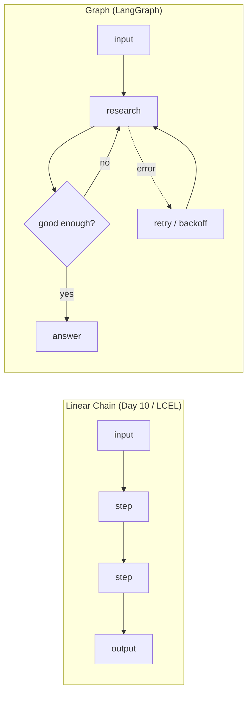
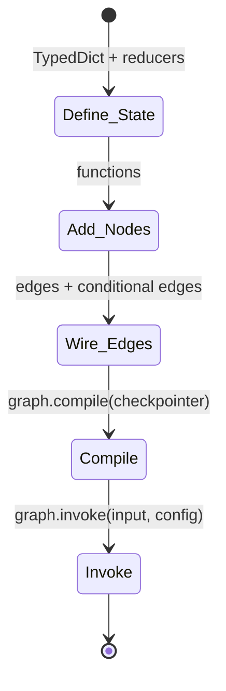
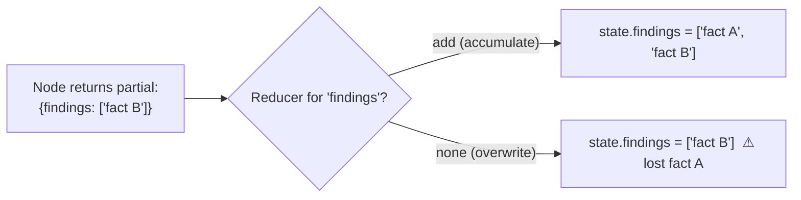
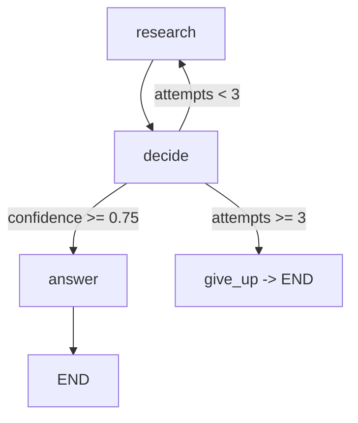
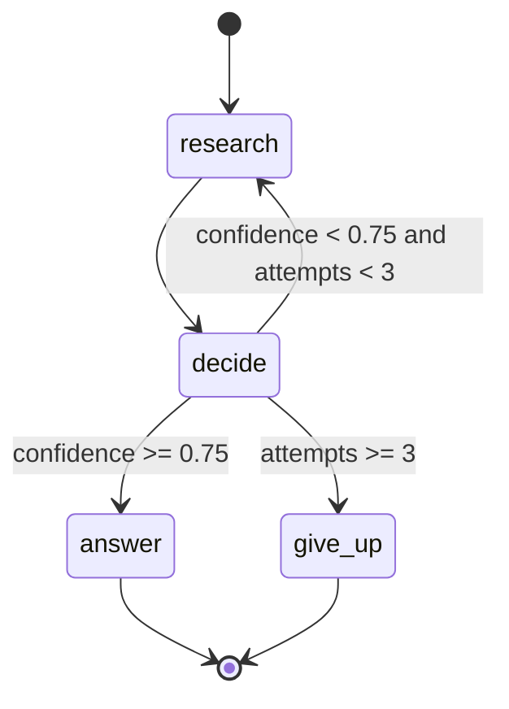
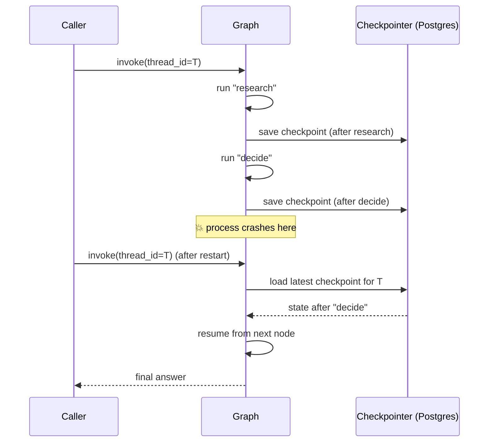
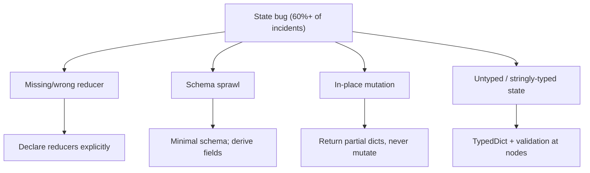
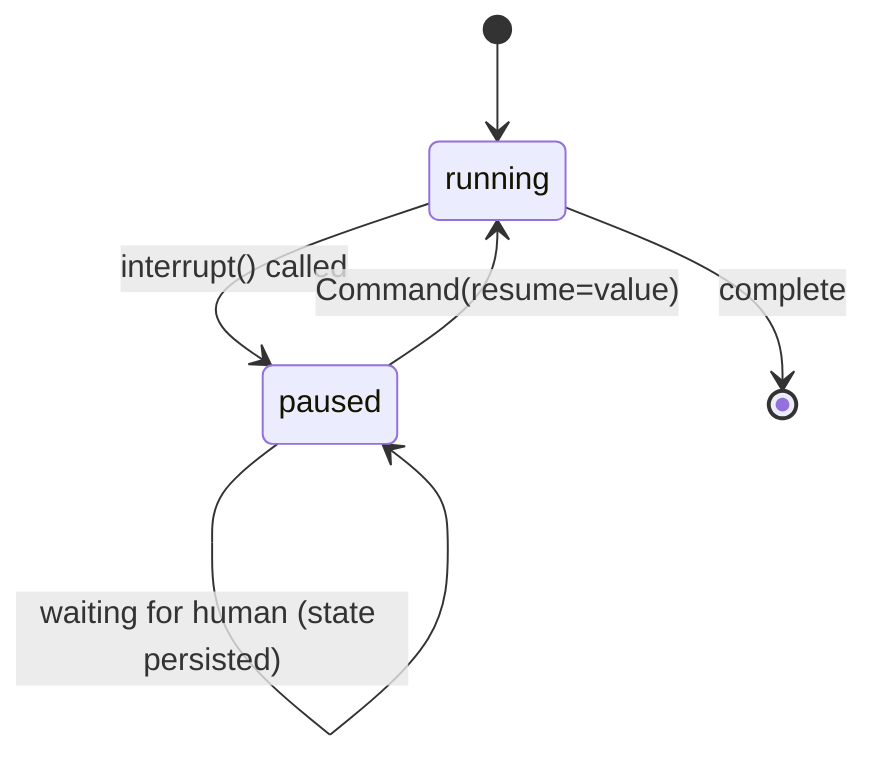
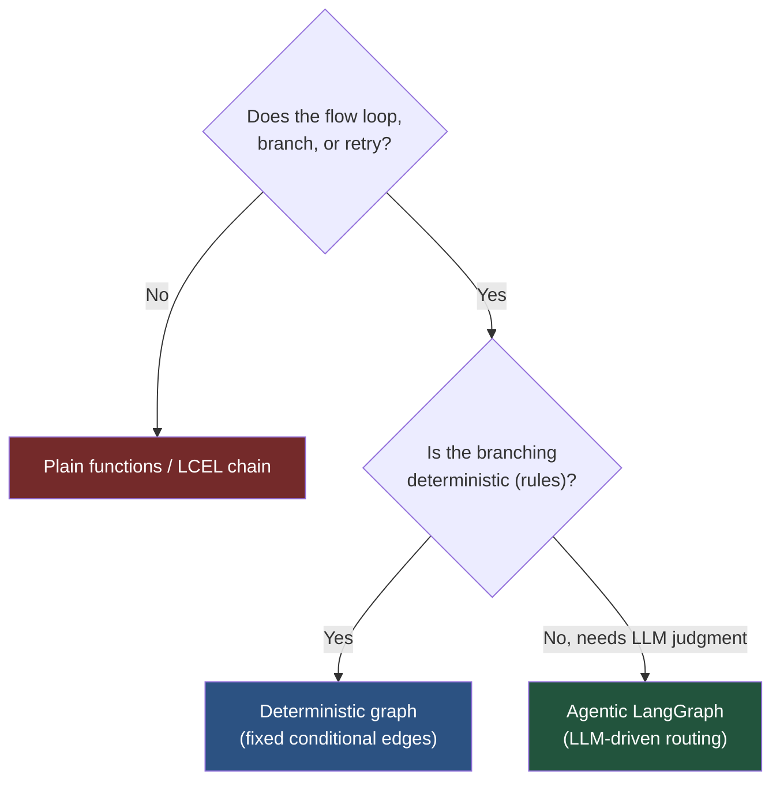

# Day 11 — LangGraph & Agent Orchestration

> Series: AI Backend Engineering
>
> **Goal:** Understand why real agents are graphs, not chains; master LangGraph's typed state, nodes, edges, and conditional edges; and use durable checkpointing to build agents you can pause, resume, and interrupt — treating state as the deliberate design concern it is.

---

## Table of Contents

1. [Why Graphs Beat Linear Chains](#1-why-graphs-beat-linear-chains)
2. [The Core Model: State, Nodes, Edges](#2-the-core-model-state-nodes-edges)
3. [Typed State and Reducer Functions](#3-typed-state-and-reducer-functions)
4. [Conditional Edges: Branching and Loops](#4-conditional-edges-branching-and-loops)
5. [Building a Real Branching Agent](#5-building-a-real-branching-agent)
6. [Durable State and Checkpointing](#6-durable-state-and-checkpointing)
7. [State Management: The #1 Agent Bug Source](#7-state-management-the-1-agent-bug-source)
8. [Human-in-the-Loop, Interrupts, Resumption](#8-human-in-the-loop-interrupts-resumption)
9. [The Dark Side](#9-the-dark-side)
10. [Day 11 Self-Check](#10-day-11-self-check)
11. [Tomorrow](#11-tomorrow)
12. [Apply (1 hour)](#12-apply-1-hour)

---

## 1. Why Graphs Beat Linear Chains

The LCEL chain you built on Day 10 flows in exactly one direction: input → step → step → output. That is a **DAG with no cycles and no branching** — perfect for RAG, useless for agents.

Real agents need to:
- **Loop** — "search again, the results were weak."
- **Branch** — "if confident, answer; else, retry."
- **Retry** — "the tool failed; back off and try once more."
- **Carry multi-step state** — accumulate findings across many steps.

**The data is unambiguous.** LangChain's 2026 *State of Agent Engineering* report found:
- **70%+ of production agents use a graph structure** (a DAG or state machine), not a linear chain.
- **60%+ of production incidents are tied to state management** — the single largest failure category.

Companies running agents at scale — **Uber, LinkedIn, Klarna** — build on **LangGraph**, which reached **v1.0 in 2026** and is the recommended orchestration layer for complex agents. LangGraph is *built on* LangChain: you keep using LangChain components (models, retrievers, parsers from Day 10) as the *work* inside each node, and LangGraph supplies the *workflow*.


*A chain is a pipe; a graph is a control-flow machine — loops, branches, and retries are first-class, not bolted on.*

**Why (deeper).** You already know this shape. A state machine with typed state, transitions, and guards is exactly the **State pattern from your System Design notes**. LangGraph is that pattern applied to LLM workflows, with durability added. If you've built a saga or a workflow engine, LangGraph will feel familiar.

**When to reach for it.** Any workflow with a loop, a branch, a retry, human approval, or state that must survive a crash. **When NOT to** (see §9): a strictly linear, deterministic pipeline — that's a chain or plain functions, and wrapping it in a graph is pure overhead.

> **🤔 Wait — why a graph (LangGraph) when a simple chain already works?**
> Because a chain can only go forward, and real agents need to go *back*. The instant your workflow says "if the results are weak, search again" or "if the tool errored, retry with backoff," you've asked for a **cycle** — and a chain (a DAG) mathematically cannot express a cycle. People try to fake it with recursion or a `while` loop wrapping their chain, and it works until they need to *resume after a crash*, *pause for human approval*, or *see which iteration set which value* — at which point they've hand-rolled a worse LangGraph. The graph isn't heavier machinery for its own sake; it makes loops, branches, retries, and persisted state **first-class**, so you declare them instead of smuggling them in. This is the State pattern from your System Design notes, with durability built in.

**✅ Good scenario (where it saves you):** A research-assistant agent runs a "search → judge → search again if thin → answer" loop that can take 8 steps and 40 seconds. On LangGraph with a Postgres checkpointer, when the pod gets rescheduled mid-run, the agent resumes from the last completed node instead of restarting the whole (paid) LLM loop. Add one `interrupt()` and a human approves the final answer before it reaches the customer — pause-and-resume that can wait hours, holding no process open.

**❌ Bad scenario (when misused / the pain without it):** A team fakes the loop with a plain `while` around an LCEL chain and no state discipline. There's no reducer, so each iteration overwrites `findings` and the agent "forgets" what it learned; there's no recursion guard, so a stubborn low-confidence model loops forever and burns $200 of tokens overnight before anyone notices; and when the box restarts mid-loop, every partial result is gone. This is the 60%+-of-incidents-are-state-management statistic, lived.

**When NOT to:** a fixed 4-step ETL — load, transform, embed, store — with no branch or retry is a for-loop or an LCEL chain; wrapping it in a StateGraph + TypedDict + edges is pure ceremony for control flow that never varies.

---

## 2. The Core Model: State, Nodes, Edges

LangGraph has exactly four concepts. Master these and you can build anything.

| Concept | What it is | Analogy (System Design) |
|---|---|---|
| **State** | A typed dict passed to every node; the single source of truth | The workflow's shared context / saga state |
| **Node** | A plain Python function `(state) -> partial_state` | A step / service call |
| **Edge** | A fixed transition from node A to node B | A hard-coded next-step |
| **Conditional edge** | A function that picks the next node from state | A router / branch / guard |

The lifecycle: **define State schema → add nodes → wire edges → compile → invoke.** Compiling validates the graph (unreachable nodes, missing entry point) before you run it — a compile-time safety net you'll appreciate.


*The build loop is always the same five moves; the art is in the state schema and the conditional edges.*

---

## 3. Typed State and Reducer Functions

**Why.** State is the spine of the whole agent — and the #1 bug source (§7). Typing it deliberately is your best defense.

**What.** State is a `TypedDict` (or Pydantic model). Each node returns a *partial* update; LangGraph merges it into the running state. **How the merge happens is controlled by reducers.**

By default, a returned key *overwrites* the existing value. But some keys should *accumulate* — a message history should append, not replace. That's what `Annotated[..., reducer_fn]` does.

```python
from typing import Annotated, TypedDict
from operator import add
from langchain_core.messages import BaseMessage
from langgraph.graph.message import add_messages


class AgentState(TypedDict):
    # Overwrite semantics (default): the latest value wins.
    question: str
    answer: str
    confidence: float
    attempts: int

    # Accumulate semantics: add_messages appends & de-dupes messages.
    messages: Annotated[list[BaseMessage], add_messages]

    # Accumulate a list of findings across loop iterations.
    findings: Annotated[list[str], add]
```

**How reducers work.** When a node returns `{"findings": ["new fact"]}`, the `add` reducer does `old + new` instead of replacing. Without the reducer, each loop iteration would *wipe* prior findings — a classic, silent state bug.


*Choosing the reducer is choosing overwrite-vs-accumulate — get it wrong and state silently disappears.*

**The Dark Side (preview of §7 & §9).** Reducers are invisible in the node code. A node that "should" accumulate but has no reducer will silently overwrite, and you'll debug a phantom "the agent forgets its findings" bug for an hour. Declare reducers deliberately and comment why.

---

## 4. Conditional Edges: Branching and Loops

**Why.** This is where a graph earns its name. A conditional edge is a function that reads state and returns the *name* of the next node — enabling branches, loops, and retries.

```python
from langgraph.graph import END

def route_after_research(state: AgentState) -> str:
    """Decide: answer, retry the research, or give up."""
    if state["confidence"] >= 0.75:
        return "answer"
    if state["attempts"] >= 3:      # guard against infinite loops (see §9)
        return "give_up"
    return "research"               # loop back
```

You attach it with `add_conditional_edges`, mapping each possible return value to a node:

```python
graph.add_conditional_edges(
    "decide",
    route_after_research,
    {"answer": "answer", "research": "research", "give_up": END},
)
```


*A conditional edge is a guarded transition — the same guard clauses you'd write in a state machine, now steering an LLM loop.*

**When.** Any decision point. **The Dark Side:** every conditional edge needs a termination guarantee. The `attempts >= 3` guard is not optional — without it, a low-confidence model loops forever, burning tokens and money (§9).

---

## 5. Building a Real Branching Agent

Let's build a **research → decide → answer-or-retry** agent with typed state, a conditional edge, and (in §6) a checkpointer. The nodes use your Day 10 LangChain components and your Day 8 retriever as the "work."

```python
from typing import Annotated, TypedDict
from operator import add
from langgraph.graph import StateGraph, START, END
from langchain_anthropic import ChatAnthropic  # verify names at build time

model = ChatAnthropic(model="claude-sonnet-4-5", temperature=0.0)


class ResearchState(TypedDict):
    question: str
    findings: Annotated[list[str], add]   # accumulate across retries
    confidence: float
    attempts: int
    answer: str


def research(state: ResearchState) -> dict:
    """Retrieve/produce evidence. Reuse your Day 8 retriever here."""
    q = state["question"]
    # new_docs = my_retriever.invoke(q)  # Day 8; stubbed below
    new_docs = [f"evidence for '{q}' (attempt {state['attempts'] + 1})"]
    return {
        "findings": new_docs,          # 'add' reducer appends
        "attempts": state["attempts"] + 1,
    }


def decide(state: ResearchState) -> dict:
    """Score how good the accumulated findings are (LLM-as-judge)."""
    prompt = (
        f"Question: {state['question']}\n"
        f"Findings so far:\n{chr(10).join(state['findings'])}\n"
        "Rate 0.0-1.0 how sufficient these are to answer. Reply with only the number."
    )
    raw = model.invoke(prompt).content.strip()
    try:
        conf = float(raw)
    except ValueError:
        conf = 0.0   # defensive: never trust the model's format blindly
    return {"confidence": conf}


def answer(state: ResearchState) -> dict:
    prompt = (
        f"Answer using ONLY these findings:\n{chr(10).join(state['findings'])}\n"
        f"Question: {state['question']}"
    )
    return {"answer": model.invoke(prompt).content}


def give_up(state: ResearchState) -> dict:
    return {"answer": "I couldn't find enough evidence to answer confidently."}


def route(state: ResearchState) -> str:
    if state["confidence"] >= 0.75:
        return "answer"
    if state["attempts"] >= 3:        # hard loop guard
        return "give_up"
    return "research"


# ---- Wire the graph ----
builder = StateGraph(ResearchState)
builder.add_node("research", research)
builder.add_node("decide", decide)
builder.add_node("answer", answer)
builder.add_node("give_up", give_up)

builder.add_edge(START, "research")
builder.add_edge("research", "decide")
builder.add_conditional_edges(
    "decide", route,
    {"answer": "answer", "research": "research", "give_up": "give_up"},
)
builder.add_edge("answer", END)
builder.add_edge("give_up", END)

app = builder.compile()

result = app.invoke({
    "question": "How does Redis persistence work?",
    "findings": [], "confidence": 0.0, "attempts": 0, "answer": "",
})
print(result["answer"])
```


*The concrete agent state machine: a bounded research loop with two exits — a shape you'll reuse constantly.*

Note what LangGraph gave you: the loop, the branch, the accumulating state, and the compile-time validation — none of which LCEL could express. And each node is just a plain function you can unit-test in isolation.

---

## 6. Durable State and Checkpointing

**Why.** Your System Design instincts scream: *what happens if the process crashes mid-loop?* In a raw agent, you lose everything. In LangGraph 1.0, **durable state and built-in checkpointing** persist the state after every node, so you can **resume without custom DB logic**.

**What.** A *checkpointer* is a pluggable store (in-memory for dev, SQLite/Postgres/Redis for prod) that snapshots the full state at each step, keyed by a `thread_id`. This is durability as a first-class feature — the thing you'd normally hand-build with a state table and a resume routine.

```python
from langgraph.checkpoint.memory import InMemorySaver   # dev only
# from langgraph.checkpoint.postgres import PostgresSaver  # prod; verify package

checkpointer = InMemorySaver()
app = builder.compile(checkpointer=checkpointer)

config = {"configurable": {"thread_id": "user-42-session-7"}}

# Run it. Every node's output is persisted under this thread_id.
app.invoke({"question": "...", "findings": [], "confidence": 0.0,
            "attempts": 0, "answer": ""}, config=config)

# Later — even after a restart — inspect or resume from the last checkpoint:
snapshot = app.get_state(config)
print(snapshot.values["attempts"], snapshot.next)
```


*Checkpointing turns a crash from data-loss into a resume — durability you get by passing one argument.*

> **🤔 Wait — why bother with checkpointing? If the process crashes, can't I just re-run the request from the start?**
> Only if re-running is free and side-effect-free — and for agents it's neither. A crashed multi-step agent that "just re-runs" pays for *all* the LLM calls again (the 8-step research loop bills twice), and worse, it may **re-fire side effects** — sending the same email twice, charging a card again, re-filing a ticket — because your tool nodes already ran before the crash. Checkpointing snapshots state after *every* node keyed by `thread_id`, so resume picks up at the next unfinished step: no double-billing tokens, no duplicate side effects, no lost accumulated findings. It's the durability instinct from System Design (idempotency + a state table + a resume routine) handed to you for one constructor argument.

**✅ Good scenario (where it saves you):** A coding-agent product runs long multi-file refactors that take minutes and dozens of tool calls. With a Postgres checkpointer keyed by `thread_id`, a deploy that rolls pods mid-task doesn't lose the user's work — the agent resumes exactly where it stopped, and the user never sees more than a brief pause. Support tickets for "the agent lost my session" drop to zero.

**❌ Bad scenario (when misused):** A team enables checkpointing but lets state sprawl to 30 fields holding full document blobs and raw retrieval dumps. Now every node writes a 200 KB checkpoint to Postgres, throughput tanks, the DB bill climbs, and — because that fat state quietly persists user PII — they've created a data-retention and deletion problem nobody scoped. Durable state amplifies whatever discipline (or sprawl) you feed it.

**When NOT to:** a fast, stateless, single-shot call that's cheap to just retry doesn't need a checkpointer — `InMemorySaver` in dev or nothing at all is fine; durability earns its cost when a run is long, expensive, or fires real side effects.

| Checkpointer | Use for | Trade-off |
|---|---|---|
| `InMemorySaver` | Local dev, tests | Lost on restart |
| SQLite saver | Single-node, small scale | Not horizontally scalable |
| Postgres saver | Production, multi-node | Needs a managed DB (you have one) |
| Redis saver | Fast, ephemeral sessions | Tune persistence/TTL (Day 14) |

**Where.** The checkpointer is exactly where your Day 14 memory work plugs in — the thread state *is* short-term memory. **The Dark Side:** checkpoints store the *entire* state at every step. Fat state schemas (§9) mean fat, slow, expensive checkpoints. Persisted state can also hold PII (teaser: Day 20 privacy) — you now own its lifecycle and deletion.

---

## 7. State Management: The #1 Agent Bug Source

Repeating the stat because it defines the discipline: **60%+ of production agent incidents trace to state management.** Not model quality, not prompts — *state*. Treat it deliberately.

The four classic state bugs and their fixes:

| Bug | Symptom | Fix |
|---|---|---|
| Missing reducer | Agent "forgets" accumulated data each loop | Use `Annotated[list, add]` / `add_messages` |
| Wrong reducer | Duplicated or exploding lists | Match reducer to intent; de-dupe |
| Schema sprawl | 30-field state nobody understands | Keep state minimal; derive, don't store |
| Mutating state in-place | Nondeterministic, un-resumable runs | Return *new* partial dicts, never mutate |


*The state-bug taxonomy — every entry is a discipline, not a feature; this is where production agents live or die.*

**Node contract to enforce on your team:**
1. A node **returns a partial update** — it never mutates `state` in place.
2. Every accumulating key **has a declared reducer**.
3. State stays **minimal and typed**; if a value can be derived, derive it, don't store it.
4. **Validate** model-supplied values before writing them to state (see the `float(raw)` guard in §5).

---

## 8. Human-in-the-Loop, Interrupts, Resumption

**Why.** Some steps need a human: approving a spend, confirming a destructive action (teaser: Day 12 tool side-effects, Day 19 security), or correcting a wrong turn. LangGraph makes this native via **interrupts** — the graph pauses, persists via the checkpointer, and waits.

**What & How.** `interrupt()` inside a node halts execution and surfaces a payload to the caller. Because the checkpointer already persisted the state, the pause can last milliseconds or days. You resume by invoking again with a `Command(resume=...)`.

```python
from langgraph.types import interrupt, Command

def confirm_action(state: ResearchState) -> dict:
    decision = interrupt({
        "prompt": "Approve sending this answer to the customer?",
        "answer": state["answer"],
    })
    if decision != "approve":
        return {"answer": "Held for human review."}
    return {}   # proceed unchanged

# Caller side:
app.invoke(inputs, config=config)          # runs until interrupt, then pauses
# ... human reviews out-of-band, possibly hours later ...
app.invoke(Command(resume="approve"), config=config)   # resumes from the pause
```


*Interrupts + checkpointing = a workflow that can wait for a human without holding a process open — durable pause-and-resume.*

**Where.** Approval gates, escalation to a human agent, and debugging (pause and inspect state). This is only *possible* because of the checkpointer from §6 — durability and human-in-the-loop are the same mechanism.

---

## 9. The Dark Side

### 9.1 Graph Complexity for Linear Problems

If your workflow is genuinely linear — load, retrieve, prompt, answer — a graph is bureaucratic overhead. You'll write a StateGraph, a TypedDict, node functions, and edges to express what three lines of LCEL or plain Python already say. **Use a graph when there's a loop, branch, retry, or persisted state. Otherwise don't.**

### 9.2 State Schema Sprawl

The most insidious long-term rot. State starts with three fields and grows to thirty as every feature bolts on "just one more key." Suddenly nobody knows which fields are live, which reducers fire, or why a checkpoint is 200 KB. Checkpoint size and cost balloon. **Keep state minimal; derive values instead of storing them; delete dead fields aggressively.** Treat the state schema like a database schema — it needs migrations and reviews.

### 9.3 Over-Agentifying Deterministic Workflows

The cardinal sin of 2026 AI backends: turning a deterministic pipeline into an "agent" because agents are fashionable. **A pipeline is not an agent.** If the steps are fixed and the order never changes, an LLM deciding the next step is slower, costlier, non-deterministic, and harder to test than a plain function call. Reserve agentic control flow (LLM-chosen next steps, loops, dynamic branching) for problems that genuinely need adaptivity. For everything else, a DAG of deterministic functions wins — the same discipline you learned Day 10.


*Escalate to agentic control flow only when the problem genuinely needs LLM-driven adaptivity — not because "agent" sounds better than "pipeline."*

### 9.4 Runaway Loops and Cost

Every cycle in the graph is a potential infinite loop. Without a guard (`attempts >= 3`, a recursion limit, a budget cap), a stubborn low-confidence model will loop until your bill notices. LangGraph has a `recursion_limit` config — set it. Combine with the Day 4 token budget to cap spend per run.

---

## 10. Day 11 Self-Check

1. Cite the two headline stats from LangChain's 2026 report and explain what each implies for how you build agents.
2. Name LangGraph's four core concepts and give a System Design analogy for each.
3. What does a reducer function do, and what silent bug appears if you forget one on an accumulating key?
4. Write the return-value contract for a well-behaved node (four rules).
5. What is a conditional edge, and why must every loop through one have a termination guard?
6. How does a checkpointer turn a mid-loop crash from data-loss into a resume? What keys the persisted state?
7. Why are checkpointing and human-in-the-loop interrupts fundamentally the same mechanism?
8. Give three symptoms of state schema sprawl and the discipline that prevents it.
9. A colleague wants to rebuild a fixed 4-step ETL pipeline as a LangGraph agent. What's your argument against it?
10. Where does today's checkpointer/thread-state connect to the memory work coming on Day 14?

---

## 11. Tomorrow

**Day 12 — Tool Calling & Function Calling.** Your agent's nodes so far only *think* and *retrieve*. Tomorrow they get *hands*: the model emits a structured tool call, your code executes it, and you feed the result back so the model can continue. You'll run the tool-use loop framework-free with your Day 3 provider first, design robust tool schemas, guard against infinite tool loops and hallucinated tools, and only then see LangGraph's prebuilt agent.

---

## 12. Apply (1 hour)

1. **(30 min)** Build the §5 research→decide→answer-or-retry agent for real, wiring the `research` node to your Day 8 retriever. Make the conditional edge loop at least once on a hard question and terminate via the `attempts` guard on an unanswerable one.
2. **(15 min)** Add a Postgres (or SQLite) checkpointer with a `thread_id`. Run halfway, kill the process, restart, and resume from the checkpoint. Confirm `findings` survived intact — that's your reducer working.
3. **(10 min)** Add an `interrupt()` approval gate before the `answer` node. Pause, inspect the state, then resume with `Command(resume="approve")`.
4. **(5 min)** Deliberately remove the `add` reducer from `findings`, re-run the loop, and watch the agent "forget" prior findings. Put it back. You just reproduced the #1 production agent bug in miniature — never forget the feeling.
