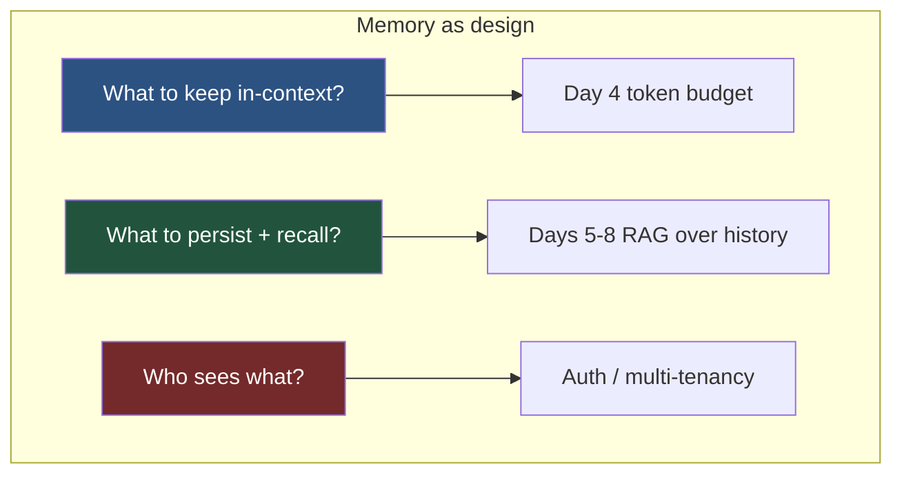
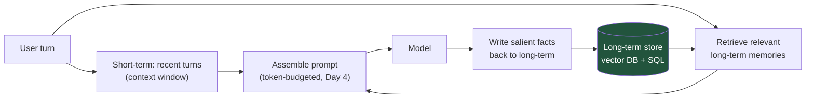
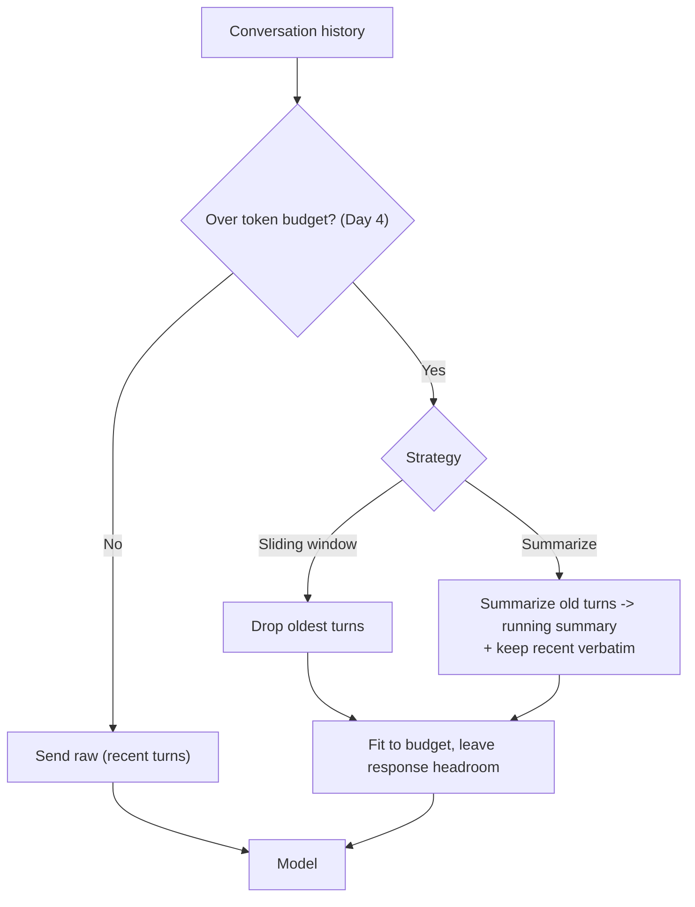
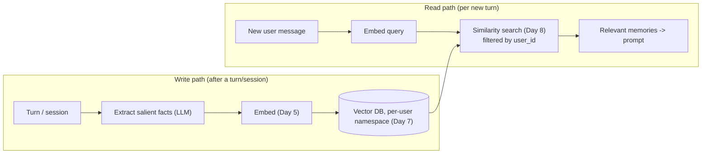
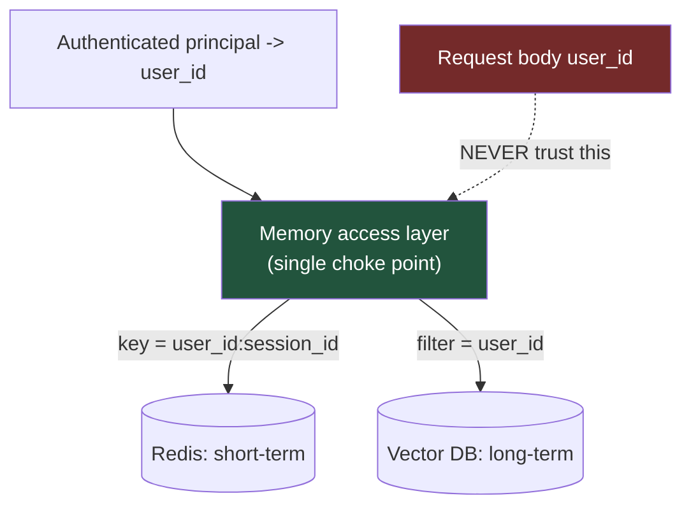
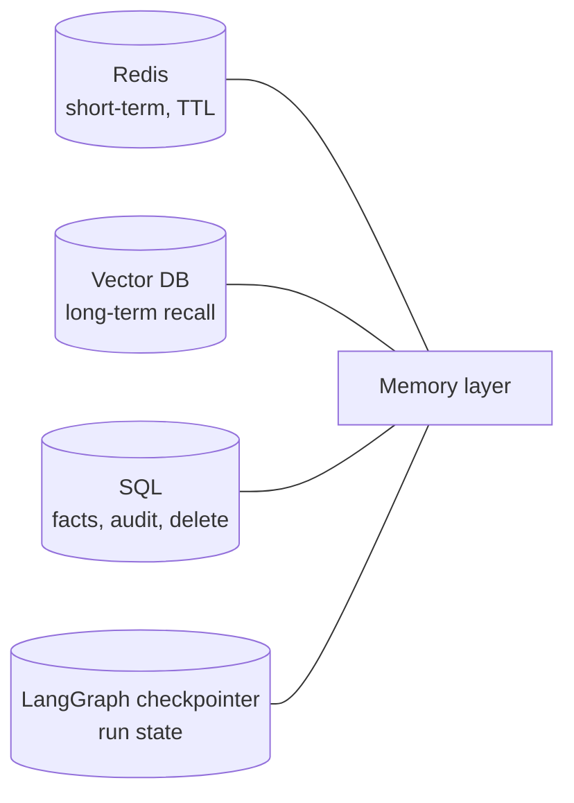
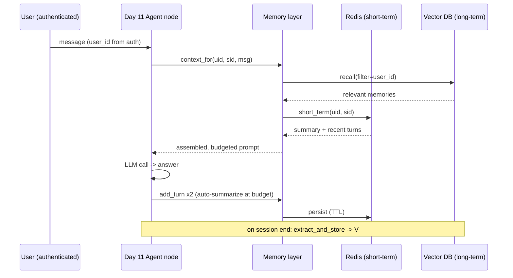
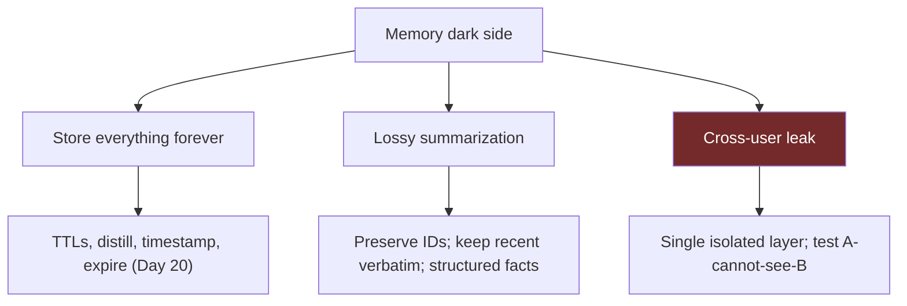

# Day 14 — AI Memory

> Series: AI Backend Engineering
>
> **Goal:** Treat memory as a deliberate design concern independent of any framework — short-term conversation buffers vs long-term persisted recall — using summarization and token budgeting (Day 4), retrieval memory as RAG over your own history (Days 5-8), and strict per-user isolation so you never leak one user's memory to another.

---

## Table of Contents

1. [Memory Is a Design Concern, Not a Feature](#1-memory-is-a-design-concern-not-a-feature)
2. [Short-Term vs Long-Term Memory](#2-short-term-vs-long-term-memory)
3. [Conversation History Management](#3-conversation-history-management)
4. [Retrieval Memory: RAG Over Your Own History](#4-retrieval-memory-rag-over-your-own-history)
5. [Session Management and Per-User Isolation](#5-session-management-and-per-user-isolation)
6. [Memory Store Choices](#6-memory-store-choices)
7. [Building a Memory Class](#7-building-a-memory-class)
8. [Wiring Memory to the Day 11 Agent](#8-wiring-memory-to-the-day-11-agent)
9. [The Dark Side](#9-the-dark-side)
10. [Day 14 Self-Check](#10-day-14-self-check)
11. [Tomorrow](#11-tomorrow)
12. [Apply (1 hour)](#12-apply-1-hour)

---

## 1. Memory Is a Design Concern, Not a Feature

Everything you built this week is amnesiac. The tool loop (Day 12), the agent graph (Day 11), the MCP server (Day 13) — none of them remember a user across sessions unless *you* design memory in. LLMs are stateless functions: the only thing they "know" in a given call is what's in the context window you send.

**Why frame it as design, not a library.** Because memory is really three familiar backend problems wearing a new hat:
- **What to keep in the request** (context-window budgeting — Day 4).
- **What to persist and how to recall it** (storage + retrieval — RAG, Days 5-8).
- **Who can see what** (multi-tenant isolation — your auth/tenancy instincts).

No framework decides these for you correctly. LangGraph's checkpointer (Day 11 §6) gives you a *place* to put short-term state, and vector DBs (Day 7) give you a *place* for long-term recall — but the *policy* (what to remember, summarize, forget, isolate) is your design.


*Memory isn't a plugin — it's three backend problems you already know: budgeting, retrieval, and isolation.*

> **🤔 Wait — why design memory at all? Doesn't the context window already "remember" the conversation?**
> The context window remembers exactly one thing: **whatever you re-send on this specific API call.** It is not a place data lives — the model is a stateless function, so the moment the request returns, it "forgets" everything. What feels like memory in a chat UI is your backend *re-sending the whole transcript every turn*. That illusion breaks in two ways fast: (1) the transcript grows past the window (or past your token budget) and early turns must be dropped or summarized, and (2) a *new session tomorrow* starts blank — the window never spanned sessions to begin with. So "memory" is really two design jobs the window can't do: compressing within a session to fit the budget (Day 4), and persisting *across* sessions so you can recall relevant facts later (RAG, Days 5-8). The window is RAM; memory is deciding what to keep in RAM and what to page to disk.

**✅ Good scenario (where it saves you):** A support-assistant SaaS distills durable facts after each chat — "plan: Enterprise, prefers email, order 8841 open." When the same customer returns three weeks later and says "any update?", the agent recalls the open order and answers instantly instead of re-asking everything. Retrieval memory (Day 8 RAG over history) injects only the ~5 relevant facts, so the prompt stays small and cheap while feeling like the assistant *knows* the user.

**❌ Bad scenario (the pain without it / when misused):** A team "adds memory" by just never trimming the transcript and re-sending it all every turn. By turn 80 each call sends 30k tokens, latency doubles, the bill per message climbs steadily, and one long conversation finally overflows the window — dropping the early turn that held the account number, so the model starts hallucinating it. No budget policy, no summarization, no cross-session persistence: the "memory" was an accident of re-sending, and it collapsed under its own weight.

**When NOT to:** a single-turn, stateless tool — a one-shot classifier or a "summarize this pasted text" endpoint — doesn't need a memory system; there's no conversation to compress and nothing to recall, so Redis + a vector store is pure overhead.

---

## 2. Short-Term vs Long-Term Memory

The foundational split.

| | Short-term memory | Long-term memory |
|---|---|---|
| Scope | Within one conversation/session | Across sessions, indefinitely |
| Lives in | The context window (the messages you send) | A persisted store (vector DB, SQL) |
| Bounded by | Context-window size + token budget (Day 4) | Storage + retrieval budget |
| Access | Included verbatim (or summarized) each call | Retrieved on demand by relevance |
| Analogy | RAM / working set | Disk / long-term store |
| Store | In-memory, Redis | Vector DB + SQL |
| Failure mode | Overflow the window; lose early turns | Recall stale/wrong facts (§9) |

**Why the split matters.** Short-term is *cheap to access but scarce* (every token costs money and there's a hard ceiling). Long-term is *abundant but must be searched* (you can't dump a user's entire history into every prompt — you retrieve only what's relevant). This is exactly the RAM-vs-disk trade-off from your systems background: keep the hot working set close, page the rest in on demand.


*The memory taxonomy in motion: recent turns stay in-context, relevant history is retrieved, and salient new facts are written back.*

---

## 3. Conversation History Management

Short-term memory is a queue of messages that will eventually exceed the window. Four strategies, escalating in sophistication. Reuse your **Day 4 token budgeting** throughout — decisions are driven by *token count*, not message count.

**1. Raw window (keep everything).** Simplest: send the full history every turn. Works until it doesn't — one long conversation blows the context window and the cost per call climbs every turn.

**2. Sliding window (keep last N).** Keep the most recent N turns (or last N tokens); drop the oldest. Bounded and cheap, but the model forgets anything older — bad for long support conversations where early context matters.

**3. Summarization / running summary.** When history exceeds a threshold, summarize the older turns into a compact running summary and keep recent turns verbatim. Preserves the gist of the whole conversation within a fixed budget. Costs an extra LLM call to summarize.

**4. Token-budget-aware trimming.** The production approach: allocate a fixed token budget (Day 4) — e.g., "system prompt + summary + last K turns + retrieved memories ≤ 8k tokens" — and trim/summarize to fit, always leaving headroom for the model's response.


*History-compression strategies all serve one master: the token budget from Day 4 — leave headroom for the answer.*

| Strategy | Cost | Keeps early context? | Best for |
|---|---|---|---|
| Raw window | High, grows | Yes (until overflow) | Short chats |
| Sliding window | Low, bounded | No | Long, recency-dominated chats |
| Running summary | +1 LLM call | Yes (lossy) | Long support/assistant sessions |
| Budget-aware trim | Tuned | Yes (hybrid) | Production default |

```python
def build_short_term(messages: list[dict], summary: str, budget_tokens: int,
                     count_tokens) -> list[dict]:
    """Keep a running summary + as many recent turns as fit the budget (Day 4)."""
    out: list[dict] = []
    if summary:
        out.append({"role": "system", "content": f"Conversation so far: {summary}"})
    used = count_tokens(out)
    for msg in reversed(messages):                 # newest first
        t = count_tokens([msg])
        if used + t > budget_tokens:
            break                                  # older turns fall to summary
        out.insert(1 if summary else 0, msg)
        used += t
    return out
```

**The Dark Side (preview §9):** summarization is lossy. The one detail the summary drops ("the customer's order ID is 8841") may be the one that mattered.

---

## 4. Retrieval Memory: RAG Over Your Own History

**The key realization: long-term memory is RAG (Day 8) pointed at your own conversation history and learned facts instead of documents.** Everything you built Days 5-8 applies directly.

**Why.** You can't fit a user's entire history in the window, and most of it is irrelevant to the current turn. So you *embed* past turns/facts (Day 5), store them in a vector DB (Day 7), and at query time *retrieve the most relevant memories* (Day 8) to inject into the prompt — exactly the retrieval you already know.

**What to store.** Two flavors:
- **Episodic** — raw past turns/events ("on 2026-06-01 the user asked about refunds").
- **Semantic / facts** — distilled durable facts ("user prefers metric units", "user's plan is Enterprise"). Often extracted by an LLM after a session.


*Retrieval memory is the Day 8 RAG pipeline aimed at your own history — embed, store per-user, retrieve by relevance, inject.*

```python
def recall(self, user_id: str, query: str, k: int = 5) -> list[str]:
    q_vec = embed_query(query)                       # Day 5
    hits = self.vectors.search(                      # Day 7/8
        q_vec, top_k=k,
        filter={"user_id": user_id},                 # ISOLATION — never optional (§5)
    )
    return [h.text for h in hits]
```

Note the `filter={"user_id": user_id}` — retrieval memory without a tenant filter is a data breach waiting to happen (§5, §9).

---

## 5. Session Management and Per-User Isolation

**Why this is the highest-stakes part of the file.** A memory bug is not a wrong answer — it's **user A seeing user B's data.** That's a privacy incident, a compliance violation, and a trust-destroyer. Apply the same **multi-tenancy and auth instincts** you use for any per-user data.

**Session management.** A *session* is one conversation, keyed by a `session_id` (short-term memory scope). A *user* owns many sessions (long-term memory scope). Map them explicitly:

```
user_id  ─┬─ session_id_1  → short-term buffer (Redis)
          ├─ session_id_2  → short-term buffer (Redis)
          └─ long-term memories (vector DB, namespaced by user_id)
```

**Per-user isolation — the non-negotiable rules:**
1. **Every read and write carries `user_id`** — no query without a tenant filter.
2. **Namespace or partition the store per user** (separate collection/namespace, or a mandatory `user_id` filter enforced in a single access layer — never sprinkled around).
3. **Derive `user_id` from the authenticated principal**, never from a request body the client controls (that's IDOR — reuse your auth knowledge).
4. **Short-term buffers are keyed by `{user_id}:{session_id}`** so a session can never be fetched without its owner.

```python
class MemoryAccess:
    """Single choke point — isolation enforced here, nowhere else."""
    def _short_key(self, user_id: str, session_id: str) -> str:
        return f"mem:{user_id}:{session_id}"          # user_id always first

    def recall(self, user_id: str, query: str, k: int = 5) -> list[str]:
        # user_id filter is structurally required — you can't call recall without it
        return self.vectors.search(embed_query(query), top_k=k,
                                   filter={"user_id": user_id})
```


*Isolation lives in one access layer, keyed by the authenticated user_id — never trust a client-supplied id, and never scatter the filter.*

> **🤔 Wait — why obsess over per-user isolation? It's just a `WHERE user_id = ...` filter, isn't it?**
> It's a one-line filter whose *absence* is a data breach, not a wrong answer — and that asymmetry is the whole point. In a normal CRUD app a missing tenant filter shows user A a list of user B's records; bad, but visible and bounded. In memory, a missing filter feeds user B's private facts *into user A's model context*, and the LLM blends them into a fluent, confident answer — so the leak is invisible (no error, no stack trace) and unbounded (any past conversation of any user). Worse, the vector index blurs everything into one semantic space, so without a hard filter a similarity search *will* surface another tenant's memories as "relevant." "Just a filter" is exactly why it's dangerous: it's trivial to forget in one of forty call sites, which is why it must live in a single choke point that makes calling `recall` *without* a `user_id` structurally impossible.

**✅ Good scenario (where it saves you):** A doc-Q&A product routes every memory read/write through one `MemoryAccess` layer that derives `user_id` from the auth token and refuses to build a query without it. A CI test asserts `recall(user_B)` never returns user_A's data. When a new feature adds a "recall preferences" path months later, it *has* to go through the choke point, so isolation is inherited for free — no forty-call-site audit, no leak.

**❌ Bad scenario (the pain without it):** An engineer adds a quick "recent memories" endpoint that reads the vector store directly and takes `user_id` from the request JSON "to keep it simple." An attacker (or just a buggy client) passes someone else's id, and now user A is reading user B's medical questions and account details — an IDOR breach that ships silently because the response looks perfectly normal. This is the failure that ends up in an incident postmortem and a compliance filing.

**When NOT to (there is almost no exception):** only a genuinely single-tenant, single-user deployment — a personal local assistant with exactly one human — can relax per-user isolation; the instant a second user exists, the filter is non-negotiable.

---

## 6. Memory Store Choices

Match the store to the access pattern — the same "right tool for the job" thinking from your systems work.

| Need | Store | Why |
|---|---|---|
| Short-term session buffer | **Redis** | Fast, TTL for auto-expiry, per-key isolation — reuse your Redis knowledge |
| Long-term semantic recall | **Vector DB** (Day 7) | Similarity search over embedded memories |
| Durable facts / relational | **SQL** (your DB) | Structured facts, joins, audit, right-to-delete (§9) |
| Agent run state / resume | **LangGraph checkpointer** (Day 11 §6) | Thread state = short-term memory, persisted |

**Redis for short-term** — TTL is the feature: set a session buffer to expire after, say, 24h of inactivity, and stale sessions clean themselves up (privacy + cost, §9). **Vector DB for long-term** — namespaced per user. **SQL** for facts you must query/audit/delete precisely (a vector store is bad at "delete everything about user X for GDPR" — you need structured records too).


*A memory system is usually polyglot: Redis for hot session state, a vector DB for recall, SQL for auditable facts.*

---

## 7. Building a Memory Class

A `Memory` class combining **summarizing short-term** (Redis + running summary) with **vector-backed long-term recall** — framework-independent, isolation-first.

```python
from dataclasses import dataclass, field
from typing import Callable, Protocol


class VectorStore(Protocol):
    def upsert(self, text: str, vector: list[float], metadata: dict) -> None: ...
    def search(self, vector: list[float], top_k: int, filter: dict) -> list["Hit"]: ...


@dataclass
class Hit:
    text: str
    score: float


class Memory:
    """Short-term (Redis + running summary) + long-term (vector recall), per-user isolated."""

    def __init__(self, redis, vectors: VectorStore, llm, embed: Callable[[str], list[float]],
                 count_tokens: Callable[[list[dict]], int], short_budget: int = 3000) -> None:
        self.redis = redis
        self.vectors = vectors
        self.llm = llm                 # your Day 3 provider (for summarization + extraction)
        self.embed = embed             # Day 5
        self.count_tokens = count_tokens  # Day 4
        self.short_budget = short_budget

    # ---------- keys (isolation) ----------
    def _msgs_key(self, uid: str, sid: str) -> str:
        return f"mem:{uid}:{sid}:msgs"

    def _summary_key(self, uid: str, sid: str) -> str:
        return f"mem:{uid}:{sid}:summary"

    # ---------- short-term ----------
    def add_turn(self, uid: str, sid: str, role: str, content: str, ttl: int = 86400) -> None:
        self.redis.rpush(self._msgs_key(uid, sid), f"{role}:{content}")
        self.redis.expire(self._msgs_key(uid, sid), ttl)     # auto-expire stale sessions
        self._maybe_summarize(uid, sid)

    def _maybe_summarize(self, uid: str, sid: str) -> None:
        raw = self.redis.lrange(self._msgs_key(uid, sid), 0, -1)
        msgs = [{"role": r.split(":", 1)[0], "content": r.split(":", 1)[1]} for r in raw]
        if self.count_tokens(msgs) <= self.short_budget:
            return
        # Summarize the OLDER half, keep the recent half verbatim.
        cut = len(msgs) // 2
        old, recent = msgs[:cut], msgs[cut:]
        prior = self.redis.get(self._summary_key(uid, sid)) or ""
        summary = self.llm.complete(
            system="Summarize this conversation, preserving names, IDs, decisions, and open questions.",
            user=f"PRIOR SUMMARY:\n{prior}\n\nNEW TURNS:\n{old}",
        )
        self.redis.set(self._summary_key(uid, sid), summary, ex=86400)
        self.redis.delete(self._msgs_key(uid, sid))
        for m in recent:
            self.redis.rpush(self._msgs_key(uid, sid), f"{m['role']}:{m['content']}")

    def short_term(self, uid: str, sid: str) -> list[dict]:
        out: list[dict] = []
        if summary := self.redis.get(self._summary_key(uid, sid)):
            out.append({"role": "system", "content": f"Conversation so far: {summary}"})
        for r in self.redis.lrange(self._msgs_key(uid, sid), 0, -1):
            role, content = r.split(":", 1)
            out.append({"role": role, "content": content})
        return out

    # ---------- long-term ----------
    def remember_fact(self, uid: str, fact: str) -> None:
        """Persist a durable fact, namespaced by user (isolation)."""
        self.vectors.upsert(fact, self.embed(fact), metadata={"user_id": uid})

    def extract_and_store(self, uid: str, sid: str) -> None:
        """After a session, distill durable facts and persist them (semantic memory)."""
        convo = self.short_term(uid, sid)
        facts = self.llm.complete(
            system="Extract durable user facts (preferences, IDs, decisions) as a bullet list. "
                   "Omit ephemeral chit-chat.",
            user=str(convo),
        )
        for line in (f.strip("- ").strip() for f in facts.splitlines() if f.strip()):
            self.remember_fact(uid, line)

    def recall(self, uid: str, query: str, k: int = 5) -> list[str]:
        hits = self.vectors.search(self.embed(query), top_k=k, filter={"user_id": uid})
        return [h.text for h in hits]   # user_id filter = isolation, always

    # ---------- assemble the prompt ----------
    def context_for(self, uid: str, sid: str, user_msg: str) -> list[dict]:
        memories = self.recall(uid, user_msg)
        blocks: list[dict] = []
        if memories:
            blocks.append({"role": "system",
                           "content": "Relevant memories:\n- " + "\n- ".join(memories)})
        blocks.extend(self.short_term(uid, sid))
        blocks.append({"role": "user", "content": user_msg})
        return blocks
```

Every store touch carries `user_id`. Short-term auto-summarizes at the token budget (Day 4). Long-term recall is Day 8 RAG filtered by tenant.

---

## 8. Wiring Memory to the Day 11 Agent

Drop `Memory` into the Day 11 agent so nodes read/write memory through the isolated layer. The `user_id`/`session_id` ride in the graph config (like the `thread_id` checkpointer key from Day 11 §6).

```python
memory = Memory(redis, vectors, llm=client, embed=embed_query,
                count_tokens=count_tokens, short_budget=3000)

def respond(state: "AgentState", config: dict) -> dict:
    uid = config["configurable"]["user_id"]        # from authenticated principal (§5)
    sid = config["configurable"]["session_id"]
    user_msg = state["question"]

    prompt_msgs = memory.context_for(uid, sid, user_msg)   # short + long-term, isolated
    answer = client.chat(messages=prompt_msgs).text

    memory.add_turn(uid, sid, "user", user_msg)
    memory.add_turn(uid, sid, "assistant", answer)         # triggers budget-aware summarize
    return {"answer": answer}

# On session end, distill durable facts to long-term:
# memory.extract_and_store(uid, sid)
```


*Memory plugs into the agent through one isolated layer — recall on the way in, persist on the way out, distill on session end.*

---

## 9. The Dark Side

**Storing everything forever.** The lazy default — persist every turn indefinitely — is a triple liability: **cost** (unbounded vector-store growth), **privacy** (you're now a data-retention risk), and **stale facts poisoning answers** (a memory that "user works at Acme" outlives their job change and the model confidently asserts it). Set TTLs, distill instead of hoard, timestamp facts and prefer recent ones, and expire or re-verify old memories. **PII and right-to-delete** (a user's legal right to have their data erased) mean you must be able to *find and delete* everything about a user — which is why SQL/structured records (§6) matter alongside the vector store. Fuller treatment: **Day 20 privacy/compliance.**

**Summarization losing critical detail.** Compression is lossy by definition. The running summary that drops "order ID 8841" or "user is allergic to penicillin" turns a helpful assistant into a dangerous one. Mitigations: summarize with an explicit instruction to preserve names/IDs/decisions (see §7), keep recent turns verbatim, and store high-stakes facts as *structured records*, not prose summaries.

**Memory bugs are wrong-user data leaks.** Repeating §5 because it's the one that ends careers: a missing `user_id` filter, a mis-keyed Redis entry, or a `user_id` trusted from the request body means **user A gets user B's memories.** This is not a bug ticket — it's a breach. Enforce isolation in a single access layer, key everything by the authenticated `user_id`, test isolation explicitly (a test that asserts user A *cannot* retrieve user B's memory), and never trust client-supplied identifiers.


*Three failure classes, three disciplines — and the cross-user leak is the one that must never happen.*

---

## 10. Day 14 Self-Check

1. Why is memory better understood as a design concern than as a framework feature? Which three backend problems is it made of?
2. Contrast short-term and long-term memory across scope, storage, and access pattern. What's the RAM/disk analogy?
3. Name the four conversation-history strategies and when each is appropriate. What single constraint (from Day 4) drives them all?
4. Explain how long-term memory is "RAG over your own history." Which Day 5-8 pieces map to which memory operations?
5. What's the difference between episodic and semantic memory, and how do you produce semantic facts?
6. List the four rules of per-user isolation. Why must `user_id` come from the authenticated principal, not the request body?
7. Which stores fit short-term, long-term recall, and auditable facts respectively, and why is the system usually polyglot?
8. Why does the memory access layer have exactly one choke point instead of scattering the `user_id` filter?
9. Give the three failure classes in the dark side and one mitigation for each. Which one is a breach, not a bug?
10. How do timestamps and TTLs defend against stale facts poisoning answers, and how does that connect to Day 20?

---

## 11. Tomorrow

You've now built the full modern agent stack: LangChain components (Day 10), LangGraph orchestration with durable state (Day 11), tool calling (Day 12), MCP (Day 13), and memory (Day 14). Next you'll turn to making it *production-safe and observable* — evaluation, guardrails, security (the Day 19 teasers finally land), and the operational concerns that separate a demo from a system real users trust.

---

## 12. Apply (1 hour)

1. **(25 min)** Implement the §7 `Memory` class against real Redis and your Day 7 vector store. Wire short-term add/summarize and long-term remember/recall. Confirm summarization fires when a conversation crosses your token budget.
2. **(15 min)** Connect it to your Day 11 agent (§8): recall on the way in, persist on the way out. Have a multi-turn conversation, end the session, run `extract_and_store`, start a *new* session, and confirm the agent recalls a fact from the earlier one.
3. **(15 min)** Write an isolation test: create memories for `user_A` and `user_B`, then assert that `recall(user_B, ...)` never returns `user_A`'s data. Make it pass. This test is your breach insurance.
4. **(5 min)** Add a TTL to short-term buffers and a timestamp to long-term facts. Write one sentence on how you'd honor a "delete everything about this user" request — and note it for Day 20.
