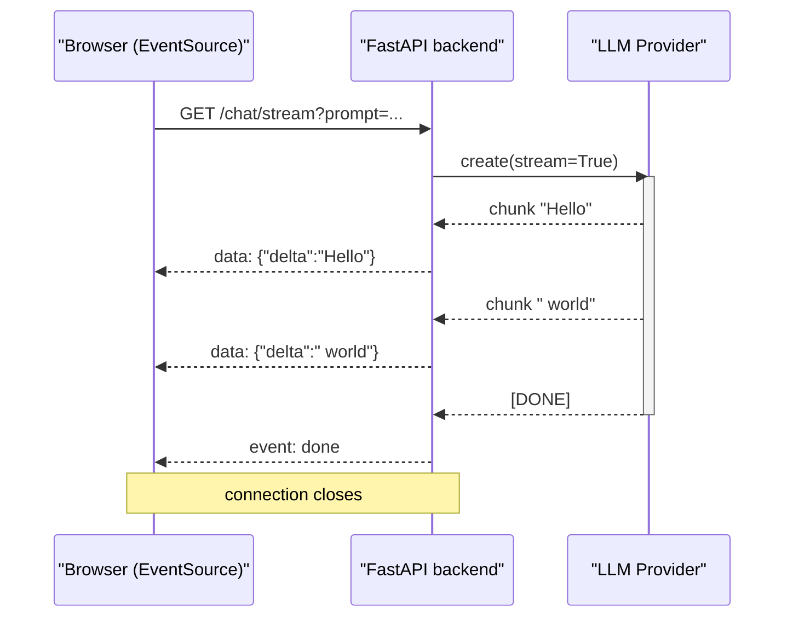
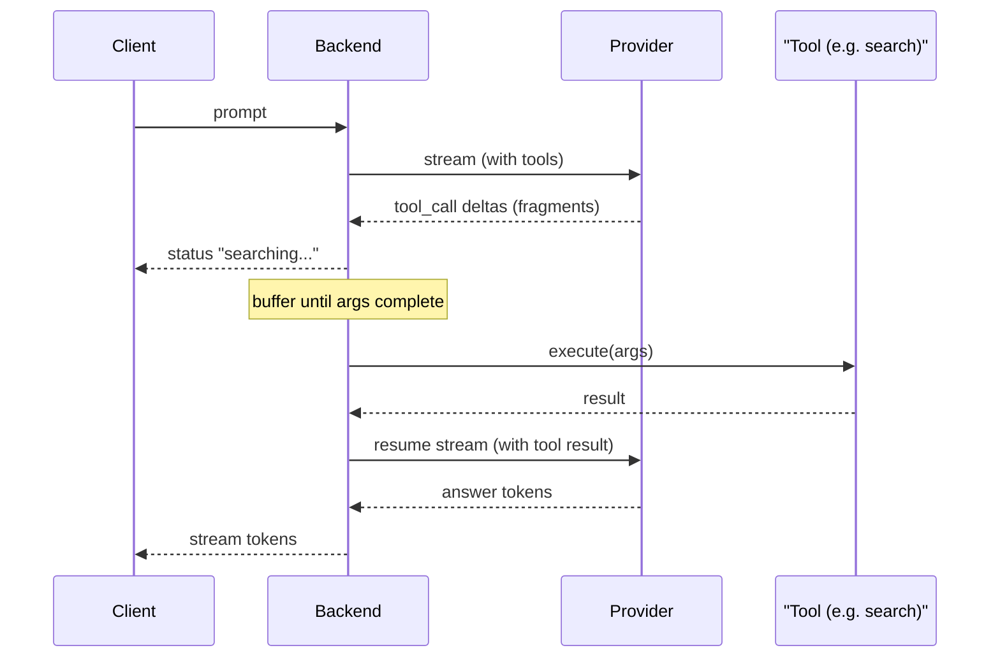
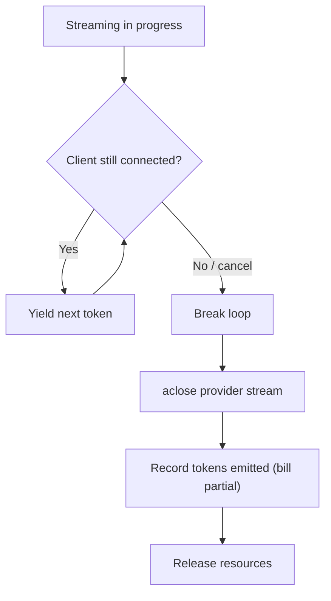
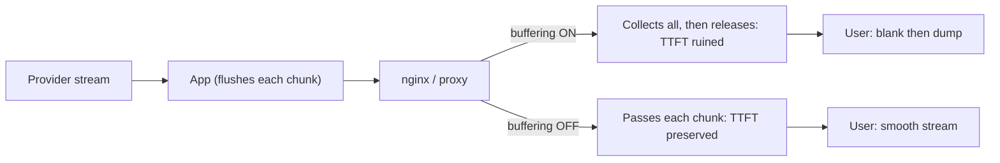

# Day 15 — Streaming & Real-Time Delivery

> Series: AI Backend Engineering
> Goal: Deliver LLM output token-by-token so your product *feels* fast — and survive the hard parts (tool calls, cancellation, mid-stream errors, buffering proxies) that break naive streaming in production.

This is the stage where your **System Design** muscle starts paying real dividends. Streaming LLM output is *not* a new concept — it's SSE and WebSockets (System Design Day 8), backpressure, timeouts, and load balancer behavior applied to a new payload. We lean on that hard today.

---

## Table of Contents

1. [Why stream at all (perceived latency)](#1-why-stream-at-all)
2. [SSE vs WebSockets for LLM output](#2-sse-vs-websockets)
3. [Backend architecture: async generators end-to-end](#3-backend-architecture)
4. [Wiring it to your provider abstraction (AI Day 3)](#4-wiring-to-the-provider-abstraction)
5. [The hard combination: streaming + tool calls + structured output](#5-the-hard-combination)
6. [Cancellation: client disconnects, stop the meter](#6-cancellation)
7. [Timeouts, buffering vs flushing](#7-timeouts-buffering-vs-flushing)
8. [The Dark Side](#8-the-dark-side)
9. [Day 15 Self-Check](#9-day-15-self-check)
10. [Tomorrow](#10-tomorrow)
11. [Apply (1 hour)](#11-apply-1-hour)

---

## 1. Why stream at all

### Why
A non-streaming chat completion for a 600-token answer can take **8–20 seconds**. If the user stares at a spinner for 12 seconds, they assume it's broken and leave. If the *first word* appears in 400ms and the rest flows steadily, they'll happily read along for 12 seconds. **Perceived latency is the product.**

The key metric split:

- **TTFT (Time To First Token)** — how long until the *first* chunk hits the screen. This is what users feel as "responsiveness."
- **Total generation time** — how long until the *last* token. This is bounded by model speed (tokens/sec) and output length; you mostly cannot shrink it.

Streaming trades nothing on total time but collapses *perceived* latency to TTFT. This is the single highest-leverage UX change in an LLM product.

### What
Streaming = the server emits partial output as the model produces it, over a long-lived HTTP response (SSE) or socket (WebSocket), instead of buffering the whole completion and returning it in one shot.

### When
- Chat UX, long-form generation, agent step narration → **stream** (default in July 2026).
- Short classification/extraction returning a single JSON object the client can't use until complete → **don't stream** (a spinner + 1.5s is fine; see Dark Side).
- Background/batch jobs where no human waits → **don't stream**, use an async job (Day 17).

### How
Compare the two experiences on a timeline.

```mermaid
gantt
    title "Perceived latency: buffered vs streamed (same total time)"
    dateFormat X
    axisFormat %Ss
    section Buffered
    "User waits (blank screen)" :crit, 0, 12
    "Full answer appears"       :done, 12, 13
    section Streamed
    "TTFT — first token"        :active, 0, 1
    "Tokens flow, user reads"   :done, 1, 12
```


*Same total time; streaming moves the felt cost from 12s of silence to ~0.4s.*

### Where
The streaming boundary spans three hops: **client ↔ your backend ↔ provider**. Every hop must stream — a single buffering layer (a proxy, a load balancer, a framework default) collapses the whole benefit. Hold that thought for the Dark Side.

### The Dark Side
Streaming is *contagious complexity*. Once you stream, error handling, cancellation, retries, and testing all get harder (you can't just `try/except` a return value). If a spinner plus a 2-second response is acceptable UX, streaming may be pure cost. **Stream because the latency demands it, not because it looks cool.**

> **🤔 Wait — why stream tokens if the answer is fast anyway?**
> Two different "fasts" are being conflated. "Fast" as in *total time* — how long until the last token — is set by the model's tokens/sec and the answer length, and streaming does **nothing** for it. What streaming collapses is *perceived* time: **TTFT (Time To First Token)**. A 600-token answer that takes 12 seconds end-to-end feels broken as 12s of blank spinner, and feels responsive if the first words appear in 400ms and flow steadily while the user reads. So the question answers itself: if your answer genuinely *is* fast — a sub-second classification, a 40-token yes/no — there's nothing to stream and a spinner is honest. Streaming pays off precisely when total time is *long* but you can start delivering early. It buys perceived latency, not real latency — and that's the whole UX game for chat and long-form generation.

**✅ Good scenario (where it saves you):** A coding-assistant product streams a 800-token explanation-plus-diff. Total generation is ~10s, but TTFT is ~350ms, so the developer starts reading the reasoning immediately and cancels early once they see the fix they needed — saving both their time and the tokens the model would have kept generating. Engagement and satisfaction jump with zero change to model speed.

**❌ Bad scenario (when misused):** A team bolts streaming onto a structured-extraction endpoint that returns a single JSON object the client can't use until it's complete. Now they've inherited in-band error frames, cancellation handling, proxy-buffering bugs, and stateful tests — all to "stream" a 900ms response the user waits for anyway before anything renders. Pure complexity, zero UX gain; a spinner would have been strictly better.

**When NOT to:** a short response the client can't act on until it's whole — a classification, a small JSON object, a 1.5s extraction — shouldn't stream; a spinner plus the full result avoids all of streaming's contagious complexity for no felt benefit.

---

## 2. SSE vs WebSockets

### Why
LLM token output is a **one-way firehose**: server → client. You rarely need the client to interrupt mid-token with new data (typing "stop" is a *separate* request, not an inbound socket message). Choosing the heavier transport "just in case" costs you complexity forever.

### What
- **SSE (Server-Sent Events)** — plain HTTP, `Content-Type: text/event-stream`, server pushes `data:` lines, unidirectional, auto-reconnect built into the browser `EventSource`, rides normal HTTP infra.
- **WebSocket** — full-duplex TCP upgrade, bidirectional, but you own reconnection, heartbeats, and framing.

Both are from **System Design Day 8 (real-time delivery)** — this is that lesson applied to tokens.

### When / comparison

| Dimension | SSE | WebSocket |
|---|---|---|
| Directionality | Server → client only | Full duplex |
| Protocol | Plain HTTP/1.1 or HTTP/2 | TCP upgrade (`101 Switching`) |
| Reconnect | Built into `EventSource` | You build it |
| Proxy/LB friendliness | High (looks like HTTP) | Lower (upgrade must be allowed) |
| Auth | Standard headers/cookies | Trickier (no custom headers in browser WS) |
| Backpressure | HTTP-native | Manual |
| Best for | **Token streaming, chat output** | Live collab, voice, bidirectional agents |
| Complexity | Low | Higher |

**Verdict for July 2026: most chat streaming uses SSE.** Reach for WebSockets only when the *client* must push a continuous stream too (live audio/voice agents, collaborative cursors). "User clicked stop" and "user sent next message" are ordinary HTTP requests — they do not justify WebSockets.

### How
The SSE wire format is trivially simple — that's the point:

```
data: {"delta": "Hello"}

data: {"delta": " world"}

event: done
data: {"finish_reason": "stop"}

```
Each event is `data:` lines terminated by a blank line. An `event:` line names a custom event type. That's the entire protocol.

### Where
SSE lives behind your normal API gateway and load balancer. WebSockets often need explicit LB config for the upgrade handshake and sticky/long-lived connections — one more reason SSE wins for token streaming.

### The Dark Side
SSE over **HTTP/1.1** consumes one of the browser's ~6 connections-per-host. If you open several SSE streams from one page, you starve other requests. HTTP/2 multiplexing fixes this — make sure your edge speaks it. WebSocket's dark side: you *will* forget heartbeats and discover dead half-open connections in production.

---

## 3. Backend architecture

### Why
The clean way to stream in Python is an **async generator** that yields chunks. It composes naturally: provider async-iterator → your transform generator → FastAPI response. Backpressure is handled for you — if the client is slow, `await` on the write pauses your generator, which pauses your pull from the provider.

### What
`async def` + `yield`. FastAPI's `StreamingResponse` (or `sse-starlette`'s `EventSourceResponse`) consumes an async generator and flushes each yielded piece.

### How — a full, runnable SSE endpoint

```python
from __future__ import annotations

import asyncio
import json
from collections.abc import AsyncIterator

from fastapi import FastAPI, Request
from sse_starlette.sse import EventSourceResponse  # sse-starlette>=2.x

app = FastAPI()


async def fake_provider_stream(prompt: str) -> AsyncIterator[str]:
    """Stand-in for a real provider stream. Replace with AI Day 3 client."""
    for token in f"You said: {prompt}. Here is a streamed reply.".split():
        await asyncio.sleep(0.05)  # simulate model token cadence
        yield token + " "


async def sse_generator(request: Request, prompt: str) -> AsyncIterator[dict]:
    """Yield SSE events; stop cleanly if the client disconnects."""
    try:
        async for token in fake_provider_stream(prompt):
            if await request.is_disconnected():  # cancellation, see section 6
                break
            yield {"event": "token", "data": json.dumps({"delta": token})}
        yield {"event": "done", "data": json.dumps({"finish_reason": "stop"})}
    except Exception as exc:  # mid-stream error signalling, see Dark Side
        yield {"event": "error", "data": json.dumps({"message": str(exc)})}


@app.get("/chat/stream")
async def chat_stream(request: Request, prompt: str) -> EventSourceResponse:
    return EventSourceResponse(
        sse_generator(request, prompt),
        headers={
            "Cache-Control": "no-cache",
            "X-Accel-Buffering": "no",  # tell nginx NOT to buffer (Dark Side)
        },
    )
```

### The sequence


*Every hop stays streaming; the backend is a thin transform between provider and client.*

### When
Use `EventSourceResponse` (from `sse-starlette`) when you want proper SSE semantics (event names, retry, ping/keepalive). Use raw `StreamingResponse` only for non-SSE byte streams. Use plain string yields when you control both ends and don't need the SSE contract.

### Where
This generator sits in your API layer. Keep the provider call and any RAG retrieval *upstream* of the stream start — you want retrieval done before TTFT, then stream only generation.

### The Dark Side
`async` generators that hold DB connections or provider clients across every `yield` keep those resources pinned for the *entire* stream duration (could be 30s). Acquire what you need, start the stream, and don't hold pooled connections open across the whole yield loop or you'll exhaust the pool under load.

---

## 4. Wiring to the provider abstraction

### Why
On **AI Day 3** you built a provider-agnostic interface. Streaming must live *behind* that abstraction so switching OpenAI ↔ Anthropic ↔ local doesn't rewrite your endpoint. Each provider's stream shape differs (OpenAI `choices[0].delta.content`, Anthropic `content_block_delta`), so the adapter normalizes them to a single chunk type.

### What
A `StreamChunk` dataclass and an `astream()` method on the provider protocol that yields normalized chunks.

### How

```python
from __future__ import annotations

from collections.abc import AsyncIterator
from dataclasses import dataclass
from typing import Protocol


@dataclass(slots=True)
class StreamChunk:
    delta: str = ""                 # incremental text
    tool_call_delta: dict | None = None  # partial tool-call args, section 5
    finish_reason: str | None = None
    usage: dict | None = None       # tokens, arrives at end for billing


class LLMProvider(Protocol):
    async def astream(
        self, messages: list[dict], **params: object
    ) -> AsyncIterator[StreamChunk]: ...


class OpenAIAdapter:
    def __init__(self, client) -> None:  # AsyncOpenAI
        self._client = client

    async def astream(
        self, messages: list[dict], **params: object
    ) -> AsyncIterator[StreamChunk]:
        stream = await self._client.chat.completions.create(
            messages=messages, stream=True,
            stream_options={"include_usage": True}, **params,
        )
        async for event in stream:
            if not event.choices:
                if event.usage:
                    yield StreamChunk(usage=event.usage.model_dump())
                continue
            choice = event.choices[0]
            delta = choice.delta
            yield StreamChunk(
                delta=delta.content or "",
                finish_reason=choice.finish_reason,
            )
```

Now the endpoint from section 3 just iterates `provider.astream(...)` and forwards `chunk.delta` — provider swaps are invisible to the transport layer. This is the **provider abstraction from AI Day 3** doing exactly what it was built for.

### When
Add `include_usage` (OpenAI) or read the final `message_delta` usage (Anthropic) so you still capture token counts for the **cost cascade from AI Day 4** — streaming must not blind your billing.

### Where
The adapter is the *only* place that knows a vendor's wire format. Everything downstream sees `StreamChunk`.

### The Dark Side
Usage/token data arrives at the *end* of the stream (or not at all if the client disconnects). If you bill from usage, a cancelled stream leaves you estimating from tokens-emitted-so-far. Track emitted tokens yourself as you go; don't rely solely on the final usage event.

---

## 5. The hard combination

Streaming + **tool calls** + **structured output** is where naive designs fall apart.

### Why it's hard
You can only validate a JSON object or execute a tool call once its arguments are **complete**. But streaming gives you *fragments*: `{"loc` … `ation":"Par` … `is"}`. You cannot parse or act mid-fragment. So the elegant "stream everything" dream collides with the "I need the whole thing to be valid" reality.

### What actually happens
A tool-calling turn is really *phases*:

1. Model streams a **tool call** (function name + argument fragments).
2. Fragments assemble into complete JSON args.
3. Your backend **executes** the tool.
4. You feed the result back and the model streams the **final answer**.

So a single user turn can involve two streamed segments with a non-streamed tool execution in the middle.

### How — patterns

**Pattern A — stream-then-tool-then-resume (recommended).** Accumulate tool-call deltas silently, execute when complete, then stream the follow-up answer to the user. The user sees text stream only *after* tools run (optionally show a "searching…" status during the gap).

```python
async def run_turn(provider, messages, tools, execute_tool) -> AsyncIterator[dict]:
    tool_args_buf: dict[int, str] = {}   # index -> accumulated JSON string
    tool_names: dict[int, str] = {}

    async for chunk in provider.astream(messages, tools=tools):
        if chunk.tool_call_delta:  # phase 1: accumulate, DO NOT parse yet
            tc = chunk.tool_call_delta
            idx = tc["index"]
            tool_names.setdefault(idx, tc.get("name", tool_names.get(idx, "")))
            tool_args_buf[idx] = tool_args_buf.get(idx, "") + tc.get("arguments", "")
            yield {"event": "status", "data": "calling tool..."}
        elif chunk.delta:  # plain text (no tool this turn)
            yield {"event": "token", "data": chunk.delta}

        if chunk.finish_reason == "tool_calls":  # phase 2/3: now complete
            import json
            for idx, raw in tool_args_buf.items():
                args = json.loads(raw)  # safe: full JSON now
                result = await execute_tool(tool_names[idx], args)
                messages.append({"role": "tool", "content": json.dumps(result)})
            # phase 4: resume — stream the final grounded answer
            async for c in provider.astream(messages):
                if c.delta:
                    yield {"event": "token", "data": c.delta}
```

**Pattern B — partial-parse for structured output.** If you're streaming a big JSON object to render progressively (e.g., a form filling in), use a *tolerant/partial* JSON parser (libraries exist that close open braces/strings to yield a best-effort object). Render optimistically; only trust it on the final complete parse. Never *act* on partial JSON — only *display* it.

### Diagram


*Two streamed segments bracket a non-streamed tool execution.*

### When
- Structured output the client *acts on* (executes, saves) → wait for complete + validate. Streaming is display-only.
- Structured output the client only *renders* → partial-parse is fine.

### Where
The buffering of tool-call fragments happens in your orchestration layer — never expose raw fragments to the client as if they were final.

### The Dark Side
Models sometimes stream tool-call JSON that *never* validates (truncation, hallucinated schema). If you `json.loads` blindly, you crash mid-stream. Always wrap in try/except and have a repair/retry-or-fail path — and remember a failed parse still cost you tokens.

---

## 6. Cancellation

### Why
If the user closes the tab, hits "stop," or navigates away, you must **stop generation and stop billing**. Every token the model produces after the user left is pure waste — you pay the provider for output nobody reads. At scale this is real money and real GPU contention.

> **🤔 Wait — why handle cancellation? If the user leaves, the request just ends, doesn't it?**
> The *client* connection ends, but your backend and the *provider* stream don't automatically know or care. Unless you detect the disconnect and propagate it, your generator keeps pulling tokens from the provider — and you keep **paying** for output nobody will ever read, while holding a worker and a GPU slot the provider is billing you for. A "fast" abandoned request is cheap to leak; a 30-second agent answer abandoned at token 20 leaks the other 580 tokens times every user who tabs away. At scale that's a real line on the invoice and real capacity stolen from users who are still watching. Cancellation is stopping the meter, not just tidying up.

**✅ Good scenario (where it saves you):** A high-traffic support chat checks `is_disconnected()` each iteration and `aclose()`s the provider stream in `finally`. When users get their answer and close the tab mid-generation (common — people leave once they see enough), the backend stops within a token or two and bills only what was emitted. Across millions of sessions that's a double-digit-percent cut in output-token spend and freed concurrency headroom.

**❌ Bad scenario (the pain without it):** An agent product streams long answers but never checks for disconnect. Users routinely abandon slow generations, yet every stream runs to completion server-side against the provider. The token bill is mysteriously higher than the UI-visible usage, workers stay pinned on dead connections, and under load the pool exhausts — an outage caused entirely by paying for tokens no human received.

**When NOT to:** a sub-second, single-shot response that finishes before a user could realistically cancel doesn't need disconnect plumbing — there's no meaningful window to stop, so the `finally`/`aclose` ceremony buys nothing.

### What
Detect client disconnect → break your generator loop → the provider stream is closed (context-manager/`aclose`) → provider stops generating (for providers that honor early close).

### How
FastAPI/Starlette exposes `await request.is_disconnected()`. Check it each iteration (shown in section 3). For explicit "stop" buttons, the cleanest design is a **separate** `POST /chat/{id}/cancel` that flips a flag or cancels an `asyncio.Task`.

```python
async def cancellable_stream(request, provider, messages) -> AsyncIterator[dict]:
    stream_cm = provider.astream(messages)
    try:
        async for chunk in stream_cm:
            if await request.is_disconnected():
                break                    # stop pulling from provider
            if chunk.delta:
                yield {"event": "token", "data": chunk.delta}
    finally:
        aclose = getattr(stream_cm, "aclose", None)
        if aclose:
            await aclose()               # close underlying provider connection
        # record tokens emitted so far for billing even on cancel
```

### Flow


*Disconnect must reach all the way back to the provider — otherwise you keep paying.*

### When
Always implement cancellation for user-facing streams. Skip it only for sub-second responses where it can't matter.

### Where
Cancellation lives in the generator's loop + `finally`. The billing record must survive cancellation, so write usage in `finally`, not after the loop.

### The Dark Side
Disconnect detection is **not instant** — `is_disconnected()` may lag until the next write attempt fails, so you can generate a few extra tokens post-disconnect. Also: if an intermediate proxy buffers, your backend may *think* the client is connected long after it left. Test cancellation through your *real* proxy stack, not just locally.

---

## 7. Timeouts, buffering vs flushing

### Why
LLM calls are slow and variable. Without deliberate timeouts, one stuck upstream stream pins a worker forever. And if any layer buffers instead of flushing, TTFT silently balloons — your streaming code is correct but the user still stares at a blank screen.

### What
- **TTFT timeout** — how long you'll wait for the *first* chunk before failing over.
- **Idle/inter-token timeout** — max gap between chunks (detects a stalled stream).
- **Total budget** — hard ceiling on the whole stream.
- **Flushing** — forcing bytes out per chunk rather than accumulating.

### How — layered timeouts on a stream

```python
import asyncio
from collections.abc import AsyncIterator

async def with_stream_timeouts(
    stream: AsyncIterator[StreamChunk],
    ttft_s: float = 8.0,
    idle_s: float = 20.0,
) -> AsyncIterator[StreamChunk]:
    it = stream.__aiter__()
    first = True
    while True:
        try:
            budget = ttft_s if first else idle_s
            chunk = await asyncio.wait_for(it.__anext__(), timeout=budget)
        except StopAsyncIteration:
            return
        except asyncio.TimeoutError:
            raise TimeoutError(
                "no first token" if first else "stream stalled"
            )
        first = False
        yield chunk
```

### Buffering — the silent killer
Your app streams perfectly, but between it and the user sit an **nginx reverse proxy** and a **load balancer** (System Design Day 12). Their defaults *buffer* upstream responses. Result: they collect the whole completion, then release it — total time unchanged, but TTFT ruined and streaming pointless.

Fixes:
- Set response header `X-Accel-Buffering: no` (nginx).
- Disable `proxy_buffering` for the SSE route.
- Ensure `Content-Encoding` gzip isn't buffering the stream; disable compression for `text/event-stream`.
- Confirm the LB does per-chunk pass-through (this is the **load balancing knowledge from System Design Day 12** applied — know your LB's buffering mode).


*Correct app code is worthless if a proxy buffers the stream — reuse your LB/proxy knowledge.*

### When
Set TTFT timeout aggressively (fail fast to a fallback — Day 17). Set idle timeout generously (models pause). Total budget aligns with your request SLA.

### Where
Timeouts wrap the provider stream; buffering config lives in nginx/LB, not your code. Both must be right.

### The Dark Side
Compression + streaming fight each other: gzip wants a buffer to compress; SSE wants immediate flush. Disable compression on event-stream routes. And a too-short idle timeout will kill legitimately slow (long-reasoning) generations — tune against real model latencies, not guesses.

---

## 8. The Dark Side

A consolidated hit-list for streaming in production:

- **Streaming when a spinner would do.** A 1.5s structured extraction gains nothing from streaming and costs you cancellation, error-handling, and testing complexity. Match the transport to the UX need.
- **Streamed errors are ugly.** Once you've sent `200 OK` and started streaming, you *cannot* send an HTTP error status. A failure at token 300 must be signalled *in-band* — a dedicated `event: error` SSE frame the client handles, plus a way to visually mark the partial answer as incomplete. Design this from day one.
- **Proxies/LBs buffering SSE.** The number-one reason "streaming doesn't work in prod but works locally." Verify `X-Accel-Buffering: no`, disabled proxy buffering, HTTP/2 at the edge — your **System Design Day 12** load-balancer knowledge is the fix.
- **Billing blind spots.** Usage arrives last; cancellations truncate it. Count emitted tokens yourself.
- **Resource pinning.** Long streams hold workers/connections. Cap concurrent streams; don't hold pooled DB connections across yields.
- **Retries don't compose with streaming.** You can't cleanly retry a stream that failed at token 200 (System Design Day 18 retries assume idempotent, re-runnable calls). Either restart from scratch (user sees a flicker) or fail — decide explicitly. Retry logic belongs *before* the first token, not mid-stream.
- **Testing.** Streaming is stateful and time-dependent; unit tests must drive the async generator and assert chunk sequences, disconnects, and error frames — not just a final string.

---

## 9. Day 15 Self-Check

1. Explain TTFT vs total generation time. Which does streaming improve, and which does it not?
2. Give two concrete cases where you'd choose *not* to stream, and why a spinner is better there.
3. Why is SSE preferred over WebSockets for most chat token streaming? Name one case that genuinely needs WebSockets.
4. In FastAPI, how does an async generator provide backpressure to the provider stream automatically?
5. Walk through the four phases of a streamed tool-calling turn. Why can't you parse tool-call JSON mid-stream?
6. What's the difference between "partial-parse to display" and "wait-and-validate to act" for structured output? When is each safe?
7. How do you detect client disconnect in Starlette, and why must billing be recorded in a `finally` block?
8. Your streaming works locally but users see a blank screen then a dump in prod. List three likely causes and their fixes.
9. Once you've sent `200 OK` and begun streaming, how do you signal a failure that happens at token 300?
10. Why don't System Design Day 18 retries compose cleanly with a stream that fails mid-generation?

---

## 10. Tomorrow

**Day 16 — Caching & Cost Optimization for AI.** Streaming made responses *feel* fast; tomorrow we make them *cheap*. Exact-match and **semantic** caching (embeddings from AI Day 5 + cache-aside from System Design Day 11), provider-side prompt caching, embedding caches, model cascades, and the terrifying failure mode of a semantic cache serving a subtly wrong answer to a subtly different question.

---

## 11. Apply (1 hour)

Build a minimal streaming chat endpoint end-to-end:

1. **(20 min)** FastAPI `GET /chat/stream` using `EventSourceResponse` that consumes your AI Day 3 provider's `astream()` and forwards `StreamChunk.delta` as SSE `token` events, ending with a `done` event carrying token usage.
2. **(15 min)** Add cancellation: check `request.is_disconnected()` each iteration, `aclose()` the provider stream in `finally`, and log tokens emitted so far.
3. **(10 min)** Add TTFT (8s) and idle (20s) timeouts via `asyncio.wait_for`; on TTFT timeout, emit an `error` SSE frame instead of crashing.
4. **(10 min)** Put nginx in front locally, reproduce the buffering bug, then fix it with `proxy_buffering off;` + `X-Accel-Buffering: no`. Confirm TTFT drops from ~total-time to sub-second.
5. **Stretch:** simulate a tool call — buffer tool-arg deltas, "execute" a fake tool, then resume streaming the final answer, emitting a `status` event during the gap.

Ship it behind a feature flag, watch TTFT vs total time in your logs, and you've got production streaming.
