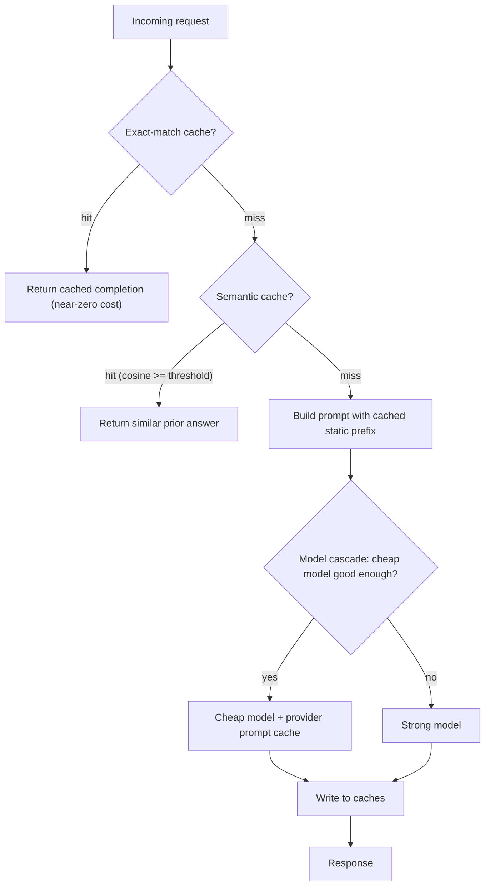
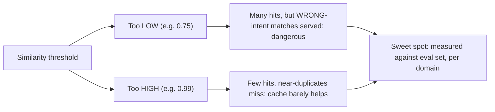
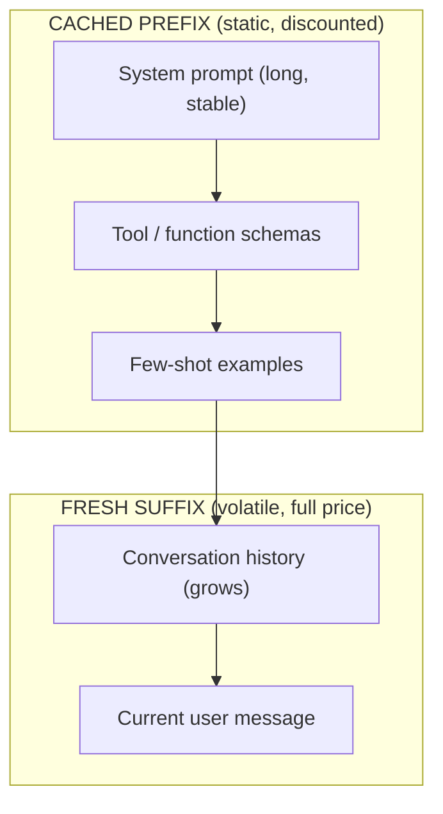
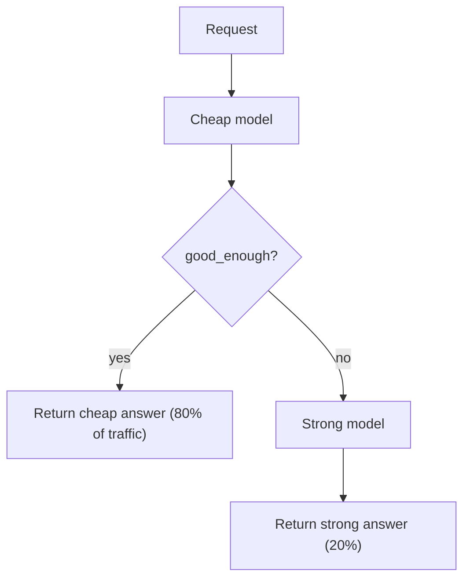

# Day 16 — Caching & Cost Optimization for AI

> Series: AI Backend Engineering
> Goal: Slash LLM spend and latency with layered caching — exact-match, semantic, provider prompt caching, embedding caches — plus model cascades and batching, while refusing to let a cache serve a subtly wrong answer.

Today is a direct sequel to **System Design Day 11 (caching, cache-aside)** and **AI Day 4 (cost, the cost cascade)** and **AI Day 5 (embeddings)**. Caching an LLM is caching with a twist: the "key" is fuzzy, the "value" can be non-deterministic, and a wrong hit doesn't 500 — it lies confidently. Respect that.

---

## Table of Contents

1. [The cost problem and the caching hierarchy](#1-the-cost-problem)
2. [Exact-match response cache](#2-exact-match-response-cache)
3. [Semantic caching](#3-semantic-caching)
4. [Provider-side prompt caching](#4-provider-side-prompt-caching)
5. [Embedding caches](#5-embedding-caches)
6. [Model cascade / routing](#6-model-cascade--routing)
7. [Request batching](#7-request-batching)
8. [A worked cost-savings estimate](#8-a-worked-cost-savings-estimate)
9. [The Dark Side](#9-the-dark-side)
10. [Day 16 Self-Check](#10-day-16-self-check)
11. [Tomorrow](#11-tomorrow)
12. [Apply (1 hour)](#12-apply-1-hour)

---

## 1. The cost problem

### Why
LLM calls are 100–10,000× more expensive per request than a DB read, and slow (Day 15). Two identical or *near*-identical questions shouldn't each cost a full generation. The **cost cascade from AI Day 4** taught you where money goes (input tokens × price + output tokens × price, per model tier). Caching attacks the *number of calls* and *tokens per call* directly.

### What
A layered cache hierarchy, cheapest-to-check first:


*Check the cheapest, safest layer first; escalate only on miss.*

### When
Cache when: read-heavy, repeated or similar queries, tolerant of slightly stale answers, and you *have evals* to catch regressions (see Dark Side). Don't cache when: outputs are personalized, non-deterministic-by-design, legally must be fresh, or you have no way to detect a bad hit.

### How / Where / Dark Side
Covered per-layer below. The overarching **cache-aside pattern from System Design Day 11** applies to every layer: check cache → on miss compute → write cache → return.

---

## 2. Exact-match response cache

### Why
The cheapest, safest win. If the *exact same* prompt + params come in again, the answer is deterministic-enough to reuse. Zero risk of "wrong question" because the key is the literal input.

### What
Key = a hash of everything that affects the output: full prompt (all messages), model, temperature, top_p, max_tokens, tools, system prompt, and a **version tag**. Value = the completion. Store in Redis (your System Design Day 11 cache).

### How

```python
from __future__ import annotations

import hashlib
import json
from dataclasses import asdict, dataclass

import redis.asyncio as redis

r = redis.from_url("redis://localhost:6379")

PROMPT_CACHE_VERSION = "v3"  # bump when prompt template or model changes!


@dataclass(frozen=True)
class CacheKeyParts:
    messages: tuple  # tuple of (role, content)
    model: str
    temperature: float
    max_tokens: int
    tools_sig: str


def exact_key(parts: CacheKeyParts) -> str:
    payload = json.dumps(asdict(parts), sort_keys=True, default=str)
    digest = hashlib.sha256(payload.encode()).hexdigest()
    return f"llm:exact:{PROMPT_CACHE_VERSION}:{digest}"


async def cached_completion(parts: CacheKeyParts, compute) -> dict:
    """cache-aside (System Design Day 11), applied to an LLM call."""
    key = exact_key(parts)
    if raw := await r.get(key):
        return json.loads(raw) | {"_cache": "exact_hit"}
    result = await compute()                         # the expensive LLM call
    await r.set(key, json.dumps(result), ex=60 * 60 * 24)  # 24h TTL
    return result | {"_cache": "miss"}
```

### When
- `temperature == 0` (deterministic): exact-match is nearly free correctness. **Highly recommended.**
- `temperature > 0`: the *same* prompt yields *different* outputs by design — caching pins one sampled answer. Acceptable if you *want* consistency for repeats; wrong if you want variety.

### Where
In front of the provider call, behind your provider abstraction (AI Day 3), so all models benefit.

### The Dark Side
- **Cache poisoning across versions.** If you tweak the system prompt or upgrade the model but don't bump `PROMPT_CACHE_VERSION`, you serve answers generated under the *old* prompt. Every prompt/model change must invalidate — version the key.
- Hashing must include *everything* that changes output. Forget `tools` or `system` and you serve mismatched answers.

---

## 3. Semantic caching

### Why
Exact-match misses "What's your refund policy?" vs "How do refunds work?" — same intent, different words. **Semantic caching** catches these by comparing *meaning*, not bytes. This is where hit rates jump from ~5% to 30–60% on FAQ-style traffic.

> **🤔 Wait — why semantic caching? Won't matching on "meaning" serve the wrong answer to a different question?**
> That fear is exactly right, and it's the discipline the whole section is built around — semantic caching is powerful *and* the one cache that can lie confidently. The safety isn't magic; it's a **threshold** you tune against a labeled eval set. Set it well (say 0.92+ for general FAQ) and only genuine paraphrases hit — "how do refunds work?" reuses "what's your refund policy?" and you serve a correct answer for near-zero cost. Set it too low and you get the nightmare: "flights *to* Paris" (cosine ~0.97 to "flights *from* Paris") returns the opposite answer with no exception thrown. So the honest answer to "won't it serve wrong answers?" is: *it will, unless you measure your wrong-hit rate and guard the failure modes* — high thresholds for high stakes, entity/intent checks on dates/quantities/negations, and hard exclusions for medical/legal/financial. A semantic cache you can't audit with evals is a liability, not an optimization.

**✅ Good scenario (where it saves you):** A docs-Q&A SaaS gets thousands of rephrasings of the same ~200 questions daily. A semantic cache at threshold 0.93, tuned against a labeled same/different-intent eval set, lifts hit rate from 6% (exact-match only) to ~45%, cutting the monthly LLM bill nearly in half and dropping p50 latency to a Redis lookup — with a measured wrong-hit rate of ~0 on the eval set.

**❌ Bad scenario (when misused):** A team ships semantic caching at threshold 0.85 with no eval set "to boost hit rate." A user asks "is the 100mg dose safe?"; the cache returns the cached answer for "is the 10mg dose safe?" (cosine ~0.98), confidently and with no error. The wrong-intent hit is invisible in logs, ships to a real user, and becomes a safety incident — the defining hazard of semantic caching, realized because nobody measured before deploying.

**When NOT to:** never semantic-cache negation-sensitive, quantity-sensitive, or personalized queries (dates, dosages, "can/cannot", "my order status") — and don't deploy it *at all* before you have an eval set to measure the wrong-hit rate; without that, exact-match caching only.

### What
Embed the incoming query (embeddings from **AI Day 5**), search a vector store of prior query embeddings, and if the nearest neighbor's cosine similarity ≥ a **threshold**, return its cached answer. It's cache-aside with a *fuzzy* key.

### How

```python
from __future__ import annotations

import numpy as np

SIMILARITY_THRESHOLD = 0.92  # TUNE THIS — see Dark Side


async def embed(text: str) -> np.ndarray:
    """Reuse the AI Day 5 embedding client (cached itself, section 5)."""
    ...  # returns normalized float32 vector


class SemanticCache:
    def __init__(self, vstore, threshold: float = SIMILARITY_THRESHOLD) -> None:
        self._v = vstore          # e.g. Redis vector, pgvector, Qdrant
        self._t = threshold

    async def get(self, query: str) -> dict | None:
        vec = await embed(query)
        hits = await self._v.search(vec, top_k=1)
        if hits and hits[0].score >= self._t:
            return {"answer": hits[0].payload["answer"],
                    "_cache": "semantic_hit", "score": hits[0].score}
        return None

    async def put(self, query: str, answer: str) -> None:
        vec = await embed(query)
        await self._v.upsert(vec, payload={"query": query, "answer": answer})


async def answer_with_semantic_cache(query: str, sc: SemanticCache, compute) -> dict:
    if hit := await sc.get(query):
        return hit
    result = await compute()
    await sc.put(query, result["answer"])
    return result | {"_cache": "miss"}
```

### The threshold-tuning problem
This *single number* is the whole ballgame:


*The threshold trades hit rate against correctness; find it empirically, not by intuition.*

Tune it against a **labeled eval set** of query pairs marked same/different intent. Pick the threshold that maximizes hits while keeping wrong-intent hits at ~0. Different domains need different thresholds.

### When
Great for: FAQ, support, docs Q&A, high-repeat read traffic. Bad for: anything where small wording differences flip meaning (dates, quantities, negations, directions), or personalized answers.

### Where
Sits after exact-match, before the model. Namespace the vector store per tenant/user if answers are user-specific.

### The Dark Side (this is the big one)
- **Subtly wrong answers.** "Flights *to* Paris" vs "Flights *from* Paris" embed almost identically — cosine ~0.97 — but the correct answer is opposite. Same for "Can I cancel?" vs "Can I *not* cancel?", "10mg" vs "100mg". The cache returns a confident, plausible, *wrong* answer. No exception is thrown. This is the defining hazard of semantic caching.
- **Mitigations:** raise threshold for high-stakes domains; add an intent/entity guard (compare extracted entities — dates, directions, quantities — not just embeddings); exclude negation-sensitive queries; never semantic-cache medical/legal/financial specifics.
- **Personalization leak.** Caching "my order status" across users is a data breach. Namespace by user or never cache personalized queries.
- **No evals = flying blind.** You cannot know your wrong-hit rate without an eval set. **Do not deploy semantic caching before you have evals (Days 21–22 teaser).**

---

## 4. Provider-side prompt caching

### Why
Your prompts often share a large *static prefix* — a long system prompt, tool schemas, few-shot examples, retrieved context reused across turns. Providers now let you cache that prefix server-side and bill it at a **large discount** (cached-input pricing, often 10–90% cheaper than fresh input tokens). This is orthogonal to your own caches: even on a cache *miss* in your layers, the provider prefix cache cuts input cost.

### What
Structure the prompt so the **stable, reusable content comes first** (system prompt → tools → few-shot → retrieved docs), and the **volatile content (the user's turn) comes last**. Mark the prefix as cacheable (Anthropic `cache_control` breakpoints; OpenAI automatic prefix caching). The provider hashes the prefix and reuses its computed state.

### How — prompt structure


*Put everything reusable at the front so the provider can cache and discount it.*

```python
# Anthropic-style: mark the static prefix cacheable
messages = [
    {"role": "system", "content": [
        {"type": "text", "text": LONG_SYSTEM_PROMPT,
         "cache_control": {"type": "ephemeral"}},  # <-- cache breakpoint
    ]},
    {"role": "user", "content": user_turn},  # volatile, uncached
]
```

Rules that make it actually cache:
- The prefix must be **byte-identical** across calls (no timestamps, no per-request IDs inside the cached span).
- Order stable-first, volatile-last (from **AI Day 4 cost** — this is the practical payoff).
- Prefix must exceed the provider's minimum cacheable length.

### When
Always, when a meaningful static prefix exists (chat with a big system prompt, RAG with reused context, agents with fixed tool schemas). Low effort, pure savings.

### Where
This is provider-config, applied in your provider adapter (AI Day 3). Combine with your exact/semantic caches — they stack.

### The Dark Side
- Prefix caches are **short-lived** (minutes) and **per-region/per-account**; a cold prefix pays full price. Under bursty traffic you may rarely hit it.
- Accidentally putting *anything* volatile in the cached span (a timestamp, a session id) silently invalidates it every call — you pay to write a cache you never read. Audit your prefix for hidden variability.

---

## 5. Embedding caches

### Why
Embeddings (AI Day 5) are deterministic for a given (text, model): the same input always yields the same vector. Re-embedding the same chunk is pure waste — and RAG re-embeds the same corpus and repeated queries constantly.

### What
A content-hash-keyed cache: `key = hash(embedding_model + text)` → vector. Deterministic, so *exact-match is perfectly safe* here (no semantic hazard).

### How

```python
import hashlib
import numpy as np
import redis.asyncio as redis

r = redis.from_url("redis://localhost:6379")

def _ekey(text: str, model: str) -> str:
    h = hashlib.sha256(f"{model}\x00{text}".encode()).hexdigest()
    return f"emb:{model}:{h}"

async def get_embedding(text: str, model: str, embed_fn) -> np.ndarray:
    key = _ekey(text, model)
    if raw := await r.get(key):
        return np.frombuffer(raw, dtype=np.float32)
    vec = await embed_fn(text, model)             # the paid API call
    await r.set(key, vec.astype(np.float32).tobytes())  # no TTL: deterministic
    return vec
```

### When
Always cache embeddings — for corpus indexing (avoid re-embedding on redeploy) and for repeated queries. No TTL needed unless the model version changes (then include the version in the key).

### Where
Under both your RAG pipeline and the semantic cache (section 3) — the semantic cache's `embed()` should call *this*, so it never double-pays.

### The Dark Side
Mostly benign. The one trap: **change the embedding model without changing the key** and you'll mix vectors from two models in one space — similarity math becomes garbage. Always put the model+version in the key.

---

## 6. Model cascade / routing

### Why
From **AI Day 4**: most requests don't need your strongest, priciest model. A cascade tries a **cheap model first**, checks if the answer is good enough, and **escalates to a strong model only on failure**. This can cut cost 50–80% because the cheap model handles the easy majority.

> **🤔 Wait — why route through a cheap model first? Isn't calling two models just paying twice?**
> Only when the *gate* is bad — and that's the whole catch. A cascade pays twice *only on escalation*; if the cheap model satisfies `good_enough` for 70–80% of traffic, those requests cost ~1/20th and never touch the frontier model, so the blended cost plummets. The math only works when the gate is cheap and accurate: it must correctly decide "this cheap answer is fine" without itself costing more than it saves. Get the gate wrong in one direction and junk cheap answers leak to users (quality collapse); wrong in the other and *everything* escalates, so you pay for both models on every request — strictly worse than just calling the strong one. So the answer to "isn't this paying twice?" is: no, if the easy majority stops at tier one; yes and worse, if your gate escalates everything. The gate is the entire design.

**✅ Good scenario (where it saves you):** A support-triage product classifies and drafts replies. A cheap model handles ~78% of tickets and a schema-validation gate (is the JSON well-formed and the category in the allowlist?) is near-free to run. Only the ambiguous 22% escalate to the frontier model. Realized spend drops ~65% versus all-frontier, and because the gate is a structural check, there's no extra model call to pay for.

**❌ Bad scenario (when misused):** A team cascades open-ended reasoning questions where the cheap tier almost always fails, and uses an LLM judge as the gate. Now nearly every request pays for three calls — cheap answer + judge + strong answer — and adds two serial latencies, so the "optimization" is *more* expensive and slower than routing straight to the strong model. The cascade was applied to a workload the cheap tier can't serve.

**When NOT to:** hard reasoning, code generation, or long-context synthesis where the cheap tier fails the gate constantly — route straight to the strong model; a cascade there just adds latency and double cost for near-zero cheap-tier hits.

### What
Cheap → strong escalation, gated by a confidence/quality check (a validator, a self-rated confidence, a schema check, or a cheap judge).

### How

```python
from __future__ import annotations
from dataclasses import dataclass

@dataclass
class Tier:
    model: str
    price_in: float   # $ / 1M input tokens
    price_out: float

CHEAP = Tier("small-fast", 0.15, 0.60)
STRONG = Tier("frontier", 3.00, 15.00)

async def cascade(prompt: str, provider, good_enough) -> dict:
    # 1. try cheap
    cheap_ans = await provider.complete(prompt, model=CHEAP.model)
    if await good_enough(prompt, cheap_ans):
        return cheap_ans | {"_tier": "cheap"}
    # 2. escalate
    strong_ans = await provider.complete(prompt, model=STRONG.model)
    return strong_ans | {"_tier": "strong"}


async def good_enough(prompt: str, answer: dict) -> bool:
    """Gate: schema-valid? not a refusal? self-confidence high?
    For structured tasks, validate the JSON. For open Q&A, a cheap
    judge or heuristic. Bad gates make cascades worse than useless."""
    ...
```


*Route the easy majority to the cheap tier; escalate only what needs it.*

### When
- Classification, extraction, routing, simple Q&A → cascade shines (cheap model handles most).
- Hard reasoning, code, long-context synthesis → the cheap tier fails the gate constantly; cascade adds latency + double cost. Route straight to strong.

### Where
In your orchestration layer, above the provider abstraction. Log `_tier` so you can measure the escalation rate (if >50% escalate, your cheap tier or gate is wrong).

### The Dark Side
- **The gate is everything.** A bad `good_enough` either lets bad cheap answers through (quality collapse) or escalates everything (you pay for *both* models — worse than not cascading). The gate itself may cost a model call — make sure gate cost < savings.
- **Double latency** on escalation: cheap call + strong call in series. For latency-sensitive paths, cascading can hurt UX even while saving money.
- Falling back to a model so weak the answer is *worse than an honest failure* — foreshadows Day 17's degraded-fallback trap.

---

## 7. Request batching

### Why
Embedding and some completion APIs let you send many inputs in one request, amortizing per-request overhead and often unlocking discounted **batch pricing** (e.g., 50% off for async batch jobs with relaxed latency). Also improves throughput against provider RPM limits (Day 17).

### What
- **Sync micro-batching:** collect requests arriving within a small time window, send as one API call (great for embeddings).
- **Async batch API:** submit a large job file, get results within hours at a discount (great for offline corpus embedding, bulk classification).

### How — a micro-batcher for embeddings

```python
import asyncio

class EmbeddingBatcher:
    def __init__(self, embed_many, max_batch=64, window_s=0.02) -> None:
        self._embed_many = embed_many
        self._max, self._window = max_batch, window_s
        self._queue: list[tuple[str, asyncio.Future]] = []
        self._task: asyncio.Task | None = None

    async def embed(self, text: str):
        fut: asyncio.Future = asyncio.get_event_loop().create_future()
        self._queue.append((text, fut))
        if self._task is None or self._task.done():
            self._task = asyncio.create_task(self._flush_soon())
        return await fut

    async def _flush_soon(self):
        await asyncio.sleep(self._window)
        batch, self._queue = self._queue[: self._max], self._queue[self._max :]
        vecs = await self._embed_many([t for t, _ in batch])
        for (_, fut), v in zip(batch, vecs):
            fut.set_result(v)
```

### When
- Offline/bulk (indexing a corpus, nightly re-classification) → **async batch API**, big discount, latency irrelevant.
- Online but overlapping (many users embedding queries) → **micro-batch** with a tiny window.
- Single low-latency user request → don't batch (the window adds latency for no gain).

### Where
Under the RAG indexer and the embedding cache. Batching + embedding cache + async batch pricing compound into large savings on corpus work.

### The Dark Side
Micro-batching adds a latency window to every request — keep it tiny (10–20ms) for online paths. Async batch APIs are *not* real-time — never put a user-blocking request on a batch queue expecting seconds (that's Day 17's async-job pattern, not this).

---

## 8. A worked cost-savings estimate

### Why
Cache decisions must be justified with numbers, not vibes. Here's the arithmetic.

**Baseline:** 1,000,000 requests/month, each ~1,000 input + 500 output tokens on the strong tier (`$3/1M in`, `$15/1M out`).

- Per request: `1000/1e6 * $3 + 500/1e6 * $15 = $0.003 + $0.0075 = $0.0105`.
- Monthly baseline: `1e6 * $0.0105 = $10,500`.

**Add caching layers:**

| Layer | Effect | Assumption |
|---|---|---|
| Exact-match | 8% of requests hit | free on hit |
| Semantic | 25% of *remaining* hit | free on hit |
| Prompt cache | 40% input-token discount on misses | on the 700-char static prefix |
| Cascade | 70% of misses served by cheap tier | cheap ≈ 1/20th cost |

Compute:
- Exact hits: `0.08 * 1e6 = 80k` served free. Remaining: 920k.
- Semantic hits: `0.25 * 920k = 230k` served free. Remaining: **690k paid**.
- Of 690k, 70% (483k) go cheap (~`$0.0105/20 ≈ $0.000525` each) = `$254`.
- 30% (207k) go strong. With 40% input discount, input drops from `$0.003` to `$0.0018`; output unchanged `$0.0075` → `$0.0093` each = `$1,925`.
- **New monthly cost ≈ $254 + $1,925 ≈ $2,179** vs `$10,500` baseline.

**≈ 79% cost reduction.** The single formula to remember: **savings ≈ hit_rate × per_request_price**, applied layer by layer. Hit rate is the lever; correctness is the constraint.

---

## 9. The Dark Side

Consolidated failure modes — internalize these before caching anything user-facing:

- **Semantic cache serving subtly wrong answers.** The headline hazard. "to Paris"/"from Paris", "10mg"/"100mg", "can"/"cannot" — near-identical embeddings, opposite correct answers, no exception raised. Guard with entity/intent checks, high thresholds for high stakes, and hard exclusions for medical/legal/financial.
- **Caching non-deterministic / personalized output.** `temperature > 0` means "same prompt, intended variety" — caching pins one roll. Personalized answers cached across users = data leak. Namespace or don't cache.
- **Caching before you have evals.** Without an eval set (Days 21–22) you cannot measure your wrong-hit rate. A cache you can't audit is a liability, not an optimization.
- **Stale cache after a prompt or model change.** You improved the system prompt; the old (worse) answers keep serving because the key didn't change. **Version every cache key; bump on any prompt/model/schema change.**
- **Hidden variability in prompt-cache prefixes.** A timestamp or request id inside the "static" span invalidates the provider cache every call — you pay to write, never read.
- **Bad cascade gate.** Either lets junk through or escalates everything (paying for two models). Measure escalation rate.
- **Cache stampede.** On a popular key expiring, a thousand concurrent misses hammer the provider at once — the **thundering herd from System Design Day 11**. Use single-flight / request coalescing so only one computes and the rest await it.

---

## 10. Day 16 Self-Check

1. Order the four cache layers cheapest-to-check-first and explain why the order matters.
2. What *exactly* must go into an exact-match cache key, and why must you version it?
3. When is exact-match caching safe with `temperature > 0`, and when is it wrong?
4. Explain the semantic-cache threshold trade-off. How do you set the threshold without guessing?
5. Give three concrete query pairs that embed nearly identically but need *opposite* answers. How do you guard against them?
6. How should you structure a prompt to maximize provider prompt-cache hits, and what silently breaks the prefix cache?
7. Why is exact-match caching perfectly safe for embeddings but hazardous for completions?
8. Describe a model cascade and the single component that makes or breaks it. What happens when that component is bad?
9. When should work go on an async batch API vs a sync micro-batcher vs neither?
10. Walk through the savings estimate: baseline $10,500/mo drops to ~$2,179. Which lever contributed most, and what constrains how far you can push it?

---

## 11. Tomorrow

**Day 17 — Resilience, Rate Limiting & Queues for AI.** Caching cut cost; tomorrow we survive failure. Provider outages and fallback chains (circuit breaker + graceful degradation from System Design Day 18), the *two directions* of rate limiting (the provider's limits on you, and your limits on users — token bucket from System Design Day 21), retries with backoff + jitter without triggering retry storms, timeout budgets, and async job queues (System Design Day 15) for long generations.

---

## 12. Apply (1 hour)

1. **(15 min)** Implement the exact-match cache from section 2 with a versioned key in Redis. Prove that bumping `PROMPT_CACHE_VERSION` invalidates all entries.
2. **(20 min)** Build a `SemanticCache` over pgvector or Redis vector using your AI Day 5 embeddings (routed through the section-5 embedding cache). Seed it with 20 FAQ answers.
3. **(15 min)** Write a tiny eval: 10 same-intent pairs and 10 opposite-intent pairs (include "to/from", "10mg/100mg", "can/cannot"). Sweep thresholds 0.80→0.99 and chart hit rate vs wrong-hit rate. Pick your threshold from the data — and watch a low threshold happily serve a wrong-intent answer.
4. **(10 min)** Add the section-6 cascade with a schema-validation gate for a structured-extraction task; log the escalation rate and compute realized savings with the section-8 formula.
5. **Stretch:** structure your prompt with a cached static prefix and measure the provider's reported cached-input tokens across two identical-prefix calls.
