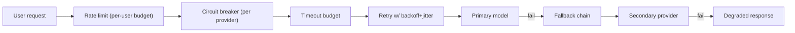
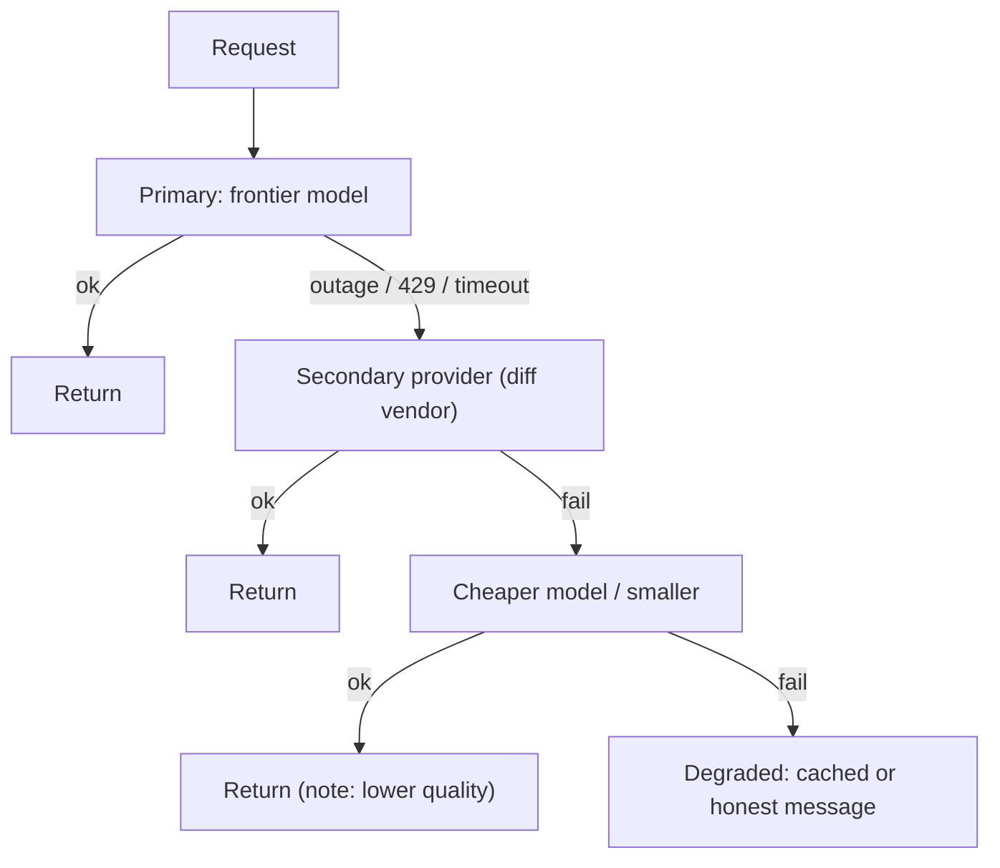
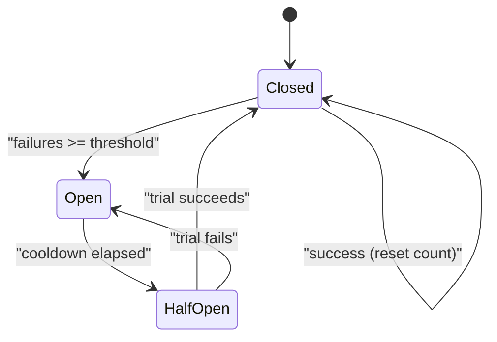
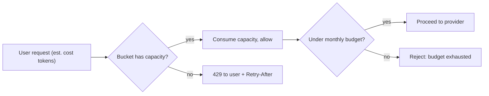
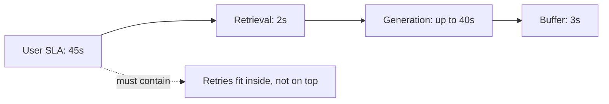
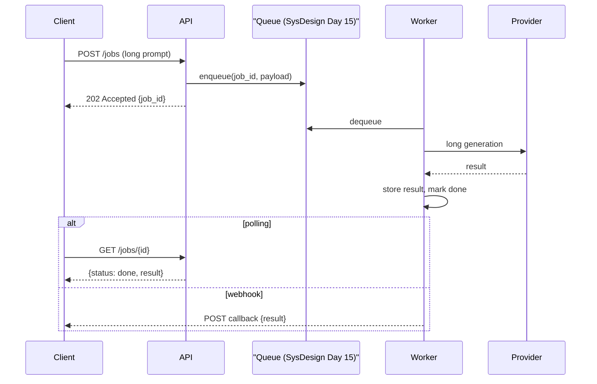

# Day 17 — Resilience, Rate Limiting & Queues for AI

> Series: AI Backend Engineering
> Goal: Keep an LLM product up when providers fail, throttle, or slow to a crawl — with fallback chains, two-directional rate limiting, disciplined retries, timeout budgets, and async job queues for long generations.

Today is your **System Design** resilience chapter, re-aimed at LLMs. Circuit breakers + graceful degradation (Day 18), token bucket (Day 21), retries+backoff+jitter (Day 18), queues/DLQ (Day 15) — all reused directly. The twist: LLM calls are slow, expensive, non-idempotent-feeling, and rate-limited on *tokens* not just requests. We adapt each pattern to that reality.

---

## Table of Contents

1. [The failure landscape for LLM backends](#1-the-failure-landscape)
2. [Provider outages & fallback chains](#2-fallback-chains)
3. [Circuit breakers for providers](#3-circuit-breakers)
4. [Rate limiting — the provider's limits on you](#4-rate-limiting-inbound)
5. [Rate limiting — your limits on users](#5-rate-limiting-outbound)
6. [Retries with backoff + jitter](#6-retries)
7. [Timeout budgets](#7-timeout-budgets)
8. [Async job queues for long generations](#8-async-job-queues)
9. [The Dark Side](#9-the-dark-side)
10. [Day 17 Self-Check](#10-day-17-self-check)
11. [Tomorrow](#11-tomorrow)
12. [Apply (1 hour)](#12-apply-1-hour)

---

## 1. The failure landscape

### Why
LLM providers are third-party dependencies with SLAs you don't control. They have outages, rolling degradations, hard rate limits, and multi-second-to-multi-minute latencies. A backend that assumes the provider always answers quickly *will* fall over. You already know how to build resilient systems — today you apply it to a dependency that's slower and pricier than any database.

### What
The distinct failure modes and their System Design counterpart:

| Failure | LLM specifics | System Design pattern |
|---|---|---|
| Provider outage | 500/503, connection refused | Circuit breaker + fallback (Day 18) |
| Rate limited | 429 + `Retry-After`, TPM/RPM | Token bucket, backoff (Day 21/18) |
| Slow response | 10–60s generations | Timeout budgets (Day 18) |
| Transient blip | occasional 500, timeout | Retry w/ backoff + jitter (Day 18) |
| Overload (yours) | too many concurrent long calls | Queues, bulkheads (Day 15) |

### When / How / Where / Dark Side
Each row is a section below. The meta-lesson: **compose these — don't pick one.** A production LLM call is retry-wrapped, circuit-breaker-guarded, timeout-bounded, rate-limited both ways, with a fallback chain and (for long work) a queue.


*A production LLM call is a stack of composed resilience patterns, not a single try/except.*

---

## 2. Fallback chains

### Why
When your primary model is down or throttled, returning a 500 to the user is the *last* resort. A fallback chain degrades gracefully: primary model → secondary provider → cheaper model → cached/canned degraded answer. Users prefer a slightly-worse answer now over an error. This is **graceful degradation from System Design Day 18**.

### What
An ordered list of providers/models tried in sequence, each wrapped so a failure (outage, 429 after retries, timeout) advances to the next. The final rung is a *degraded* response (cached answer, template, or an honest "we're degraded" message) — never an unhandled exception.

### How — a fallback wrapper on the AI Day 3 provider interface

```python
from __future__ import annotations

import logging
from collections.abc import Sequence
from dataclasses import dataclass

log = logging.getLogger(__name__)


@dataclass
class Rung:
    name: str
    provider: "LLMProvider"   # AI Day 3 interface
    model: str


class ProviderUnavailable(Exception): ...


class FallbackChain:
    def __init__(self, rungs: Sequence[Rung], degraded) -> None:
        self._rungs = rungs
        self._degraded = degraded  # callable returning a safe last-resort answer

    async def complete(self, messages: list[dict], **params) -> dict:
        last_err: Exception | None = None
        for rung in self._rungs:
            try:
                result = await rung.provider.complete(
                    messages, model=rung.model, **params
                )
                return result | {"_rung": rung.name}
            except (ProviderUnavailable, TimeoutError) as exc:
                log.warning("rung %s failed: %s -> next", rung.name, exc)
                last_err = exc
                continue
        log.error("all rungs failed, degrading", exc_info=last_err)
        return await self._degraded(messages) | {"_rung": "degraded"}
```


*Fall down the rungs; the bottom rung is always a safe, non-throwing response.*

### When
Use cross-*vendor* fallback (OpenAI → Anthropic) for outage resilience — same-vendor fallback doesn't help when the whole vendor is down. Use cross-*tier* fallback (frontier → cheap) for rate-limit/cost pressure.

### Where
The chain sits behind your provider abstraction (AI Day 3) so callers see one `complete()`. This is *why* you built that abstraction — swapping vendors mid-request is only possible with a normalized interface.

> **🤔 Why bother with fallback models — doesn't the provider advertise 99.9% uptime?**
> 99.9% still means ~9 hours down per year, and those hours don't come with a warning. More importantly, **the failures you hit daily aren't "downtime" at all**: 429 throttling, TTFT spikes, and regional degradations don't count against the SLA but still return errors to *your* users.
> And single-vendor fallback doesn't survive a vendor-wide outage — that's why the resilient rung is a *different* vendor, not a different model at the same one.

**✅ Good scenario (where it saves you):** At an AI writing assistant, a product launch drives a 5× traffic spike and the primary vendor starts returning 429s within seconds. The chain silently advances to a second vendor; users get answers a touch slower but never see an error, and the on-call dashboard flags "running on rung 2" instead of paging anyone at 2am.

**❌ Bad scenario (the pain without it / when misused):** A support-bot team fills the bottom rung with a tiny 1B model "just to always return something." During an outage it confidently invents a refund policy that doesn't exist, and that answer reaches thousands of customers. A plain "we're temporarily degraded, try again" would have been far less damaging than authoritative-sounding nonsense.

**When NOT to over-do it:** an internal nightly batch job that no human is waiting on doesn't need a multi-vendor chain — it can just fail and retry on the next run; fallback earns its complexity when a *user* is waiting live.

### The Dark Side
**Falling back to a model so weak the answer is worse than an honest error.** A frontier-quality task routed to a tiny model may return confident nonsense — which is worse than "we're temporarily degraded, try again." Know each rung's quality floor; for high-stakes tasks, the degraded rung should be an honest failure message, not a bad generation. Also: fallbacks can mask a persistent primary outage — alert when you're running on a fallback rung, don't just silently limp.

---

## 3. Circuit breakers

### Why
If the primary provider is down, hammering it on every request wastes time (each call waits for a timeout) and can worsen the provider's recovery (retry storm, section 6/9). A **circuit breaker (System Design Day 18)** trips after repeated failures and *fails fast* — skipping the dead provider and going straight to fallback — until a cooldown lets it test recovery.

### What
Three states: **Closed** (normal, requests flow), **Open** (tripped, fail fast to fallback), **Half-Open** (cooldown elapsed, let a trial request through to test recovery).

### How


*Open = stop calling the dead provider; Half-Open = cautiously test recovery.*

```python
import time
from enum import Enum

class State(Enum):
    CLOSED = "closed"; OPEN = "open"; HALF_OPEN = "half_open"

class CircuitBreaker:
    def __init__(self, threshold: int = 5, cooldown_s: float = 30.0) -> None:
        self._threshold, self._cooldown = threshold, cooldown_s
        self._failures = 0
        self._opened_at = 0.0
        self._state = State.CLOSED

    def _allow(self) -> bool:
        if self._state is State.OPEN:
            if time.monotonic() - self._opened_at >= self._cooldown:
                self._state = State.HALF_OPEN
                return True          # one trial request
            return False             # fail fast
        return True

    def on_success(self) -> None:
        self._failures = 0
        self._state = State.CLOSED

    def on_failure(self) -> None:
        self._failures += 1
        if self._failures >= self._threshold or self._state is State.HALF_OPEN:
            self._state = State.OPEN
            self._opened_at = time.monotonic()

    async def call(self, fn, *a, **kw):
        if not self._allow():
            raise ProviderUnavailable("circuit open")
        try:
            result = await fn(*a, **kw)
        except Exception:
            self.on_failure()
            raise
        self.on_success()
        return result
```

### When
One breaker **per provider (per model endpoint)**. Wrap each rung of the fallback chain in its own breaker so a dead primary trips fast and the chain advances instantly instead of eating a timeout every request.

### Where
Between the fallback chain and the provider call. Per-provider state, ideally shared across workers (Redis-backed) so all instances agree a provider is down.

> **🤔 Why add a breaker — won't retries already handle a down provider?**
> Retries handle a *transient blip*. A breaker handles a *sustained outage* — a different problem. During a 20-minute provider outage, retrying means every request waits out a full timeout before failing, so you're **paying (in latency and dollars) to hammer a corpse** that can't answer.
> The breaker fails fast: skip the dead provider instantly, jump to fallback, and probe for recovery only occasionally.

**✅ Good scenario (where it saves you):** At an AI coding-assistant company, the primary model endpoint goes hard-down for 15 minutes. The breaker trips after 5 failures, so instead of 10,000 requests each eating a 45s timeout, they fail over to the secondary in milliseconds. Latency stays flat, and the recovering provider isn't buried under a wall of doomed calls the moment it comes back.

**❌ Bad scenario (the pain without it / when misused):** No breaker: during the same outage every worker keeps dialing the dead endpoint, each request stalls the full timeout, the worker pool saturates, and *healthy* traffic (including fallback-eligible requests) queues behind stuck calls. One vendor's outage becomes *your* outage — the exact cascade the breaker exists to stop.

**When NOT to over-do it:** a single-instance internal tool with light traffic doesn't need Redis-coordinated breaker state — a plain in-process counter is fine; distributed breaker state matters once you're horizontally scaled and N workers would each rediscover the outage.

### The Dark Side
- Per-process breakers disagree under horizontal scaling — each worker independently discovers the outage, so you still hammer the provider N× (N = worker count). Share breaker state in Redis for a coordinated trip.
- A too-sensitive breaker (low threshold) trips on normal transient blips and needlessly degrades you. Tune threshold + cooldown against real error rates.

---

## 4. Rate limiting — the provider's limits on you

### Why
Providers cap you on **RPM (requests/min)** *and* **TPM (tokens/min)** per model. Exceed either and you get `429`. Naive code that ignores this bursts, gets throttled, retries, bursts again — a self-inflicted outage. You must respect their limits *proactively* and react to `429` correctly.

### What
- **Reactive:** on `429`, honor the `Retry-After` header exactly (don't retry sooner).
- **Proactive:** a *token-aware* limiter that estimates a request's token cost and refuses/queues it before sending, keeping you under TPM/RPM.

### How — respecting 429 and token-aware limiting

```python
import asyncio
import time

class TokenAwareLimiter:
    """Client-side guard against provider TPM. Refills tokens per minute."""
    def __init__(self, tpm: int) -> None:
        self._capacity = tpm
        self._tokens = float(tpm)
        self._last = time.monotonic()
        self._lock = asyncio.Lock()

    async def acquire(self, estimated_tokens: int) -> None:
        async with self._lock:
            while True:
                now = time.monotonic()
                self._tokens = min(
                    self._capacity,
                    self._tokens + (now - self._last) * self._capacity / 60.0,
                )
                self._last = now
                if self._tokens >= estimated_tokens:
                    self._tokens -= estimated_tokens
                    return
                deficit = estimated_tokens - self._tokens
                await asyncio.sleep(deficit * 60.0 / self._capacity)


async def respect_429(call):
    try:
        return await call()
    except RateLimited as exc:         # your adapter maps 429 -> RateLimited
        wait = exc.retry_after or 1.0  # from Retry-After header
        await asyncio.sleep(wait)
        return await call()            # one honoring retry
```

### When
Always run a proactive token-aware limiter in front of high-throughput LLM traffic (batch jobs, multi-tenant). Estimate tokens from input length + `max_tokens` before sending; correct with real usage after.

### Where
In your provider adapter, per-model. Combine with the outbound (per-user) limiter in section 5 — they're different limiters solving different problems.

> **🤔 If I already retry on 429, why also throttle myself proactively before sending?**
> Because reacting to 429 means you've *already* burned a request, gotten throttled, and now add retry load on top — a burst that bounces off the limit, retries, and bursts again is a self-inflicted throttle loop. A proactive token-aware limiter keeps you *under* TPM/RPM so most 429s never happen.
> Reactive `Retry-After` handling is the seatbelt; proactive limiting is not crashing in the first place.

**✅ Good scenario (where it saves you):** A RAG platform runs a nightly re-embedding job over millions of documents. The token-aware limiter paces requests to sit just under the model's TPM ceiling, so the job runs at max sustainable throughput with almost zero 429s — steady and predictable instead of a sawtooth of bursts and backoffs.

**❌ Bad scenario (the pain without it / when misused):** A batch pipeline fires all requests at once, gets a wall of 429s, retries them *immediately* ignoring `Retry-After`, and the flood looks like abuse — the provider tightens limits or temporarily bans the key, taking down not just the batch job but the live product sharing that key.

**When NOT to over-do it:** a low-volume interactive endpoint nowhere near the TPM ceiling doesn't need a proactive token accountant — simple `Retry-After` honoring on the rare 429 is enough; the proactive limiter earns its keep under high-throughput or multi-tenant load.

### The Dark Side
- Ignoring `Retry-After` and retrying immediately turns one 429 into a ban-inducing flood.
- Token estimation is *imperfect* — output length is unknown until generated. Budget conservatively (assume `max_tokens` fully used) or you'll blow TPM anyway.

---

## 5. Rate limiting — your limits on users

### Why
The other direction: protect *yourself* from a single user (or a runaway loop, or an abuser) draining your provider budget and starving everyone else. This is the **token bucket from System Design Day 21**, but the "cost" of a request is measured in *LLM tokens/dollars*, not just request count.

### What
Per-user (or per-tenant/API-key) **token bucket**, where a request consumes bucket capacity proportional to its *token cost*, and a per-user **budget** (daily/monthly token or dollar cap).

### How


*Two gates: short-term burst control (token bucket) and long-term spend cap (budget).*

```python
import time
import redis.asyncio as redis

r = redis.from_url("redis://localhost:6379")

async def allow_user(user_id: str, cost_tokens: int,
                     refill_per_s: float, capacity: float) -> bool:
    """Token bucket (SysDesign Day 21) where cost is LLM tokens, in Redis."""
    key = f"rl:{user_id}"
    now = time.time()
    # (use a Lua script in prod for atomicity; simplified here)
    data = await r.hgetall(key)
    tokens = float(data.get(b"tokens", capacity))
    last = float(data.get(b"ts", now))
    tokens = min(capacity, tokens + (now - last) * refill_per_s)
    if tokens < cost_tokens:
        await r.hset(key, mapping={"tokens": tokens, "ts": now})
        return False
    tokens -= cost_tokens
    await r.hset(key, mapping={"tokens": tokens, "ts": now})
    return True
```

### When
Every multi-tenant or public LLM product needs per-user limiting. Free tiers get tight buckets + hard monthly budgets; paid tiers get larger ones. Enforce *token/dollar* budgets, not just request counts — one long-context request can cost 100× a short one.

### Where
At your API edge, before the provider call and before the inbound limiter (section 4). Reject over-budget users fast with a clear `429` + `Retry-After`, so they don't consume downstream resources.

> **🤔 Why rate-limit my own paying users — isn't that just turning away revenue?**
> Because the provider budget is *shared*. One runaway client — an infinite retry loop, a scripted abuser, a buggy integration — can drain the whole month's spend in an afternoon and starve every other paying user. Per-user limits protect the *many* from the *one*.
> You're not capping revenue; you're stopping one account from spending everyone else's headroom.

**✅ Good scenario (where it saves you):** At a multi-tenant AI SaaS, a customer ships a bug that calls the API in a tight loop. Their per-user token bucket throttles them to their fair share and their monthly budget caps the damage — the blast radius stays inside that one tenant, and every other customer's latency and quota are untouched.

**❌ Bad scenario (the pain without it / when misused):** No per-user metering: a single free-tier script discovers your endpoint and hammers 200K-token context requests overnight. Because you only counted *requests*, it looked "under limit" the whole time — you wake up to a five-figure provider bill and a rate-limit ban that takes the whole product offline.

**When NOT to over-do it:** a single-tenant internal tool used by a handful of trusted employees doesn't need per-user token buckets and dollar budgets — a global concurrency cap is simpler; per-user metering pays off once untrusted or many tenants share one provider bill.

### The Dark Side
- Counting *requests* instead of *tokens/dollars* lets a user with few-but-huge requests blow your budget while looking "under limit." Meter the real cost.
- A shared budget across a burst of concurrent requests can over-spend (race) — use atomic Redis (Lua/`INCRBY`) so concurrent requests can't each pass the check.

---

## 6. Retries

### Why
Transient failures (occasional 500, network blip, timeout) succeed on a second try. **Retries with exponential backoff + jitter (System Design Day 18)** recover these without a human. But LLMs add sharp caveats: calls are expensive (each retry costs money + tokens), and retrying the *wrong* things makes outages worse.

### What
Exponential backoff (`base * 2**attempt`) + **full jitter** (randomize the wait) to avoid synchronized retry waves. Only retry **safe/idempotent** failures.

### How

```python
import asyncio
import random

RETRYABLE = (TimeoutError, ProviderUnavailable)  # NOT 400/validation/content-policy

async def with_retry(call, max_attempts=3, base=0.5, cap=8.0):
    for attempt in range(max_attempts):
        try:
            return await call()
        except RateLimited as exc:       # special-case: honor Retry-After
            await asyncio.sleep(exc.retry_after or base * 2 ** attempt)
        except RETRYABLE:
            if attempt == max_attempts - 1:
                raise
            backoff = min(cap, base * 2 ** attempt)
            await asyncio.sleep(random.uniform(0, backoff))  # FULL JITTER
```

### When — what to retry, what NOT to
- **Retry:** timeouts, 500/503, connection errors — transient, safe to re-run.
- **Do NOT retry:** 400 (bad request), content-policy refusals, auth errors — deterministic, retrying just re-fails and wastes money.
- **Do NOT retry *into* a rate limit:** if you're getting 429s, retrying adds load. Honor `Retry-After`, and consider tripping the circuit breaker instead of retrying.
- **"Idempotent-ish":** a completion isn't truly idempotent (temperature > 0 gives different output), but re-running a *failed* call is safe because no result was delivered. Never retry a call you're unsure completed with side effects (e.g., a tool that charged a card).

### Where
Innermost wrapper, inside the circuit breaker, inside the timeout. Order matters: timeout bounds each attempt; retry loops attempts; breaker counts failures across requests.

> **🤔 Provider flaky? Just retry harder — more attempts, no delay, right?**
> That's how a blip becomes an outage. If every client retries instantly and in lockstep the moment a provider stumbles, the retry traffic *is* a self-inflicted DDoS on the very server that's trying to recover — so it never does.
> The fixes are counter-intuitive: retry *fewer* times, wait with *full jitter*, and let the breaker stop retrying entirely during a sustained outage.

**✅ Good scenario (where it saves you):** At an AI search product, a provider drops a burst of transient 500s during a deploy. `with_retry` with full jitter spreads the second attempts across a random window, so recoveries trickle in instead of stampeding — the vast majority of requests succeed on retry and users never notice the wobble.

**❌ Bad scenario (the pain without it / when misused):** A team sets `max_attempts=10` with fixed 100ms backoff and no jitter. A one-second provider hiccup triggers thousands of synchronized retries that pile onto the recovering endpoint, holding it down; the "outage" lasts ten minutes instead of one, and the bill for those doomed retries is real money spent on calls that could never succeed.

**When NOT to over-do it:** a truly deterministic failure — a 400, an auth error, a content-policy refusal — should get zero retries; retrying it just re-fails and wastes money. Retries are only for *transient, safe-to-rerun* failures.

### The Dark Side — retry storms
**This is the amplification trap from System Design Day 18.** A provider hiccups → every client retries simultaneously → the retry traffic *is* a DDoS on the recovering provider → it stays down → more retries. Jitter is the primary defense (spreads retries in time). Also: cap attempts low (2–3), respect `Retry-After`, and let the circuit breaker stop retries entirely during a sustained outage. Retrying harder during an outage makes the outage worse *and* burns your money on calls that can't succeed.

---

## 7. Timeout budgets

### Why
LLM calls are *slow and variable* — 2s to 60s+. Without deliberate timeouts, a stuck call pins a worker indefinitely, exhausting your concurrency and cascading into your own outage. But timeouts too tight kill legitimate long generations. You must set them *deliberately*, per operation.

### What
A **timeout budget** allocated across the request's phases: retrieval + provider call + retries must fit within the user-facing SLA. Distinguish **connect timeout** (fast — fail if you can't reach the provider), **TTFT timeout** (Day 15), and **total timeout** (the whole generation).

### How

```python
import asyncio

async def call_with_budget(coro_factory, total_s: float = 45.0):
    """Total budget across attempts; each attempt gets a slice."""
    try:
        return await asyncio.wait_for(coro_factory(), timeout=total_s)
    except asyncio.TimeoutError:
        raise TimeoutError(f"exceeded {total_s}s budget")

# Budget composition example:
# retrieval: 2s | provider TTFT: 8s | total generation: 40s
# retries: 2 attempts must fit -> don't set 30s timeout with 3 retries
#          on a 45s SLA (3 x 30 = 90s > 45s).
```


*Allocate the SLA across phases; retries live inside the budget, never extend it.*

### When
Long-form generation → generous total timeout (30–60s) but strict *connect* + *TTFT* timeouts (fail fast to fallback if the provider isn't even starting). Interactive/short → tight everything. Anything longer than your SLA → move to an async job (section 8), don't just raise the timeout.

### Where
Timeouts wrap the provider call; the *budget* is a request-level concept enforced across retrieval + generation + retries. A common bug: 30s per-attempt timeout × 3 retries = 90s actual worst case, blowing a "45s SLA." Make retries fit *inside* the budget.

> **🤔 Should I just set one short timeout everywhere to keep things snappy?**
> No — a timeout too tight kills legitimate long generations (a 40-second document really does take 40 seconds), so you throw away valid work and pay for it. But no timeout is worse: one stuck call pins a worker forever, and enough of those exhaust your concurrency into a self-outage.
> The answer isn't one number — it's *per-operation* budgets: fast connect/TTFT timeouts to fail over quickly, a generous total timeout sized above real p99.

**✅ Good scenario (where it saves you):** At an AI report-generation tool, a strict 3s *connect*/TTFT timeout fails fast to the fallback when a provider isn't even starting, while a generous 50s *total* timeout lets genuine long generations finish. Stuck calls are killed before they pin workers, and valid long work still completes — both problems solved without one blanket number.

**❌ Bad scenario (the pain without it / when misused):** A team sets a flat 10s timeout to feel responsive. Every legitimate long-form generation trips it, cascading into needless fallbacks and retries — burning double the tokens and *still* failing the user — all while the p99 latency was always 35s and nobody measured it.

**When NOT to over-do it:** a short interactive chat turn doesn't need an elaborate multi-phase budget — a single tight total timeout is fine; phase-by-phase budgeting matters when a request fans out across retrieval + long generation + retries under a hard SLA.

### The Dark Side
- Tight timeouts + slow model = constant spurious failures and wasted fallbacks. Measure real p99 latency (Day 18) and set timeouts above it, not below.
- A timeout doesn't stop the provider from generating (and billing) — like cancellation (Day 15), you may pay for output you abandoned. Close the connection on timeout.

---

## 8. Async job queues for long generations

### Why
Some generations take *minutes* (long documents, multi-step agents, batch analysis). Holding an HTTP connection open for 3 minutes is fragile (proxy timeouts, client drops) and wastes a worker. **Async job queues (System Design Day 15)** decouple submission from completion: submit → get a job id → poll or receive a webhook → fetch result.

### What
- **Sync streaming (Day 15):** human waits, seconds-scale, token stream. Best UX for chat.
- **Async job:** human doesn't wait live, minutes-scale, durable. `POST /jobs` → `202 Accepted` + job id → worker processes off a queue → status via polling or webhook.

### How


*Submit-and-detach: the queue survives client drops and long runtimes.*

```python
from fastapi import FastAPI
import uuid

app = FastAPI()

@app.post("/jobs", status_code=202)
async def submit(payload: dict) -> dict:
    job_id = str(uuid.uuid4())
    await enqueue("llm_jobs", {"id": job_id, **payload})  # Celery/RQ/Arq/SQS
    await set_status(job_id, "queued")
    return {"job_id": job_id, "status": "queued"}

@app.get("/jobs/{job_id}")
async def status(job_id: str) -> dict:
    return await get_status(job_id)   # queued | running | done | failed
```

### When
- Response in seconds, human watching → **sync streaming**.
- Response in minutes, or human can walk away → **async job**.
- Bulk/offline (Day 16 batching) → async job on the batch API.

Reuse **DLQ from System Design Day 15**: a job that fails all retries goes to a dead-letter queue for inspection instead of silently vanishing. Make workers idempotent (a redelivered job shouldn't double-charge or double-generate).

### Where
Queue between API and workers. Store results in Redis/DB with a TTL. Rate-limit *workers'* provider calls (section 4) so a big queue drain doesn't blow your TPM.

> **🤔 If queues make everything more robust, why not queue every request?**
> Because queueing work the user expects *instantly* feels broken — a chat reply that arrives via "submit, poll, wait" reads as a bug, not resilience. Match the delivery model to the expectation: stream what humans watch live, queue what they can walk away from.
> And a queue's durability can hide overload: work silently piles up, latency creeps, and nothing throws — you only find out when the backlog is hours deep.

**✅ Good scenario (where it saves you):** At an AI document-analysis company, a "summarize this 300-page contract" job takes 4 minutes. Instead of holding an HTTP connection open (and dying to a proxy timeout), it returns `202` + a job id; the worker processes off a durable queue and survives client drops, and a DLQ catches jobs that exhaust retries so nothing silently vanishes.

**❌ Bad scenario (the pain without it / when misused):** A team routes *interactive chat* through the job queue "for consistency." Every reply now makes users submit-and-poll, so the product feels sluggish and broken — and because the queue is unbounded, a traffic spike backs it up for 20 minutes with no alarm, since depth and age were never monitored.

**When NOT to over-do it:** a seconds-scale, human-is-watching request should be sync-streamed, not queued — the deciding question is simply "can the user walk away?"; if not, the queue's indirection is pure overhead and worse UX.

### The Dark Side
- **Queue latency for something users expect instantly.** If users expect a chat reply and you queue it, the wait feels broken. Match the delivery model to expectation — don't queue interactive work.
- Unbounded queues hide overload: work piles up, latency grows silently. Monitor queue depth + age (Day 18) and shed load / warn users when the backlog is deep.
- Poll intervals: too frequent hammers your API, too slow feels laggy. Prefer webhooks or SSE-on-a-job for the result push.

---

## 9. The Dark Side

Consolidated resilience hazards:

- **Retry storms amplifying an outage.** Synchronized retries turn a provider blip into a sustained outage and burn your budget on doomed calls. Full jitter, low attempt caps, honor `Retry-After`, and let the circuit breaker halt retries during sustained failure. (System Design Day 18's core lesson.)
- **Fallback to a model too weak to help.** A degraded rung that returns confident nonsense is worse than an honest failure. Know each rung's quality floor; for high-stakes tasks, degrade to an honest message, not a bad generation. Alert when running on fallback — don't limp silently.
- **Queue latency for instant-expectation work.** Async jobs are wrong for chat. Match delivery to expectation.
- **Counting requests, not tokens/dollars.** Rate limits and budgets must meter real cost — one huge request ≠ one tiny one.
- **Retrying non-idempotent side effects.** Re-running a failed *generation* is safe; re-running a call whose tool charged a card is not. Guard side-effecting retries with idempotency keys.
- **Per-process circuit breakers under horizontal scale.** Each worker rediscovers the outage → you still flood the provider N×. Share breaker state (Redis).
- **Timeouts that don't multiply correctly.** 30s × 3 retries ≠ a 45s SLA. Make retries fit inside the budget.
- **Timeouts/cancellations that don't stop billing.** You pay for abandoned generations. Close connections on timeout/cancel (ties to Day 15).

---

## 10. Day 17 Self-Check

1. Sketch the full composed stack for a resilient LLM call (rate limit → breaker → timeout → retry → fallback). Why does the order matter?
2. Why is cross-*vendor* fallback necessary for outage resilience, and what does cross-*tier* fallback solve instead?
3. Describe the three circuit-breaker states and what triggers each transition. Why one breaker per provider?
4. What breaks about circuit breakers under horizontal scaling, and how do you fix it?
5. Explain the two directions of rate limiting. Why must both meter *tokens/dollars* rather than request counts?
6. On a 429, what must you do, and what must you *not* do? How does retrying into a rate limit make things worse?
7. Which failures should you retry and which must you never retry? Why is full jitter the key defense against retry storms?
8. A "45s SLA" with a 30s per-attempt timeout and 3 retries is broken — why, and how do you fix the budget?
9. When do you choose sync streaming vs an async job queue? Give the deciding question.
10. Give an example where falling back to a weaker model is worse than returning an error, and how you'd handle it instead.

---

## 11. Tomorrow

**Day 18 — Observability for LLM Apps.** You can now stay fast (Day 15), cheap (Day 16), and up (Day 17) — but how do you *know* the answer was actually good? Tomorrow: the core insight that bug-free code can still be "broken" (hallucinations, garbage retrieval, prompt regressions, cost creep — none throw exceptions), the three pillars from System Design Day 20 adapted for LLMs, tracing across RAG+agent chains, quality signals, feedback loops into eval sets, and drift detection with Langfuse and LangSmith.

---

## 12. Apply (1 hour)

1. **(15 min)** Wrap your AI Day 3 provider in a `FallbackChain` with two rungs (two vendors) + a degraded canned response. Force the primary to fail and confirm the chain advances and tags `_rung`.
2. **(15 min)** Add a per-provider `CircuitBreaker` (Redis-backed if you can) around each rung; simulate 5 consecutive failures and verify it trips Open and fails fast, then recovers via Half-Open.
3. **(10 min)** Implement the per-user token-bucket limiter (section 5) in Redis metering *estimated tokens*; prove a burst of huge requests gets throttled while small ones pass.
4. **(10 min)** Add `with_retry` with full jitter and a `RETRYABLE` allowlist; write a test that a 400 is *not* retried and a timeout *is*. Add `Retry-After` handling for 429.
5. **(10 min)** Stand up a `POST /jobs` + `GET /jobs/{id}` async flow on Arq/RQ/Celery for a long generation, with a DLQ for exhausted retries. Decide, in one sentence, which of your product's endpoints should be sync-streamed vs queued.
