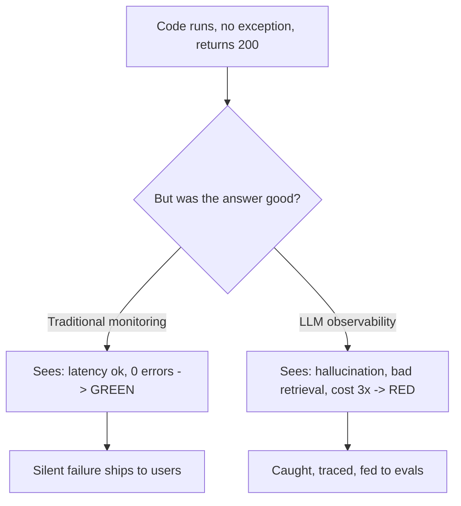
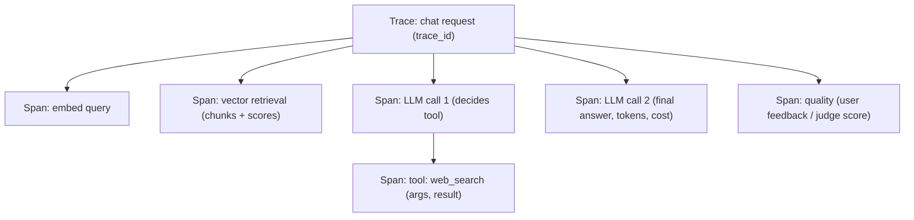
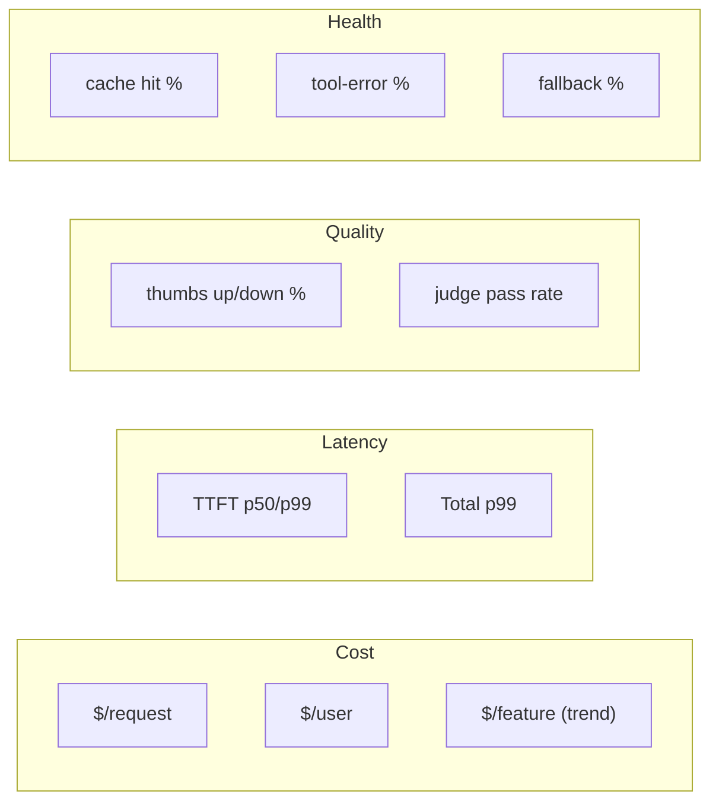
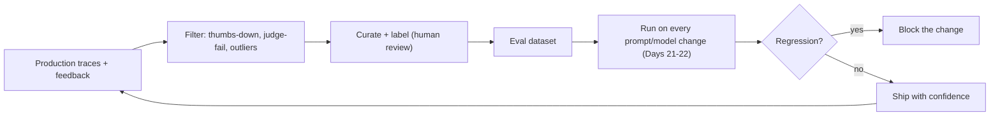
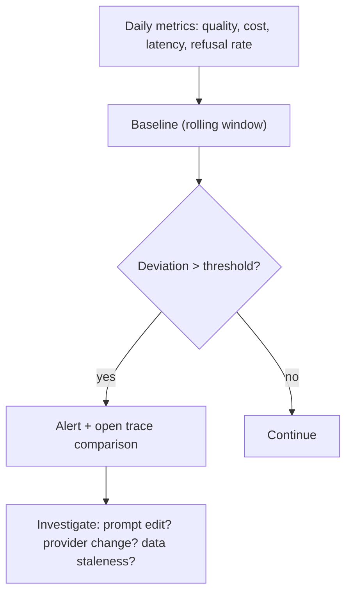

# Day 18 — Observability for LLM Apps

> Series: AI Backend Engineering
> Goal: See inside your LLM system — because bug-free code can still be catastrophically "broken" — using tracing, metrics, and quality signals adapted from the three pillars, wired to Langfuse or LangSmith, feeding a loop back into evals.

Today rests on **System Design Day 20 (observability — the three pillars: logs, metrics, traces)** and pushes it somewhere your old systems never had to go: *correctness itself is now an observable*. A REST endpoint either returns 200 or 500. An LLM endpoint returns 200 with a confident, fluent, completely wrong answer — and nothing anywhere throws. That gap is today's entire subject.

---

## Table of Contents

1. [Why: bug-free code that's still broken](#1-the-core-insight)
2. [The three pillars, adapted for LLMs](#2-three-pillars-adapted)
3. [Pillar 1 — Tracing](#3-tracing)
4. [Pillar 2 — Metrics](#4-metrics)
5. [Pillar 3 — Quality signals](#5-quality-signals)
6. [Feedback loops: production traces → eval datasets](#6-feedback-loops)
7. [Drift detection](#7-drift-detection)
8. [Tools: Langfuse vs LangSmith (and others)](#8-tools)
9. [Instrumenting a RAG/agent call in Python](#9-instrumentation)
10. [The Dark Side](#10-the-dark-side)
11. [Day 18 Self-Check](#11-day-18-self-check)
12. [Tomorrow](#12-tomorrow)
13. [Apply (1 hour)](#13-apply-1-hour)

---

## 1. The core insight

### Why
State this plainly, because it reframes everything you know about monitoring: **an LLM app can be completely broken while every line of code runs perfectly and no exception is thrown.**

- The model **hallucinated** a plausible, false answer. → 200 OK.
- The retriever pulled **garbage chunks**, so the grounded answer is grounded in nonsense. → 200 OK.
- Someone **edited the prompt** last week and quality quietly regressed. → 200 OK.
- An **agent looped** 40 times before answering. → 200 OK (just slow + expensive).
- **Cost silently tripled** because inputs grew or a cache stopped hitting. → 200 OK.

Your System Design observability (Day 20) catches crashes, latency, and error rates — none of which fire here. In LLM systems, **the absence of errors is not the presence of correctness.** Observability must now capture *what the model did and how good it was*, not just whether the process stayed up.

### What
LLM observability = the three pillars (traces, metrics, logs) **plus a fourth concern quality signals** — capturing the semantic content of each request and some measure of its goodness, so you can debug the invisible failures above.

### When / How / Where / Dark Side
Instrument from day one of any LLM feature — retrofitting observability after a silent-quality incident means you have no data to diagnose it. Details below.


*The gap between 'no errors' and 'good answers' is the entire reason LLM observability exists.*

> **🤔 Why observability if my code has no exceptions?**
> Because the worst LLM failures never raise. A confidently wrong answer is a 200 OK.
> Exceptions guard your *process*; observability guards your *output*.

**✅ Good scenario (where it saves you):** At a customer-support AI company, a prompt tweak subtly raised the refusal rate — zero errors, zero 500s. But the groundedness signal on the traces showed answers drifting off-context within an hour, and the team rolled back before the ticket queue exploded.

**❌ Bad scenario (the pain without it):** A legal-research assistant started fabricating citations after a silent provider model update. Every request returned 200; the ops dashboard stayed green for nine days until a customer's brief got thrown out in court. Nothing threw — that was the whole problem.

**When NOT to over-do it:** an internal prototype with three users and no stakes doesn't need full tracing on day one — eyeballing outputs is enough until real users depend on correctness.

---

## 2. Three pillars, adapted

### Why
You already think in **logs, metrics, traces (System Design Day 20)**. Rather than invent a new mental model, map LLM needs onto the pillars you know — then add quality as the dimension traditional systems lack.

### What / comparison

| Pillar | Classic system (Day 20) | LLM app adaptation |
|---|---|---|
| **Traces** | Request across microservices | Prompt → retrieval → tool calls → completion across the RAG/agent chain |
| **Metrics** | RPS, latency, error rate, CPU | TTFT, p50/p99 latency, tokens in/out, **cost/request**, cache hit rate, tool-error rate, retrieval recall |
| **Logs** | Structured events | Structured events **minus PII/secrets** (Dark Side) |
| **Quality (new)** | — (either it worked or it 500'd) | Thumbs up/down, LLM-as-judge scores, groundedness, eval pass rate |

### When / Where
All three pillars run in production continuously. Quality signals run both in production (user feedback, sampled judging) and offline (eval sets, Days 21–22).

> **🤔 Isn't a green latency/error dashboard enough — it's what worked for years?**
> No. That dashboard proves the *process* is healthy, not that *answers* are correct.
> The two are orthogonal: 0 errors and 100% hallucination coexist happily.

**✅ Good scenario (where it saves you):** A search startup mapped LLM signals onto its existing Grafana pillars, then added one quality tile. When judge-pass-rate dipped after a reindex, the ops team caught it on the same board they already watched — no new muscle memory required.

**❌ Bad scenario (when misused):** A team ported its classic dashboards, declared "observability done," and shipped. Latency and error panels stayed green for a month while retrieval quietly degraded; the regression surfaced only in a churn report, long after the revenue was lost.

**When NOT to over-do it:** if your LLM feature is a thin, non-critical wrapper (e.g., autocomplete hints), a full four-pillar board is overkill — track cost and a coarse feedback signal, skip the rest.

### The Dark Side
Mapping to familiar pillars is comforting but can lull you into thinking classic dashboards suffice. They don't — a green latency/error dashboard says nothing about whether answers are correct. **Quality is the pillar your old tooling can't see; budget for it explicitly.**

---

## 3. Tracing

### Why
When an answer is wrong, you must reconstruct *exactly* what happened: what the user asked, what got retrieved, what the model saw, which tools ran with what args, what came back, how many tokens, how long, which model+params. Without a trace, debugging an LLM failure is guesswork. A trace is the flight recorder.

### What — capture per request (per span)
- **Input:** full prompt / all messages, system prompt, model + params (temperature, top_p, max_tokens), tool schemas.
- **Retrieval:** query, retrieved chunk ids + text + scores, which chunks made it into context.
- **Tool calls:** tool name, arguments, result, latency, success/error.
- **Output:** completion, finish reason, token counts (in/out), cost.
- **Timing:** TTFT, total latency, per-span latency.
- **Correlation:** a trace id spanning the *whole* agent/RAG chain, with nested spans per step.

### How — the trace tree


*One trace, nested spans across the whole RAG+agent chain — the flight recorder for a wrong answer.*

This is **distributed tracing from System Design Day 20** (parent/child spans, trace propagation) applied to an LLM chain. Langfuse is OpenTelemetry-integrated, so the same OTel concepts you know carry over directly.

### When
Trace **every** production request (sampling loses the rare failures you most need). If volume forces sampling, always keep traces for errors, low-feedback, and high-cost outliers.

### Where
Spans are created in your orchestration layer, exported to Langfuse/LangSmith (or an OTel collector). Attach the trace id to your app logs so classic logs and LLM traces correlate.

> **🤔 Why trace the whole chain — isn't logging the final answer enough?**
> No. A wrong answer tells you *that* it failed, not *where*. The bug could be retrieval, the prompt, a tool, or the model.
> Only a nested trace shows which span poisoned the output.

**✅ Good scenario (where it saves you):** At a RAG analytics product, a user reported a nonsense answer. The trace showed retrieval returned high-scoring but off-topic chunks — the embedding model had been swapped. One trace localized a bug that would have taken days of guesswork.

**❌ Bad scenario (the pain without it):** A team logged only inputs and outputs. When answers went bad they couldn't tell whether the retriever or the prompt was at fault, so they rewrote the prompt three times — while the real culprit, a broken reranker, kept degrading answers with zero exceptions.

**When NOT to over-do it:** a single-shot LLM call with no retrieval and no tools doesn't need a span tree — one input/output record is already a complete trace.

### The Dark Side
Traces capture the **full prompt and completion** — which is exactly where PII and secrets live. Logging these to a third-party observability platform can be a compliance breach (see Dark Side section 10). Redact before export.

---

## 4. Metrics

### Why
Metrics are your always-on aggregate view — the dashboards and alerts that tell you *something changed* before users complain. Same role as **System Design Day 20 metrics**, new signals.

### What — the LLM metric set
- **Latency:** TTFT (Day 15), total latency **p50/p95/p99** (percentiles, not averages — a mean hides the p99 pain).
- **Tokens:** input tokens, output tokens (per request, aggregated per user/feature).
- **Cost:** **cost per request, per user, per feature** — the single most important business metric; a silent 3× cost creep only shows here.
- **Cache:** hit rate per layer (Day 16) — a dropping hit rate directly raises cost.
- **Reliability:** tool-error rate, retry rate, fallback-rung rate (Day 17), 429 rate.
- **Retrieval quality:** retrieval recall / hit-in-context rate (did the right chunk make it in?).
- **Quality:** feedback rate + score, LLM-judge pass rate (section 5).

### How

```python
from prometheus_client import Counter, Histogram

llm_cost = Counter("llm_cost_usd_total", "LLM cost", ["model", "feature", "user_tier"])
llm_latency = Histogram("llm_latency_seconds", "Total latency", ["model", "feature"])
llm_ttft = Histogram("llm_ttft_seconds", "Time to first token", ["model"])
cache_hits = Counter("llm_cache_hits_total", "Cache hits", ["layer", "result"])

def record(model, feature, tier, cost_usd, latency_s, ttft_s):
    llm_cost.labels(model, feature, tier).inc(cost_usd)
    llm_latency.labels(model, feature).observe(latency_s)
    llm_ttft.labels(model).observe(ttft_s)
```

### The dashboard concept


*Cost + latency + quality + health on one board — quality sits beside the metrics your old dashboards already had.*

### When / Where
Metrics stream continuously to Prometheus/Grafana/Datadog *and* to your LLM platform (which computes cost/token metrics from traces automatically). Alert on cost/request spikes, p99 latency, feedback-score drops, and cache-hit-rate collapse.

> **🤔 Our average latency and total spend look fine — why percentiles and per-feature cost?**
> Averages hide the pain. A great p50 can mask a p99 that times out for your biggest customers, and a flat total bill can hide one feature quietly tripling.
> Aggregates lie; slices tell the truth.

**✅ Good scenario (where it saves you):** A coding-assistant company sliced cost per feature and spotted one endpoint's cost-per-request climbing 4× as its cache hit rate decayed. They fixed the cache key before the monthly invoice, saving five figures nobody had noticed accruing.

**❌ Bad scenario (the cost blowup):** A chatbot's inputs slowly grew as context-stuffing crept in. No alert fired — total tokens just looked "busy but fine" — until finance flagged a doubled invoice at month close. The signal was there per-request the whole time; nobody was watching it.

**When NOT to over-do it:** for a low-volume feature costing a few dollars a month, per-user cost cardinality is wasted effort — a single cost-per-request line is plenty.

### The Dark Side
**Vanity metrics.** "Requests served," "tokens generated," "uptime 99.9%" all look great while answer quality quietly rots. If your dashboard has no *quality* metric, it is measuring activity, not value. Always pair a volume metric with a quality metric.

---

## 5. Quality signals

### Why
This is the pillar traditional systems lack. Since correctness doesn't throw, you must *measure* it. Two production sources: **explicit user feedback** and **LLM-as-judge**.

### What
- **User feedback:** thumbs up/down, edits, regenerate-clicks, copy events, dwell — cheap, real, but sparse and biased (most users rate nothing; angry users over-rate).
- **LLM-as-judge:** a model scores an answer against criteria (groundedness, relevance, correctness) — scalable, runs on sampled production traffic, but imperfect and itself needs validation. This is a *teaser* to the eval Days 21–22, where you build real eval sets and judges.

### How

```python
from fastapi import FastAPI
app = FastAPI()

@app.post("/traces/{trace_id}/feedback")
async def feedback(trace_id: str, score: int, comment: str | None = None) -> dict:
    # attach to the trace so good/bad answers are linked to their full context
    await langfuse_score(trace_id=trace_id, name="user_feedback",
                         value=score, comment=comment)
    return {"ok": True}

async def judge(trace_id: str, question: str, answer: str, context: str) -> float:
    """Sampled LLM-as-judge. Cheap model, strict rubric, returns 0..1.
    Validate the judge against human labels before trusting it (Days 21-22)."""
    verdict = await cheap_model.complete(
        JUDGE_RUBRIC.format(q=question, a=answer, ctx=context))
    await langfuse_score(trace_id=trace_id, name="groundedness", value=verdict)
    return verdict
```

### When
Collect user feedback always (it's free and gold). Run LLM-judge on a *sample* (judging every request doubles your cost). Judge 100% only for high-stakes flows or during a suspected regression.

### Where
Feedback endpoint attaches scores to the trace id (section 3), so a bad rating is linked to the *full context* that produced it — that linkage is what makes feedback debuggable and feeds section 6.

> **🤔 We have a 4.6-star average — isn't quality already measured?**
> Barely. That average comes from the 2% who bothered to rate, skewed toward the furious and the delighted.
> Explicit feedback is a biased sample, not a quality metric — pair it with sampled judging.

**✅ Good scenario (where it saves you):** A writing-assistant team ran a cheap LLM-as-judge on sampled traffic and caught groundedness sliding two days before user thumbs-down volume moved. The judge saw the regression while the ratings were still lagging.

**❌ Bad scenario (the silent regression):** A company alerted only on thumbs-down. A prompt change degraded a rarely-rated flow; feedback stayed silent because those users never click ratings, and the quality drop shipped to prod undetected for a week.

**When NOT to over-do it:** don't run LLM-as-judge on 100% of traffic for a low-stakes feature — judging can cost as much as generation; sample a few percent unless it's high-stakes.

### The Dark Side
- Feedback is **sparse and biased** — a 4.5/5 average from the 2% who rate says little about the 98% who didn't.
- **The judge can be wrong.** An unvalidated LLM judge gives false confidence. Validate judge scores against human labels before you trust or alert on them.

---

## 6. Feedback loops

### Why
The highest-value asset in an LLM product is a dataset of **real production inputs with known-good/known-bad outcomes**. Every thumbs-down, every escalation, every judge-flagged answer is a candidate test case. Closing the loop — production traces → eval dataset → regression tests — is how you *stop shipping the same failure twice*.

### What
A pipeline: capture traces → filter for signal (negative feedback, judge fails, high cost, outliers) → curate into an eval dataset → run every prompt/model change against it (Days 21–22) → prevent regressions.

### How


*Every bad production answer becomes a permanent regression test — the loop that compounds quality.*

### When
Continuously. The moment you have negative feedback, start harvesting it into an eval set. This is the bridge into Days 21–22.

### Where
Langfuse and LangSmith both support turning traces into datasets directly — a flagged production trace becomes an eval example in one click/API call. That native loop is a major reason to adopt these platforms over rolling your own.

> **🤔 We already have evals — why pipe production traces back in?**
> Because synthetic evals test the failures *you imagined*. Production traces surface the ones you didn't.
> The loop is how you stop shipping the same bug twice.

**✅ Good scenario (where it saves you):** A support-AI team turned every escalated ticket into an eval row. Within a quarter their regression set caught a prompt refactor that would have re-broken a bug fixed months earlier — the exact failure was now a permanent test.

**❌ Bad scenario (the pain without it):** A team fixed a hallucination by hand, shipped, and moved on. Two model upgrades later the same hallucination returned because it was never captured as a test. They debugged the identical issue from scratch — the loop that would have caught it was never closed.

**When NOT to over-do it:** if you ship a prompt once and never touch it again, an elaborate trace-to-dataset pipeline is overkill — a handful of manual test cases suffices.

### The Dark Side
A feedback loop that only harvests failures overfits your evals to known problems while blind spots stay untested. Also sample *good* and *typical* traces, not just the fires — or your eval set only proves you fixed old bugs, not that you kept things working.

---

## 7. Drift detection

### Why
LLM systems degrade *silently over time* even when you change nothing: your traffic distribution shifts, your data grows stale, and — critically — **the provider silently updates the model behind the same name**, changing behavior overnight. Without drift detection you learn about degradation from a customer, weeks late.

### What
Track quality and cost metrics as **time series** and alert on trend breaks:
- Quality drift: judge-score / feedback-score trending down.
- Cost drift: cost/request trending up (inputs growing, cache decaying, escalation rising).
- Latency drift: p99 creeping up.
- Behavior drift: output length, refusal rate, or tool-use rate shifting — often the fingerprint of a silent provider model update.

### How


*Watch the trend, not the snapshot — silent drift is invisible in any single request.*

### When
Compute drift daily/weekly against a rolling baseline. Pin your model to dated/versioned snapshots where the provider offers them, and diff behavior when you *choose* to upgrade — so a model change is a deliberate, measured event, not a surprise.

### Where
Your metrics store + LLM platform, both retaining history. Correlate drift alerts with your prompt/model deploy log so you can tell "we changed something" from "the provider changed something."

> **🤔 We didn't change anything — how can quality drift on its own?**
> Because the ground moves underneath you: traffic shifts, data goes stale, and the provider can silently update the model behind the same name.
> "We changed nothing" is exactly when silent drift bites.

**✅ Good scenario (where it saves you):** A summarization product watched output-length and refusal-rate time series. When both jumped overnight with no deploy on their side, the fingerprint screamed "provider model update" — they pinned to the prior snapshot and diffed behavior deliberately instead of firefighting.

**❌ Bad scenario (the drift no one saw):** A team tracked only snapshots, never trends. The provider quietly shipped a new model version; answers grew terser and started dropping caveats. Quality eroded for weeks until a customer complained — invisible in any single 200 OK request.

**When NOT to over-do it:** a pinned, self-hosted open-weights model with stable traffic barely drifts — a weekly glance beats a full anomaly-detection rig there.

### The Dark Side
Drift alerts fire on legitimate seasonality/traffic shifts too — untuned, they become noise. Baseline against comparable windows and require sustained deviation, not a single blip (ties to alert fatigue below).

---

## 8. Tools

### Why
Rolling your own tracing + cost accounting + eval-dataset management is a large, undifferentiated build. Purpose-built LLM observability platforms give you traces, cost, quality scoring, and dataset loops out of the box. In July 2026 the two leaders are **Langfuse** and **LangSmith**.

### What / comparison

| Dimension | **Langfuse** | **LangSmith** |
|---|---|---|
| License | Open-source, self-hostable | Proprietary, hosted (SaaS) |
| Ecosystem | Framework-agnostic, **OpenTelemetry-integrated** | **LangChain / LangGraph native** |
| Best fit | You want self-host/data control, OTel, any framework | You're all-in on LangChain |
| Tracing | Decorators, SDK, OTel spans | Deep auto-trace of LangChain runs |
| Evals/datasets | Built-in, trace→dataset | Built-in, tight LangChain eval integration |
| Cost tracking | Automatic per-model | Automatic per-model |
| Data residency | Full control (self-host) | Vendor-hosted (region options) |

**Also worth knowing:** **Arize Phoenix** (open-source, OTel-native, strong on eval/embedding-drift visualization) and **Braintrust** (eval-and-experiment-centric). Verify current versions and features when you build — this space moves fast.

### When
- Self-hosting / data-control / OTel / framework-agnostic → **Langfuse**.
- Deep LangChain/LangGraph app, want zero-config tracing → **LangSmith**.
- Heavy eval/experimentation workflow → evaluate Braintrust / Phoenix alongside.

### Where
The platform SDK wraps your orchestration layer (section 9). Because Langfuse speaks OpenTelemetry, it slots into the OTel pipeline you may already run from System Design Day 20 — same collector, same trace-propagation model.

> **🤔 Why adopt a platform — can't we just log traces to our existing stack?**
> You can, but you'll rebuild cost accounting, quality scoring, and trace-to-dataset loops from scratch.
> That's undifferentiated engineering these platforms hand you out of the box.

**✅ Good scenario (where it saves you):** A regulated fintech chose self-hosted Langfuse so full prompts never left their boundary, yet still got automatic per-model cost tracking and one-click trace-to-eval — capabilities they'd budgeted a quarter to build in-house.

**❌ Bad scenario (when misused):** A team rolled their own tracing to "save money," then spent months bolting on cost math and dataset tooling — badly. Meanwhile cost creep went untracked because their homegrown pipeline never computed per-model spend, and the blowup surfaced on the invoice.

**When NOT to over-do it:** for a weekend project or a throwaway demo, wiring up a full observability platform is overkill — print the trace to stdout and move on.

### The Dark Side
These platforms ingest your full prompts + completions — a data-governance decision, not just a technical one. Self-hosted Langfuse keeps data in your boundary; hosted platforms send it to a vendor. Choose with your compliance team, and redact PII regardless (section 10).

---

## 9. Instrumentation

### Why
Concretely: how do you actually trace a RAG/agent call in Python? Two levels — **manual spans** (portable, explicit) and a **decorator** (ergonomic, framework-native). Know both.

### How — manual spans (portable, OTel-style)

```python
from __future__ import annotations
import time
from langfuse import Langfuse  # verify current version

lf = Langfuse()  # reads keys from env

async def answer_question(question: str, user_id: str) -> dict:
    trace = lf.trace(name="rag_chat", user_id=user_id, input={"q": question})
    t0 = time.monotonic()

    # span 1: retrieval
    rspan = trace.span(name="retrieval", input={"query": question})
    chunks = await retrieve(question)              # your RAG retriever
    rspan.end(output={"chunk_ids": [c.id for c in chunks],
                      "scores": [c.score for c in chunks]})

    # span 2: generation (as an LLM "generation" for cost accounting)
    context = "\n".join(c.text for c in chunks)
    gen = trace.generation(name="answer", model="frontier",
                           input=[{"role": "user", "content": question}],
                           metadata={"context_chunks": len(chunks)})
    completion = await provider.complete(
        [{"role": "system", "content": f"Context:\n{context}"},
         {"role": "user", "content": question}], model="frontier")
    gen.end(output=completion["text"],
            usage={"input": completion["tokens_in"],
                   "output": completion["tokens_out"]})  # -> auto cost

    trace.update(output={"answer": completion["text"]},
                 metadata={"latency_s": time.monotonic() - t0})
    return {"answer": completion["text"], "trace_id": trace.id}
```

### How — decorator (ergonomic)

```python
from langfuse.decorators import observe

@observe()                       # auto-creates a span, captures in/out, timing
async def retrieve(question: str) -> list:
    ...

@observe(as_type="generation")   # marks an LLM call for token/cost capture
async def generate(messages: list[dict], model: str) -> dict:
    ...

@observe()                       # top-level trace; nested @observe = child spans
async def rag_chat(question: str) -> dict:
    chunks = await retrieve(question)
    return await generate(build_messages(question, chunks), model="frontier")
```

The decorator auto-nests: calling `retrieve` and `generate` inside `rag_chat` produces the trace tree from section 3 with zero manual span plumbing.

### When
Use the decorator for greenfield code you control; use manual spans when you need precise control, custom span attributes, or you're bridging an existing OTel setup.

### Where
Wrap the orchestration layer, not the transport layer — you want the *semantic* steps (retrieve, generate, tool-call) as spans, not HTTP mechanics.

> **🤔 Manual spans or the decorator — do I really need to know both?**
> Yes, but not at once. The decorator is the default for code you own; manual spans are for custom attributes or bridging an existing OTel setup.
> Same trace tree, different ergonomics.

**✅ Good scenario (where it saves you):** A team greenfielding an agent used `@observe()` and got the full nested trace tree with zero span plumbing — retrieval, generation, and tool calls all captured automatically, so a wrong answer was debuggable from day one.

**❌ Bad scenario (the pain when misused):** A team instrumented at the HTTP transport layer instead of the orchestration layer. Their spans showed request/response mechanics but not *which chunk* or *which tool arg* caused a bad answer — semantically blind traces that looked complete but couldn't debug the failure that mattered.

**When NOT to over-do it:** don't hand-roll manual spans for a simple LangChain app — the native auto-tracing already captures the tree; manual plumbing just adds maintenance.

### The Dark Side
Whatever you pass as `input`/`output` gets sent to the platform — that's where a raw prompt with a user's SSN ends up in a vendor's database. Redact at the instrumentation boundary (next section).

---

## 10. The Dark Side

- **Logging full prompts with PII/secrets.** Traces capture complete prompts + completions, which routinely contain names, emails, SSNs, API keys, and internal data — shipped to a third-party platform. This is **"never log secrets" from System Design Day 20**, now with far more surface area. Redact/mask before export (regex + PII detection on input/output fields); prefer self-hosted (Langfuse) for sensitive data; scrub secrets from prompts before they're ever assembled. *This foreshadows Day 20's AI security chapter.*
- **Vanity metrics vs quality.** Tokens generated, requests served, uptime — all green while answers rot. Every volume metric must be paired with a quality metric, or your dashboard measures busyness, not value.
- **Observability overhead and cost.** Tracing every request, running LLM-judges on all traffic, retaining full histories — these have real compute, storage, and dollar costs (judging can rival generation cost). Sample judiciously; always keep full traces for errors/negative-feedback/outliers; downsample the boring middle.
- **Alert fatigue.** Drift and quality alerts that fire on every seasonal wobble get muted — and then you miss the real regression. Baseline against comparable windows, require sustained deviation, and tier alerts (page on cost/quality cliffs; digest the rest). This is the same alerting discipline from System Design Day 20.
- **Judge you didn't validate.** An LLM-as-judge that disagrees with humans gives confident-but-wrong quality numbers. Validate against human labels before trusting it (Days 21–22).
- **Feedback loop overfit.** Harvesting only failures builds evals that prove old bugs are fixed but never test that normal cases still work. Sample the typical, not just the broken.

---

## 11. Day 18 Self-Check

1. State the core insight of LLM observability in one sentence. Give three concrete "broken but no exception" failures.
2. Map the three pillars (System Design Day 20) onto LLM observability. What fourth concern do LLMs add that classic systems lack?
3. List eight things a trace should capture per request. Why must the trace span the *whole* RAG/agent chain?
4. Why should you trace 100% of requests (or, if sampling, which requests must you always keep)?
5. Why are p50/p99 latency percentiles more honest than an average? Which single metric best exposes silent cost creep?
6. Contrast user feedback vs LLM-as-judge as quality signals — strengths, weaknesses, and when to use each.
7. Describe the feedback loop from production traces to eval sets. What's the trap of harvesting only failures?
8. What is drift detection, and how would you distinguish "we changed the prompt" from "the provider silently changed the model"?
9. Compare Langfuse and LangSmith. Which would you pick for a self-hosted, OTel-based, framework-agnostic stack, and why?
10. Where exactly does PII leak into observability, and what's your redaction strategy? Which System Design lesson does this reuse?

---

## 12. Tomorrow

You've completed the **production-readiness stage**: streaming (Day 15), caching/cost (Day 16), resilience (Day 17), and observability (Day 18) — your System Design foundation fully cashed in. Next comes **evaluation and quality** (Days 21–22): turning the eval datasets you started harvesting today into rigorous, automated quality gates — building eval sets, validating LLM-as-judge against humans, and blocking regressions before they ship. The feedback loop you built today is the on-ramp.

---

## 13. Apply (1 hour)

1. **(20 min)** Instrument your RAG/agent call with Langfuse (self-hosted via Docker, or free cloud tier) using the section-9 decorator approach: a top-level trace with nested `retrieval` and `generation` spans. Confirm the trace tree and automatic cost appear in the dashboard.
2. **(10 min)** Add a `POST /traces/{id}/feedback` endpoint that attaches a thumbs up/down score to the trace. Submit both and confirm they link to their full context.
3. **(10 min)** Export the LLM metric set (TTFT, p99 latency, cost/request, cache hit rate) to Prometheus/Grafana (or read them from Langfuse). Build a one-screen board with cost, latency, *and* a quality tile.
4. **(10 min)** Add a redaction step at the instrumentation boundary that masks emails/keys in `input`/`output` before export. Prove a fake SSN in a prompt does *not* reach the platform.
5. **(10 min)** Take one thumbs-down trace and turn it into a single eval dataset row (Langfuse dataset). You've now closed the first link of the feedback loop that Days 21–22 will build on. Bonus: run a cheap LLM-as-judge on 20 sampled traces and eyeball whether its scores match your own judgment.
