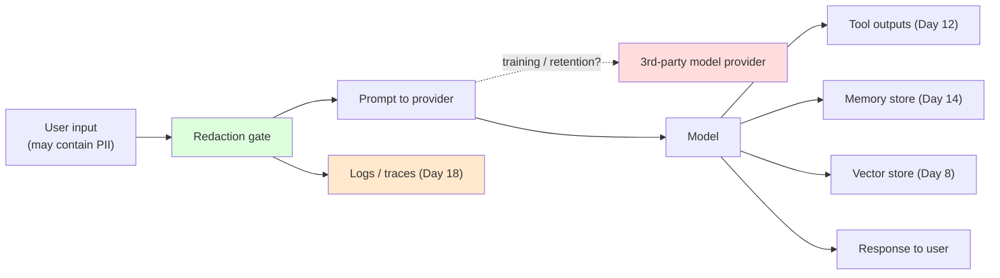
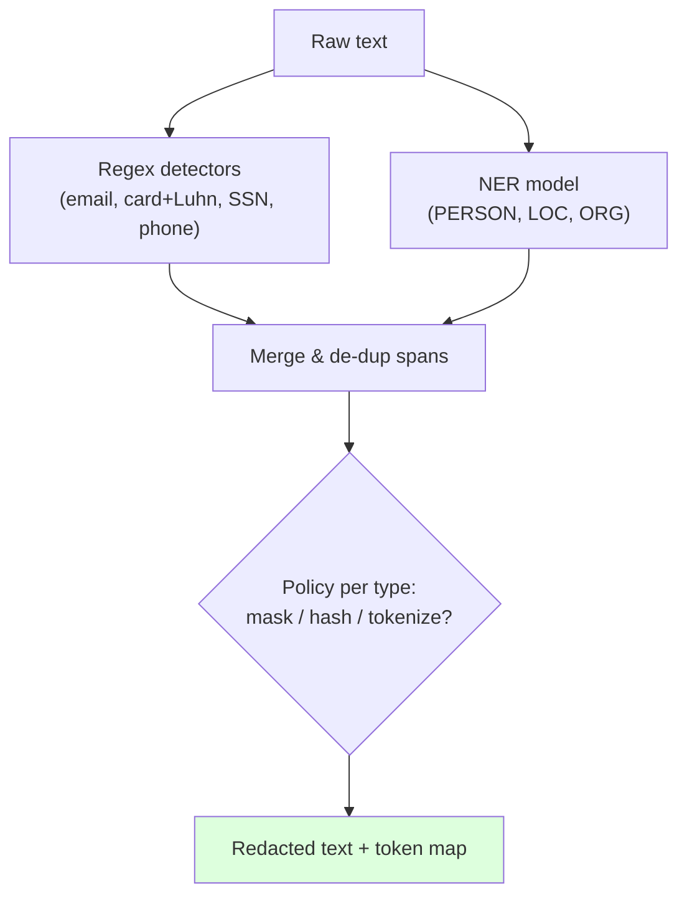
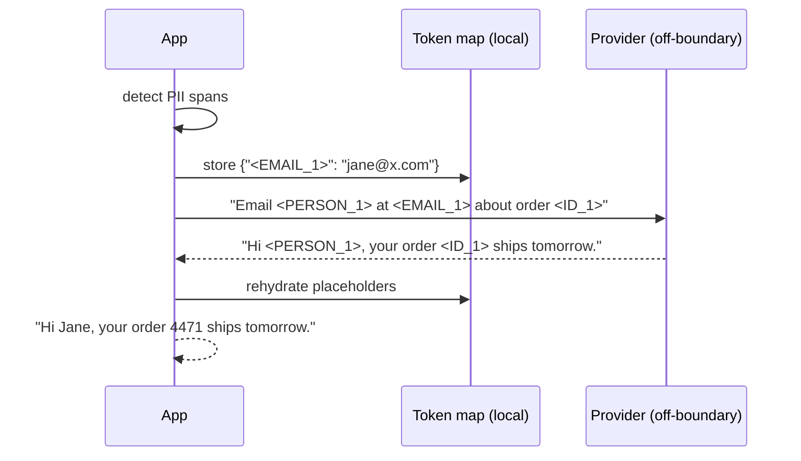
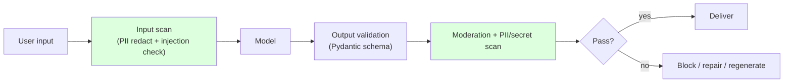
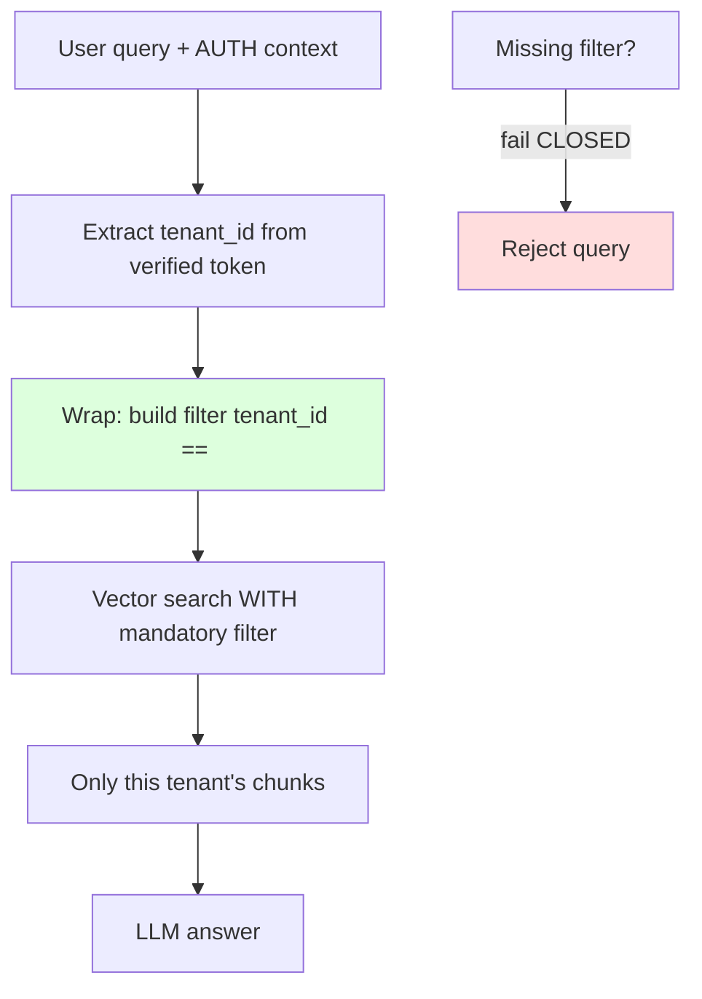

# Day 20 — Data Protection, PII & Guardrails

> Series: AI Backend Engineering
> Goal: Stop sensitive data from leaking through prompts, logs, tool outputs, and memory; redact PII before it hits the model; validate outputs; and enforce tenant isolation in RAG so one org can never see another's data.

## Table of Contents
1. [Why data protection is different for LLM systems](#1-why-data-protection-is-different-for-llm-systems)
2. [The leakage paths (map your data flow)](#2-the-leakage-paths-map-your-data-flow)
3. [PII detection & redaction before the model or logs](#3-pii-detection--redaction-before-the-model-or-logs)
4. [Redact → process → rehydrate](#4-redact--process--rehydrate)
5. [Output validation & content filtering](#5-output-validation--content-filtering)
6. [Least-privilege data access & tenant isolation in RAG](#6-least-privilege-data-access--tenant-isolation-in-rag)
7. [Compliance: GDPR right-to-delete vs embeddings & memory](#7-compliance-gdpr-right-to-delete-vs-embeddings--memory)
8. [Python: a full guardrail pipeline](#8-python-a-full-guardrail-pipeline)
9. [Tooling landscape (July 2026)](#9-tooling-landscape-july-2026)
10. [The Dark Side](#10-the-dark-side)
11. [Day 20 Self-Check](#day-20-self-check)
12. [Tomorrow](#tomorrow)
13. [Apply (1 hour)](#apply-1-hour)

---

## 1. Why data protection is different for LLM systems

**Why.** In a classic backend, data flows to systems you control or to vetted vendors under contract. In an LLM system, the most sensitive data your users hold — support transcripts, health notes, financial details — gets serialized into a **prompt** and shipped to a third-party model provider, echoed into **traces** (Day 18), embedded into a **vector store** (Day 8), and possibly written into long-term **memory** (Day 14). Each hop is a new place PII can rest, be logged, or leak.

**What.** Data protection for LLMs means governing PII/sensitive data across four surfaces: (1) what leaves your boundary to a provider, (2) what lands in logs/traces, (3) what persists in vectors/memory, (4) what comes back out to a user. Guardrails are the runtime controls that enforce this.

**When.** Design these in from day one. Retrofitting redaction after PII is already sprawled across logs and a vector DB is an expensive cleanup and a reportable-incident risk.

**Where.** At every boundary in your data-flow diagram — the same diagram you drew for Day 19's injection surfaces. Injection is about *malicious data coming in*; data protection is about *sensitive data going out or resting insecurely*. Same map, opposite arrows.

**How.** Redaction gates on the way in, validation and filtering gates on the way out, tenant scoping on retrieval, and purge capability for compliance. The rest of the day.

*Reuse your System Design instinct — "never log secrets" (Day 20 there) — and extend it: never log, embed, or ship PII you didn't have to.*

> **🤔 Why redact PII if we trust our LLM provider?**
> Because the provider is only one hop of many. "Trust" is a contract, not a control.
> PII still leaks into *your* logs, traces, eval sets, and support screenshots — places the DPA never touches.
>
> - **A data-processing agreement answers: "is the provider allowed to hold this?"** — a legal question about one vendor.
> - **Redaction answers: "does the SSN sit in plaintext anywhere it doesn't have to?"** — a technical question about your whole blast radius.
>
> So the one-liner: **a DPA covers the provider; redaction shrinks the blast radius everywhere else.**

**✅ Good scenario (where it saves you):** At a healthcare-support AI vendor, redaction at the boundary means when a debug trace, an APM sample, and a shared eval dataset all get built from real traffic, none of them contain a patient's real name or MRN — just `<PERSON_1>`. A breach of the log store leaks placeholders, not protected health information.

**❌ Bad scenario (the pain without it):** A fintech assistant "trusts the provider" and skips boundary redaction. Six months later an engineer discovers every prompt — full of customer SSNs — has been flowing verbatim into the log aggregator and the LLM-tracing SaaS, both with far weaker access controls than the production DB. The provider was never the leak; the plaintext SSNs in the log index are the reportable incident.

**When NOT to over-do it:** if the text genuinely never contains PII — an internal doc-search bot over public API docs — a full redaction pipeline is ceremony; redaction earns its cost the moment **user-supplied content** crosses a boundary you'll log, retain, or reuse.

---

## 2. The leakage paths (map your data flow)



*Every red/orange node is a place PII can rest or escape; the green gate is where you stop it.*

| Path | The risk | Primary control |
|---|---|---|
| **Prompt → provider** | PII sent off-boundary; possible retention/training on your data | Redact before send; choose zero-retention / no-train endpoints; DPA in place |
| **Logs / traces** | PII captured verbatim in Day 18 traces, breaks "never log secrets" | Redact *before* logging; scrub trace payloads |
| **Provider training** | Your data trains a shared model; leaks to other customers | **Opt out** of training; use enterprise/zero-retention tiers; verify contractually |
| **Tool outputs** | A tool returns raw PII (a DB row, an email) into context and logs | Scope tool queries; redact tool outputs before logging |
| **Memory (Day 14)** | Long-term memory silently accumulates PII you must later purge | Redact/pseudonymize on write; keyed by user for deletion |
| **Vector store (Day 8)** | Embeddings + chunk text hold PII; embeddings are hard to "unsee" | Redact before embedding; store deletable keys per record |
| **Output → user** | Model reveals another user's PII or unsafe content | Output validation + moderation + tenant checks |

> **🤔 If we redact before the provider, isn't the data already safe everywhere?**
> No — the prompt is one branch of the flow. The same PII can fork into logs, tool outputs, memory, and vectors *in parallel*.
> Redacting one arrow doesn't cover the others.

**✅ Good scenario (where it saves you):** A B2B support-AI company draws the full data-flow map first and puts one `redact()` gate at the branch point, before the flow splits to the provider *and* the logger *and* the trace exporter. One control, every downstream node covered — the classic "redact once, upstream of the fork" win.

**❌ Bad scenario (the pain without it):** A team redacts only the prompt sent to the provider but logs the raw request object for debugging. A tool call returns a full customer DB row into context, which the tracer captures verbatim. The provider hop is clean, yet raw emails and phone numbers now sit in the APM vendor and the trace SaaS — leakage through the paths nobody mapped.

**When NOT to over-do it:** a single-surface prototype that only calls the model and prints to console doesn't need a formal flow diagram; mapping every path pays off once you have **multiple sinks** — logs, traces, memory, vectors — that can each independently capture PII.

**The Dark Side.** The sneakiest path is **logs/traces**. You add Day 18 observability to debug, and now every prompt — full of customer PII — sits in your log store, your APM vendor, and your LLM-tracing SaaS, often with far weaker access controls than your production DB. Many real breaches are "we logged the prompts." Redact before the logger, not after.

---

## 3. PII detection & redaction before the model or logs

**Why before.** Once PII is in the prompt sent to the provider, or written to a log line, it has already left your control. Redaction must happen **upstream** of both the model call and the log write.

**What counts as PII.** Names, emails, phone numbers, national IDs (SSN/Aadhaar), credit cards, addresses, IPs, medical/financial identifiers, and context-specific identifiers (account numbers, case IDs). Different regimes (GDPR, HIPAA, PCI) scope this differently — know yours.

**How — a layered detector:**
1. **Regex/deterministic** for structured PII (emails, cards, SSNs, phones). Fast, cheap, high precision on formats. Add a Luhn check for cards to cut false positives.
2. **NER (Named Entity Recognition)** for unstructured PII (person names, locations, orgs) that regex can't catch. spaCy or a transformer NER model.
3. **Purpose-built tools** — **Microsoft Presidio** (analyzer + anonymizer, combines regex + NER + context), **LLM-Guard** PII scanner.



*Regex catches formats, NER catches names; policy decides masking vs reversible tokenization.*

**Where to place it.** As middleware in front of the provider client and inside your logging formatter. A single `redact()` call on the way in, applied to both the prompt and anything you log.

> **🤔 Isn't a good regex enough — why bother with an NER model?**
> Regex only catches *formatted* PII (emails, cards, SSNs). It cannot find "call Priya about the Nagpur account."
> Names, places, and orgs need NER; the two layers cover different failure modes.

**✅ Good scenario (where it saves you):** At a customer-service AI platform, the layered detector (regex + Presidio NER) sits inside the shared logging formatter, so a single call scrubs both the outbound prompt and the log line. When an agent pastes a chat transcript full of names and card numbers, the card is caught by regex+Luhn and the names by NER — before either reaches the model or the log.

**❌ Bad scenario (the pain without it):** A team ships regex-only redaction. It masks the SSN pattern but sails right past "the patient, Maria Gonzalez, in Room 4B." That unstructured PII lands in the trace store and, worse, gets pulled into the golden eval dataset curated from real traces — so now customer names live in a CI artifact that every engineer can clone.

**When NOT to over-do it:** if your inputs are strictly structured fields you already control (a form with a typed `card_number`), deterministic regex plus Luhn is plenty; a transformer NER model is overkill until you're handling **free-form user text**.

**The Dark Side.** NER misses. Names in other languages, unusual formats, PII split across turns — detectors have real false-negative rates. Redaction *reduces* exposure; it is not a guarantee. Combine it with least-privilege and zero-retention endpoints so a miss isn't catastrophic.

---

## 4. Redact → process → rehydrate

**Why.** Sometimes you must send data to the model to do the task, but the model doesn't need the *real* values — it needs *placeholders* it can reason about. Masking destroys the ability to give a useful, personalized answer ("Dear [MASK], your order [MASK]..."). **Tokenization/pseudonymization** preserves structure and reversibility.

**What.** Replace each PII span with a stable placeholder token (`<PERSON_1>`, `<EMAIL_1>`), keep a **local** token→value map, send the tokenized text to the model, then **rehydrate** the model's output by substituting real values back in — all inside your trust boundary.



*The provider never sees real PII; the user still gets a personalized answer.*

| Strategy | Reversible? | Model utility | Use when |
|---|---|---|---|
| Masking (`****`) | No | Low | Logs, when value is never needed again |
| Hashing | No (one-way) | Low | Correlation without disclosure |
| **Tokenization / pseudonymization** | Yes (local map) | **High** | Task needs the value back in the answer |
| Format-preserving encryption | Yes (key) | High | Structured fields, PCI |

> **🤔 Why not just mask everything with `****` and be done?**
> Because masking is one-way — the model can't personalize an answer it can't read.
> Tokenization keeps the *structure* the model needs while keeping the *value* on your side.

**✅ Good scenario (where it saves you):** An e-commerce assistant tokenizes "Email Jane at jane@acme.com about order 4471" into `<PERSON_1>`/`<EMAIL_1>`/`<ID_1>`, sends only placeholders off-boundary, then rehydrates for the user. The provider never sees a real email, yet the customer still gets "Hi Jane, your order 4471 ships tomorrow." Utility and protection at once.

**❌ Bad scenario (when misused):** A team rehydrates the model output *and then logs the rehydrated version* for analytics. The tokenized prompt was clean, but the log now holds the real email again — and the token→value map got dumped into the same trace for "debuggability," so an attacker with log access can reverse every placeholder. The reversible map became the leak.

**When NOT to over-do it:** if the task never needs the real value back — a sentiment classifier, a bulk log scrubber — skip tokenization entirely and use irreversible masking; the token map is a secret you shouldn't carry unless **rehydration is actually required**.

**The Dark Side.** The token map is now a secret. Store it in memory or a secured store, never in logs, and expire it with the request. And rehydration can *re-introduce* PII into an output you then log — so log the **tokenized** version, rehydrate only for the user.

---

## 5. Output validation & content filtering

**Why.** The model's output can be malformed, unsafe, off-tenant, or leak PII (its own or from context). Never pipe raw model output straight to a user, a downstream system, or an action.

**What & How — three checks:**

1. **Schema validation with Pydantic** (reuse Day 2 structured output). If the output must be structured, *parse and validate* it; reject/repair on failure. This also neutralizes many injection-driven "surprise" outputs (Day 19).

2. **Moderation / safety classifiers.** Run outputs through a moderation model or **Llama Guard** / **LLM-Guard** output scanners for toxicity, self-harm, and disallowed content. Provider moderation endpoints too.

3. **PII & leak scan on the way out.** Re-run PII detection on the output to catch the model emitting PII it shouldn't (e.g., another record pulled in via RAG), plus secret patterns (API keys) — the "never log/return secrets" rule, enforced at egress.



*Input scan and output scan are the two guardrail bookends around every model call.*

> **🤔 The input was already redacted — why scan the output too?**
> Because the model can emit PII that never came from the user: another record pulled in via RAG, or a leaked API key.
> Egress scanning is a separate guarantee from ingress redaction.

**✅ Good scenario (where it saves you):** At a multi-tenant SaaS with a support copilot, the output PII/secret scan catches the model quoting a *different* customer's email that a mis-scoped retrieval slipped into context. The guardrail blocks the reply before it reaches the user — turning a cross-tenant data disclosure into a caught, logged, non-event.

**❌ Bad scenario (an output guardrail failing):** A team validates the JSON schema but skips the egress PII scan. The model, given a noisy context, echoes another user's phone number in the `answer` field. It's well-formed JSON, so it passes validation and gets delivered — and the customer screenshots it into a support ticket, which becomes the permanent record of the leak.

**When NOT to over-do it:** on a low-risk internal tool where outputs are consumed by the same authenticated user who supplied the input (no RAG, no cross-tenant context), heavy moderation plus double PII scanning is latency you don't need; reserve the full egress stack for **high-risk, user-facing, or multi-tenant** surfaces.

**The Dark Side.** Each scan is a synchronous hop that adds latency and cost (Day 4) and can throttle streaming (you may have to buffer to scan). Over-strict moderation blocks legitimate content and generates support tickets. Validate against a labeled set; reserve heavy output scanning for high-risk surfaces.

---

## 6. Least-privilege data access & tenant isolation in RAG

**This is the highest-stakes section. A mis-scoped vector query is a cross-tenant data breach.**

**Why.** In multi-tenant RAG (Day 8), all tenants' chunks often live in **one** vector index. Semantic search matches on *meaning*, not on *who owns the document*. If your query doesn't constrain by tenant, a user's question can retrieve — and the model will happily quote — **another organization's confidential documents**. This is the RAG equivalent of forgetting a `WHERE tenant_id = ?` clause, and it is disturbingly easy to ship.

**What.** Tenant isolation = every retrieval is provably scoped to the caller's tenant/user, enforced by a **mandatory metadata filter** (reuse Day 7 metadata filtering) derived from the authenticated identity (reuse your auth knowledge — never from user-supplied input).

**How.**
1. On ingest, tag every chunk's metadata with `tenant_id` (and `user_id`/ACL where needed).
2. On query, inject a `tenant_id == <authenticated tenant>` filter into **every** vector search. Derive the tenant from the verified session/token, *not* from the request body.
3. Make the filter **impossible to omit**: wrap the vector client so no code path can query without a tenant filter (fail closed if missing).
4. Consider **physical isolation** (per-tenant index/namespace/collection) for high-sensitivity data — stronger than a shared index with filters.



*The tenant filter comes from the verified identity and is impossible to omit — omission fails closed.*

| Approach | Isolation strength | Cost/complexity | When |
|---|---|---|---|
| Shared index + metadata filter | Good (if enforced) | Low | Most B2B SaaS |
| Per-tenant namespace/collection | Strong | Medium | Sensitive verticals |
| Per-tenant physical DB | Strongest | High | Regulated / enterprise isolation SLAs |

> **🤔 We store each tenant's data with a `tenant_id` — isn't that isolation already?**
> Storing the tag isn't enough; you have to *filter on it every single query*.
> Semantic search matches meaning, not ownership — an unfiltered query happily returns another tenant's chunks.

**✅ Good scenario (where it saves you):** A B2B analytics AI wraps its vector client so no retrieval can run without a `tenant_id` filter derived from the verified token. When a new engineer ships an endpoint and forgets the filter, the wrapper raises instead of returning data — the fail-closed design turns a would-be cross-tenant breach into a loud 500 in staging.

**❌ Bad scenario (a regulatory violation):** A shared index makes the filter optional. A new "related documents" feature queries without a tenant scope, and Company A's users start seeing snippets of Company B's confidential contracts in the model's answers. No error fired — just silently broader results. It's the RAG version of a missing `WHERE tenant_id = ?`, and it's a reportable breach across every affected customer.

**When NOT to over-do it:** a genuinely single-tenant deployment (one customer, one dedicated index) doesn't need per-query tenant filters or physical namespaces; the mandatory-filter machinery earns its keep the moment **more than one tenant shares any index**.

**The Dark Side.** Filters that are *optional* in the code path are the trap: a new endpoint forgets the filter and leaks silently — no error, no alert, just wrong (broader) results. **Fail closed**: the vector wrapper must reject any query lacking a tenant scope. Also beware **embedding-model leakage** across tenants (shared fine-tunes) and cached results served across tenants.

---

## 7. Compliance: GDPR right-to-delete vs embeddings & memory

**Why.** GDPR (and CCPA, etc.) grant users a **right to erasure**. When a user says "delete my data," you must purge it *everywhere* — including places LLM systems love to scatter it: the vector store (Day 8), long-term memory (Day 14), and trace logs (Day 18). "We can't easily delete from embeddings" is not a legal defense.

**What / How.**
- **Design for deletion from the start.** Every embedded chunk and memory record carries a stable key (`user_id`, `doc_id`) so you can find and delete all vectors/memories for a subject in one operation.
- **Embeddings are personal data.** An embedding derived from a person's text can be personal data — treat it as deletable, not "just math."
- **Memory purge (Day 14).** Provide a `forget(user_id)` that wipes stored memories; don't let PII accumulate in memory with no eviction path.
- **Trace retention.** Set TTLs on traces/logs and ensure they're redacted; unbounded retention of PII-laden traces is a liability.
- **Model training.** You cannot un-train a provider's model from your data — which is exactly why the earlier controls (opt out of training, zero-retention endpoints, redact before send) are the *only* real protection here.

> **🤔 It's just an embedding — that's math, not personal data. Do we really have to delete it?**
> An embedding derived from a person's text can *re-identify* that person, so regulators treat it as personal data.
> "It's only vectors" is not a GDPR defense.

**✅ Good scenario (where it saves you):** A SaaS company tags every embedded chunk and memory record with a stable `user_id` from day one. When a user files an erasure request, one `forget(user_id)` call purges their vectors, memories, and (via TTL) their redacted traces in a single sweep — a routine compliance ticket instead of a fire drill.

**❌ Bad scenario (a GDPR violation):** A team embedded documents with no per-subject key, thinking "we'll figure out deletion later." A right-to-erasure request arrives and they cannot locate which of millions of vectors belong to that person. Meanwhile the raw text was also sent to a training-on-by-default endpoint months ago — so parts of that user's data are now un-erasable, and the regulator is asking why.

**When NOT to over-do it:** ephemeral, session-scoped embeddings that are dropped when the request ends don't need a deletion pipeline — there's nothing persistent to erase; the deletion machinery matters when embeddings or memories **outlive the request**.

**The Dark Side.** The hard corner: data already sent to a provider that trains on it, or PII baked into a fine-tune, is effectively unrecoverable. Erasure at *that* layer is impossible after the fact — so prevention (Section 2/3) is your compliance posture, not remediation.

---

## 8. Python: a full guardrail pipeline

An input redaction gate (regex + reversible tokenization), a tenant-scoped retrieval wrapper that fails closed, and an output validator. Type-hinted, runnable-quality; the NER/moderation calls are pluggable stubs.

```python
from __future__ import annotations

import hashlib
import re
from dataclasses import dataclass, field
from typing import Callable, Protocol

from pydantic import BaseModel, ValidationError

# ---------------------------------------------------------------------------
# 1. PII detection: regex layer (add spaCy/Presidio NER as another detector)
# ---------------------------------------------------------------------------
PII_PATTERNS: dict[str, re.Pattern[str]] = {
    "EMAIL": re.compile(r"[\w.+-]+@[\w-]+\.[\w.-]+"),
    "PHONE": re.compile(r"\+?\d[\d \-()]{7,}\d"),
    "SSN": re.compile(r"\b\d{3}-\d{2}-\d{4}\b"),
    "CARD": re.compile(r"\b(?:\d[ -]?){13,16}\b"),
}


def _luhn_ok(number: str) -> bool:
    digits = [int(d) for d in re.sub(r"\D", "", number)]
    if len(digits) < 13:
        return False
    checksum, parity = 0, len(digits) % 2
    for i, d in enumerate(digits):
        if i % 2 == parity:
            d *= 2
            if d > 9:
                d -= 9
        checksum += d
    return checksum % 10 == 0


@dataclass
class Redaction:
    text: str
    token_map: dict[str, str] = field(default_factory=dict)  # placeholder -> real


def redact(text: str, reversible: bool = True) -> Redaction:
    """Redact PII BEFORE the model call AND before logging (Section 3-4)."""
    token_map: dict[str, str] = {}
    counters: dict[str, int] = {}
    out = text
    for label, pat in PII_PATTERNS.items():
        for m in list(pat.finditer(out)):
            value = m.group(0)
            if label == "CARD" and not _luhn_ok(value):
                continue  # reduce false positives
            counters[label] = counters.get(label, 0) + 1
            if reversible:
                placeholder = f"<{label}_{counters[label]}>"
                token_map[placeholder] = value
            else:
                placeholder = f"[{label}]"
            out = out.replace(value, placeholder, 1)
    return Redaction(text=out, token_map=token_map)


def rehydrate(text: str, token_map: dict[str, str]) -> str:
    """Substitute real values back — inside the trust boundary, for the USER only."""
    for placeholder, value in token_map.items():
        text = text.replace(placeholder, value)
    return text


# ---------------------------------------------------------------------------
# 2. Tenant-isolated retrieval wrapper — FAILS CLOSED (Section 6)
# ---------------------------------------------------------------------------
class VectorStore(Protocol):
    def search(self, query: str, k: int, filter: dict[str, object]) -> list[dict]: ...


@dataclass
class AuthContext:
    user_id: str
    tenant_id: str  # derived from a VERIFIED token, never from request body


class TenantScopedRetriever:
    """No code path can query without a tenant filter (Day 6/7 + auth)."""

    def __init__(self, store: VectorStore) -> None:
        self._store = store

    def retrieve(self, query: str, auth: AuthContext, k: int = 5) -> list[dict]:
        if not auth.tenant_id:
            raise PermissionError("FAIL-CLOSED: no tenant scope; refusing query.")
        mandatory_filter = {"tenant_id": auth.tenant_id}
        return self._store.search(query=query, k=k, filter=mandatory_filter)


# ---------------------------------------------------------------------------
# 3. Output validation (Pydantic, Day 2) + PII/secret egress scan (Section 5)
# ---------------------------------------------------------------------------
class SupportReply(BaseModel):
    answer: str
    confidence: float
    cited_doc_ids: list[str]


SECRET_PATTERNS = [re.compile(r"sk-[A-Za-z0-9]{20,}"), re.compile(r"AKIA[0-9A-Z]{16}")]


def validate_output(
    raw: str,
    moderate: Callable[[str], bool],  # returns True if SAFE
) -> tuple[SupportReply | None, list[str]]:
    problems: list[str] = []
    try:
        reply = SupportReply.model_validate_json(raw)
    except ValidationError as e:
        return None, [f"schema invalid: {e.error_count()} errors"]

    # Egress PII scan: model must not leak PII (e.g. cross-tenant via RAG).
    leaked = redact(reply.answer, reversible=False)
    if leaked.text != reply.answer:
        problems.append("output contains PII")
    for pat in SECRET_PATTERNS:
        if pat.search(reply.answer):
            problems.append("output contains a secret-like token")
    if not moderate(reply.answer):
        problems.append("failed moderation")
    return (reply if not problems else None), problems


# ---------------------------------------------------------------------------
# 4. Safe logging: log the REDACTED prompt, never the raw one (Day 18/20)
# ---------------------------------------------------------------------------
def safe_log(event: str, prompt: str) -> None:
    red = redact(prompt, reversible=False)
    fingerprint = hashlib.sha256(prompt.encode()).hexdigest()[:12]
    print(f"[log] {event} prompt='{red.text}' fp={fingerprint}")


# ---------------------------------------------------------------------------
# 5. Demo
# ---------------------------------------------------------------------------
def _demo() -> None:
    raw = "Email jane@acme.com about card 4539578763621486, SSN 123-45-6789."
    red = redact(raw)
    print("tokenized:", red.text)             # PII replaced, safe to send/log
    safe_log("inbound", raw)                   # logs redacted form only

    model_out = "Sent to <EMAIL_1> regarding card <CARD_1>."
    print("to user :", rehydrate(model_out, red.token_map))

    reply_json = '{"answer":"See docs.","confidence":0.9,"cited_doc_ids":["d1"]}'
    reply, problems = validate_output(reply_json, moderate=lambda s: True)
    print("valid   :", reply, "problems:", problems)


if __name__ == "__main__":
    _demo()
```

**What to notice:** redaction runs before both the model *and* the logger; the retriever *cannot* run without a tenant scope; the output validator enforces schema, PII egress, secrets, and moderation. Guardrails are code at the boundaries, not adjectives in a prompt.

---

## 9. Tooling landscape (July 2026)

| Tool | Role |
|---|---|
| **Microsoft Presidio** | PII analyzer + anonymizer (regex + NER + context); reversible/pseudonymization |
| **LLM-Guard** | Input/output scanners: PII, secrets, toxicity, injection (pairs with Day 19) |
| **Llama Guard** | Content moderation classifier (input & output) |
| **spaCy / transformer NER** | Custom entity detection for domain PII |
| **Pydantic** | Output schema validation (Day 2) |
| **Vector DB metadata filters** | Tenant isolation (Pinecone/Weaviate/pgvector/Qdrant namespaces) |

---

## 10. The Dark Side

- **Guardrail latency & UX cost.** Input scan + output scan + moderation can add hundreds of ms and force you to buffer streaming. Every guardrail is a tax on your Day 20 (System Design) SLOs; budget it and skip heavy scans on low-risk paths.
- **Security theater vs real wins.** Rotating provider keys monthly and maintaining giant word blocklists *feel* like security and mostly aren't. The real wins are boring: **least privilege**, **tenant scoping that fails closed**, **redaction before the boundary**, **parameterized/scoped data access**, and **zero-retention/no-train endpoints**. Spend effort where the breaches actually happen.
- **Over-redaction destroys utility.** Mask too aggressively and the model can't do its job ("summarize [MASK]'s [MASK] issue with [MASK]"). Tune detectors; prefer reversible tokenization when the task needs the value.
- **False negatives are inevitable.** No PII detector is perfect (multilingual names, novel formats, split-across-turns). Redaction is a layer, not a guarantee — which is why zero-retention endpoints and least privilege backstop it.
- **The un-deletable corners.** Data sent to a training provider, or baked into a fine-tune, can't be erased on request. If you can't prevent it, don't send it.
- **Logs are the quiet breach.** Adding observability (Day 18) without redaction just relocated all your PII into a less-guarded store. Redact in the log formatter.

---

## Day 20 Self-Check
1. Name the four surfaces where LLM systems scatter PII, and the primary control for each.
2. Why must redaction happen *before* both the model call and the log write?
3. Contrast masking, hashing, and tokenization on reversibility and model utility. When do you pick each?
4. Walk through redact → process → rehydrate. Where does the token map live, and what must you never log?
5. Why is a mis-scoped vector query a cross-tenant *breach* and not just a bug? Where must the tenant_id come from?
6. What does "fail closed" mean for a retriever, and why is an *optional* tenant filter dangerous?
7. Give the three output-validation checks and how each maps to prior days (Day 2, Day 19).
8. Under GDPR right-to-delete, what must you be able to purge, and which layer is effectively un-erasable?
9. Distinguish security theater from real wins in LLM data protection with two examples each.
10. How do guardrails threaten your latency SLOs, and how do you decide where to apply the heavy ones?

## Tomorrow
**Day 21 — LLM Evaluation Fundamentals.** We build the regression safety net: why "it looks good" fails, offline vs online eval, golden datasets curated from real traces, deterministic + semantic + RAG (RAGAS) metrics, and LLM-as-a-judge with its biases. You'll ship a 15-20 case eval suite for your Day 8 RAG.

## Apply (1 hour)
1. (20 min) Add the `redact()` gate in front of your provider client *and* inside your Day 18 logging. Confirm no raw email/card/SSN appears in a log line. Verify rehydrate restores the user-facing answer.
2. (25 min) Wrap your Day 8 vector store in `TenantScopedRetriever`. Prove it raises when the tenant scope is missing (fail closed). Write a test that a tenant-A query never returns a tenant-B doc.
3. (15 min) Add `validate_output()` after one model call: schema (Pydantic), PII egress scan, secret scan, moderation stub. Trigger each failure branch once and confirm it blocks.
