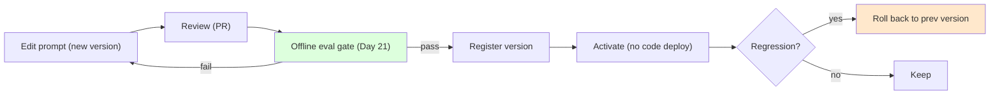
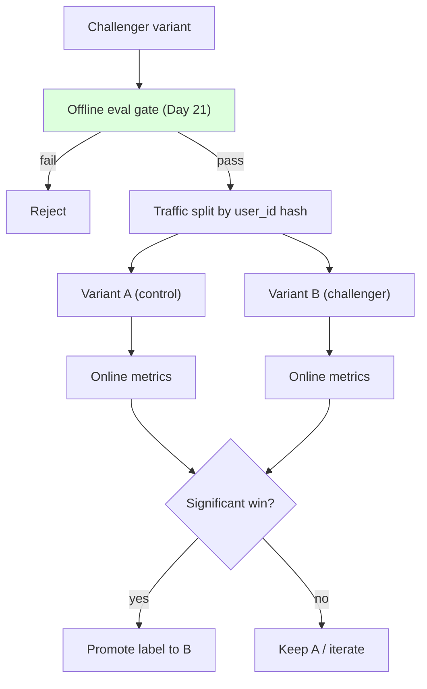
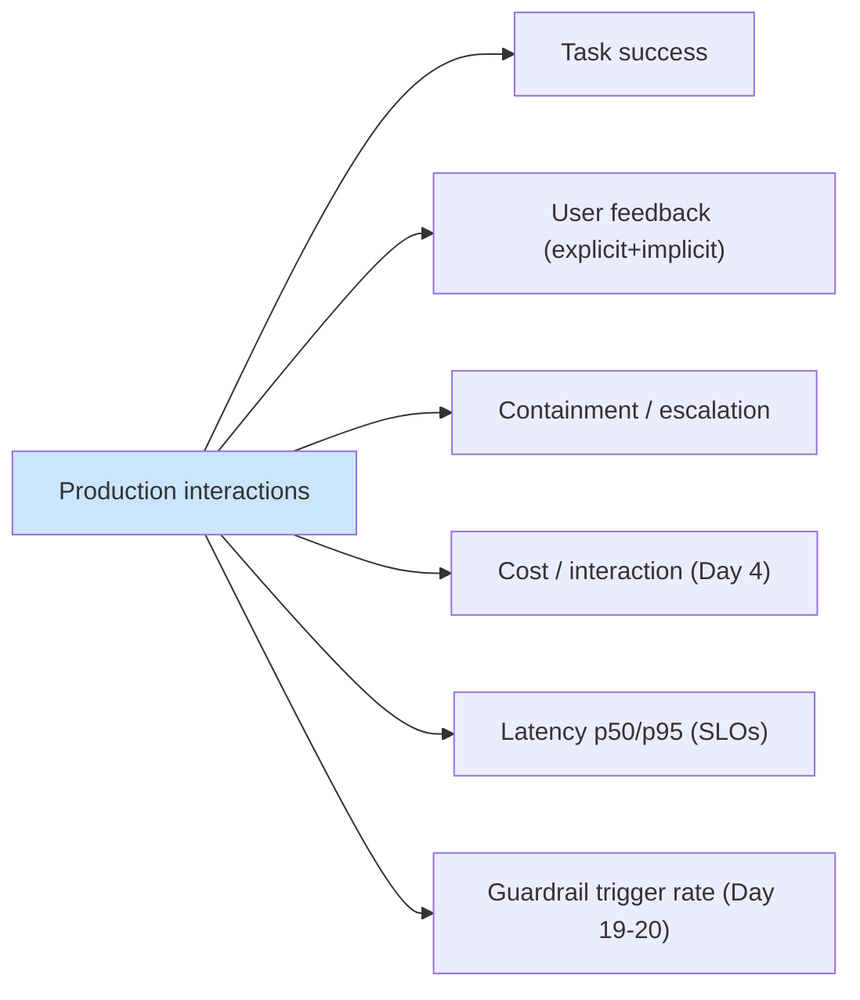
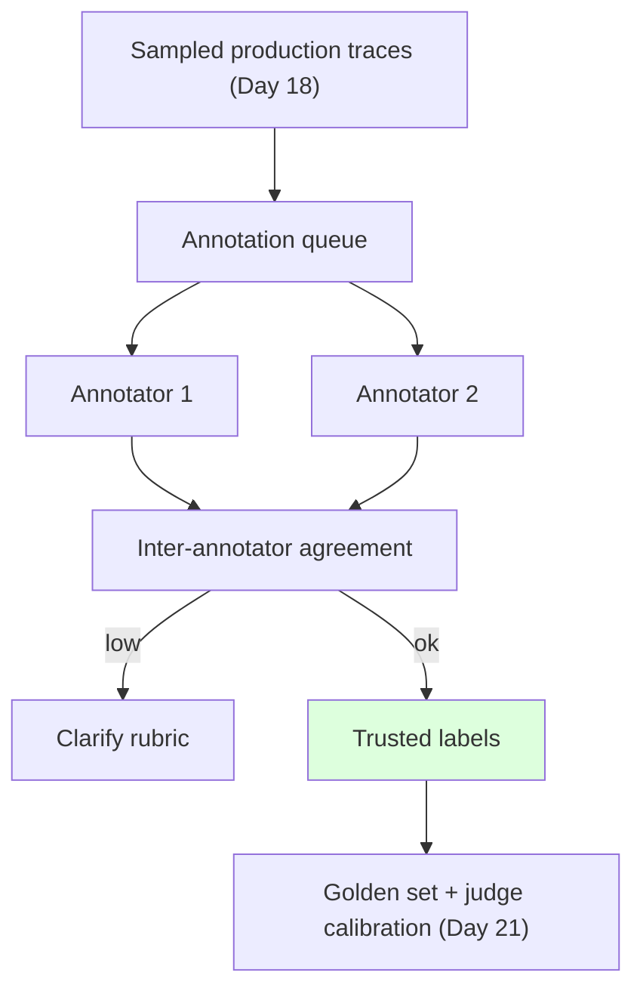
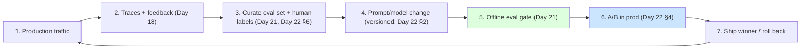

# Day 22 — Prompt Versioning, A/B Testing & Human Eval

> Series: AI Backend Engineering
> Goal: Treat prompts like code (version, review, roll back), A/B test variants and models safely in production, add human evaluation where it's non-negotiable, and close the improvement flywheel that ties Days 18, 21, and 22 together.

## Table of Contents
1. [Why this closes the loop](#1-why-this-closes-the-loop)
2. [Treat prompts like code](#2-treat-prompts-like-code)
3. [Prompt registries & decoupling prompt from deploy](#3-prompt-registries--decoupling-prompt-from-deploy)
4. [A/B testing prompts & models in production](#4-ab-testing-prompts--models-in-production)
5. [Online metrics that matter](#5-online-metrics-that-matter)
6. [Human evaluation & annotation](#6-human-evaluation--annotation)
7. [Closing the loop: the improvement flywheel](#7-closing-the-loop-the-improvement-flywheel)
8. [Python: a prompt registry + experiment runner](#8-python-a-prompt-registry--experiment-runner)
9. [Tooling landscape (July 2026)](#9-tooling-landscape-july-2026)
10. [The Dark Side](#10-the-dark-side)
11. [Day 22 Self-Check](#day-22-self-check)
12. [Tomorrow](#tomorrow)
13. [Apply (1 hour)](#apply-1-hour)

---

## 1. Why this closes the loop

**Why.** Days 18-21 gave you the pieces: observability (traces), guardrails, and offline evals. Today assembles them into an operating discipline. Without versioning you can't roll back a bad prompt; without A/B you ship on vibes; without human eval you have no ground truth for subjective quality; and without closing the loop your evals gather dust. This is the day the pieces become a *flywheel*.

**What.** Four capabilities: (1) prompts under version control with review and rollback, (2) production experiments (A/B) gated by offline evals, (3) the right online metrics, (4) human evaluation for what machines can't judge — all wired into a repeating cycle.

**When.** As soon as prompts change more than once and real users are affected. The moment a prompt edit can degrade a live experience, you need version control and a safe rollout path.

**Where.** Prompt registry (config/DB, not hardcoded), your serving layer (traffic splitting), your metrics store (Day 18), and an annotation workflow.

**How.** Version → offline-eval gate (Day 21) → A/B in prod → measure online → ship or roll back → feed learnings back into the eval set. The rest of the day.

*The reframe from System Design: this is CI/CD + feature flags + experimentation, applied to a probabilistic component.*

---

## 2. Treat prompts like code

**Why.** Prompts are behavior-defining logic. A one-word change can swing quality, cost, and safety. If prompts live as string literals scattered in code or, worse, edited live in a vendor UI with no history, you have an un-auditable, un-rollback-able production system.

**What "like code" means:**
- **Version control** — every prompt has a version/hash; changes are diffs.
- **Changelog** — what changed, why, expected effect, author, date.
- **Review** — prompt changes get a PR review like any code change (a second set of eyes catches regressions and safety issues, Day 19).
- **Testable** — every version passes the Day 21 offline suite before it can ship.
- **Rollback** — you can revert to the previous version instantly, without a code deploy.



*A prompt change moves through the same gates as code: review, test, activate, and revert if it regresses.*

> **🤔 Why version prompts — they're just strings?**
> A prompt is production configuration that changes model behavior, deployed independently of your code.
> An unversioned edit is an untracked prod deploy: you can't roll it back, can't attribute a quality drop to it, and can't A/B it because there's no stable version to point traffic at.

**✅ Good scenario (where it saves you):** At an AI customer-support company, a tweak to `support_answer` quietly raised escalation rate 8%. Because every version carried a hash and changelog, on-call diffed v14→v15, swapped the `production` label back to v14 in seconds, and filed the regression — no code deploy, recovery in minutes.

**❌ Bad scenario (the pain without it):** A PM edits the system prompt live in the vendor playground on a Friday. Answers degrade over the weekend, nobody can tell which change caused it, there's no prior text to restore, and the "fix" is a frantic reconstruction from memory. A real class of production incident.

**When NOT to over-do it:** a one-off internal script or a weekend prototype with a single caller doesn't need a registry and PR flow — inline the string. Versioning earns its cost once a prompt has real users and more than one editor.

**The Dark Side.** The anti-pattern is editing prompts directly in a provider's playground or a live config with no history — it feels fast and it's a production incident waiting to happen (no diff, no review, no rollback, no eval). Speed here is a trap.

---

## 3. Prompt registries & decoupling prompt from deploy

**Why decouple.** If a prompt is baked into your application code, changing it requires a full build/deploy — slow, and it couples a *content* change to a *code* release. Decoupling lets product/prompt engineers iterate and roll back in seconds without shipping code, while still enforcing review + eval gates.

**What.** A **prompt registry**: prompts stored by `name` + `version`, with a `label` (e.g., `production`, `staging`) pointing at the active version. Your app fetches "the production version of `support_answer`" at runtime. Tools: **Langfuse** and **LangSmith** prompt management provide exactly this (with UI, versioning, and labels); you can also build a lightweight one (Section 8).

**How.**
- Store prompt text + metadata (version, template variables, model, params) in the registry.
- App references by label; swapping the label to a new version is the "deploy" — instant, reversible.
- Cache fetched prompts (with TTL) so the registry isn't in your hot path (mind latency, Day 4).
- Gate label promotion on offline evals (Day 21).

| Approach | Rollback speed | Requires code deploy? | Auditability | Best for |
|---|---|---|---|---|
| Hardcoded string | Slow (redeploy) | Yes | Via git only | Tiny/early projects |
| Config file + git | Medium | Usually | Good (git) | Small teams |
| **Prompt registry (Langfuse/LangSmith)** | **Instant (label swap)** | **No** | Strong (versions + who) | Production teams |

> **🤔 If prompts deploy without a code release, do reviews still apply?**
> Yes — more so. Decoupling removes the build/deploy friction, not the risk.
> The label swap *is* the deploy; gate label promotion on review + offline evals, or you've made shipping unreviewed behavior trivially easy.

**✅ Good scenario (where it saves you):** A prompt team at a search-assistant company iterates ten variants a day against `staging` labels, promotes only the eval-passing one to `production`, and rolls back with a single label swap when p95 latency spikes — all without waiting on the app's release train.

**❌ Bad scenario (when misused):** Two engineers both "just update the production prompt" through the registry UI within an hour, silently overwriting each other; the second write reverts the first's safety fix, and because label promotion had no review gate, nobody noticed until moderation trigger rate climbed.

**When NOT to over-do it:** if your app ships weekly anyway and one person owns the single prompt, a git-tracked config file is plenty — a full registry with labels and TTL caching is overkill until iteration speed or multiple editors demand it.

**The Dark Side.** Decoupling from deploy also decouples from your usual code review reflexes — it's now *easy* to swap a prompt with no review. Keep the review + eval gate on label promotion, or you've traded slow-and-safe for fast-and-dangerous.

---

## 4. A/B testing prompts & models in production

**Why.** Offline eval (Day 21) tells you a variant is *plausibly* better on your golden set. Only real traffic tells you it's *actually* better on real users. A/B testing splits live traffic between variant A (control) and B (challenger) and compares online metrics.

**What / How — the safe procedure:**
1. **Gate on offline evals FIRST.** Never A/B a variant that hasn't passed the Day 21 suite. Offline is the cheap filter; A/B is the expensive confirmation. A/B'ing junk wastes real-user exposure.
2. **Traffic split** — assign users (not requests) to a variant, stably (hash user_id) so a user gets a consistent experience. Start small (e.g., 5-10% to challenger).
3. **Measure online metrics** (Section 5) per variant.
4. **Check significance** before deciding — don't call a winner on 50 sessions (Section 10). Ensure enough traffic/duration.
5. **Ship or roll back** — promote the winner's version label (Section 3), or revert.



*Offline eval is the gate; only variants that pass earn live traffic, and only significant wins earn promotion.*

| | Offline eval (Day 21) | A/B test (online) |
|---|---|---|
| Traffic | None (golden set) | Real users |
| Speed | Seconds | Days |
| Risk to users | None | Real (limit blast radius) |
| Answers | "Plausibly better?" | "Actually better?" |
| Order | **First (gate)** | **Second (confirm)** |

> **🤔 If a variant already won the offline eval, why bother A/B testing it?**
> Offline says "plausibly better on our golden set"; only live traffic says "actually better for real users."
> The golden set can't capture every real distribution — A/B on stable, addressable versions is the confirmation step.

**✅ Good scenario (where it saves you):** An AI writing tool ships a challenger prompt to 10% of users hashed by user_id, watches task-success and cost per interaction for a week, sees a real, powered win, and promotes with confidence — the offline gate filtered the junk cheaply, the A/B confirmed the rest.

**❌ Bad scenario (an A/B test called on noise):** A team declares the challenger the winner after 40 sessions over one afternoon, promotes it, and the "gain" evaporates the next week — it was noise. They shipped a neutral-or-worse prompt and burned real-user exposure to learn nothing.

**When NOT to over-do it:** a very low-traffic product will never reach significance in a reasonable window — don't run a months-long A/B for a marginal tweak; lean on the offline gate and human review, and reserve live A/B for high-stakes changes.

---

## 5. Online metrics that matter

Offline metrics approximate quality; online metrics measure *outcomes*. Track per variant:

- **Task success rate** — did the user accomplish their goal? (resolved ticket, accepted answer, completed action — Day 12). The metric closest to business value.
- **User feedback** — explicit (thumbs up/down, ratings) and implicit (copied the answer, didn't rephrase, didn't escalate). Feeds the Day 21 golden set.
- **Containment / escalation rate** — fraction handled without human handoff vs escalated to a person. Rising escalation = quality drop.
- **Cost per interaction** — tokens × price (Day 4). A "better" variant that doubles cost may not be worth it.
- **Latency** — p50/p95 response time (your Day 20 SLOs). Guardrails and bigger models add latency; watch it.
- **Safety/guardrail trigger rate** — how often output filters/moderation fired (Days 19-20). A spike may mean a regression or an attack.



*A variant "wins" only when it improves outcomes without quietly wrecking cost, latency, or safety.*

> **🤔 We already have offline eval scores — why track online metrics too?**
> Offline metrics approximate quality on a fixed set; online metrics measure real outcomes.
> A variant can score higher offline yet quietly raise cost, latency, or escalation in prod — you only see that in the live numbers.

**✅ Good scenario (where it saves you):** An AI agent company adds a "cite sources" prompt that wins on offline accuracy, but the online dashboard shows p95 latency up 400ms and cost per interaction up 30%. The balanced metric set catches the regression before full rollout, and they trim the prompt.

**❌ Bad scenario (when misused):** A team optimizes hard for containment rate; the number looks great on the dashboard while genuinely stuck users get trapped in the bot instead of escalating. The single-metric win masked a real drop in user outcomes nobody was watching.

**When NOT to over-do it:** a small internal tool doesn't need six dashboards — one outcome metric (did it work?) plus a cost eyeball is fine. The full balanced scorecard earns its keep when many users and real money are on the line.

**The Dark Side.** Optimizing a single online metric (e.g., containment) can hurt users (the bot stops escalating genuinely stuck users). Watch a *balanced* set; a win on one metric with regressions on cost/latency/safety is not a win.

---

## 6. Human evaluation & annotation

**Why.** Some quality can't be measured by code or reliably by an LLM judge (which has its own biases, Day 21). Humans are **non-negotiable** for:
- **Safety-critical** judgments (medical/legal/financial correctness; did we cause harm?).
- **Subjective quality** (tone, brand voice, tastefulness, nuance).
- **Ground-truth creation** — the reference labels your offline evals and judge calibration depend on. Human labels are the root of trust for everything else.

**What / How.**
- **Annotation queues** (LangSmith, Langfuse) route sampled production traces to human reviewers who rate/label against a rubric. Prioritize low-confidence, low-rated, escalated, and adversarial cases.
- **Inter-annotator agreement (IAA):** have multiple humans label the same items and measure agreement (e.g., Cohen's/Fleiss' kappa). Low agreement means your rubric is ambiguous, not that annotators are bad — fix the rubric. IAA is also the ceiling on how good any automated judge can look.
- **Feed labels back** into the golden set (Day 21) and use them to calibrate the LLM judge.



*Humans create the ground truth; agreement between them validates the rubric and bounds how good any judge can be.*

> **🤔 Can't an LLM judge just replace human evaluation?**
> Not for the things humans anchor. The judge is calibrated *against* human labels, so it can't be more trustworthy than them.
> Human labels are the root of trust for safety-critical and subjective calls, and the ceiling on how good any judge can look.

**✅ Good scenario (where it saves you):** A health-adjacent assistant routes low-confidence and escalated traces to two clinicians who label against a rubric; their agreement (kappa) validates the rubric, and those trusted labels calibrate the LLM judge so the cheap automated gate finally correlates with real safety.

**❌ Bad scenario (when misused):** A team trusts an uncalibrated LLM judge as ground truth, ships on its scores, and only later discovers the judge shared the generator's blind spot — it rubber-stamped confidently-wrong medical answers because no human labels ever anchored it.

**When NOT to over-do it:** don't put humans in the loop to grade every response — it's slow, costly, and inconsistent at scale. Sample surgically (high-value, low-confidence, adversarial cases) and use the labels to calibrate automation rather than replace it.

**The Dark Side.** Human eval doesn't scale — it's slow, expensive, and inconsistent without a tight rubric and IAA checks. Use it surgically: sample, focus on high-value/uncertain cases, and lean on it to *calibrate* automation rather than replace it.

---

## 7. Closing the loop: the improvement flywheel

**This is the synthesis of Days 18, 21, and 22.** Each turn of the wheel makes the system measurably better, safely.



*Feedback becomes data, data becomes tests, tests gate changes, changes get proven in prod, and shipping generates new feedback — forever.*

**The steps, named:**
1. **Production** serves users.
2. **Observability (Day 18)** captures traces + explicit/implicit feedback.
3. **Curation (Day 21 §3 + human labels §6)** turns real failures into new golden-set cases.
4. **Change (Day 22 §2)** — a versioned, reviewed prompt/model edit targeting those failures.
5. **Offline eval gate (Day 21)** — must pass, or back to step 4.
6. **A/B (Day 22 §4)** — proven on real traffic with significance.
7. **Ship or roll back**, and the wheel turns again.

**Why it's a flywheel, not a checklist.** Each pass compounds: your golden set gets richer, your judge better-calibrated, your regressions caught earlier. Teams that turn this wheel weekly pull decisively ahead of teams shipping on intuition.

> **🤔 Isn't the loop just a checklist you run once and move on?**
> No — the value is in it repeating. Each turn compounds: richer golden set, better-calibrated judge, regressions caught earlier.
> Run it once and it's overhead; run it weekly and it's a moat.

**✅ Good scenario (where it saves you):** An AI product team turns the wheel every week — prod failures become golden cases, gated changes get A/B-proven, winners ship — and after a quarter their eval set catches regressions that used to reach users, pulling decisively ahead of a rival shipping on intuition.

**❌ Bad scenario (the pain without it):** A team instruments traces, builds eval sets, and runs A/Bs — then nobody owns acting on the results. Evals gather dust, A/B outcomes are never promoted, feedback is collected but never curated. The half-built flywheel is pure overhead and false comfort.

**When NOT to over-do it:** a pre-launch prototype with no real traffic has nothing to feed the wheel yet — don't build the full curation-and-A/B machinery before you have users and failures worth learning from.

**The Dark Side.** The wheel breaks at any missing link. The most common break: **never closing it** — evals that gather dust, feedback that's collected but never curated, A/B results nobody acts on. A half-built flywheel is just overhead.

---

## 8. Python: a prompt registry + experiment runner

A minimal prompt registry (versions + labels + changelog) and an experiment runner that evaluates two variants against the golden set (reusing Day 21) and reports a winner *with a significance caveat*. Type-hinted, runnable-quality.

```python
from __future__ import annotations

import hashlib
import math
from dataclasses import dataclass, field
from datetime import datetime, timezone
from typing import Callable


# ---------------------------------------------------------------------------
# 1. Prompt registry: versioned, labeled, with changelog (Section 2-3)
# ---------------------------------------------------------------------------
@dataclass
class PromptVersion:
    version: int
    template: str
    author: str
    note: str
    created_at: str
    hash: str


class PromptRegistry:
    """Decouples prompt from deploy: activate by label, roll back instantly."""

    def __init__(self) -> None:
        self._versions: dict[str, list[PromptVersion]] = {}
        self._labels: dict[tuple[str, str], int] = {}  # (name, label) -> version

    def register(self, name: str, template: str, author: str, note: str) -> PromptVersion:
        versions = self._versions.setdefault(name, [])
        v = PromptVersion(
            version=len(versions) + 1,
            template=template,
            author=author,
            note=note,
            created_at=datetime.now(timezone.utc).isoformat(),
            hash=hashlib.sha256(template.encode()).hexdigest()[:12],
        )
        versions.append(v)
        return v

    def set_label(self, name: str, label: str, version: int) -> None:
        # In prod: gate this on offline evals passing (Day 21).
        self._labels[(name, label)] = version

    def get(self, name: str, label: str = "production") -> PromptVersion:
        version = self._labels[(name, label)]
        return self._versions[name][version - 1]

    def rollback(self, name: str, label: str = "production") -> PromptVersion:
        current = self._labels[(name, label)]
        if current <= 1:
            raise ValueError("no previous version")
        self.set_label(name, label, current - 1)
        return self.get(name, label)

    def changelog(self, name: str) -> list[str]:
        return [f"v{v.version} [{v.hash}] {v.created_at} {v.author}: {v.note}"
                for v in self._versions[name]]


# ---------------------------------------------------------------------------
# 2. Experiment runner: compare two variants on the golden set (Day 21)
# ---------------------------------------------------------------------------
@dataclass
class VariantResult:
    label: str
    version: int
    scores: list[float]

    @property
    def mean(self) -> float:
        return sum(self.scores) / len(self.scores) if self.scores else 0.0

    @property
    def n(self) -> int:
        return len(self.scores)


def _welch_t(a: VariantResult, b: VariantResult) -> tuple[float, bool]:
    """Welch's t-test approximation. Returns (t_stat, is_significant@~95%)."""
    def var(xs: list[float], m: float) -> float:
        return sum((x - m) ** 2 for x in xs) / (len(xs) - 1) if len(xs) > 1 else 0.0
    va, vb = var(a.scores, a.mean), var(b.scores, b.mean)
    se = math.sqrt(va / a.n + vb / b.n) if a.n and b.n else 0.0
    if se == 0:
        return 0.0, False
    t = (b.mean - a.mean) / se
    return t, abs(t) > 1.96  # rough normal-approx cutoff


@dataclass
class Experiment:
    name: str
    golden: list[str]  # eval case ids; real impl uses Day 21 Case objects
    eval_fn: Callable[[str, str], float]  # (rendered_prompt, case) -> score 0..1

    def run(self, a: PromptVersion, b: PromptVersion) -> dict[str, object]:
        ra = VariantResult("A", a.version, [self.eval_fn(a.template, c) for c in self.golden])
        rb = VariantResult("B", b.version, [self.eval_fn(b.template, c) for c in self.golden])
        t, significant = _welch_t(ra, rb)
        winner = "B" if rb.mean > ra.mean else "A"
        return {
            "A_mean": round(ra.mean, 3), "B_mean": round(rb.mean, 3),
            "n": ra.n, "t_stat": round(t, 2),
            "winner": winner, "significant": significant,
            "caveat": (
                "Significant at ~95% on this offline set."
                if significant else
                f"NOT significant (n={ra.n}). Do NOT ship on this alone — "
                "need more cases and an online A/B before deciding."
            ),
        }


# ---------------------------------------------------------------------------
# 3. Demo
# ---------------------------------------------------------------------------
def _demo() -> None:
    reg = PromptRegistry()
    reg.register("support", "Answer briefly: {q}", "alia", "baseline")
    v2 = reg.register("support", "Answer briefly and cite sources: {q}", "alia", "add citations")
    reg.set_label("support", "production", 1)

    # Fake eval: v2 (with 'cite') scores a bit higher on these cases.
    def fake_eval(template: str, case: str) -> float:
        base = 0.7 + (0.1 if "cite" in template else 0.0)
        return min(1.0, base + (hash(case + template) % 10) / 100)

    exp = Experiment("support_citations", [f"c{i}" for i in range(18)], fake_eval)
    report = exp.run(a=reg.get("support"), b=v2)
    print("A/B report:", report)
    print("changelog:", *reg.changelog("support"), sep="\n  ")

    # If offline passes AND online A/B confirms -> promote; else rollback.
    if report["significant"] and report["winner"] == "B":
        reg.set_label("support", "production", 2)
        print("promoted v2 to production")


if __name__ == "__main__":
    _demo()
```

**What to notice:** the registry gives instant rollback and a changelog without a code deploy; the experiment runner returns a winner *and* a significance caveat that refuses to declare victory on too little data — encoding the discipline from the Dark Side below.

---

## 9. Tooling landscape (July 2026)

| Tool | Role | Notes |
|---|---|---|
| **Langfuse** | OSS prompt mgmt + evals + tracing | Registry with labels; closes the loop with traces (Day 18) |
| **LangSmith** | Datasets + **annotation queues** + prompt mgmt | Strong human-eval workflow |
| **promptfoo** | Regression + red-team, A/B-style comparisons (CLI) | OpenAI-acquired early 2026; OSS CLI continues |
| **Braintrust** | Managed experiment + scoring workflow | Hosted A/B/eval |
| **DeepEval / RAGAS** | Offline metrics feeding the gate (Day 21) | Plug into step 5 of the flywheel |

---

## 10. The Dark Side

- **A/B without enough traffic for significance.** Calling a winner on a handful of sessions is reading noise. Low-traffic products may need weeks per experiment — or should lean harder on offline eval and human review. The runner's significance caveat exists precisely to stop premature calls.
- **Shipping on vibes.** "The new prompt feels sharper" is not evidence. If it didn't pass the offline gate and win a powered A/B, it's an opinion. The whole discipline exists to replace vibes with data.
- **Versioning sprawl.** Dozens of half-documented prompt versions with no changelog, no clear `production` label, nobody sure what's live. Enforce changelog + review; prune dead versions; one clear active label per environment.
- **Human eval that doesn't scale / annotator inconsistency.** Unbounded human review is slow and, without a tight rubric and IAA checks, inconsistent. Sample, focus on high-value cases, measure agreement, and use humans to calibrate automation — not to grade everything.
- **Never closing the loop.** The deadliest failure: collecting feedback, building eval sets, running A/Bs — and then not acting, so the flywheel never turns. Evals that gather dust are pure overhead and false comfort. Make the loop a recurring ritual with an owner.
- **Registry in the hot path.** Fetching prompts live on every request adds latency and a dependency; cache with TTL (Day 4/20 SLO concerns).

---

## Day 22 Self-Check
1. What five properties make prompts "treated like code," and which prevents a bad prompt from becoming a stuck incident?
2. Why decouple prompt from deploy, and what does a prompt registry's *label* do?
3. What must always precede an A/B test, and why is A/B'ing an un-gated variant wasteful?
4. Why split traffic by user_id (not per request), and why start small?
5. Name five online metrics that matter and one risk of optimizing a single one.
6. For which three situations is human evaluation non-negotiable? Why is ground-truth creation foundational?
7. What is inter-annotator agreement, what does low IAA usually indicate, and how does it bound automated judges?
8. Draw the improvement flywheel and label which day owns each step.
9. Why is calling an A/B winner on 50 sessions dangerous? What does "significance caveat" protect against?
10. What is the deadliest failure of this whole system, and what ritual prevents it?

## Tomorrow
Next we move from evaluating and shipping prompts to operating the whole system under load: deployment patterns, scaling inference, caching strategies, and cost/latency optimization for production AI backends — turning the flywheel you just built into a reliable, economical service.

## Apply (1 hour)
1. (20 min) Move one hardcoded prompt into the `PromptRegistry`. Register two versions with changelog notes, set a `production` label, and prove instant rollback works without touching app code.
2. (25 min) Run the `Experiment` runner over your Day 21 golden set comparing the two versions. Read the winner *and* the significance caveat. If not significant, note how many more cases you'd need.
3. (15 min) Sketch your improvement flywheel on paper, labeling each arrow with the day/tool that owns it (18 traces → 21 eval → 22 A/B). Circle the one link your team is currently missing — that's your next week's work.
