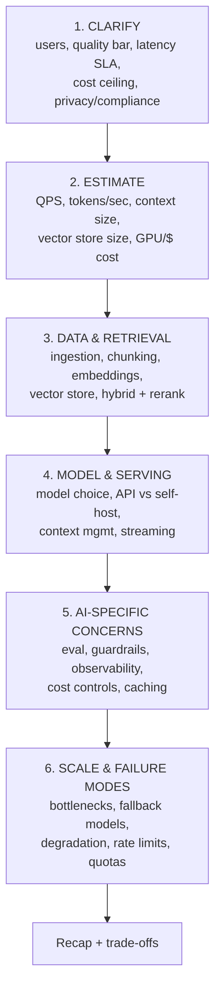
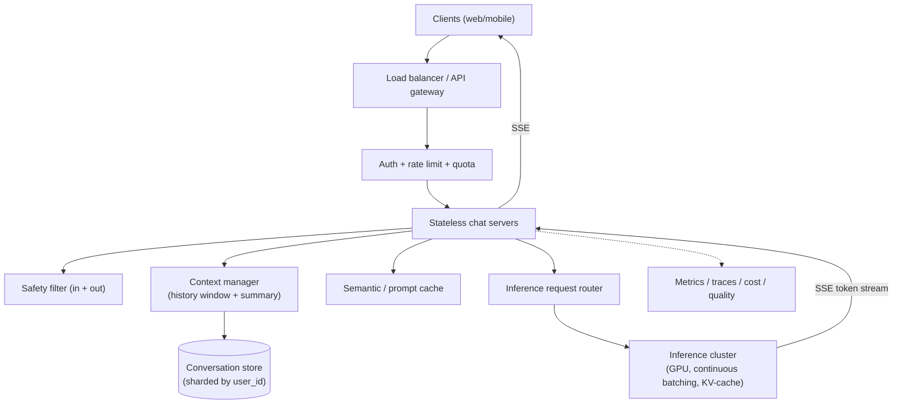
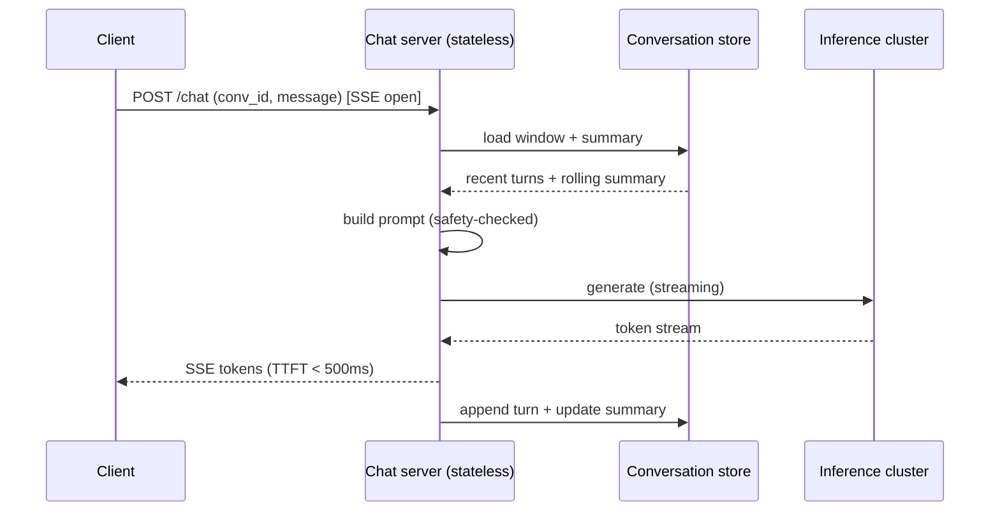
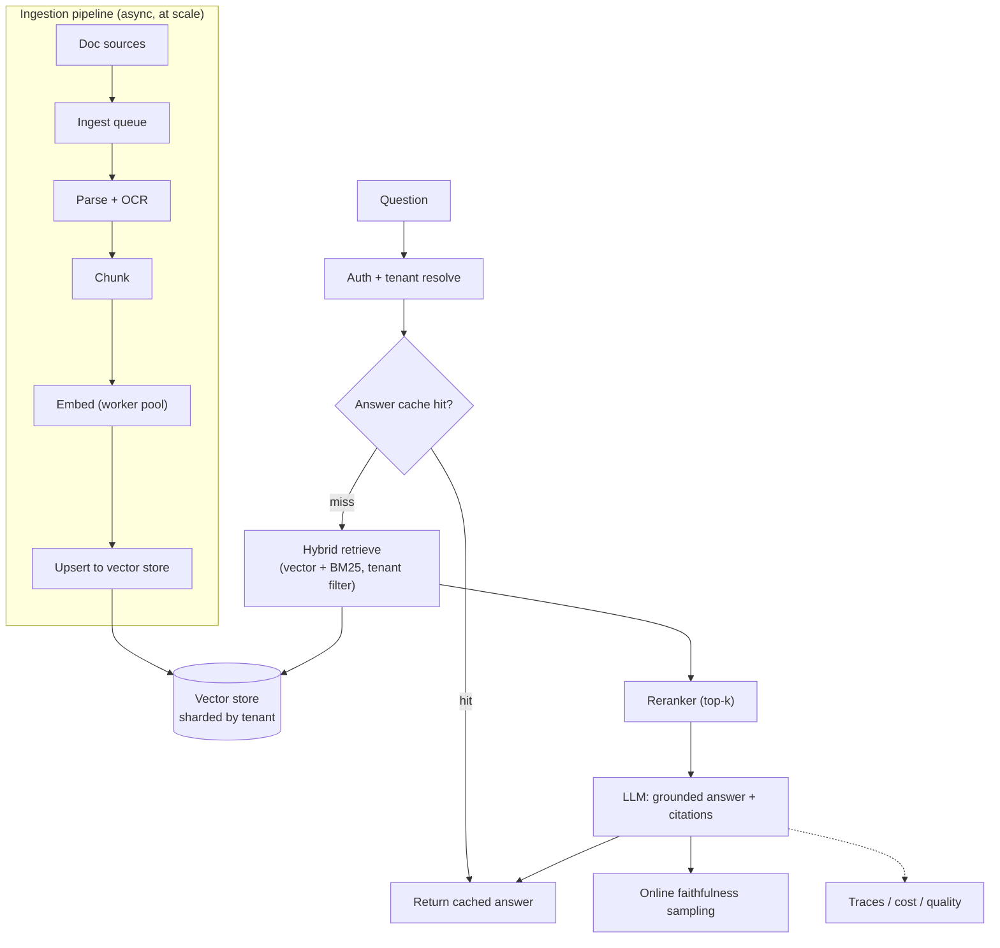
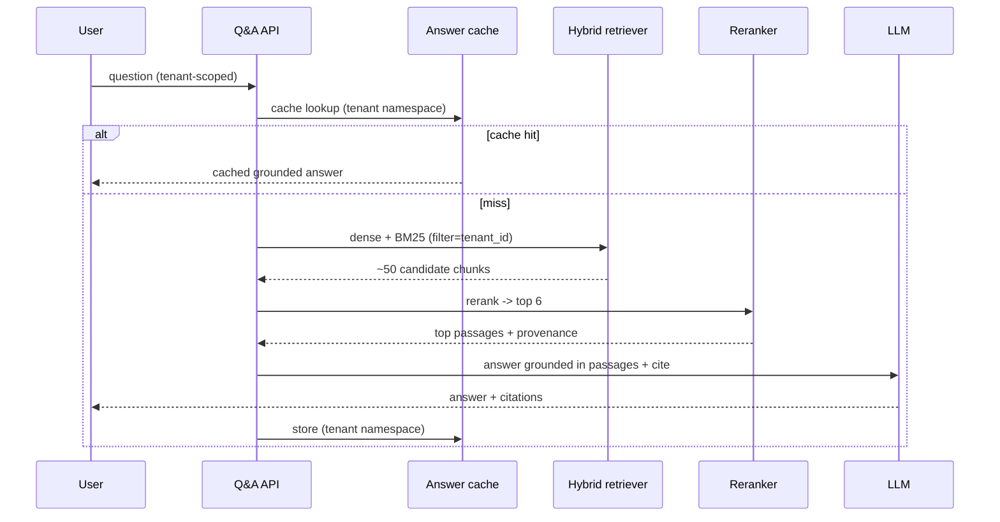
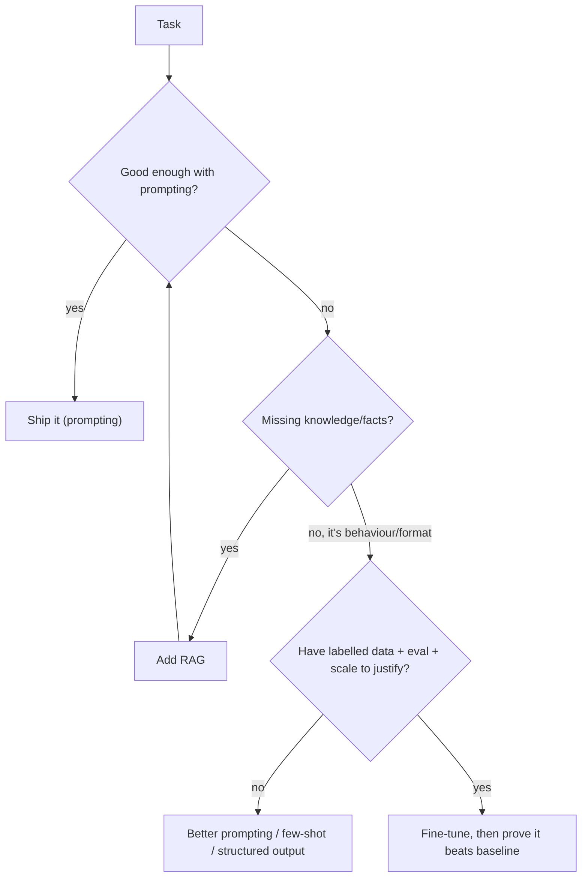

# Day 30 — AI System Design Interview Day + Beyond

> Series: AI Backend Engineering
> Goal: Zoom out from building to *designing on a whiteboard*. Learn how AI system design interviews differ from classic ones, get a reusable framework, work two full designs with real arithmetic and grading rubrics, master AI-specific estimation, and chart what's beyond the 30 days. Graduation day.

You already have strong backend, DB, and classic system-design skills. Today layers the AI-specific concerns on top — the stuff that makes an "AI system design" interview a different beast.

---

## Table of Contents
- [Part A — How AI design interviews differ + the framework](#part-a)
- [Part B — Two fully worked designs with rubrics](#part-b)
  - [B1 — Design ChatGPT](#b1-chatgpt)
  - [B2 — Design a document Q&A system at scale](#b2-docqa)
- [Part C — AI estimation toolkit](#part-c)
- [Part D — Beyond the 30 days](#part-d)
- [Gap-analysis template](#gap-analysis)
- [Graduation](#graduation)

---

## Part A — How AI design interviews differ + the framework <a name="part-a"></a>

An AI system design interview **still tests everything a classic one does**: APIs, data modelling, sharding, caching, queues, replication, consistency, availability, back-of-envelope math. If you can't do the classic stuff, the AI layer won't save you.

But it *adds* a set of AI-specific concerns that a classic interview never touches:

| Classic concern | The AI-specific twist |
|---|---|
| Compute sizing | **Model selection & cost** — which model, API vs self-host, tokens are the unit of cost |
| Latency | **Streaming / time-to-first-token** — perceived latency; TTFT vs total; SSE |
| Storage | **Vector store sizing** — N × dims × 4 bytes + index overhead; embeddings, not rows |
| Data pipeline | **RAG vs fine-tune vs long-context** — how to get knowledge into the model |
| Correctness/testing | **Eval strategy** — you can't unit-test a probabilistic system; offline + online evals |
| Security | **Guardrails & safety** — prompt injection, PII, jailbreaks, harmful output |
| Bugs | **Hallucination handling** — grounding, citations, confidence, escalation |
| Monitoring | **Feedback loops** — thumbs up/down, drift, continuous eval, prompt versioning |

The interviewer wants to see you reason about *tokens, quality, cost, and safety* as first-class design dimensions — not bolt them on at the end.

### The framework (use this on every AI design question)


*Follow the arrows out loud; interviewers grade your structure as much as your answer.*

Step notes:
1. **Clarify** — Never skip. Ask: who are the users and how many? What's the quality bar (must be right vs best-effort)? Latency SLA? Cost ceiling? Any privacy/compliance (PII, on-prem, region)? These answers *drive every later choice*.
2. **Estimate** — Do the arithmetic (Part C). QPS, tokens/request, tokens/sec throughput, storage, cost/request, monthly cost. Numbers turn hand-waving into engineering.
3. **Data & retrieval** — If knowledge is involved: ingestion pipeline, chunking strategy, embedding model, vector store choice + sharding, hybrid retrieval + rerank, freshness/re-indexing.
4. **Model & serving** — Model selection for the quality/cost/latency triangle. API vs self-host (Part C has the break-even math). Context management. Streaming/SSE.
5. **AI-specific** — Eval strategy (offline golden sets + online sampling), guardrails (injection/PII/safety), observability (traces, token/cost metrics, quality drift), cost controls (caching, routing, budgets).
6. **Scale & failure modes** — Bottlenecks (usually inference GPU or vector store), fallback models, graceful degradation, rate limiting & per-tenant quotas.

> **🤔 Wait — in an AI design interview, why not jump straight to the architecture? That's the impressive part.**
> Because the boxes you draw are only right *relative to constraints you haven't asked for yet*. "Design ChatGPT" for 100 internal users and for 100M consumers are different systems — different serving, different cost model, different failure modes. A candidate who whiteboards an inference cluster before asking the quality bar, latency SLA, cost ceiling, and privacy scope is optimizing a problem the interviewer never posed, and the interviewer reads it as exactly that: someone who codes before they understand the requirement. Clarify isn't throat-clearing; it's where you decide *which* architecture is even correct.

**✅ Good scenario (where this choice wins):** You open with "How many users, what's the quality bar, latency SLA, cost ceiling, any PII/on-prem needs?" The interviewer says "on-prem, healthcare, latency-tolerant" — and now your whole design (self-host, strict PII handling, RAG over their corpus) is right from the first line you draw.

**❌ Bad scenario (when it backfires / the naive alternative):** You hear "design a document Q&A system" and immediately draw a global vector index and a big API model. Twenty minutes in, the interviewer mentions strict tenant isolation and on-prem data residency — and your entire board is wrong. You either backtrack (looks disorganized) or defend a design you already know doesn't fit (worse).

**When NOT to over-do it:** don't burn ten minutes interrogating every edge case — ask the four or five load-bearing questions (scale, quality bar, latency, cost, privacy), state reasonable assumptions out loud for the rest, and move; clarification that never reaches a design reads as stalling.

### The AI-specific concerns, expanded (step 5 is where interviews are won)

Classic candidates nail steps 1-4 and stop. Step 5 is the differentiator — spend real time here:

- **Eval strategy** — State it explicitly: an offline **golden set** (labelled inputs → expected behaviour) gates every deploy in CI; **online sampling** (LLM-judge a % of live traffic) catches drift the golden set can't. Name the metrics that matter for *this* system — accuracy and faithfulness for Q&A, precision and false-positive rate for a reviewer, field-level precision/recall for extraction. "We'll eyeball outputs" is a fail.
- **Guardrails & safety** — Three layers: input (injection detection, treat all external content as untrusted *data*), model (system-prompt framing, refusal behaviour), output (PII redaction, harmful-content filter). Crucially, **limit capability**: a system that can't take a dangerous action can't be tricked into one. Human gates on high-stakes actions.
- **Observability** — Beyond classic metrics: per-request **traces** (retrieval → decision → generation spans), **token/cost metrics** per tenant, and **quality drift** (sampled faithfulness over time). You cannot debug or bill an LLM system you can't see into.
- **Cost controls** — Semantic/prompt caching, model routing (cheap model for easy requests, strong model for hard ones), per-tenant budgets, and bounded agent loops. Cost is a design constraint, not a cleanup task.
- **Hallucination handling** — Grounding (answer only from retrieved context), citations, confidence/coverage gating, and escalation when unsure. The honest "I don't know / here's a human" path is a feature, not a gap.

### What the interviewer is actually probing

The framework keeps you organized; these are the *judgement* signals that separate a pass from a strong hire:

| Signal | What "weak" sounds like | What "strong" sounds like |
|---|---|---|
| Treats tokens as the unit of cost/latency | "It calls the model and returns text" | "Input is ~800 tokens with history, output ~400; that drives cost and TTFT" |
| Knows when NOT to use AI | "The LLM validates the format" | "Format/checksum is deterministic — regex, not a model" |
| Quality is measurable | "It'll be accurate" | "Golden-set offline evals + online faithfulness sampling in CI" |
| Grounding vs memorizing | "Fine-tune it on our docs" | "RAG for facts; fine-tune only changes behaviour/format" |
| Safety is designed-in | (silence) | "Injection framing, PII redaction at the boundary, output filter" |
| Cost has controls | "We'll optimize later" | "Cache, model routing, per-tenant budgets, self-host break-even" |
| Honest about failure | "It just works" | "Fallback model, degrade gracefully, load-shed via quotas" |

**Common traps to avoid out loud:**
- Skipping the clarify step and designing for the wrong scale.
- Proposing fine-tuning to inject knowledge (it doesn't reliably — it's the #1 red flag).
- Forgetting that images/long contexts also cost tokens.
- No eval story — "we'll check the outputs manually" doesn't scale.
- Treating safety and cost as v2 problems instead of design constraints.

> **🤔 Wait — eval is a testing detail; why bring it up unprompted in a *design* interview?**
> Because in an AI system, "how do you know it works?" is a *design* question, not a QA afterthought. You can't unit-test a probabilistic system, so the eval story *is* part of the architecture: an offline golden set gating every deploy in CI, plus online LLM-judge sampling of live traffic to catch drift the golden set can't. A candidate who designs a beautiful RAG pipeline and never says how they'd measure faithfulness has designed something they can't safely change. Volunteering the eval strategy is one of the clearest "strong hire" signals there is.

**✅ Good scenario (where this choice wins):** Asked to design document Q&A, you name the metrics up front — accuracy and faithfulness — with an offline golden set per tenant in CI and online faithfulness sampling for drift. The interviewer ticks the "quality is measurable" box without having to ask.

**❌ Bad scenario (when it backfires / the naive alternative):** You finish the design and, asked "how would you evaluate it?", say "we'll eyeball the outputs" or "QA will test it." That one sentence undoes a strong design — it signals you'd ship changes to a probabilistic system with no way to know if they helped or regressed.

**When NOT to over-do it:** don't derail the interview into eval minutiae — name the strategy, the gating metrics that matter for *this* system, and the offline+online split, then move on; a two-sentence eval story lands, a ten-minute one crowds out the rest of the design.

---

## Part B — Two fully worked designs with rubrics <a name="part-b"></a>

### B1 — Design ChatGPT <a name="b1-chatgpt"></a>

#### Requirements (after clarifying)
- **Functional**: multi-tenant conversational chat; multi-turn context; streaming responses; conversation history persistence; model selection; safety filtering; rate limits/quotas.
- **Non-functional**: 100M users, ~10M DAU; TTFT < 500 ms; support long conversations; strong safety; cost-controlled.
- **Scope cut**: skip training the model; assume a served LLM. Focus on the *serving platform* around it.

#### Estimation (with arithmetic)
- DAU 10M, ~5 conversations/day, ~6 messages each → 10M × 5 × 6 = **300M messages/day**.
- 300M / 86,400 s ≈ **3,500 messages/sec average**; peak ×3 ≈ **~10,000 msg/s**.
- Tokens: assume avg 800 input (with history) + 400 output = 1,200 tokens/message.
- Output token throughput needed: 10,000 msg/s × 400 out = **4M output tokens/sec** at peak.
- If one GPU serves ~2,500 output tokens/sec (illustrative, mid-size model), you need ≈ 4M / 2,500 = **~1,600 GPUs** at peak (before batching gains; continuous batching improves this substantially).
- Conversation storage: 300M msgs/day × ~1 KB = **~300 GB/day** ≈ 110 TB/year (before compression/TTL).
- Cost (if using an API at illustrative $2.50/$10 per 1M in/out): (800×$2.5 + 400×$10)/1M = $0.002 + $0.004 = **$0.006/message** → 300M/day × $0.006 = **$1.8M/day**. This number is *why* big players self-host — see Part C break-even.

#### Architecture

*Chat servers are stateless; conversation state lives in a sharded store; GPUs stream tokens back over SSE.*

#### Deep dives
- **Stateless chat servers + streaming**: servers hold no session state (horizontal scale); state is the conversation store. Responses stream via SSE — the client sees the first token in <500 ms while generation continues.
- **Context management**: a conversation grows unboundedly, but context windows and cost don't. Keep a sliding window of recent turns + a rolling **summary** of older turns (Day 14). This bounds tokens/request and cost.
- **KV-cache / inference serving**: the transformer caches per-token key/value tensors so each new token doesn't recompute the whole prefix. **Continuous batching** packs many users' requests into one GPU batch, raising throughput 5–20×. This is the single biggest lever on GPU count and cost. Prefix caching reuses the KV for shared system prompts.
- **Rate limiting & quotas**: token-bucket per user/tenant; quotas by plan tier; protects the GPU fleet (the scarce resource) from a few heavy users.
- **Safety**: input classifier (block disallowed requests) + output filter (block harmful generations) + jailbreak/injection resistance in the system prompt.
- **Cost**: semantic/prompt cache for repeated queries; route simple turns to a cheaper model; batch aggressively.

#### Conversation storage & sharding
Shard the conversation store **by user_id** (or conversation_id) so a user's history is co-located and one hot user can't hotspot a shard for others. Hot vs cold: recent conversations in a fast store (low-latency KV/document DB); archive old ones to cheap object storage with a TTL. Because chat servers are stateless, any server can resume any conversation by loading from the store — this is what lets you autoscale the fleet freely.


*Any stateless server reconstructs context from the store, so the fleet scales horizontally without sticky sessions.*

#### Bottlenecks & failure modes
- **Bottleneck**: GPU inference capacity. Mitigate with batching, quantization, smaller models for easy turns, and autoscaling.
- **Failure**: model/region outage → fallback model + graceful "degraded" mode (shorter answers, cheaper model). Overload → shed load via queue + rate limits, not by falling over.
- **Multi-region**: route users to the nearest region for low TTFT; conversation store replicated or geo-partitioned; GPU capacity provisioned per region with cross-region failover.
- **Thundering herd on shared prefixes**: cache the KV for the shared system prompt (prefix caching) so millions of requests don't recompute it.

#### Grading rubric
| Dimension | Weak | Strong |
|---|---|---|
| Clarify | Jumps to architecture | Nails users, SLA, cost ceiling, safety scope |
| Estimation | No numbers | Tokens/sec, GPU count, storage, $/msg with arithmetic |
| Streaming | "Return the response" | SSE, TTFT vs total, stateless servers |
| Context mgmt | Ignores growth | Sliding window + summarization to bound tokens |
| Inference serving | "Call the model" | KV-cache, continuous batching, prefix cache, quantization |
| Cost | Ignores it | Cache + routing + self-host break-even reasoning |
| Safety | Bolt-on | In/out filters, injection resistance, quotas |
| Failure modes | None | Fallback model, degradation, load shedding |

---

### B2 — Design a document Q&A system at scale <a name="b2-docqa"></a>

Enterprise RAG: many tenants, millions of documents, ask questions, get grounded answers with citations.

#### Requirements (after clarifying)
- **Functional**: ingest documents per tenant; ask NL questions; grounded answers + citations; per-tenant isolation; freshness (new docs searchable quickly).
- **Non-functional**: 1,000 tenants, avg 1M docs each → up to **1B documents**; answer latency < 4 s p95; accuracy/faithfulness bar high; strict tenant isolation.
- **Scope**: focus on ingestion at scale, retrieval quality, isolation, and freshness.

#### Estimation (with arithmetic)
- Docs: 1B docs, avg 10 chunks/doc → **10B chunks / vectors**.
- Embedding dims: 1,024 (illustrative), float32 = 4 bytes → 1,024 × 4 = **4,096 bytes/vector**.
- Raw vector storage: 10B × 4,096 B = **~41 TB**. Add index overhead (HNSW ~1.5–2×) → **~60–80 TB**. → *must shard.*
- Ingestion: if onboarding 100M docs → 1B chunks to embed. At an embedding throughput of ~2,000 chunks/sec/worker, 1B / 2,000 = 500,000 worker-seconds ≈ **~140 worker-hours** → parallelize across e.g. 100 workers ≈ **~1.4 hours**.
- Query cost: retrieval (cheap) + 1 LLM call (~2k input + 300 output). At illustrative $2.50/$10 per 1M: (2000×2.5 + 300×10)/1M = **~$0.008/query**.
- Vector query QPS: say 1,000 tenants × 0.1 QPS = **100 QPS**; with rerank + LLM, size the LLM tier for 100 concurrent-ish generations.

#### Architecture

*Ingestion is an async, horizontally-scaled pipeline; queries hit a sharded, tenant-filtered vector store with hybrid retrieval and rerank.*

#### Deep dives
- **Ingestion at scale**: queue-driven, idempotent, retryable. Embedding is the throughput bottleneck → worker pool, batch API calls, backpressure. Store doc metadata + chunk provenance for citations.
- **Vector store sharding**: shard **by tenant** — gives isolation *and* smaller per-shard indexes (faster search). Huge tenants get dedicated shards; small tenants share (with tenant_id filter). ~60–80 TB total means dozens of shards.
- **Hybrid retrieval + rerank**: dense (semantic) + sparse (BM25 keyword) union, then a cross-encoder reranker on the top ~50 → top ~6. Hybrid catches both meaning and exact terms (IDs, error codes); rerank fixes dense recall's precision.
- **Per-tenant isolation**: tenant_id is a hard filter at query time and a shard boundary. Answer cache is namespaced per tenant. No global index.
- **Caching**: (1) embedding cache for repeat docs, (2) semantic answer cache per tenant for FAQs.
- **Eval**: offline golden Q/A per tenant for accuracy + faithfulness; online, LLM-judge a sample of live answers for hallucination drift.
- **Freshness / re-indexing**: new docs flow through the same queue and are searchable within minutes. Handle updates/deletes (tombstones) so stale chunks don't get retrieved. Periodic re-embed when you upgrade the embedding model (a full re-index — plan for it).

#### Query flow (sequence)

*Every retrieval carries the tenant filter; the reranker turns high-recall candidates into high-precision context.*

#### Bottlenecks & failure modes
- **Bottleneck**: embedding throughput at ingest; vector search latency on huge shards (mitigate: shard smaller, ANN tuning, replicas for read QPS).
- **Failure**: embedding-model change requires full re-index (versioned indexes, blue/green swap); a hot tenant → dedicated shard + rate limit; LLM outage → fallback model, or return top passages without synthesis.
- **Quality drift**: docs change, retrieval degrades silently. Online faithfulness sampling + a recall check on the golden set catch it before users complain.
- **Cost spikes**: a tenant with huge documents blows context size. Cap retrieved tokens; truncate/summarize oversize passages; per-tenant cost budgets.

#### Grading rubric
| Dimension | Weak | Strong |
|---|---|---|
| Clarify | Assumes scale | Tenants, doc counts, latency, isolation, freshness |
| Estimation | No sizing | Vector storage math (N×dims×4 + overhead), ingest throughput, $/query |
| Ingestion | "Embed the docs" | Queue, worker pool, backpressure, idempotency, provenance |
| Sharding | One big index | Shard by tenant for isolation + speed; hot-tenant handling |
| Retrieval | Pure vector | Hybrid + rerank, tenant filter, top-k reasoning |
| Isolation | Post-filter | Hard filter at query + shard boundary + cache namespacing |
| Freshness | Ignored | Re-index strategy, updates/deletes, embedding-model migration |
| Eval/quality | None | Offline golden + online faithfulness sampling |

---

## Part C — AI estimation toolkit <a name="part-c"></a>

Reuse the System Design Day 21 estimation style: memorize a few numbers, do the arithmetic out loud.

### 1. Tokens/sec throughput
- Rough rule: a served mid-size model does **~1,000–3,000 output tokens/sec/GPU** with continuous batching (varies wildly by model size, quantization, hardware — state your assumption).
- GPUs needed ≈ (peak output tokens/sec required) ÷ (tokens/sec/GPU).
- Example: need 100k output tok/s, GPU does 2,000 → ~50 GPUs.

### 2. Cost-per-request math
```
cost = (input_tokens × price_in + output_tokens × price_out) / 1_000_000
```
- Example (illustrative $2.50/$10 per 1M in/out): 2,000 in + 500 out = (2000×2.5 + 500×10)/1M = $0.005 + $0.005 = **$0.01/request**.
- Monthly: cost/request × requests/month. Always project to monthly — that's the number that gets budgeted.

### 3. Vector store sizing
```
raw_bytes  = N_vectors × dims × 4          # float32
index_size ≈ raw_bytes × 1.5 to 2.0        # HNSW/IVF overhead
```
- Example: 100M vectors × 768 dims × 4 = 307 GB raw → ~460–600 GB with index.
- Levers: fewer dims (smaller embedding model), **quantization** (int8 → 4× smaller, or binary → 32× smaller with recall trade-off), product quantization for massive scale.

### 4. GPU memory rough rules
- Model weights: **~2 bytes/param** at fp16 → a 7B model ≈ 14 GB, 70B ≈ 140 GB (needs multi-GPU).
- Add KV-cache memory: grows with (batch size × sequence length × layers) — often the real memory pressure at high concurrency.
- Rule of thumb: weights + ~20–40% headroom for KV-cache and activations; long contexts + big batches blow this up fast.

### 5. When self-host beats API on cost (break-even)
- API cost is **per-token, zero fixed cost** — cheap at low/spiky volume, brutal at high steady volume.
- Self-host is **mostly fixed** (GPU rental/amortization) — expensive idle, cheap when saturated.
- Break-even sketch: if a GPU costs ~$2/hr (illustrative) = ~$1,440/month and yields ~2,000 tok/s ≈ 5.2B tokens/month at full utilization, its self-host cost ≈ $1,440 / 5.2B tokens ≈ **$0.0003/1k tokens** — roughly 10–30× cheaper *per token than API* **if you keep it busy**. So:
  - Low/bursty volume, want zero ops → **API**.
  - High, steady volume (millions of requests/day), data-residency needs, and you can keep GPUs > ~50% utilized → **self-host** starts winning.
  - The killer variable is **utilization**. An idle self-hosted GPU is the most expensive option there is.

### 6. Quick-reference numbers to memorize
Carry these into an interview; state them as assumptions and adjust:

| Quantity | Rough number (illustrative — verify live) |
|---|---|
| Model weights memory | ~2 bytes/param at fp16 (7B ≈ 14 GB) |
| Output throughput | ~1k–3k tokens/sec/GPU with continuous batching |
| Embedding vector | dims × 4 bytes (fp32); e.g. 768 → ~3 KB |
| Index overhead | ×1.5–2.0 on raw vector bytes (HNSW) |
| API price (mid-tier) | ~$2.50 / $10 per 1M input/output tokens |
| int8 quantization | ~4× smaller vectors/weights, small recall loss |
| Tokens per word | ~1.3 tokens/word (English) |

### 7. A worked mini-estimation (say it out loud)
"1M queries/day, RAG, 2k input + 400 output tokens each. Cost/query = (2000×2.5 + 400×10)/1M = $0.005+$0.004 = **$0.009**. Daily = 1M × $0.009 = **$9k/day ≈ $270k/month**. A 30% answer-cache hit rate cuts that to ~$189k/month. If steady, evaluate self-hosting the generation tier." That two-sentence chain — assumption → arithmetic → lever — is exactly what interviewers score.

---

## Part D — Beyond the 30 days <a name="part-d"></a>

### Fine-tuning vs RAG vs prompting — the decision framework

| Approach | What it changes | Best for | Cost/effort | When to reach for it |
|---|---|---|---|---|
| **Prompting** | Nothing; instructions only | General tasks, fast iteration | Lowest | **Default. Try this first, always.** |
| **RAG** | Adds *knowledge* at runtime | Factual grounding, fresh/private data, citations | Medium (pipeline) | Need up-to-date or proprietary facts, want citations, data changes often |
| **Fine-tuning** | Adjusts model *behaviour/style/format* | Consistent format/tone, narrow task, latency (smaller model) | High (data + training + eval + maintenance) | Only after prompting + RAG plateau, with clear metrics |

> **🤔 Wait — if we want the model to "know our docs," why not just fine-tune it on them?**
> This is the single most common red flag in an AI design interview, so get it exactly right: **fine-tuning does not reliably add knowledge — it changes behaviour, style, and format.** Train on your docs and the model learns to *sound like* them, then hallucinates specifics confidently and goes stale the instant a doc changes. Knowledge that must be correct, fresh, and citable belongs in *retrieval* — RAG — where you can update a document without retraining and point at the source. Fine-tune to change *how* the model answers; use RAG to change *what facts* it answers from.

**✅ Good scenario (where this choice wins for RAG):** "Answer support questions from our constantly-changing policy docs, with citations." RAG retrieves the current doc at query time, cites it, and a doc edit is live immediately — no retraining, no stale facts.

**❌ Bad scenario (fine-tune to inject knowledge):** You fine-tune on last quarter's policies. The model confidently states a refund window that changed in March, can't cite a source, and fixing it means another training run. You spent training budget to build a system that's wrong and stale by design.

**When fine-tuning is the right call instead:** you need a *behaviour/format* prompting can't hold — a strict output style, a niche classification, or a smaller cheaper model at fixed quality — you have thousands of labelled examples, and an eval harness to prove it beat the RAG/prompting baseline.

**When fine-tuning actually earns its cost (most projects don't need it):**
- You have thousands of high-quality labelled examples.
- You need a *behaviour/format* the model won't reliably follow via prompting (a specific output style, a niche classification, a compact domain vocabulary).
- You want to shrink to a smaller/cheaper model at fixed quality (latency/cost win at scale).
- You have an eval harness to prove it beat the RAG/prompting baseline — and you'll re-tune when the base model updates.

**Fine-tuning does NOT add knowledge reliably** — it teaches patterns, not facts. For "know this document," use RAG. The classic mistake is fine-tuning to inject knowledge; it hallucinates confidently and is stale the moment the data changes.


*Exhaust prompting and RAG before fine-tuning — most systems never need to fine-tune.*

**A note on long-context vs RAG**: context windows keep growing, and "just stuff the docs in the prompt" is tempting. It works for a handful of documents, but at scale it's expensive (you pay for every token, every request), slow (latency grows with context), and quality degrades ("lost in the middle"). RAG stays the scalable answer for large, changing corpora; long-context is great for a bounded set of documents per request. Know when each wins — it's a common interview follow-up.

### Multimodal (vision/audio) intro
- **Vision**: models now take images alongside text — document understanding (beats OCR+extract for messy layouts — relevant to your Day 28 onboarding project), UI screenshots, charts, visual QA. Same design principles: tokens (images cost tokens too, often hundreds to thousands each), grounding, eval.
- **Audio**: speech-to-text (transcription) and text-to-speech, plus native audio models for voice agents. Latency and streaming matter even more for voice UX — TTFT becomes time-to-first-*audio*.
- Design impact: multimodal inputs change your token math and your ingestion pipeline (store + reference media in object storage, embed captions/OCR text for retrieval, not just raw text).

### RLHF / DPO (awareness only)
- **RLHF** (Reinforcement Learning from Human Feedback): the alignment technique behind instruction-following/chat models — a reward model trained on human preference rankings guides the LLM's behaviour.
- **DPO** (Direct Preference Optimization): a simpler, popular alternative that optimizes on preference pairs directly without a separate reward model.
- You almost certainly won't run these yourself early on — but know the terms: they're *how* the models you use got aligned, and they come up in interviews.

### Staying current without drowning
The field moves monthly. You cannot read everything — nor should you, and trying is a fast route to burnout without depth.
- **Follow signal, not noise**: a few high-quality sources (model provider changelogs, one or two curated newsletters, provider docs). Ignore the hype firehose and the "this changes everything" threads.
- **Anchor on fundamentals**: tokens, embeddings, retrieval, eval, guardrails, cost, human-in-the-loop — these don't change. New models are new *numbers* plugged into the same design skeleton you already own. A model that's 2× cheaper doesn't change your architecture; it changes one cell in your cost table.
- **Learn by building**: skim releases; go deep only when a new capability unblocks a real project. Reading about a feature you'll never use is procrastination dressed as learning.
- **Re-run your evals** when you adopt a new model — that's the *only* way to know if "better on the leaderboard" is actually better *for your task*. Your golden set is your ground truth; benchmarks are someone else's.
- **Separate durable from disposable**: concepts (RAG, evals, agents, guardrails) are durable — invest heavily. Specific SDKs and frameworks are disposable — learn them shallowly and expect churn.

### A "what to build next" project ladder
The 7 projects cover the core. To go deeper, climb this ladder — each rung adds one production muscle:

| Rung | Project idea | New muscle |
|---|---|---|
| 1 | Add a feedback loop (👍/👎) + weekly eval report to any Day-27/29 project | Continuous eval, drift detection |
| 2 | Self-host an open model behind your `LLMProvider`; A/B it vs the API | Inference serving, break-even math for real |
| 3 | Build a voice support agent (STT → your Day-27 pipeline → TTS) | Multimodal, streaming latency |
| 4 | Fine-tune a small model for one narrow task; prove it beats the RAG baseline | When fine-tuning earns its cost |
| 5 | Multi-tenant SaaS wrapper: quotas, per-tenant cost dashboards, billing | Productionizing the platform |
| 6 | An eval/observability service other teams plug into | Platform thinking |

### Portfolio / interview prep
- Your 7 projects *are* your portfolio: chatbot, PDF RAG, tool agent, multi-agent, support system, supplier onboarding, code review. Write each up as a one-pager: problem, architecture diagram, key trade-offs, evals + numbers, cost, what you'd do next.
- For interviews: rehearse the Part A framework out loud until it's automatic. Practice the estimation arithmetic (Part C) on a whiteboard cold. Prepare one story per project about a *hard trade-off* you made (e.g., escalation vs answering in support, precision vs recall in code review, deterministic validation vs LLM in onboarding).
- Be ready to defend the four questions that come up in every AI interview:
  1. "Why RAG not fine-tune here?" → knowledge vs behaviour, freshness, cost.
  2. "How did you evaluate it?" → golden set, offline + online, CI bars, the metrics that mattered.
  3. "What stops prompt injection / keeps it safe?" → untrusted-data framing, capability limits (no dangerous tool), PII redaction, human gates.
  4. "How do you control cost / latency?" → tokens as the unit, caching, model routing, streaming/TTFT, budgets.
- Whiteboard etiquette: think out loud, state assumptions, do the arithmetic, name the bottleneck, then the trade-off. Silence reads as "doesn't know."

---

## Gap-analysis template <a name="gap-analysis"></a>

Rate yourself 1 (shaky) to 5 (could teach it). Anything ≤ 3 → an action. Covers all 7 stages of the course.

| Stage | Topic | Confidence (1-5) | Action if low |
|---|---|---|---|
| 1. Foundations | LLM basics, tokens, context windows | | Re-read Day 1; do the token-counting exercise |
| 1. Foundations | Prompting techniques (few-shot, CoT, structured) | | Rewrite a weak prompt from a project with Day 2/22 patterns |
| 2. APIs & cost | Provider abstraction (`LLMProvider`) | | Re-implement Day 3 with a 2nd provider |
| 2. APIs & cost | Cost tracking + reduction (`CostMeter`, caching) | | Add cost dashboards to a project (Day 16) |
| 3. Retrieval | Embeddings + chunking | | Compare 2 chunking strategies on eval (Day 5/6) |
| 3. Retrieval | Vector DBs + sharding/sizing | | Do the Part C sizing math for your PDF-RAG project |
| 3. Retrieval | RAG + hybrid search + rerank | | Add hybrid + rerank to a pure-vector project (Day 8/9) |
| 4. Orchestration | LangChain / LangGraph | | Rebuild one flow as an explicit graph (Day 10/11) |
| 4. Orchestration | Tool calling + MCP | | Add one MCP tool to the support bot (Day 12/13) |
| 4. Orchestration | Agents (single + multi) | | Trace an agent loop; bound its tool calls (Day 25) |
| 5. Memory & UX | Conversation memory + summarization | | Add rolling summary to bound tokens (Day 14) |
| 5. Memory & UX | Streaming (SSE, TTFT) | | Measure TTFT vs total on your chatbot (Day 15) |
| 5. Memory & UX | Semantic caching | | Measure cache hit rate + cost saved (Day 16) |
| 6. Production | Resilience (retries, fallback, circuit breaker) | | Kill the primary model; verify fallback (Day 17) |
| 6. Production | Observability (traces, metrics) | | Add span tracing to one project (Day 18) |
| 6. Production | Prompt injection hardening | | Run an injection eval on all 7 projects (Day 19) |
| 6. Production | PII/guardrails + tenant isolation | | Audit logs for leaked PII; add redaction (Day 20) |
| 6. Production | Evaluation harness | | Build a golden set + CI bars for a project (Day 21/23) |
| 6. Production | Prompt versioning | | Put prompts in a registry; A/B one (Day 22) |
| 7. Design/interview | AI design framework | | Do a mock design out loud using Part A |
| 7. Design/interview | AI estimation (tokens/GPU/vector/cost) | | Whiteboard Part C math cold |
| 7. Design/interview | Fine-tune vs RAG vs prompt decision | | Justify the choice for each of your 7 projects |

---

## One-page AI design cheat sheet

Print this. It's the whole day compressed.

**Framework:** Clarify → Estimate → Data/Retrieval → Model/Serving → AI-specific (eval, guardrails, observability, cost, hallucination) → Scale/Failure.

**Always clarify:** users & scale · quality bar · latency SLA · cost ceiling · privacy/compliance.

**Estimation formulas:**
- cost = (in_tok × price_in + out_tok × price_out) / 1e6
- vector store = N × dims × 4 bytes × (1.5–2.0 index overhead)
- GPUs ≈ peak_output_tokens_per_sec ÷ tokens_per_sec_per_gpu
- weights ≈ 2 bytes/param (fp16)

**Decision defaults:**
- Knowledge → RAG. Behaviour/format → maybe fine-tune. Everything else → prompting first.
- High steady volume + utilization → self-host. Low/spiky → API.
- Hybrid retrieval + rerank beats pure vector. Shard by tenant for isolation + speed.
- Deterministic where exact (validation, checksums, secrets); LLM where fuzzy (reading, reasoning).

**Never forget:** tokens are the unit of cost & latency · streaming/TTFT for UX · evals gate deploys · treat external content as untrusted data · limit capability so injection can't cause harm · human-in-the-loop for high stakes · redact PII at the boundary.

**Red flags that fail candidates:** fine-tuning to add knowledge · no eval story · safety/cost as v2 · no arithmetic · skipping clarify.

---

## Graduation <a name="graduation"></a>

Thirty days ago, "LLM" meant an API you poked and hoped. Look at what you can do now.

You can take a raw model and wrap it in a *provider abstraction* with fallbacks. You can *ground* it in private knowledge with chunking, embeddings, hybrid retrieval, and rerank. You can give it *tools* and *memory*, *stream* its output, and *cache* it. You can make it *resilient*, *observable*, and *cost-controlled*. You can *harden* it against injection, *redact* PII, and *isolate* tenants. You can *evaluate* it like an engineer instead of eyeballing it, and *version* the prompts that drive it.

And you proved it — seven times. A chatbot. A PDF RAG. A tool agent. A multi-agent system. A customer support platform that knows when to escalate. A supplier onboarding assistant that lets humans sign off. A code reviewer that resists being told to approve itself.

Most importantly, you learned the discipline underneath all of it: **use the LLM where it earns its keep, use deterministic code where it's exact, and keep a human in the loop where the stakes are real.** That judgement — not any single model or framework — is what makes an AI backend engineer.

The models will change next month. The framework you built won't. Go design something.

*Congratulations. You've graduated the 30 days.*

---

*End of the AI Backend Engineering series. Revisit the gap-analysis table quarterly — the topics are stable even as the numbers move.*
