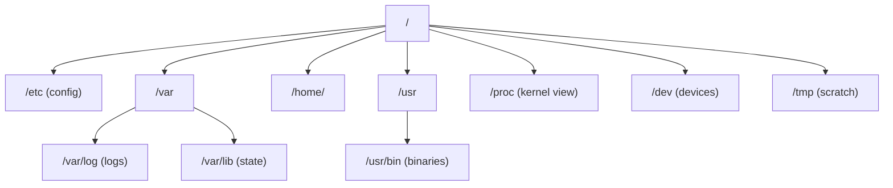
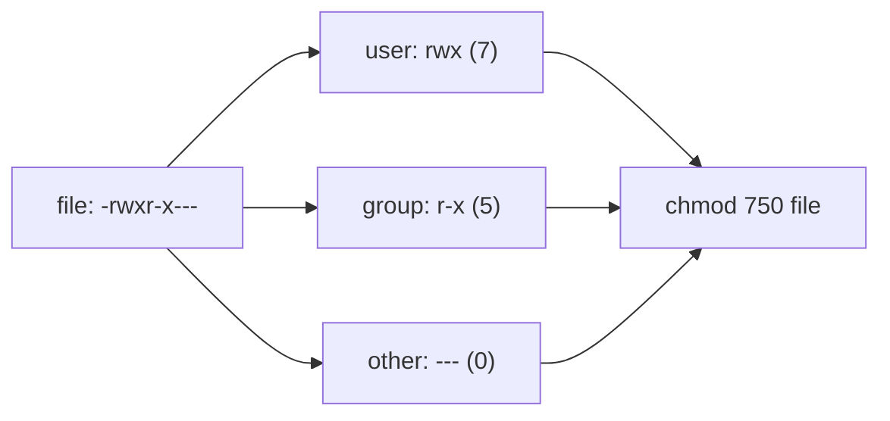
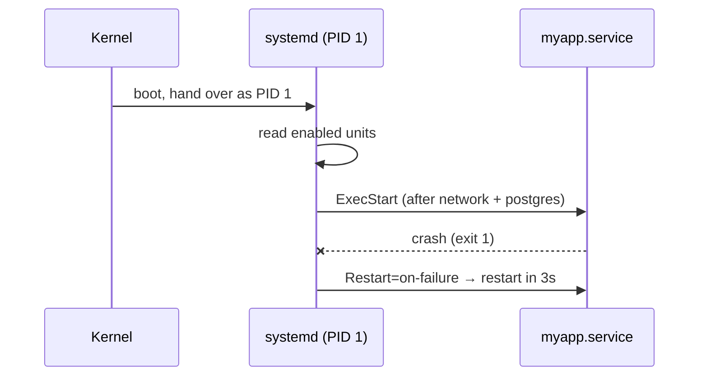
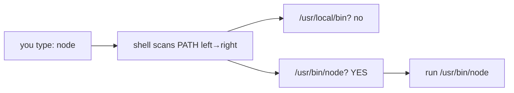

# Day 1 — Linux Fundamentals

> Series: Cloud & DevOps Engineering
> Goal: Become fluent enough on a Linux box that you can navigate, control processes, manage services, and reason about permissions the way an on-call engineer does at 2 a.m.

> Verify versions when you build: this file targets Ubuntu 24.04 LTS / RHEL 9 era tooling (2026). Commands like `apt`, `systemctl`, and `ps` are stable, but flags drift — run `--help` or `man` on your actual box.

---

## Table of Contents
1. [Why Linux is the ground floor of DevOps](#1-why-linux-is-the-ground-floor-of-devops)
2. [The Filesystem Hierarchy (FHS)](#2-the-filesystem-hierarchy-fhs)
3. [Navigation & file commands](#3-navigation--file-commands)
4. [Permissions: rwx, chmod, chown, sudo](#4-permissions-rwx-chmod-chown-sudo)
5. [Processes: ps, top, kill, signals](#5-processes-ps-top-kill-signals)
6. [systemd & systemctl](#6-systemd--systemctl)
7. [Package managers: apt & yum/dnf](#7-package-managers-apt--yumdnf)
8. [Environment variables & PATH](#8-environment-variables--path)
9. [Lab: manage a service end-to-end](#9-lab-manage-a-service-end-to-end)
10. [Self-Check](#10-self-check)
11. [Tomorrow](#11-tomorrow)

---

## 1. Why Linux is the ground floor of DevOps

**In plain words:** Linux is the building your whole product lives in. Containers, Kubernetes nodes, CI runners, cloud VMs — peel back any layer and there's a Linux kernel underneath. If you can't move around the building, you can't fix the plumbing.

- **Why:** ~96% of the top web servers and effectively all container hosts run Linux. Your app in production is a Linux process.
- **What:** A Unix-like OS: a kernel (talks to hardware) plus userland tools (the commands you type).
- **When:** Every day. SSH into a box to check why a service is down; inspect logs; restart a daemon.
- **How:** Through a shell (Day 2) issuing commands the kernel executes.
- **Where:** Cloud VMs (EC2 / GCE / Azure VM), container base images, CI runners, your laptop's WSL2.

> 🤔 **"I deploy with Docker and Kubernetes — do I really need raw Linux?"** Yes, more than ever. A container *is* a Linux process with namespaces. When a pod crashes with `exit code 137`, that's the kernel's OOM killer sending SIGKILL — a Linux concept. Abstractions leak downward; the person who understands the floor debugs the fastest.

**✅ Good scenario (where it saves you):** Prod API returns 502. You SSH in, run `systemctl status api`, see it's `activating (auto-restart)`, tail the journal, spot a missing env var. Fixed in 4 minutes.

**❌ Bad scenario (the pain without it):** Same outage, but you only know the deploy dashboard. It says "unhealthy." You have no idea how to look inside the box, so you page a senior and wait 40 minutes while customers churn.

**When NOT to:** Don't SSH into production to make manual, undocumented changes ("snowflake servers"). Diagnose on the box, but *fix* through code/config so the change is reproducible.

---

## 2. The Filesystem Hierarchy (FHS)

**In plain words:** Linux has one big tree starting at `/` (root). There are no drive letters like `C:`. Everything — disks, USB sticks, even devices — hangs somewhere off that single tree.

- **Why:** Predictability. Any engineer on any distro knows configs live in `/etc` and logs in `/var/log`.
- **What:** A standardized layout (Filesystem Hierarchy Standard).
- **When:** Every time you go looking for a config, binary, or log.
- **How:** Directories are "mounted" onto the tree; you `cd` around them.
- **Where:** Identical concept across Ubuntu, RHEL, Alpine (container images).

| Path | Holds | You'll go here to… |
|------|-------|--------------------|
| `/` | Root of everything | Orient yourself |
| `/etc` | System & app **config** files | Edit nginx.conf, sshd_config |
| `/var/log` | **Logs** | Debug why a service failed |
| `/var/lib` | App state/data (DBs, docker) | Find Postgres data dir |
| `/home/<user>` | User files | Your dotfiles, keys |
| `/root` | root user's home | Rarely; root's home |
| `/usr/bin`, `/bin` | Installed **binaries** | Locate a command |
| `/usr/local/bin` | Manually installed binaries | Your custom scripts |
| `/tmp` | Temp files (wiped on reboot) | Scratch space |
| `/opt` | Optional 3rd-party software | Vendor installs |
| `/proc`, `/sys` | **Virtual** kernel interfaces | Read live process/kernel state |
| `/dev` | Device files | Disks (`/dev/sda`), null (`/dev/null`) |
| `/mnt`, `/media` | Mount points | Attached volumes |


*One tree, no drive letters — the whole OS hangs off `/`.*

> 🤔 **"Why is /proc empty on disk but full of files?"** It isn't on disk at all. `/proc` is a *virtual* filesystem the kernel synthesizes on the fly. `cat /proc/cpuinfo` reads live kernel data, not a stored file. This is how tools like `top` learn what's running.

**✅ Good scenario:** New engineer joins, needs to change the app's log level. They know configs live in `/etc/myapp/`, find it instantly.

**❌ Bad scenario (when misused):** Someone dumps app data into `/tmp`. A reboot wipes `/tmp`, and the "database" vanishes. Root cause: not knowing `/tmp` is ephemeral.

**When NOT to:** Don't store persistent data in `/tmp` or hand-edit files under `/proc` (mostly read-only kernel state).

**Dark Side:** `/var/log` filling the disk is a classic outage. A runaway service writes GBs of logs, disk hits 100%, everything grinds to a halt. Log rotation (`logrotate`) exists precisely to prevent this.

---

## 3. Navigation & file commands

**In plain words:** These are your legs and hands — walking around directories and picking up/moving files.

- **Why:** You can't fix what you can't find or read.
- **What:** `cd`, `ls`, `pwd`, `cat`, `less`, `cp`, `mv`, `rm`, `mkdir`, `find`, `grep`.
- **When:** Constantly.
- **How:** Type a command + arguments in the shell.
- **Where:** Any shell session.

```bash
pwd                      # print working directory — "where am I?"
ls -lah /var/log         # -l long, -a all (incl hidden), -h human sizes
cd /etc/nginx            # change directory
cd -                     # jump back to previous directory
cd                       # (no arg) go to your home ~

cat app.conf             # dump a small file to screen
less /var/log/syslog     # page through a big file (q to quit, / to search)
head -n 20 access.log    # first 20 lines
tail -n 50 access.log    # last 50 lines
tail -f access.log       # FOLLOW live appends (Ctrl-C to stop)

mkdir -p /opt/app/data   # -p creates parent dirs as needed, no error if exists
cp -r src/ backup/       # -r recursive copy for directories
mv old.txt new.txt       # move OR rename (same command)
rm file.txt              # delete a file
rm -rf /opt/app/tmp      # recursive+force — DANGEROUS, no undo, no trash

find / -name "nginx.conf" 2>/dev/null   # search by name, hide permission errors
find /var/log -mtime -1 -type f         # files modified in last 1 day
```

Expected `ls -lah` line, decoded:
```text
-rw-r--r-- 1 root root 4.0K Jul 26 09:12 app.conf
│ │  │  │   │ │    │    │    └─ name
│ │  │  │   │ │    │    └────── size
│ │  │  │   │ │    └─────────── group
│ │  │  │   │ └──────────────── owner
│ │  │  │   └────────────────── link count
│ └──┴──┴── permissions (see §4)
└── type: - file, d dir, l symlink
```

> 🤔 **"`rm -rf` scares me — is there a safety net?"** No trash bin. `rm -rf /` (or a stray `rm -rf $VAR/` where `$VAR` is empty → `rm -rf /`) has ended careers. Habits that save you: quote variables, use `--` to end options, and prefer `trash-cli` or moving to a temp dir for interactive work. In scripts, `set -u` (Day 2) makes unset variables an error.

**✅ Good scenario:** `find /var/log -size +500M` instantly reveals the 2 GB log file eating your disk.

**❌ Bad scenario:** You `rm -rf build/ ` with a trailing space and an empty var → wipe the wrong tree. No backups. Hours lost.

**When NOT to:** Don't `cat` a multi-GB log (floods your terminal / can hang) — use `less`, `tail`, or `grep`.

---

## 4. Permissions: rwx, chmod, chown, sudo

**In plain words:** Every file has a bouncer checking three guest lists — the **owner**, the **group**, and **everyone else** — and for each, whether they may **read**, **write**, or **execute**.

- **Why:** Security and correctness. Wrong perms = either a breach or a service that can't start.
- **What:** 3 permission bits (r=4, w=2, x=1) × 3 identity classes (user/group/other).
- **When:** Deploying keys, scripts, config, service data.
- **How:** `chmod` sets bits, `chown` sets owner/group, `sudo` runs as another user (usually root).
- **Where:** Everywhere — SSH keys, web roots, /etc files.

### The numeric model (the part everyone fumbles)

Each class gets a digit 0–7 = sum of read(4) + write(2) + execute(1):

| Numeric | Binary | Meaning |
|--------:|:------:|---------|
| 7 | 111 | rwx (read+write+execute) |
| 6 | 110 | rw- |
| 5 | 101 | r-x |
| 4 | 100 | r-- |
| 0 | 000 | --- |

Three digits = user, group, other.

```bash
chmod 644 index.html     # user rw, group r, other r  (typical file)
chmod 600 id_ed25519     # user rw, NOBODY else  (SSH private key MUST be this)
chmod 755 deploy.sh      # user rwx, group r-x, other r-x (executable script/dir)
chmod 700 ~/.ssh         # only you can enter your ssh dir

# Symbolic form (relative changes):
chmod +x deploy.sh       # add execute for all classes
chmod u+x,go-w file      # user add execute; group+other remove write

chown alice:devs app.log     # set owner=alice, group=devs
chown -R www-data: /var/www  # recursive; group defaults to www-data's primary
```

> 🤔 **"Why does SSH silently refuse my key?"** Because a private key readable by group/other is a security hole, so SSH ignores it. `chmod 600 ~/.ssh/id_ed25519` and `chmod 700 ~/.ssh`. This single gotcha burns every newcomer once.

### sudo — borrow root, briefly

```bash
sudo systemctl restart nginx   # run ONE command as root
sudo -i                        # interactive root shell (use sparingly)
sudo -u postgres psql          # run as a specific user (postgres), not root
```

`sudo` logs who did what (`/var/log/auth.log`) — accountability the shared root password never gave you.


*Three identity classes, three bits each → the numeric mode `750`.*

**✅ Good scenario:** Deploy script sets web files to `644` and dirs to `755`; nginx serves them, nobody can overwrite them. Locked-down and working.

**❌ Bad scenario (when misused):** Someone hits a "permission denied" and runs `chmod -R 777 /var/www` to make it "just work." Now any process/user can rewrite your site — a textbook vulnerability. 777 is almost never the right answer.

**When NOT to:** Don't `chmod 777` anything in production. Don't run services as root when a dedicated low-privilege user works.

**Dark Side:** `sudo` fatigue — people alias half their commands with sudo and stop noticing when something needs root. Least privilege is a discipline, not a default.

---

## 5. Processes: ps, top, kill, signals

**In plain words:** A process is a running program — a program that's "come alive." Each has a PID (ID badge). You watch them, and when one misbehaves, you send it a signal — a polite tap, or a hard shove.

- **Why:** Services are processes; debugging means inspecting and controlling them.
- **What:** PID, parent PID, CPU/mem usage, state; signals like SIGTERM/SIGKILL.
- **When:** High CPU, hung service, memory leak, "is it even running?"
- **How:** `ps`, `top`/`htop` to observe; `kill` to signal.
- **Where:** Any box.

```bash
ps aux                       # snapshot of ALL processes (user, pid, cpu%, mem%, cmd)
ps aux | grep nginx          # find nginx processes
ps -ef --forest              # tree view showing parent/child

top                          # live dashboard (press M=sort mem, P=cpu, q=quit)
htop                         # nicer top (may need: sudo apt install htop)

pgrep -a node                # list PIDs whose command matches "node"
```

Reading `ps aux`:
```text
USER   PID %CPU %MEM   VSZ   RSS TTY  STAT START TIME COMMAND
www    812 12.0  3.4 72311 34122 ?    Ssl  09:01 1:20 /usr/bin/node server.js
```
`RSS` = real RAM used (KB). `STAT` `S`=sleeping, `R`=running, `Z`=zombie, `D`=uninterruptible (often disk I/O wait).

### Signals — the vocabulary of `kill`

| Signal | Number | Meaning | Catchable? |
|--------|-------:|---------|------------|
| SIGTERM | 15 | "Please shut down cleanly" (default) | Yes — app can flush/close |
| SIGKILL | 9 | "Die now" — kernel force-kills | **No** — cannot be caught |
| SIGINT | 2 | Ctrl-C interrupt | Yes |
| SIGHUP | 1 | Terminal closed / "reload config" | Yes (many daemons reload) |
| SIGSTOP/SIGCONT | 19/18 | Pause / resume | Stop no |

```bash
kill 812            # sends SIGTERM (15) — graceful, the DEFAULT
kill -HUP 812       # tell daemon to reload config without restart
kill -9 812         # SIGKILL — last resort, no cleanup, may corrupt state
pkill -f server.js  # kill by command-line match
```

> 🤔 **"Should I just always `kill -9`? It works every time."** Reach for `kill -9` last. SIGTERM lets the app finish in-flight requests, flush buffers, and close DB connections. SIGKILL yanks the power cord — half-written files, orphaned locks, corrupted state. Graceful shutdown is why `SIGTERM` is the default and why Kubernetes sends TERM first, then KILL after a grace period.

**✅ Good scenario:** A worker is stuck. You `kill -TERM`, it finishes its current job and exits cleanly, supervisor restarts it. Zero data loss.

**❌ Bad scenario:** You `kill -9` a database mid-write. It comes back needing crash recovery; one table is corrupt. An avoidable incident.

**When NOT to:** Don't `kill -9` a database or stateful service unless it's truly wedged and TERM failed.

**Dark Side:** Zombie (`Z`) processes — a child died but the parent never reaped it. Usually harmless but a flood of them signals a buggy parent. You can't kill a zombie; you fix or restart the parent.

---

## 6. systemd & systemctl

**In plain words:** systemd is the OS's operations manager. It starts services at boot, restarts them when they crash, orders their startup (DB before app), and keeps their logs. `systemctl` is how you give it orders.

- **Why:** You need services to start on boot and self-heal on crash — not depend on a human running a command.
- **What:** systemd = init system (PID 1) managing "units" (services, timers, sockets).
- **When:** Installing/running any long-lived service on a VM.
- **How:** Define a `.service` unit file, then `systemctl` to control it.
- **Where:** Ubuntu, RHEL, most modern distros (Alpine uses OpenRC instead — relevant for containers).

```bash
systemctl status nginx        # is it running? recent logs, PID, uptime
sudo systemctl start nginx    # start now
sudo systemctl stop nginx     # stop now
sudo systemctl restart nginx  # stop + start
sudo systemctl reload nginx   # re-read config WITHOUT dropping connections
sudo systemctl enable nginx   # start automatically on boot
sudo systemctl disable nginx  # don't start on boot
systemctl is-active nginx     # -> active / inactive
systemctl list-units --type=service --state=running
```

`enable` vs `start` trips everyone up:

| Command | Effect now | Effect on reboot |
|---------|-----------|------------------|
| `start` | Runs it | Nothing |
| `enable` | Nothing | Runs it |
| `enable --now` | Runs it | Runs it |

A minimal unit file at `/etc/systemd/system/myapp.service`:
```ini
[Unit]
Description=My API
After=network.target postgresql.service   # start order

[Service]
User=appuser                    # run as low-privilege user, NOT root
WorkingDirectory=/opt/app
Environment=NODE_ENV=production
ExecStart=/usr/bin/node server.js
Restart=on-failure              # self-heal on crash
RestartSec=3

[Install]
WantedBy=multi-user.target      # what "enable" hooks into
```
```bash
sudo systemctl daemon-reload    # tell systemd to re-read unit files after editing
sudo systemctl enable --now myapp
journalctl -u myapp -f          # follow this service's logs (see Day 3)
```


*systemd is the supervisor that starts, orders, and resurrects your services.*

> 🤔 **"My service runs when I start it manually but not after reboot — bug?"** Not a bug: you `start`ed it but never `enable`d it. `enable` is what wires it into boot. Use `systemctl enable --now`.

**✅ Good scenario:** App crashes at 3 a.m. `Restart=on-failure` brings it back in 3 seconds. Nobody paged.

**❌ Bad scenario:** Team runs the app via a raw `node server.js &` in an SSH session. They log out, the shell dies, the app dies. No auto-restart, no boot persistence. This is what systemd exists to prevent.

**When NOT to:** Inside containers you usually run ONE process as PID 1 directly (no systemd) — the container runtime is your supervisor. Don't cram systemd into a container image.

---

## 7. Package managers: apt & yum/dnf

**In plain words:** An app store for the command line. It fetches software plus everything it depends on, from trusted repositories, and tracks what's installed so you can cleanly upgrade or remove it.

- **Why:** Manual installs = dependency hell and un-upgradable snowflakes.
- **What:** `apt` (Debian/Ubuntu, `.deb`), `dnf`/`yum` (RHEL/Fedora/Amazon Linux, `.rpm`).
- **When:** Provisioning a box, installing tools, patching.
- **How:** Commands below; repos configured in `/etc/apt/` or `/etc/yum.repos.d/`.
- **Where:** VMs and Dockerfiles (Day 7).

| Task | Debian/Ubuntu (`apt`) | RHEL/Fedora (`dnf`) |
|------|----------------------|---------------------|
| Refresh index | `sudo apt update` | (auto) `sudo dnf check-update` |
| Install | `sudo apt install nginx` | `sudo dnf install nginx` |
| Remove | `sudo apt remove nginx` | `sudo dnf remove nginx` |
| Upgrade all | `sudo apt upgrade` | `sudo dnf upgrade` |
| Search | `apt search redis` | `dnf search redis` |
| What provides file | `dpkg -S /usr/bin/nginx` | `rpm -qf /usr/bin/nginx` |
| List installed | `apt list --installed` | `rpm -qa` |

```bash
sudo apt update                    # ALWAYS refresh index first on Debian/Ubuntu
sudo apt install -y curl git jq    # -y auto-confirm (good for scripts)
apt policy nginx                   # show available vs installed version
```

> 🤔 **"Why must I run `apt update` before `apt install`?"** `apt update` refreshes the local catalog of what's available and where. Without it you may install a stale version or get "package not found" because your box's index predates the package. `update` (refresh catalog) ≠ `upgrade` (install newer versions) — two different verbs people constantly confuse.

**✅ Good scenario:** Dockerfile pins `apt-get install -y nginx=1.26.*` → reproducible builds across the team.

**❌ Bad scenario:** Someone `curl | bash`-installs a tool outside the package manager. Six months later nobody knows it's there, it's unpatched, and it silently breaks on OS upgrade.

**When NOT to:** Don't mix package managers for the same software (e.g., apt + a manual tarball of nginx) — you'll get conflicting versions.

**Dark Side:** `apt upgrade` on a running prod box can restart services mid-traffic. Patch during maintenance windows or via immutable image rebuilds (the modern way — Day 7).

---

## 8. Environment variables & PATH

**In plain words:** Environment variables are sticky notes the shell hands to every program it launches — config the program reads without asking. `PATH` is the special note listing *where to look* for commands you type.

- **Why:** 12-factor apps read config (DB URLs, secrets, ports) from the environment.
- **What:** Key=value pairs in a process's environment, inherited by children.
- **When:** Configuring apps, wiring secrets, making a command "found."
- **How:** `export`, shell profiles, systemd `Environment=`.
- **Where:** Everywhere; the bridge between config and code.

```bash
echo $PATH                 # colon-separated dirs the shell searches for commands
# /usr/local/bin:/usr/bin:/bin

which node                 # which node binary actually runs (first match in PATH)
type -a python3            # show ALL matches + whether it's an alias/builtin

export DATABASE_URL="postgres://localhost/app"   # set for THIS shell + children
printenv DATABASE_URL      # read it back
env | sort                 # dump the whole environment

# Set for ONE command only (not persisted):
LOG_LEVEL=debug ./server

# Add a dir to PATH (order matters — earlier wins):
export PATH="$HOME/.local/bin:$PATH"
```

Persistence: put `export` lines in `~/.bashrc` (interactive shells) or `~/.profile` (login shells). System-wide: `/etc/environment`.


*PATH is a search order — first match wins, which is why order matters.*

> 🤔 **"I set an env var but the app doesn't see it — why?"** Two classic reasons: (1) You set it in one shell but launched the app from another — env vars only flow *down* to children, never sideways. (2) You forgot `export`, so it stayed a shell-local variable and wasn't handed to the child process. For services, set it in the systemd unit (`Environment=`) or an `EnvironmentFile=`, not your personal `.bashrc`.

**✅ Good scenario:** Same image runs in dev/staging/prod; only env vars differ (DB URL, feature flags). One artifact, many environments — the 12-factor dream.

**❌ Bad scenario (when misused):** Secrets `export`ed in `.bashrc` and committed to a dotfiles repo → API keys leaked on GitHub. Env is for config; secrets need a vault/secret manager.

**When NOT to:** Don't hardcode secrets in `.bashrc` or Dockerfiles (`ENV`) — they leak into image layers and history. Use secret managers (AWS Secrets Manager / GCP Secret Manager / Azure Key Vault) later.

---

## 9. Lab: manage a service end-to-end

**Goal:** Install, run, configure, and supervise a real service, then prove you can debug it. Do this on a throwaway Ubuntu VM, WSL2, or a `ubuntu:24.04` container.

```bash
# 1) Provision
sudo apt update
sudo apt install -y nginx

# 2) Bring it up and make it boot-persistent
sudo systemctl enable --now nginx
systemctl status nginx           # expect: active (running)
curl -I http://localhost         # expect: HTTP/1.1 200 OK

# 3) Change content + permissions correctly
echo "<h1>Day 1 done</h1>" | sudo tee /var/www/html/index.html
sudo chown www-data:www-data /var/www/html/index.html
sudo chmod 644 /var/www/html/index.html
curl -s http://localhost         # expect your heading

# 4) Reload without downtime, then inspect the process
sudo systemctl reload nginx
ps -ef | grep '[n]ginx'          # note master + worker PIDs, running as www-data

# 5) Break it on purpose, then diagnose
sudo sed -i 's/listen 80/listen 80x/' /etc/nginx/sites-enabled/default  # bad config
sudo systemctl restart nginx     # expect FAILURE
systemctl status nginx           # read the error
sudo nginx -t                    # config test tells you the exact bad line
# fix it:
sudo sed -i 's/listen 80x/listen 80/' /etc/nginx/sites-enabled/default
sudo systemctl restart nginx && systemctl is-active nginx   # active

# 6) Watch logs live (Day 3 preview)
sudo journalctl -u nginx -f      # Ctrl-C to stop
```

**Stretch goals:**
- Write your OWN `hello.service` unit that runs a shell loop printing the date, with `Restart=on-failure`. `enable --now` it, then `kill` the process and confirm systemd resurrects it.
- Fill the disk safely: create a 100 MB file with `fallocate -l 100M /tmp/big`, watch `df -h`, then remove it.
- Create user `deployer`, add to a `web` group, give the web root group-write, and verify with `ls -l`.

---

## 10. Self-Check

1. What's the difference between `/etc`, `/var/log`, and `/tmp`, and which survives a reboot?
2. Translate `chmod 640` to rwx notation and say who can do what.
3. Why does SSH ignore a private key with mode `644`? What mode fixes it?
4. `systemctl start` vs `systemctl enable` — which makes a service survive reboot?
5. What's the practical difference between `kill -15` and `kill -9`, and when do you use each?
6. You set `export FOO=bar`, launch a program from a *different* terminal, and it can't see `FOO`. Why?
7. What does `apt update` do that `apt install` alone does not?
8. How do you find which nginx.conf is actually on the box and which binary runs when you type `nginx`?
9. In `ps aux`, what does STAT `Z` mean and can you `kill -9` it?
10. Why is `chmod -R 777 /var/www` a security red flag?

---

## 11. Tomorrow

**Tomorrow — Day 2: Shell & Bash Scripting.** We turn these individual commands into weapons: pipes, redirection, `grep/sed/awk`, loops, and hardened scripts (`set -euo pipefail`, `trap`) so you can automate the toil you did by hand today — and build your first real log-parsing/backup script.
