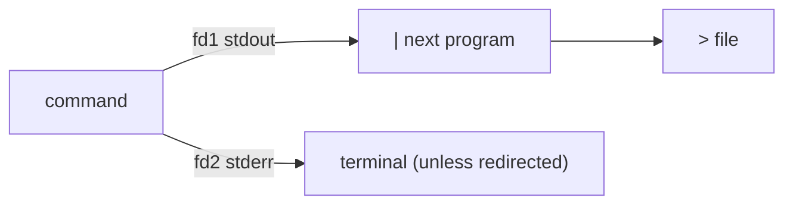
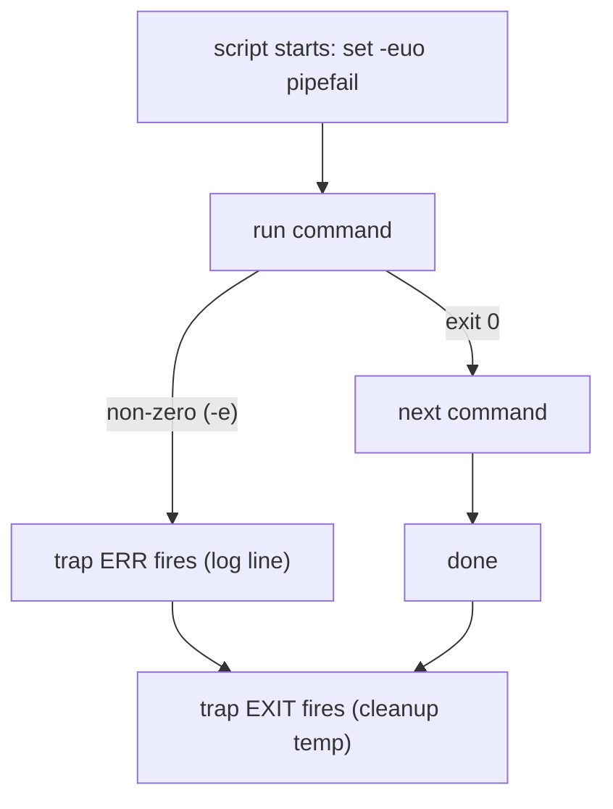

# Day 2 — Shell & Bash Scripting

> Series: Cloud & DevOps Engineering
> Goal: Turn the one-off commands from Day 1 into reliable automation — pipes, text-slicing, control flow, and *hardened* scripts you'd trust to run unattended in cron or CI.

> Verify versions when you build: this targets Bash 5.x (Ubuntu 24.04 ships 5.2). macOS ships an ancient Bash 3.2 — install newer with `brew install bash` or target `sh`/`zsh` deliberately. `#!/usr/bin/env bash` keeps scripts portable.

---

## Table of Contents
1. [Why scripting is the DevOps multiplier](#1-why-scripting-is-the-devops-multiplier)
2. [Variables, quoting, exit codes](#2-variables-quoting-exit-codes)
3. [Pipes & redirection](#3-pipes--redirection)
4. [Conditionals, loops, functions, arguments](#4-conditionals-loops-functions-arguments)
5. [Text tools: grep, sed, awk, cut, sort, uniq, xargs](#5-text-tools-grep-sed-awk-cut-sort-uniq-xargs)
6. [Robust scripts: set -euo pipefail & trap](#6-robust-scripts-set--euo-pipefail--trap)
7. [Lab: a log-parsing + backup script](#7-lab-a-log-parsing--backup-script)
8. [Self-Check](#8-self-check)
9. [Tomorrow](#9-tomorrow)

---

## 1. Why scripting is the DevOps multiplier

**In plain words:** If you did something by hand twice, script it the third time. A shell script is you, written down — so the computer (or a teammate at 3 a.m.) can repeat you perfectly.

- **Why:** DevOps is a war on toil. Manual, repeated tasks are slow and error-prone; scripts are fast and consistent.
- **What:** A text file of shell commands run top-to-bottom, with logic.
- **When:** Backups, deploys, log parsing, health checks, glue between tools.
- **How:** A shebang (`#!/usr/bin/env bash`), commands, `chmod +x`, run it.
- **Where:** Cron, CI pipelines, systemd timers, your `~/bin`.

> 🤔 **"Isn't Bash a legacy toy? Shouldn't I write everything in Python/Go?"** Reach for Python when logic gets complex, you need data structures, or you're parsing JSON heavily. But Bash is unbeatable glue for *orchestrating other programs* — `docker`, `kubectl`, `git`, `curl`. Every CI system, every entrypoint script, every Dockerfile has Bash in it. Knowing it isn't optional; knowing when to graduate to Python is wisdom.

**✅ Good scenario (where it saves you):** Nightly cron runs a 30-line backup script; it's dumped the DB and shipped it to S3 every night for two years without a human.

**❌ Bad scenario (the pain without it):** "Deploy" is a Confluence page with 22 manual steps. Someone skips step 14 during an incident and takes prod down harder.

**When NOT to:** Don't write 800-line Bash monsters with nested data structures — that's the signal to switch to Python/Go.

---

## 2. Variables, quoting, exit codes

**In plain words:** Variables are labeled boxes. Quoting tells the shell "treat this as one thing, spaces and all." Exit codes are a program's one-word verdict: 0 = success, anything else = a specific failure.

- **Why:** 90% of Bash bugs are unquoted variables and ignored exit codes.
- **What:** `name=value`, `"$name"`, and `$?`.
- **When:** Every script.
- **How:** Below.
- **Where:** Universal.

```bash
name="Cloud DevOps"        # NO spaces around = (name = "x" is a syntax error)
echo "$name"               # ALWAYS quote expansions -> Cloud DevOps
echo $name                 # unquoted -> word-splits into 2 args (risky)

count=$(ls | wc -l)        # $( ) captures command output ("command substitution")
echo "There are $count files"

: "${PORT:=8080}"          # default: if PORT unset, set it to 8080
greeting="${USER}, hi"     # ${} braces disambiguate: ${USER}_suffix

# Exit codes:
grep -q root /etc/passwd
echo $?                    # 0 -> found (success)
grep -q nobody_x /etc/passwd
echo $?                    # 1 -> not found (a "failure" exit code)

command_that_fails || echo "it failed"     # || runs on FAILURE (non-zero)
command_that_works && echo "it worked"     # && runs on SUCCESS (zero)
```

### The quoting rules that bite everyone

| Form | Behavior | Use for |
|------|----------|---------|
| `"$var"` | Expands `$var`, keeps it one word | **Default. Almost always this.** |
| `'$var'` | Literal — NO expansion | Fixed strings, regex, passwords with `$` |
| `` `cmd` `` | Old command substitution | Avoid — use `$(cmd)` (nests, readable) |
| `$var` (bare) | Expands AND word-splits + globs | Rarely what you want |

> 🤔 **"Why did my script break on a filename with a space?"** Because you wrote `rm $file` instead of `rm "$file"`. Unquoted, `my file.txt` becomes two arguments `my` and `file.txt`. Quote every expansion — `"$file"`, `"$@"`, `"${arr[@]}"`. This one habit eliminates a whole class of production bugs.

**✅ Good scenario:** Your backup path has a space (`/mnt/My Backups/`); because you quoted everything, it just works.

**❌ Bad scenario (when misused):** `PATH_TO_DELETE=$1; rm -rf $PATH_TO_DELETE/` — caller passes empty string → `rm -rf /`. Quoting + `set -u` would have stopped it cold.

**When NOT to:** Don't quote when you *intentionally* want word-splitting (rare) or glob expansion (`for f in *.log`).

**Dark Side:** Exit codes are silently ignored by default. A `cp` that failed still lets your script march on to "success" — unless you check `$?` or use `set -e` (§6).

---

## 3. Pipes & redirection

**In plain words:** A pipe `|` is a conveyor belt handing one program's output to the next's input. Redirection `>` points a program's output at a file instead of your screen. Together they're the Unix superpower: small tools chained into big jobs.

- **Why:** Compose simple tools instead of writing one giant program.
- **What:** stdin(0), stdout(1), stderr(2), and the operators that route them.
- **When:** Filtering logs, building pipelines, saving output, silencing noise.
- **How:** Below.
- **Where:** Everywhere.

```bash
cat access.log | grep 500 | wc -l     # pipeline: lines with 500, then count them

echo "hello" > out.txt      # > OVERWRITE file with stdout
echo "world" >> out.txt     # >> APPEND to file
sort < names.txt            # < feed file as stdin

ls /nope 2> err.txt         # 2> redirect STDERR (fd 2) only
ls /etc  1> ok.txt          # 1> redirect STDOUT (fd 1); 1 is the default
command > all.log 2>&1      # send stderr to WHEREVER stdout goes (merge both)
command &> all.log          # bash shorthand for the same merge

noisy_command 2>/dev/null   # discard errors into the black hole /dev/null
noisy_command >/dev/null 2>&1  # discard EVERYTHING (silence)

grep ERROR app.log | tee errors.txt   # tee: write to file AND pass down the pipe
```

The `2>&1` ordering gotcha:
```bash
command 2>&1 > file    # WRONG: stderr goes to old stdout (terminal), THEN stdout->file
command > file 2>&1    # RIGHT: stdout->file first, then stderr follows to file
```


*Two output streams: stdout flows down the pipe, stderr goes to the terminal until you redirect it.*

> 🤔 **"Why does `grep foo | grep bar > out.txt` still show errors on screen?"** Because `>` only redirects stdout. Errors travel on stderr (fd 2), which you didn't redirect. Add `2>&1` (in the right order) to capture them too. Knowing stdout ≠ stderr is what separates people who can silence noisy cron jobs from those who can't.

**✅ Good scenario:** `journalctl -u api | grep -i timeout | tail -20` pinpoints the failing dependency in seconds.

**❌ Bad scenario:** A cron job's errors go to stderr, which cron emails nowhere; the job silently fails for weeks. Redirecting `2>&1` to a logfile would have surfaced it.

**When NOT to:** Don't `> file` a file you're also reading in the same pipeline (`sort f > f` truncates `f` first → data loss). Use a temp file or `sponge` (from `moreutils`).

**Dark Side:** Pipelines hide exit codes — by default `$?` is only the *last* command's status. `false | true` "succeeds." `set -o pipefail` (§6) fixes this.

---

## 4. Conditionals, loops, functions, arguments

**In plain words:** The parts that make a script *think*: ask yes/no questions, repeat work, package logic into reusable named blocks, and accept inputs.

```bash
#!/usr/bin/env bash

# --- Conditionals: [[ ]] is the modern, safer test ---
if [[ -f /etc/nginx/nginx.conf ]]; then      # -f: file exists?
  echo "config present"
elif [[ -d /etc/nginx ]]; then               # -d: directory exists?
  echo "dir but no config"
else
  echo "missing"
fi

# Common test operators:
#   -f file   -d dir   -x executable   -z empty string   -n nonempty string
#   ==  !=  (strings)      -eq -ne -lt -gt -le -ge (integers)
if [[ "$env" == "prod" && "$count" -gt 10 ]]; then echo "busy prod"; fi

# --- Loops ---
for svc in nginx redis postgres; do
  systemctl is-active "$svc" || echo "$svc is DOWN"
done

for f in /var/log/*.log; do            # glob loop (quote inside!)
  echo "size of $f: $(wc -l < "$f")"
done

n=1
while [[ $n -le 3 ]]; do echo "attempt $n"; ((n++)); done

# --- Functions ---
log() { echo "[$(date +%H:%M:%S)] $*"; }   # $* = all args as one string
retry() {                                   # reusable retry wrapper
  local tries="$1"; shift                   # local keeps vars scoped
  local i
  for ((i=1; i<=tries; i++)); do
    "$@" && return 0                        # "$@" = run the passed command
    log "attempt $i failed, retrying..."
    sleep 1
  done
  return 1
}
log "starting"
retry 3 curl -fsS https://example.com >/dev/null || log "gave up"

# --- Script arguments ---
#   $0 script name   $1..$9 positional   $# count   "$@" all (quoted, separate)
echo "script: $0, first arg: ${1:-<none>}, arg count: $#"
```

| `$*` vs `"$@"` | Meaning |
|----------------|---------|
| `$*` | All args as ONE space-joined string |
| `"$@"` | Each arg as a SEPARATE quoted word (**almost always what you want**) |

> 🤔 **"When do I use `[ ]` vs `[[ ]]`?"** Prefer `[[ ]]` in Bash — it handles unquoted variables more safely, supports `&&`/`||` and pattern matching, and won't word-split. Use single `[ ]` (aka `test`) only for POSIX `sh` portability. For arithmetic, use `(( ))`: `if (( count > 10 ))`.

**✅ Good scenario:** A `retry` function wraps flaky `curl` calls across your whole deploy script; transient network blips stop causing false failures.

**❌ Bad scenario (when misused):** A `while read` loop that forgets `IFS=` and `-r` mangles filenames with backslashes/leading spaces, corrupting a batch rename.

**When NOT to:** Don't parse structured data (JSON/YAML) with loops and `grep` — use `jq`/`yq`. Don't loop when a single `xargs`/`find -exec` is clearer and faster.

**Dark Side:** `for f in $(ls)` is a classic anti-pattern — it word-splits on spaces and breaks on newlines. Use `for f in *` (glob) or `find ... -print0 | xargs -0`.

---

## 5. Text tools: grep, sed, awk, cut, sort, uniq, xargs

**In plain words:** Your text machine shop. Logs and config are just text; these tools search it, edit it, slice columns, tally it, and feed it into other commands.

```bash
# grep — SEARCH (find lines matching a pattern)
grep -i "error" app.log            # -i case-insensitive
grep -rn "TODO" src/               # -r recursive, -n line numbers
grep -c "200 " access.log          # -c count matches
grep -v "healthz" access.log       # -v INVERT: lines that DON'T match
grep -E "40[0-9]|50[0-9]" a.log    # -E extended regex (4xx or 5xx)

# cut — pick COLUMNS by delimiter
cut -d',' -f1,3 data.csv           # fields 1 and 3, comma-delimited
cut -d' ' -f1 access.log           # first space-separated field (client IP)

# sort + uniq — order and tally (uniq needs sorted input!)
sort access.log | uniq             # dedupe
sort ips.txt | uniq -c | sort -rn  # COUNT each, sort by count descending
#   ^ the classic "top offenders" one-liner

# sed — STREAM EDIT (find/replace, delete lines)
sed 's/foo/bar/g' file             # replace foo->bar on every line (g=global)
sed -n '10,20p' file               # print only lines 10-20
sed -i.bak 's/8080/9090/g' cfg.ini # -i EDIT IN PLACE, .bak keeps a backup
sed '/^#/d' cfg.ini                # delete comment lines

# awk — COLUMN-AWARE processing (a mini language)
awk '{print $1}' access.log        # first field of each line
awk -F',' '{print $2}' data.csv    # -F set field separator
awk '$9 == 500 {print $7}' access.log   # URLs where status(col9)==500
awk '{sum+=$1} END {print sum}' nums.txt # sum a column
awk '{c[$1]++} END {for (k in c) print c[k], k}' access.log  # count by field

# xargs — turn stdin into ARGUMENTS for another command
find . -name "*.tmp" | xargs rm            # delete all found .tmp files
find . -name "*.log" -print0 | xargs -0 gzip   # -print0/-0 safe for spaces
cat urls.txt | xargs -P4 -I{} curl -sO {}  # -P4 run 4 in parallel, {} = item
```

> 🤔 **"grep vs sed vs awk — they overlap, which do I reach for?"** Mental model: **grep** *finds* lines. **sed** *transforms* lines (find/replace, delete). **awk** *understands columns* and does math/logic across fields. If you're extracting the 7th column where the 9th is 500 and summing bytes — that's awk's job. If you're just replacing a string — sed. If you're finding matches — grep.

Comparison at a glance:

| Tool | Superpower | Weakness |
|------|-----------|----------|
| grep | Fast pattern search | Can't edit or do columns |
| sed | In-place stream editing | Awkward for columns/math |
| awk | Columns + arithmetic + logic | Overkill for simple search |
| cut | Trivial column slicing | Single-char delimiter, no logic |
| jq | JSON (NOT these tools' job) | JSON only |

**✅ Good scenario:** During an incident, `awk '$9>=500{print $7}' access.log | sort | uniq -c | sort -rn | head` instantly ranks your top-failing endpoints. No dashboard needed.

**❌ Bad scenario (when misused):** Parsing JSON logs with `grep`/`cut` — one reordered field and your pipeline silently extracts the wrong value. Use `jq`.

**When NOT to:** Don't `sed -i` on production config without a `.bak` and a test. Don't parse HTML/JSON/YAML with regex.

**Dark Side:** `sed -i` with a wrong regex can quietly corrupt every matching line across a directory. Always dry-run without `-i` first and keep backups.

---

## 6. Robust scripts: set -euo pipefail & trap

**In plain words:** By default Bash is *forgiving to a fault* — it plows ahead after errors, treats typos as empty strings, and hides pipeline failures. These flags flip it into "strict mode" so a broken script *stops* instead of doing damage. `trap` is your cleanup crew that runs even when things blow up.

- **Why:** An unattended script that ignores errors can delete the wrong thing or half-finish a deploy.
- **What:** Shell options + a cleanup hook.
- **When:** The header of every serious script.
- **How:** Below.
- **Where:** Cron, CI, deploy scripts.

```bash
#!/usr/bin/env bash
set -euo pipefail
IFS=$'\n\t'          # safer word-splitting (newline/tab, not spaces)

# What each flag does:
#   -e  exit immediately if any command returns non-zero (fail fast)
#   -u  treat use of an UNSET variable as an error (catches typos)
#   -o pipefail  a pipeline fails if ANY stage fails (not just the last)

tmpdir="$(mktemp -d)"                 # make a temp dir

cleanup() {                           # runs on EXIT no matter what
  rm -rf "$tmpdir"
  echo "cleaned up $tmpdir"
}
trap cleanup EXIT                     # register cleanup for normal + error exits
trap 'echo "ERROR on line $LINENO" >&2' ERR   # log where it died

# When you INTENTIONALLY allow failure under set -e:
set +e; risky_command; rc=$?; set -e   # or:
grep foo file || true                  # "|| true" says "failure is fine here"
```

Why each flag matters, concretely:

| Flag | Without it (the bug) | With it |
|------|----------------------|---------|
| `-e` | `cd /wrong` fails, script keeps running and `rm -rf *` in the *current* dir | Stops at the failed `cd` |
| `-u` | Typo `$bakcup_dir` → empty → `rm -rf /` | Errors: "unbound variable" |
| `pipefail` | `curl bad \| tar x` "succeeds" because tar exit hides curl's | Whole pipeline fails |


*Strict mode + traps: fail fast, log where, always clean up.*

> 🤔 **"`set -e` sounds great — why do senior engineers say it has footguns?"** Because `set -e` has surprising exceptions: it won't trigger inside `if`/`while` conditions, in commands joined by `&&`/`||`, or in functions called in certain contexts. It can also make an *intentional* non-zero (like `grep` finding nothing) kill your script. The answer isn't to avoid it — it's to *know* it: append `|| true` where failure is acceptable, and test your scripts. Belt-and-suspenders beats blind trust either way.

**✅ Good scenario:** A backup script with `set -euo pipefail` + `trap cleanup EXIT` aborts the instant the `pg_dump` fails, never uploads a truncated backup, and always removes its temp files.

**❌ Bad scenario (the pain without it):** Deploy script's `cd release_dir` fails (typo), and the next line `rm -rf *` runs in `/home/deploy` instead. Everything gone. `set -e` would have stopped at the bad `cd`.

**When NOT to:** Don't blindly slap `set -e` on scripts full of commands that *legitimately* return non-zero (like `grep`, `diff`) without adding `|| true`. Interactive login shells: don't `set -e` there — a failed command shouldn't log you out.

**Dark Side:** `trap cleanup EXIT` that itself errors can mask the real failure. Keep cleanup handlers simple and idempotent.

---

## 7. Lab: a log-parsing + backup script

**Goal:** Build one hardened script that (a) reports the top failing endpoints from a web log and (b) backs up a directory with rotation. Run it, break it, and watch strict mode + trap protect you.

Create `sample.log` first:
```bash
cat > /tmp/access.log <<'EOF'
10.0.0.1 - - [26/Jul/2026:09:00:01] "GET /api/users HTTP/1.1" 200 512
10.0.0.2 - - [26/Jul/2026:09:00:02] "GET /api/pay HTTP/1.1" 500 88
10.0.0.1 - - [26/Jul/2026:09:00:03] "GET /api/pay HTTP/1.1" 500 88
10.0.0.3 - - [26/Jul/2026:09:00:04] "GET /healthz HTTP/1.1" 200 2
10.0.0.2 - - [26/Jul/2026:09:00:05] "GET /api/users HTTP/1.1" 404 33
EOF
```

Now the script `report_and_backup.sh`:
```bash
#!/usr/bin/env bash
set -euo pipefail
IFS=$'\n\t'

LOG="${1:?usage: $0 <access.log> <backup-src-dir>}"   # :? = required arg
SRC="${2:?usage: $0 <access.log> <backup-src-dir>}"
BACKUP_DIR="${BACKUP_DIR:-/tmp/backups}"              # env override, default
KEEP=5                                                 # keep last 5 backups

log() { echo "[$(date +%FT%T)] $*"; }

tmp="$(mktemp -d)"
trap 'rm -rf "$tmp"; log "cleaned temp"' EXIT
trap 'log "FAILED at line $LINENO"' ERR

# --- Part A: log report ---
log "Top failing endpoints (status >= 400):"
awk '$9 >= 400 {print $7}' "$LOG" \
  | sort | uniq -c | sort -rn \
  | awk '{printf "  %4d  %s\n", $1, $2}'

total=$(wc -l < "$LOG")
errors=$(awk '$9 >= 500' "$LOG" | wc -l)
log "5xx errors: $errors / $total requests"

# --- Part B: rotating backup ---
mkdir -p "$BACKUP_DIR"
stamp="$(date +%Y%m%d-%H%M%S)"
archive="$BACKUP_DIR/backup-$stamp.tar.gz"
tar -czf "$tmp/part.tar.gz" -C "$(dirname "$SRC")" "$(basename "$SRC")"
mv "$tmp/part.tar.gz" "$archive"          # atomic-ish: build in temp, move in
log "created $archive ($(du -h "$archive" | cut -f1))"

# rotate: delete all but newest $KEEP
mapfile -t old < <(ls -1t "$BACKUP_DIR"/backup-*.tar.gz | tail -n +$((KEEP+1)))
if ((${#old[@]})); then
  rm -f "${old[@]}"
  log "rotated out ${#old[@]} old backups"
fi
log "done"
```
Run it:
```bash
chmod +x report_and_backup.sh
./report_and_backup.sh /tmp/access.log /etc/nginx
# Expect: /api/pay shown with count 2, then a backup-*.tar.gz created in /tmp/backups
```

**Prove the safety net works:**
```bash
./report_and_backup.sh                 # NO args -> the :? messages fire, exit ≠ 0
./report_and_backup.sh /tmp/access.log # missing 2nd arg -> caught immediately
```

**Stretch goals:**
- Add a `--dry-run` flag that logs what it *would* delete without deleting.
- Ship the archive to a "remote" (simulate with `scp` to localhost, Day 3).
- Add a `checksum` (`sha256sum`) file next to each backup and verify on restore.
- Schedule it: write a cron line `0 2 * * *` or a systemd timer (Day 1 unit + `.timer`).

---

## 8. Self-Check

1. Why is `rm "$file"` safer than `rm $file`? Give a filename that breaks the unquoted form.
2. What's the difference between `>`, `>>`, and `2>&1`? Why does ordering of `> file 2>&1` matter?
3. Write the one-liner that lists the top 5 client IPs by request count from an access log.
4. Which flag in `set -euo pipefail` catches a typo'd variable name, and what does `pipefail` add?
5. When would grep, sed, and awk each be the right tool? Give a one-line example of each.
6. What does `trap cleanup EXIT` guarantee, and why is it better than putting cleanup at the end of the script?
7. Explain `"$@"` vs `$*`. Which do you pass to a wrapped command and why?
8. Your cron job "runs fine" but silently produces no output on failure. What redirection habit would have surfaced the error?
9. Why does `for f in $(ls)` break on filenames with spaces, and what should you use instead?
10. Give a case where you'd deliberately append `|| true` to a command under `set -e`.

---

## 9. Tomorrow

**Tomorrow — Day 3: Networking & Troubleshooting on Linux.** Now that you can automate on a box, we make the box talk to the world: ports, DNS, `curl`/`ss`/`dig`/`nc`, and SSH in depth (keys, config, tunnels) — culminating in a "service unreachable" diagnosis drill that mirrors a real on-call page.
