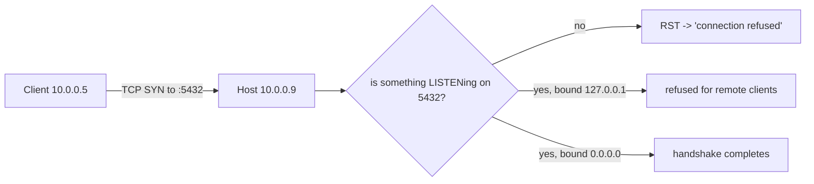
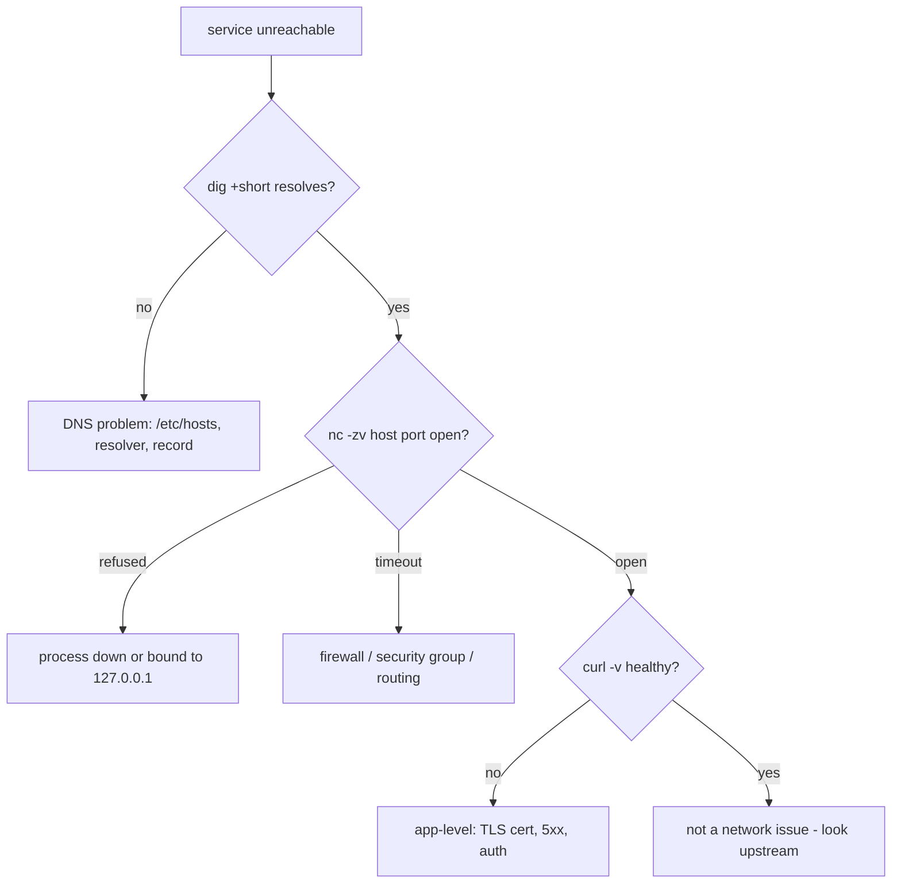
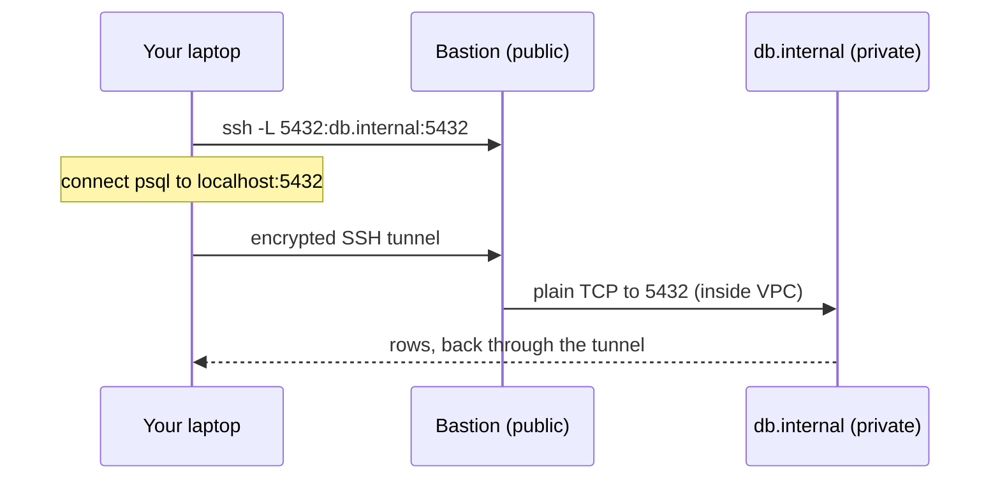

# Day 3 — Networking & Troubleshooting on Linux

> Series: Cloud & DevOps Engineering
> Goal: Turn "the service is down" from a panic into a checklist. Learn to trace a request from DNS → TCP → port → process, wield SSH like a scalpel, and read logs to find the truth.

> Verify versions when you build: `ss`/`ip` (iproute2) have replaced `netstat`/`ifconfig` on modern distros (2026). `dig` comes from `dnsutils`/`bind-utils`. Cloud specifics (Security Groups, NACLs) covered in later cloud files — but the Linux side here is universal across AWS/GCP/Azure.

> Cross-reference: TCP, DNS, and the request lifecycle from **System Design Day 8** — here we make those concepts tangible on an actual box.

---

## Table of Contents
1. [Why networking is where DevOps careers are made](#1-why-networking-is-where-devops-careers-are-made)
2. [Ports & the request path](#2-ports--the-request-path)
3. [DNS on a box](#3-dns-on-a-box)
4. [The diagnostic toolbox: curl, wget, ss, dig, nc, ping, traceroute](#4-the-diagnostic-toolbox)
5. [SSH deeply: keys, config, tunnels](#5-ssh-deeply-keys-config-tunnels)
6. [Moving files: scp & rsync](#6-moving-files-scp--rsync)
7. [Logs: journalctl, tail -f, /var/log](#7-logs-journalctl-tail--f-varlog)
8. [Lab: diagnose "service unreachable"](#8-lab-diagnose-service-unreachable)
9. [Self-Check](#9-self-check)
10. [Tomorrow](#10-tomorrow)

---

## 1. Why networking is where DevOps careers are made

**In plain words:** Almost every outage is, at heart, "A can't talk to B." DNS won't resolve, a port's closed, a firewall blocks it, or a cert expired. The engineer who can walk the path from browser to process — and name exactly which hop broke — is the one everyone trusts in an incident.

- **Why:** Distributed systems are just boxes talking over the network; failures cluster there.
- **What:** DNS resolution, TCP connections, ports, firewalls, TLS, and the tools to inspect each.
- **When:** Every "it's slow / timing out / connection refused" ticket.
- **How:** Layer-by-layer isolation (bottom-up or top-down).
- **Where:** Between any two services, in any cloud.

> 🤔 **"The app team says 'it's a network issue' — is that a real diagnosis?"** Almost never on its own. "Network issue" is a shrug. A *real* diagnosis names the hop: "DNS resolves fine, TCP handshake to port 5432 times out from the app subnet, so it's a firewall/security-group rule, not DNS or the DB process." Your job is to convert vague blame into a specific, provable failure point.

**✅ Good scenario (where it saves you):** Checkout is failing. In 5 minutes you prove: DNS ok → TCP to payment API refused → the API's process is up but bound to `127.0.0.1` not `0.0.0.0`. Root cause found without paging three teams.

**❌ Bad scenario (the pain without it):** Same outage, and the "fix" is restarting random services hoping one helps. Two hours of thrash, customers gone.

**When NOT to:** Don't blindly restart to "fix" networking — you erase the evidence and the problem returns.

---

## 2. Ports & the request path

**In plain words:** An IP address gets you to the right building; a port gets you to the right door within it. A web server listens on door 80/443, Postgres on 5432, Redis on 6379. "Connection refused" usually means nobody's standing at that door.

- **Why:** Knowing which process owns which port is half of network debugging.
- **What:** Ports (0–65535), listening vs established sockets, `0.0.0.0` vs `127.0.0.1`.
- **When:** "Port already in use," "connection refused," "can't reach the service."
- **How:** `ss` to inspect sockets.
- **Where:** Every host.

Common ports to memorize:

| Port | Service | Port | Service |
|-----:|---------|-----:|---------|
| 22 | SSH | 5432 | PostgreSQL |
| 80 | HTTP | 3306 | MySQL |
| 443 | HTTPS (TLS) | 6379 | Redis |
| 53 | DNS | 27017 | MongoDB |
| 8080 | HTTP alt / apps | 9090 | Prometheus |

```bash
ss -tlnp                     # what's LISTENING? -t tcp -l listening -n numeric -p process
# State   Recv-Q Send-Q Local Address:Port   Process
# LISTEN  0      511    0.0.0.0:80           users:(("nginx",pid=812,fd=6))
# LISTEN  0      128    127.0.0.1:5432       users:(("postgres",pid=940,fd=5))

ss -tnp state established     # active connections
ss -tlnp | grep :5432         # who owns port 5432?
sudo lsof -i :8080            # alternative: what process is on 8080
```

The `0.0.0.0` vs `127.0.0.1` trap:

| Bind address | Reachable from | Meaning |
|--------------|----------------|---------|
| `127.0.0.1` (localhost) | ONLY the same machine | "loopback only" |
| `0.0.0.0` | Any interface / other machines | "listen everywhere" |


*"Connection refused" = reached the host but no matching listener; a timeout = never reached it (firewall).*

> 🤔 **"'Connection refused' vs 'connection timed out' — same thing, right?"** No — and the difference tells you *where* it broke. **Refused** = your packet reached the host and it actively said "no door here" (process down, or bound to localhost only). **Timed out** = your packet vanished into the void — a firewall/security group silently dropped it, or the host is unreachable. Refused → look at the process/bind. Timeout → look at the firewall/routing.

**✅ Good scenario:** App can't reach Postgres. `ss -tlnp | grep 5432` on the DB box shows it bound to `127.0.0.1`. Change `listen_addresses='*'`, reachable. Nailed in minutes.

**❌ Bad scenario (when misused):** Someone binds a database to `0.0.0.0` with no firewall on a public IP → the internet finds it in hours. Bind to `0.0.0.0` *and* firewall it, or bind to the private interface only.

**When NOT to:** Don't expose stateful services (DB/Redis) on `0.0.0.0` without a firewall/security group. Don't kill a process to free a port before checking what it is.

---

## 3. DNS on a box

**In plain words:** DNS is the phone book turning `api.stripe.com` into an IP. On a Linux box, several files and services decide *how* a name gets resolved — and when DNS is stale or misconfigured, everything downstream looks "broken" for mysterious reasons.

- **Why:** "It's always DNS" is a meme because it's true — caching and misconfig cause baffling outages.
- **What:** Resolver config, `/etc/hosts`, `/etc/resolv.conf`, `systemd-resolved`.
- **When:** "Name or service not known," intermittent resolution, wrong IP returned.
- **How:** `dig`, `nslookup`, inspect the resolver files.
- **Where:** Every host; also containers (their own `/etc/resolv.conf`).

```bash
cat /etc/hosts               # static overrides, checked BEFORE DNS
# 127.0.0.1 localhost
# 10.0.0.9  db.internal      <- pin a name to an IP (great for testing)

cat /etc/resolv.conf         # which DNS servers this box uses
# nameserver 127.0.0.53      <- systemd-resolved stub on Ubuntu
resolvectl status            # real upstream servers behind the stub (systemd)

dig api.example.com          # full DNS query + answer
dig +short api.example.com   # just the IP(s)
dig @8.8.8.8 example.com     # ask a SPECIFIC server (bypass local cache)
dig example.com A            # A record (IPv4); AAAA=IPv6, CNAME, MX, TXT, NS
dig +trace example.com       # follow the delegation from root -> TLD -> authoritative
getent hosts api.example.com # resolve the way the SYSTEM does (respects /etc/hosts)
```

The resolution order (`nsswitch.conf`) usually: `/etc/hosts` first, then DNS.

> 🤔 **"`dig` shows the right IP, but my app still can't resolve the name — how?"** Because `dig` talks straight to a DNS server, but your *app* goes through the system resolver, which also consults `/etc/hosts` and `nsswitch.conf`. A stale `/etc/hosts` entry, a broken `systemd-resolved`, or a container with a bad `/etc/resolv.conf` can all diverge from what `dig` sees. Use `getent hosts <name>` to resolve *the way your app does*, not the way `dig` does.

**✅ Good scenario:** You suspect a bad deploy pointed traffic at an old IP. `dig +short` shows the DNS record still points at the dead host — a TTL/propagation issue, not the app. Right team paged.

**❌ Bad scenario (when misused):** Someone hardcodes an IP in `/etc/hosts` to "fix" resolution, forgets it, and months later the service migrates IPs. That box mysteriously talks to a dead host forever.

**When NOT to:** Don't leave temporary `/etc/hosts` hacks in place. Don't set absurdly long TTLs on records you may need to fail over quickly.

**Dark Side:** DNS caching means changes aren't instant. A low TTL costs more queries but lets you fail over fast; a high TTL is efficient but painful during incidents. This tradeoff is a real design decision (System Design Day 8).

---

## 4. The diagnostic toolbox

**In plain words:** A handful of tools, each answering one question: Is the name resolving? Is the port open? Is the HTTP response what I expect? Where does the path break?

```bash
# ping — is the host reachable at all? (ICMP; some hosts block it)
ping -c 4 example.com          # -c 4 = 4 packets then stop

# curl — the Swiss Army knife for HTTP(S). LEARN THIS DEEPLY.
curl -I https://example.com                    # -I headers only (HEAD request)
curl -v https://example.com                    # -v verbose: DNS, TLS, request/response
curl -sS -o /dev/null -w "%{http_code} %{time_total}s\n" https://example.com
#   -s silent -S show errors -o discard body -w print status+timing
curl -fsSL https://example.com/health          # -f fail on 4xx/5xx (good in scripts)
curl -H "Authorization: Bearer $TOKEN" https://api.example.com/me   # custom header
curl -X POST -d '{"a":1}' -H 'Content-Type: application/json' url   # POST JSON
curl --resolve api.example.com:443:10.0.0.9 https://api.example.com # test a specific IP

# wget — better for downloading files/mirroring
wget -q https://example.com/file.tar.gz         # -q quiet
wget -c https://.../big.iso                      # -c resume a partial download

# nc (netcat) — is the TCP PORT open? (no HTTP needed)
nc -zv db.internal 5432        # -z scan (no data) -v verbose -> "succeeded" or refused
nc -zv example.com 443

# ss — sockets (from §2)
ss -s                          # summary of socket counts

# traceroute / mtr — WHERE does the path break?
traceroute example.com         # each network hop + latency
mtr example.com                # live, combines ping+traceroute (install if missing)
```

Which tool answers which question:

| Symptom | First tool | It tells you |
|---------|-----------|--------------|
| "Is the name valid?" | `dig +short` / `getent` | DNS resolves or not |
| "Is the host up?" | `ping` | Reachable (if ICMP allowed) |
| "Is the port open?" | `nc -zv host port` | TCP reachable / refused / timeout |
| "Is HTTP healthy?" | `curl -v` | Status, headers, TLS, timing |
| "Where's the latency?" | `mtr` / `traceroute` | Which hop is slow/dropping |


*The isolation ladder: name → port → HTTP. Each rung points at a different team/fix.*

> 🤔 **"`ping` fails — is the server down?"** Not necessarily. Tons of hosts and cloud firewalls *block ICMP* (ping) while HTTP works fine. A failed ping proves almost nothing on its own. Confirm with `nc -zv host 443` or `curl` — testing the *actual* port your service uses is what matters, not ICMP.

**✅ Good scenario:** `curl -v` reveals `SSL certificate problem: certificate has expired`. You've turned "site is down" into "renew the cert" in one command.

**❌ Bad scenario (when misused):** Relying on `ping` to conclude a service is healthy. Ping succeeds, but the app returns 500s — ping never touched the application layer.

**When NOT to:** Don't conclude "server down" from ping alone. Don't hammer a struggling service with a `curl` retry loop during an incident.

---

## 5. SSH deeply: keys, config, tunnels

**In plain words:** SSH is an encrypted remote control for other machines. Passwords are the weak, phishable way in; **key pairs** are the strong way — you keep a secret private key, the server holds your public key, and only the matching pair opens the door. Tunnels let SSH also carry *other* traffic through that secure pipe.

- **Why:** Every remote box, CI runner, and git push over SSH depends on this. Keys done right = secure and passwordless.
- **What:** Asymmetric key auth, `~/.ssh/config`, port forwarding.
- **When:** Reaching any server; accessing a DB behind a bastion; git.
- **How:** Below.
- **Where:** Universal.

```bash
# 1) Generate a modern key pair (ed25519 > RSA)
ssh-keygen -t ed25519 -C "you@example.com"
#   creates ~/.ssh/id_ed25519 (PRIVATE - never share) and .pub (PUBLIC - share)

# 2) Install your PUBLIC key on the server (appends to ~/.ssh/authorized_keys)
ssh-copy-id deploy@10.0.0.9
#   or manually: cat ~/.ssh/id_ed25519.pub | ssh deploy@host 'cat >> ~/.ssh/authorized_keys'

# 3) Connect
ssh deploy@10.0.0.9
ssh -i ~/.ssh/id_ed25519 deploy@10.0.0.9      # specify a key explicitly
ssh -v deploy@10.0.0.9                          # -v debug auth problems

# permissions matter (Day 1!): key 600, dir 700, or SSH refuses it
chmod 700 ~/.ssh && chmod 600 ~/.ssh/id_ed25519
```

`~/.ssh/config` — the productivity multiplier:
```ssh-config
Host bastion
  HostName 203.0.113.10
  User ops
  IdentityFile ~/.ssh/id_ed25519

Host db
  HostName 10.0.0.9              # private IP, only reachable via bastion
  User deploy
  ProxyJump bastion             # hop through bastion automatically
  # now: `ssh db` just works, jumping through the bastion transparently
```

### Tunnels (port forwarding)

```bash
# LOCAL forward: expose a REMOTE service on YOUR localhost
ssh -L 5432:db.internal:5432 bastion
#   now localhost:5432 on YOUR machine -> db.internal:5432 through the SSH pipe
#   run psql -h 127.0.0.1 locally to reach a DB you can't touch directly

# REMOTE forward: expose YOUR local service on the REMOTE box
ssh -R 8080:localhost:3000 remote-host
#   remote-host:8080 -> your laptop:3000 (demo a local app to a server)

# DYNAMIC (SOCKS proxy): route arbitrary traffic through the remote
ssh -D 1080 bastion            # a SOCKS5 proxy on localhost:1080
```

| Forward type | Flag | Direction | Use case |
|--------------|------|-----------|----------|
| Local | `-L` | remote service → your localhost | Reach a DB/UI behind a bastion |
| Remote | `-R` | your service → remote host | Expose local app to a server |
| Dynamic | `-D` | SOCKS proxy | Browse through the remote network |


*A local forward lets you reach a private DB as if it were on your own machine.*

> 🤔 **"Why keys instead of passwords — isn't a strong password enough?"** Keys are far stronger: the private key never leaves your machine, so there's nothing to phish or brute-force over the wire, and you can revoke one key without rotating everyone's password. Best practice on servers: `PasswordAuthentication no` in `sshd_config` — keys only. Pair with an SSH agent (`ssh-add`) so you type your passphrase once per session.

**✅ Good scenario:** A production DB has no public IP. `ssh -L` through the bastion lets you run a read-only query to debug — securely, no firewall changes, fully audited.

**❌ Bad scenario (the pain without it):** Team shares one password-protected `root` login. It leaks in a screenshot; now everyone's locked out during rotation and there's no audit trail of who did what.

**When NOT to:** Don't commit private keys to git (ever). Don't disable host key checking (`StrictHostKeyChecking no`) in production — it defeats MITM protection. Don't leave long-lived remote forwards open.

**Dark Side:** SSH agent forwarding (`-A`) is convenient but risky — a compromised remote host can use your forwarded agent to hop to *other* servers as you. Prefer `ProxyJump`.

---

## 6. Moving files: scp & rsync

**In plain words:** `scp` copies files over SSH — simple, dumb, copies everything. `rsync` is the smart mover: it copies only what *changed*, can resume, and mirrors directories efficiently — the backbone of backups and deploys.

```bash
# scp — simple secure copy
scp local.tar.gz deploy@host:/opt/app/        # push a file up
scp deploy@host:/var/log/app.log ./           # pull a file down
scp -r ./dist deploy@host:/var/www/           # -r recursive (a directory)

# rsync — the professional's choice
rsync -avz ./dist/ deploy@host:/var/www/dist/
#   -a archive (perms/times/symlinks) -v verbose -z compress in transit
#   NOTE trailing slash on source: "contents of dist/" vs "the dir dist"
rsync -avz --delete ./site/ host:/var/www/     # --delete: mirror EXACTLY (removes extras)
rsync -avzP --partial big.iso host:/data/      # -P progress + resume interrupted
rsync -avz --dry-run ./ host:/dest/            # --dry-run: PREVIEW, change nothing
rsync -avz -e "ssh -p 2222" ./ host:/dest/     # custom SSH port
```

| | scp | rsync |
|---|-----|-------|
| Copies only changes | No (whole file) | **Yes (delta)** |
| Resume interrupted | No | Yes (`-P`) |
| Mirror/delete extras | No | Yes (`--delete`) |
| Dry run preview | No | Yes |
| Best for | One quick file | Backups, deploys, big trees |

> 🤔 **"Why does `rsync ./dist host:/www` behave differently than `rsync ./dist/ host:/www`?"** The trailing slash on the *source* is the classic gotcha. `dist/` means "copy the *contents* of dist into /www." `dist` (no slash) means "copy the dist *directory itself* into /www" (→ `/www/dist`). Always `--dry-run` first to see what will actually move.

**✅ Good scenario:** Nightly `rsync --delete` mirrors 40 GB of assets; after the first sync each run transfers only the few MB that changed. Fast and bandwidth-cheap.

**❌ Bad scenario (when misused):** Running `rsync --delete` with the wrong source path *empties* the destination (deletes files not present in an empty/wrong source). This has wiped production directories. `--dry-run` first, always.

**When NOT to:** Don't use `scp`/`rsync` as your deploy mechanism for immutable infra — prefer building an image (Day 7). Don't `--delete` without a dry run.

---

## 7. Logs: journalctl, tail -f, /var/log

**In plain words:** Logs are the flight recorder. When something breaks, the truth is almost always written down somewhere — you just need to know where to look and how to follow it live.

- **Why:** Logs turn "it broke" into "it broke *because* X at *time* Y."
- **What:** systemd journal (`journalctl`) and plain files under `/var/log`.
- **When:** Every diagnosis, always.
- **How:** Below.
- **Where:** Every box; containers log to stdout (Day 6).

```bash
# systemd journal (the modern, structured log)
journalctl -u nginx                     # all logs for the nginx unit
journalctl -u nginx -f                   # FOLLOW live (like tail -f)
journalctl -u nginx --since "10 min ago" # time filter
journalctl -u nginx -p err               # priority >= error only
journalctl -u nginx -n 100 --no-pager    # last 100 lines
journalctl -b                            # logs since last BOOT
journalctl -k                            # kernel messages (dmesg)
journalctl -u nginx -o json-pretty       # structured JSON output

# plain log files
tail -f /var/log/syslog                  # follow live appends (Ctrl-C stops)
tail -n 200 /var/log/nginx/error.log     # last 200 lines
grep -i "out of memory" /var/log/syslog  # find OOM killer events
less +F /var/log/app.log                 # less in follow mode (Ctrl-C then q)

# combine with Day 2 tools:
journalctl -u api --since today | grep -i timeout | awk '{print $1,$2,$3}'
```

Where things log:

| Source | Location |
|--------|----------|
| systemd services | `journalctl -u <svc>` |
| Kernel / OOM / hardware | `journalctl -k`, `/var/log/kern.log`, `dmesg` |
| SSH / auth / sudo | `/var/log/auth.log` (Debian), `/var/log/secure` (RHEL) |
| nginx/apache | `/var/log/nginx/`, `/var/log/apache2/` |
| Containers | `docker logs <c>` → stdout/stderr (Day 6) |

> 🤔 **"My service died and there's nothing in its log — where did the error go?"** Three common places: (1) The kernel killed it — check `journalctl -k` / `dmesg` for the **OOM killer** (`exit 137` in containers). (2) It crashed before opening its logfile — check `journalctl -u <svc>` for the systemd-captured stderr. (3) It logged to stdout and your service captures nothing — that's what the journal is for. The "silent" death almost always left a trace one layer down.

**✅ Good scenario:** API restarts every few minutes. `journalctl -u api -p err --since "1 hour ago"` shows repeated `OOMKilled` → it's a memory leak, not networking. Right root cause, first try.

**❌ Bad scenario (the pain without it):** No log aggregation; the box gets replaced by autoscaling and its logs vanish with it. The evidence is gone forever. (This is why prod ships logs off-box — CloudWatch/Loki/ELK, later.)

**When NOT to:** Don't `tail -f` a log during a flood on a busy box and walk away — it can pin your terminal. Don't rely on local logs for ephemeral cloud instances; ship them.

**Dark Side:** Unrotated logs fill `/var/log` and take the box down (Day 1). `logrotate` and journal size limits (`SystemMaxUse=`) exist for exactly this.

---

## 8. Lab: diagnose "service unreachable"

**Goal:** Reproduce the single most common on-call page and walk the isolation ladder. Use a VM/WSL2/container with nginx.

**Setup — break it three different ways, diagnose each:**

```bash
# Baseline: working service
sudo apt update && sudo apt install -y nginx netcat-openbsd curl dnsutils
sudo systemctl enable --now nginx
curl -I http://localhost        # HTTP/1.1 200 OK  <- healthy baseline
```

**Break #1 — process down (should feel like "connection refused"):**
```bash
sudo systemctl stop nginx
curl -v http://localhost/        # expect: "Connection refused"
nc -zv localhost 80              # expect: refused
# DIAGNOSE:
ss -tlnp | grep :80              # empty -> nothing is listening
systemctl status nginx           # inactive (dead) -> found it
# FIX:
sudo systemctl start nginx && curl -I http://localhost
```

**Break #2 — bound to the wrong interface (refused for remote, works locally):**
```bash
# edit /etc/nginx/sites-enabled/default: change "listen 80;" to "listen 127.0.0.1:80;"
sudo sed -i 's/listen 80;/listen 127.0.0.1:80;/' /etc/nginx/sites-enabled/default
sudo systemctl reload nginx
ss -tlnp | grep :80              # shows 127.0.0.1:80 (NOT 0.0.0.0) -> remote clients refused
# FIX: revert to 0.0.0.0
sudo sed -i 's/listen 127.0.0.1:80;/listen 80;/' /etc/nginx/sites-enabled/default
sudo nginx -t && sudo systemctl reload nginx
```

**Break #3 — DNS resolves wrong (name points at a dead host):**
```bash
echo "10.255.255.1 myservice.local" | sudo tee -a /etc/hosts   # unreachable IP
getent hosts myservice.local     # resolves to the dead IP
curl -v http://myservice.local/  # times out -> reaches nothing
nc -zv myservice.local 80        # timeout (not refused) -> firewall/routing/dead host
# DIAGNOSE the divergence:
dig +short myservice.local       # (empty - it's in /etc/hosts, not DNS!)
grep myservice.local /etc/hosts  # AHA - stale hosts entry
# FIX:
sudo sed -i '/myservice.local/d' /etc/hosts
```

**Write your findings** for each break in the shape a real incident review wants:
> Symptom → What I tested (command + result) → Which hop failed → Root cause → Fix → How to prevent.

**Stretch goals:**
- Set up an SSH key + `~/.ssh/config` alias to your box; connect with just `ssh mybox`.
- Create a local port forward to reach nginx "as if" it were behind a bastion.
- Simulate an expired cert with a self-signed one and diagnose it via `curl -v`.
- `rsync --dry-run` a directory to another path and read exactly what it *would* change.

---

## 9. Self-Check

1. "Connection refused" vs "connection timed out" — what does each tell you about where the failure is?
2. A DB is up but the app can't connect. How does `ss -tlnp` help, and what does binding to `127.0.0.1` vs `0.0.0.0` mean?
3. `dig` returns the right IP but the app can't resolve the name. Name two reasons and the command that resolves "the way the app does."
4. Give the exact `curl` invocation to print just the HTTP status code and total time, discarding the body.
5. Why are SSH keys stronger than passwords, and what one line in `sshd_config` enforces keys-only?
6. You need to query a private DB with no public IP through a bastion. Write the SSH local-forward command.
7. What does the trailing slash on an `rsync` source path change? Why `--dry-run` first?
8. `ping` fails but the website loads in a browser. Explain how both can be true.
9. A service died with nothing in its own log. Give two places you'd look next.
10. Walk the isolation ladder in order for "service unreachable," naming the tool at each rung.

---

## 10. Tomorrow

**Tomorrow — Day 4: Git Core.** We shift from operating servers to the version-control skill every engineer lives in: the snapshot mental model (working → staging → commit), branching and merging, merge vs rebase, resolving conflicts, and the undo toolkit that saves you when things go wrong.
