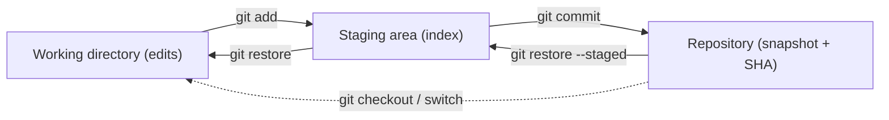
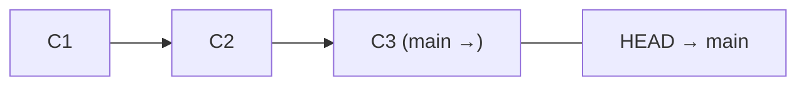
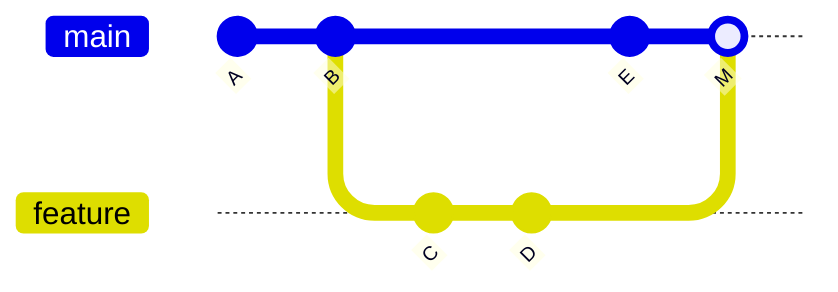
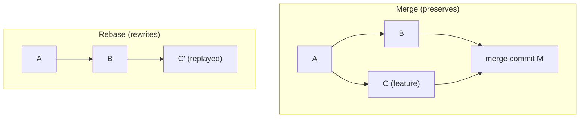
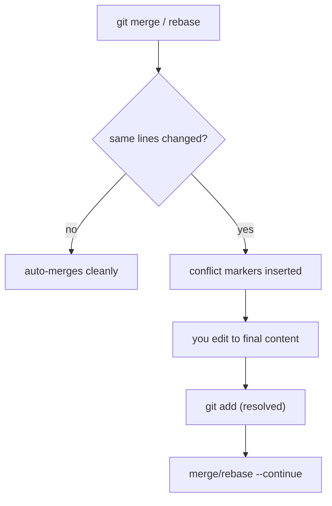
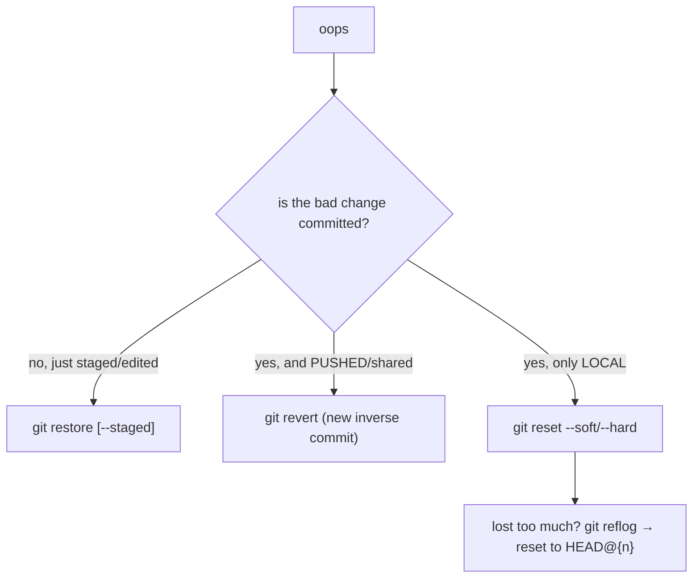

# Day 4 — Git Core

> Series: Cloud & DevOps Engineering
> Goal: Build a correct *mental model* of Git (snapshots, not diffs), run the everyday flow without fear, branch and merge, understand merge vs rebase, and own the undo toolkit so no mistake is ever permanent.

> Verify versions when you build: this targets Git 2.4x (2026). Modern Git added `git switch`/`git restore` to split the overloaded `git checkout` — we teach those, but `checkout` still works everywhere.

---

## Table of Contents
1. [Why Git is non-negotiable](#1-why-git-is-non-negotiable)
2. [The snapshot mental model](#2-the-snapshot-mental-model)
3. [The everyday flow](#3-the-everyday-flow)
4. [Branching & merging](#4-branching--merging)
5. [Merge vs rebase](#5-merge-vs-rebase)
6. [Conflicts](#6-conflicts)
7. [Remotes](#7-remotes)
8. [The undo toolkit](#8-the-undo-toolkit-reset-revert-restore-reflog-stash)
9. [Lab: resolve a conflict + rebase](#9-lab-resolve-a-conflict--rebase)
10. [Self-Check](#10-self-check)
11. [Tomorrow](#11-tomorrow)

---

## 1. Why Git is non-negotiable

**In plain words:** Git is a time machine and a collaboration ledger for your code. It remembers every version, lets many people work at once without overwriting each other, and lets you undo almost anything. Every product company runs on it; every deploy pipeline starts from it.

- **Why:** Code changes constantly, by many hands; you need history, safety, and parallelism.
- **What:** A distributed version-control system storing project snapshots.
- **When:** Every change you make, forever.
- **How:** A local `.git` repo plus optional remotes (GitHub/GitLab, Day 5).
- **Where:** Laptops, CI runners, deploy systems — Git commit SHAs are the currency of DevOps.

> 🤔 **"I'm a solo dev — do I really need branches and all this ceremony?"** Yes. Even solo, Git is your undo history, your experiment sandbox (branch, try, throw away), and your bisect tool when a bug appears "sometime in the last month." The moment you deploy from a pipeline, your commit SHA *is* your release identity. Git isn't collaboration overhead — it's how professional software is versioned, shipped, and rolled back.

**✅ Good scenario (where it saves you):** A bug ships. `git bisect` finds the exact commit that introduced it across 200 commits in minutes; you revert that one commit and deploy.

**❌ Bad scenario (the pain without it):** Code lives in `final_v2_REALfinal.zip` folders. Two people edit the same file, one overwrites the other, and there's no history to recover the lost work.

**When NOT to:** Don't commit large binaries/secrets to Git (they live in history forever). Use Git LFS for big assets, a secret manager for secrets.

---

## 2. The snapshot mental model

**In plain words:** The single idea that makes Git click: a commit is a *photograph of your whole project* at a moment, not a list of edits. Git is cheap about this because unchanged files just point to the previous photo. Your work moves through three zones on its way to becoming a photo.

- **Why:** Almost every Git confusion comes from thinking in "diffs" or not knowing which zone a file is in.
- **What:** Working directory → Staging area (index) → Repository (commits).
- **When:** Every single commit.
- **How:** `add` promotes changes to staging; `commit` freezes staging into a snapshot.
- **Where:** Local `.git`.

The three zones:

| Zone | What it is | How you move things here |
|------|-----------|--------------------------|
| **Working directory** | Your actual files, being edited | Just editing |
| **Staging area (index)** | The "photo you're composing" | `git add` |
| **Repository (.git)** | Permanent snapshots (commits) | `git commit` |


*Work flows left→right into a snapshot; the undo commands (Day §8) flow right→left.*

Every commit has: a unique SHA (`a1b2c3d…`), an author, a message, a pointer to its parent(s), and the full tree snapshot. A **branch** is just a movable sticky note pointing at one commit. `HEAD` is "where you are now."


*A branch (main) and HEAD are lightweight pointers into a chain of snapshots.*

> 🤔 **"Does Git store diffs between versions? That's what SVN did."** No — Git stores full *snapshots* (deduplicated by content hash, so it's still efficient). Diffs are *computed on demand* when you ask (`git diff`). This is why branching and switching are instant: Git just moves a pointer to a different snapshot rather than replaying a pile of patches. Internalize "snapshot, not diff" and 80% of Git mystery evaporates.

**✅ Good scenario:** Staging lets you commit *part* of your work — you `git add` just the bug fix, leaving unrelated debug prints in the working dir out of the clean commit.

**❌ Bad scenario (when misused):** `git add .` blindly stages a debug file, a secret, and 200MB of node_modules into one commit. A `.gitignore` and selective `add` would have prevented it.

**When NOT to:** Don't treat staging as optional noise — it's the tool that lets you craft clean, reviewable commits.

**Dark Side:** Anything committed lives in history forever, even if you "delete" it later. A committed secret must be rotated *and* scrubbed from history (`git filter-repo`), not just removed in a new commit.

---

## 3. The everyday flow

**In plain words:** The loop you'll run thousands of times: check status, stage what you want, commit with a message, push.

```bash
git init                      # start a new repo (creates .git/)
git clone git@github.com:org/repo.git   # or copy an existing one

git status                    # WHAT'S changed / staged? run this constantly
git status -sb                # short + branch info

git add file.py               # stage one file
git add src/                  # stage a directory
git add -p                    # stage HUNK BY HUNK (craft precise commits)
git add .                     # stage everything (know what you're grabbing!)

git diff                      # unstaged changes (working vs staging)
git diff --staged             # staged changes (staging vs last commit)

git commit -m "Fix null check in payment handler"
git commit                    # opens editor for a fuller message (body)
git commit --amend            # fix the LAST commit (message or add forgotten files)

git log --oneline --graph --decorate -10   # readable history
git show HEAD                 # what the latest commit changed

git push                      # send commits to remote (Day 5/7)
git pull                      # fetch + merge remote changes
```

A good commit message:
```text
Fix race condition in order confirmation email

The worker read order status before the DB transaction committed,
occasionally sending "shipped" emails for unpaid orders. Now reads
after commit. Fixes the duplicate-email reports from last week.
```
Imperative subject ≤ ~50 chars, blank line, then *why* (not just what — the diff shows what).

Create `.gitignore` early:
```gitignore
node_modules/
__pycache__/
.env               # NEVER commit secrets
*.log
dist/
.DS_Store
```

> 🤔 **"`git add .` then `git commit -m 'stuff'` — that's the whole workflow, right?"** It works, but it's how junk enters history: a stray secret, a giant build artifact, a "stuff"/"wip"/"fix" message no one can read later. Slow down: `git status` to see what you're grabbing, `git add -p` to stage deliberately, and write a message your future self will thank you for during a 2 a.m. incident review.

**✅ Good scenario:** Six months later a payment bug appears. `git log --oneline` + clear messages let you find and understand the relevant change in one scroll.

**❌ Bad scenario (when misused):** History is 400 commits of "wip", "fix", "asdf". `git bisect` and `git blame` become useless; nobody can tell why anything changed.

**When NOT to:** Don't `--amend` or rewrite commits you've already pushed to a shared branch (§5 Dark Side).

---

## 4. Branching & merging

**In plain words:** A branch is a parallel timeline — a safe copy where you can build a feature without touching `main`. Merging weaves your timeline back into `main` when it's ready.

- **Why:** Isolate work-in-progress; keep `main` always releasable.
- **What:** Movable pointers (branches) and the act of combining them (merge).
- **When:** Every feature, fix, or experiment.
- **How:** Below.
- **Where:** Local, then pushed for review (Day 5).

```bash
git branch                       # list branches (* = current)
git switch -c feature/login      # create AND switch (modern; = checkout -b)
git switch main                  # switch back
git branch -d feature/login      # delete a merged branch
git branch -D feature/login      # force-delete (unmerged) — careful

# do work on the branch, commit, then merge into main:
git switch main
git merge feature/login          # bring the feature's commits into main
```

Two kinds of merge:

| Merge type | When it happens | Result |
|------------|-----------------|--------|
| **Fast-forward** | main hasn't moved since you branched | Pointer just slides forward — no merge commit |
| **3-way merge** | both branches advanced | Creates a *merge commit* with two parents |

```bash
git merge --no-ff feature/login  # force a merge commit even if FF is possible
#   (keeps an explicit record that a feature branch existed)
```


*A 3-way merge: main advanced to E, feature to D, and M ties them together with two parents.*

> 🤔 **"Should I make a branch for tiny changes, or just commit to main?"** For anything non-trivial or reviewed, branch — it keeps `main` deployable and gives reviewers a clean PR (Day 5). Branches are so cheap in Git (just a pointer) that "should I branch?" is almost always "yes." Trunk-based teams use *very short-lived* branches merged the same day (Day 5).

**✅ Good scenario:** Three engineers build three features on three branches simultaneously; `main` stays releasable the whole time and each feature merges cleanly when reviewed.

**❌ Bad scenario (the pain without it):** Everyone commits half-done work straight to `main`. A hotfix is needed but `main` is full of broken WIP — you can't release.

**When NOT to:** Don't let feature branches live for weeks — they drift far from `main` and become merge nightmares ("big bang merge"). Integrate often.

**Dark Side:** Long-lived branches accumulate conflicts exponentially. The fix is cultural (small, frequent merges), not technical.

---

## 5. Merge vs rebase

**In plain words:** Both combine branches, but they tell different *stories*. **Merge** preserves history exactly as it happened, tying timelines with a merge commit — honest but sometimes messy. **Rebase** *rewrites* your commits to sit neatly on top of the latest main, as if you'd started your work today — clean and linear, but it forges new commits.

- **Why:** Team history readability vs. honesty is a real tradeoff you'll debate.
- **What:** `git merge` (adds a merge commit) vs `git rebase` (replays commits onto a new base).
- **When:** Integrating your branch with updated `main`.
- **How:** Below.
- **Where:** Before opening/updating a PR.

```bash
# You're on feature; main moved ahead. Two ways to catch up:

# OPTION A — merge main into your feature (preserves history)
git switch feature
git merge main               # creates a merge commit on feature

# OPTION B — rebase your feature onto main (linear history)
git switch feature
git rebase main              # replays your commits on top of main's tip
#   resolve conflicts per commit, then:  git rebase --continue
#   bail out entirely with:              git rebase --abort

# Interactive rebase — clean up your OWN commits before review
git rebase -i HEAD~3         # squash/reword/reorder the last 3 commits
```


*Merge keeps the fork visible; rebase makes it look like a straight line.*

| | Merge | Rebase |
|---|-------|--------|
| History | Preserved, true, branchy | Linear, clean, "edited" |
| Commit SHAs | Unchanged | **Rewritten (new SHAs)** |
| Merge commits | Yes | No |
| Safe on shared branches | Yes | **No — never rebase pushed shared history** |
| Best for | Integrating shared/`main` | Tidying your *local* feature before PR |

> 🤔 **"Merge or rebase — which is 'correct'? Teams argue about this endlessly."** Neither is universally right; it's a team convention. The one hard rule: **never rebase commits that others have already pulled** — you rewrite SHAs and force everyone into a painful reconciliation. Common healthy pattern: rebase your *local, unpushed* feature branch to keep it tidy and linear, but *merge* (with a merge commit or squash) into `main` via PR. When in doubt, follow your team's documented policy.

**✅ Good scenario:** Before opening a PR you `rebase -i` to squash "wip", "typo", "fix wip" into one clean commit with a real message. Reviewers see a coherent change.

**❌ Bad scenario (the pain / when misused):** You `git rebase` a branch a teammate already based work on and `push --force`. Their commits now conflict with rewritten history; hours of confusion and lost work follow.

**When NOT to:** Never rebase (or force-push) a shared/public branch others depend on. Don't rebase `main` itself.

**Dark Side:** `git push --force` on a shared branch can obliterate teammates' commits. Use `--force-with-lease` (refuses if the remote moved unexpectedly) — it's the seatbelt version.

---

## 6. Conflicts

**In plain words:** A conflict happens when two branches changed the *same lines* and Git can't decide who's right — so it stops and asks *you*. It's not an error; it's Git being honest that a human must choose.

- **Why:** Parallel work on the same code is inevitable; conflicts are normal, not failure.
- **What:** Conflict markers Git inserts into the file.
- **When:** During merge, rebase, or `pull`.
- **How:** Edit the markers, stage, continue.
- **Where:** Any integration.

```bash
git merge feature
# Auto-merging config.yml
# CONFLICT (content): Merge conflict in config.yml
# Automatic merge failed; fix conflicts and then commit the result.

git status                   # lists "both modified" files
```

Git marks the clash inside the file:
```text
<<<<<<< HEAD
timeout = 30          # main's version ("ours")
=======
timeout = 60          # incoming version ("theirs")
>>>>>>> feature
```
Resolve by editing to the correct final content and deleting all three markers:
```text
timeout = 60          # you decided theirs is right (or blend them)
```
```bash
git add config.yml           # mark this file resolved
git merge --continue         # or: git commit (finishes the merge)
# during a rebase instead:  git rebase --continue

# escape hatches:
git merge --abort            # forget the whole merge, back to before
git rebase --abort
git checkout --theirs file   # take incoming version wholesale
git checkout --ours file     # keep our version wholesale
```


*A conflict just pauses the process to ask a human which change wins.*

> 🤔 **"During a rebase, which side is 'ours' vs 'theirs' — I always pick wrong."** It flips between merge and rebase, which is the classic trap. In a **merge**, `ours` = the branch you're on, `theirs` = the branch merging in. In a **rebase**, it's *inverted*: `ours` = the branch you're rebasing *onto* (main), `theirs` = your own commits being replayed. Because it's confusing, don't rely on `--ours/--theirs` blindly — read the actual content and decide.

**✅ Good scenario:** A conflict in `config.yml` surfaces that two people changed the same timeout for different reasons — you catch a real disagreement *before* it ships, not after.

**❌ Bad scenario (when misused):** Panicked dev resolves a conflict by deleting the other person's change wholesale without reading it, silently dropping a needed fix. The bug returns in prod.

**When NOT to:** Don't `--abort` and give up repeatedly on a big merge — that just defers the pain. Integrate more often so conflicts stay small.

---

## 7. Remotes

**In plain words:** A remote is a copy of your repo living elsewhere (usually GitHub/GitLab) that the team shares. Your local repo and the remote are peers; you `push` your commits up and `pull`/`fetch` theirs down.

```bash
git remote -v                       # list remotes (usually "origin")
git remote add origin git@github.com:org/repo.git

git fetch origin                    # DOWNLOAD remote commits, don't merge yet (safe)
git pull                            # fetch + merge into current branch
git pull --rebase                   # fetch + rebase (linear; avoids merge-commit noise)

git push -u origin feature/login    # push + set upstream (first push of a branch)
git push                            # subsequent pushes

git branch -vv                      # show which remote branch each local tracks
```

`fetch` vs `pull`:

| | `fetch` | `pull` |
|---|--------|--------|
| Downloads remote commits | Yes | Yes |
| Modifies your working branch | **No** (safe, inspect first) | Yes (merges/rebases) |
| Use when | You want to review before integrating | You're ready to integrate |

> 🤔 **"`git pull` sometimes creates a weird 'Merge branch main' commit — what is that?"** That's a merge commit from `pull` reconciling your local commits with the remote's. Many teams find these noisy on feature branches and prefer `git pull --rebase` (or set `git config pull.rebase true`) to keep history linear. On `main`, policies vary — follow your team's.

**✅ Good scenario:** `git fetch` + `git log origin/main` lets you *see* what landed on main before you integrate, so you're never surprised by an incoming change.

**❌ Bad scenario (when misused):** Blindly `git pull` on a dirty working tree triggers conflicts and half-merged state mid-task. `git stash` first (§8) or commit before pulling.

**When NOT to:** Don't `push --force` to `origin/main`. Don't treat the remote as a backup for uncommitted local work — only committed+pushed work is safe.

---

## 8. The undo toolkit (reset, revert, restore, reflog, stash)

**In plain words:** Git's superpower is that almost nothing is truly lost. This is the kit that gets you out of trouble — from "unstage this file" to "I nuked a branch, bring it back."

| Tool | Undoes what | Rewrites history? | Safe on shared? |
|------|-------------|-------------------|-----------------|
| `git restore` | Working-dir / staging changes | No | Yes |
| `git revert` | A *committed* change (via a new commit) | No (adds) | **Yes** |
| `git reset` | Moves branch pointer; unstages/discards | Yes (can lose commits) | **No** |
| `git stash` | Shelves uncommitted work temporarily | No | Yes |
| `git reflog` | Finds "lost" commits to recover | No | Yes |

```bash
# restore — undo file-level changes (the modern, focused commands)
git restore file.py             # discard working-dir edits to file (careful!)
git restore --staged file.py    # unstage, keep the edits
git restore --source=HEAD~2 f   # restore file as it was 2 commits ago

# revert — safely undo a PUSHED commit by making an inverse commit
git revert a1b2c3d              # creates a NEW commit that undoes a1b2c3d
#   ^ USE THIS on shared branches — history stays intact, nothing rewritten

# reset — move the branch pointer (local surgery)
git reset --soft HEAD~1         # undo last commit, KEEP changes staged
git reset --mixed HEAD~1        # (default) undo commit, changes back to working dir
git reset --hard HEAD~1         # undo commit AND discard changes — DESTRUCTIVE

# stash — shelve work to switch context fast
git stash                       # save uncommitted changes, clean the tree
git stash list
git stash pop                   # reapply most recent stash and drop it
git stash apply                 # reapply but KEEP it in the stash
git stash -u                    # include untracked files

# reflog — the safety net when you think you lost commits
git reflog                      # shows EVERY move of HEAD (even "deleted" commits)
git reset --hard HEAD@{2}       # jump back to a known-good point from reflog
```


*Pick your undo by two questions: is it committed, and is it shared?*

> 🤔 **"`git reset` vs `git revert` — they both 'undo,' when do I use which?"** Decisive rule: **`revert` for shared/pushed history, `reset` for local-only.** `revert` adds a new commit that cancels the old one — history is preserved, safe for everyone. `reset` *moves the branch pointer backward*, effectively erasing commits — great locally, catastrophic if you force-push it to a branch others have. If you've already pushed it and others have it, `revert` is almost always the answer.

> 🤔 **"I ran `git reset --hard` and lost a day's work — is it gone?"** Probably not! `git reflog` records every position HEAD has been in for ~90 days. Find the SHA from before the reset and `git reset --hard <sha>` (or `git checkout <sha>`). The reflog has rescued countless engineers — it's the reason "I lost commits" is usually recoverable.

**✅ Good scenario:** A bad commit shipped to prod. `git revert <sha>` creates a clean, reviewable "undo" commit; history stays honest and CI redeploys the safe state.

**❌ Bad scenario (the pain / when misused):** Someone `git reset --hard` + `push --force` on `main` to "undo" a pushed commit, blowing away three teammates' commits that came after. `git revert` would have been safe.

**When NOT to:** Don't `reset --hard` without knowing it discards uncommitted work irreversibly (well — reflog saves *commits*, not un-committed edits). Don't `reset` shared branches.

**Dark Side:** `reset --hard` discards *uncommitted* changes with no reflog safety net — reflog only rescues things that were once committed. Commit early; the commit is your seatbelt.

---

## 9. Lab: resolve a conflict + rebase

**Goal:** Manufacture a real conflict, resolve it, then rebase a feature onto an advanced main and clean up the history. Do it all in a throwaway local repo.

```bash
# 1) Set up a repo with a conflict waiting to happen
mkdir git-lab && cd git-lab && git init
printf "timeout = 30\nretries = 3\n" > config.txt
git add config.txt && git commit -m "Add base config"

# 2) Branch off and change a line
git switch -c feature/tune
sed -i 's/timeout = 30/timeout = 60/' config.txt
git commit -am "Increase timeout to 60"

# 3) Meanwhile main changes the SAME line differently
git switch main
sed -i 's/timeout = 30/timeout = 45/' config.txt
git commit -am "Set timeout to 45"

# 4) Merge -> CONFLICT
git merge feature/tune
git status                         # config.txt "both modified"
cat config.txt                     # see the <<<<<<< ======= >>>>>>> markers
# --- edit config.txt: decide the final value (say 60), remove all markers ---
sed -i '/[<=>]\{7\}/d' config.txt  # crude marker strip for the lab
sed -i 's/timeout = 45/timeout = 60/' config.txt   # keep the value you chose
git add config.txt
git commit --no-edit               # complete the merge
git log --oneline --graph          # see the merge commit

# 5) Now practice REBASE instead. Make a linear feature.
git switch -c feature/logs
echo "log_level = info" >> config.txt
git commit -am "wip logs"
echo "log_format = json" >> config.txt
git commit -am "typo"
echo "# logging section" >> config.txt
git commit -am "fix wip"

# 6) main advances independently
git switch main
echo "region = us-east-1" >> config.txt
git commit -am "Add region"

# 7) Rebase feature onto the new main + squash the messy commits
git switch feature/logs
git rebase main                    # resolve any conflict, then --continue
git rebase -i HEAD~3               # mark 2nd & 3rd as "squash", write one clean message
git log --oneline --graph          # linear history, ONE tidy logs commit

# 8) Practice the undo toolkit
git commit -am "oops mistake"      # make a bad commit
git revert HEAD --no-edit          # undo it the SAFE way
git reflog                         # marvel at the full history of HEAD moves
```

**Stretch goals:**
- Cause a conflict *during* the rebase (edit the same line on main and feature) and resolve it per-commit with `git rebase --continue`.
- `git reset --hard HEAD~1`, then recover the "lost" commit using `git reflog`.
- Stash a dirty change, switch branches, come back, `git stash pop`.
- Add a `.gitignore` and confirm `git status` stops showing an ignored file.

---

## 10. Self-Check

1. Explain "snapshot, not diff." Why does that make branch-switching instant?
2. Name the three zones and the command that moves work between each.
3. What's the difference between a fast-forward merge and a 3-way merge?
4. When is rebase the right choice, and what is the one thing you must NEVER rebase?
5. `reset` vs `revert`: which is safe on a pushed branch and why?
6. You `git reset --hard` and think you lost commits. What command likely recovers them?
7. In a merge conflict, what do `<<<<<<<`, `=======`, and `>>>>>>>` delimit? How do you finish resolving?
8. `git fetch` vs `git pull` — which is safe to run mid-task and why?
9. What does `--force-with-lease` protect against compared to `--force`?
10. Why is committing a secret a problem even after you "delete" it in a later commit?

---

## 11. Tomorrow

**Tomorrow — Day 5: Git Collaboration (GitHub/GitLab).** We take these local skills into a team: pull/merge requests and code review, branching strategies (trunk-based vs GitFlow), tags/releases/semver, protected branches, hooks, and conventional commits — the workflow every product company actually ships with.
