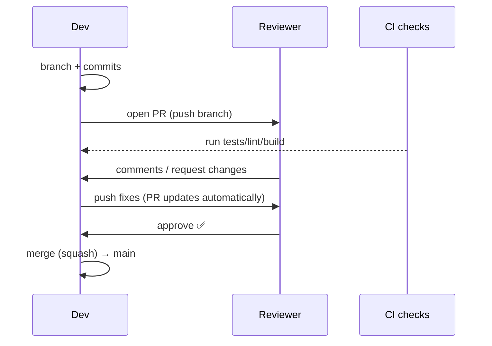
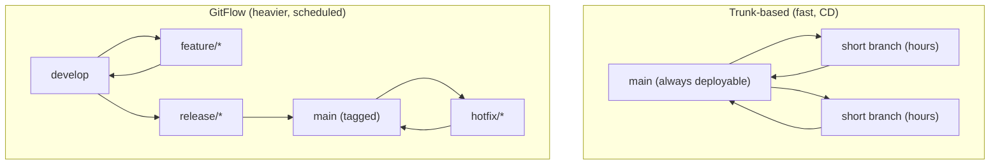
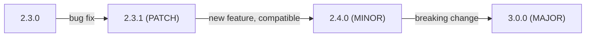
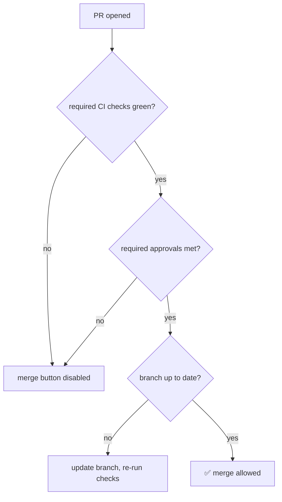
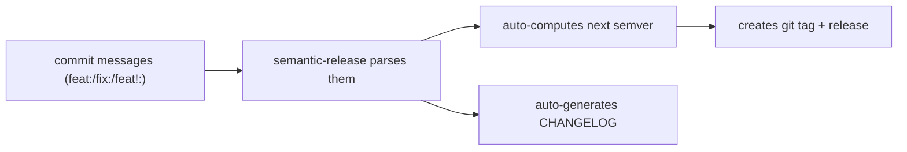
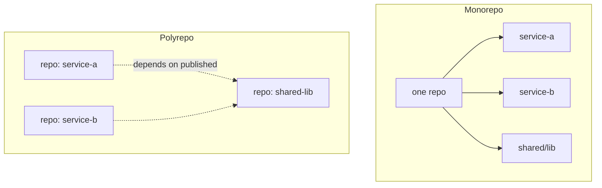

# Day 5 — Git Collaboration (GitHub/GitLab)

> Series: Cloud & DevOps Engineering
> Goal: Move from solo Git to *team* Git — pull/merge requests, code review, branching strategies, releases and semver, protected branches, hooks, and conventional commits — the way real product companies ship.

> Verify versions when you build: GitHub and GitLab UIs evolve (2026); the concepts (PR/MR, protected branches, required checks) are stable across GitHub, GitLab, Bitbucket, and Azure DevOps. Terms differ: GitHub says **Pull Request**, GitLab says **Merge Request** — same idea.

---

## Table of Contents
1. [Why collaboration workflow is a first-class skill](#1-why-collaboration-workflow-is-a-first-class-skill)
2. [Pull/Merge Requests & code review](#2-pullmerge-requests--code-review)
3. [Branching strategies: trunk-based vs GitFlow](#3-branching-strategies-trunk-based-vs-gitflow)
4. [Tags, releases, and semver](#4-tags-releases-and-semver)
5. [Protected branches & required checks](#5-protected-branches--required-checks)
6. [Hooks (client & server / CI)](#6-hooks-client--server--ci)
7. [Conventional commits](#7-conventional-commits)
8. [Monorepo vs polyrepo](#8-monorepo-vs-polyrepo)
9. [Lab: PR + branch protection](#9-lab-pr--branch-protection)
10. [Self-Check](#10-self-check)
11. [Tomorrow](#11-tomorrow)

---

## 1. Why collaboration workflow is a first-class skill

**In plain words:** Writing code alone is easy; *shipping* code with 20 other people without breaking `main` is the hard, valuable skill. The rituals here — reviews, protected branches, checks — are guardrails that let a team move fast without knocking each other's work over.

- **Why:** Product velocity comes from many people merging safely all day.
- **What:** The social+technical process wrapped around Git: PRs, reviews, gates, releases.
- **When:** Every change that touches shared code.
- **How:** Platform features (GitHub/GitLab) + team conventions.
- **Where:** Every engineering org.

> 🤔 **"Reviews and process just slow me down — can't I push to main and move fast?"** For a solo toy, sure. On a team shipping to customers, "push to main" is how you take prod down and lose trust. Good process is *paved road*, not red tape: it catches bugs before customers do, spreads knowledge, and — crucially for DevOps — makes every change traceable and revertable. The fastest teams have the *best* guardrails, not the fewest.

**✅ Good scenario (where it saves you):** A subtle N+1 query slips into a PR; a reviewer catches it before it hits prod and pages the on-call. Ten minutes of review saved a Saturday outage.

**❌ Bad scenario (the pain without it):** Anyone pushes to `main` anytime. A half-finished migration lands, CI was never required, and the next deploy corrupts data.

**When NOT to:** Don't cargo-cult heavyweight process onto a two-person startup — match ceremony to team size and risk.

---

## 2. Pull/Merge Requests & code review

**In plain words:** A PR/MR is a formal proposal: "here are my commits on a branch; please review and merge them into `main`." It's where code gets a second pair of eyes, automated checks run, and a discussion happens *before* anything reaches production.

- **Why:** Quality gate + knowledge sharing + audit trail, all in one.
- **What:** A branch diff + review + checks + merge, on GitHub/GitLab.
- **When:** Every feature/fix.
- **How:** Push branch → open PR → review → checks pass → merge.
- **Where:** GitHub (PR) / GitLab (MR) / Bitbucket / Azure DevOps.

The lifecycle:
```bash
git switch -c feat/cart-discount        # branch (Day 4)
# ...commit work...
git push -u origin feat/cart-discount   # push the branch
# open a PR in the UI (or: gh pr create --fill  with GitHub CLI)
gh pr create --title "Add cart discount" --body "Applies promo codes at checkout"
gh pr checks                            # watch CI status
gh pr merge --squash                    # merge after approval + green checks
```


*A PR is the meeting point of automated checks and human review before code reaches main.*

Merge strategies at the PR button:

| Strategy | History effect | Good for |
|----------|----------------|----------|
| **Merge commit** | Keeps all branch commits + a merge commit | Preserving full context |
| **Squash & merge** | Collapses branch into ONE commit on main | Clean, linear main (most common) |
| **Rebase & merge** | Replays commits, no merge commit | Linear history, keeps individual commits |

Good review etiquette (both sides):
- Author: small PRs (< ~400 lines), clear description of *why*, self-review first, respond to every comment.
- Reviewer: be timely, distinguish "blocking" from "nit," suggest don't demand, approve when *good enough* not perfect.

> 🤔 **"Big PR or small PR — bigger means fewer PRs to manage, right?"** Small wins decisively. A 2,000-line PR gets a rubber-stamp "LGTM" because no human can meaningfully review it; a 150-line PR gets real scrutiny. Small PRs merge faster, conflict less, and are trivially revertable. If your PR is huge, that's a signal to split the work — stacked/sequential PRs beat one monster.

**✅ Good scenario:** A tightly-scoped 120-line PR gets a thorough review, two real bugs caught, merged same day. Velocity *and* quality.

**❌ Bad scenario (when misused):** A 3,000-line "refactor everything" PR sits for two weeks, accumulates conflicts, gets a reluctant approval nobody actually read, and hides a regression.

**When NOT to:** Don't require heavyweight reviews on trivial docs/config typo fixes if your team allows fast-tracking. Don't use PRs as a place to bikeshed style that a linter should enforce.

**Dark Side:** Review can become a power/ego battleground or a bottleneck. Culture (kindness, SLAs on review time, automated style) keeps it healthy.

---

## 3. Branching strategies: trunk-based vs GitFlow

**In plain words:** A branching strategy is your team's *rulebook* for how branches are named, how long they live, and how code flows to production. The two poles: **trunk-based** (everyone integrates into `main` constantly, tiny branches) and **GitFlow** (elaborate long-lived branches for develop/release/hotfix).

- **Why:** The wrong strategy causes merge hell or release chaos.
- **What:** Conventions around branch lifetime and integration cadence.
- **When:** Decided per team/product.
- **How:** Below.
- **Where:** Everywhere; trunk-based dominates modern CI/CD shops.


*Trunk-based keeps one short-lived stream; GitFlow maintains several long-lived ones.*

| | Trunk-based | GitFlow |
|---|-------------|---------|
| Branch lifetime | Hours–1 day | Days–weeks |
| Integration | Continuous into `main` | Batched via develop/release |
| Release cadence | Continuous deploy | Scheduled releases |
| Merge conflict risk | Low (small, frequent) | Higher (long branches) |
| Feature flags needed | Yes (hide incomplete work) | No (branch hides it) |
| Best fit | SaaS/web, CD, cloud | Versioned/on-prem, multi-version support |

> 🤔 **"GitFlow has a branch for everything — isn't more structure safer?"** GitFlow was designed for a *2010* world of scheduled, versioned desktop releases. For a modern SaaS that deploys many times a day, its long-lived `develop`/`release` branches create exactly the merge hell you're trying to avoid. Most cloud-native product teams use **trunk-based development** with feature flags and CI. Reach for GitFlow only if you genuinely maintain multiple released versions (e.g., on-prem software with v3.x and v4.x support).

**✅ Good scenario:** Trunk-based + feature flags lets a SaaS team ship 40 times a day; incomplete features live behind flags on `main`, never blocking a release.

**❌ Bad scenario (when misused):** A fast-moving web startup adopts full GitFlow; `develop` and `release` branches diverge, every release is a painful merge, deploys slow to weekly. The structure fought the goal.

**When NOT to:** Don't adopt trunk-based *without* feature flags and strong CI — you'll ship half-built features. Don't impose GitFlow's ceremony on a continuously-deployed product.

**Dark Side:** Trunk-based demands discipline (green main, fast CI, flags). Without it, a broken `main` blocks the whole team. The strategy shifts the cost from merges to engineering rigor.

---

## 4. Tags, releases, and semver

**In plain words:** A tag is a permanent bookmark on a specific commit — usually "this is version 2.3.0." A release wraps that tag with notes and artifacts. **Semver** (semantic versioning) is a shared language for what a version *number* promises about compatibility.

- **Why:** Deploys, rollbacks, and dependencies need stable, meaningful version identities.
- **What:** `git tag`, release pages, `MAJOR.MINOR.PATCH`.
- **When:** Every release/deploy.
- **How:** Below.
- **Where:** Release pipelines, container image tags (Day 7), package registries.

```bash
git tag v2.3.0                       # lightweight tag (just a pointer)
git tag -a v2.3.0 -m "Q3 release"    # ANNOTATED tag (has author/date/msg) — prefer this
git push origin v2.3.0               # tags don't push by default!
git push origin --tags               # push all tags
git tag                              # list
git checkout v2.3.0                  # inspect the exact released code
git describe --tags                  # e.g. v2.3.0-5-gab12cd (5 commits since tag)
```

Semver — `MAJOR.MINOR.PATCH`:

| Bump | When | Example | Breaks callers? |
|------|------|---------|-----------------|
| **MAJOR** | Incompatible API change | 2.3.0 → 3.0.0 | **Yes** |
| **MINOR** | New feature, backward-compatible | 2.3.0 → 2.4.0 | No |
| **PATCH** | Backward-compatible bug fix | 2.3.0 → 2.3.1 | No |

Pre-release/build suffixes: `2.4.0-rc.1`, `2.4.0-beta`, `1.0.0+build.42`.


*Each position makes a compatibility promise — that's the whole point of semver.*

> 🤔 **"Tags vs branches — aren't they both just pointers to commits?"** Under the hood, yes, but their *contract* differs: a **branch moves** as you commit; a **tag is frozen** to one commit forever. `v2.3.0` should always mean the exact same code, so people can deploy, roll back, or bisect against it reliably. If your "version" moves, it's useless as a version. Also note: `git push` sends branches but **not** tags — you must push tags explicitly, a constant gotcha.

**✅ Good scenario:** Prod breaks after deploying `v2.4.0`. You redeploy the immutable `v2.3.0` tag instantly — a clean, known-good rollback because the tag is frozen.

**❌ Bad scenario (when misused):** A team re-uses/moves the `latest` tag to mean "current prod," then can't reproduce what was actually running last Tuesday. Immutable, semver'd tags would have made it trivial.

**When NOT to:** Don't rely on mutable tags (`latest`) for anything you need to reproduce or roll back to. Don't bump MAJOR for a bug fix or hide a breaking change in a MINOR.

**Dark Side:** Semver is a *promise humans must keep*. Tooling can't detect that you snuck a breaking change into a MINOR — that's a discipline/testing problem that burns downstream consumers.

---

## 5. Protected branches & required checks

**In plain words:** Protected branches are locks on `main`: you can't push directly, you must go through a PR, and the PR can't merge until reviews and automated checks pass. It's the technical enforcement of "nothing untested reaches production."

- **Why:** Humans forget rules; enforcement doesn't.
- **What:** Repo settings gating merges into important branches.
- **When:** On `main`/`release` in every real repo.
- **How:** GitHub "Branch protection rules" / GitLab "Protected branches" + "Merge request approvals."
- **Where:** Repo settings.

Typical protections on `main`:
- Require a pull request before merging (no direct pushes).
- Require N approvals (e.g., 1–2), and re-request review after new commits.
- Require status checks to pass (CI: tests, lint, build, security scan).
- Require branch to be up to date with `main` before merge.
- Require signed commits / linear history (optional).
- Dismiss stale approvals when new commits are pushed.
- Restrict who can push, and disallow force-push/deletion.


*Protection rules make "merge to main" a gated event, not a keystroke.*

> 🤔 **"If we trust our engineers, why lock main at all?"** Because protection isn't about distrust — it's about *removing the possibility of accident*. Even your best engineer, tired at 6pm, can `git push origin main` by muscle memory or merge a PR with red CI. Enforced gates mean the tired-engineer path is simply blocked. It also gives you compliance/audit evidence for free (SOC 2, etc.). Trust your people; don't rely on their perfection.

**✅ Good scenario:** A PR with failing tests literally cannot be merged — the button is greyed out until CI is green. A whole class of "oops, broke main" incidents becomes impossible.

**❌ Bad scenario (the pain without it):** `main` is unprotected; someone force-pushes to "clean up history," rewriting shared commits and breaking everyone's local clones the next morning.

**When NOT to:** Don't set protections so strict (5 approvals, 40-min CI) that they grind a small team to a halt — tune to your risk. Don't give everyone "bypass protections" — that defeats the point.

**Dark Side:** Admins can often bypass protections. A culture where seniors routinely "just force it through" quietly erodes the guardrail for everyone.

---

## 6. Hooks (client & server / CI)

**In plain words:** Hooks are scripts Git runs automatically at certain moments — before a commit, before a push, after a merge. They let you enforce standards *early* (lint before commit) so bad code never even leaves the laptop, and enforce them *authoritatively* in CI so nothing slips through.

- **Why:** Catch problems at the cheapest moment (pre-commit) and enforce them where it counts (CI).
- **What:** Client-side hooks in `.git/hooks/`; server-side enforcement in CI/platform.
- **When:** Every commit/push/merge.
- **How:** Below (usually via a manager like `pre-commit` or Husky, not raw scripts).
- **Where:** Dev laptops + CI pipeline.

```bash
# Client-side hooks live in .git/hooks/ (NOT versioned by default → use a manager)
# Common local hooks:
#   pre-commit   run linters/formatters/tests before allowing a commit
#   commit-msg   validate the commit message (e.g., conventional commits)
#   pre-push     run the test suite before pushing

# Modern approach: the `pre-commit` framework (language-agnostic, shareable)
pip install pre-commit
cat > .pre-commit-config.yaml <<'EOF'
repos:
  - repo: https://github.com/pre-commit/pre-commit-hooks
    rev: v4.6.0
    hooks:
      - id: trailing-whitespace
      - id: end-of-file-fixer
      - id: check-added-large-files      # block giant files
      - id: detect-private-key           # block committing secrets!
EOF
pre-commit install                       # wires it into .git/hooks
git commit -m "test"                     # hooks now run automatically
pre-commit run --all-files               # run on the whole repo once
```

> 🤔 **"If I have pre-commit hooks locally, do I still need checks in CI?"** Yes — local hooks are *convenience*, CI is *enforcement*. A dev can skip a local hook with `git commit --no-verify`, or simply not have it installed. Never trust the client. The rule: **local hooks for fast feedback, CI (with required status checks, §5) as the authority.** The same linter runs in both places — fast on your laptop, mandatory in the pipeline.

**✅ Good scenario:** A `detect-private-key` pre-commit hook stops an AWS key from ever being committed. The secret never touches history — no rotation fire drill needed.

**❌ Bad scenario (when misused):** A team relies *only* on local hooks for security. One dev without them installed pushes a formatting mess (or a secret) straight through because CI didn't re-check.

**When NOT to:** Don't put slow, heavy tasks (full integration test suite) in `pre-commit` — devs will `--no-verify` around it. Keep local hooks fast; put the heavy stuff in CI.

**Dark Side:** `--no-verify` exists and people use it. Hooks are guidance, not a wall — the wall is CI + protected branches.

---

## 7. Conventional commits

**In plain words:** A tiny grammar for commit messages — `type(scope): description` — that makes history machine-readable. Tools can then auto-generate changelogs and even auto-pick the next semver from your commits.

- **Why:** Consistent, parseable history → automated versioning + changelogs + easier scanning.
- **What:** A message convention (`feat:`, `fix:`, `chore:`…).
- **When:** Every commit, ideally enforced by a `commit-msg` hook.
- **How:** Below.
- **Where:** Any repo using semantic-release/changelog automation.

```text
feat(cart): apply percentage promo codes at checkout

Adds PROMO10-style codes with a max-discount cap. Closes #482.

BREAKING CHANGE: /checkout now requires a `promoVersion` field.
```

| Type | Meaning | Semver impact (with automation) |
|------|---------|--------------------------------|
| `feat` | New feature | MINOR |
| `fix` | Bug fix | PATCH |
| `docs` | Docs only | none |
| `refactor` | Code change, no behavior change | none |
| `perf` | Performance improvement | PATCH |
| `test` | Tests only | none |
| `chore`/`build`/`ci` | Tooling/pipeline | none |
| `BREAKING CHANGE:` (footer) or `!` | Incompatible change | **MAJOR** |

```bash
git commit -m "fix(auth): reject expired JWTs before DB lookup"
git commit -m "feat!: drop Node 16 support"      # ! marks a breaking change → MAJOR
```


*Conventional commits turn your history into the input for automated versioning and changelogs.*

> 🤔 **"Isn't this just bureaucratic prefix-typing?"** It pays for itself the moment you automate releases. With conventional commits, a tool like `semantic-release` reads your merged commits, decides whether it's a PATCH/MINOR/MAJOR, tags the version, and writes the changelog — zero manual version bumping, zero "what changed in 2.4.0?" archaeology. Even without automation, a scannable `fix(auth):` history beats a wall of "updates" during an incident.

**✅ Good scenario:** Every merge to `main` triggers `semantic-release`; versions and changelogs generate themselves, perfectly matching what actually changed. No human ever hand-edits a version number.

**❌ Bad scenario (when misused):** Half the team writes `feat:` for bug fixes and forgets `BREAKING CHANGE:`; automated semver now lies, and a breaking change ships as a "safe" MINOR that breaks consumers.

**When NOT to:** Don't over-engineer this for a solo throwaway repo. Don't enforce it so rigidly that a `commit-msg` hook blocks urgent hotfixes — allow a documented escape hatch.

---

## 8. Monorepo vs polyrepo

**In plain words:** Do all your services live in *one* giant repo (monorepo) or many *small* repos (polyrepo)? It's a foundational structure choice that shapes how you build, version, and coordinate changes across teams.

- **Why:** It affects tooling, CI cost, cross-service changes, and team autonomy.
- **What:** One repo for everything vs one repo per service/library.
- **When:** Decided early, painful to reverse.
- **How:** Tooling (Nx, Turborepo, Bazel for monorepos; per-repo CI for polyrepos).
- **Where:** Company-wide.

| | Monorepo | Polyrepo |
|---|----------|----------|
| Cross-service change | One atomic PR | Coordinated PRs across repos |
| Code sharing | Trivial (same tree) | Via published packages/versions |
| CI at scale | Needs smart selective builds | Simple per-repo CI |
| Team autonomy | Shared conventions | Independent per team |
| Tooling investment | High (Bazel/Nx) | Low |
| Access control | Coarser (whole repo) | Fine (per repo) |
| Examples | Google, Meta, many startups w/ Nx | Amazon (service-per-repo), many OSS |


*Monorepo shares a tree (atomic changes); polyrepo shares via versioned packages.*

> 🤔 **"Monorepo means one big mess and slow CI, right?"** Only without tooling. Naive monorepos *do* suffer slow CI (rebuilding everything on every change) — which is why monorepo shops invest in *selective/affected* builds (Nx, Turborepo, Bazel) that only build what changed. The payoff is atomic cross-service refactors and effortless code sharing. Polyrepo trades that for simpler per-repo CI at the cost of "update the shared lib in 12 repos" coordination pain. Neither is universally right — it's about your tooling appetite and how coupled your services are.

**✅ Good scenario:** A monorepo lets one PR change a shared API *and* all 8 consumers atomically — impossible to ship a half-migrated state. Nx builds only the affected projects.

**❌ Bad scenario (when misused):** A monorepo with no selective-build tooling runs the *entire* test suite on every one-line change — 45-minute CI, developer misery. Or: a polyrepo where a shared-lib bump requires 15 manually-coordinated PRs that drift out of sync.

**When NOT to:** Don't adopt a monorepo without committing to the build tooling it requires. Don't split into 50 microrepos before you have the platform to manage them.

---

## 9. Lab: PR + branch protection

**Goal:** Run the full team workflow on a real GitHub/GitLab repo: protect `main`, open a PR that fails then passes checks, review it, and merge with a clean squash + tag. (Use a free personal repo.)

> Note: this needs a GitHub/GitLab account and the `git`/`gh` CLI. Web UI steps described where CLI isn't natural.

```bash
# 1) Create + clone a repo (via UI or gh)
gh repo create devops-day5-lab --public --clone
cd devops-day5-lab
echo "# Day 5 Lab" > README.md
git add README.md && git commit -m "chore: init" && git push

# 2) PROTECT main (UI: Settings → Branches → Add rule for `main`)
#    - Require a pull request before merging
#    - Require status checks to pass
#    - Require branch up to date
#    - Disallow force-push + deletion

# 3) Add a trivial CI check so protection has something to require
mkdir -p .github/workflows
cat > .github/workflows/ci.yml <<'EOF'
name: ci
on: [pull_request]
jobs:
  test:
    runs-on: ubuntu-latest
    steps:
      - uses: actions/checkout@v4
      - name: fake test
        run: test -f README.md   # passes only if README exists
EOF
git add .github && git commit -m "ci: add basic check" && git push

# 4) Try to push straight to main → BLOCKED by protection
echo "direct edit" >> README.md
git commit -am "docs: sneak past review"
git push                          # expect: rejected (protected branch)
git reset --hard origin/main      # undo the local attempt

# 5) Do it the RIGHT way: branch + PR
git switch -c feat/add-usage
printf "\n## Usage\nRun it.\n" >> README.md
git commit -am "feat(docs): add usage section"
git push -u origin feat/add-usage
gh pr create --fill               # open the PR
gh pr checks                      # watch CI (should pass)
gh pr view --web                  # review in browser; approve (or have a teammate)
gh pr merge --squash --delete-branch

# 6) Tag a release using semver + conventional-commit intent
git switch main && git pull
git tag -a v0.1.0 -m "First usable docs"
git push origin v0.1.0
gh release create v0.1.0 --generate-notes    # auto changelog from commits/PRs
```

**Prove the gate works:**
- Break the check (rename README) and confirm the PR merge button is disabled until fixed.
- Add a `pre-commit` hook (§6) locally and confirm it runs before commits.

**Stretch goals:**
- Add a `commit-msg` hook (commitlint) enforcing conventional commits; watch it reject `git commit -m "stuff"`.
- Require 1 approval and try to merge your own PR without it (blocked).
- Set up `semantic-release` (or Release Please) so tags/changelogs generate from commits automatically.
- Add a CODEOWNERS file so certain paths auto-request specific reviewers.

---

## 10. Self-Check

1. What three things does a PR combine (hint: gate, people, record)?
2. Why do small PRs get better reviews than large ones? Give two concrete reasons.
3. Contrast trunk-based and GitFlow on branch lifetime and release cadence. Which suits continuous deployment?
4. What extra practice does trunk-based development *require* to hide incomplete work?
5. In semver, which position bumps for a breaking change, and what does bumping it promise consumers?
6. Why must you `git push origin --tags` separately, and why should release tags be immutable?
7. Name three protections you'd put on `main` and what incident each prevents.
8. Why isn't a local pre-commit hook enough for security? What's the authoritative enforcement layer?
9. How do conventional commits enable automated versioning and changelogs?
10. Give one clear win and one clear cost of a monorepo versus polyrepo.

---

## 11. Tomorrow

**Tomorrow — Day 6: Docker Fundamentals.** We solve "works on my machine" for good: containers vs VMs, images vs containers, the Docker architecture (daemon/registry), the core command set, volumes, and networking — ending with a DB + app running in connected containers.
