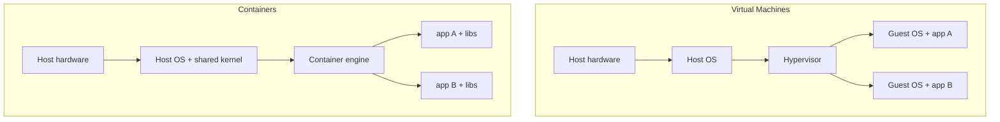
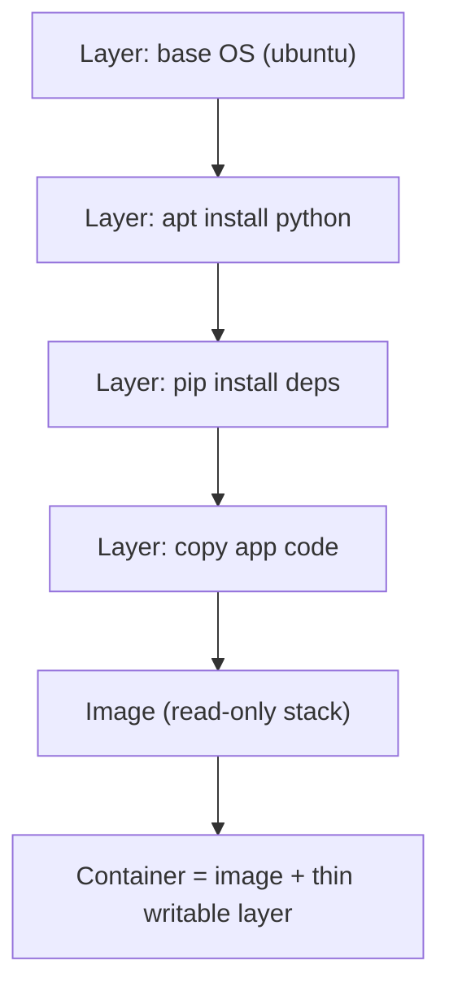
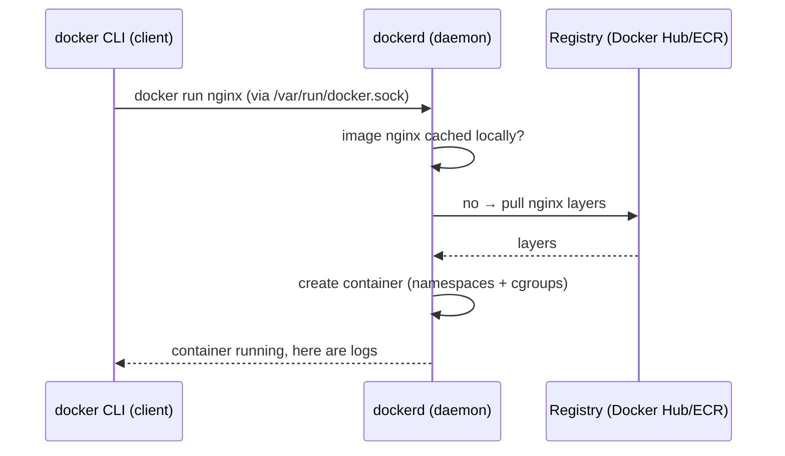
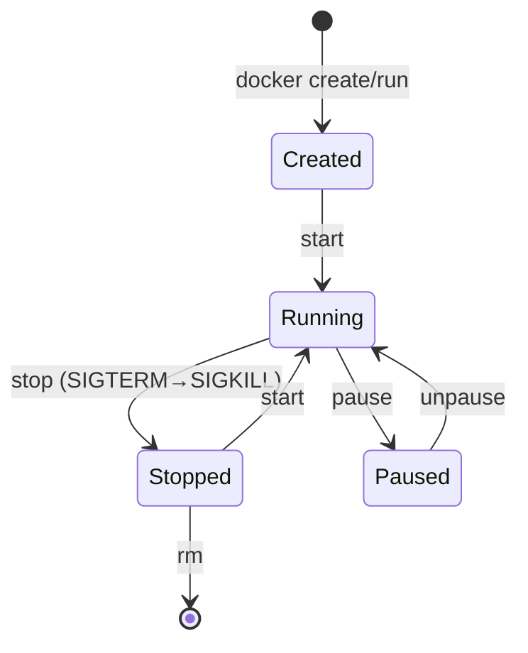
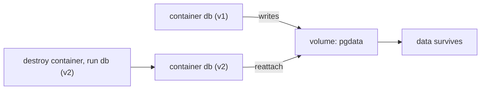
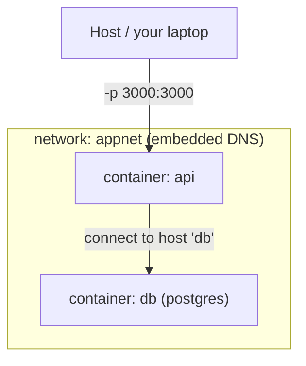

# Day 6 — Docker Fundamentals

> Series: Cloud & DevOps Engineering
> Goal: Kill "works on my machine" forever. Understand what a container really is, how it differs from a VM, the image→container relationship, Docker's architecture, and the core command set — then run a real app + database in connected containers.

> Verify versions when you build: this targets Docker Engine 27+ / Docker Desktop (2026). On Linux, `docker` is the CLI over the Engine daemon. Alternatives exist (Podman, containerd/nerdctl) with near-identical commands. Cloud equivalents show up later: ECS/EKS (AWS), GKE/Cloud Run (GCP), ACI/AKS (Azure).

> Cross-reference: the process/namespace concepts from **Linux Day 1** — a container is a Linux process in disguise.

---

## Table of Contents
1. [The "works on my machine" problem](#1-the-works-on-my-machine-problem)
2. [Containers vs VMs](#2-containers-vs-vms)
3. [Images vs containers](#3-images-vs-containers)
4. [Docker architecture: daemon, registry, client](#4-docker-architecture-daemon-registry-client)
5. [Core commands](#5-core-commands-run-ps-exec-logs-stop-rm-pull)
6. [Volumes: persisting data](#6-volumes-persisting-data)
7. [Networking & ports](#7-networking--ports)
8. [Lab: DB + app in connected containers](#8-lab-db--app-in-connected-containers)
9. [Self-Check](#9-self-check)
10. [Tomorrow](#10-tomorrow)

---

## 1. The "works on my machine" problem

**In plain words:** Software depends on its environment — a specific runtime version, libraries, OS packages, env vars. When those differ between your laptop, a teammate's, CI, and prod, the same code behaves differently. A container packages the app *with* its whole environment into one shippable box, so "works on my machine" becomes "works everywhere, identically."

- **Why:** Environment drift is a top cause of "it passed CI but broke in prod."
- **What:** Containers bundle app + dependencies + config into a portable, isolated unit.
- **When:** Any time you deploy, test, or share software.
- **How:** Build an image (Day 7), run it as a container anywhere.
- **Where:** Laptops, CI, every cloud.

> 🤔 **"I use virtualenv / nvm / a requirements.txt — isn't that enough for reproducibility?"** Those pin *language-level* dependencies but not the layer below: the OS, system libraries (`libssl`, `glibc`), locale, the exact interpreter build, and OS packages your code shells out to. Containers pin *all* of it — the whole userland — so the artifact CI tested is byte-for-byte what runs in prod. That "one artifact, everywhere" guarantee is why containers won.

**✅ Good scenario (where it saves you):** A dev on macOS/ARM, CI on Linux/x86, and prod on Linux — all run the exact same image. A native-library bug that would only appear in prod is caught in dev because the environments are identical.

**❌ Bad scenario (the pain without it):** App works locally, fails in prod because prod has OpenSSL 1.1 and the dev box has 3.0. A day lost to an environment mismatch a container would have eliminated.

**When NOT to:** Don't containerize a trivial static script that has zero dependencies just for fashion — but for anything with a runtime + deps, containers are the default in 2026.

---

## 2. Containers vs VMs

**In plain words:** A VM virtualizes *hardware* — it runs a whole second operating system (its own kernel) on top of yours. A container virtualizes the *OS* — many containers share the host's single Linux kernel but each gets an isolated slice (its own filesystem, processes, network). VMs are houses with their own foundations; containers are apartments sharing one building's foundation.

- **Why:** The difference explains why containers boot in milliseconds and VMs in minutes.
- **What:** Kernel-sharing isolation (namespaces + cgroups) vs full hardware virtualization.
- **When:** Choosing your unit of deployment.
- **How:** Docker uses Linux **namespaces** (isolation: PID, network, mount, user) + **cgroups** (limits: CPU, memory).
- **Where:** Everywhere; often *both* (containers running on VMs in the cloud).


*VMs each carry a full guest OS; containers share the host kernel and carry only the app + its libs.*

| | Virtual Machine | Container |
|---|-----------------|-----------|
| Isolation unit | Full OS (own kernel) | Process (shared kernel) |
| Startup time | Seconds–minutes | Milliseconds |
| Size | GBs (whole OS) | MBs (app + libs) |
| Density per host | Tens | Hundreds–thousands |
| Isolation strength | Stronger (hardware boundary) | Weaker (kernel shared) |
| Overhead | High | Near-native |
| Boots its own kernel | Yes | No (shares host's) |

> 🤔 **"If containers share the host kernel, are they secure enough for multi-tenant workloads?"** Containers give *good* isolation for trusting your own workloads, but the shared kernel is a bigger attack surface than a VM's hardware boundary — a kernel exploit can potentially cross containers. That's why for hostile multi-tenancy (running untrusted customer code), platforms add a VM boundary underneath: gVisor, Kata Containers, Firecracker microVMs (what AWS Lambda/Fargate use). For your own services, plain containers are the norm. Match isolation to threat model.

**✅ Good scenario:** You pack 200 microservice containers onto a handful of VMs at near-native speed — density and startup speed a VM-per-service model could never match. Autoscaling responds in seconds.

**❌ Bad scenario (when misused):** Running mutually-untrusted customer code in plain containers on a shared host — a kernel escape could breach tenants. Needs a microVM boundary.

**When NOT to:** Don't use containers where you need a *different kernel* than the host (e.g., a true Windows kernel on Linux — that requires a VM). Don't assume container isolation equals VM isolation for security.

**Dark Side:** "It's isolated" lulls people into skipping security. Containers running as root, with the host Docker socket mounted, are a well-known escape path. Isolation is real but not absolute.

---

## 3. Images vs containers

**In plain words:** An image is the *recipe/blueprint* — a read-only, layered template of a filesystem + metadata. A container is a *running instance* of that image — the cake baked from the recipe, with a thin writable layer on top. One image → many identical containers.

- **Why:** Confusing the two is the #1 beginner stumble.
- **What:** Image = immutable template; container = a live, writable instance.
- **When:** Every build/run.
- **How:** `docker build` makes images (Day 7); `docker run` turns an image into a container.
- **Where:** Local cache, registries, running hosts.

Images are **layered** — each build step is a cached, shareable layer:

*An image is a stack of read-only layers; a container adds one writable layer on top.*

| | Image | Container |
|---|-------|-----------|
| State | Read-only, immutable | Running/stopped, has writable layer |
| Analogy | Class / recipe / .exe | Object / cake / running process |
| Created by | `docker build` / `docker pull` | `docker run` |
| Count | One | Many from the same image |
| Lifespan | Persists in registry | Ephemeral by design |

```bash
docker images                 # list local IMAGES
docker ps                     # list running CONTAINERS
docker ps -a                  # all containers (incl. stopped)
docker run nginx              # image "nginx" -> a new running container
docker run nginx              # run again -> a SECOND container, same image
```

> 🤔 **"I changed a file inside a running container — why is it gone when I restart?"** Because containers are *ephemeral* and their writable layer is thrown away when the container is removed. Anything you `docker exec` and edit lives only in that one container's throwaway layer. Persistent changes belong in the *image* (rebuild via Dockerfile, Day 7) or in a *volume* (§6). Treating containers as cattle, not pets, is the whole mindset: never hand-edit a running container in prod.

**✅ Good scenario:** One tested image `myapp:v2.3.0` runs as 12 identical containers behind a load balancer. Kill any one; another identical instance replaces it instantly.

**❌ Bad scenario (when misused):** Someone `docker exec`s into a prod container and hand-installs a hotfix. Next deploy replaces the container and the fix vanishes — a "snowflake" that can't be reproduced.

**When NOT to:** Don't store important data in a container's writable layer (use volumes). Don't treat a container as a long-lived server you SSH into and tweak.

**Dark Side:** The writable layer grows with logs/temp files; a container writing gigs to its own layer can exhaust disk. Write data to volumes, logs to stdout.

---

## 4. Docker architecture: daemon, registry, client

**In plain words:** When you type `docker run`, the CLI (client) doesn't do the work — it sends a request to a background service, the **daemon** (`dockerd`), which builds/runs containers and pulls images from a **registry** (like Docker Hub). Client talks, daemon does, registry stores.

- **Why:** Understanding the pieces explains permissions, remote Docker, and where images come from.
- **What:** CLI ↔ daemon (via socket/API) ↔ registry.
- **When:** Every command.
- **How:** Below.
- **Where:** Local host; daemon can even be remote.


*The CLI is a thin client; the daemon does the real work and fetches images from registries.*

| Piece | Role |
|-------|------|
| **Client (`docker`)** | The CLI you type; sends API calls |
| **Daemon (`dockerd`)** | Builds images, runs containers, manages networks/volumes |
| **Registry** | Stores/distributes images (Docker Hub, ECR, GCR/Artifact Registry, ACR) |
| **Image** | The pulled/built template |
| **Container** | The running instance |

```bash
docker version               # client AND daemon (server) versions
docker info                  # daemon status, storage driver, # containers/images
docker login                 # authenticate to a registry before push/pull private
```

> 🤔 **"Why does `docker` need `sudo` on Linux, and is adding my user to the `docker` group safe?"** Because the CLI talks to the daemon over `/var/run/docker.sock`, owned by root. Adding yourself to the `docker` group removes the `sudo` — but understand the tradeoff: the docker group is **root-equivalent**. Anyone in it can `docker run -v /:/host` and read/modify the entire host filesystem as root. On a personal dev box that's fine; on a shared/prod host, treat docker-group membership as handing out root. This is also why mounting the docker socket into a container is dangerous.

**✅ Good scenario:** CI builds an image, pushes to your private registry (ECR), and every environment pulls that exact same immutable artifact by digest. One build, promoted through stages.

**❌ Bad scenario (when misused):** A CI job mounts the host `docker.sock` into an untrusted container to "build inside build." A compromised build now has root on the CI host. Prefer rootless/isolated builders (BuildKit, Kaniko).

**When NOT to:** Don't expose the Docker daemon TCP socket to the network without TLS + auth (instant remote root). Don't run the daemon on a box you also treat as low-trust.

---

## 5. Core commands (run, ps, exec, logs, stop, rm, pull)

**In plain words:** The daily driver command set — pull an image, run it, look at what's running, peek inside, read its logs, stop and clean up.

```bash
# PULL — fetch an image from a registry
docker pull redis:7-alpine       # specific tag (ALWAYS pin, avoid bare "latest")

# RUN — create + start a container from an image
docker run redis:7-alpine                       # foreground (attached)
docker run -d redis:7-alpine                     # -d detached (background)
docker run -d --name cache redis:7-alpine        # --name for a friendly handle
docker run -d -p 6379:6379 redis:7-alpine        # -p HOST:CONTAINER publish a port
docker run --rm alpine echo hi                    # --rm auto-delete when it exits
docker run -it ubuntu bash                        # -it interactive terminal (a shell)
docker run -e NODE_ENV=production myapp           # -e set env var
docker run --memory=512m --cpus=1 myapp           # cgroup resource LIMITS

# PS — what's running?
docker ps                        # running containers
docker ps -a                     # include stopped ones
docker ps --format '{{.Names}}\t{{.Status}}'      # custom columns

# EXEC — run a command INSIDE a running container (debugging)
docker exec -it cache redis-cli    # open redis-cli inside the "cache" container
docker exec -it cache sh           # get a shell to poke around

# LOGS — read stdout/stderr (containers log to stdout by convention!)
docker logs cache                # dump logs
docker logs -f cache             # follow live (like tail -f, Day 3)
docker logs --tail 100 cache     # last 100 lines

# STOP / START / RESTART — lifecycle (SIGTERM then SIGKILL, Day 1 signals!)
docker stop cache                # graceful stop (SIGTERM, then SIGKILL after grace)
docker start cache
docker restart cache
docker kill cache                # immediate SIGKILL

# CLEAN UP — reclaim resources
docker rm cache                  # remove a STOPPED container
docker rm -f cache               # force-remove a running one
docker rmi redis:7-alpine        # remove an image
docker system prune              # remove stopped containers, unused nets/images (careful)
docker system df                 # how much disk is Docker using?
```

Lifecycle at a glance:

*A container moves through created → running → stopped, and is gone only after `rm`.*

> 🤔 **"Where do container logs go — there's no /var/log inside?"** By design, a containerized app logs to **stdout/stderr**, not a file. The Docker daemon captures those streams; `docker logs` reads them, and in production a log driver ships them to CloudWatch/Loki/ELK. This is the 12-factor rule: treat logs as event *streams*, not files the app manages. If your app writes to a logfile inside the container, that file dies with the container and nothing collects it — send logs to stdout instead.

**✅ Good scenario:** A container misbehaves; `docker logs -f` + `docker exec -it sh` let you diagnose live without SSH, then you fix the image and redeploy. Clean loop.

**❌ Bad scenario (when misused):** Running everything without `--name` and without cleanup; `docker ps -a` shows 300 dead containers eating disk, and nobody knows which is which.

**When NOT to:** Don't run untagged `latest` in production (unreproducible). Don't `docker exec` fixes into prod containers as a workflow — fix the image.

**Dark Side:** `docker system prune -a` is a footgun — the `-a` also deletes images not attached to a running container, which can wipe images you needed. Read the prompt before confirming.

---

## 6. Volumes: persisting data

**In plain words:** Containers are disposable, but some data (a database's files) must outlive them. A **volume** is durable storage managed by Docker that you attach to a container — the data lives independently, so you can destroy and recreate the container without losing it.

- **Why:** Databases, uploads, and caches need persistence across container restarts/replacements.
- **What:** Named volumes (Docker-managed) and bind mounts (host path).
- **When:** Any stateful container.
- **How:** `-v` / `--mount`.
- **Where:** DB containers, dev source-mounting.

```bash
# Named volume (Docker-managed, the production choice for data)
docker volume create pgdata
docker run -d --name db -v pgdata:/var/lib/postgresql/data postgres:16
#   ^ Postgres writes its data into the volume; the container is now disposable

# Bind mount (a specific HOST path → container) — great for DEV live-reload
docker run -d -p 8080:80 -v "$(pwd)/site":/usr/share/nginx/html:ro nginx
#   ^ edits to ./site appear instantly in the container; :ro = read-only

# tmpfs (in-memory, never touches disk) — secrets/scratch
docker run --tmpfs /tmp myapp

docker volume ls                 # list volumes
docker volume inspect pgdata     # where/what it is
docker volume rm pgdata          # delete (data GONE — irreversible)
```

| | Named volume | Bind mount |
|---|--------------|------------|
| Managed by | Docker (`/var/lib/docker/volumes`) | You (any host path) |
| Portability | High (host-agnostic) | Tied to host layout |
| Best for | **Production data (DBs)** | **Dev: live code mounting** |
| Backup story | `docker volume` tooling | Plain filesystem |


*The volume outlives the container — the key to stateful workloads.*

> 🤔 **"Volume vs bind mount — which do I use?"** Rule of thumb: **named volumes for data you must keep** (databases, uploads) because Docker manages them portably and they don't depend on host paths; **bind mounts for development** when you want your live source code on the host to appear inside the container for instant reload. In production, prefer named volumes (or cloud-managed storage like EBS/persistent disks); avoid bind-mounting host paths you don't control.

**✅ Good scenario:** You upgrade Postgres by destroying the old container and starting a new `postgres:16` container pointed at the same `pgdata` volume — zero data loss, clean version bump.

**❌ Bad scenario (the pain without it):** A DB runs with no volume; the container is removed during a redeploy and *all data is gone*. This is the classic "I lost my database" Docker horror story.

**When NOT to:** Don't store production data only in the container's writable layer. Don't bind-mount broad host paths (`/`, `/var/run/docker.sock`) into containers — security hole.

**Dark Side:** `docker volume rm` and `docker system prune --volumes` delete data permanently with a one-line confirm. Back up stateful volumes; never prune volumes on a whim.

---

## 7. Networking & ports

**In plain words:** By default each container gets its own private network address, invisible to the outside. To reach a container from your laptop you **publish a port** (`-p`). To let containers talk to *each other*, you put them on the same **user-defined network**, where Docker's built-in DNS lets them find each other by container name.

- **Why:** Multi-container apps (app + DB + cache) must communicate; you must expose the front door.
- **What:** Bridge networks, port publishing, container-name DNS.
- **When:** Any multi-container setup or externally-reached service.
- **How:** Below.
- **Where:** Local dev, Compose (Day 8), and conceptually in Kubernetes.

```bash
# Publish a port to reach a container from the host (Day 3: HOST:CONTAINER)
docker run -d -p 8080:80 nginx        # localhost:8080 → container's port 80
docker run -d -p 127.0.0.1:8080:80 nginx   # bind only to localhost (safer)

# Create a user-defined network so containers can resolve each other by NAME
docker network create appnet
docker run -d --name db  --network appnet postgres:16
docker run -d --name api --network appnet -p 3000:3000 myapi
#   inside "api", the DB host is literally "db" — Docker's embedded DNS resolves it
#   api connects to: postgres://db:5432/...   (NOT localhost, NOT an IP)

docker network ls                # list networks
docker network inspect appnet    # see connected containers + IPs
```


*Publish a port for outside access; a shared user-defined network lets containers resolve each other by name.*

The `localhost` trap:

| Inside container, to reach… | Use | NOT |
|-----------------------------|-----|-----|
| Another container on same net | its **container name** (`db`) | `localhost` |
| The host machine | `host.docker.internal` (Docker Desktop) | `localhost` |
| The internet | normal DNS | — |

> 🤔 **"My API connects to `localhost:5432` for the DB and it works locally but not in Docker — why?"** Because inside a container, `localhost` means *that container itself*, not the host or the DB container. The DB is a *separate* container with its own network identity. On a shared user-defined network, connect to the DB by its **container name** (`db:5432`), which Docker's DNS resolves. This single misconception breaks nearly every first multi-container project. (Note: the *default* bridge network has no name-DNS — you must create a user-defined network, which Compose does for you automatically in Day 8.)

**✅ Good scenario:** `api` reaches `db` by name over `appnet`; you swap the DB container for a new version and `api` reconnects with no config change because it uses the name, not an IP.

**❌ Bad scenario (when misused):** Hardcoding a container's IP address (`172.17.0.3`) — IPs change every restart, so the link breaks on the next deploy. Use names.

**When NOT to:** Don't publish database ports (`-p 5432:5432`) to `0.0.0.0` on a server — that exposes your DB to the network (Day 3). Keep inter-container traffic on the internal network; only publish the public front door.

**Dark Side:** `-p 5432:5432` on a cloud VM with a public IP and no firewall = your database on the open internet. Publish only what must be public, bind to `127.0.0.1` for local-only, and use security groups.

---

## 8. Lab: DB + app in connected containers

**Goal:** Run a Postgres database and a small app container on a shared network, with the app reaching the DB *by name* and the DB persisting to a volume. This is the mental model for everything in Day 8.

```bash
# 1) Create an isolated network + a persistent volume
docker network create appnet
docker volume create pgdata

# 2) Run Postgres on the network, data in the volume (NOT published to the world)
docker run -d --name db \
  --network appnet \
  -v pgdata:/var/lib/postgresql/data \
  -e POSTGRES_PASSWORD=secret \
  -e POSTGRES_DB=shop \
  postgres:16

docker ps                                  # db should be "Up"
docker logs db | tail -5                    # expect "database system is ready"

# 3) Prove name-based networking: run a client container that reaches "db"
docker run --rm --network appnet \
  -e PGPASSWORD=secret \
  postgres:16 \
  psql -h db -U postgres -d shop -c "SELECT version();"
#   ^ -h db resolves via Docker DNS. Expect PostgreSQL version output.

# 4) Run a tiny app that talks to the DB by name (using a throwaway python image)
docker run --rm --network appnet -e PGPASSWORD=secret python:3.12-slim sh -c '
  pip install -q psycopg2-binary >/dev/null 2>&1;
  python - <<PY
import psycopg2
c = psycopg2.connect(host="db", dbname="shop", user="postgres", password="secret")
cur = c.cursor()
cur.execute("CREATE TABLE IF NOT EXISTS items(id serial, name text);")
cur.execute("INSERT INTO items(name) VALUES (%s) RETURNING id;", ("widget",))
print("inserted id:", cur.fetchone()[0])
c.commit()
PY
'
#   ^ app connects to host "db", writes a row. Expect "inserted id: 1".

# 5) PROVE the volume persists data across container destruction
docker rm -f db                            # destroy the DB container entirely
docker run -d --name db --network appnet \
  -v pgdata:/var/lib/postgresql/data \
  -e POSTGRES_PASSWORD=secret postgres:16  # recreate, SAME volume
sleep 5
docker run --rm --network appnet -e PGPASSWORD=secret postgres:16 \
  psql -h db -U postgres -d shop -c "SELECT count(*) FROM items;"
#   ^ expect count = 1 — the row SURVIVED the container being destroyed. Volumes work!

# 6) Clean up
docker rm -f db
docker volume rm pgdata
docker network rm appnet
```

**Prove the misconceptions to yourself:**
- Try connecting the app with `host="localhost"` instead of `host="db"` — watch it fail (localhost = the app's own container).
- Run the DB *without* the volume, insert data, `docker rm -f db`, recreate — the data is gone.

**Stretch goals:**
- Publish the DB with `-p 5432:5432` and connect from your host's `psql` — then reflect on why you'd *never* do that on a public server.
- Add resource limits (`--memory=256m`) to the DB and watch `docker stats`.
- Give the DB a healthcheck via `docker run --health-cmd` and see `docker ps` show "healthy."
- Everything you did with raw `docker` commands here — Day 8 collapses into one `docker-compose.yml`.

---

## 9. Self-Check

1. In one sentence each: how do a VM and a container differ in what they virtualize?
2. Why do containers start in milliseconds while VMs take seconds to minutes?
3. Explain image vs container using the class/object (or recipe/cake) analogy.
4. You edited a file via `docker exec`; it's gone after recreating the container. Why, and where should persistent changes live?
5. When you type `docker run`, which component actually does the work, and where does the image come from?
6. Why is adding your user to the `docker` group effectively granting root?
7. Your app uses `localhost:5432` to reach the DB and it fails in Docker. What's wrong and what's the fix?
8. Named volume vs bind mount — which for a production database, which for dev live-reload?
9. Where should a containerized app send its logs, and why not a file inside the container?
10. Why is `-p 5432:5432` on a public cloud VM dangerous, and what's the safer pattern?

---

## 10. Tomorrow

**Tomorrow — Day 7: Building Images (Dockerfile).** We stop *pulling* images and start *building* them: the instruction set (FROM/RUN/COPY/CMD/ENTRYPOINT), CMD vs ENTRYPOINT, layer caching and ordering, shrinking images, multi-stage builds, slim/distroless bases, .dockerignore, non-root security — then build and push a lean production image.
