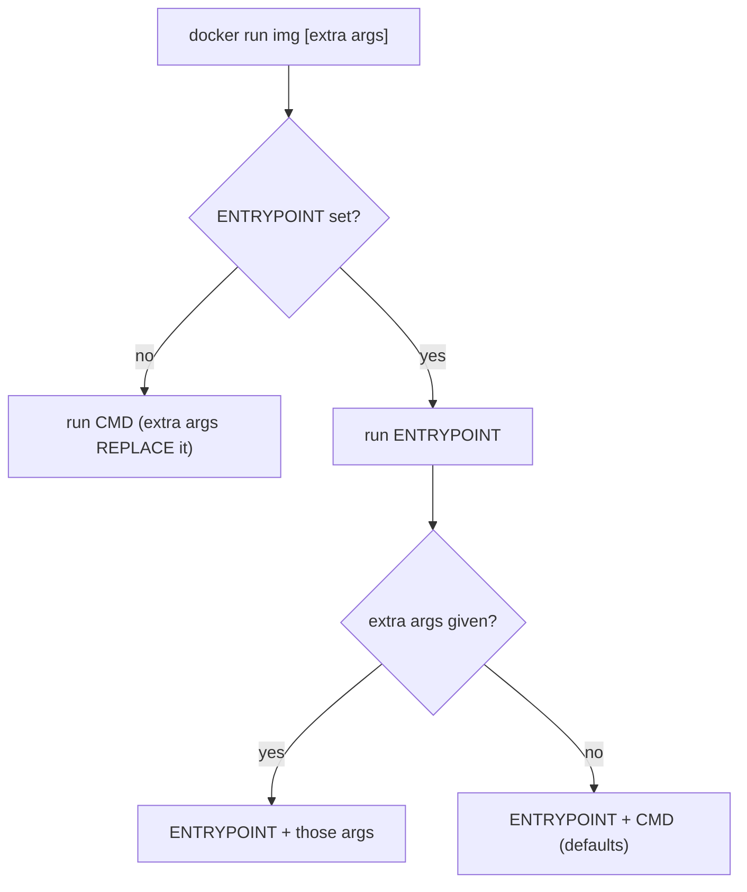
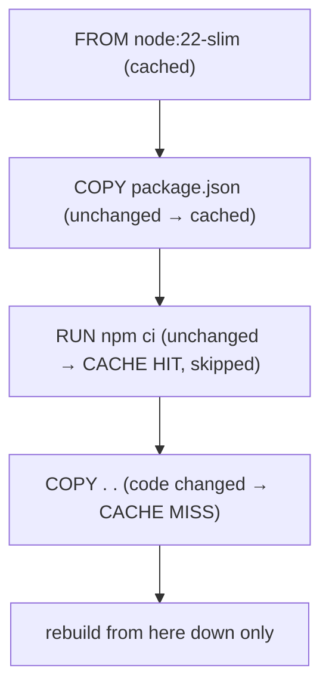
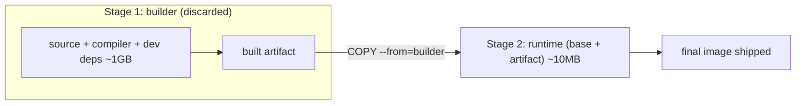
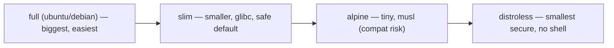
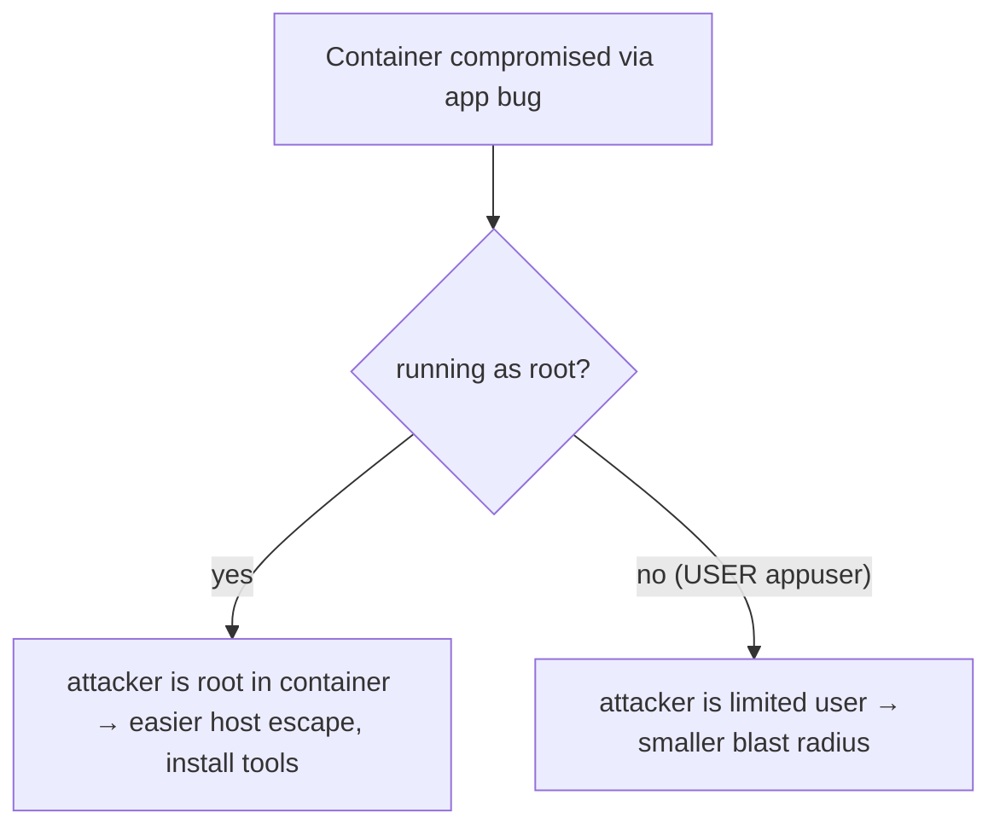

# Day 7 — Building Images (Dockerfile)

> Series: Cloud & DevOps Engineering
> Goal: Author production-grade Dockerfiles — understand every core instruction, master CMD vs ENTRYPOINT, exploit layer caching, shrink images with multi-stage builds and slim/distroless bases, and ship securely as a non-root user to a registry.

> Verify versions when you build: this targets Docker with BuildKit (default in Engine 23+, 2026) — you get better caching and `--mount` features. Pin base image tags and check for current LTS bases (e.g., `node:22-slim`, `python:3.12-slim`) when you build. Registry equivalents: Docker Hub, AWS ECR, GCP Artifact Registry, Azure ACR, GitHub GHCR.

> Cross-reference: image *layers* and images-vs-containers from **Docker Day 6**.

---

## Table of Contents
1. [Why writing Dockerfiles is the real skill](#1-why-writing-dockerfiles-is-the-real-skill)
2. [The instruction set](#2-the-instruction-set)
3. [CMD vs ENTRYPOINT](#3-cmd-vs-entrypoint)
4. [Layer caching & instruction order](#4-layer-caching--instruction-order)
5. [Image size & multi-stage builds](#5-image-size--multi-stage-builds)
6. [Slim, alpine, distroless](#6-slim-alpine-distroless)
7. [.dockerignore](#7-dockerignore)
8. [Security basics: non-root & more](#8-security-basics-non-root--more)
9. [Tags & registries (push)](#9-tags--registries-push)
10. [Lab: multi-stage Dockerfile + push](#10-lab-multi-stage-dockerfile--push)
11. [Self-Check](#11-self-check)
12. [Tomorrow](#12-tomorrow)

---

## 1. Why writing Dockerfiles is the real skill

**In plain words:** Pulling other people's images is easy; the value is in *authoring* your app's image well. A Dockerfile is a repeatable recipe that turns your source into a shippable artifact. Written carelessly it's a 1.5 GB, insecure, slow-to-build mess; written well it's a 60 MB, non-root, cache-friendly image CI builds in seconds.

- **Why:** The Dockerfile is where build speed, image size, security, and reproducibility are won or lost.
- **What:** A text file of instructions `docker build` executes top-to-bottom into image layers.
- **When:** Every service you ship.
- **How:** `docker build -t name:tag .`
- **Where:** Your repo root, run in CI.

> 🤔 **"Can't I just start a container, install stuff by hand, and `docker commit` it into an image?"** You *can*, and you should never do it for real work. A `docker commit`ed image is a black box — nobody knows what's inside, it can't be rebuilt or reviewed, and it's the container equivalent of a snowflake server (Day 1). A Dockerfile is *code*: version-controlled, reviewable in a PR (Day 5), reproducible, and diff-able. If it's not in the Dockerfile, it doesn't exist.

**✅ Good scenario (where it saves you):** A well-ordered Dockerfile rebuilds in 8 seconds on a code change (deps cached) and produces a 70 MB image. CI is fast and cheap; deploys are quick.

**❌ Bad scenario (the pain without it):** A naive Dockerfile reinstalls all dependencies on every one-line change (3-minute builds) and ships a 1.4 GB image with a full compiler toolchain and secrets baked in.

**When NOT to:** Don't hand-write a Dockerfile for a language with a great buildpack/CNB or a framework tool that generates a better one — but understand what it produces.

---

## 2. The instruction set

**In plain words:** A handful of verbs describe how to build the image: pick a base, set a working directory, copy files in, run build steps, set env/ports, and declare the start command.

```dockerfile
# syntax=docker/dockerfile:1
FROM node:22-slim                 # BASE image every build starts from (pin the tag!)

WORKDIR /app                      # set + create the working dir (cd for later steps)

ENV NODE_ENV=production           # build+runtime env var (baked into the image)

COPY package*.json ./             # COPY host files → image (order matters, §4)
RUN npm ci --omit=dev             # RUN a build-time command → creates a layer

COPY . .                          # copy the rest of the source

EXPOSE 3000                       # DOCUMENTS the port (does NOT publish it — -p does)

USER node                         # drop from root to a non-privileged user (§8)

CMD ["node", "server.js"]         # default command when a container starts (§3)
```

| Instruction | Does | Gotcha |
|-------------|------|--------|
| `FROM` | Sets the base image | Pin a tag/digest; `latest` drifts |
| `WORKDIR` | Sets/creates cwd for later steps | Use it instead of `RUN cd` (cd doesn't persist) |
| `COPY` | Copies files from build context | Order for cache (§4); prefer over `ADD` |
| `ADD` | Like COPY + URL/tar-extract | Avoid unless you need auto-extract |
| `RUN` | Executes a command at build time | Each `RUN` = a layer; chain to reduce them |
| `ENV` | Sets env vars (build + runtime) | Bakes into image — **never secrets** |
| `ARG` | Build-time-only variable | Not present at runtime |
| `EXPOSE` | Documents a port | Does NOT open it; `-p` (Day 6) does |
| `USER` | Sets the user for later steps + runtime | Default is root — change it (§8) |
| `CMD` | Default command/args | Overridable at `docker run` |
| `ENTRYPOINT` | The executable itself | See §3 |
| `HEALTHCHECK` | Container health probe | Used by orchestrators |
| `LABEL` | Metadata (maintainer, version) | Useful for tooling |

> 🤔 **"`COPY` vs `ADD` — they look identical, which do I use?"** Use `COPY` for everything by default. `ADD` has two extra "magic" behaviors — it can fetch a URL and it auto-extracts local tar archives — which are surprising and occasionally a security footgun (auto-extracting untrusted tars). The Docker best-practice guidance is explicit: prefer `COPY` unless you specifically need `ADD`'s tar auto-extraction. Explicit beats magic.

> 🤔 **"Why did `RUN cd /app && ...` not affect my next instruction?"** Each `RUN` runs in its own shell; a `cd` inside one `RUN` doesn't carry to the next instruction. Use `WORKDIR /app` — it persists the directory for *all* subsequent instructions (and it's created if missing).

**✅ Good scenario:** `EXPOSE 3000` + a `LABEL org.opencontainers.image.version` make the image self-documenting; tooling and teammates instantly know the port and version.

**❌ Bad scenario (when misused):** `ENV DB_PASSWORD=secret` in the Dockerfile — the secret is now permanently baked into an image layer, readable by anyone who pulls it. Secrets go in runtime env/secret managers, never in the image.

**When NOT to:** Don't use `ADD` for plain local files. Don't rely on `EXPOSE` to actually publish a port. Don't bake secrets with `ENV`/`ARG`.

**Dark Side:** `ARG` values and build history are visible in `docker history` and image metadata — passing a secret via `--build-arg` still leaks it. Use BuildKit `--mount=type=secret` for build-time secrets.

---

## 3. CMD vs ENTRYPOINT

**In plain words:** Both define what runs when the container starts, but they play different roles. **ENTRYPOINT** is the fixed executable ("this container *is* a nginx"). **CMD** provides default arguments that are *easy to override* at `docker run`. Think of ENTRYPOINT as the command and CMD as its default arguments.

- **Why:** Getting this wrong means your container ignores your start command or can't be run flexibly.
- **What:** ENTRYPOINT = the program; CMD = default args (or the whole command if no ENTRYPOINT).
- **When:** Every image's final instruction.
- **How:** Use *exec form* (`["exe","arg"]`), not shell form.
- **Where:** Bottom of the Dockerfile.

```dockerfile
# Pattern A — CMD only (simple, fully overridable)
CMD ["node", "server.js"]
#   docker run img              → node server.js
#   docker run img npm test     → npm test  (CMD entirely replaced)

# Pattern B — ENTRYPOINT + CMD (fixed program, default args)
ENTRYPOINT ["python", "app.py"]
CMD ["--port", "8000"]
#   docker run img              → python app.py --port 8000
#   docker run img --port 9000  → python app.py --port 9000  (CMD replaced, ENTRYPOINT stays)
```

Exec form vs shell form — a real trap:
```dockerfile
CMD ["node", "server.js"]     # EXEC form: PID 1 is node → receives SIGTERM correctly
CMD node server.js            # SHELL form: runs "/bin/sh -c node server.js"
#   ^ now sh is PID 1; SIGTERM goes to sh, NOT node → graceful shutdown breaks
```

| | CMD | ENTRYPOINT |
|---|-----|------------|
| Role | Default command *or* default args | The fixed executable |
| Overridden by `docker run args`? | Yes, fully replaced | No (args append to it) |
| Common use | Simple single-command images | "Container as a binary" + flags |
| Together | Provides ENTRYPOINT's default args | Runs, with CMD as defaults |


*ENTRYPOINT is fixed; CMD is the easily-overridden default.*

> 🤔 **"My container ignores SIGTERM and takes 10 seconds to stop — why?"** Almost always the *shell form* of CMD/ENTRYPOINT. `CMD node server.js` makes `/bin/sh` PID 1, and `sh` doesn't forward SIGTERM to your app — so `docker stop` waits the full grace period then SIGKILLs it (Day 1 signals; matters hugely in Kubernetes where slow shutdown = dropped requests). Fix: use **exec form** `CMD ["node","server.js"]` so your app is PID 1 and gets the signal directly. For apps that spawn children, add a lightweight init like `tini` to reap zombies.

**✅ Good scenario:** ENTRYPOINT wraps your app with an entrypoint script that runs DB migrations then `exec`s the app as PID 1 — clean startup, correct signal handling, graceful shutdown.

**❌ Bad scenario (when misused):** Shell-form CMD means rolling deploys drop in-flight requests because the app never receives SIGTERM to drain gracefully.

**When NOT to:** Don't use shell form when you need signal handling. Don't set ENTRYPOINT to something users can't override when they legitimately need to (e.g., to run a one-off `bash` for debugging — keep a way in).

---

## 4. Layer caching & instruction order

**In plain words:** Docker builds images as a stack of cached layers, one per instruction. On a rebuild it reuses every layer up to the *first* thing that changed, then rebuilds the rest. So the *order* of instructions decides your build speed: put rarely-changing steps (installing dependencies) *before* frequently-changing steps (copying source code).

- **Why:** Correct ordering turns 3-minute rebuilds into 8-second ones.
- **What:** Each instruction → a cache layer; a change invalidates that layer and everything after.
- **When:** Every Dockerfile.
- **How:** Copy dependency manifests and install *before* copying app code.
- **Where:** The middle of your Dockerfile.

```dockerfile
# ❌ BAD ORDER — any code change busts the dependency cache
FROM node:22-slim
WORKDIR /app
COPY . .                   # copies code AND package.json together
RUN npm ci                 # re-runs on EVERY code change (slow!)

# ✅ GOOD ORDER — deps cached until package.json changes
FROM node:22-slim
WORKDIR /app
COPY package*.json ./      # only manifests first
RUN npm ci                 # cached unless package.json changes
COPY . .                   # code changes only invalidate from HERE down
CMD ["node", "server.js"]
```


*The cache is reused up to the first changed instruction — so order dependencies before source.*

Also minimize layer count and clean up *within* the same `RUN`:
```dockerfile
# ❌ leaves apt cache in the image (bloat) and makes many layers
RUN apt-get update
RUN apt-get install -y curl
# ✅ one layer, cache cleaned in the SAME layer so it doesn't persist
RUN apt-get update \
 && apt-get install -y --no-install-recommends curl \
 && rm -rf /var/lib/apt/lists/*
```

> 🤔 **"Why does cleaning up in a *separate* RUN not shrink the image?"** Because layers are immutable and additive. If `RUN apt-get install...` adds 80 MB in one layer and a later `RUN rm -rf ...` deletes it in the *next* layer, the 80 MB still exists in the earlier layer — the final image carries both. You must add-and-clean *within the same `RUN`* (`&& rm -rf`) so the bloat never becomes a committed layer. This is the #1 reason "I deleted the files but the image is still huge."

**✅ Good scenario:** A one-line source change rebuilds only the final `COPY . .` layer — 8 seconds in CI, because the dependency layer was a cache hit.

**❌ Bad scenario (the pain without it):** `COPY . .` sits above `RUN npm ci`, so every code push reinstalls hundreds of packages from scratch. CI is 3× slower and burns build minutes/money.

**When NOT to:** Don't over-split into dozens of tiny `RUN`s (each is a layer). Don't chase caching so hard you make the Dockerfile unreadable — balance.

**Dark Side:** Cache can serve *stale* results — e.g., `RUN apt-get update` cached separately can install outdated packages. For reproducibility, pin versions and occasionally build with `--no-cache`.

---

## 5. Image size & multi-stage builds

**In plain words:** Your *build* environment (compilers, dev dependencies, source) is huge and unnecessary at *runtime*. A **multi-stage build** uses one throwaway stage to compile/build, then copies *only the finished artifact* into a tiny final stage — leaving all the build junk behind. Result: images shrink from gigabytes to megabytes.

- **Why:** Smaller images = faster pulls/deploys, less attack surface, lower cost.
- **What:** Multiple `FROM` stages; final image contains only what you `COPY --from`.
- **When:** Any compiled/bundled app (Go, Java, Node, frontend builds, Rust).
- **How:** Below.
- **Where:** Standard practice for production images.

```dockerfile
# --- Stage 1: BUILDER (has the full toolchain, thrown away) ---
FROM golang:1.23 AS builder
WORKDIR /src
COPY go.* ./
RUN go mod download
COPY . .
RUN CGO_ENABLED=0 go build -o /app/server ./cmd/server   # produces ONE binary

# --- Stage 2: RUNTIME (tiny; only the binary) ---
FROM gcr.io/distroless/static-debian12       # ~2 MB, no shell, no package manager
COPY --from=builder /app/server /server      # copy ONLY the artifact from stage 1
USER nonroot:nonroot
ENTRYPOINT ["/server"]
# Final image: a few MB instead of ~1 GB — no Go toolchain, no source.
```

Node example (build assets, ship only runtime):
```dockerfile
FROM node:22-slim AS build
WORKDIR /app
COPY package*.json ./
RUN npm ci
COPY . .
RUN npm run build          # produces ./dist

FROM node:22-slim AS runtime
WORKDIR /app
ENV NODE_ENV=production
COPY package*.json ./
RUN npm ci --omit=dev      # ONLY production deps
COPY --from=build /app/dist ./dist
USER node
CMD ["node", "dist/server.js"]
```


*Only the artifact crosses into the final stage — the heavy build environment is left behind.*

| Approach | Typical size | Contains |
|----------|--------------|----------|
| Single-stage naive | 800 MB – 1.5 GB | Compiler, dev deps, source, artifact |
| Multi-stage + slim | 80–200 MB | Runtime + artifact only |
| Multi-stage + distroless/static | 5–30 MB | Just the binary + minimal libc |

> 🤔 **"Does a smaller image actually matter, or is it just bragging rights?"** It's operationally real. Smaller images pull faster (critical when autoscaling spins up 50 nodes, or a Lambda cold-starts), cost less to store/transfer, and — most importantly — have a *smaller attack surface*: no shell, no package manager, no compiler means far fewer CVEs for scanners to flag and far less for an attacker to exploit if they get in. A distroless image with no shell can't be `exec`ed into to run arbitrary commands. Size is a security and speed feature, not vanity.

**✅ Good scenario:** A Go service ships as an 8 MB distroless image; it pulls in under a second during autoscaling and passes security scans with near-zero findings.

**❌ Bad scenario (when misused):** Single-stage build ships the entire JDK + Maven + source for a Java app — a 1.2 GB image, slow to pull, riddled with CVEs from packages the *runtime* never uses.

**When NOT to:** Don't force distroless if your app genuinely needs a shell or extra runtime tools (debugging, entrypoint scripts) — use `slim` then. Don't over-optimize a rarely-deployed internal tool.

---

## 6. Slim, alpine, distroless

**In plain words:** Your choice of *base image* is the biggest lever on size and compatibility. Full images are big and convenient; slim trims the fat; alpine is tiny but uses a different C library (musl) that can bite you; distroless is the smallest and most secure but has no shell to debug in.

| Base | Size | libc | Shell/pkg mgr | Best for | Watch out |
|------|------|------|---------------|----------|-----------|
| `debian`/`ubuntu` (full) | ~100+ MB | glibc | Yes | Max compatibility, dev | Big, more CVEs |
| `*-slim` | ~40–80 MB | glibc | Yes (minimal) | **Most production apps** | Sane default |
| `alpine` | ~5–15 MB | **musl** | Yes (`apk`) | Tiny images | musl breaks some binaries; DNS/timezone quirks |
| `distroless` | ~2–20 MB | glibc | **No shell** | Compiled/locked-down runtime | Hard to debug (no shell) |
| `scratch` | 0 MB | none | No | Fully static Go/Rust binaries | Nothing at all inside |

```dockerfile
FROM python:3.12-slim          # good default for Python: glibc, small, has apt
FROM node:22-alpine            # tiny, but test native modules (musl!) carefully
FROM gcr.io/distroless/python3 # locked down, no shell
```


*A spectrum from convenient-but-big to tiny-but-locked-down.*

> 🤔 **"Alpine is the smallest — why isn't it always the answer?"** Because Alpine swaps glibc for **musl** libc, and that difference is subtle but real: some Python wheels and native Node modules ship glibc-only binaries and must recompile (slow builds) or fail on musl; you can hit DNS resolution and timezone edge cases; and debugging musl issues eats hours. For many teams `*-slim` (glibc, still small) is the pragmatic sweet spot — nearly as small, none of the musl surprises. Reach for Alpine when you've tested your stack on it, and distroless when you want minimal + secure and don't need a shell.

**✅ Good scenario:** Switching from `python:3.12` to `python:3.12-slim` cuts an image from 1 GB to 150 MB with zero code changes and no compatibility surprises (still glibc).

**❌ Bad scenario (when misused):** A team moves to `alpine` for size, then spends two days debugging a native crypto library that only ships glibc wheels. The 40 MB they saved cost them two engineer-days.

**When NOT to:** Don't pick alpine for a Python/data-science stack heavy in native wheels. Don't pick distroless if your ops runbook depends on `exec`ing a shell into prod (unless you have a debug sidecar/ephemeral container strategy).

**Dark Side:** Tiny images make live debugging harder — no `curl`, no shell. Modern answer: Kubernetes *ephemeral debug containers* or a separate debug image, not fattening prod.

---

## 7. .dockerignore

**In plain words:** Just like `.gitignore`, a `.dockerignore` tells Docker which files *not* to send into the build. Without it, `COPY . .` can drag in `.git/`, `node_modules/`, secrets, and gigabytes of junk — bloating the image, slowing the build, and leaking sensitive files.

```dockerignore
.git
.gitignore
node_modules          # will be reinstalled fresh inside the image
dist
*.log
.env                  # NEVER copy secrets into an image
.env.*
Dockerfile
docker-compose.yml
**/__pycache__
.venv
coverage/
.DS_Store
README.md
```

- **Why:** Smaller/faster build context, no secret/junk leakage, better cache.
- **What:** A file listing paths excluded from the build context sent to the daemon.
- **When:** Every project with a Dockerfile.
- **How:** Put `.dockerignore` in the build context root.
- **Where:** Repo root, next to the Dockerfile.

> 🤔 **"I have a `.gitignore` already — do I need a separate `.dockerignore`?"** Yes — they're unrelated. Docker doesn't read `.gitignore`. Without `.dockerignore`, `COPY . .` copies *everything* in the directory, including files git ignores (like `.env` with secrets, or a local `node_modules`) straight into your image. Two concrete harms: (1) a secret `.env` gets baked into a layer you then push to a registry, and (2) copying a huge `.git` history or local `node_modules` bloats the image and busts the cache. Always add `.dockerignore`.

**✅ Good scenario:** `.dockerignore` excludes `.git` and `node_modules`; the build context drops from 900 MB to 4 MB, builds are faster, and no local secrets can sneak in.

**❌ Bad scenario (the pain without it):** `COPY . .` copies a developer's local `.env` with production DB credentials into the image; it's pushed to a shared registry, and the secret is now extractable by anyone who pulls it.

**When NOT to:** Don't ignore files your build actually needs (e.g., don't blanket-ignore a config the app reads). Review it when builds mysteriously miss files.

---

## 8. Security basics: non-root & more

**In plain words:** By default a container runs as **root** — and if an attacker breaks out of the app, they're root inside the container (and closer to root on the host). Running as a dedicated non-root user is the single cheapest, highest-impact hardening step. Add a few more habits and your images are meaningfully safer.

- **Why:** Least privilege limits blast radius of any compromise.
- **What:** `USER`, pinned digests, minimal base, no secrets in layers, scanning.
- **When:** Every production image.
- **How:** Below.
- **Where:** Dockerfile + CI scanning.

```dockerfile
FROM node:22-slim
WORKDIR /app
COPY package*.json ./
RUN npm ci --omit=dev
COPY . .

# Create + switch to a non-root user (the node image already has "node")
USER node                        # everything after runs as non-root
# Or create your own:
#   RUN useradd -r -u 10001 appuser && chown -R appuser /app
#   USER appuser

CMD ["node", "server.js"]
```

Security checklist:
- **Run as non-root** (`USER`) — the big one.
- **Pin base by digest** for reproducibility: `FROM node:22-slim@sha256:...`.
- **Minimal base** (slim/distroless) — fewer packages, fewer CVEs (§5/§6).
- **No secrets in image** — not in `ENV`, `ARG`, or copied `.env` (§7). Inject at runtime.
- **Scan images** in CI — `docker scout`, Trivy, Grype — fail the build on criticals.
- **Read-only root filesystem** at runtime: `docker run --read-only` + a writable volume for temp.
- **Drop capabilities**: `--cap-drop=ALL`, add back only what's needed.


*Non-root doesn't stop a breach, but it shrinks what the attacker can do next.*

> 🤔 **"The container is isolated — why does running as root inside it matter?"** Because isolation isn't a wall, it's a fence (Day 6). If your app has an RCE and the process is root, the attacker is root *inside* the container: they can install tools, read every mounted file, and probe for kernel/misconfig escapes to the host — and if the container ever runs `--privileged` or mounts the docker socket, it's game over. As non-root, the same breach is far more contained. It's defense-in-depth: cheap to add (`USER`), disproportionately valuable.

**✅ Good scenario:** A CVE lands in a dependency; because the image is non-root, distroless, and gets a Trivy scan in CI, the vulnerable path isn't even present and the build fails fast on the finding. Fixed before deploy.

**❌ Bad scenario (the pain / when misused):** A public image runs as root and mounts the host Docker socket for "convenience." A single app RCE becomes full host compromise — the textbook container escape.

**When NOT to:** Some ports/paths need root (binding <1024) — use capabilities (`--cap-add=NET_BIND_SERVICE`) or a higher port + proxy instead of just running as root. Don't skip scanning because "it's internal."

---

## 9. Tags & registries (push)

**In plain words:** A registry is the shared warehouse for images (Day 6). You **tag** an image with a meaningful name+version, then **push** it so CI, teammates, and every environment can **pull** the exact same artifact. Good tagging (immutable, semver'd) is what makes rollbacks and reproducibility possible.

```bash
docker build -t myapp:1.4.0 .                 # build + tag
docker tag myapp:1.4.0 myapp:latest           # add a second tag to same image

# Namespacing for a registry: registry/namespace/name:tag
docker tag myapp:1.4.0 ghcr.io/myorg/myapp:1.4.0
docker login ghcr.io                          # authenticate
docker push ghcr.io/myorg/myapp:1.4.0         # upload
docker push ghcr.io/myorg/myapp:latest

# Pull the immutable digest for guaranteed reproducibility:
docker pull ghcr.io/myorg/myapp@sha256:abc123...
```

Registry equivalents across clouds:

| Registry | Provider | Typical image ref |
|----------|----------|-------------------|
| Docker Hub | Docker | `docker.io/org/app:tag` |
| GHCR | GitHub | `ghcr.io/org/app:tag` |
| ECR | AWS | `<acct>.dkr.ecr.<region>.amazonaws.com/app:tag` |
| Artifact Registry | GCP | `<region>-docker.pkg.dev/proj/repo/app:tag` |
| ACR | Azure | `<name>.azurecr.io/app:tag` |

> 🤔 **"Isn't `latest` the current version — safe to deploy?"** `latest` is a lie waiting to happen. It's just a *mutable tag* that whoever pushed last moved — it has no inherent "newest" meaning, and two hosts pulling `latest` an hour apart can get *different* images. You then can't reproduce or reliably roll back ("what was `latest` on Tuesday?"). Deploy **immutable, versioned tags** (`1.4.0`) or, best, **pin by digest** (`@sha256:...`) so the artifact is provably identical everywhere. Use `latest` only as a convenience pointer for humans, never as a deploy target.

**✅ Good scenario:** CI builds `myapp:1.4.0`, pushes to ECR, and prod deploys that exact digest. A bad release rolls back instantly to the `1.3.9` digest — provably the previous artifact.

**❌ Bad scenario (when misused):** Prod deploys `myapp:latest`. A teammate pushes an experimental `latest`; the next autoscale event pulls it and ships untested code to customers. Nobody can say what's running.

**When NOT to:** Don't deploy `latest` to production. Don't push images built from a dirty working tree without a version/commit SHA in the tag.

---

## 10. Lab: multi-stage Dockerfile + push

**Goal:** Build a lean, non-root, multi-stage image for a small app, verify it's small and works, then push it to a registry (GHCR is free with a GitHub account).

Create a tiny app `app.py`:
```bash
mkdir docker-lab && cd docker-lab
cat > app.py <<'EOF'
from http.server import BaseHTTPRequestHandler, HTTPServer
class H(BaseHTTPRequestHandler):
    def do_GET(self):
        self.send_response(200); self.end_headers()
        self.wfile.write(b"Day 7: built and shipped\n")
HTTPServer(("0.0.0.0", 8000), H).serve_forever()
EOF
```

The Dockerfile (multi-stage-style, slim, non-root):
```dockerfile
# syntax=docker/dockerfile:1

# --- build stage: install deps into a venv (nothing to compile here, but shows the pattern) ---
FROM python:3.12-slim AS build
WORKDIR /app
COPY app.py .
# (if there were requirements: COPY requirements.txt . && RUN pip install --prefix=/install ...)

# --- runtime stage: slim base, non-root, only what's needed ---
FROM python:3.12-slim AS runtime
WORKDIR /app
ENV PYTHONUNBUFFERED=1
COPY --from=build /app/app.py .
RUN useradd -r -u 10001 appuser
USER appuser
EXPOSE 8000
CMD ["python", "app.py"]
```

And a `.dockerignore`:
```bash
cat > .dockerignore <<'EOF'
.git
__pycache__
*.pyc
.env
Dockerfile
EOF
```

Build, inspect, run, verify:
```bash
docker build -t day7app:1.0.0 .
docker images day7app:1.0.0              # note the SIZE (slim → ~150MB, not ~1GB)
docker run -d --name day7 -p 8000:8000 day7app:1.0.0
curl localhost:8000                      # -> "Day 7: built and shipped"
docker exec day7 whoami                  # -> appuser  (NON-ROOT, proves USER worked)
docker history day7app:1.0.0             # inspect the layers you created
docker rm -f day7

# Test caching: change only app.py, rebuild → note dependency layers are CACHE HITs
```

Tag + push to GHCR:
```bash
echo "$GHCR_TOKEN" | docker login ghcr.io -u <your-github-user> --password-stdin
docker tag day7app:1.0.0 ghcr.io/<your-github-user>/day7app:1.0.0
docker push ghcr.io/<your-github-user>/day7app:1.0.0
# pull it back on any machine:
docker pull ghcr.io/<your-github-user>/day7app:1.0.0
```

**Prove the lessons:**
- Move `COPY app.py .` *above* a (hypothetical) dependency install and watch the cache bust on every code change.
- Remove `USER appuser`, rebuild, `docker exec ... whoami` → `root`. Put it back.
- Add a scan: `docker scout cves day7app:1.0.0` (or `trivy image day7app:1.0.0`) and read the findings.

**Stretch goals:**
- Convert a real compiled app (Go/Java/Node build) to true multi-stage and measure the size drop.
- Add a `HEALTHCHECK` instruction and watch `docker ps` report "healthy."
- Pin the base by digest (`@sha256:...`) and explain why that's more reproducible than a tag.
- Run with `--read-only --cap-drop=ALL` and a tmpfs for `/tmp`; confirm the app still works.

---

## 11. Self-Check

1. Why is a Dockerfile better than `docker commit` for building images?
2. Explain CMD vs ENTRYPOINT and give a case where you'd use both together.
3. Why does shell-form `CMD node server.js` break graceful shutdown, and what's the fix?
4. Your dependency install re-runs on every code change. Reorder the Dockerfile to fix it and explain why it works.
5. You added files in one `RUN` and deleted them in the next, but the image is still huge. Why, and what's the fix?
6. What does a multi-stage build leave *out* of the final image, and name two benefits.
7. Alpine is the smallest base — give two concrete reasons it isn't always the right choice.
8. What's the difference between `.gitignore` and `.dockerignore`, and name a security risk of missing the latter.
9. Why run a container as non-root if containers are "isolated" anyway?
10. Why should production deploy an immutable tag or digest instead of `latest`?

---

## 12. Tomorrow

**Tomorrow — Day 8: Docker Compose & Local Dev.** We stop typing long `docker run` chains and declare the *whole* multi-container app — services, networks, volumes, depends_on, healthchecks, env files — in one `docker-compose.yml`, spin it up with a single command, and learn exactly where Compose ends and Kubernetes begins.
