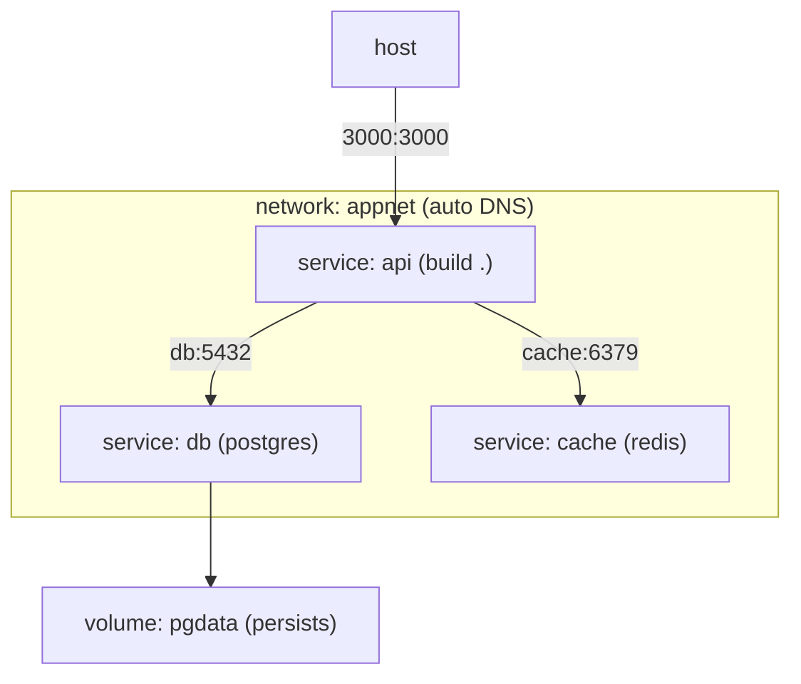
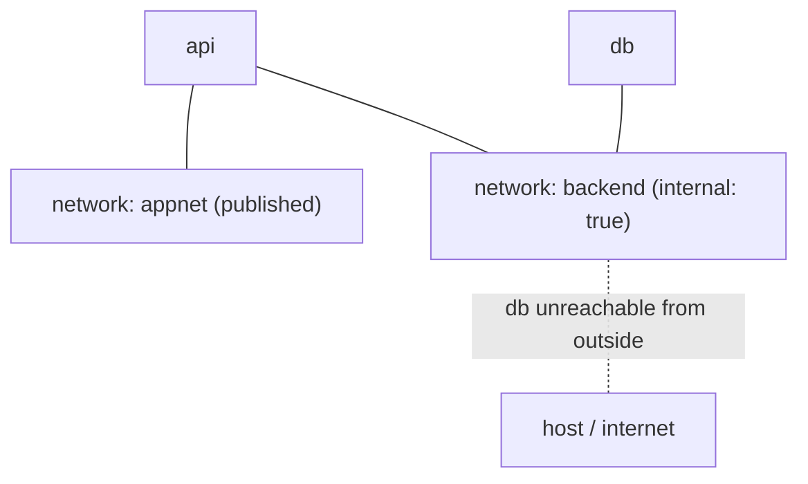
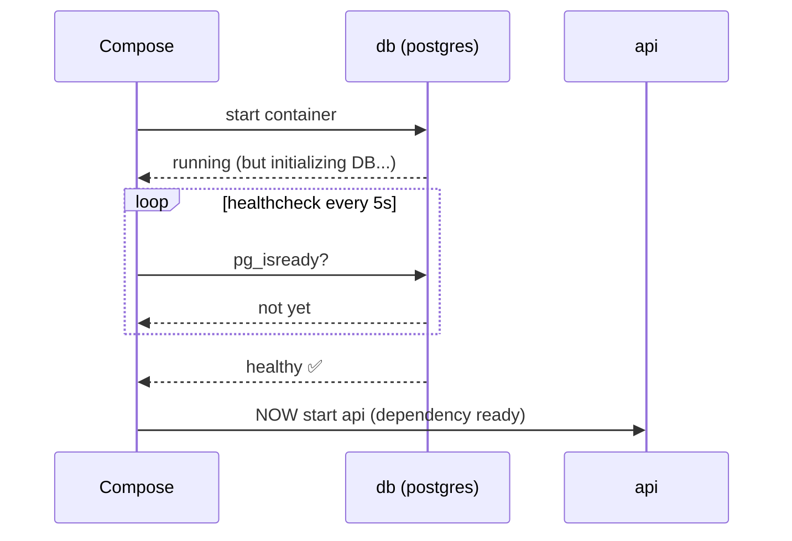
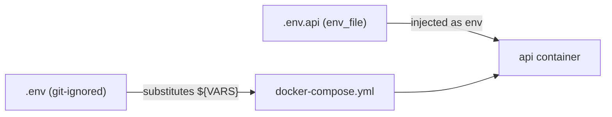
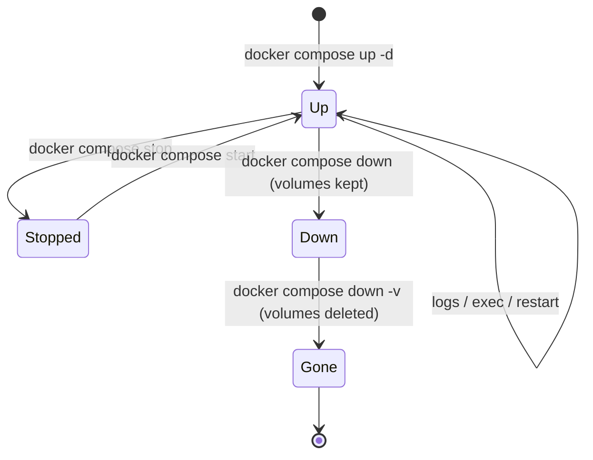
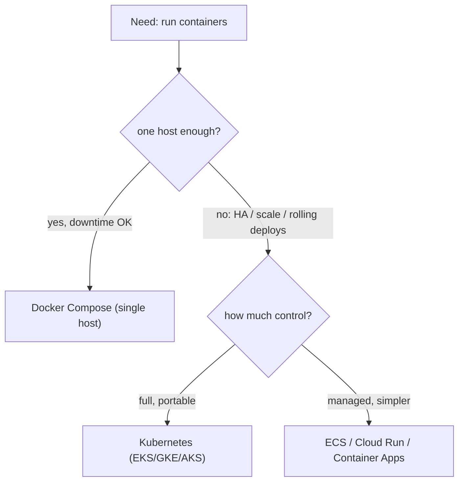

# Day 8 — Docker Compose & Local Dev

> Series: Cloud & DevOps Engineering
> Goal: Declare an entire multi-container application — app, database, cache — in one `docker-compose.yml`, bring it up with a single command, wire services together with networks/volumes/healthchecks/env files, and understand exactly where Compose ends and Kubernetes begins.

> Verify versions when you build: modern Docker uses `docker compose` (v2, a plugin — space, no hyphen); the old `docker-compose` (v1, Python) is retired (2026). The Compose file no longer needs a `version:` key. Compose is a *local/single-host* tool; multi-host orchestration is Kubernetes / ECS / Cloud Run (later).

> Cross-reference: everything from **Docker Day 6** (containers, volumes, networks) and **Day 7** (building images) — Compose is those concepts, declared instead of typed.

---

## Table of Contents
1. [Why Compose exists](#1-why-compose-exists)
2. [Anatomy of docker-compose.yml](#2-anatomy-of-docker-composeyml)
3. [Services, networks, volumes](#3-services-networks-volumes)
4. [depends_on & healthchecks](#4-depends_on--healthchecks)
5. [Env files & configuration](#5-env-files--configuration)
6. [The Compose command set](#6-the-compose-command-set)
7. [Dev vs prod with Compose](#7-dev-vs-prod-with-compose)
8. [When Compose ends and Kubernetes begins](#8-when-compose-ends-and-kubernetes-begins)
9. [Lab: app + DB + cache in one command](#9-lab-app--db--cache-in-one-command)
10. [Self-Check](#10-self-check)
11. [Tomorrow / Where this course goes next](#11-tomorrow--where-this-course-goes-next)

---

## 1. Why Compose exists

**In plain words:** A real app is rarely one container — it's an app *plus* a database *plus* a cache *plus* maybe a queue. Wiring those by hand (Day 6's lab: create network, create volume, `docker run` each with the right flags, in the right order) is tedious and error-prone. Compose lets you *describe* the whole stack in one YAML file and bring it all up — correctly wired — with one command.

- **Why:** Multi-container apps need reproducible, one-command orchestration on a single host.
- **What:** A declarative YAML file + the `docker compose` CLI.
- **When:** Local development, CI test environments, simple single-server deploys.
- **How:** `docker compose up`.
- **Where:** Every dev laptop; CI; small-scale prod.

> 🤔 **"I already know `docker run` — why learn another tool instead of a shell script of run commands?"** Because a Compose file is *declarative and self-documenting*: it captures the entire topology (which services, how they connect, what persists) as version-controlled config a new teammate can read and run in one line. A shell script of `docker run` commands is imperative, fragile (ordering, cleanup), and nobody wants to maintain it. Compose also handles the tedious right-things-for-you: it auto-creates a shared network with DNS, names things predictably, and tears it all down cleanly. It's `docker run` × N, done properly.

**✅ Good scenario (where it saves you):** A new engineer clones the repo and runs `docker compose up`. In 30 seconds they have the app, Postgres, and Redis running and connected — no README of 15 manual `docker run` commands, no "what version of Postgres?" Slack thread.

**❌ Bad scenario (the pain without it):** Onboarding takes a day: everyone runs slightly different `docker run` incantations, forgets the network, and hits the `localhost` trap (Day 6). "Works on my machine" returns — for the *dev environment* this time.

**When NOT to:** Don't use Compose to run a fleet across many machines with autoscaling/self-healing — that's Kubernetes (§8). Don't reach for it for a genuinely single-container app.

---

## 2. Anatomy of docker-compose.yml

**In plain words:** The Compose file is a map of your application's world: each **service** is a container (from an image or a Dockerfile), plus the **networks** they talk over and the **volumes** where data lives. It's the Day 6 lab, written down.

```yaml
# docker-compose.yml  (no "version:" needed in modern Compose)
services:
  api:                              # a service = one container role
    build: .                        # build from local Dockerfile (Day 7)...
    # image: ghcr.io/org/api:1.4.0  # ...or pull a prebuilt image
    ports:
      - "3000:3000"                 # publish HOST:CONTAINER (Day 6)
    environment:
      - DATABASE_URL=postgres://app:secret@db:5432/shop   # note host is "db"!
      - REDIS_URL=redis://cache:6379
    depends_on:
      db:
        condition: service_healthy  # wait until db is HEALTHY, not just started
      cache:
        condition: service_started
    networks: [appnet]
    restart: unless-stopped

  db:
    image: postgres:16
    environment:
      - POSTGRES_USER=app
      - POSTGRES_PASSWORD=secret
      - POSTGRES_DB=shop
    volumes:
      - pgdata:/var/lib/postgresql/data      # named volume → data persists (Day 6)
    healthcheck:
      test: ["CMD-SHELL", "pg_isready -U app -d shop"]
      interval: 5s
      timeout: 3s
      retries: 5
    networks: [appnet]

  cache:
    image: redis:7-alpine
    networks: [appnet]

volumes:
  pgdata:                           # declare the named volume

networks:
  appnet:                           # a user-defined network (name-based DNS, Day 6)
```


*One file describes every container, how they connect, and what persists — exactly Day 6's lab, declared.*

Top-level keys:

| Key | Declares |
|-----|----------|
| `services` | The containers (each is a service) |
| `networks` | User-defined networks (Compose makes a default one anyway) |
| `volumes` | Named volumes for persistence |
| `configs` / `secrets` | Non-secret and secret config (Swarm/Compose) |

> 🤔 **"In Compose, how does `api` find the database — do I need IPs or links?"** By the **service name**. Compose puts all services on a shared network with embedded DNS (Day 6), so `api` connects to the database at hostname `db` (the service name), port `5432` — never `localhost`, never a hardcoded IP. This is the same name-based networking from Day 6, but Compose creates the network for you automatically. The single most common Compose mistake is still using `localhost` for a sibling service.

**✅ Good scenario:** The whole topology — three services, their wiring, persistence — is 40 lines of reviewable YAML in the repo. A change to the DB version is a one-line PR (Day 5).

**❌ Bad scenario (when misused):** Someone hardcodes container IPs or uses `localhost` for `db`; it breaks the moment containers restart and get new IPs. Use service names.

**When NOT to:** Don't cram unrelated apps into one giant Compose file. Don't commit secrets directly in the `environment:` block (§5).

---

## 3. Services, networks, volumes

**In plain words:** These three map one-to-one onto Day 6's concepts. A **service** is a container definition (and Compose can run several replicas of it). **Networks** connect services by name. **Volumes** keep data alive across `down`/`up`.

```yaml
services:
  worker:
    image: myorg/worker:1.2.0
    deploy:
      replicas: 3                   # run 3 worker containers (Compose supports basic scale)
    volumes:
      - ./logs:/app/logs            # bind mount (host path) — dev convenience (Day 6)
      - shared:/data                # named volume — persistent
    networks:
      - appnet
      - backend                     # a service can join multiple networks

networks:
  appnet:
  backend:
    internal: true                  # no external access — isolate internal traffic

volumes:
  shared:
```

Networks — isolation is a design tool:

*Put the DB only on an internal network so nothing outside can reach it — defense in depth.*

Volume types recap (from Day 6):

| In Compose | Type | Use |
|------------|------|-----|
| `pgdata:/var/lib/postgresql/data` | Named volume | Production data persistence |
| `./src:/app/src` | Bind mount | Dev live-reload of source |
| `/tmp` via `tmpfs:` | tmpfs | In-memory scratch/secrets |

> 🤔 **"If I `docker compose down`, do I lose my database?"** Depends on the flag — and this trips everyone. Plain `docker compose down` removes containers and networks but **keeps named volumes**, so your DB data survives. `docker compose down -v` (or `--volumes`) *also deletes the volumes* — your data is gone. Muscle-memory `down -v` in a dev loop is a classic "why is my database empty again?" moment. Know which one you're typing.

**✅ Good scenario:** The DB lives on an `internal: true` network and a named volume; it's unreachable from outside *and* its data survives restarts. Secure and durable by config.

**❌ Bad scenario (the pain / when misused):** A dev habitually runs `docker compose down -v` to "reset," then does it on a shared/staging environment and wipes real data. `down` vs `down -v` is a real footgun.

**When NOT to:** Don't publish DB/cache ports to the host unless you need host access. Don't bind-mount source into production images (dev-only pattern).

---

## 4. depends_on & healthchecks

**In plain words:** Services start in some order, but "started" isn't "ready" — Postgres's container can be *running* while the database is still initializing and refusing connections. `depends_on` controls *order*; a **healthcheck** + `condition: service_healthy` makes a service wait until its dependency is genuinely *ready to serve*.

- **Why:** Race conditions on startup ("app can't connect to DB") are the #1 Compose flake.
- **What:** `depends_on` (ordering) + `healthcheck` (readiness).
- **When:** Any service that depends on another being ready.
- **How:** Below.
- **Where:** Every stack with a DB/cache dependency.

```yaml
services:
  api:
    build: .
    depends_on:
      db:
        condition: service_healthy   # WAIT for db to pass its healthcheck
      cache:
        condition: service_started    # cache only needs to be started

  db:
    image: postgres:16
    healthcheck:
      test: ["CMD-SHELL", "pg_isready -U app"]  # the readiness probe
      interval: 5s        # check every 5s
      timeout: 3s         # each check must answer within 3s
      retries: 5          # 5 fails in a row → "unhealthy"
      start_period: 10s   # grace window before failures count (slow startup)
```


*`depends_on: service_healthy` waits for genuine readiness, not just "container running."*

> 🤔 **"I set `depends_on: db` — why does my app STILL crash with 'connection refused' on startup?"** Because the *plain* form of `depends_on` only guarantees the DB container has *started*, not that Postgres is *accepting connections* — those are seconds apart, and your app races ahead and fails. The fix is a **healthcheck** on the DB plus `depends_on: { db: { condition: service_healthy } }`, so Compose waits for `pg_isready` to pass. Belt-and-suspenders: apps should *also* retry their DB connection on startup (Day 2's retry pattern) — because in production (Kubernetes) there's no `depends_on` at all, and dependencies can vanish and return at any time. Resilient apps don't assume dependencies are always up.

**✅ Good scenario:** `condition: service_healthy` means `docker compose up` reliably brings the whole stack up in the right order every time — no flaky "sometimes the API dies on first boot" in CI.

**❌ Bad scenario (when misused):** Relying on plain `depends_on` (no healthcheck); the app boots before Postgres is ready, crashes, and the team adds a random `sleep 10` hack that's both too long (slow) and too short (still flakes).

**When NOT to:** Don't use `sleep` hacks instead of healthchecks. Don't rely on Compose ordering as your *only* resilience — apps must handle dependencies coming and going (that's how prod works).

**Dark Side:** Healthchecks add startup latency and, if misconfigured (too-tight timeout), can flap a healthy service to "unhealthy." Tune `interval`/`timeout`/`start_period` to the real service.

---

## 5. Env files & configuration

**In plain words:** Hardcoding config and secrets in the Compose file is bad (it's committed to git). Instead, put values in a `.env` file (git-ignored) that Compose reads, and reference variables. This keeps the same Compose file usable across dev/staging with only the env values changing — the 12-factor idea from Linux Day 1.

```yaml
services:
  api:
    build: .
    ports:
      - "${API_PORT:-3000}:3000"     # ${VAR:-default} substitution
    environment:
      - DATABASE_URL=${DATABASE_URL}
    env_file:
      - .env.api                     # load a whole file of KEY=VALUE into the container
  db:
    image: postgres:16
    environment:
      - POSTGRES_PASSWORD=${DB_PASSWORD}
```

Two distinct `.env` mechanisms — don't confuse them:

| Mechanism | What it does | Scope |
|-----------|--------------|-------|
| `.env` (auto-loaded, project root) | Substitutes `${VARS}` **in the compose file itself** | Compose interpolation |
| `env_file:` (per service) | Injects KEY=VALUE **into the container's environment** | The running container |

```bash
# .env  (git-ignored!) — used for ${...} substitution in docker-compose.yml
API_PORT=3000
DB_PASSWORD=supersecret
DATABASE_URL=postgres://app:supersecret@db:5432/shop
```
```gitignore
# .gitignore
.env
.env.*
```


*`.env` fills in the Compose file; `env_file:` pours variables into the container.*

> 🤔 **"Env vars are how 12-factor apps get config — so it's fine to keep prod secrets in `.env`?"** For *local dev*, a git-ignored `.env` is a reasonable convenience. For *real secrets in real environments*, no — `.env` files leak (accidentally committed, sitting in plaintext on disk, copied around). Production secrets belong in a proper secret manager — AWS Secrets Manager, GCP Secret Manager, Azure Key Vault, or Vault — injected at runtime. Compose is a dev/small-scale tool; treat its `.env` as "good enough for my laptop," not "how we store the production database password." And *always* git-ignore `.env`.

**✅ Good scenario:** The same `docker-compose.yml` runs for every developer; each has their own git-ignored `.env`. No secrets in the repo, no per-person Compose edits.

**❌ Bad scenario (the pain / when misused):** Someone hardcodes the production DB password directly in `docker-compose.yml` and commits it. It's now in git history forever (Day 4 Dark Side) and must be rotated.

**When NOT to:** Don't commit `.env`. Don't use plaintext `.env` for production secrets. Don't put secrets in the `environment:` block literally.

---

## 6. The Compose command set

**In plain words:** A small set of verbs manages the whole stack at once — bring it up, watch logs, exec into a service, scale it, tear it down.

```bash
docker compose up                 # build (if needed) + start ALL services, attached
docker compose up -d              # detached (background) — the usual
docker compose up --build         # force rebuild images first (after Dockerfile change)
docker compose up -d db cache     # start only specific services

docker compose ps                 # status of this project's services
docker compose logs -f            # follow logs from ALL services (color-coded)
docker compose logs -f api        # just one service

docker compose exec api sh        # shell into the running "api" service (Day 6 exec)
docker compose exec db psql -U app shop    # run a command in a service

docker compose build              # build images without starting
docker compose pull               # pull prebuilt images
docker compose restart api        # restart one service
docker compose stop               # stop containers (keep them)

docker compose down               # stop + REMOVE containers & networks (KEEPS volumes)
docker compose down -v            # ...and DELETE volumes too (data gone! §3)
docker compose down --rmi all     # ...and remove images

docker compose config             # validate + print the fully-resolved config
docker compose up -d --scale worker=3       # run 3 replicas of "worker"
```

Lifecycle:

*One project, managed as a unit — `up` to `down` covers the whole stack.*

> 🤔 **"After I change my Dockerfile and run `docker compose up`, my change isn't there — why?"** Because Compose reuses the *existing* built image and doesn't automatically rebuild on `up`. You need `docker compose up --build` (or `docker compose build` first) to pick up Dockerfile/source changes. This "I changed the code but it's running the old version" confusion is extremely common — remember: `up` starts what exists; `--build` regenerates the image first.

**✅ Good scenario:** `docker compose up -d --build` in CI spins up the full app+DB+cache, runs the integration tests against it, and `docker compose down -v` tears it down cleanly — a fresh, reproducible test environment every run.

**❌ Bad scenario (when misused):** A dev debugs for an hour wondering why their code fix isn't taking effect, not realizing `up` served the stale image. `--build` would have shown it immediately.

**When NOT to:** Don't `down -v` when you want to keep data. Don't run interactive `up` (attached) as a "server" — it dies when your terminal closes; use `-d`.

---

## 7. Dev vs prod with Compose

**In plain words:** The *same* Compose stack can serve development (live-reload source, debug ports, seeded data) and small-scale production (prebuilt images, restart policies, no source mounts) — by *layering* a second override file. But Compose's role differs sharply between the two: essential for dev, marginal for serious prod.

- **Why:** Dev wants fast feedback; prod wants immutability and resilience — different needs, one base.
- **What:** A base file + environment-specific override files.
- **When:** Any project that runs Compose beyond a single machine's dev.
- **How:** `docker-compose.override.yml` (auto-merged) and explicit `-f` files.
- **Where:** Dev laptops (heavily); simple prod/staging (cautiously).

```yaml
# docker-compose.yml  (base — shared)
services:
  api:
    build: .
    environment:
      - NODE_ENV=production

# docker-compose.override.yml  (DEV — auto-merged by `docker compose up`)
services:
  api:
    volumes:
      - ./src:/app/src            # live-reload: your source mounted in (Day 6 bind mount)
    environment:
      - NODE_ENV=development
    command: npm run dev          # override to a watch/reload command

# docker-compose.prod.yml  (PROD — used explicitly)
services:
  api:
    image: ghcr.io/org/api:1.4.0  # prebuilt, versioned image (Day 7) — NO build/mount
    restart: unless-stopped
    deploy:
      replicas: 2
```

```bash
docker compose up -d                                        # base + override (DEV)
docker compose -f docker-compose.yml -f docker-compose.prod.yml up -d   # PROD
```

| Concern | Dev with Compose | Prod with Compose |
|---------|------------------|-------------------|
| Image | `build:` locally | Prebuilt, versioned `image:` |
| Source | Bind-mounted (live reload) | Baked into image (immutable) |
| Secrets | git-ignored `.env` | Secret manager, injected |
| Restart/self-heal | Not important | `restart:` policies (limited) |
| Scale/failover | N/A | Weak — single host only |

> 🤔 **"Can I just run Compose in production and skip Kubernetes?"** For a small, single-server app with modest uptime needs — a side project, an internal tool, an MVP — yes, Compose in prod is legitimate and pragmatic (add `restart: unless-stopped`, real secrets, and backups). But understand its ceiling: Compose runs on *one host*, so that host is a single point of failure, there's no automatic rescheduling if it dies, no rolling deploys, no horizontal autoscaling, no multi-node load balancing. The moment you need high availability across machines, you've outgrown it (§8). Rule of thumb: Compose for dev always; Compose for prod only when "one server going down is acceptable for a while."

**✅ Good scenario:** Dev uses the override for instant live-reload; the exact same base file plus a prod override runs the versioned image on a single VPS for an internal tool. One mental model, two modes.

**❌ Bad scenario (when misused):** A team runs customer-facing, revenue-critical prod on Compose on one EC2 instance. The instance reboots for maintenance; the whole product is down with no failover. That workload needed an orchestrator.

**When NOT to:** Don't run HA/critical multi-service prod on single-host Compose. Don't bind-mount source in production. Don't reuse dev `.env` secrets in prod.

---

## 8. When Compose ends and Kubernetes begins

**In plain words:** Compose orchestrates containers on *one machine*. The moment you need many machines working as a pool — with automatic healing, rolling updates, and scaling — you need a real orchestrator: Kubernetes (or a managed equivalent like ECS, Cloud Run, or Nomad). It's not that Compose is "worse"; it solves a different, smaller problem.

- **Why:** Knowing the boundary stops you from both over-engineering (k8s for a toy) and under-engineering (Compose for critical HA).
- **What:** Single-host (Compose) vs multi-host, self-healing, declarative orchestration (Kubernetes).
- **When:** The transition is driven by availability, scale, and team needs.
- **How:** Conceptually below (Kubernetes is a later course/module).
- **Where:** EKS/GKE/AKS, ECS, Cloud Run, self-managed k8s.


*Compose is the single-host answer; multi-host resilience is where orchestrators take over.*

| Capability | Docker Compose | Kubernetes |
|------------|----------------|------------|
| Hosts | One | Many (a cluster) |
| Self-healing (reschedule dead containers) | No (just `restart`) | Yes |
| Rolling / zero-downtime deploys | No | Yes |
| Horizontal autoscaling | No | Yes (HPA) |
| Load balancing across nodes | No | Yes (Services/Ingress) |
| Secret/config management | Basic | Rich (Secrets/ConfigMaps) |
| Learning curve / ops overhead | Low | High |
| Best for | Dev, CI, small single-host prod | Production at scale/HA |

> 🤔 **"Should I just learn Kubernetes and skip Compose — isn't k8s what companies use?"** Learn Compose first, and don't skip it. Compose teaches the *fundamentals every orchestrator shares* — services, service-to-service networking, volumes, healthchecks, dependency ordering, env config — in a form simple enough to actually understand. Kubernetes is those same ideas plus a mountain of distributed-systems machinery (pods, deployments, services, ingress, controllers). Jumping straight to k8s without the Compose-level mental model means memorizing YAML you don't understand. Also: most companies still use Compose *for local dev* even when prod is Kubernetes — so you'll use both. Compose is the on-ramp, not a dead end.

**✅ Good scenario:** A startup runs Compose for dev and their MVP on one server, then migrates to managed Kubernetes (or Cloud Run) once uptime becomes revenue-critical — carrying the exact same mental model (services, networks, healthchecks) up the ladder.

**❌ Bad scenario (over-engineering):** A two-person team stands up a self-managed Kubernetes cluster for a low-traffic internal app and spends more time babysitting the cluster than building the product. Compose (or Cloud Run) would have served them for a year.

**When NOT to:** Don't adopt Kubernetes before you have the scale/HA need and the ops capacity — its complexity is a tax. Don't stretch single-host Compose to carry critical, always-on production.

**Dark Side:** Kubernetes' power comes with real operational cost — it's a distributed system you now have to operate. Many teams would be better served by managed container platforms (Cloud Run, ECS Fargate, Container Apps) that hide most of that complexity.

---

## 9. Lab: app + DB + cache in one command

**Goal:** Take Day 6's manual app+DB (all those `docker run`/`network`/`volume` commands) and collapse the *entire* stack — app, Postgres, Redis — into one `docker-compose.yml` that comes up with a single command, with proper healthchecks, persistence, and env config.

Project layout:
```bash
mkdir compose-lab && cd compose-lab
```

`app.py` — a tiny app that uses BOTH the DB and the cache, connecting by service name:
```python
# app.py
import os, time, psycopg2, redis
from http.server import BaseHTTPRequestHandler, HTTPServer

def connect_db():
    for _ in range(10):                       # retry pattern (Day 2 / §4)
        try:
            return psycopg2.connect(os.environ["DATABASE_URL"])
        except Exception:
            time.sleep(1)
    raise SystemExit("db never came up")

db = connect_db()
cache = redis.from_url(os.environ["REDIS_URL"])
cur = db.cursor()
cur.execute("CREATE TABLE IF NOT EXISTS hits(n int)")
db.commit()

class H(BaseHTTPRequestHandler):
    def do_GET(self):
        n = cache.incr("hits")                # cache: count visits
        cur.execute("INSERT INTO hits(n) VALUES(%s)", (n,)); db.commit()
        self.send_response(200); self.end_headers()
        self.wfile.write(f"visit #{n} (persisted to db + counted in redis)\n".encode())

HTTPServer(("0.0.0.0", 8000), H).serve_forever()
```

`requirements.txt`:
```text
psycopg2-binary
redis
```

`Dockerfile` (Day 7 patterns: slim, non-root, cache-friendly order):
```dockerfile
# syntax=docker/dockerfile:1
FROM python:3.12-slim
WORKDIR /app
COPY requirements.txt .
RUN pip install --no-cache-dir -r requirements.txt   # deps first (cache!)
COPY app.py .
RUN useradd -r -u 10001 appuser
USER appuser
EXPOSE 8000
CMD ["python", "app.py"]
```

`.env` (git-ignored):
```text
DB_PASSWORD=secret
```

`docker-compose.yml` — the whole stack:
```yaml
services:
  api:
    build: .
    ports:
      - "8000:8000"
    environment:
      - DATABASE_URL=postgres://app:${DB_PASSWORD}@db:5432/shop
      - REDIS_URL=redis://cache:6379
    depends_on:
      db:
        condition: service_healthy
      cache:
        condition: service_started
    restart: unless-stopped

  db:
    image: postgres:16
    environment:
      - POSTGRES_USER=app
      - POSTGRES_PASSWORD=${DB_PASSWORD}
      - POSTGRES_DB=shop
    volumes:
      - pgdata:/var/lib/postgresql/data
    healthcheck:
      test: ["CMD-SHELL", "pg_isready -U app -d shop"]
      interval: 5s
      timeout: 3s
      retries: 5

  cache:
    image: redis:7-alpine

volumes:
  pgdata:
```

Run it — the whole point, one command:
```bash
echo "DB_PASSWORD=secret" > .env
docker compose up -d --build          # build api + start all three services

docker compose ps                     # all Up; db should show (healthy)
curl localhost:8000                   # -> "visit #1 (persisted to db + counted in redis)"
curl localhost:8000                   # -> "visit #2 ..."  (redis counter increments)

# prove persistence + wiring:
docker compose exec db psql -U app -d shop -c "SELECT count(*) FROM hits;"   # matches visits
docker compose logs -f api            # watch logs (Ctrl-C to stop)

# restart the app only — data/counter survive because db+redis persist:
docker compose restart api
curl localhost:8000                   # counter CONTINUES (redis kept running)

# tear down but KEEP data:
docker compose down                   # containers gone, pgdata volume remains
docker compose up -d                  # bring back; db rows still there

# full reset (deletes the volume — data gone):
docker compose down -v
```

**Prove the lessons to yourself:**
- Change `db` to `localhost` in `DATABASE_URL` → app fails (the `localhost` trap, Day 6/§2).
- Remove the healthcheck + `condition: service_healthy`, keep plain `depends_on` → occasionally the app races the DB and hits connection errors on first boot (§4).
- Edit `app.py`, run `docker compose up -d` *without* `--build` → your change doesn't appear; add `--build` → it does (§6).
- `docker compose down` then `up` → data survives. `down -v` then `up` → fresh empty DB (§3).

**Stretch goals:**
- Add a `docker-compose.override.yml` that bind-mounts `./app.py` for live editing (dev mode, §7).
- Add a fourth service (e.g., adminer or pgAdmin) on the same network to browse the DB by name.
- Move the DB onto an `internal: true` network so it's unreachable from the host (§3), and confirm the app still reaches it.
- Wire this Compose stack into a CI job: `up -d --build`, run a curl-based smoke test, `down -v`.

---

## 10. Self-Check

1. What problem does Compose solve that a folder of `docker run` commands does not?
2. In a Compose file, how does the `api` service address the `db` service — and why not `localhost`?
3. What's the difference between `docker compose down` and `docker compose down -v`? Which loses your database?
4. Plain `depends_on` didn't stop your app from crashing on startup. What does, and why?
5. You changed your Dockerfile but `docker compose up` runs the old code. What flag fixes it and why?
6. Explain the two different roles a `.env`/`env_file` play in Compose.
7. Why is a git-ignored `.env` "fine for dev" but wrong for production secrets? What's the prod answer?
8. Name three things Kubernetes gives you that single-host Compose cannot.
9. When is running Compose in production a legitimate, reasonable choice — and when is it not?
10. Why learn Compose before Kubernetes rather than skipping straight to k8s?

---

## 11. Tomorrow / Where this course goes next

You've now built the entire local foundation of a modern DevOps engineer: **Linux** (Days 1–3), **Git & collaboration** (Days 4–5), and **Docker** (Days 6–8) — from a single process on a box to a fully-wired multi-container app declared in one file.

**Next up in Cloud & DevOps Engineering:** **CI/CD pipelines** (GitHub Actions / GitLab CI) that build the images from Day 7 and run the Compose stack from Day 8 automatically on every push (Day 5's PRs + branch protection become *gates* in a pipeline); then **cloud fundamentals** (AWS/GCP/Azure — VPCs echoing Day 3 networking, IAM echoing Day 1 permissions), **Infrastructure as Code** (Terraform), and finally **Kubernetes** — where every concept from Day 8 (services, networking, volumes, healthchecks, dependency ordering) scales out across a cluster.

Everything from here builds on these eight days. The Linux process you started on Day 1 is the container you shipped on Day 7 running in the stack you composed on Day 8 — soon deployed, at scale, by a pipeline, to the cloud.
