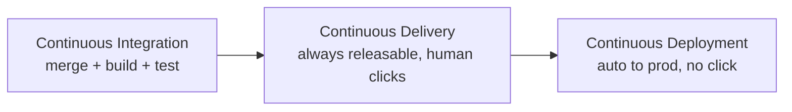
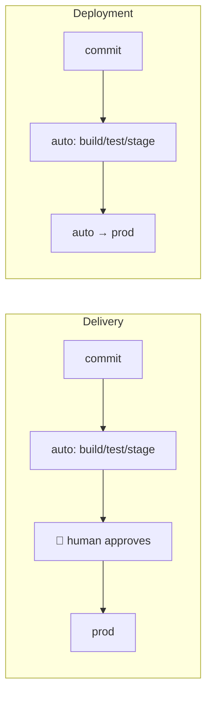
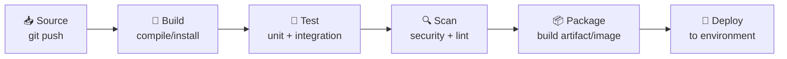
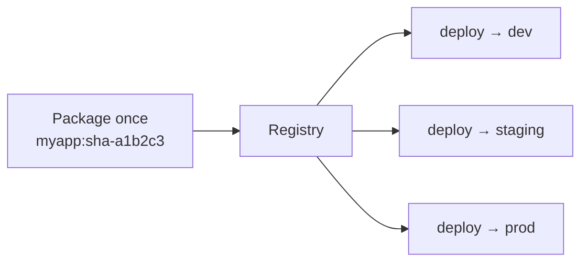
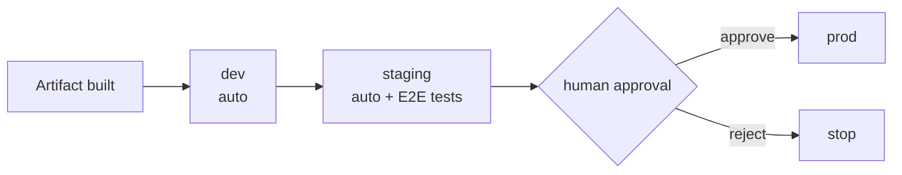
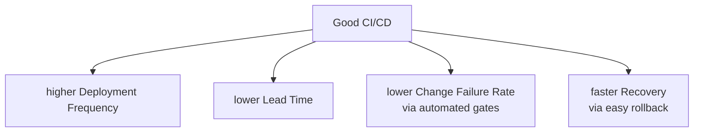

# Day 9 — CI/CD Concepts

> Series: Cloud & DevOps Engineering
> Goal: Understand what a pipeline actually *is* and *why* — so that when you touch GitHub Actions tomorrow, you're wiring up ideas you already own, not copying YAML you don't understand.

---

## Table of Contents
1. [In plain words: what CI/CD really is](#1-in-plain-words)
2. [The three letters: CI vs CD vs CD](#2-the-three-letters)
3. [Continuous Integration (CI)](#3-continuous-integration)
4. [Continuous Delivery vs Continuous Deployment](#4-delivery-vs-deployment)
5. [The pipeline stages: build → test → scan → package → deploy](#5-the-pipeline-stages)
6. [Artifacts: the thing you build once](#6-artifacts)
7. [Environments & promotion](#7-environments--promotion)
8. [Why automate? (the business case)](#8-why-automate)
9. [DORA metrics preview](#9-dora-metrics-preview)
10. [Lab: design a pipeline on paper](#10-lab)
11. [Self-Check](#11-self-check)
12. [Tomorrow](#12-tomorrow)

---

## 1. In plain words

**In plain words:** CI/CD is a *conveyor belt in a factory*. A developer drops a raw part (a code change) onto one end. The belt automatically inspects it, assembles it, stamps it with a version, and — if every station passes — carries it to the shelf where customers can buy it. No human carries the part between stations, and no part skips inspection. Before conveyor belts, a person carried each part by hand, sometimes forgot a step, and quality depended on who was on shift.

CI/CD is that belt for software. **CI** is the inspection-and-assembly half. **CD** is the "get it onto the shelf" half.

- **Why:** manual release is slow, error-prone, and terrifying — so teams release rarely, which makes each release bigger and *more* terrifying. A vicious loop.
- **What:** an automated sequence of steps triggered by a code change that validates and ships that change.
- **When:** the moment you have more than one person, or more than one environment, or you deploy more than once a month.
- **How:** a pipeline defined as code (YAML) that runs on a *runner* whenever you push.
- **Where:** it sits between your Git repo (the source of truth) and your running environments (dev → staging → prod).

> 🤔 **Isn't CI/CD just "the thing that runs my tests"?**
> No — that's only the first station. Running tests is CI. CI/CD also *packages* the validated code into a shippable artifact and *moves that artifact* through environments to production, with gates and rollbacks. If your "CI/CD" stops at green checkmarks and a human still manually copies files to a server, you've automated the cheap 20% and left the scary 80% by hand.

**✅ Good scenario (where it saves you):** A 12-person product team ships 30 times a day. Every merge to `main` auto-builds, tests, scans, and deploys to staging in 8 minutes. A one-line bug fix reaches customers in under an hour with zero "release nights."

**❌ Bad scenario (the pain without it):** A team deploys manually every second Friday. Someone SSHes into prod, runs `git pull`, forgets to restart a service, and the site 500s for 40 minutes. Nobody's sure which commit is live. Rollback means "who remembers the old code?"

**When NOT to obsess:** A weekend solo prototype with no users doesn't need a five-stage pipeline. A `git push` and a manual deploy is fine — until someone else joins or real users show up.

---

## 2. The three letters

The confusing part: **CD means two different things**, and people use it interchangeably. Pin this down now.

| Term | Full name | Question it answers | Human in the loop? |
|------|-----------|---------------------|--------------------|
| **CI** | Continuous **Integration** | "Does this change build and pass tests when merged with everyone else's?" | No (automatic) |
| **CD** | Continuous **Delivery** | "Is this change *always ready* to deploy at the push of a button?" | Yes — a human clicks "release" |
| **CD** | Continuous **Deployment** | "Should validated changes go to prod *automatically*, no button?" | No — fully automatic |

Think of it as a ladder. Each rung requires the one below it.


*Each rung of maturity assumes the rung below it already works.*

Most product companies live at **Continuous Delivery** for prod (a human approves) and **Continuous Deployment** for staging (fully auto). That combo is the sweet spot for 2026.

---

## 3. Continuous Integration

**In plain words:** CI is the rule "everybody merges their work into the shared branch *often* — at least daily — and a robot immediately checks that the combined result still works." The opposite is each dev hoarding a giant branch for three weeks, then a hellish "merge day."

- **Why:** the longer branches diverge, the more painful and bug-prone the merge. Integrate small and often, and conflicts stay tiny.
- **What:** on every push/PR, a runner checks out the code, installs dependencies, compiles, and runs the automated test suite. Red = blocked.
- **When:** always, from day one of any team project.
- **How:** a pipeline triggered by `push` and `pull_request` events (you'll write this tomorrow).
- **Where:** runs before the code is allowed to merge — a *required status check* on the branch.

> 🤔 **"CI is a tool I install, right?"**
> No — CI is a *practice*. GitHub Actions/Jenkins are tools that *enable* the practice, but you can own all the fancy tooling and still not do CI if devs sit on branches for weeks. CI is fundamentally about integrating frequently; the robot is just the enforcement.

**Dark Side note:** CI creates a *social contract* — "don't break `main`." A red pipeline on `main` should stop the team. If your team learns to ignore a permanently-red build ("oh, that test is flaky, just merge"), CI is worse than useless: it's noise that trains people to ignore signals. Fix or delete flaky tests ruthlessly.

**✅ Good scenario:** Two devs edit the same module. Both push within hours; CI catches the conflict and a failing test the same day. 15-minute fix.

**❌ Bad scenario:** Feature branch lives 4 weeks. On merge day, 60 files conflict, three tests fail, and nobody remembers why a line was changed. Two days lost.

---

## 4. Delivery vs Deployment

This is the single most common interview mix-up. Nail it.

- **Continuous Delivery:** every green build produces a deployable artifact and is *automatically pushed as far as staging*. Production requires a **human to click a button** (or approve). The point: you *could* ship any commit at any moment, but a human decides *when*.
- **Continuous Deployment:** remove the button. Every commit that passes all gates goes to **production automatically**.


*Delivery keeps a human gate at prod; Deployment removes it.*

| Dimension | Continuous Delivery | Continuous Deployment |
|-----------|--------------------|-----------------------|
| Prod gate | Human approval | None (fully auto) |
| Speed to prod | Minutes–hours (waits for click) | Minutes |
| Risk appetite | Regulated / high-stakes / early team | High test confidence, mature team |
| Test suite required | Strong | *Extremely* strong + monitoring + auto-rollback |
| Typical for | Fintech, healthcare, most B2B | Big-tech consumer, feature-flagged SaaS |

**When NOT to do Continuous Deployment:** if you don't have a trustworthy test suite, good monitoring, and automated rollback, auto-shipping to prod just means shipping bugs *faster*. Earn it.

---

## 5. The pipeline stages

The canonical pipeline: **build → test → scan → package → deploy.** Each stage is a gate — fail one, the whole thing stops (fail fast).


*Fail fast: cheap, fast stages go first so you learn of failure in seconds, not minutes.*

| Stage | What happens | Why it's here | Example tool (2026) |
|-------|-------------|---------------|---------------------|
| Build | Compile / install deps | Does it even build? | `npm ci`, `go build`, `mvn package` |
| Test | Unit, then integration | Does it behave? | Jest, pytest, JUnit |
| Scan | SAST, dependency CVEs, secrets, lint | Is it safe & clean? | Trivy, Snyk, CodeQL, gitleaks |
| Package | Produce the immutable artifact | Build once, ship everywhere | Docker, `.jar`, `.zip` |
| Deploy | Push artifact to an environment | Get it running | kubectl, ArgoCD, `aws` CLI |

**Ordering rule — fail fast:** put the *fastest, cheapest* checks first. Linting fails in 3 seconds; a full integration suite takes 6 minutes. Run the 3-second check first so you don't waste 6 minutes to discover a missing semicolon.

> 🤔 **"Why scan? My code is fine, it's the hackers who are the problem."**
> Most breaches aren't your code — they're a vulnerable *dependency* you pulled in transitively, or an AWS key accidentally committed. The scan stage catches known-CVE libraries and leaked secrets *before* they reach prod. Skipping it is how a log4j-style flaw ships to every customer overnight.

**✅ Good scenario:** Dependency scan flags a critical CVE in a JSON parser at PR time. Bumped in 5 minutes, never reached prod.

**❌ Bad scenario:** No scan stage. A committed AWS secret key sits in git history for months; a bot scraping GitHub finds it and spins up crypto-mining EC2 instances. $40k bill.

---

## 6. Artifacts

**In plain words:** An artifact is the *sealed, versioned box* your pipeline builds once — a Docker image, a `.jar`, a zipped bundle. The golden rule: **build once, deploy many.** You test the exact same box in staging that you ship to prod. You do *not* rebuild per environment.

- **Why:** if you rebuild for prod, you might pull a newer dependency and ship something you never tested. "Works in staging" must *guarantee* "works in prod" — only possible if it's the identical box.
- **What:** an immutable, versioned output (`myapp:1.4.2`, `git-sha-a1b2c3`).
- **When:** produced in the Package stage, stored in a registry/artifact store.
- **How:** tag with the git SHA or a semver, push to a registry (ECR, GitHub Packages, Artifactory).
- **Where:** a container/artifact registry the deploy stage pulls from.


*The identical artifact flows through every environment — never rebuilt.*

> 🤔 **"Can't I just `git pull` on the prod server and run it?"**
> That's the anti-pattern. `git pull` on prod means prod builds its *own* version — different OS, different dependency resolution, different everything from what you tested. Immutable artifacts kill "works on my machine" and "works in staging." The box you tested is the box that runs.

**When NOT to:** truly static content (a marketing HTML page) may not need a container, but even then a versioned, immutable bundle beats live-editing files on a server.

---

## 7. Environments & promotion

You don't ship straight to customers. An artifact is **promoted** up a chain of environments, each more production-like.

| Environment | Purpose | Who uses it | Data |
|-------------|---------|-------------|------|
| **dev** | Rapid iteration, may be broken | developers | fake/seed |
| **staging** (pre-prod) | Prod-like final rehearsal | QA, product, automated E2E | prod-like, anonymized |
| **prod** | Real customers | everyone | real |


*Promotion = moving the same tested artifact up the ladder, with a gate before prod.*

**Promotion** means "this exact artifact passed the lower environment, so advance it." Staging should mirror prod as closely as budget allows (same infra shape, same config *keys* with different values). The bigger the gap between staging and prod, the more "surprises" leak through.

> 🤔 **"Staging passed, so prod is guaranteed fine, right?"**
> No — staging *reduces* risk, it doesn't eliminate it. Staging usually has less traffic, smaller data, and often different secrets/config. That's exactly why tomorrow's deployment strategies (canary, blue-green) exist: to de-risk the final step into prod even after staging is green.

**Cross-reference:** environments map neatly onto the load-balancing and traffic-shaping ideas from **System Design Day 12 (load balancing)** — a canary is just a load balancer sending 5% of traffic to the new version.

---

## 8. Why automate?

The business case, in plain numbers.

- **Speed:** manual release = hours of human coordination. Automated = minutes, unattended.
- **Repeatability:** the robot does the *exact* same 40 steps every time. Humans skip step 27 at 6pm on a Friday.
- **Safety:** every change goes through identical gates. No "just this once, skip the tests."
- **Auditability:** every deploy is logged — who, what commit, when. Gold for debugging and compliance (SOC 2 / **System Design Day 20's** operational concerns).
- **Confidence → frequency:** when releasing is boring and safe, you release *often*. Small changes are easier to debug than big ones. This is the whole flywheel.

> 🤔 **"Automation is a lot of upfront work — is it worth it for a small team?"**
> The break-even is shockingly fast. If a manual deploy takes 30 min and you deploy 3x/week, that's 78 hours/year *plus* the cost of the inevitable human-error outage. A pipeline pays for itself in weeks and then compounds. The small team is *exactly* who benefits — they have no ops team to absorb manual toil.

**❌ Bad scenario (when misused):** A team automates a *bad* process. The manual deploy skipped a broken migration step; now the pipeline runs the broken step reliably, 30x a day. Automation amplifies whatever you feed it — fix the process first, then automate.

---

## 9. DORA metrics preview

DORA (DevOps Research & Assessment) gives four metrics that predict elite software teams. You'll go deeper on Day 11; here's the preview so you know *what your pipeline is optimizing for.*

| Metric | Question | Elite (2026 benchmark, verify current) |
|--------|----------|-----------------------------------------|
| **Deployment Frequency** | How often do you ship to prod? | On-demand, multiple/day |
| **Lead Time for Changes** | Commit → running in prod, how long? | < 1 hour |
| **Change Failure Rate** | % of deploys causing a prod problem | 0–15% |
| **Failed Deployment Recovery Time** (MTTR) | How fast do you recover? | < 1 hour |


*The four DORA metrics are the scoreboard your pipeline is trying to win.*

The first two measure **throughput** (speed), the last two measure **stability**. The old myth was "you trade speed for stability." DORA's data blew that up: elite teams are *both* faster *and* more stable — because good automation delivers both at once.

---

## 10. Lab

**Design a pipeline on paper (no tools yet — this cements the mental model).**

Pick a real-ish app: a Node.js REST API for a to-do product, deployed as a Docker container to AWS ECS.

**Deliverable:** a one-page design covering:

1. **Trigger** — what events start the pipeline? (Hint: PR opened, push to `main`.)
2. **Stages** — list each stage in order, with the *exact command* you'd run:
   ```bash
   # Build
   npm ci                     # clean, reproducible install from lockfile
   # Test
   npm test                   # unit tests, must exit 0
   # Scan
   npx trivy fs .             # dependency + config vulnerabilities
   npx gitleaks detect        # no committed secrets
   # Package
   docker build -t todo-api:$GIT_SHA .
   # Deploy
   aws ecs update-service --force-new-deployment   # roll out artifact
   ```
3. **Fail-fast ordering** — justify why you put each stage where you did.
4. **Artifact** — what is it, how is it tagged, where is it stored? (Answer: `todo-api:<git-sha>` in Amazon ECR.)
5. **Environments** — draw dev → staging → prod. Which transitions are automatic? Which need a human?
6. **Two failure modes** — write down: (a) what happens if the test stage fails, (b) what happens if prod deploy fails. Who/what recovers?
7. **DORA** — which of the four metrics does *your* design most improve, and which does it not yet address?

**Stretch:** mark on your diagram exactly where tomorrow's GitHub Actions `jobs` and `steps` will map onto your stages.

---

## 11. Self-Check

1. Explain the difference between Continuous Delivery and Continuous Deployment in one sentence each.
2. CI is a *practice*, not a tool. What practice, specifically, and what breaks if you skip it?
3. Why does "build once, deploy many" matter — what bug class does it eliminate?
4. Order these fastest-first and justify: integration tests, lint, unit tests, dependency scan.
5. What is an artifact, and why should you *never* `git pull` on a prod server?
6. Your staging build is green. Give two concrete reasons prod could still break.
7. Name the four DORA metrics and label each as throughput or stability.
8. A teammate says "our build has been red for a week but that test is just flaky, keep merging." Why is this dangerous, and what do you do?
9. When is a full CI/CD pipeline *overkill*?
10. Sketch (from memory) the five canonical pipeline stages and one tool for each.

---

## 12. Tomorrow

**Day 10 — GitHub Actions (Hands-On CI/CD):** we stop designing and start building. You'll write real `workflow.yml` — jobs, steps, runners, triggers, secrets, caching, matrix builds — and finish with a working pipeline that tests your app, builds a Docker image, and pushes it to a registry. Every "stage" you drew today becomes a real block of YAML. Bring your paper design.
