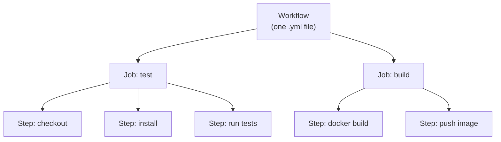
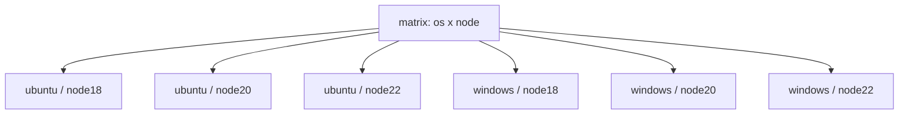
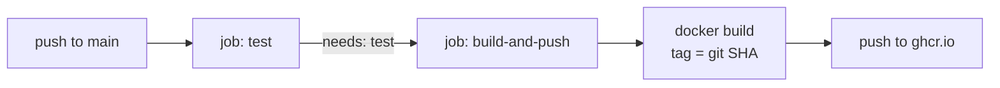
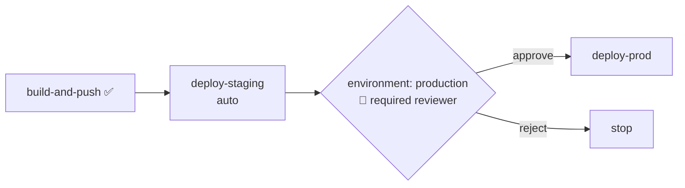

# Day 10 — GitHub Actions (Hands-On CI/CD)

> Series: Cloud & DevOps Engineering
> Goal: Turn yesterday's paper pipeline into real, working YAML — write a workflow that tests your app, builds a Docker image, and pushes it to a registry, with secrets, caching, matrix builds, and an approval gate.

---

## Table of Contents
1. [In plain words: what GitHub Actions is](#1-in-plain-words)
2. [The mental model: workflows → jobs → steps → runners](#2-the-mental-model)
3. [Triggers: when does it run?](#3-triggers)
4. [YAML anatomy: your first workflow](#4-yaml-anatomy)
5. [Marketplace actions (don't reinvent)](#5-marketplace-actions)
6. [Secrets (never hardcode)](#6-secrets)
7. [Caching (make it fast)](#7-caching)
8. [Matrix builds (test many combos)](#8-matrix-builds)
9. [The real pipeline: test → docker build → push](#9-the-real-pipeline)
10. [Environments & approvals](#10-environments--approvals)
11. [GitHub Actions vs Jenkins vs GitLab CI](#11-comparison)
12. [Lab](#12-lab)
13. [Self-Check](#13-self-check)
14. [Tomorrow](#14-tomorrow)

---

## 1. In plain words

**In plain words:** GitHub Actions is a *robot assistant that lives inside your GitHub repo* and watches for things to happen. You leave it a to-do list written in YAML ("when someone pushes code, run these commands on a fresh computer"). When the trigger fires, GitHub spins up a clean throwaway machine, runs your list, and reports back with a green check or a red X — right on the pull request.

It is, in 2026, the **dominant** CI/CD tool for new projects — because it's already *inside* the place your code lives. No separate server to run.

- **Why:** yesterday's pipeline concepts need an *engine* to run them. GitHub Actions is that engine, with zero infrastructure to manage.
- **What:** a YAML-defined automation platform triggered by repo events, running on GitHub-hosted (or self-hosted) runners.
- **When:** any repo hosted on GitHub. It's the default choice for product teams already on GitHub.
- **How:** commit a file to `.github/workflows/`. That's the entire setup.
- **Where:** files live in `.github/workflows/*.yml`; runs show up in the repo's "Actions" tab and on each PR.

> 🤔 **"Isn't GitHub Actions just for running tests?"**
> That's the *entry-level* use. Actions can build and push Docker images, deploy to AWS, provision infra with Terraform, publish npm packages, run scheduled jobs (cron), send Slack alerts, and gate prod deploys behind human approval. It's a general automation engine that happens to be great at CI/CD.

**✅ Good scenario (where it saves you):** A product team pushes a PR. Within 90 seconds the PR shows: tests passed, lint clean, security scan clean, Docker image built. Reviewer merges with confidence. No one ran anything by hand.

**❌ Bad scenario (the pain without it):** No CI. A PR "looks fine," gets merged, and `main` is broken for everyone because the author never ran the full test suite locally. Half a day lost tracing which of six merges broke it.

**When NOT to:** if your org standardized on GitLab (use GitLab CI) or has heavy self-hosted Jenkins investment with hundreds of jobs, don't fragment tooling just to chase the trend. Match the org.

---

## 2. The mental model

Four nested concepts. Get this hierarchy and everything else is detail.


*A workflow contains jobs; each job runs on its own fresh runner and contains ordered steps.*

| Concept | What it is | Key fact |
|---------|-----------|----------|
| **Workflow** | One YAML file in `.github/workflows/` | Triggered by events |
| **Job** | A group of steps | Runs on its *own fresh runner*; jobs run in **parallel** by default |
| **Step** | A single task | Runs *sequentially* within a job; shares the runner's filesystem |
| **Runner** | The machine executing a job | GitHub-hosted (`ubuntu-latest`) or self-hosted |
| **Action** | A reusable step from the marketplace | e.g. `actions/checkout@v4` |

**Critical gotcha:** each **job gets a brand-new, empty machine.** Job A cannot see files Job B created unless you explicitly pass them via *artifacts* or make one job `needs` the other. Steps *within* a job *do* share the filesystem. New learners lose hours here.

> 🤔 **"So all my steps share the same computer, right?"**
> Steps in the *same job*, yes. Steps in *different jobs*, no — different jobs = different machines. If your `build` job needs the compiled output from your `test` job, either combine them into one job or use `actions/upload-artifact` / `download-artifact` to hand files across.

---

## 3. Triggers

The `on:` key defines *when* the workflow runs. This maps directly to yesterday's "Trigger" box.

```yaml
on:
  push:
    branches: [main]          # every push to main
  pull_request:
    branches: [main]          # every PR targeting main (CI gate)
  workflow_dispatch:          # a manual "Run" button in the UI
  schedule:
    - cron: "0 2 * * *"       # nightly at 02:00 UTC (e.g. dependency scan)
```

| Trigger | Fires when | Typical use |
|---------|-----------|-------------|
| `push` | Commits pushed to a branch | Deploy on merge to `main` |
| `pull_request` | PR opened/updated | CI gate: test before merge |
| `workflow_dispatch` | Human clicks "Run workflow" | Manual deploys, one-off jobs |
| `schedule` | Cron time | Nightly scans, cleanup |
| `release` | GitHub Release published | Publish artifacts |

**Product pattern:** `pull_request` runs *test + scan* (the gate). `push` to `main` runs *test + build + deploy*. Two behaviors, often one file with `if:` conditions.

---

## 4. YAML anatomy

Your first complete, working CI workflow. Save as `.github/workflows/ci.yml`.

```yaml
name: CI                              # shows up in the Actions tab

on:
  pull_request:
    branches: [main]

jobs:
  test:                               # job id
    runs-on: ubuntu-latest            # the runner OS
    steps:
      - name: Checkout code
        uses: actions/checkout@v4     # pulls your repo onto the runner

      - name: Setup Node
        uses: actions/setup-node@v4
        with:
          node-version: "20"          # LTS as of 2026 — verify current LTS
          cache: "npm"                # built-in dependency caching

      - name: Install dependencies
        run: npm ci                   # 'ci' = clean, lockfile-exact install

      - name: Lint (fail fast, cheapest first)
        run: npm run lint

      - name: Run tests
        run: npm test                 # non-zero exit = job fails = red X on PR
```

Anatomy decoded:
- `uses:` runs a **pre-built action** (someone else's reusable step).
- `run:` runs a **shell command** on the runner.
- `with:` passes inputs to a `uses:` action.
- `name:` is a human label (optional but do it — it makes logs readable).

> 🤔 **"Why `npm ci` instead of `npm install`?"**
> `npm install` can *update* your lockfile and pull slightly different versions — non-reproducible, the enemy of "build once." `npm ci` installs the *exact* versions in `package-lock.json`, failing if the lockfile is out of sync. Reproducible builds are the whole point of CI. (Equivalent idea: `pip install -r requirements.txt` with pinned versions, `go mod download`.)

---

## 5. Marketplace actions

**In plain words:** the Marketplace is an app store of reusable steps. Instead of writing 30 lines of shell to log into a Docker registry, you `uses:` a battle-tested action someone maintains.

| Action | Does | Pin |
|--------|------|-----|
| `actions/checkout@v4` | Clone your repo onto the runner | Almost every workflow starts here |
| `actions/setup-node@v4` | Install a Node version + cache | Language setup |
| `docker/build-push-action@v6` | Build + push a Docker image | Container CI |
| `docker/login-action@v3` | Auth to a registry | Before push |
| `aws-actions/configure-aws-credentials@v4` | Assume an AWS role (OIDC) | Deploys |
| `actions/upload-artifact@v4` | Save files between jobs | Hand-off |

**Security rule — pin your actions.** `uses: someaction@v4` follows a moving tag; a compromised maintainer could push malicious code to `v4`. For high-security repos, pin to a full commit SHA: `uses: someaction@a1b2c3d...`. Prefer official (`actions/`, `docker/`, `aws-actions/`) and verified-creator actions.

> 🤔 **"Marketplace actions run in my pipeline — is that a supply-chain risk?"**
> Yes, a real one. A third-party action runs *with access to your secrets and repo*. Treat every `uses:` like adding a dependency: prefer official/verified publishers, read what it does, and pin to a SHA for anything sensitive. This is the CI equivalent of the dependency-scan concern from Day 9.

**❌ Bad scenario:** A team used an unpinned, obscure action to "post to Slack." The maintainer's account was compromised; the new version exfiltrated `AWS_SECRET_ACCESS_KEY` to an attacker. Pinning to a SHA would have frozen the safe version.

---

## 6. Secrets

**Never** put passwords, API keys, or tokens in your YAML — it's committed to git, visible to everyone. Store them in **GitHub → Settings → Secrets and variables → Actions**, then reference them.

```yaml
      - name: Login to registry
        uses: docker/login-action@v3
        with:
          username: ${{ secrets.DOCKERHUB_USERNAME }}
          password: ${{ secrets.DOCKERHUB_TOKEN }}   # never the literal token
```

- Secrets are **encrypted at rest** and **masked** in logs (they print as `***`).
- Scope them to **environments** (Day 10 §10) so a `prod` secret can't be used by a `dev` job.
- **Best practice for AWS in 2026:** don't store long-lived AWS keys as secrets at all. Use **OIDC** — GitHub proves its identity to AWS and assumes a role, getting *temporary* credentials. Zero standing secrets. (You'll understand *why* this is superior after Day 13 IAM.)

```yaml
      # Modern, keyless AWS auth via OIDC
      - uses: aws-actions/configure-aws-credentials@v4
        with:
          role-to-assume: arn:aws:iam::123456789012:role/github-deploy
          aws-region: ap-south-1
        # no access keys anywhere — GitHub's OIDC token is exchanged for temp creds
```

> 🤔 **"Secrets are masked in logs, so they're safe, right?"**
> Masking helps but isn't a guarantee — a malicious step, an unpinned action, or `echo`ing a transformed secret can leak it. The real defense is *not having a long-lived secret to steal*: OIDC + short-lived credentials means even a leak expires in minutes. Least privilege (Day 13) means a leaked cred can do little.

---

## 7. Caching

Fresh runners start empty, so they re-download every dependency every run — slow. Caching restores dependencies from a previous run.

```yaml
      - name: Setup Node with cache
        uses: actions/setup-node@v4
        with:
          node-version: "20"
          cache: "npm"                # simplest: built-in npm cache
```

For finer control or non-Node ecosystems, use `actions/cache`:

```yaml
      - name: Cache dependencies
        uses: actions/cache@v4
        with:
          path: ~/.npm
          key: npm-${{ hashFiles('package-lock.json') }}   # key changes when deps change
          restore-keys: |
            npm-
```
The `key` is a fingerprint of your lockfile. Same lockfile → cache hit (fast). Changed lockfile → cache miss → rebuild → save new cache. This routinely cuts install time from 90s to 5s.

> 🤔 **"More caching is always faster and safer, right?"**
> Not always — a *stale or poisoned* cache can hide problems or, worse, become an attack vector (a compromised cache entry). Key caches tightly to the lockfile hash, and never cache build outputs you intend to ship (rebuild those from source). Cache the *inputs* (deps), ship the *outputs* fresh.

---

## 8. Matrix builds

**In plain words:** a matrix runs the *same job* across a grid of variations in parallel — "test on Node 18, 20, and 22 at once" — instead of writing three near-identical jobs.

```yaml
jobs:
  test:
    runs-on: ${{ matrix.os }}
    strategy:
      fail-fast: false               # let all combos finish even if one fails
      matrix:
        os: [ubuntu-latest, windows-latest]
        node: ["18", "20", "22"]
    steps:
      - uses: actions/checkout@v4
      - uses: actions/setup-node@v4
        with:
          node-version: ${{ matrix.node }}
      - run: npm ci
      - run: npm test
```
This launches **2 × 3 = 6** parallel jobs. If tests pass on all, you *know* the code works across every supported combo — no manual multi-version testing.


*One job definition fans out into a grid of parallel runs.*

**When NOT to:** if your product only ever runs on one Node version in one prod OS, a 6-cell matrix wastes runner minutes (which cost money). Match the matrix to what you *actually support in prod*.

---

## 9. The real pipeline

Now the payoff — a workflow that on push to `main`: tests, builds a Docker image, and pushes it to a registry. This *is* yesterday's pipeline, in YAML. Save as `.github/workflows/deploy.yml`.

```yaml
name: Build and Push Image

on:
  push:
    branches: [main]

jobs:
  test:
    runs-on: ubuntu-latest
    steps:
      - uses: actions/checkout@v4
      - uses: actions/setup-node@v4
        with:
          node-version: "20"
          cache: "npm"
      - run: npm ci
      - run: npm test

  build-and-push:
    needs: test                       # gate: only run if 'test' job passed
    runs-on: ubuntu-latest
    permissions:
      contents: read
      packages: write                 # allow pushing to GitHub Container Registry
    steps:
      - uses: actions/checkout@v4

      - name: Log in to GHCR
        uses: docker/login-action@v3
        with:
          registry: ghcr.io
          username: ${{ github.actor }}
          password: ${{ secrets.GITHUB_TOKEN }}    # auto-provided token

      - name: Build and push
        uses: docker/build-push-action@v6
        with:
          context: .
          push: true
          # tag with the git SHA — immutable, traceable artifact (Day 9!)
          tags: ghcr.io/${{ github.repository }}:${{ github.sha }}
          cache-from: type=gha         # reuse Docker layer cache
          cache-to: type=gha,mode=max
```


*The `needs:` keyword enforces the fail-fast gate — no image is built from failing code.*

Key wins baked in:
- **`needs: test`** — the build job is *gated* on tests (Day 9's "fail fast").
- **`:${{ github.sha }}`** — immutable artifact tagged by commit (Day 9's "build once").
- **`type=gha` cache** — Docker layers reused across runs.
- **`GITHUB_TOKEN`** — a short-lived token GitHub injects; no manual secret needed for GHCR.

---

## 10. Environments & approvals

To gate a *deploy* behind a human (Continuous **Delivery**, Day 9), use GitHub **Environments**. In repo Settings → Environments, create `production` and add a **required reviewer** and, optionally, environment-scoped secrets.

```yaml
  deploy-prod:
    needs: build-and-push
    runs-on: ubuntu-latest
    environment: production           # <- triggers the approval gate + scoped secrets
    steps:
      - name: Deploy
        run: echo "deploying ${{ github.sha }} to prod"
        # e.g. aws ecs update-service --force-new-deployment ...
```
When the workflow reaches `deploy-prod`, GitHub **pauses** and requests approval from the named reviewer. Nothing ships until a human clicks approve — with a full audit trail of who approved what.


*The `environment:` key is how you implement Day 9's human-approval gate in Actions.*

> 🤔 **"Can't I just tell people 'don't merge to the deploy branch without asking'?"**
> Social rules fail under pressure — someone will merge at 5pm on Friday "just this once." An environment gate is *enforced*: the deploy physically cannot proceed without a click, and every approval is logged for your SOC 2 audit. Guardrails beat guidelines.

---

## 11. Comparison

| Dimension | GitHub Actions | Jenkins | GitLab CI |
|-----------|----------------|---------|-----------|
| Hosting | SaaS (or self-hosted runners) | Self-hosted server you maintain | SaaS or self-hosted |
| Config | YAML in `.github/workflows/` | Groovy `Jenkinsfile` or UI | YAML `.gitlab-ci.yml` |
| Setup cost | ~zero (in your repo) | High (server, plugins, upgrades) | Low–medium |
| Ecosystem | Huge Marketplace | Huge but aging plugin ecosystem | Solid, integrated |
| Best when | You're on GitHub (most new teams) | Legacy/complex on-prem, full control | You're on GitLab |
| 2026 momentum | Dominant for new projects | Declining but entrenched in enterprises | Strong where GitLab is the SCM |
| Maintenance burden | Low | High (you own the box + plugin CVEs) | Low–medium |

**Rule of thumb (2026):** new product-company project on GitHub → GitHub Actions. On GitLab → GitLab CI. Inherited a Jenkins farm with 400 jobs → don't rip it out for fashion; migrate deliberately.

**Dark Side note:** GitHub-hosted runner minutes and storage cost money past the free tier, and it's easy to burn them with fat matrices, no caching, and workflows that run on every trivial push. Add path filters (`on.push.paths`), tune matrices, and cache — treat runner minutes like the cloud bill they are (foreshadowing Day 16 FinOps).

---

## 12. Lab

**Build a real, working CI/CD workflow that tests, builds, and pushes an image.**

Use any small app you have (or scaffold a Node/Python "hello API"). Steps:

1. **Repo prep** — ensure the app has a test command (`npm test` / `pytest`) and a `Dockerfile`.
2. **CI gate** — create `.github/workflows/ci.yml` that on `pull_request` runs: checkout → setup language (with cache) → install → lint → test. Open a PR and watch the check appear.
3. **Break it on purpose** — push a failing test. Confirm the PR shows a red X and merge is blocked (enable "require status checks" in branch protection).
4. **Build + push** — create `.github/workflows/deploy.yml` that on `push` to `main`:
   - Job `test` (reuse from step 2).
   - Job `build-and-push` with `needs: test`, logging into **GHCR** and pushing `ghcr.io/<you>/<repo>:${{ github.sha }}`.
   - Verify the image appears in your repo's Packages, tagged with the commit SHA.
5. **Add a matrix** — make the `test` job run on Node `["18","20"]` (or Python `["3.11","3.12"]`). Confirm two parallel runs.
6. **Add caching** — confirm the second run's install step is dramatically faster (check the logs' timing).
7. **Approval gate (stretch)** — add a `deploy-staging` job (can just `echo`) with `environment: staging` and a required reviewer. Watch the workflow *pause* for approval.
8. **Reflect** — map each of your jobs/steps back to Day 9's build → test → scan → package → deploy. Which stage don't you have yet? (Answer: probably *scan* — add `trivy` or CodeQL as a stretch.)

**Deliverable:** links to a green run and the pushed, SHA-tagged image.

---

## 13. Self-Check

1. What's the difference between a *job* and a *step* regarding the machine they run on?
2. Two jobs, `build` then `deploy`. `deploy` can't find the file `build` created. Why, and two ways to fix it?
3. Write the `on:` block for "run on PRs to main *and* on a nightly cron."
4. Why `npm ci` over `npm install` in CI?
5. Where do you store a Docker registry password, and why never in the YAML?
6. What does `needs: test` do, and which Day 9 principle does it implement?
7. Explain OIDC for AWS auth in one sentence and why it beats long-lived access keys.
8. A `2 × 3` matrix — how many jobs run, and when is such a matrix wasteful?
9. Why should you pin marketplace actions to a commit SHA for sensitive repos?
10. How do you force a human to approve before a prod deploy in GitHub Actions?

---

## 14. Tomorrow

**Day 11 — Deployment Strategies & GitOps Intro:** your image is built and pushed — now *how* do you release it without downtime or blast-radius disasters? Rolling, blue-green, canary, feature flags (with diagrams and trade-offs), safe rollbacks, the full DORA metrics, and the GitOps model where Git itself is the deploy button (ArgoCD/Flux preview). You'll add a real manual-approval deploy stage.
