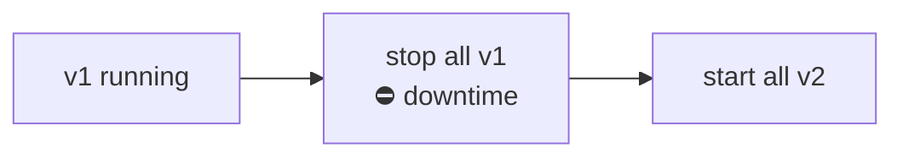
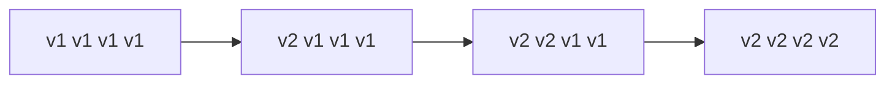
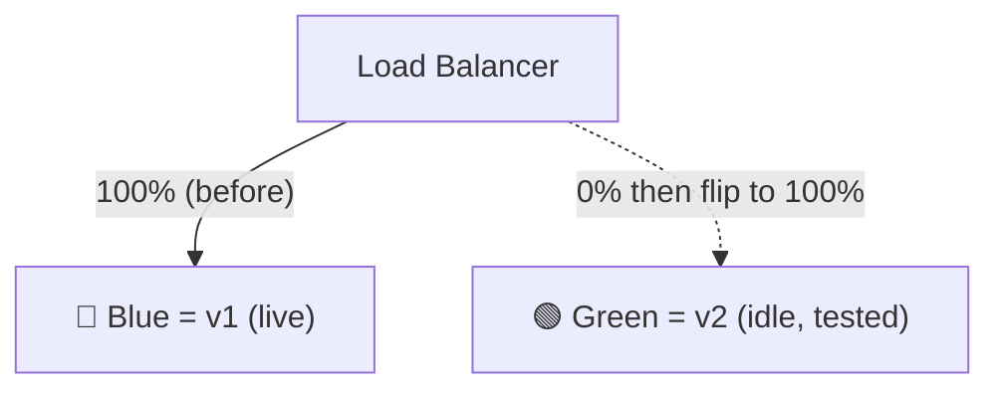
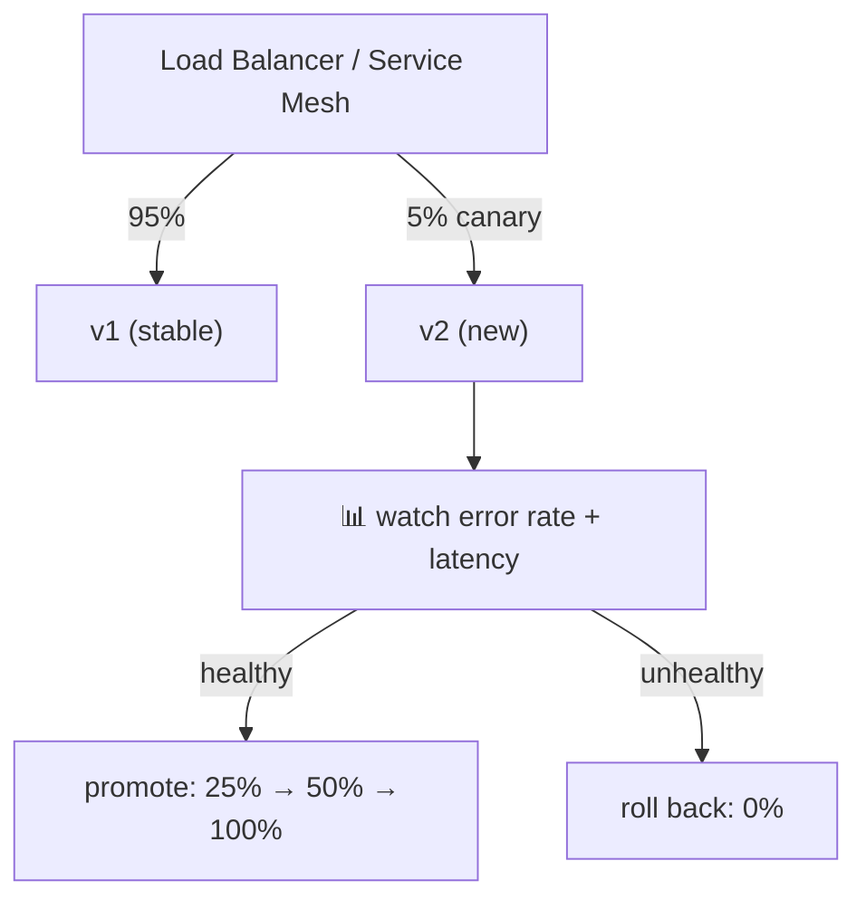
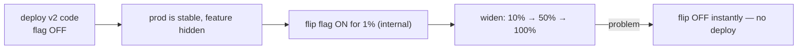
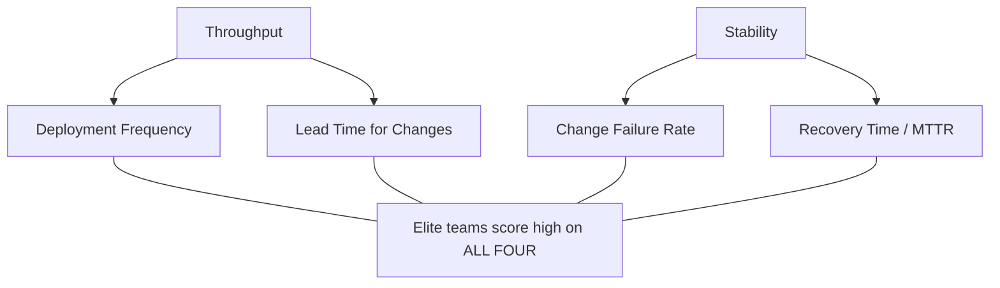
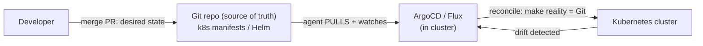

# Day 11 — Deployment Strategies & GitOps Intro

> Series: Cloud & DevOps Engineering
> Goal: Learn how to release a new version *without* taking the site down or blowing up every user at once — rolling, blue-green, canary, feature flags — plus safe rollbacks, the DORA scoreboard, and GitOps (Git as the deploy button).

---

## Table of Contents
1. [In plain words: why "how you deploy" matters](#1-in-plain-words)
2. [Recreate (the naive baseline)](#2-recreate)
3. [Rolling deployment](#3-rolling)
4. [Blue-green deployment](#4-blue-green)
5. [Canary deployment](#5-canary)
6. [Feature flags](#6-feature-flags)
7. [Trade-off table: which strategy when](#7-trade-off-table)
8. [Rollbacks & deployment safety](#8-rollbacks--safety)
9. [DORA metrics (the full picture)](#9-dora-metrics)
10. [GitOps: Git as the source of truth](#10-gitops)
11. [Lab](#11-lab)
12. [Self-Check](#12-self-check)
13. [Tomorrow](#13-tomorrow)

---

## 1. In plain words

**In plain words:** Yesterday you built an artifact. But *swapping* the running version for a new one is like changing a plane's engine. You can (a) land the plane, swap it, take off again — downtime; (b) swap one engine at a time while flying — rolling; (c) build a second identical plane, move passengers over, keep the old one warm — blue-green; (d) let a few passengers try the new engine first and watch — canary. Same goal (new version live), wildly different risk.

- **Why:** a bad deploy can take down your whole product. The *strategy* decides the blast radius when — not if — a release is broken.
- **What:** the pattern by which old-version instances are replaced by new-version instances and traffic is shifted.
- **When:** every time you ship to prod. The more users/revenue, the more the strategy matters.
- **How:** orchestrated by your platform (Kubernetes, ECS, a load balancer) plus a deploy tool (ArgoCD, CodeDeploy).
- **Where:** at the traffic layer — load balancers and orchestrators route users to old vs new (ties to **System Design Day 12, load balancing**).

> 🤔 **"Can't I just replace the old version with the new one and be done?"**
> You can — it's called *recreate*, and it means downtime plus an all-or-nothing gamble: if the new version is broken, 100% of users hit the breakage simultaneously. Real strategies exist precisely to shrink downtime to zero and the blast radius to a few percent. Choosing "just replace it" for a high-traffic product is choosing maximum risk.

**✅ Good scenario (where it saves you):** A canary sends 5% of traffic to `v2`. Error rate on the canary spikes; the pipeline auto-rolls-back in 90 seconds. 95% of users never noticed. Incident averted.

**❌ Bad scenario (the pain without it):** Recreate deploy at peak hours. New version has a bad DB migration. The site is down for *everyone* for 25 minutes while the team scrambles to redeploy the old version they hope still builds.

**When NOT to overthink:** an internal admin tool with 5 users at 2am can use recreate — a few seconds of downtime is fine and the extra machinery isn't worth it. Match ceremony to blast radius.

---

## 2. Recreate

**In plain words:** stop all old instances, then start all new ones. Simplest, and there's a gap where *nothing* is running.


*Recreate: a downtime window between killing v1 and v2 being ready.*

- **Pros:** dead simple, no version overlap (good when v1 and v2 *can't* coexist, e.g. incompatible schema).
- **Cons:** downtime; all-or-nothing risk.
- **When:** low-traffic internal tools, or when versions genuinely cannot run side by side.

---

## 3. Rolling

**In plain words:** replace instances a few at a time. At any moment, some run v1 and some run v2 — no downtime, because there are always healthy instances serving.


*Rolling: swap in batches; the load balancer keeps sending traffic only to healthy pods.*

- **Why:** zero-downtime with minimal extra infrastructure (no duplicate fleet).
- **What:** the orchestrator (Kubernetes Deployment, ECS) kills N old pods, starts N new, waits for health checks, repeats.
- **How (Kubernetes):**
  ```yaml
  spec:
    strategy:
      type: RollingUpdate
      rollingUpdate:
        maxUnavailable: 1     # never drop more than 1 pod at once
        maxSurge: 1           # may run 1 extra pod during rollout
  ```
- **Where:** the default in Kubernetes and ECS.

**Dark Side note:** during a rolling update, v1 and v2 run **simultaneously**. Your app and database schema must be *backward compatible* for the overlap window. A migration that drops a column v1 still reads will break the old pods mid-rollout. This forces the discipline of *expand-and-contract* migrations (add column → deploy code using it → later remove old).

> 🤔 **"Rolling is zero-downtime, so it's totally safe, right?"**
> Zero-downtime ≠ zero-risk. A bad v2 still rolls out to *everyone*, just gradually — and if health checks pass but the app is *logically* broken (returns wrong data, not errors), rolling happily ships the bug to 100%. Health checks catch crashes, not bad business logic. That's why canary + real metrics exist.

**✅ Good:** a 10-pod service updates 1 pod at a time; a crash-on-boot bug fails the first pod's health check and the rollout *halts* automatically at 1/10 affected.

**❌ Bad:** the new version boots fine (health check green) but silently corrupts data. Rolling ships it to all 10 pods before anyone notices.

---

## 4. Blue-green

**In plain words:** stand up a *complete second environment* (green) running v2 alongside the live one (blue) running v1. Test green privately, then flip the load balancer to point 100% at green — instant cutover. Keep blue warm for instant rollback.


*Blue-green: two full environments; the LB flip is the release, and flipping back is the rollback.*

- **Why:** instant cutover and instant rollback (flip the LB back). Green is fully tested before any user touches it.
- **What:** two parallel prod environments; a router/LB decides which is live.
- **Cost:** you pay for *double* the infrastructure during the overlap.
- **How:** on AWS, CodeDeploy blue-green with an ALB target-group swap; on K8s, two Deployments + a Service selector flip.
- **Where:** high-stakes releases where instant rollback is worth the double cost.

> 🤔 **"Blue-green means I can never have a bad release reach users, right?"**
> No — when you flip, **100% of traffic** moves to green at once. If green has a bug your pre-flip tests missed, everyone hits it instantly (though you can flip back fast). Blue-green optimizes *rollback speed*, not *gradual exposure*. For gradual exposure you want canary. Also: the database is usually *shared* between blue and green, so a bad migration isn't undone by flipping back.

**❌ Bad scenario (when misused):** team assumes flipping back to blue undoes everything, but v2 already wrote incompatible rows to the *shared* DB. Rollback restores the old *code* but not the corrupted *data*. Blue-green protects code, not shared state.

---

## 5. Canary

**In plain words:** named after canaries in coal mines. Release v2 to a *small* slice of real users (say 5%), watch real production metrics (errors, latency), and only widen to 25% → 50% → 100% if it stays healthy. If it's sick, roll back having harmed almost no one.


*Canary: expose a little, measure real metrics, then promote or abort — the smallest blast radius.*

- **Why:** smallest possible blast radius; validated against *real* traffic (things staging can't reproduce).
- **What:** progressive traffic shifting gated on live metrics.
- **How:** service meshes (Istio, Linkerd), Argo Rollouts, AWS CodeDeploy canary configs, or LB weights. Tie promotion to metric thresholds via Prometheus (the *3 pillars of observability* — **System Design Day 20**).
- **Where:** high-traffic consumer products where 5% is still a statistically useful sample.
- **When NOT to:** low traffic — 5% of 200 daily users is 10 people, not enough signal. And it needs *good observability*; without metrics, a canary is just a slow rolling deploy.

**✅ Good:** payment service v2 canaried at 5%; p99 latency doubles on the canary only; auto-abort at 90 seconds; 95% of users never saw it.

---

## 6. Feature flags

**In plain words:** decouple *deploy* from *release*. Ship the code to prod **turned off** behind an `if (flag.enabled)`, then flip it on for chosen users *without a new deploy*. The code is already live and warm; the flag controls exposure.


*Feature flags separate 'code is deployed' from 'feature is live' — the kill switch needs no redeploy.*

- **Why:** instant kill switch (no rebuild/redeploy), targeted rollout (beta users, %), decouples ship cadence from release decisions, enables trunk-based development (merge incomplete features safely, hidden behind a flag).
- **What:** runtime configuration gating code paths; managed by LaunchDarkly, Flagsmith, Unleash, or a config table.
- **How:**
  ```javascript
  if (flags.isEnabled("new-checkout", { userId })) {
    return newCheckout();
  }
  return oldCheckout();          // both code paths shipped; flag chooses
  ```
- **Where:** product teams doing continuous deployment and A/B experiments.

> 🤔 **"Feature flags are just glorified if-statements — why the fuss?"**
> The magic is *changing behavior in prod without deploying*. A canary needs a pipeline run to shift traffic; a flag flips in milliseconds from a dashboard, even for non-engineers (PMs, on-call). It's the fastest possible rollback for a *feature*. The fuss is that "deploy" and "release" become independent decisions.

**Dark Side note:** flags are *debt*. Every flag is a permanent branch in your code doubling the paths to test. Dead flags left "on forever" rot into confusing dead code. Rule: every flag needs an owner and an expiry — remove it once the feature is fully rolled out.

---

## 7. Trade-off table

| Strategy | Downtime | Blast radius | Rollback speed | Extra cost | Needs good metrics? | Best for |
|----------|----------|-------------|----------------|-----------|--------------------|---------|
| **Recreate** | Yes | 100% | Redeploy old | None | No | Internal/low-traffic, incompatible versions |
| **Rolling** | No | Gradual → 100% | Roll back gradually | Minimal | Somewhat | Default for most services |
| **Blue-green** | No | 100% at flip | Instant (flip back) | ~2x infra | Some | High-stakes, need instant rollback |
| **Canary** | No | ~5% first | Fast (drop canary) | Small | **Yes** | High-traffic consumer apps |
| **Feature flags** | No | You choose | Instant (flip flag) | Flag platform | Yes (for %) | Continuous deployment, experiments |

**These combine.** Real product setup: canary *deploy* the artifact, and gate the actual *feature* behind a flag. Best of both — safe infra rollout *and* an instant feature kill switch.

---

## 8. Rollbacks & safety

The most important sentence in this course: **you will ship a bad deploy. Optimize for how fast you recover, not for never failing.** (This is DORA's MTTR.)

**Rollback options, fastest first:**
1. **Feature flag off** — milliseconds, no deploy. Best if the change was behind a flag.
2. **Blue-green flip back** — seconds, if you kept blue warm.
3. **Redeploy previous artifact** — minutes. Because you tagged by git SHA (Day 9!), the old image *still exists* — just point the deploy at `:<previous-sha>`.
4. **Roll forward** — sometimes fixing forward is faster than reverting (e.g. a one-line config).

**Safety mechanisms:**
- **Health checks / readiness probes** — don't route traffic to a pod until it says it's ready.
- **Automated rollback** — CodeDeploy/Argo Rollouts abort and revert if error/latency alarms fire.
- **Expand-and-contract migrations** — never make a schema change that breaks the currently-running version during overlap.
- **Deploy during low-traffic windows** for risky changes; small changes anytime.

> 🤔 **"If my testing is good enough, I won't need rollbacks, right?"**
> No test suite catches everything — real traffic, real data volume, real third-party outages, and real user behavior surface bugs staging never will. Mature teams *assume* failure and make rollback boring and instant. A team that can roll back in 60 seconds ships fearlessly; a team that can't ships once a quarter, terrified.

**❌ Bad scenario:** no artifact versioning; "rollback" means *rebuilding* the old commit under pressure, hoping it still compiles with today's dependencies. 40-minute outage. Immutable, SHA-tagged artifacts (Day 9) would have made rollback a 2-minute redeploy.

---

## 9. DORA metrics

The full scoreboard (previewed Day 9). These four, from Google's DORA research, separate elite teams from low performers — and your deployment strategy directly moves them.

| Metric | Measures | Elite (2026, *verify current*) | Which strategy helps |
|--------|----------|-------------------------------|----------------------|
| **Deployment Frequency** | How often you ship to prod | Multiple/day | Automation + canary/flags reduce fear |
| **Lead Time for Changes** | Commit → prod | < 1 hour | CI/CD pipeline (Day 10) |
| **Change Failure Rate** | % deploys causing a prod issue | 0–15% | Canary + flags catch bad changes early |
| **Failed Deployment Recovery Time** (MTTR) | Time to recover from a bad deploy | < 1 hour | Fast rollback: flags, blue-green, SHA artifacts |


*The myth was speed-vs-stability; DORA proved elite teams win both — the strategies above are how.*

**The key insight:** throughput and stability are *not* a trade-off. The same practices — small batches, automation, safe rollback, feature flags — improve all four together. Ship *smaller* and *more often* and you get faster *and* safer.

---

## 10. GitOps

**In plain words:** GitOps makes **Git the single source of truth for what's running in prod.** Instead of a pipeline *pushing* changes into the cluster, an agent living *in* the cluster continuously *pulls* from Git and makes reality match. Want to deploy? Merge a change to the Git repo describing the desired state. Want to roll back? `git revert`. The cluster reconciles itself to whatever Git says.


*GitOps: an in-cluster agent continuously reconciles the live cluster to the desired state declared in Git.*

**Core principles:**
1. **Declarative** — the whole desired system state is described in files (K8s YAML, Helm), not imperative scripts.
2. **Versioned in Git** — Git is the source of truth; every change is a commit (who, what, when — free audit log).
3. **Pulled automatically** — an in-cluster agent (ArgoCD or Flux) watches Git and applies changes.
4. **Continuously reconciled** — if someone `kubectl edit`s prod by hand, the agent detects *drift* and reverts it to match Git. Prod can't silently diverge from Git.

**The 2026 tools:**

| Tool | Notes |
|------|-------|
| **ArgoCD** | Most popular; great UI showing sync status & drift; app-of-apps pattern |
| **Flux** | CNCF, lightweight, GitOps toolkit, strong Helm/Kustomize integration |

> 🤔 **"GitOps sounds like just 'CI/CD but the deploy step is in the cluster' — what's the real difference?"**
> Two big shifts. **Pull vs push:** classic CI/CD *pushes* (`kubectl apply` from a runner that holds cluster credentials); GitOps *pulls* (the agent in the cluster reads Git, so your CI never needs prod credentials — huge security win). **Continuous reconciliation:** classic CI/CD applies once and walks away; if someone hand-edits prod, nobody notices. GitOps *constantly* re-asserts Git's state, so manual drift is auto-corrected. Git is not just where deploys start — it's what prod is *guaranteed to equal*.

**✅ Good scenario:** an engineer hotfixes prod with `kubectl edit` at 3am. ArgoCD flags the config as "OutOfSync," and either reverts it or forces the fix to be committed to Git — so the emergency change isn't lost on the next deploy.

**❌ Bad scenario (the pain without it):** in a push-based shop, three engineers have made undocumented `kubectl` changes to prod over six months. Nobody knows the *true* current config. A cluster rebuild is impossible because the real state lives only in the cluster's memory, not in Git.

**When NOT to:** GitOps shines with Kubernetes/declarative infra. For a couple of Lambda functions or a single EC2 box, full ArgoCD is over-engineering — a simple pipeline deploy is plenty.

---

## 11. Lab

**Add a real deploy stage with a manual approval gate, and reason about strategy.**

Part A — Approval gate (hands-on, builds on Day 10):
1. In your Day 10 repo, add a `deploy-staging` job (`environment: staging`, auto) and a `deploy-prod` job (`environment: production`) with `needs: deploy-staging`.
2. In repo Settings → Environments → `production`, add **yourself as a required reviewer**.
3. The deploy step can be a stand-in that echoes the strategy:
   ```bash
   echo "Deploying ${{ github.sha }} to prod via rolling update"
   # real: aws ecs update-service --force-new-deployment  (rolling)
   #  or:  kubectl set image deploy/app app=ghcr.io/you/app:${{ github.sha }}
   ```
4. Push to `main`. Watch the workflow **pause at `deploy-prod`** awaiting your approval. Approve it. Confirm the audit trail shows who/when.

Part B — Strategy design (on paper):
5. For each of these products, pick a deployment strategy and justify in 2 lines:
   - a) Internal admin dashboard, 8 users, business hours only.
   - b) Consumer mobile-app backend, 2M daily users, revenue-critical checkout.
   - c) A new "dark launch" recommendation feature the PM wants to test on 1% of users.
6. Write the **rollback plan** for (b): what's your fastest rollback, and what makes it fast? (Hint: SHA-tagged artifact + which strategy.)
7. **GitOps sketch:** draw how a merge to a Git repo of K8s manifests reaches the cluster via ArgoCD. Mark where "drift detection" happens.
8. **DORA:** for product (b), which single practice would most improve *Change Failure Rate*, and which would most improve *MTTR*?

**Deliverable:** a link to the paused-then-approved prod run, plus your one-page strategy/rollback notes.

---

## 12. Self-Check

1. Contrast blast radius: recreate vs canary. Who hits a bad release, and how many?
2. Why must app + schema be backward compatible during a rolling update?
3. Blue-green gives instant rollback — but name one thing flipping back to blue does *not* undo.
4. When is canary a poor fit? (Two reasons.)
5. Explain how feature flags decouple "deploy" from "release."
6. List three rollback methods, fastest first, and what each requires.
7. Name the four DORA metrics and split them into throughput vs stability.
8. "Speed vs stability is a trade-off." Why did DORA prove this wrong?
9. GitOps: explain *pull vs push* and why pull is a security win.
10. What is "drift" in GitOps and how does ArgoCD handle it?

---

## 13. Tomorrow

**Day 12 — Cloud & AWS Foundations:** we've been deploying *somewhere* — tomorrow we learn *where*. Why cloud at all (capex→opex, elasticity, managed services), regions and AZs, the shared responsibility model, console vs CLI vs SDK, and the big compute decision: EC2 vs ECS vs EKS vs Fargate vs Lambda — when to reach for each, with GCP/Azure equivalents. You'll launch a real EC2 instance, SSH in, and run a container on it.
