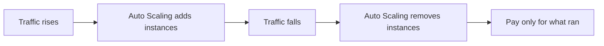
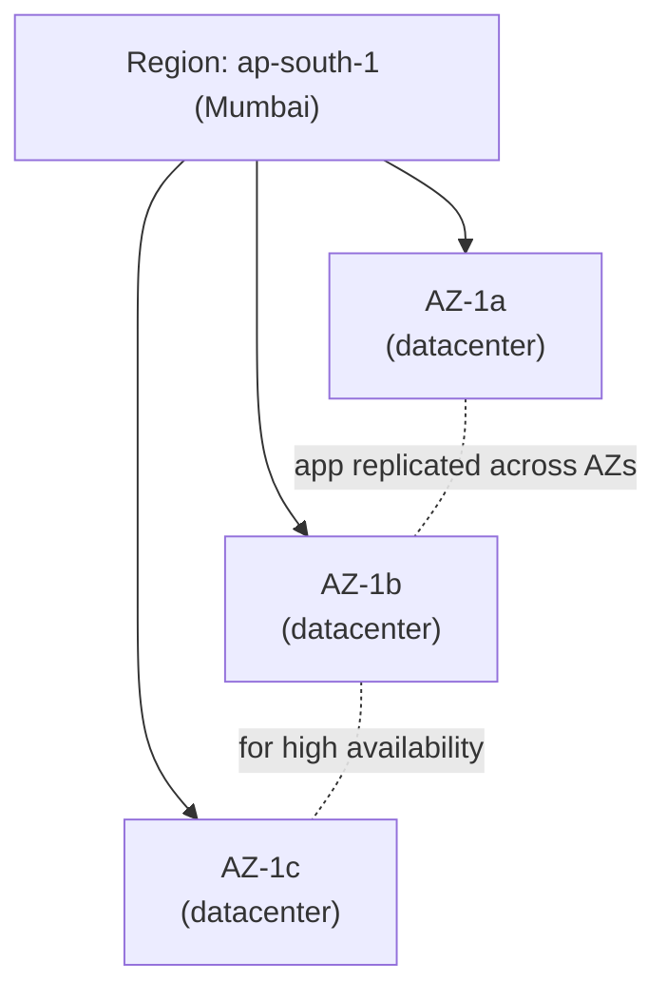
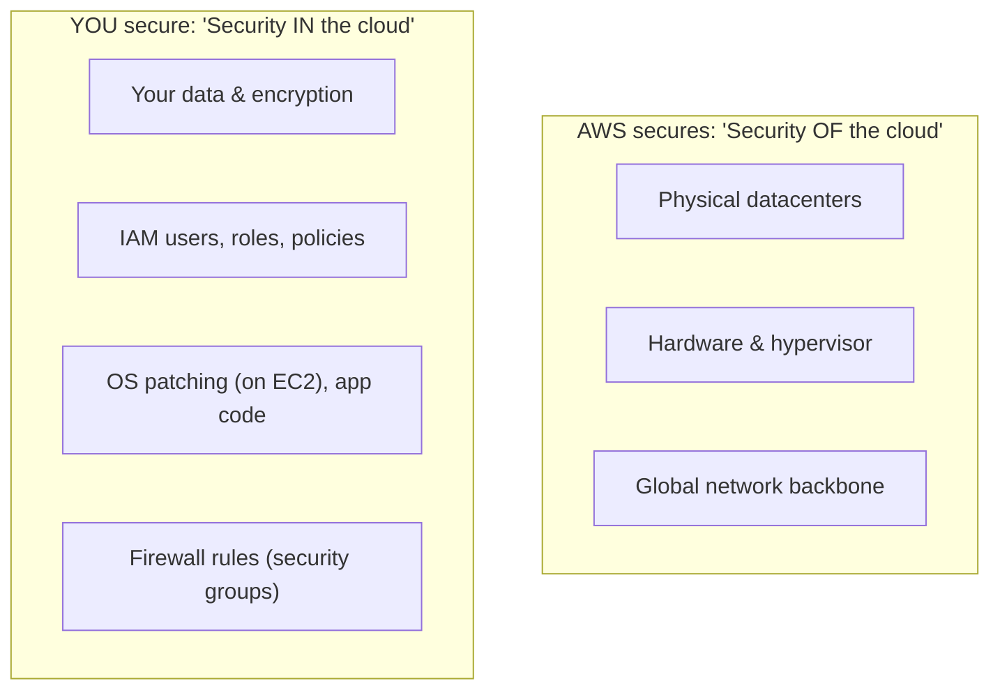
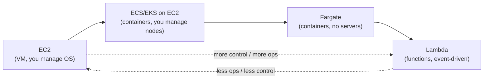

# Day 12 — Cloud & AWS Foundations

> Series: Cloud & DevOps Engineering
> Goal: Understand *why* cloud exists, the mental map of AWS (regions/AZs, shared responsibility, console/CLI/SDK), and how to choose compute — EC2 vs ECS vs EKS vs Fargate vs Lambda — then launch a real EC2 box and run a container on it.

---

## Table of Contents
1. [In plain words: what "cloud" actually is](#1-in-plain-words)
2. [Why cloud: capex → opex, elasticity, managed services](#2-why-cloud)
3. [Regions & Availability Zones](#3-regions--azs)
4. [The shared responsibility model](#4-shared-responsibility)
5. [Three ways to touch AWS: console, CLI, SDK](#5-console-cli-sdk)
6. [Compute options: the big decision](#6-compute-options)
7. [EC2 vs ECS vs EKS vs Fargate vs Lambda](#7-compute-comparison)
8. [GCP & Azure equivalents](#8-gcp-azure-equivalents)
9. [Lab: launch EC2, SSH, run a container](#9-lab)
10. [Self-Check](#10-self-check)
11. [Tomorrow](#11-tomorrow)

---

## 1. In plain words

**In plain words:** The cloud is *renting someone else's computers by the second* instead of buying your own. Before cloud, launching a product meant buying physical servers, racking them in a data center, running the AC and networking, and hoping you bought the right amount — too few and you crash on launch day, too many and you've wasted a fortune. AWS (and GCP, Azure) own millions of servers and rent you exactly what you need, when you need it, via an API. Stop using it? Stop paying.

"The cloud is just someone else's computer" — but a computer with a data center, redundant power, global network, and 200+ managed services attached, that you rent by the minute.

- **Why:** eliminate the massive upfront cost and guesswork of owning hardware; get global scale on demand.
- **What:** on-demand compute, storage, networking, and higher-level managed services, rented via API/console.
- **When:** almost always for new products in 2026 — unless regulation or extreme scale economics say otherwise.
- **How:** an account, a web console + CLI + SDK, and a credit card.
- **Where:** AWS is the market leader; GCP and Azure are the other two majors. This course teaches AWS (transferable concepts).

> 🤔 **"Cloud is just outsourcing my servers to save money — right?"**
> Cost is only part of it, and cloud isn't automatically *cheaper* (at massive steady scale, owning hardware can win — Dropbox famously left). The bigger wins are **speed** (spin up a database in 3 minutes vs 3 weeks of procurement), **elasticity** (scale to 10x for Black Friday, back down at midnight), and **managed services** (AWS runs your database's backups, patching, and failover so you don't). You're buying agility and offloaded ops, not just rented metal.

**✅ Good scenario (where it saves you):** a startup launches, gets a traffic spike from a viral post, auto-scales from 2 to 40 servers in minutes, handles it, scales back down by morning. Paid for exactly the peak they used. Owning hardware, they'd have crashed or pre-bought 40 idle servers.

**❌ Bad scenario (the pain without it):** a team runs their own data center. A disk fails at 2am, there's no redundancy, and the product is down 6 hours until someone drives in with a replacement drive. Meanwhile a competitor on AWS had automatic multi-AZ failover.

**When NOT to (Dark Side note):** cloud bills can *explode* if you leave things running or over-provision (we hammer this on Day 16). And "lift-and-shift" of a legacy app without re-architecting often costs *more* than the old data center while delivering none of the elasticity. Cloud rewards cloud-native design; it punishes carelessness.

---

## 2. Why cloud

Three pillars. Memorize these — they're the answer to every "why cloud?" interview question.

**1. Capex → Opex (capital expense → operating expense).**
- **Old world:** buy $500k of servers upfront (capex), depreciate over years, whether or not you use them.
- **Cloud:** pay-as-you-go monthly (opex). No upfront hardware. Spend scales with usage.
- **Why it matters:** startups can launch for dollars; you convert a scary fixed bet into a variable cost tied to actual demand.

**2. Elasticity (scale up *and* down, automatically).**
- Match capacity to demand in real time. 10x traffic at lunch, 0.1x at 3am — pay for each.
- Contrast *scalability* (can grow) with *elasticity* (grows **and shrinks automatically**). The shrinking is what saves money.


*Elasticity: capacity tracks demand in both directions, so you never pay for idle peak hardware.*

**3. Managed services (let AWS run the undifferentiated heavy lifting).**
- RDS runs your database's patching, backups, replication, failover. You just use it.
- The value ladder: **more managed = less ops toil, less control, sometimes more cost.** You climb this ladder in §6.

> 🤔 **"If cloud is pay-as-you-go, it's always cheaper than owning servers, right?"**
> No. For *spiky/uncertain* workloads, cloud is far cheaper (you don't pay for idle peak capacity). But for a *steady, predictable, massive* workload running 24/7 at high utilization, owning hardware can be cheaper per unit — which is why a few giants repatriate. The cloud premium buys elasticity and speed; if you don't *need* those, you're paying for options you don't use. Most product companies do need them.

---

## 3. Regions & AZs

**In plain words:** AWS divides the world into **Regions** (a geographic area, e.g. `ap-south-1` = Mumbai, `us-east-1` = N. Virginia). Each region contains multiple **Availability Zones (AZs)** — physically separate data centers, miles apart, with independent power and networking, but connected by fast private links. You deploy *across* AZs so one data center burning down doesn't take you offline.


*A Region is a geography; AZs are isolated datacenters within it — spread across AZs for HA.*

| Concept | What | Rule of thumb |
|---------|------|--------------|
| **Region** | Geographic area (Mumbai, Ireland...) | Pick near your users (latency) + data-residency laws |
| **Availability Zone (AZ)** | Isolated datacenter(s) within a region | Deploy across ≥2 AZs for high availability |
| **Edge location** | CDN PoP (CloudFront) | Cache content near users globally (Day 14) |

**Why regions matter:**
- **Latency** — put compute near users (System Design Day 12 / networking intuition).
- **Data residency** — GDPR / Indian data laws may *require* data stay in a region.
- **Cost** — prices differ per region.
- **Service availability** — not every service launches in every region on day one.

**Why AZs matter:** *high availability.* An AZ can fail (power, fire, flood). Spreading your app and database across ≥2 AZs means a single-AZ outage doesn't take you down. Multi-AZ is the foundation of the load-balancing and redundancy ideas from **System Design Day 12**.

> 🤔 **"Multi-AZ, multi-region — isn't that overkill? One region is fine, right?"**
> **Multi-AZ within one region is table stakes** — always do it for anything production; it's cheap and protects against the common failure (one datacenter down). **Multi-*region*** is a different, expensive beast (data replication, DNS failover, complexity) reserved for global apps or extreme DR requirements. Don't conflate them: multi-AZ = yes by default; multi-region = only when you truly need it.

**❌ Bad scenario:** a team runs their entire prod DB in a single AZ to save money. That AZ has a power event; the product is down for hours. A multi-AZ RDS deployment would have failed over automatically in ~60 seconds.

---

## 4. Shared responsibility

**In plain words:** security in the cloud is a *split contract.* AWS secures the cloud *itself* (the buildings, hardware, hypervisor, network). **You** secure what you put *in* the cloud (your data, your access controls, your app, your firewall rules). The line moves depending on the service. Get the line wrong and you have a breach.


*AWS secures the cloud; you secure what you put in it — and where the line sits shifts by service.*

| You're responsible for... | AWS is responsible for... |
|---------------------------|---------------------------|
| Your data & who can access it | Physical security of datacenters |
| IAM configuration (Day 13!) | Hardware, hypervisor, host OS |
| Security group / NACL rules (Day 14) | Global network & availability zones |
| Guest OS patching **on EC2** | Managed-service patching (RDS, Lambda runtime) |
| Encryption choices | Encryption *capability* (KMS) |

**The line moves with the service:**
- **EC2 (IaaS):** you patch the OS, secure the app, configure the firewall. Most responsibility yours.
- **RDS (managed):** AWS patches the DB engine and OS; you manage users, data, and network access.
- **Lambda (serverless):** AWS runs *everything* under your code; you own only the code and its permissions. Least responsibility yours.

> 🤔 **"AWS is super secure, so my stuff on AWS is automatically secure, right?"**
> This misconception causes a huge share of real breaches. AWS securing the *datacenter* does nothing about *your* misconfigured S3 bucket set to public, *your* leaked access keys, or *your* IAM policy granting `*:*`. The most famous cloud breaches (Capital One, countless open S3 buckets) were **customer-side** misconfigurations — squarely on the "you" side of the line. AWS gives you secure tools; using them securely is your job. That's why Day 13 (IAM) is the most important day of this course.

**❌ Bad scenario:** a team assumes "it's on AWS, it's secure," leaves an S3 bucket public, and 100M customer records leak. AWS did its job perfectly; the customer misread the contract.

---

## 5. Console, CLI, SDK

Three ways to interact with AWS — you'll use all three.

| Method | What | Best for | Reproducible? |
|--------|------|----------|--------------|
| **Console** | Web UI (point & click) | Learning, exploring, one-off inspection | ❌ No (manual clicks) |
| **CLI** | `aws` command-line tool | Scripting, automation, CI/CD | ✅ Yes (scriptable) |
| **SDK** | Libraries (boto3 Python, aws-sdk JS...) | In your application code | ✅ Yes (in code) |

```bash
# Configure the CLI once (better: use SSO / roles, not long-lived keys — Day 13)
aws configure                       # prompts for key, secret, region, output

# Every console click has a CLI equivalent:
aws ec2 describe-instances          # list your EC2 instances (JSON)
aws s3 ls                           # list your S3 buckets
aws sts get-caller-identity         # "who am I?" — confirm which identity you are
```

```python
# SDK (boto3) — AWS from inside your app
import boto3
s3 = boto3.client("s3")
s3.upload_file("report.pdf", "my-bucket", "reports/report.pdf")
```

**The maturity path:** start in the **console** to *understand* what exists → move to the **CLI/IaC** so it's *reproducible and reviewable* → use the **SDK** for logic *inside* your app.

> 🤔 **"The console is easiest — why bother with CLI or Terraform?"**
> Console clicking is fine for *learning*, but it's the enemy of reliable ops: it's not repeatable, not reviewable, not version-controlled, and impossible to recreate after a disaster. "ClickOps" in production means nobody can reproduce your environment. Real teams define infra as *code* (CLI scripts, and ideally Terraform/CloudFormation) so it's auditable and rebuildable — the same "declarative, in Git" principle as GitOps (Day 11).

**Dark Side note:** `aws configure` stores long-lived access keys in `~/.aws/credentials` in plaintext. This is exactly the credential that gets leaked and abused. Prefer **AWS IAM Identity Center (SSO)** with short-lived credentials, or roles — you'll understand *why* deeply after Day 13.

---

## 6. Compute options

**In plain words:** "compute" = where your code actually runs. AWS gives you a *spectrum* from "here's a bare virtual server, you do everything" (EC2) to "just give me a function, I'll run it on demand" (Lambda). The trade-off is always **control vs. operational burden**: more control = more work; more managed = less work but less flexibility.


*The compute spectrum: from full-control VMs to zero-server functions — pick by how much ops you want to own.*

- **EC2** — a virtual machine. You choose OS, size, and patch/secure it. Maximum control and flexibility; maximum ops. Like renting an empty apartment.
- **ECS / EKS (on EC2)** — run *containers* (your Docker images from Day 10). **ECS** is AWS's simpler orchestrator; **EKS** is managed Kubernetes (industry-standard, portable, complex). You still manage the underlying EC2 "nodes."
- **Fargate** — run containers with **no servers to manage**. You hand AWS a container + CPU/memory spec; it runs it. Works under ECS *or* EKS. Like a serviced apartment — you bring your stuff, they handle the building.
- **Lambda** — **serverless functions.** Upload code; it runs *only when triggered* (an HTTP request, an S3 upload, a queue message), scales automatically, and you pay per invocation/millisecond. Nothing runs = nothing paid. Like a hotel room you're billed for by the minute you occupy it. (Deep dive Day 16.)

> 🤔 **"Containers vs serverless vs VMs — isn't newer always better? Just use Lambda for everything?"**
> No — each fits different workloads. **Lambda** is perfect for short, event-driven, bursty tasks but is a poor fit for long-running processes, heavy sustained traffic (can get *pricey* vs a always-on container), or when you need fine OS control. **Fargate/ECS/EKS** suit long-running services and existing containerized apps. **EC2** suits when you need specific OS/kernel/hardware (GPUs, special networking) or are lifting-and-shifting. "Newer" is a spectrum of trade-offs, not a ladder — match the tool to the workload shape.

**✅ Good scenario:** an image-thumbnail job that runs on each upload → **Lambda** (event-driven, bursty, pay-per-use, zero idle cost). A steady 24/7 REST API → **Fargate/ECS** (predictable, no cold starts, cheaper at constant load).

**❌ Bad scenario (when misused):** a team runs a high-traffic, constantly-busy API on Lambda; at millions of steady invocations, the per-request bill dwarfs what a couple of Fargate containers would cost — and cold starts add latency. Right tool, wrong workload.

---

## 7. Compute comparison

| Option | You manage | AWS manages | Best for | Cost model | Ops burden |
|--------|-----------|-------------|----------|-----------|-----------|
| **EC2** | OS, patching, scaling, app | Hardware, hypervisor | Full control, special hardware (GPU), legacy lift-and-shift | Per instance-hour (running = paying) | High |
| **ECS on EC2** | EC2 nodes, containers | Orchestration control plane | Containerized apps, AWS-native simplicity | Per EC2 node-hour | Medium-high |
| **EKS on EC2** | EC2 nodes, K8s config | K8s control plane | Kubernetes-standard, portable, multi-cloud | Node-hours + cluster fee | High |
| **Fargate** | Container + CPU/mem spec | Servers, patching, scaling | Containers without server management | Per vCPU/mem/second used | Low |
| **Lambda** | Function code + config | Everything else | Event-driven, bursty, glue code | Per request + GB-ms (idle = free) | Very low |

**Decision heuristic (2026):**
- Need OS-level control / GPUs / legacy app → **EC2**.
- Have Docker containers, want simplicity, all-in on AWS → **ECS (Fargate)**.
- Want Kubernetes (portability, big ecosystem, existing k8s skills) → **EKS**.
- Event-driven, spiky, short tasks / want zero idle cost → **Lambda**.
- Default advice for a new containerized service that isn't married to k8s → **ECS on Fargate** (least ops for the value).

---

## 8. GCP & Azure equivalents

Concepts transfer across clouds — only the names change. Keep this table; you'll thank yourself in cross-cloud interviews.

| Concept | AWS | GCP | Azure |
|---------|-----|-----|-------|
| Virtual machine | EC2 | Compute Engine | Virtual Machines |
| Managed Kubernetes | EKS | GKE | AKS |
| Serverless containers | Fargate | Cloud Run | Container Apps |
| Serverless functions | Lambda | Cloud Functions | Azure Functions |
| Region/zone model | Region + AZ | Region + Zone | Region + Availability Zone |
| Object storage | S3 | Cloud Storage | Blob Storage |
| CLI | `aws` | `gcloud` | `az` |
| Identity/permissions | IAM | Cloud IAM | Entra ID / Azure RBAC |

**Note:** GCP's **Cloud Run** is often praised as the cleanest serverless-container experience; Azure is strongest where an org already lives in Microsoft (AD, Office). The *skills* — regions, AZs, shared responsibility, compute spectrum, IAM — are portable. Learn AWS deeply; translation is a lookup table.

---

## 9. Lab

**Launch an EC2 instance, SSH in, and run a container on it.**

> Use the **AWS Free Tier** (a `t2.micro`/`t3.micro` is free-tier eligible — *verify current free-tier terms*). **Stop or terminate the instance when done** so you're not billed.

1. **Launch** (console first, to *see* it, then note the CLI equivalent):
   - EC2 → Launch instance → Amazon Linux 2023 AMI → `t3.micro`.
   - Create/download a key pair (`.pem`) — this is your SSH key. **Guard it** (foreshadows Day 13 credentials).
   - Network: allow SSH (port 22) **from your IP only** (not `0.0.0.0/0`!) and HTTP (80). This security-group choice is Day 14.
   ```bash
   # CLI equivalent (once you know your subnet/SG/key names):
   aws ec2 run-instances \
     --image-id ami-xxxxxxxx --instance-type t3.micro \
     --key-name my-key --security-group-ids sg-xxxx \
     --subnet-id subnet-xxxx
   ```
2. **SSH in:**
   ```bash
   chmod 400 my-key.pem                       # key must not be world-readable
   ssh -i my-key.pem ec2-user@<public-ip>     # connect
   ```
3. **Install Docker and run a container:**
   ```bash
   sudo dnf install -y docker                 # Amazon Linux 2023
   sudo systemctl start docker
   sudo docker run -d -p 80:80 nginx          # run nginx, map port 80
   sudo docker ps                             # confirm it's running
   ```
4. **Verify from your browser:** visit `http://<public-ip>` — you should see the nginx welcome page. (If it hangs, that's a security-group/networking problem — exactly the Day 14 "why can't it connect?" debug flow.)
5. **Reflect (write answers):**
   - Which parts of this did *you* secure vs AWS (shared responsibility)?
   - Where on the compute spectrum is this, and what would running the same nginx on **Fargate** save you?
   - What's the GCP equivalent of the instance you launched?
6. **Clean up — do NOT skip:**
   ```bash
   aws ec2 terminate-instances --instance-ids i-xxxxxxxx   # stop the meter
   ```

**Deliverable:** a screenshot of the nginx page served from *your* EC2 public IP, plus your reflection answers.

---

## 10. Self-Check

1. Give the three pillars of "why cloud" and explain capex→opex in one sentence.
2. Difference between scalability and elasticity — and why does the *shrinking* matter for cost?
3. Region vs Availability Zone — and why deploy across ≥2 AZs?
4. Draw the shared responsibility line for EC2 vs Lambda. What flips?
5. Name the most common *category* of real cloud breach and which side of the responsibility line it's on.
6. Console vs CLI vs SDK — which is not reproducible, and why does that matter in prod?
7. Place EC2, Fargate, and Lambda on the control-vs-ops spectrum.
8. Give one workload where Lambda is ideal and one where it's a costly mistake.
9. For a new containerized service not tied to Kubernetes, what's the sensible 2026 default and why?
10. Name the GCP and Azure equivalents of EC2, EKS, and Lambda.

---

## 11. Tomorrow

**Day 13 — IAM & Security Foundations:** the single most important day of this course, because *most cloud breaches are IAM failures* — on your side of the responsibility line. Users, groups, roles, policies, least privilege, roles vs access keys, instance profiles, assume-role, MFA, and the anatomy of a policy JSON. You'll write a least-privilege policy and give an EC2 instance access to S3 *with no access keys at all.*
