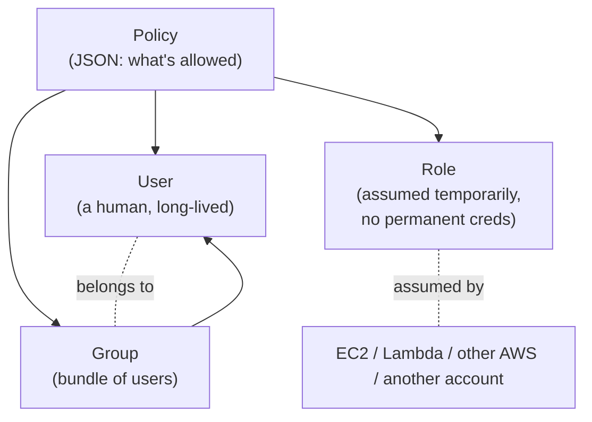
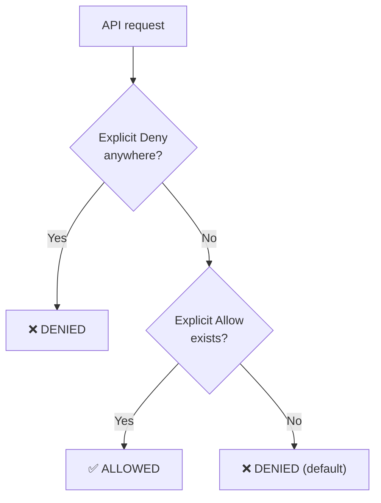
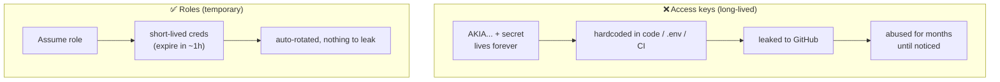
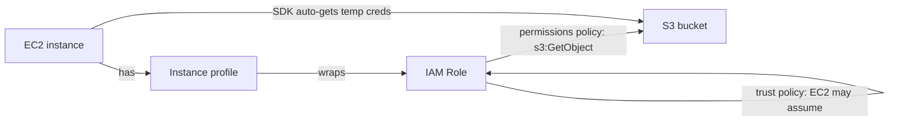
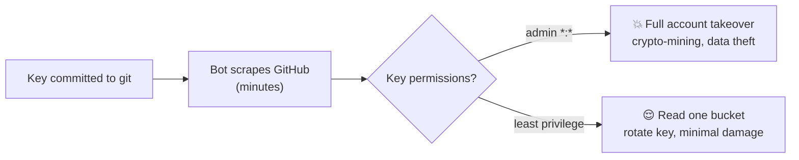
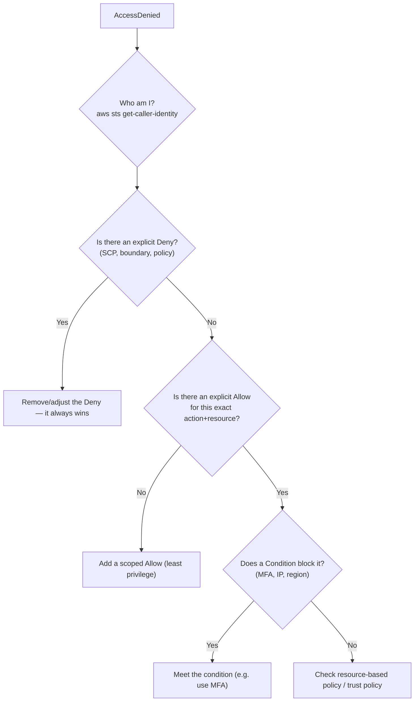

# Day 13 — IAM & Security Foundations

> Series: Cloud & DevOps Engineering
> Goal: Master the single highest-leverage security skill in cloud — because the majority of real breaches are IAM misconfigurations, squarely on *your* side of the shared-responsibility line. Users, groups, roles, policies, least privilege, and giving compute access *without* keys.

---

## Table of Contents
1. [In plain words: what IAM is and why it's #1](#1-in-plain-words)
2. [The four building blocks: users, groups, roles, policies](#2-building-blocks)
3. [Policy JSON anatomy](#3-policy-json)
4. [Least privilege](#4-least-privilege)
5. [Roles vs access keys (the big one)](#5-roles-vs-keys)
6. [Instance profiles & assume-role](#6-instance-profiles-assume-role)
7. [MFA & root account hygiene](#7-mfa--root)
8. [Real breach scenarios (learn from pain)](#8-breach-scenarios)
9. [IAM debug flow: "why is this denied?"](#9-debug-flow)
10. [Lab](#10-lab)
11. [Self-Check](#11-self-check)
12. [Tomorrow](#12-tomorrow)

---

## 1. In plain words

**In plain words:** IAM (Identity and Access Management) is the *bouncer and keycard system* for your entire AWS account. It answers one question for every single action: **"Is *this identity* allowed to do *this thing* on *this resource*?"** Every API call — reading a file, launching a server, deleting a database — passes the bouncer. Get the keycards wrong (too many doors open) and one stolen card opens everything.

Why is this Day 13 the most important day? Because **AWS securing the datacenter (Day 12) does nothing if you hand out keys to everything.** The famous cloud breaches — Capital One, endless public S3 leaks, crypto-mining bills — are almost all IAM/config failures. This is the security skill that pays.

- **Why:** access control is the #1 cause of cloud breaches; it's entirely your responsibility.
- **What:** a global service defining *who* (identities) can do *what* (actions) on *which* resources, under *what* conditions.
- **When:** from the first day of any account — before you build anything real.
- **How:** identities (users/roles) + policies (JSON permission documents) evaluated on every request.
- **Where:** IAM is *global* (not regional) and free; it gates every other AWS service.

> 🤔 **"IAM is boring config — can't I just give admin access and lock it down later?"**
> This exact thought causes breaches. "Lock it down later" never happens; the over-permissioned user/key sits there for months until it leaks (committed to git, phished, left in a laptop). The blast radius of a leaked *admin* credential is your entire company; the blast radius of a leaked *least-privilege* credential is one bucket. IAM done right at the start is nearly free; done wrong, it's the breach in the news. It's not boring — it's the whole game.

**✅ Good scenario (where it saves you):** a developer's least-privilege key leaks in a public repo. A bot finds it and tries to launch EC2 instances — *denied*, the key only had read access to one S3 prefix. Rotate the key, move on. No damage.

**❌ Bad scenario (the pain without it):** a developer's *admin* key leaks the same way. Within minutes bots spin up 100 GPU instances mining crypto across every region. $60k bill, data exfiltrated, incident response for weeks.

**When NOT to over-engineer (Dark Side note):** IAM *can* become so locked-down that engineers are blocked for days waiting on permission grants and route around it with shared admin creds — worse than a sane policy. Least privilege must be paired with a *fast, self-serve* way to request access. Security that's too painful gets bypassed.

---

## 2. Building blocks

Four concepts. Confusing them is the root of most IAM mistakes — especially **user vs role.**


*Policies define permissions; you attach them to users, groups, or roles — roles are the star of secure design.*

| Block | What it is | Credentials | Use for |
|-------|-----------|-------------|---------|
| **User** | A permanent identity for one human (or legacy app) | Long-lived password + optional access keys | Real people logging in |
| **Group** | A named bundle of users sharing policies | None (users have theirs) | "Developers", "Admins" — manage permissions by team |
| **Role** | An identity that's *assumed temporarily*; issues short-lived creds | **No permanent credentials** | AWS services, cross-account, federated/human-via-SSO, apps |
| **Policy** | A JSON document listing allowed/denied actions | N/A | Attached to any of the above |

**The mental model:**
- **Groups** solve "I have 20 developers who all need the same access" — attach the policy to the group, add users to the group. Never attach policies to users one by one.
- **Roles** are the crown jewel: an identity *anything* can temporarily *assume* to get **short-lived** credentials — no permanent keys to leak. An EC2 instance, a Lambda, a CI pipeline (Day 10 OIDC!), a user in another account — all should use roles.

> 🤔 **"What's the real difference between a user and a role? They both have permissions."**
> A **user** = a permanent identity with *long-lived credentials* (a password, access keys that live until you rotate them). A **role** = a *temporary hat anyone can put on*, granting *short-lived credentials* (expire in minutes/hours) via `sts:AssumeRole`. The security difference is enormous: a user's key, if stolen, works until someone notices and revokes it (could be months); a role's credentials, if stolen, expire on their own in an hour. **Prefer roles for everything except actual human login** — and even humans should log in via SSO (which hands them a role).

---

## 3. Policy JSON

**In plain words:** a policy is a document that says, for a list of actions: *Allow* or *Deny*, on which *resources*, under what *conditions*. Every AWS permission is expressible this way. Learn to read it and you can read any AWS permission.

```json
{
  "Version": "2012-10-17",
  "Statement": [
    {
      "Sid": "ReadOneBucketPrefix",
      "Effect": "Allow",
      "Action": [
        "s3:GetObject",
        "s3:ListBucket"
      ],
      "Resource": [
        "arn:aws:s3:::my-app-uploads",
        "arn:aws:s3:::my-app-uploads/reports/*"
      ],
      "Condition": {
        "IpAddress": { "aws:SourceIp": "203.0.113.0/24" }
      }
    }
  ]
}
```

The five parts you must know:

| Field | Meaning | Example |
|-------|---------|---------|
| **Effect** | `Allow` or `Deny` | `"Allow"` |
| **Action** | Which API operations | `"s3:GetObject"`, `"ec2:*"` |
| **Resource** | Which ARNs it applies to | `"arn:aws:s3:::my-bucket/*"` |
| **Condition** | Optional extra constraints | only from an IP, only with MFA, only in a region |
| **Principal** | *Who* (used in resource-based & trust policies) | an account, a service |

**Evaluation rules (memorize):**
1. **Default deny** — if nothing explicitly allows it, it's denied.
2. **Explicit allow** — a matching `Allow` grants it...
3. **Explicit deny wins** — ...unless *any* policy has a matching `Deny`. **Deny always beats Allow.** Use explicit `Deny` for guardrails you never want overridden.


*IAM evaluation: default deny, allow must be explicit, and any explicit deny always wins.*

> 🤔 **"If I add an Allow policy, that grants access — so more policies = more access, right?"**
> Mostly, but the trap is **explicit Deny**. You can attach ten `Allow` policies granting broad access, and a *single* `Deny` statement (say, in a permissions boundary or SCP) overrides all of them. This is a *feature* — org-wide guardrails ("nobody, not even admins, can disable CloudTrail") are enforced with `Deny`. So access isn't just additive; denies are absolute trumps.

**`Action: "*"` and `Resource: "*"` together = admin over everything.** Seeing `"Action": "*", "Resource": "*"` outside a break-glass admin role should set off alarms. That's the "give admin, lock down later" antipattern in JSON form.

---

## 4. Least privilege

**In plain words:** grant *only* the permissions an identity actually needs to do its job — nothing more. A photo-thumbnail Lambda needs to read from one bucket and write to another. It does *not* need to delete databases, launch servers, or read every bucket. Least privilege means its policy grants exactly those two actions on those two buckets.

- **Why:** the blast radius of a compromised identity equals its permissions. Minimize permissions → minimize damage. This is the single most important security principle in cloud.
- **What:** the smallest set of actions on the smallest set of resources that lets the job succeed.
- **When:** always. Start from *zero* and add what's needed (allow-list), never start from admin and subtract.
- **How:** scope `Action` and `Resource` tightly; use conditions; use AWS Access Analyzer to find unused permissions and generate least-privilege policies from CloudTrail history.
- **Where:** every user, role, and policy.

**Least privilege vs the lazy default:**

| Approach | Policy | Blast radius if leaked |
|----------|--------|------------------------|
| ❌ Lazy | `Action: "*", Resource: "*"` (AdministratorAccess) | **Entire account** |
| ⚠️ Half | `s3:*` on `*` | Every bucket, all actions |
| ✅ Least privilege | `s3:GetObject` on `arn:aws:s3:::uploads/thumbnails/*` | One prefix, read-only |

> 🤔 **"Least privilege sounds like it'll break things constantly — isn't broad access more practical?"**
> Broad access is *convenient today, catastrophic tomorrow*. The practical path: grant a scoped policy, and when something's genuinely denied, *widen it precisely* (CloudTrail tells you the exact missing action). This is the opposite of "grant admin, and pray no key leaks." The extra 20 minutes of scoping is insurance against the six-figure breach. Tools (Access Analyzer) now auto-generate least-privilege policies from actual usage, removing most of the pain.

**✅ Good scenario:** an intern's role can only read one S3 prefix. They accidentally run a script that tries to delete an RDS database — *denied*. The scope saved you from a junior mistake.

**❌ Bad scenario (when misused):** a "temporary" admin policy granted to a contractor for a one-off task is never removed. Six months later their laptop is stolen; the still-active admin creds compromise everything.

---

## 5. Roles vs access keys

**This is the most important practical decision in IAM.** Get this right and you eliminate the #1 breach vector.

**In plain words:** an **access key** is a long-lived username/password pair for an app or user (`AKIA...` + secret). It works forever until rotated — and it's the thing that gets committed to GitHub, hard-coded in a script, or left in a config file. A **role** gives out *temporary* credentials that expire automatically — nothing permanent to leak.


*Access keys are permanent and leakable; role credentials expire on their own — always prefer roles.*

| | Access keys | Roles |
|--|-------------|-------|
| Lifetime | Long-lived (until rotated) | Short-lived (minutes–hours) |
| Leak impact | Works until revoked (often months) | Expires on its own |
| Where they end up | git, `.env`, laptops, CI logs | Nowhere persistent |
| Rotation | Manual, often forgotten | Automatic |
| Use for | Last resort for external/legacy systems | **Everything on AWS**: EC2, Lambda, ECS, CI/CD, cross-account |

**The rule (2026):** **eliminate long-lived access keys wherever possible.**
- App on EC2 needs S3? → **instance profile (role)**, not keys.
- Lambda needs DynamoDB? → **execution role**, not keys.
- GitHub Actions needs to deploy? → **OIDC + assume-role** (Day 10), not keys stored as secrets.
- Human needs console? → **IAM Identity Center (SSO)** → temporary creds via a role, not an IAM user with a password.

> 🤔 **"I need my app to call AWS, so it obviously needs an access key stored somewhere, right?"**
> This is the most expensive misconception in cloud. Your app on AWS does **not** need a stored key — it should *assume a role* and receive temporary credentials automatically. An EC2 instance gets them from its **instance profile** via the metadata service; Lambda gets them from its **execution role**; the SDK picks them up with zero config. The *only* time you truly need long-lived keys is an external system that can't assume a role — and even then, use short-lived alternatives first. If you're storing an `AKIA...` key, ask "why isn't this a role?"

**❌ Bad scenario:** the classic. A developer hard-codes `AWS_ACCESS_KEY_ID`/`AWS_SECRET_ACCESS_KEY` into the app and commits it. Automated bots scrape GitHub *continuously* for these patterns; the key is abused within *minutes*. An instance profile would have meant no key existed to commit.

---

## 6. Instance profiles & assume-role

**Instance profile — in plain words:** the mechanism that lets an EC2 instance *be* a role. You create a role (with, say, S3 read access), wrap it in an instance profile, attach it to the instance. Now code running on that instance automatically gets temporary S3 credentials from the instance metadata service — **no keys anywhere.** The AWS SDK finds them automatically.

```bash
# On the EC2 instance, the SDK auto-fetches temp creds from the metadata service.
# You can see them (IMDSv2 — token-required, the secure version):
TOKEN=$(curl -s -X PUT "http://169.254.169.254/latest/api/token" \
  -H "X-aws-ec2-metadata-token-ttl-seconds: 300")
curl -s -H "X-aws-ec2-metadata-token: $TOKEN" \
  http://169.254.169.254/latest/meta-data/iam/security-credentials/
# The app just calls s3.getObject() — SDK handles creds transparently, no keys.
```

**AssumeRole — in plain words:** `sts:AssumeRole` is the API that lets one identity temporarily *become* a role, getting short-lived credentials. It's the backbone of: services using roles, cross-account access, and SSO. A **trust policy** on the role declares *who is allowed to assume it* (the `Principal`).

```json
// Trust policy: "EC2 is allowed to assume this role"
{
  "Version": "2012-10-17",
  "Statement": [{
    "Effect": "Allow",
    "Principal": { "Service": "ec2.amazonaws.com" },
    "Action": "sts:AssumeRole"
  }]
}
```

Two policies per role — don't confuse them:
- **Trust policy** (`Principal`): *who can assume this role.*
- **Permissions policy**: *what the role can do* once assumed.


*Instance profile → role → temporary creds: the app reaches S3 with zero stored keys.*

**Cross-account assume-role** is how a CI account deploys into a prod account, or a central security account audits others — the target role trusts the source account's principal. Same mechanism, huge security value: no shared keys between accounts.

> 🤔 **"Isn't setting up roles and trust policies more work than just using a key?"**
> Slightly more setup, dramatically less risk *and often less ongoing work* — because there's no key to rotate, store securely, or clean up after a leak. The AWS SDK is *built* to find role credentials automatically (from instance metadata, env, or profile) with zero code changes. You write `s3.getObject()` either way; the difference is whether a stealable secret exists. Roles are less work over the lifetime, not more.

---

## 7. MFA & root account hygiene

**Root account** = the email you signed up with. It has *unlimited, unrestricted* power — it can close the account and bypass most controls. Treat it like a nuclear launch key.

**Root account rules:**
1. **Enable MFA on root immediately** — a hardware key or authenticator app.
2. **Never use root for daily work.** Create an IAM admin user / SSO instead.
3. **No access keys on root, ever.** Delete any that exist.
4. **Lock the credentials away** — root is for a handful of tasks only a root can do (closing the account, changing billing).

**MFA (Multi-Factor Authentication) — in plain words:** requires a *second* proof beyond the password — a code from your phone or a hardware key. So a stolen password alone is useless. Enforce MFA on all human users, and *require* it for sensitive actions via a policy condition:

```json
// Deny sensitive actions unless the request was MFA-authenticated
{
  "Effect": "Deny",
  "Action": ["iam:*", "ec2:TerminateInstances"],
  "Resource": "*",
  "Condition": {
    "BoolIfExists": { "aws:MultiFactorAuthPresent": "false" }
  }
}
```

> 🤔 **"MFA is annoying — a strong password should be enough, right?"**
> Passwords get phished, reused, and leaked in breaches *constantly* — a strong password you typed into a fake login page is worthless. MFA means the attacker also needs your physical phone/key, which stops the overwhelming majority of credential attacks. The 10 seconds of friction is the highest-ROI security control that exists. On the root account it's non-negotiable.

**Also enable from day one:** **CloudTrail** (logs every API call — your audit trail and forensic record; ties to the *observability* pillars of System Design Day 20) and set up billing alerts (Day 16) so a compromise-driven cost spike is caught fast.

---

## 8. Breach scenarios

Real-world IAM failure patterns. Study them — they repeat endlessly.

| Breach pattern | What went wrong | The IAM fix |
|----------------|-----------------|-------------|
| **Leaked access key** | Long-lived key committed to public GitHub; bots abuse it in minutes | Use **roles**, not keys; scan for secrets in CI (Day 9) |
| **Over-permissioned role** (Capital One-style) | A compromised component had far more access than it needed; attacker pivoted to read data | **Least privilege** — scope the role to only what it needs |
| **Public S3 bucket** | Bucket policy/ACL left open to the world | Block Public Access on; least-privilege bucket policy |
| **Never-rotated admin key** | A years-old admin key on a laptop gets stolen | No standing admin keys; short-lived creds; MFA |
| **Root used daily** | Root creds phished; total account compromise | Lock root, MFA it, use SSO for daily work |


*Same leak, opposite outcomes — least privilege is what turns a catastrophe into a shrug.*

**The through-line:** every one of these is preventable with the *same handful of habits* — roles over keys, least privilege, MFA, lock down root, log everything. Master those and you've closed most of the door attackers walk through.

---

## 9. Debug flow

When you (inevitably) hit `AccessDenied`, work it systematically instead of reaching for `AdministratorAccess` in frustration.


*Debug IAM denials in order: identity → explicit deny → missing allow → conditions → resource/trust policy.*

Key commands:
```bash
aws sts get-caller-identity            # confirm WHICH identity you actually are
aws iam simulate-principal-policy ...  # test what a principal is allowed, no risk
# Then read CloudTrail for the denied event — it names the exact action + reason.
```

**Golden rule:** the fix for `AccessDenied` is *never* "attach AdministratorAccess." It's "find the single missing scoped permission and add exactly that." Reaching for admin to unblock yourself is how least privilege quietly dies across a team.

---

## 10. Lab

**Write a least-privilege policy, then give an EC2 instance access to S3 with NO access keys.**

Part A — Least-privilege policy:
1. Create an S3 bucket `myapp-<yourname>-uploads`.
2. Write a policy that allows **only** `s3:GetObject` and `s3:PutObject` on `arn:aws:s3:::myapp-<yourname>-uploads/*` (and `s3:ListBucket` on the bucket). No `s3:*`, no `Resource: "*"`.
   ```json
   {
     "Version": "2012-10-17",
     "Statement": [
       {
         "Effect": "Allow",
         "Action": ["s3:GetObject", "s3:PutObject"],
         "Resource": "arn:aws:s3:::myapp-YOURNAME-uploads/*"
       },
       {
         "Effect": "Allow",
         "Action": "s3:ListBucket",
         "Resource": "arn:aws:s3:::myapp-YOURNAME-uploads"
       }
     ]
   }
   ```

Part B — EC2 → S3 with zero keys (the important part):
3. Create an **IAM role** for EC2:
   - Trusted entity: EC2 service (this sets the trust policy).
   - Attach your least-privilege policy from Part A.
4. Launch (or reuse Day 12's) EC2 instance and **attach the role** (creates the instance profile). **Do not** run `aws configure`; store **no keys**.
5. SSH in and prove it works keylessly:
   ```bash
   aws sts get-caller-identity        # shows the assumed-role ARN, not a user
   echo "hello from EC2" > test.txt
   aws s3 cp test.txt s3://myapp-YOURNAME-uploads/   # works — via the role
   aws s3 ls s3://myapp-YOURNAME-uploads/            # works
   ```
6. **Prove least privilege holds** — try something the policy doesn't allow and watch it fail:
   ```bash
   aws ec2 describe-instances         # AccessDenied — role can't do EC2. Good.
   aws s3 ls                          # AccessDenied listing ALL buckets. Good.
   ```
7. **Confirm no keys exist:** `cat ~/.aws/credentials` → should not exist / be empty. The creds came from the instance metadata role, temporary and auto-rotating.
8. **Reflect (write answers):**
   - If someone stole this instance's temporary creds, why is the damage limited *twice over* (least privilege + expiry)?
   - How would you give **GitHub Actions** the same S3 access without any stored key? (Answer: OIDC + assume-role, Day 10.)

**Deliverable:** the successful keyless `s3 cp`, the two `AccessDenied` results proving the scope, and your reflection.

---

## 11. Self-Check

1. Why is IAM the most breach-relevant service, and which side of the shared-responsibility line is it on?
2. User vs role — the core credential difference and why it matters for a leak.
3. Name the five key fields of a policy statement.
4. State the three IAM evaluation rules. Which wins: an Allow or a Deny?
5. Define least privilege and explain "blast radius equals permissions."
6. Access keys vs roles: give the 2026 rule and three places to prefer roles.
7. How does an EC2 instance get AWS credentials with no keys stored? Name the mechanism.
8. Trust policy vs permissions policy — what does each control?
9. Give three root-account rules and why MFA on root is non-negotiable.
10. You hit `AccessDenied`. Walk the debug flow — and why is "attach AdministratorAccess" the wrong fix?

---

## 12. Tomorrow

**Day 14 — Cloud Networking (VPC):** IAM controls *who* can call the AWS API; networking controls *what can reach what* over the wire. VPCs, public vs private subnets, route tables, internet & NAT gateways, security groups vs NACLs, the "why can't it connect?" debug flow, load balancers (ALB/NLB), Route 53 DNS, and CloudFront CDN. You'll build a VPC with public and private subnets and put a database safely in the private one.
