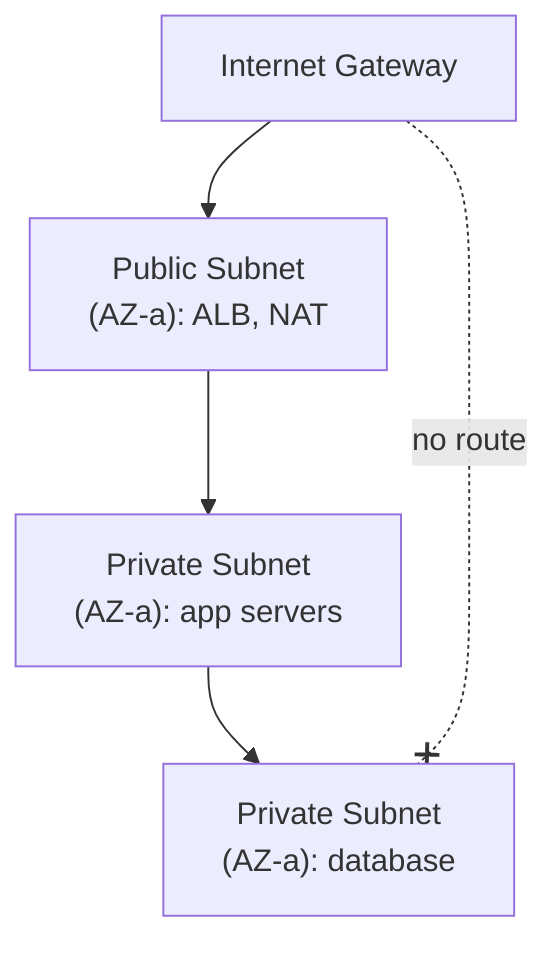
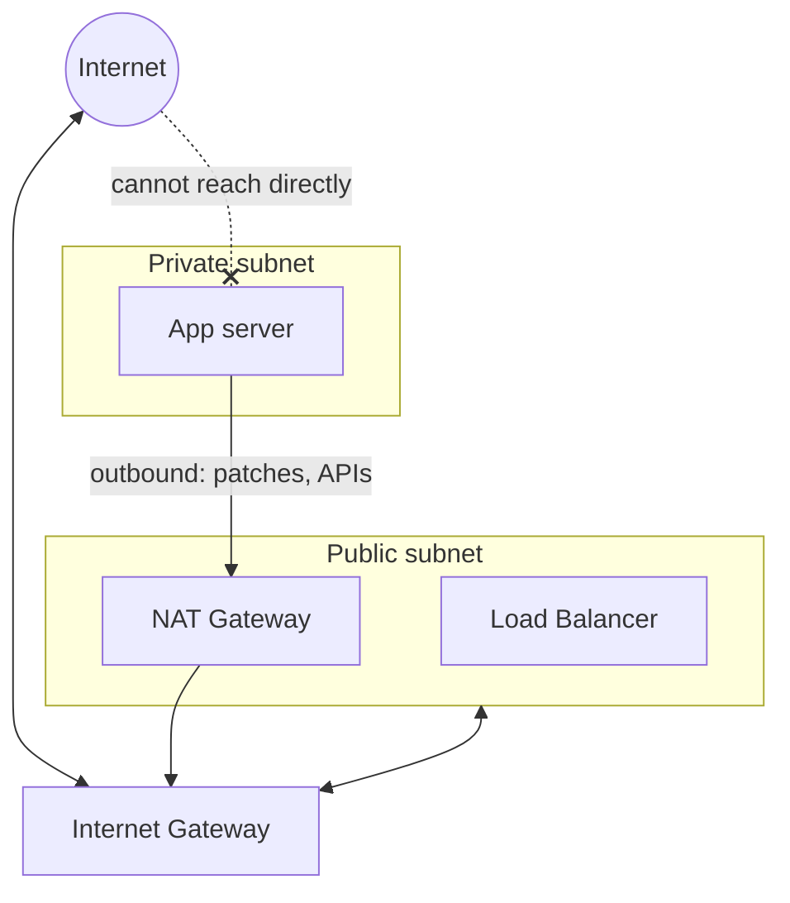
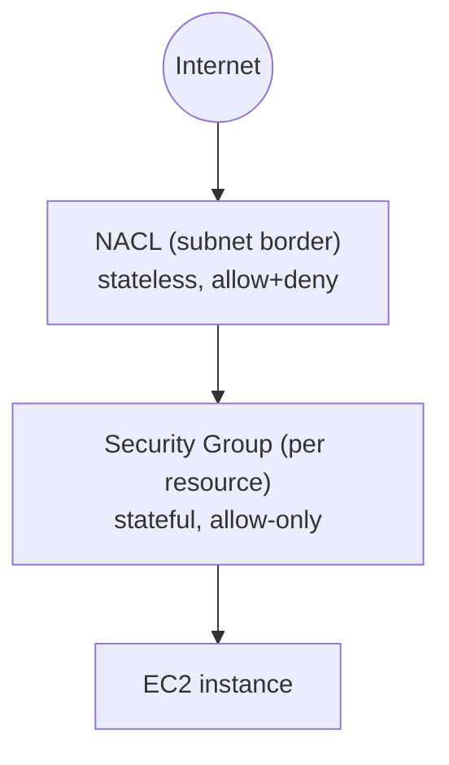
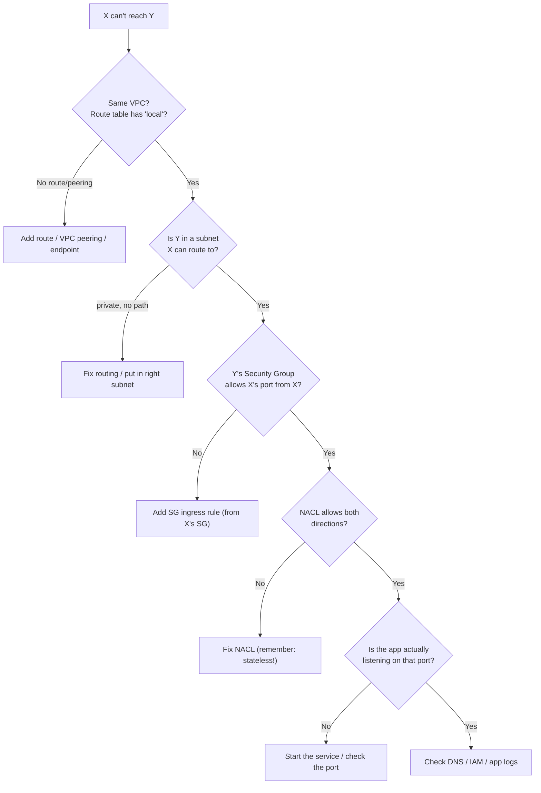
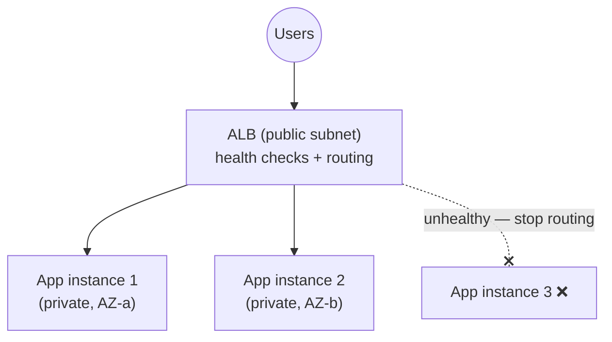
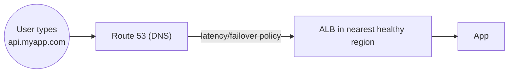
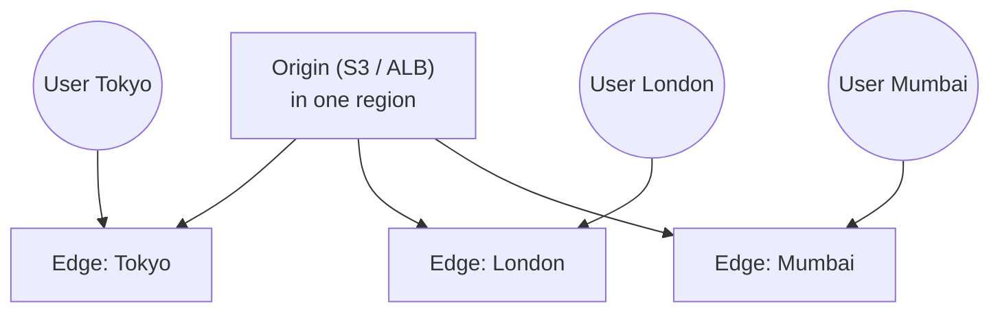

# Day 14 — Cloud Networking (VPC)

> Series: Cloud & DevOps Engineering
> Goal: Build a mental model of cloud networking that lets you answer the two questions that dominate DevOps ops work — "how do I put a database somewhere the internet can't reach?" and "why can't this thing connect to that thing?" VPCs, subnets, route tables, gateways, security groups vs NACLs, load balancers, DNS, and CDN.

---

## Table of Contents
1. [In plain words: the VPC as your private datacenter](#1-in-plain-words)
2. [Subnets: public vs private](#2-subnets)
3. [Route tables, Internet Gateway, NAT Gateway](#3-routing-gateways)
4. [Security groups vs NACLs](#4-sg-vs-nacl)
5. [The "why can't it connect?" debug flow](#5-debug-flow)
6. [Load balancers: ALB vs NLB](#6-load-balancers)
7. [Route 53: DNS](#7-route-53)
8. [CloudFront: CDN](#8-cloudfront)
9. [GCP & Azure equivalents](#9-equivalents)
10. [Lab](#10-lab)
11. [Self-Check](#11-self-check)
12. [Tomorrow](#12-tomorrow)

---

## 1. In plain words

**In plain words:** A **VPC (Virtual Private Cloud)** is *your own private, walled-off slice of the AWS network* — like leasing a floor in a building and putting up your own internal walls, doors, and reception desk. Nothing gets in or out unless you build a door for it. Inside, you carve rooms (**subnets**), decide which rooms have windows to the street (**public**) and which are locked interior vaults (**private**), and post guards (**security groups / NACLs**) at every door.

The whole point: you decide *exactly* what can talk to what. Your database goes in the vault with no street window; your web server sits by the entrance. IAM (Day 13) controlled *who can call the AWS API*; networking controls *what can reach what over the wire.* Both must be right.

- **Why:** isolate and control traffic so the internet can't reach things that should be private (databases, internal services).
- **What:** a logically isolated virtual network you fully control — IP ranges, subnets, routing, gateways, firewalls.
- **When:** every real deployment lives in a VPC (there's a default one; real teams build their own).
- **How:** CIDR block → subnets across AZs → route tables → gateways → firewall rules.
- **Where:** VPCs are *regional* (span the AZs of one region).

> 🤔 **"Why not just put everything on the public internet with a password? Isn't a firewall enough?"**
> Defense in depth. A password is *one* layer, and passwords leak (Day 13). Network isolation means the database is *physically unreachable* from the internet — an attacker who steals the DB password still can't connect because there's no route to it. You reduce your attack surface to just the front door (a load balancer). "Reachable but password-protected" vs "not reachable at all" is the difference between one lock and a locked door inside a locked vault inside a locked building.

**✅ Good scenario (where it saves you):** a web server in a public subnet is compromised. The attacker tries to reach the database directly — but it's in a private subnet with a security group allowing connections *only* from the web tier. The blast radius is contained.

**❌ Bad scenario (the pain without it):** a team puts their database on a public IP "to make it easy to connect from their laptops." A misconfigured password (or none) later, and the entire customer database is dumped by an internet-wide scanner within days.

**When NOT to over-build (Dark Side note):** networking is where teams *lose whole days* to invisible bugs — a missing route, a security group typo, a subnet with no path out. Over-complex VPC designs (dozens of subnets, tangled peering) become unmaintainable. Start with the standard pattern (public + private subnets across 2 AZs) and only add complexity when a real need appears.

---

## 2. Subnets

**In plain words:** a **subnet** is a room inside your VPC floor — a sub-range of the VPC's IP addresses, living in *one* AZ. The critical distinction is **public vs private**, and it comes down to one thing: *does this subnet have a route to the internet?*

- **Public subnet** — has a route to an **Internet Gateway**. Things here *can* have public IPs and be reachable from / reach the internet. Put internet-facing things here: load balancers, bastion hosts.
- **Private subnet** — **no** direct route from the internet. Nothing here is reachable from the outside. Put your app servers and databases here — the things that should never be exposed.


*Public subnets face the internet; private subnets hold your app and database, unreachable from outside.*

**The standard product pattern:** for each of 2+ AZs, one public subnet (load balancer, NAT) and private subnets (app tier, data tier). Multi-AZ (Day 12) means one AZ failing doesn't kill you.

| Subnet type | Route to internet? | Put here |
|-------------|-------------------|----------|
| **Public** | Yes (via Internet Gateway) | Load balancers, bastion hosts, NAT gateway |
| **Private (app)** | Outbound only (via NAT) | Application servers, containers |
| **Private (data)** | None (or via NAT for updates) | Databases, caches — most protected |

> 🤔 **"If my app server is in a private subnet with no internet, how does it download updates or call external APIs?"**
> That's exactly what a **NAT Gateway** is for (next section). A private subnet can be given *outbound-only* internet access: it can *initiate* connections out (pull an OS patch, call Stripe's API) but nothing on the internet can *initiate* a connection *in*. It's a one-way door. So "private" doesn't mean "totally offline" — it means "can't be reached *from* the internet."

---

## 3. Routing & gateways

**In plain words:** a **route table** is the *signpost* in each subnet that says "traffic for *this* destination goes *that* way." A subnet is "public" purely because its route table sends internet-bound traffic (`0.0.0.0/0`) to an **Internet Gateway**. Change the signpost, change whether the subnet is public.

Three pieces:

| Component | Role | In plain words |
|-----------|------|----------------|
| **Route table** | Rules mapping destination CIDR → target | The signpost: "for the internet, go here" |
| **Internet Gateway (IGW)** | The VPC's door to the internet (two-way) | The building's front entrance to the street |
| **NAT Gateway** | Outbound-only internet for private subnets | A one-way exit: private things go out, nothing comes in |


*Public subnet routes to the IGW (two-way); private subnets route outbound-only through a NAT Gateway.*

**How a subnet becomes public vs private (the key mechanic):**
- **Public subnet route table:** `0.0.0.0/0 → Internet Gateway` (internet-bound traffic goes to the IGW).
- **Private subnet route table:** `0.0.0.0/0 → NAT Gateway` (outbound-only) *or no internet route at all* (fully isolated). Local VPC traffic (`10.0.0.0/16 → local`) always works within the VPC.

```hcl
# Terraform sketch: what makes a subnet "public"
resource "aws_route_table" "public" {
  vpc_id = aws_vpc.main.id
  route {
    cidr_block = "0.0.0.0/0"           # all internet-bound traffic...
    gateway_id = aws_internet_gateway.igw.id   # ...goes to the IGW = public
  }
}

resource "aws_route_table" "private" {
  vpc_id = aws_vpc.main.id
  route {
    cidr_block     = "0.0.0.0/0"       # outbound internet...
    nat_gateway_id = aws_nat_gateway.nat.id    # ...via NAT = outbound-only
  }
}
```

> 🤔 **"Internet Gateway vs NAT Gateway — aren't they both just 'the internet'?"**
> Direction is the whole difference. **IGW** is *two-way*: things in the subnet can reach the internet *and* the internet can reach them (if they have a public IP). **NAT** is *one-way outbound*: private things can *initiate* connections out, but the internet can *never initiate* a connection in. You use IGW for your load balancer (must accept inbound); you use NAT so private app servers can pull updates without being exposed. Mixing them up is a classic "why can't my private server reach the internet / why is my database exposed" bug.

**Dark Side note:** **NAT Gateways cost money** — an hourly charge *plus* per-GB data processing. A private subnet blasting terabytes through NAT (e.g. pulling large images repeatedly) racks up a surprising bill. For AWS-service traffic (S3, DynamoDB), use **VPC endpoints** to bypass NAT entirely — cheaper and more secure. (FinOps foreshadowing, Day 16.)

---

## 4. Security groups vs NACLs

Two firewall layers. Confusing them is a top interview stumble and a top real-world bug. Learn the table cold.

**In plain words:**
- A **security group (SG)** is a firewall attached to a *resource* (an instance, a load balancer). It's **stateful** — if you allow traffic *in*, the reply is automatically allowed *out*. Think: a bouncer who remembers who he let in.
- A **NACL (Network ACL)** is a firewall attached to a *subnet*. It's **stateless** — you must allow both directions explicitly. Think: a checkpoint that has amnesia and checks every packet in *both* directions independently.


*Two layers: the NACL guards the subnet border; the security group guards each resource.*

| Feature | Security Group | NACL |
|---------|---------------|------|
| Attaches to | Resource (instance, ENI, LB) | Subnet |
| State | **Stateful** (return traffic auto-allowed) | **Stateless** (must allow both directions) |
| Rules | **Allow only** (implicit deny) | Allow **and** Deny |
| Evaluation | All rules evaluated together | Numbered order, first match wins |
| Default | Deny all inbound, allow all outbound | Default NACL allows all |
| Typical use | Your everyday firewall (99% of work) | Coarse subnet-wide blocks (e.g. block an IP range) |

**The practical truth:** you'll spend ~99% of your time in **security groups**. NACLs are a secondary, coarse layer most teams leave at default and only touch to block a specific bad IP range at the subnet edge.

**Security groups can reference *each other*** — this is the elegant, secure pattern:
```hcl
# DB security group: allow Postgres ONLY from the app tier's security group
resource "aws_security_group_rule" "db_from_app" {
  type                     = "ingress"
  from_port                = 5432
  to_port                  = 5432
  protocol                 = "tcp"
  security_group_id        = aws_security_group.db.id
  source_security_group_id = aws_security_group.app.id   # not an IP — a group!
}
```
This says "the database accepts connections only from things in the app security group" — no IP hardcoding, and it stays correct as instances come and go (elasticity, Day 12).

> 🤔 **"Security group is stateful, NACL is stateless — does that difference actually bite me?"**
> Constantly. Because SGs are **stateful**, you allow inbound port 443 and the response flows back automatically — done. Because NACLs are **stateless**, if you allow inbound 443 but forget to allow the *outbound ephemeral ports* (the high-numbered ports responses use), the request arrives but the reply is silently dropped — a maddening "connects but hangs" bug. This is why beginners should stick to SGs and leave NACLs default: the stateless trap eats hours.

**❌ Bad scenario (when misused):** someone "secures" a subnet by adding NACL rules, allows inbound on the app port, but forgets outbound ephemeral ports. Every connection half-completes and times out. Hours lost to a stateless firewall they didn't need to touch.

---

## 5. Debug flow

The most common DevOps support question: **"Why can't X connect to Y?"** Work it as a layered checklist, outside-in. Do NOT randomly widen rules — diagnose.


*Debug connectivity outside-in: routing → subnet reachability → security group → NACL → is the app even listening.*

**The ordered checklist:**
1. **Routing** — is there a route between them? (Same VPC = `local` route exists. Different VPC = need peering/Transit Gateway. AWS service = maybe a VPC endpoint.)
2. **Subnet placement** — is Y somewhere X can actually reach (not stranded in an isolated private subnet)?
3. **Security group (Y's inbound)** — does Y's SG allow X's traffic on the right port, ideally from X's SG?
4. **Security group (X's outbound)** — usually allow-all by default, but check if locked down.
5. **NACL** — allows the traffic *both* directions (stateless!)? Usually default = fine.
6. **Is the app listening?** — the network can be perfect but the service isn't running / bound to `127.0.0.1` instead of `0.0.0.0`.
7. **DNS / IAM / app** — resolving the right host? Does IAM (Day 13) allow the API call? App-level errors?

**Golden rule:** check in this order and you'll find it fast. Random "let me just open 0.0.0.0/0" flailing both fails to fix subtle issues *and* creates security holes.

---

## 6. Load balancers

**In plain words:** a **load balancer** sits in your public subnet as the single front door, spreads incoming traffic across your app instances (in private subnets), and stops sending traffic to any instance that fails a health check. It's the enabler of the horizontal scaling and high availability from **System Design Day 12 (load balancing)** — and the traffic-shaping tool behind canary/blue-green deploys (Day 11).

AWS has two you must know (plus a legacy one):

| Load balancer | Layer | Routes on | Use for |
|---------------|-------|-----------|---------|
| **ALB** (Application) | Layer 7 (HTTP/S) | URL path, host header, headers | Web apps, microservices, path-based routing (`/api` → service A) |
| **NLB** (Network) | Layer 4 (TCP/UDP) | IP/port, ultra-low latency, static IP | Extreme performance, non-HTTP, TCP passthrough |
| CLB (Classic) | Legacy | — | Avoid for new builds |


*The ALB is the public front door; app instances stay private and only healthy ones receive traffic.*

- **ALB (Layer 7):** understands HTTP. Can route `/api/*` to one service and `/images/*` to another (path-based routing), do host-based routing, terminate TLS, integrate with WAF. The default for web products.
- **NLB (Layer 4):** operates on TCP/UDP, blazing fast, gives a static IP, handles millions of requests. Use when you need raw performance or non-HTTP protocols.

> 🤔 **"ALB vs NLB — just pick the newer/faster one, right?"**
> They're for different layers, not better/worse. **ALB** understands *HTTP* — it can route by URL path, inspect headers, and do smart web routing; that intelligence adds a little latency. **NLB** works at the raw TCP layer — no HTTP understanding, but extreme speed, static IPs, and it handles any protocol. For a typical web/API product → **ALB**. For ultra-low-latency, gaming, or non-HTTP traffic → **NLB**. "Faster" isn't the deciding factor; *what you need to route on* is.

**Key wins the LB gives you:** health checks (dead instances get no traffic — Day 11 safety), zero-downtime deploys (drain old, add new), cross-AZ distribution (HA), and TLS termination.

---

## 7. Route 53

**In plain words:** **Route 53** is AWS's DNS — the *phone book* that translates human names (`api.myapp.com`) into IP addresses / AWS resources. "53" = the DNS port. Beyond basic lookups, it does health-check-based failover and traffic routing policies, making it a key piece of high-availability and multi-region setups.

| Route 53 feature | What it does |
|------------------|-------------|
| **Hosted zone** | Container for a domain's DNS records |
| **A / AAAA record** | Name → IP address |
| **CNAME** | Name → another name |
| **Alias record** | AWS-special: name → AWS resource (ALB, CloudFront, S3) — free, and works at the zone apex |
| **Routing policies** | Simple, weighted (A/B, canary!), latency-based, failover, geolocation |


*Route 53 resolves the name and can steer users to the nearest or healthiest endpoint.*

**Powerful patterns:**
- **Weighted routing** = DNS-level canary/blue-green (send 5% of *DNS answers* to the new stack — Day 11).
- **Failover routing** = if the primary region's health check fails, DNS automatically points users to the standby region. Foundational for disaster recovery.
- **Alias to an ALB/CloudFront** — the clean way to point your apex domain at AWS resources.

> 🤔 **"DNS is just name-to-IP lookup — why is it in a DevOps course?"**
> Because DNS is one of the top causes of real outages *and* a powerful control plane. Route 53 doesn't just resolve names — it does health-check failover (auto-reroute when a region dies), latency routing (send users to the closest region), and weighted routing (traffic-split for canaries). "It's always DNS" is an ops meme *because* misconfigured records, TTL surprises, and propagation delays cause mysterious, widespread outages. Respect it.

---

## 8. CloudFront

**In plain words:** **CloudFront** is AWS's **CDN (Content Delivery Network)** — a global fleet of caches (edge locations) that store your content *close to users* so a user in Tokyo doesn't wait for a round-trip to a server in Virginia. First request fetches from your origin (S3/ALB) and caches it at the nearest edge; subsequent nearby users get the cached copy in milliseconds.


*CloudFront caches content at edge locations worldwide so users hit a nearby cache, not the distant origin.*

**Why it matters for product companies:**
- **Latency** — static assets (JS, CSS, images, video) served from the nearest edge = a dramatically faster site.
- **Origin offload** — cached requests never hit your servers, cutting load and cost (fewer NAT/compute cycles).
- **Security** — sits in front of your origin; integrates with **AWS WAF** and **Shield** for DDoS protection; can serve a private S3 bucket without exposing it.
- **HTTPS everywhere** — TLS at the edge.

| Use CloudFront for | Not ideal for |
|--------------------|---------------|
| Static assets, images, video, SPAs | Highly dynamic, per-user, uncacheable responses (still helps as TLS/DDoS front) |
| Global user base | Single-region internal tool |
| Fronting a private S3 static site | — |

> 🤔 **"A CDN is just for big media companies with lots of video, right?"**
> No — nearly every user-facing product benefits. Even a modest SaaS serves JS/CSS/images/fonts that are identical for every user; caching those at the edge cuts page-load time and offloads your origin. And CloudFront doubles as a security front (WAF, DDoS shield) and lets you serve a *private* S3 bucket safely. It's a default component of a well-built web product, not a media-only luxury.

**Cross-reference:** caching at the edge is the same *caching* principle as ElastiCache and the caching layers from **System Design** — move data closer to where it's read to cut latency and origin load.

---

## 9. Equivalents

| Concept | AWS | GCP | Azure |
|---------|-----|-----|-------|
| Virtual network | VPC | VPC | Virtual Network (VNet) |
| Subnet | Subnet | Subnet | Subnet |
| Firewall (resource) | Security Group | Firewall rules | Network Security Group |
| Internet egress for private | NAT Gateway | Cloud NAT | NAT Gateway |
| L7 load balancer | ALB | Cloud Load Balancing (HTTP(S)) | Application Gateway |
| L4 load balancer | NLB | Network Load Balancing | Azure Load Balancer |
| DNS | Route 53 | Cloud DNS | Azure DNS |
| CDN | CloudFront | Cloud CDN | Azure CDN / Front Door |

**Note:** the *concepts* — private networks, public/private subnets, stateful firewalls, L7/L4 load balancing, DNS-based routing, edge caching — are identical across clouds. Only names and minor behaviors differ.

---

## 10. Lab

**Build a VPC with public and private subnets across 2 AZs, and put a database in the private subnet where the internet can't reach it.**

> Use the VPC console wizard *or* the CLI/Terraform sketch below. Delete resources (especially the **NAT Gateway** — it bills hourly) when done.

1. **Create the VPC:** CIDR `10.0.0.0/16`.
2. **Subnets across 2 AZs:**
   - Public: `10.0.1.0/24` (AZ-a), `10.0.2.0/24` (AZ-b).
   - Private: `10.0.11.0/24` (AZ-a), `10.0.12.0/24` (AZ-b).
3. **Internet Gateway** — attach to the VPC. **NAT Gateway** — place in a public subnet (with an Elastic IP).
4. **Route tables:**
   - Public RT: `0.0.0.0/0 → IGW`; associate the public subnets.
   - Private RT: `0.0.0.0/0 → NAT`; associate the private subnets.
5. **Security groups:**
   - `alb-sg`: inbound 443 from `0.0.0.0/0`.
   - `app-sg`: inbound app port *from `alb-sg` only*.
   - `db-sg`: inbound 5432 *from `app-sg` only* (reference the SG, not an IP).
6. **Place resources:**
   - Launch an EC2 (web/app) in a **private** subnet with `app-sg`.
   - Launch a small RDS or a stand-in EC2 "db" in a **private** subnet with `db-sg`.
7. **Prove the isolation:**
   - From your laptop, try to reach the DB directly → **should fail/time out** (no public route). ✅ That's the point.
   - From the app instance, connect to the DB on 5432 → **should work** (app-sg → db-sg allowed).
   - From the app instance, `curl https://example.com` → **works via NAT** (outbound-only). The DB has no inbound path from the internet.
8. **Debug drill:** *break it on purpose* — remove the `db-sg` rule allowing `app-sg`, retry the app→DB connection, watch it hang, then walk the §5 debug flow to fix it. This muscle memory is the job.
9. **Reflect (write answers):**
   - Which single component makes the private subnet "private"? (The route table.)
   - Why reference `app-sg` in `db-sg` instead of the app's IP?
   - Where would an ALB and CloudFront sit in this diagram?

**Deliverable:** the failed direct-to-DB attempt, the successful app→DB connection, and your reflection.

---

## 11. Self-Check

1. What is a VPC, and what problem does network isolation solve that a password can't?
2. Public vs private subnet — the one thing that distinguishes them.
3. Internet Gateway vs NAT Gateway — the directional difference and when you use each.
4. Which component actually makes a subnet public? Explain the route.
5. Security group vs NACL: state the four biggest differences (attach point, state, rules, default).
6. Why does the stateless nature of NACLs cause the "connects but hangs" bug?
7. Walk the "why can't X connect to Y?" flow in order. What do you check first, and what's the last thing (that isn't network at all)?
8. ALB vs NLB — the layer each operates at and one use case each.
9. Name two Route 53 routing policies and how each supports high availability or canary deploys.
10. What is CloudFront, and give two benefits beyond latency.

---

## 12. Tomorrow

**Day 15 — Core AWS Services:** you now have compute (Day 12), identity (Day 13), and a network (Day 14) — tomorrow we fill it with the workhorse building blocks: storage (S3 vs EBS vs EFS — when each), databases (RDS vs DynamoDB vs ElastiCache), and messaging (SQS/SNS/EventBridge — reusing the queues from System Design). Plus GCP/Azure equivalents. You'll host a static site on S3 + CloudFront and provision an RDS database.
