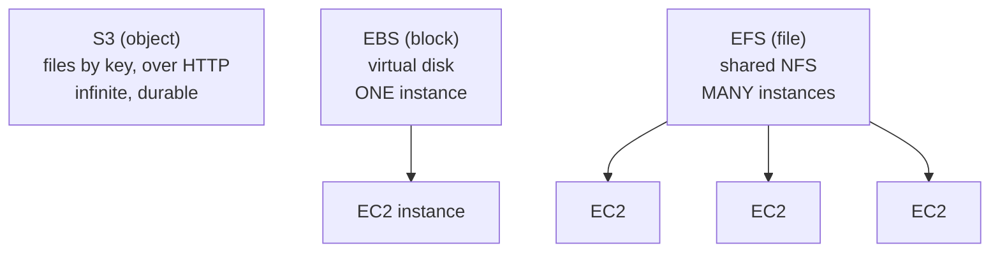
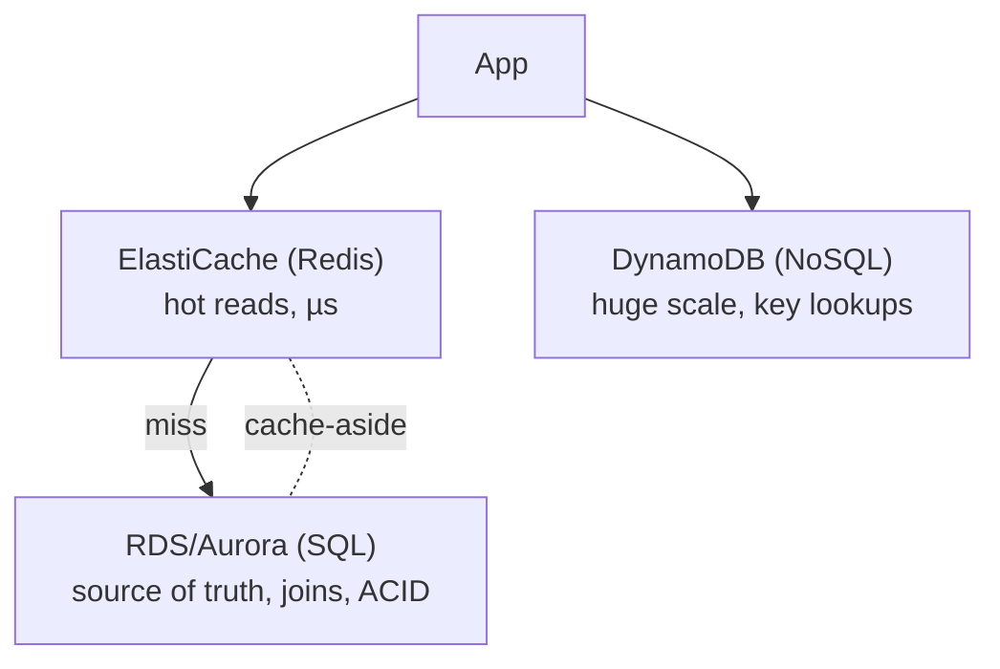
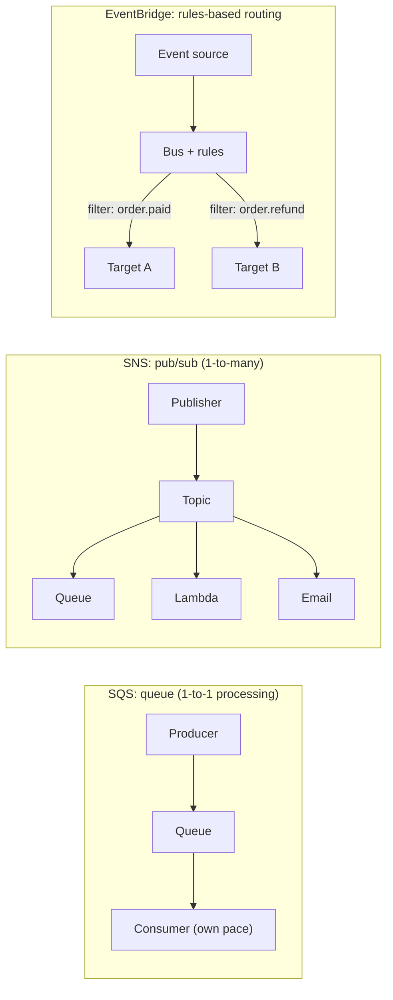
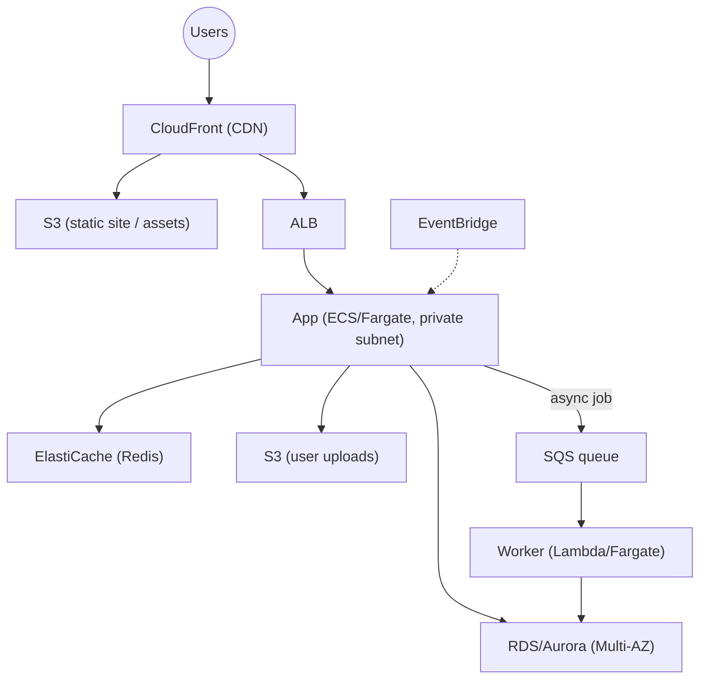

# Day 15 — Core AWS Services

> Series: Cloud & DevOps Engineering
> Goal: Learn the workhorse building blocks every product runs on — storage (S3/EBS/EFS), databases (RDS/DynamoDB/ElastiCache), and messaging (SQS/SNS/EventBridge) — and, crucially, *when to reach for each*. You'll host a static site on S3 + CloudFront and provision an RDS database.

---

## Table of Contents
1. [In plain words: the AWS pantry](#1-in-plain-words)
2. [Storage: S3 vs EBS vs EFS](#2-storage)
3. [S3 deep-ish dive](#3-s3)
4. [Databases: RDS vs DynamoDB vs ElastiCache](#4-databases)
5. [Messaging: SQS vs SNS vs EventBridge](#5-messaging)
6. [Putting it together: a product architecture](#6-architecture)
7. [GCP & Azure equivalents](#7-equivalents)
8. [Lab](#8-lab)
9. [Self-Check](#9-self-check)
10. [Tomorrow](#10-tomorrow)

---

## 1. In plain words

**In plain words:** if compute (Day 12) is your kitchen and networking (Day 14) is the plumbing, these services are the *pantry of ready-made ingredients* — managed storage, databases, and messaging you assemble instead of building from scratch. The DevOps skill isn't memorizing all 200+ AWS services; it's knowing the *dozen that matter* and picking the *right one* for each job. Pick wrong (a relational DB where you needed a queue, a file system where you needed object storage) and you fight the tool forever.

- **Why:** don't reinvent databases, queues, and storage — use battle-tested managed services and focus on your product.
- **What:** the core managed data & messaging primitives products are built from.
- **When:** every real application needs storage + a database; most need messaging as they grow.
- **How:** provision via console/CLI/IaC; connect via SDK; secure via IAM (Day 13) and networking (Day 14).
- **Where:** these plug into the VPC and identity model you already built.

> 🤔 **"There are 200+ AWS services — do I need to know them all?"**
> No — and trying to is a trap. Product-company DevOps runs on a *small core*: S3, EC2/ECS/Lambda, RDS or DynamoDB, ElastiCache, SQS/SNS/EventBridge, ALB, Route 53, CloudFront, IAM, VPC. Master *when to reach for each* of these and you can build almost anything; the other 190 are specialized tools you look up when a specific need appears. Depth on the core beats shallow familiarity with all of it.

**✅ Good scenario (where it saves you):** a team stores user uploads in **S3** (cheap, durable, infinite), runs their transactional data in **RDS Postgres**, caches hot reads in **ElastiCache**, and decouples slow image processing behind **SQS**. Each service does what it's best at; the system is cheap, scalable, and simple.

**❌ Bad scenario (when misused):** a team stores uploaded images *as rows in their SQL database* (blobs). The DB balloons, backups take hours, queries slow to a crawl, and costs spike — all solved by putting the files in S3 and keeping only the URL in the DB.

**When NOT to (Dark Side note):** managed services trade cost and lock-in for convenience. DynamoDB is magical *if your access patterns fit it* and a nightmare if they don't. Over-adopting exotic services creates vendor lock-in and a bill you don't understand (Day 16). Reach for the boring, well-understood core first.

---

## 2. Storage

Three storage types, three fundamentally different shapes. The #1 mistake is using the wrong *type*, so anchor on this first.

**In plain words:**
- **S3 (object storage)** — an infinite bucket of *files accessed by URL/key*. Not a disk, not a filesystem — you `PUT`/`GET` whole objects over HTTP. For uploads, backups, static sites, data lakes, logs.
- **EBS (block storage)** — a *virtual hard drive* attached to **one** EC2 instance. Acts like a disk (`/dev/sda`). For an OS, a database's data files — anything that needs a real disk on a single machine.
- **EFS (file storage)** — a *shared network filesystem* many instances mount at once (NFS). For shared files across a fleet.


*Three storage shapes: object (S3, by key), block (EBS, one disk one instance), file (EFS, shared mount).*

| | S3 (object) | EBS (block) | EFS (file) |
|--|-------------|-------------|------------|
| Shape | Files by key, HTTP API | Virtual disk | Shared network filesystem |
| Attach | Accessed over network by anything (with IAM) | **One** EC2 at a time (same AZ) | **Many** EC2 concurrently |
| Analogy | Dropbox/warehouse | A hard drive | A shared network drive |
| Durability | 11 nines, multi-AZ built in | Single-AZ (snapshot to back up) | Multi-AZ |
| Use for | Uploads, backups, static sites, logs, data lake | Boot volume, DB data files | Shared assets across a fleet, lift-and-shift NFS apps |
| Cost | Cheapest per GB | Mid | Priciest per GB |

> 🤔 **"Isn't S3 just a hard drive in the cloud? Why not use it for everything?"**
> S3 is **not** a disk — you can't mount it and run a database on it, and you can't edit part of a file in place (you replace the whole object). It's *object* storage: great for whole files fetched by key over HTTP (images, backups, static assets), terrible as a filesystem for an OS or a database's working files. Those need **EBS** (a real block device). Using the wrong storage shape — trying to run Postgres data files on S3, or storing millions of user uploads on an EBS volume that fills up — is a classic architecture mistake. Match the shape to the access pattern.

**❌ Bad scenario:** storing app logs on the EC2 instance's EBS volume. The disk fills, the app crashes, and logs vanish when the instance is replaced. Logs belong in S3 (or a log service) — durable, cheap, decoupled from the instance's lifecycle.

---

## 3. S3

S3 (Simple Storage Service) is the most-used AWS service — you'll touch it constantly, so know it a bit deeper.

**Core facts:**
- **Buckets** (globally-unique name) hold **objects** (the file + metadata), addressed by **key** (`reports/2026/q1.pdf`).
- **11 nines of durability** (99.999999999%) — objects are replicated across AZs automatically. Extremely hard to lose data.
- **Effectively infinite** — no capacity to provision; pay per GB stored + requests + data transfer out.
- **Storage classes** trade cost for access speed:

| Class | For | Cost | Retrieval |
|-------|-----|------|-----------|
| **S3 Standard** | Hot, frequently accessed | $$ | Instant |
| **S3 Intelligent-Tiering** | Unknown/changing access | auto-optimizes | Instant |
| **S3 Standard-IA** (Infrequent Access) | Backups accessed occasionally | $ | Instant |
| **Glacier / Deep Archive** | Cold archive, compliance | ¢ | Minutes–hours |

*Illustrative only — verify current pricing.* Use **lifecycle policies** to auto-move objects from Standard → IA → Glacier as they age (big cost saver — Day 16 FinOps).

**Security — the #1 S3 mistake is a public bucket (Day 12/13).**
```bash
# Block Public Access should be ON unless you deliberately serve a public site.
aws s3api put-public-access-block --bucket my-bucket \
  --public-access-block-configuration \
  BlockPublicAcls=true,IgnorePublicAcls=true,BlockPublicPolicy=true,RestrictPublicBuckets=true
# Enable versioning (protects against accidental delete/overwrite):
aws s3api put-bucket-versioning --bucket my-bucket \
  --versioning-configuration Status=Enabled
# Enable default encryption (SSE):
aws s3api put-bucket-encryption --bucket my-bucket \
  --server-side-encryption-configuration \
  '{"Rules":[{"ApplyServerSideEncryptionByDefault":{"SSEAlgorithm":"AES256"}}]}'
```

**Common S3 uses:** static website hosting (behind CloudFront — Day 14), user uploads, backups/snapshots, data lake, CI/CD artifacts (Day 9), log storage.

> 🤔 **"S3 has 11 nines of durability, so my data is safe — I don't need backups, right?"**
> Durability (S3 won't *lose* your bytes) is not the same as protection against *you*. If your app or a bad actor *deletes* or *overwrites* an object, 11 nines won't help — the deletion is faithfully durable too. That's what **versioning** (keep old versions), **MFA Delete**, and **cross-region replication** are for. Durability protects against hardware failure; you still need protection against human/app error and malice.

---

## 4. Databases

The big data decision. Anchor on the split: **relational (SQL) vs NoSQL vs cache.** This reuses everything from **System Design** on data modeling and consistency.

**In plain words:**
- **RDS (relational)** — managed SQL databases (Postgres, MySQL, MariaDB, SQL Server, Oracle) + **Aurora** (AWS's high-performance cloud-native SQL). For structured data with relationships, joins, transactions, and strong consistency. The default for most apps.
- **DynamoDB (NoSQL)** — fully-managed, serverless key-value/document store. Single-digit-millisecond latency at *any* scale, but you must design around *access patterns* (no ad-hoc joins). For massive scale, simple lookups, high write throughput.
- **ElastiCache (cache)** — managed **Redis**/Memcached. In-memory, microsecond reads. Not your source of truth — a *speed layer* in front of a database (System Design caching).


*Relational for structured/transactional data, DynamoDB for scale/simple access, ElastiCache as the speed layer.*

| | RDS / Aurora (SQL) | DynamoDB (NoSQL) | ElastiCache (Redis) |
|--|--------------------|------------------|---------------------|
| Model | Tables, rows, joins, SQL | Key-value / document | In-memory key-value |
| Consistency | Strong, ACID transactions | Tunable (eventual/strong) | Cache (ephemeral) |
| Scale | Vertical + read replicas | Virtually unlimited horizontal | Fast, in-memory limited by RAM |
| Query flexibility | High (ad-hoc SQL, joins) | Low (design for access patterns) | Simple GET/SET |
| Source of truth? | Yes | Yes | **No** (speed layer) |
| Use for | Most apps, complex queries, relationships | Massive scale, simple lookups, high write rate | Sessions, hot reads, leaderboards, rate limits |

> 🤔 **"NoSQL scales better than SQL — so DynamoDB is the modern choice, right?"**
> "Scales better" is only true *for the workloads it's designed for*. DynamoDB shines at massive scale with **known, simple access patterns** (get item by key). But it *cannot* do ad-hoc queries, joins, or flexible reporting — if your product needs "show me all orders over $100 from last month grouped by region," relational SQL does that trivially and DynamoDB makes it painful (or impossible without duplicating data). Modern, well-run products run enormous scale on **RDS/Aurora** every day. Choose by *access pattern and query needs*, not by which is trendier. When in doubt, start relational — it's flexible and you rarely regret it.

**Managed-database value (shared responsibility, Day 12):** RDS handles patching, backups, replication, and **Multi-AZ failover** — you toggle a checkbox and get a standby in another AZ that auto-promotes on failure. That's the elasticity and HA you'd otherwise build by hand.

**❌ Bad scenario (when misused):** picking DynamoDB for an early-stage app with evolving, query-heavy needs. Three months in, every new feature requires a new access pattern the table design didn't anticipate, forcing painful migrations. Postgres would have absorbed the changes with a new query.

---

## 5. Messaging

Messaging *decouples* services so they don't have to be up, fast, or scaled together — directly reusing **queues from System Design Day 15** and the async patterns you already know. Three services, three patterns.

**In plain words:**
- **SQS (queue)** — a durable **queue**: one service drops a message, another picks it up *later*, at its own pace. **Point-to-point**, one consumer group processes each message. For decoupling and buffering work (async jobs).
- **SNS (pub/sub)** — a **topic** that **fan-outs** one message to *many* subscribers at once (queues, Lambdas, emails). **One-to-many** broadcast.
- **EventBridge (event bus)** — a smart **event router** that filters and routes events by *content/rules* to many targets; deep integration with AWS services and SaaS. The modern choice for **event-driven architectures**.


*SQS buffers work point-to-point; SNS fans out to many; EventBridge routes by content rules.*

| | SQS | SNS | EventBridge |
|--|-----|-----|-------------|
| Pattern | Queue (point-to-point) | Pub/sub (fan-out) | Event bus (rules routing) |
| Delivery | Consumer *pulls* | *Pushes* to subscribers | *Pushes* to matched targets |
| Consumers | One logical consumer processes each msg | Many subscribers get every msg | Many targets, filtered by rules |
| Use for | Decouple + buffer async work, retries, DLQ | Broadcast notifications, fan-out to queues | Event-driven apps, SaaS integrations, content-based routing |
| Ordering | Standard (best-effort) or FIFO | — | — |

**The classic combo — SNS + SQS fan-out:** SNS publishes one event; multiple SQS queues subscribe; each downstream service drains its own queue independently and reliably. Broadcast *and* durable buffering. This is a canonical System Design pattern.

> 🤔 **"SQS, SNS, EventBridge all move messages — which do I actually use?"**
> Match the *pattern*: **SQS** when one service hands work to another to process *at its own pace* (a queue — buffering, retries, smoothing spikes). **SNS** when *one* event must reach *many* subscribers simultaneously (fan-out broadcast). **EventBridge** when you want a central bus that *routes by event content/rules* and integrates with AWS/SaaS (modern event-driven architectures). They compose: EventBridge or SNS to fan out, SQS to durably buffer each consumer. In 2026, greenfield event-driven designs often lead with **EventBridge**; SQS remains the workhorse for decoupling; SNS for simple fan-out and notifications.

**Why messaging matters (System Design tie-in):** it turns synchronous, fragile call chains into resilient async flows — a slow image-processing service can't take down your API if requests sit in a queue. Buffering absorbs traffic spikes; DLQs (dead-letter queues) catch failures for retry. This is the backbone of scalable, decoupled systems.

---

## 6. Architecture

Putting the core services together into a realistic product — this is what "knowing AWS" looks like in practice.


*A typical product: CDN + static assets, ALB to app, cache + relational DB, S3 for uploads, queue for async work.*

Every piece maps to a day: CDN/ALB (Day 14), compute (Day 12), IAM securing it all (Day 13), inside a VPC (Day 14). This diagram is the "core AWS services" mental model in one picture.

---

## 7. Equivalents

| Concept | AWS | GCP | Azure |
|---------|-----|-----|-------|
| Object storage | S3 | Cloud Storage | Blob Storage |
| Block storage | EBS | Persistent Disk | Managed Disks |
| File storage | EFS | Filestore | Azure Files |
| Managed SQL | RDS / Aurora | Cloud SQL / AlloyDB / Spanner | Azure SQL / Database for PostgreSQL |
| Managed NoSQL | DynamoDB | Firestore / Bigtable | Cosmos DB |
| Managed cache | ElastiCache | Memorystore | Azure Cache for Redis |
| Queue | SQS | Pub/Sub (also fan-out) | Storage Queues / Service Bus |
| Pub/sub | SNS | Pub/Sub | Service Bus Topics / Event Grid |
| Event bus | EventBridge | Eventarc | Event Grid |

**Note:** GCP's **Pub/Sub** collapses SQS+SNS-ish behavior into one service; Azure splits queue/topic across Storage Queues, Service Bus, and Event Grid. Concepts (object/block/file storage, SQL/NoSQL/cache, queue/pub-sub/event-bus) transfer directly.

---

## 8. Lab

**Two builds: (A) a static site on S3 + CloudFront, (B) provision an RDS database in your VPC.**

> Free-tier where possible; delete RDS and empty/delete the S3 bucket when done to avoid charges.

**Part A — Static site on S3 + CloudFront:**
1. Create a bucket; upload an `index.html` and an image.
   ```bash
   aws s3 mb s3://mysite-YOURNAME
   aws s3 cp ./site/ s3://mysite-YOURNAME/ --recursive
   ```
2. Keep **Block Public Access ON**; instead of a public bucket, create a **CloudFront distribution** with the bucket as origin using **Origin Access Control (OAC)** so only CloudFront can read it (Day 14 security pattern).
3. Visit the CloudFront URL — your site loads, served from a nearby edge, over HTTPS, with the bucket still private.
4. **Reflect:** why serve via CloudFront + OAC instead of just making the bucket public? (Answer: HTTPS, edge caching/latency, DDoS/WAF front, bucket stays private.)

**Part B — Provision RDS in your VPC (reuse Day 14):**
5. Create an **RDS Postgres** instance:
   - Place it in the **private** subnets (a DB subnet group across 2 AZs).
   - Enable **Multi-AZ** (see the standby concept even if you tear it down).
   - Attach the `db-sg` that allows 5432 *only from `app-sg`* (Day 14).
   - **Do not** make it publicly accessible.
   ```bash
   aws rds create-db-instance \
     --db-instance-identifier myapp-db \
     --engine postgres --db-instance-class db.t3.micro \
     --allocated-storage 20 \
     --master-username appadmin --manage-master-user-password \
     --vpc-security-group-ids sg-DBSG \
     --db-subnet-group-name my-private-subnet-group \
     --no-publicly-accessible --multi-az
   # note: --manage-master-user-password stores the secret in Secrets Manager
   #       (no plaintext password — Day 13 credential hygiene)
   ```
6. From your **app EC2** (Day 13/14, private subnet), connect on 5432 → works. From your laptop → fails (private, correct).
7. **Reflect (write answers):**
   - Which storage type would you use for the app's user-uploaded files, and why not the database?
   - Where would you add ElastiCache, and what would it cache?
   - If you needed to fan an "order placed" event to email + a warehouse queue + analytics, which messaging service(s)?

**Deliverable:** the working CloudFront-served private site, the RDS reachable only from the app tier, and your reflections.

---

## 9. Self-Check

1. S3 vs EBS vs EFS — one line each on shape and a use case.
2. Why is S3 *not* a drop-in replacement for a disk?
3. What does "11 nines of durability" protect against, and what does it *not*?
4. RDS vs DynamoDB — the deciding question when choosing between them.
5. "NoSQL scales better" — when is that true and when is it misleading?
6. What is ElastiCache and why is it *not* a source of truth?
7. SQS vs SNS vs EventBridge — the pattern each implements.
8. Describe the SNS→SQS fan-out pattern and one reason to use it.
9. Give three good uses for S3 in a typical product.
10. Name the GCP equivalents of S3, DynamoDB, and SQS.

---

## 10. Tomorrow

**Day 16 — Serverless & Cost:** the final foundations day. Serverless done properly — Lambda (event-driven), API Gateway, and honestly *when serverless wins and when it loses* — plus the topic that gets DevOps engineers hired and fired: **cost**. The AWS cost model, FinOps (tagging, budgets, right-sizing, spot instances), and the infamous "surprise bill" failure mode. You'll wire up a Lambda that fires whenever a file is uploaded to S3.
