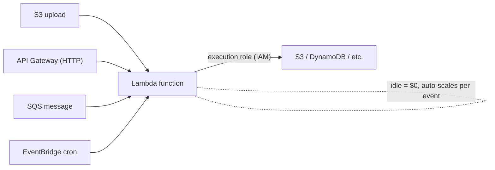
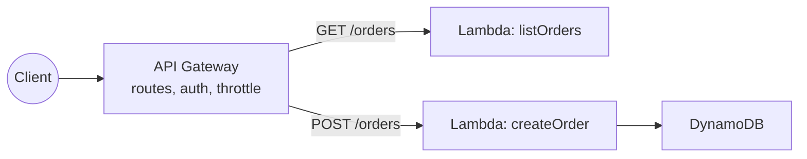
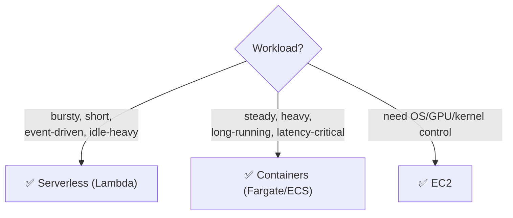
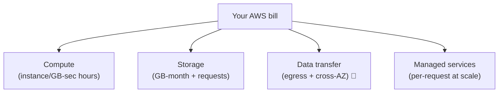
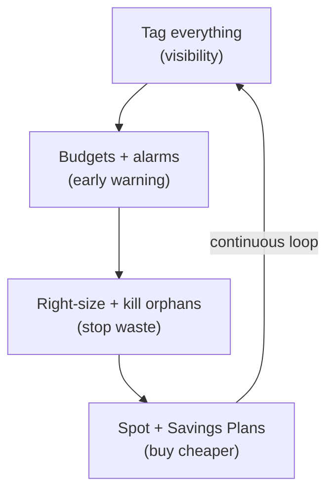
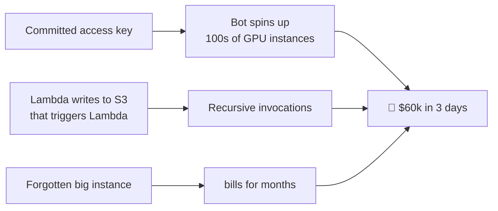

# Day 16 — Serverless & Cost

> Series: Cloud & DevOps Engineering
> Goal: Understand serverless honestly — Lambda + API Gateway, and exactly *when it wins and when it loses* — then master the topic that gets DevOps engineers hired (and fired): cloud cost. FinOps, tagging, budgets, right-sizing, spot, and the surprise-bill failure mode. You'll build a Lambda triggered by an S3 upload.

---

## Table of Contents
1. [In plain words: serverless and why cost matters](#1-in-plain-words)
2. [Lambda: event-driven functions](#2-lambda)
3. [API Gateway: HTTP in front of Lambda](#3-api-gateway)
4. [When serverless wins vs loses](#4-wins-vs-loses)
5. [The AWS cost model](#5-cost-model)
6. [FinOps: tagging, budgets, right-sizing, spot](#6-finops)
7. [The surprise-bill failure mode](#7-surprise-bill)
8. [GCP & Azure equivalents](#8-equivalents)
9. [Lab](#9-lab)
10. [Self-Check](#10-self-check)
11. [Course wrap & what's next](#11-wrap)

---

## 1. In plain words

**In plain words (serverless):** "serverless" doesn't mean *no servers* — it means *you don't manage or think about them.* You hand AWS a function; it runs your code *only when something triggers it*, scales from zero to thousands automatically, and bills you per invocation and per millisecond of run time. Idle = **$0**. It's the far end of the compute spectrum from Day 12: maximum managed, minimum ops.

**In plain words (cost):** the cloud's pay-as-you-go magic (Day 12) has a dark twin — pay-as-you-go means the bill *also* grows automatically, sometimes without anyone noticing until it's five figures. **Cost is a first-class DevOps responsibility.** Engineers who can build *and* keep the bill sane are the ones product companies fight to keep.

- **Why:** serverless removes ops for the right workloads; cost discipline is what separates a sustainable product from a runaway bill.
- **What:** event-driven functions (Lambda) + the cost model and practices (FinOps) to run everything affordably.
- **When:** serverless for bursty/event-driven glue; cost management *always, from day one*.
- **How:** triggers → functions; tags → budgets → alarms → right-sizing → spot.
- **Where:** the capstone tying together compute (Day 12), IAM (Day 13), storage & messaging (Day 15).

> 🤔 **"Serverless means there are no servers, right?"**
> There are absolutely servers — AWS just runs, patches, scales, and secures them *for* you, invisibly. "Serverless" describes *your* experience: you never provision a machine, never SSH in, never patch an OS, never think about capacity. You think only about your function and its trigger. The servers exist; your *responsibility for them* doesn't (shared responsibility shifts almost entirely to AWS — Day 12).

**✅ Good scenario (where it saves you):** an image-resize job fires only when users upload photos — a few thousand times a day, in bursts. On Lambda it costs cents, scales instantly during a spike, and costs *nothing* overnight. Running an always-on server for this would waste money 90% of the day.

**❌ Bad scenario (the pain / when misused):** a team runs a high-traffic, constantly-busy API on Lambda. At tens of millions of steady invocations a month, the per-request bill dwarfs what two small Fargate containers would cost — plus cold-start latency annoys users. Right idea for bursty work, wrong for steady heavy load.

**When NOT to (Dark Side note):** serverless hides operational complexity but introduces its own — cold starts, execution time limits (15 min max on Lambda), distributed-debugging pain across dozens of tiny functions ("Lambda spaghetti"), and cost that can *quietly* invert on you at scale. It's a fantastic tool, not a religion.

---

## 2. Lambda

**In plain words:** a Lambda is a *function that sleeps until something pokes it.* An HTTP request, a file landing in S3, a message on a queue, a scheduled cron — any of these *events* wakes it, it runs, returns, and goes back to sleep. You never manage a server; AWS spins up as many parallel copies as there are events.

**Core mechanics:**
- **Trigger (event source):** what invokes it — S3, API Gateway, SQS, EventBridge, DynamoDB Streams, cron.
- **Handler:** your function code (`def handler(event, context)`).
- **Execution role:** an IAM role (Day 13!) giving the function its permissions — **no keys**, temporary creds automatically.
- **Config:** memory (128 MB–10 GB; CPU scales *with* memory), timeout (max 15 min), runtime (Python, Node, Go, Java, custom).
- **Billing:** number of requests + GB-seconds (memory × run time). **Idle costs nothing.**


*A Lambda sleeps until an event triggers it, runs with an IAM role, and scales automatically per event.*

```python
# S3-triggered Lambda: log every uploaded object (the Lab, simplified)
import json, boto3
s3 = boto3.client("s3")   # creds come from the execution ROLE — no keys (Day 13)

def handler(event, context):
    for record in event["Records"]:
        bucket = record["s3"]["bucket"]["name"]
        key    = record["s3"]["object"]["key"]
        print(f"New upload: s3://{bucket}/{key}")   # goes to CloudWatch Logs
        # real work: resize image, validate, enqueue to SQS, write to DynamoDB...
    return {"statusCode": 200}
```

**Cold starts — the classic gotcha:** when a function hasn't run recently, AWS must initialize a fresh execution environment (load the runtime + your code) before the first invocation — adding latency (tens of ms to seconds, worse for heavy runtimes like Java). Subsequent "warm" invocations are fast. Mitigate with lighter runtimes, smaller packages, or **provisioned concurrency** (keep some warm — but that costs money, eroding the "pay only when used" benefit).

> 🤔 **"If Lambda scales automatically and costs nothing when idle, why not run my whole app on it?"**
> Because the economics and ergonomics *invert* for certain workloads. **Steady high traffic:** millions of constant invocations cost more than a right-sized always-on container. **Long-running work:** the 15-minute hard limit kills batch jobs and long connections. **Latency-sensitive:** cold starts add jitter. **Complex apps:** debugging 40 tiny functions with distributed traces is harder than one service. Lambda is superb for *event-driven, bursty, short* tasks and glue code — not a universal replacement for long-running services (that's Fargate/ECS, Day 12).

---

## 3. API Gateway

**In plain words:** Lambda has no built-in URL. **API Gateway** is the *managed front door* that turns HTTP requests into Lambda invocations (and back), so you can build a REST/HTTP API with no server. It handles routing, auth, throttling, rate limiting, and request validation at the edge.


*API Gateway maps HTTP routes to Lambda functions — a serverless REST API with no servers to run.*

| API Gateway does | Why it matters |
|-------------------|----------------|
| Route paths/methods → Lambdas | Build a real REST/HTTP API serverlessly |
| Authn/authz (Cognito, IAM, JWT) | Secure endpoints without custom code |
| Throttling & rate limiting | Protect backends + control cost (cap runaway calls) |
| Request/response transformation | Validate and shape payloads |

**The canonical serverless API stack:** API Gateway → Lambda → DynamoDB. No servers, scales to zero, pay per request. Perfect for spiky, low-to-moderate, event-driven APIs; watch cost and cold starts as steady traffic climbs.

> 🤔 **"API Gateway + Lambda has no idle cost — so it's always cheaper than a load balancer + container, right?"**
> Only in the *low/spiky* regime. API Gateway charges **per request**, and Lambda per invocation/GB-ms — cheap when traffic is intermittent, but at sustained high volume the per-request pricing can exceed a flat-rate ALB + Fargate setup that serves many requests per running second. The crossover depends on your traffic shape. Serverless wins the *idle and bursty* game; provisioned compute wins the *steady heavy* game. Model your actual traffic before assuming.

---

## 4. Wins vs loses

The honest scorecard. Interviewers love this because it separates hype-followers from engineers.

| Dimension | Serverless WINS when... | Serverless LOSES when... |
|-----------|-------------------------|--------------------------|
| Traffic shape | Bursty, spiky, unpredictable, or low | Steady, high, constant |
| Duration | Short tasks (< a few min) | Long-running / > 15 min |
| Idle | Lots of idle time (pay $0) | Always busy (pay-per-use loses to flat rate) |
| Latency | Tolerant of occasional cold-start jitter | Ultra-low-latency, consistent p99 required |
| Ops appetite | Want zero server management | Need OS/kernel/GPU control |
| Architecture | Event-driven glue, async jobs | Complex, chatty, stateful monoliths |
| Scaling need | Sudden 0→huge spikes | Predictable, plannable capacity |


*Pick compute by workload shape: serverless for bursty glue, containers for steady services, VMs for control.*

**Great serverless fits:** image/file processing on upload, webhook handlers, scheduled cron jobs, event-driven pipelines, low-traffic APIs, glue between AWS services, backends for prototypes/MVPs.

**Poor serverless fits:** high-throughput steady APIs, long-running/batch compute, workloads needing consistent sub-10ms latency, apps needing special hardware, WebSocket-heavy stateful connections (though API Gateway supports WebSockets, it gets complex/costly).

**❌ Bad scenario (when misused):** rebuilding a steady, high-traffic monolith as 60 Lambdas "to be modern." Result: higher bill, cold-start latency, and a debugging nightmare tracing a request across 60 functions. The team spends more on *managing serverless complexity* than they saved on servers.

---

## 5. Cost model

**In plain words:** everything in AWS is metered, and the meters run whether or not you're looking. Understanding *what* you pay for is how you stop paying for things you don't need. Three cost drivers dominate most bills:

1. **Compute** — instance-hours (EC2), vCPU/mem-seconds (Fargate), GB-seconds (Lambda). *Running = paying* (except idle Lambda).
2. **Storage** — GB/month (S3, EBS, RDS storage), plus request counts.
3. **Data transfer** — the sneaky one. **Data *out* to the internet costs money**; cross-AZ and cross-region transfer costs money; data *in* is usually free.

| Cost driver | Watch out for | Cheaper because... |
|-------------|---------------|--------------------|
| Compute | Idle/over-sized instances running 24/7 | Right-size, auto-scale, spot, serverless-for-bursty |
| Storage | Old data in expensive tiers, orphaned EBS volumes/snapshots | Lifecycle to Glacier, delete orphans |
| **Data transfer** | Egress to internet, cross-AZ chatter, NAT Gateway GBs | VPC endpoints, CloudFront caching, keep traffic in-AZ |
| Managed services | Per-request pricing at high scale (Lambda, API GW, DynamoDB) | Model crossover vs provisioned |


*Most bills are compute + storage + data transfer + managed-service usage — data transfer is the surprise.*

**Pricing models for compute (huge savings lever):**

| Model | Discount vs on-demand | Trade-off | Use for |
|-------|----------------------|-----------|---------|
| **On-demand** | baseline | none | Spiky/unpredictable, short-term |
| **Savings Plans / Reserved** | up to ~72% (*verify current*) | 1–3 yr commitment | Steady baseline load |
| **Spot instances** | up to ~90% (*verify current*) | Can be reclaimed with ~2 min notice | Fault-tolerant, interruptible batch/CI/stateless |

> 🤔 **"I'll just watch the bill at the end of the month — cost isn't an engineering problem, right?"**
> By month-end, the money is already spent — and a runaway resource can burn thousands *per day*. Cost is an *engineering* problem baked into design: choosing the right compute, sizing correctly, caching to cut egress, tagging so you know *what* costs what, and setting alarms that scream *before* the bill balloons. In 2026 product companies, "it works" isn't enough — "it works *and* doesn't cost 5x what it should" is the bar. FinOps is now a core DevOps skill, not a finance afterthought.

---

## 6. FinOps

**In plain words:** FinOps = *bringing engineering discipline to cloud spend* — making cost visible, accountable, and optimized, continuously. Four pillars you can act on today.

**1. Tagging (visibility — the foundation).**
You can't manage what you can't measure. **Tag every resource** (`Environment=prod`, `Team=payments`, `Project=checkout`, `Owner=...`) so you can slice the bill by team/project/env in Cost Explorer. Untagged resources = a mystery bill nobody owns.
```bash
aws ec2 create-tags --resources i-xxxx \
  --tags Key=Environment,Value=prod Key=Team,Value=payments Key=Owner,Value=alice
```

**2. Budgets & alarms (early warning).**
Set **AWS Budgets** with alerts at 50/80/100% of expected spend, and a billing alarm on total cost. Catch anomalies in *hours*, not at month-end.
```bash
# Sketch: a monthly budget that emails you as spend crosses thresholds
aws budgets create-budget --account-id 123456789012 \
  --budget '{"BudgetName":"monthly-cap","BudgetLimit":{"Amount":"500","Unit":"USD"},"TimeUnit":"MONTHLY","BudgetType":"COST"}' \
  --notifications-with-subscribers '[{"Notification":{"NotificationType":"ACTUAL","ComparisonOperator":"GREATER_THAN","Threshold":80},"Subscribers":[{"SubscriptionType":"EMAIL","Address":"you@example.com"}]}]'
```

**3. Right-sizing (stop over-provisioning).**
Most instances run at a fraction of capacity. Use **AWS Compute Optimizer** / Cost Explorer rightsizing recommendations to downsize over-provisioned instances, delete idle ones, and remove **orphaned resources** (unattached EBS volumes, old snapshots, idle load balancers, unused Elastic IPs — all bill silently).

**4. Spot & commitments (buy compute cheaper).**
- **Spot** for interruptible workloads (CI runners, batch, stateless web behind an LB) — up to ~90% off.
- **Savings Plans / Reserved** for your steady 24/7 baseline — commit and save up to ~72%.
- **Auto-scaling** so you pay for peak only during peak (elasticity, Day 12).


*FinOps is a continuous loop: see the spend, get alerted, cut waste, buy smarter — repeat.*

**When NOT to over-optimize (Dark Side note):** engineer time is expensive too. Don't spend a week shaving $20/month off a service, and don't compromise reliability (single-AZ to save money) chasing pennies. FinOps is about *material* waste and *right-sizing*, not miserliness. Optimize the big line items; automate the rest.

---

## 7. Surprise bill

The failure mode every cloud engineer must fear and prevent: the **surprise bill** — a five- or six-figure charge nobody saw coming.

**Common causes:**
- **Leaked credentials → crypto-mining** (Day 13). A committed access key → bots launch hundreds of GPU instances across every region. *The #1 catastrophic bill.*
- **Runaway auto-scaling / infinite loop.** A Lambda that triggers itself (writes to the same S3 bucket that triggers it — a recursive loop!) invokes millions of times overnight.
- **Data-transfer explosion.** A misconfigured service pulling terabytes through a NAT Gateway, or serving uncached media directly from origin.
- **Forgotten resources.** A `db.r5.4xlarge` left running from a test, an idle EKS cluster, unattached storage — quietly billing for months.
- **Free-tier expiry / over-provisioning** — the "free" instance wasn't, or you left ten of them.


*The surprise bill has a few repeat causes — leaked keys, recursive triggers, and forgotten resources top the list.*

**Defenses (do these on every account):**
1. **Billing alarms + Budgets** at multiple thresholds (§6) — your smoke detector.
2. **Least privilege + no long-lived keys** (Day 13) — kills the crypto-mining vector.
3. **MFA + CloudTrail** — catch and trace compromise fast.
4. **Guard against recursion** — never let a Lambda's output trigger itself (use a different bucket/prefix, add loop detection). AWS now has built-in recursive-invocation protection — *verify it's enabled*.
5. **Tag + review** — a weekly Cost Explorer glance catches forgotten resources.
6. **Service quotas / limits** as backstops on how much can be spun up.

> 🤔 **"Surprise bills only happen to careless people — I'll be fine, right?"**
> Some of the most experienced teams have been hit — a single leaked key or one recursive trigger is enough, and it can happen while you sleep. The professional stance isn't "I'm careful so it won't happen"; it's "I *assume* it could happen and put automated tripwires in place." Billing alarms, least-privilege IAM, and no long-lived keys turn a potential $60k catastrophe into a $50 blip you catch in an hour. Prevention is a checklist, not a personality trait.

**❌ Bad scenario:** a solo dev commits an AWS key to a public repo at 11pm. By morning, bots have run up $45k mining crypto across 15 regions. No billing alarm existed to warn them. With a $50 budget alert and a least-privilege key, this is a non-event.

---

## 8. Equivalents

| Concept | AWS | GCP | Azure |
|---------|-----|-----|-------|
| Serverless functions | Lambda | Cloud Functions | Azure Functions |
| Serverless containers | Fargate | Cloud Run | Container Apps |
| API front door | API Gateway | API Gateway / Cloud Endpoints | API Management |
| Cost analysis | Cost Explorer | Cloud Billing reports | Cost Management |
| Budgets/alerts | AWS Budgets | Budgets & alerts | Cost Management budgets |
| Spot/preemptible | Spot Instances | Spot VMs (Preemptible) | Spot VMs |
| Commit discounts | Savings Plans / Reserved | Committed Use Discounts | Reserved Instances / Savings Plans |

**Note:** GCP's **Cloud Run** is a favorite serverless-container option (often simpler than Lambda for containerized web apps); all three clouds have equivalent budgets/alerts — *set them everywhere, day one.*

---

## 9. Lab

**Build a Lambda triggered by an S3 upload — then add the cost guardrails every account needs.**

**Part A — S3 → Lambda trigger:**
1. Create two buckets — `uploads-YOURNAME` (source) and, if extending to image work, `processed-YOURNAME` (destination). *Using two buckets avoids the recursive-trigger trap from §7.*
2. Create a Lambda (Python) with the handler from §2 that logs each uploaded object's key.
3. Create an **execution role** (Day 13) granting the function *only*: CloudWatch Logs write, and `s3:GetObject` on the source bucket. **No access keys.** Least privilege.
4. Add an **S3 trigger** on `uploads-YOURNAME` for `s3:ObjectCreated:*` events.
   ```bash
   # Grant S3 permission to invoke the function, then wire the notification
   aws lambda add-permission --function-name logUpload \
     --statement-id s3invoke --action lambda:InvokeFunction \
     --principal s3.amazonaws.com --source-arn arn:aws:s3:::uploads-YOURNAME
   aws s3api put-bucket-notification-configuration --bucket uploads-YOURNAME \
     --notification-configuration '{"LambdaFunctionConfigurations":[{"LambdaFunctionArn":"arn:aws:lambda:REGION:ACCT:function:logUpload","Events":["s3:ObjectCreated:*"]}]}'
   ```
5. **Test:** upload a file → check the function's **CloudWatch Logs** for `New upload: s3://...`.
   ```bash
   aws s3 cp ./photo.jpg s3://uploads-YOURNAME/
   aws logs tail /aws/lambda/logUpload --follow
   ```
6. **Prove event-driven billing:** note that with no uploads, the function costs **$0** — nothing runs, nothing charged.

**Part B — Cost guardrails (do this for real):**
7. Create an **AWS Budget** at $10–20/month with email alerts at 80% and 100% (§6 command).
8. Create a **billing alarm** on estimated charges.
9. **Tag** your lab resources (`Project=day16-lab`, `Owner=you`) and view them grouped in **Cost Explorer**.
10. **Reflect (write answers):**
    - Why two separate buckets instead of one? (Recursive-trigger prevention.)
    - Is this workload a serverless *win* or *lose*, and why? (Win — bursty, event-driven, idle-heavy.)
    - Name two ways this exact setup could produce a surprise bill, and the guardrail that stops each.
    - If uploads became a *constant* firehose of millions/hour, when would you reconsider Lambda vs a Fargate consumer?

**Deliverable:** the CloudWatch log line proving the trigger fired, and a screenshot of your budget/alarm configured.

---

## 10. Self-Check

1. "Serverless means no servers." Correct the statement.
2. Name four Lambda trigger sources and one real use for each.
3. What is a cold start, why does it happen, and one way to mitigate it (with its downside)?
4. What does API Gateway add that Lambda alone can't do?
5. Give two workloads where serverless wins and two where it loses — with the reason.
6. Name the three dominant cost drivers, and which one surprises people.
7. On-demand vs Spot vs Savings Plans — the trade-off and best-fit for each.
8. List the four FinOps pillars and one action for each.
9. Give three causes of a surprise bill and the specific guardrail that prevents each.
10. Why is "I'll check the bill at month-end" a dangerous stance, and what's the professional alternative?

---

## 11. Wrap

**You've completed the Cloud & DevOps foundations (Days 9–16).** You now own the full arc:

- **CI/CD (Days 9–11)** — pipelines, GitHub Actions, deployment strategies & GitOps: how code *safely* becomes running software.
- **AWS foundations (Day 12)** — why cloud, regions/AZs, shared responsibility, the compute spectrum.
- **IAM (Day 13)** — the security keystone; roles over keys, least privilege.
- **Networking (Day 14)** — VPCs, subnets, firewalls, load balancers, DNS, CDN.
- **Core services (Day 15)** — storage, databases, messaging — the building blocks.
- **Serverless & cost (Day 16)** — event-driven compute and the FinOps discipline that keeps it sustainable.

These interlock: a pipeline (Day 10) builds an artifact, deploys it (Day 11) to compute (Day 12) secured by IAM (Day 13) inside a VPC (Day 14), backed by managed services (Day 15), watched for cost (Day 16). That integrated picture — *build it, secure it, ship it safely, and don't blow the budget* — is exactly what product companies hire DevOps engineers to do.

**What's next:** Infrastructure as Code (Terraform) to make all of this reproducible and version-controlled, Kubernetes deeper (EKS), and observability (metrics/logs/traces — the 3 pillars from **System Design Day 20**) to *know* your systems are healthy in production. You've built the foundation; the next layer is making it fully automated, self-healing, and observable.
