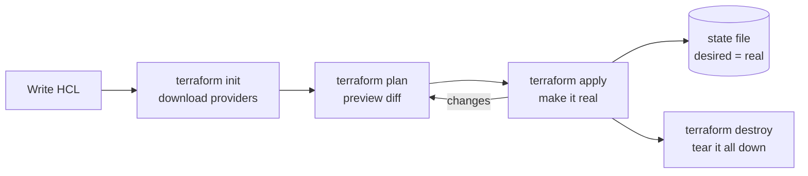
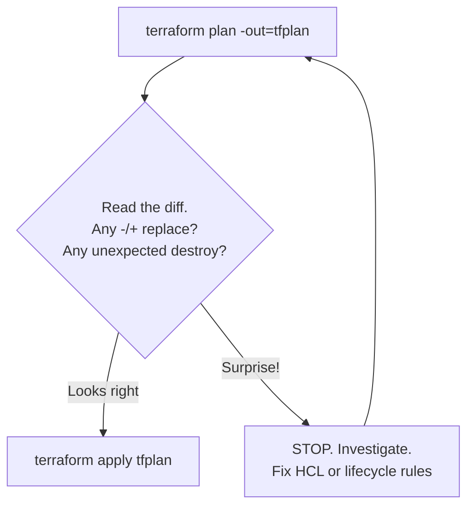

# Day 17 — IaC & Terraform Fundamentals

> Series: Cloud & DevOps Engineering
> Goal: Stop clicking in cloud consoles. Learn to describe infrastructure as code you can review, version, and reproduce — with Terraform/OpenTofu.

---

## Table of Contents

1. [Why Infrastructure as Code (IaC)](#1-why-infrastructure-as-code-iac)
2. [Declarative vs Imperative](#2-declarative-vs-imperative)
3. [The IaC Tool Landscape (2026)](#3-the-iac-tool-landscape-2026)
4. [Terraform vs OpenTofu — the honest split](#4-terraform-vs-opentofu--the-honest-split)
5. [Core Building Blocks: Providers, Resources, HCL](#5-core-building-blocks-providers-resources-hcl)
6. [The Lifecycle: init → plan → apply → destroy](#6-the-lifecycle-init--plan--apply--destroy)
7. [The plan-before-apply safety habit](#7-the-plan-before-apply-safety-habit)
8. [Lab: Provision an EC2 instance + Security Group](#8-lab-provision-an-ec2-instance--security-group)
9. [Self-Check](#9-self-check)
10. [Tomorrow](#10-tomorrow)

---

## 1. Why Infrastructure as Code (IaC)

**In plain words:** Clicking through a cloud console to build servers is like cooking a great dish with no recipe. It tastes fine once — but you can never reliably make it again, nobody else can reproduce it, and when it breaks at 3am you have no idea what you changed. IaC is writing down the recipe: a text file that *is* the infrastructure.

**Why:** Manual infrastructure (ClickOps) does not scale, is not reviewable, and drifts silently. IaC makes infrastructure **reproducible, reviewable, versioned, and self-documenting**.

**What:** IaC is the practice of defining infrastructure (networks, VMs, databases, DNS, IAM) in machine-readable definition files, applied by a tool rather than by hand.

**When:** The moment you have more than one environment (dev/staging/prod), more than one engineer, or anything you'd cry about losing. Which is basically always.

**How:** You write config files (Terraform HCL, CloudFormation YAML, Pulumi code), commit them to Git, and a tool reconciles the real cloud to match.

**Where:** AWS, Azure, GCP, Kubernetes, Cloudflare, Datadog, GitHub itself — anything with an API has a Terraform provider.

The four wins, concretely:

| Property | ClickOps (console) | IaC |
|---|---|---|
| Reproducible | "I think I checked that box" | `terraform apply` rebuilds it exactly |
| Reviewable | No diff, no PR | Change = pull request with a diff |
| Versioned | No history | `git log` shows who/what/when/why |
| Recoverable | Rebuild from memory | Re-apply from Git |
| Documented | Tribal knowledge | The code *is* the doc |

> 🤔 **"Isn't writing IaC just slower than clicking the button?"**
> For a one-off throwaway toy, yes. For anything real, no — because the button doesn't include: the review, the audit trail, the second environment, the disaster rebuild, or onboarding the next engineer. ClickOps is fast to *start* and catastrophically slow to *maintain*. IaC front-loads a little effort to kill enormous recurring pain.

**✅ Good scenario (where it saves you):** A fintech runs `dev`, `staging`, and `prod`. Prod's payment gateway VPC config lives in Terraform. A junior accidentally deletes a subnet. Recovery is `git revert` + `terraform apply` — 4 minutes, identical to before. With ClickOps that's a frantic afternoon of guessing.

**❌ Bad scenario (the pain without it):** A startup built its entire prod on the AWS console over 18 months, one click at a time. The lead engineer leaves. Nobody knows why the load balancer has that one weird health-check path, or which security group rule keeps prod alive. They're terrified to touch anything. This is called **infrastructure hostage-taking**, and it's real.

**When NOT to:** A five-minute personal experiment you'll `terminate` today. Don't Terraform a sandbox you'll delete before lunch — the ceremony isn't worth it. (But the instant it becomes "the thing we depend on," codify it.)

---

## 2. Declarative vs Imperative

**In plain words:** Imperative is telling a taxi driver every single turn ("left, right, straight, stop"). Declarative is giving the address and letting the driver figure out the route. IaC tools like Terraform are declarative: you describe the *destination* (desired state), not the driving directions.

**Why it matters:** With declarative config, you say *what you want to exist*, and the tool computes the *steps* to get there — including deletions and updates. You never write "create then if-exists update else..." logic.

```hcl
# Declarative (Terraform): describe the END STATE
resource "aws_instance" "web" {
  ami           = "ami-0abc123"
  instance_type = "t3.micro"   # I want ONE t3.micro that looks like this
}
# Terraform figures out: does it exist? create it. Wrong size? modify it. Gone? recreate it.
```

```bash
# Imperative (bash): describe the STEPS
aws ec2 run-instances --image-id ami-0abc123 --instance-type t3.micro
# You must handle: what if it already exists? what if you want 2? what if you resize?
# YOU own all the branching logic. YOU own idempotency.
```

| | Imperative | Declarative |
|---|---|---|
| You specify | The steps | The end state |
| Idempotency | You implement it | Tool guarantees it |
| Drift handling | Manual | Automatic reconciliation |
| Examples | bash, aws-cli scripts, Ansible (mostly) | Terraform, OpenTofu, CloudFormation, Kubernetes |
| Mental load | High (track current state) | Lower (just declare intent) |

> 🤔 **"Declarative sounds magical — so there's no logic at all?"**
> There's logic, but it's about *shaping the desired state* (loops with `count`/`for_each`, conditionals, variables), not about *how to reach it*. You never write the create/update/delete sequence — the tool's engine does, by diffing desired state against real state. That diff engine is the entire point of Terraform.

**When NOT to:** Genuinely sequential, one-time procedural tasks (run a DB migration, rotate a key once) are more natural imperatively. Declarative shines for *state of the world*, not *a sequence of actions*.

---

## 3. The IaC Tool Landscape (2026)

**In plain words:** Several tools solve "code my infra." They differ in *who owns them*, *what language you write*, and *which clouds they favor*.

| Tool | Language | Scope | Owner / License (2026) | Best for |
|---|---|---|---|---|
| **Terraform** | HCL (declarative DSL) | Multi-cloud, 4000+ providers | HashiCorp/IBM, BUSL (source-available) | Industry default, huge ecosystem |
| **OpenTofu** | HCL (same) | Multi-cloud | Linux Foundation, MPL 2.0 (true OSS) | Teams wanting a fully open fork |
| **CloudFormation** | YAML/JSON | AWS only | AWS, free service | All-in AWS shops, deep AWS integration |
| **Pulumi** | Real languages (TS, Python, Go, C#) | Multi-cloud | Pulumi Corp, Apache 2.0 | Devs who want loops/tests in a real language |
| **AWS CDK** | Real languages → compiles to CFN | AWS (+ CDKtf for TF) | AWS, Apache 2.0 | AWS devs who dislike YAML |
| **Ansible** | YAML (mostly imperative) | Config mgmt + some provisioning | Red Hat, GPL | Configuring *inside* servers, not building them |

**Why Terraform/OpenTofu win the default slot:** provider coverage (nearly every SaaS and cloud), a mature module registry, and a state model that works across any provider. CloudFormation locks you to AWS; Pulumi is powerful but you're now debugging general-purpose code and its blast radius.

> 🤔 **"Should I just use CloudFormation since I'm on AWS?"**
> If you are 100% AWS forever and love deep native integration (drift detection, StackSets, no state file to manage), CloudFormation is defensible. But most real companies use AWS *plus* Cloudflare *plus* Datadog *plus* GitHub *plus* a database SaaS. Terraform manages all of them with one workflow; CloudFormation manages one. That's why Terraform is the market default.

**✅ Good scenario:** A SaaS company manages AWS infra, Cloudflare DNS, Datadog monitors, and PagerDuty schedules — all in one Terraform repo, one `plan`, one review. Cross-tool consistency in a single PR.

**❌ Bad scenario (when misused):** A team picks Pulumi in Python "because we love Python," then a `for` loop bug accidentally names 200 S3 buckets identically and the abstraction hides the blast radius until apply. Real-language IaC gives real-language footguns. Power cuts both ways.

**When NOT to:** Don't reach for Terraform to configure software *inside* a running VM (package installs, file templating) — that's Ansible/cloud-init territory. Terraform *builds the box*; config management *furnishes it*.

---

## 4. Terraform vs OpenTofu — the honest split

**In plain words:** In 2023 HashiCorp changed Terraform's license from open-source (MPL) to source-available (BUSL) — you can use it, but competitors can't build a business on it. The community forked the last open version and created **OpenTofu**, now under the Linux Foundation. Same language, same workflow, `tofu` instead of `terraform`.

**Why you care:** The commands, HCL syntax, and mental model are ~identical. The differences are governance, license, and a few newer features (OpenTofu shipped state encryption and `for_each` in provider blocks early; Terraform has its own roadmap).

```bash
# They are near drop-in. Same subcommands:
terraform init && terraform plan && terraform apply    # Terraform (HashiCorp)
tofu init      && tofu plan      && tofu apply         # OpenTofu (LF fork)
```

| | Terraform | OpenTofu |
|---|---|---|
| License (2026) | BUSL 1.1 (source-available) | MPL 2.0 (open source) |
| Governance | HashiCorp (IBM-owned) | Linux Foundation, community |
| CLI binary | `terraform` | `tofu` |
| Latest (Jul 2026) | ~1.15.x (1.16 in alpha) | ~1.12.x |
| State file | Compatible | Compatible (can migrate) |
| Registry | registry.terraform.io | Uses its own + TF registry |

> 🤔 **"Which one do I learn — will my skills transfer?"**
> Learn the concepts; the binary is a footnote. 95% of what you type is identical. Most job postings still say "Terraform" (it's the brand), so learn against Terraform docs, but know OpenTofu exists and why — it's a common interview question in 2026. Migration is often as simple as swapping the binary and running `init`.

**When NOT to:** Don't agonize over the choice as a learner. Pick one, build the mental model. Switch later in ~an afternoon if your org mandates it.

> **Dark Side note:** The license change spooked enterprises. Some big orgs standardized on OpenTofu specifically to avoid vendor lock-in and BUSL uncertainty. Know this narrative — it signals you follow the ecosystem.

Throughout this course I'll write `terraform`. Everywhere, you may substitute `tofu`.

---

## 5. Core Building Blocks: Providers, Resources, HCL

**In plain words:** A **provider** is a plugin that teaches Terraform how to talk to one platform's API (AWS, GCP, Cloudflare). A **resource** is one thing you want (an EC2 instance, a DNS record). **HCL** (HashiCorp Configuration Language) is the syntax you write both in.

**Why:** Providers are the adapters; resources are the nouns; HCL is the grammar. Everything else (variables, modules, state) orbits these three.

**How — the anatomy:**

```hcl
# 1) TERRAFORM BLOCK: pin versions so teammates & CI get identical behavior
terraform {
  required_version = ">= 1.9"           # min CLI version
  required_providers {
    aws = {
      source  = "hashicorp/aws"          # where to download the provider
      version = "~> 5.60"                # allow 5.60.x but not 6.0 (pessimistic)
    }
  }
}

# 2) PROVIDER BLOCK: configure the adapter (region, auth)
provider "aws" {
  region = "us-east-1"                   # credentials come from env/CLI, NOT hardcoded
}

# 3) RESOURCE BLOCK: <TYPE> <LOCAL_NAME> { arguments }
resource "aws_instance" "web" {
  ami           = "ami-0abcdef1234567890"
  instance_type = "t3.micro"
  tags = {
    Name = "day17-web"
  }
}
```

Key HCL vocabulary:

- **Resource address**: `aws_instance.web` — how you refer to it elsewhere and in state.
- **Arguments**: inputs you set (`instance_type`).
- **Attributes**: outputs you read (`aws_instance.web.public_ip`) — known only after apply.
- **Interpolation/references**: `${...}` or bare `resource.attr` to wire resources together.
- **Version constraints**: `~> 5.60` (pessimistic: patch/minor ok, no major bump).

> 🤔 **"Do I hardcode my AWS keys in the provider block?"**
> Absolutely not — that's the #1 way credentials leak into Git and end in a $50k crypto-mining bill. Terraform reads credentials from the environment (`AWS_ACCESS_KEY_ID`), `~/.aws/credentials`, IAM roles, or SSO — the same chain the AWS CLI uses. The `provider` block should contain *config* (region), never *secrets*.

**✅ Good scenario:** A team pins `aws = "~> 5.60"`. Six months later a teammate runs `init` and gets a compatible provider — no surprise breakage from an accidental major upgrade. Version pinning = reproducibility.

**❌ Bad scenario (the pain):** No version pin. CI silently pulls a new major provider that renamed an argument. The `apply` that worked yesterday now errors across 40 resources. An afternoon lost to something one line (`version = "~> 5.60"`) prevents.

**When NOT to:** Don't over-constrain to an exact patch (`= 5.60.1`) everywhere — you'll never get security fixes. Pin the *minor* (`~> 5.60`), let patches flow.

---

## 6. The Lifecycle: init → plan → apply → destroy

**In plain words:** Four verbs run your whole day. `init` sets up. `plan` previews. `apply` executes. `destroy` tears down. Learn these four and you can operate Terraform.



*The core loop: write, preview, apply, and re-plan as your desired state evolves.*

**`terraform init`** — Run once per project (and after adding providers/modules). Downloads provider plugins into `.terraform/`, sets up the backend, writes a lock file.

```bash
terraform init
# Downloads hashicorp/aws, creates .terraform.lock.hcl (pins exact provider hashes)
# COMMIT .terraform.lock.hcl — it's your reproducibility guarantee
```

**`terraform plan`** — The dry run. Computes the diff between your HCL (desired) and state/reality (current). Changes nothing.

```bash
terraform plan
# Symbols you MUST read fluently:
#   +  create      (new resource)
#   -  destroy     (resource removed)
#   ~  update in-place  (attribute changed, no replacement)
#  -/+ replace     (destroy THEN create — DANGER: downtime/data loss)
```

**`terraform apply`** — Executes the plan. Prompts `yes` unless auto-approved. Updates the state file.

```bash
terraform apply                 # shows plan again, asks: "Enter a value: yes"
terraform apply -auto-approve   # skips prompt — ONLY in CI with a reviewed plan
```

**`terraform destroy`** — Deletes everything Terraform manages in this config. Irreversible.

```bash
terraform destroy               # tears down ALL managed resources — read the plan!
```

| Command | Reads | Writes | Safe to run anytime? |
|---|---|---|---|
| `init` | config | `.terraform/`, lockfile | Yes |
| `plan` | config + state + cloud | nothing | Yes (read-only) |
| `apply` | config + state | **cloud + state** | No — mutates reality |
| `destroy` | state | **cloud + state** | No — deletes reality |

> 🤔 **"Does `plan` change anything in my cloud?"**
> No. `plan` is strictly read-only — it *refreshes* state (reads current reality) and computes a diff, but touches nothing. This is *why* it's your safety net: you can run it a hundred times to understand impact before committing. `apply` is the only routine command that mutates.

**When NOT to:** Never run `apply -auto-approve` interactively on prod "to save time." The prompt is a feature — it's your last human checkpoint. Auto-approve belongs only in CI *after* a reviewed, saved plan.

---

## 7. The plan-before-apply safety habit

**In plain words:** `plan` is the "measure twice, cut once" of infra. The single most damaging Terraform mistakes come from applying a diff you didn't read — especially the `-/+ replace` line that quietly means "delete your production database and make a new empty one."

**Why:** Terraform will *cheerfully* destroy and recreate a resource if an immutable attribute changes. If you don't read the plan, you find out when prod is gone.

**The habit:** Save the plan, review it, apply *that exact plan*.

```bash
terraform plan -out=tfplan       # 1) compute & SAVE the plan to a file
# 2) READ IT. Count creates/updates/destroys. Hunt for -/+ (replace).
terraform apply tfplan           # 3) apply the EXACT reviewed plan (no re-diff surprise)
```



*Never let a plan you didn't read reach apply.*

Watch for these red flags in a plan:

- `-/+ replace` on a database, disk, or stateful resource → **potential data loss**.
- `destroy` count > 0 when you expected only additions.
- A change to `name`, `availability_zone`, or other **force-new** attributes.

Guardrail: mark irreplaceable resources so a bad plan *fails loudly* instead of silently nuking them.

```hcl
resource "aws_db_instance" "prod" {
  # ...
  lifecycle {
    prevent_destroy = true   # apply ABORTS if this would be destroyed — a seatbelt
  }
}
```

> 🤔 **"If Terraform is declarative and smart, why would it ever destroy my database?"**
> Because "smart" means "makes reality match your file" — and some attributes can't be changed in place (an RDS engine, an EC2 AZ, an S3 bucket name). To honor your desired state, Terraform's *only* option is destroy-and-recreate. It's not a bug; it's you asking for something that requires replacement. The plan tells you — if you read it.

**✅ Good scenario:** An engineer changes an RDS parameter. `plan` shows `-/+ replace` — replacing the whole prod database. They catch it, realize they touched an immutable field, revert, and use a parameter group instead. Reading the plan saved the company's data.

**❌ Bad scenario (real, common):** Someone renames an S3 bucket in HCL "for tidiness," runs `apply -auto-approve` in a hurry. `-/+` destroys the bucket (name is immutable) and its contents, then makes an empty new one. The old data is gone. Every senior engineer has a version of this scar.

**When NOT to skip it:** Never on shared or prod state. On a throwaway sandbox you can be looser — but the habit is the point. Build it now so it's automatic when it matters.

---

## 8. Lab: Provision an EC2 instance + Security Group

**Goal:** Build a real (free-tier) EC2 instance with a security group allowing SSH, using the full lifecycle. Then destroy it.

### Prerequisites

```bash
terraform -version         # or: tofu -version   (want >= 1.9 / >= 1.6)
aws configure              # set an access key with EC2 permissions + a region
aws sts get-caller-identity # confirm creds work
```

### Step 1 — Project files

Create a folder `day17-lab/` with `main.tf`:

```hcl
terraform {
  required_version = ">= 1.9"
  required_providers {
    aws = {
      source  = "hashicorp/aws"
      version = "~> 5.60"
    }
  }
}

provider "aws" {
  region = "us-east-1"
}

# Look up the latest Amazon Linux 2023 AMI instead of hardcoding an ID (DATA SOURCE — Day 18)
data "aws_ami" "al2023" {
  most_recent = true
  owners      = ["amazon"]
  filter {
    name   = "name"
    values = ["al2023-ami-*-x86_64"]
  }
}

# SECURITY GROUP: a virtual firewall
resource "aws_security_group" "web_sg" {
  name        = "day17-web-sg"
  description = "Allow SSH inbound"

  ingress {
    description = "SSH"
    from_port   = 22
    to_port     = 22
    protocol    = "tcp"
    cidr_blocks = ["0.0.0.0/0"]   # DEMO ONLY — restrict to your IP in real life!
  }

  egress {
    from_port   = 0
    to_port     = 0
    protocol    = "-1"            # all outbound
    cidr_blocks = ["0.0.0.0/0"]
  }

  tags = { Name = "day17-web-sg" }
}

# EC2 INSTANCE, wired to the SG above by reference
resource "aws_instance" "web" {
  ami                    = data.aws_ami.al2023.id
  instance_type          = "t3.micro"                       # free-tier eligible
  vpc_security_group_ids = [aws_security_group.web_sg.id]   # <-- resource reference
  tags = { Name = "day17-web" }
}

# OUTPUT: print the public IP after apply (more on outputs Day 18)
output "public_ip" {
  value = aws_instance.web.public_ip
}
```

### Step 2 — Run the lifecycle

```bash
cd day17-lab

terraform init          # downloads AWS provider, writes .terraform.lock.hcl
terraform fmt           # auto-format HCL (do this habitually)
terraform validate      # syntax/type check without touching the cloud

terraform plan -out=tfplan
# READ IT: expect  + aws_security_group.web_sg  and  + aws_instance.web  (2 to add, 0 to destroy)

terraform apply tfplan  # creates the SG + instance; prints public_ip
```

### Step 3 — Observe state and drift

```bash
terraform show          # human-readable current state
terraform state list    # -> aws_instance.web, aws_security_group.web_sg, data.aws_ami.al2023

# Make a drift: change instance_type to "t3.small" in main.tf, then:
terraform plan          # shows  ~ update in-place (or -/+ depending on attr)
```

### Step 4 — Clean up (avoid charges!)

```bash
terraform destroy       # READ the plan: "2 to destroy". Type: yes
# Confirm nothing lingers:
aws ec2 describe-instances --filters "Name=tag:Name,Values=day17-web" \
  --query "Reservations[].Instances[].State.Name"
```

### Success criteria

- `apply` printed a real `public_ip`.
- `terraform state list` showed your two resources.
- Changing a field made `plan` show a diff (you *saw* declarative reconciliation).
- `destroy` removed everything (check your AWS console → EC2 is empty).

**Stretch:** Restrict the SSH `cidr_blocks` to `["<your.ip>/32"]`. Re-run `plan` and read the `~ update in-place` on the SG.

---

## 9. Self-Check

1. Name the four properties IaC gives you over ClickOps, and give a one-line example of each.
2. What's the core difference between declarative and imperative infra tooling? Which is Terraform?
3. Why did OpenTofu fork from Terraform, and how different are the day-to-day commands?
4. In a `plan`, what do `+`, `-`, `~`, and `-/+` each mean? Which one should scare you and why?
5. Does `terraform plan` change your cloud? What about `terraform init`?
6. Where should AWS credentials come from — and where should they *never* live?
7. What does `~> 5.60` mean as a provider version constraint, and why not pin an exact patch?
8. Explain why Terraform might "destroy and recreate" a resource you only meant to modify.
9. What is `lifecycle { prevent_destroy = true }` for, and on what kind of resource?
10. Why should you `plan -out=tfplan` then `apply tfplan` instead of just `apply`?

---

## 10. Tomorrow

**Day 18 — Terraform State, Variables & Modules.** Today you saw a `terraform.tfstate` file appear. Tomorrow we crack it open: *what state actually is*, why it's the beating heart (and biggest footgun) of Terraform, how to store it remotely in S3 with a DynamoDB lock so your team doesn't corrupt it, and how to stop copy-pasting HCL by refactoring today's lab into a reusable **module**. State is where Terraform gets powerful — and where careers get scary. See you there.
