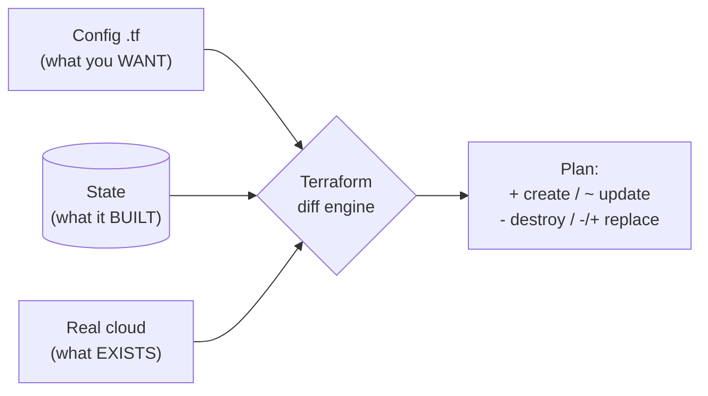
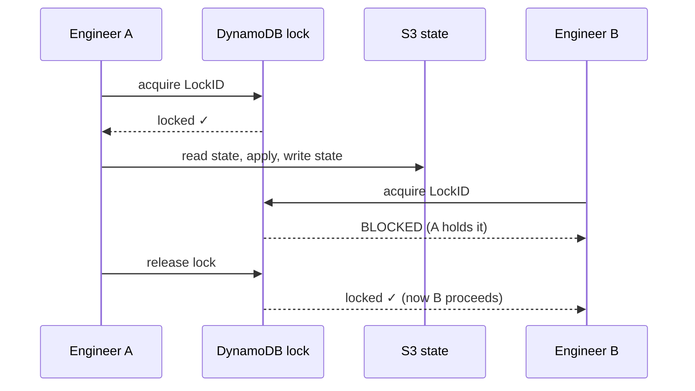
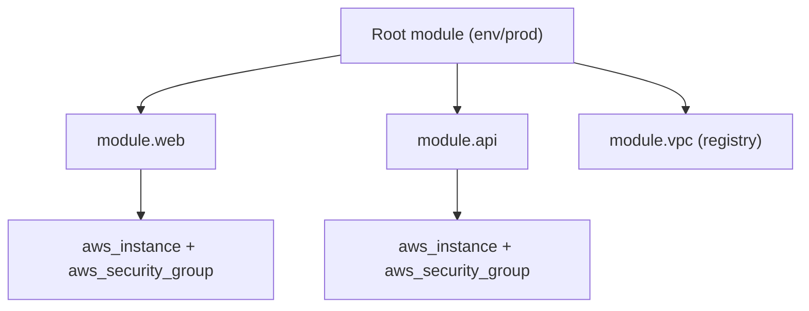

# Day 18 — Terraform State, Variables & Modules

> Series: Cloud & DevOps Engineering
> Goal: Understand the state file (Terraform's brain), store it safely for a team, parameterize configs with variables/outputs/locals/data, and stop copy-pasting HCL by building reusable modules.

---

## Table of Contents

1. [State: what it is and why it exists](#1-state-what-it-is-and-why-it-exists)
2. [The desired-vs-real mapping](#2-the-desired-vs-real-mapping)
3. [Remote state: S3 + DynamoDB lock](#3-remote-state-s3--dynamodb-lock)
4. [State corruption & lock dangers](#4-state-corruption--lock-dangers)
5. [Variables, Outputs, Locals](#5-variables-outputs-locals)
6. [Data Sources](#6-data-sources)
7. [Modules: reusable infrastructure](#7-modules-reusable-infrastructure)
8. [Lab: Refactor Day 17 into a module + remote state](#8-lab-refactor-day-17-into-a-module--remote-state)
9. [Self-Check](#9-self-check)
10. [Tomorrow](#10-tomorrow)

---

## 1. State: what it is and why it exists

**In plain words:** State is Terraform's memory. When you ran `apply` yesterday, Terraform wrote down "I created instance `i-0abc` for your `aws_instance.web`." Next time, it reads that note to know what it already built. Without memory, Terraform would have amnesia every run — unable to tell "change this" from "create a new one."

**Why it exists:** Your HCL says *what you want*. The cloud holds *what exists*. Terraform needs a third thing — a **mapping** between your resource addresses (`aws_instance.web`) and real cloud IDs (`i-0abc123`). That mapping is state.

**What:** A JSON file (`terraform.tfstate`) recording every managed resource, its real ID, all its attributes, dependencies, and metadata.

**When it's read/written:** Read on every `plan`/`apply` (to diff); written on every `apply`/`destroy` (to record changes).

**How to inspect it:**

```bash
terraform state list                 # list all tracked resource addresses
terraform state show aws_instance.web  # full attributes of one resource
cat terraform.tfstate | jq '.resources[].type'  # peek at the raw JSON (read-only!)
```

**Where:** By default a local file next to your `.tf`. For teams: a **remote backend** (S3, GCS, Terraform Cloud) — see §3.

> 🤔 **"Can't Terraform just ask the cloud what exists each time, and skip the state file?"**
> Partly — it *does* refresh from the cloud. But state solves three things the cloud API can't: (1) the **mapping** from your logical name to a physical ID (the cloud doesn't know your resource is called `web`), (2) **performance** (one bulk read beats thousands of API calls), and (3) tracking **metadata/dependencies** and things the provider can't fully re-derive. State is the ledger that makes reconciliation possible.

**✅ Good scenario:** You rename nothing but change `instance_type`. Terraform matches state → real instance `i-0abc`, sees the size differs, and *modifies* it. Correct, targeted, no orphan.

**❌ Bad scenario (the pain without it):** Imagine no state. You run `apply` twice. Terraform can't tell the existing instance is "yours," so it creates a *second* one. Now you're paying double and nobody knows which is real. State is what makes `apply` idempotent.

**When NOT to think about it:** You always think about it. State is the one Terraform concept you can never ignore.

> **Dark Side note:** State can contain **secrets in plaintext** — a DB password you passed as an argument gets stored in state. This is why remote state must be encrypted and access-controlled, and why you never commit `terraform.tfstate` to Git.

---

## 2. The desired-vs-real mapping

**In plain words:** Every `plan` is a three-way comparison. Terraform lines up (1) your **config** (desired), (2) the **state** (last-known), and (3) the **real cloud** (actual), then computes what to change.



*Every plan reconciles three views of the world; the diff is the plan.*

The three cases:

| Situation | Config says | State/Cloud says | Terraform does |
|---|---|---|---|
| New resource | exists | absent | `+ create` |
| Changed attribute | t3.small | t3.micro | `~ update` (or `-/+`) |
| Removed from config | absent | exists | `- destroy` |
| **Drift** (changed outside TF) | t3.micro | someone set t3.large in console | `~` back to t3.micro |

**Drift** = reality diverged from state because someone clicked in the console. On the next `plan`, Terraform notices and offers to "correct" reality back to your config. This is why IaC and ClickOps must not mix on the same resources.

> 🤔 **"If someone changes a resource in the console, does Terraform know?"**
> Not until the next `plan`/`apply`, which *refreshes* state from the cloud and shows the drift as a diff. Terraform's instinct is to *undo* the manual change (make reality match config). That's a feature — config is the source of truth — but it surprises people who "just tweaked one thing in the console." Rule: manage a resource in Terraform *or* by hand, never both.

**When NOT to:** If a resource genuinely must be human-managed (e.g., an emergency console hotfix), either import the new reality (Day 19) or exclude it from Terraform with `ignore_changes`.

---

## 3. Remote state: S3 + DynamoDB lock

**In plain words:** A local state file on your laptop is fine for solo play. On a team it's a disaster — two people can't share it, it's not backed up, and two simultaneous `apply`s corrupt it. **Remote state** puts the file in shared storage (S3) with a **lock** (DynamoDB) so only one `apply` runs at a time.

**Why:** Sharing, durability, encryption, and **locking** (the killer feature). The lock prevents two engineers from applying at once and scrambling the state.

**How — the S3 backend:**

```hcl
terraform {
  backend "s3" {
    bucket         = "acme-tfstate-prod"        # pre-existing S3 bucket (versioned!)
    key            = "day18/terraform.tfstate"  # path within the bucket
    region         = "us-east-1"
    dynamodb_table = "acme-tf-locks"            # holds the lock record
    encrypt        = true                        # server-side encryption at rest
  }
}
```

```bash
# The lock table needs a partition key literally named "LockID":
aws dynamodb create-table \
  --table-name acme-tf-locks \
  --attribute-definitions AttributeName=LockID,AttributeType=S \
  --key-schema AttributeName=LockID,KeyType=HASH \
  --billing-mode PAY_PER_REQUEST

# Enable S3 versioning so you can recover a clobbered state:
aws s3api put-bucket-versioning --bucket acme-tfstate-prod \
  --versioning-configuration Status=Enabled

terraform init   # migrating local -> remote? It offers to copy your existing state up.
```



*The lock serializes applies so two engineers can't corrupt shared state.*

> Note: modern Terraform (1.10+) and OpenTofu also support **S3 native lockfiles** (`use_lockfile = true`), reducing the need for a separate DynamoDB table. DynamoDB remains the classic, widely-taught pattern and works everywhere — know both.

| | Local state | Remote state (S3+lock) |
|---|---|---|
| Team sharing | No (one laptop) | Yes |
| Locking | No | Yes (concurrent apply blocked) |
| Durability/backup | No | Yes (S3 versioning) |
| Encryption | No | Yes (SSE) |
| Secrets exposure | On your disk | Controlled by IAM + encryption |

> 🤔 **"We're a small team — can't we just commit tfstate to Git?"**
> No, and this is a classic rookie disaster. State contains secrets in plaintext (leak), Git has no locking (two `apply`s = corruption + merge conflicts in JSON no human can resolve), and it bloats history. Remote state exists precisely because Git is the wrong tool for a mutable, secret-bearing, must-be-locked artifact. S3+DynamoDB is ~10 minutes to set up and saves you from all of it.

**✅ Good scenario:** Two SREs both try to deploy a hotfix at 2am. DynamoDB grants the lock to one; the other sees "state locked by user X" and waits. Zero corruption, clean serialization.

**❌ Bad scenario (the pain):** A team keeps `terraform.tfstate` in the repo. Two people merge branches; the state JSON conflicts. They "resolve" it by picking one side — silently orphaning half of prod. Now `plan` wants to recreate resources that already exist. Hours of `terraform import` surgery follow.

**When NOT to:** A genuinely personal, disposable sandbox can stay local. Anything shared or important → remote, always.

---

## 4. State corruption & lock dangers

**In plain words:** State is powerful and *fragile*. Corrupt it and Terraform loses track of reality — thinking things exist that don't (or vice-versa). Two failure modes dominate: **corruption** (bad/partial writes) and **stuck locks**.

**Why it happens:** Interrupting an `apply` mid-write, editing state JSON by hand, concurrent applies without a lock, or a crashed process that never released its lock.

**How to work with state safely — use the commands, not a text editor:**

```bash
terraform state mv aws_instance.web module.web.aws_instance.this  # rename/move an address
terraform state rm aws_instance.web        # stop tracking (does NOT delete the real resource)
terraform import aws_instance.web i-0abc123 # adopt an existing resource into state
terraform force-unlock <LOCK_ID>           # release a STUCK lock (verify no apply runs!)
```

**Recovering from corruption:** S3 versioning is your safety net. Restore a prior state version:

```bash
aws s3api list-object-versions --bucket acme-tfstate-prod --prefix day18/terraform.tfstate
aws s3api get-object --bucket acme-tfstate-prod --key day18/terraform.tfstate \
  --version-id <GOOD_VERSION> terraform.tfstate   # then re-upload / re-init
```

> 🤔 **"My apply crashed and now every command says 'state locked' — did I brick it?"**
> Usually not. A crashed process can leave the DynamoDB lock held. `terraform force-unlock <ID>` releases it — but ONLY after you've confirmed no `apply` is actually still running (in CI, another machine). Force-unlocking a live apply is how you *cause* the corruption you feared. Check first, unlock second.

**✅ Good scenario:** A CI runner died mid-apply. On-call confirms the job is dead, runs `force-unlock`, re-runs `apply`. Terraform re-reconciles cleanly because S3 had the last good state. Ten-minute recovery.

**❌ Bad scenario:** An engineer hand-edits `terraform.tfstate` to "fix" a resource ID, mistypes, and saves. Now `plan` errors on malformed JSON, or worse, thinks a prod resource doesn't exist and plans to create a duplicate. Never hand-edit state — use `state mv/rm/import`.

**When NOT to:** Never `force-unlock` reflexively, never hand-edit JSON, never `state rm` a resource thinking it deletes it (it just stops tracking — the real thing lives on, now orphaned).

> **Dark Side note:** `state rm` + `destroy` is a trap. `state rm` orphans a resource (Terraform forgets it, cloud keeps it — you pay for a ghost). Later a full `destroy` won't remove it because it's no longer tracked. Orphaned resources are a real cost-leak source.

---

## 5. Variables, Outputs, Locals

**In plain words:** Hardcoding values everywhere is like writing a program with no function arguments. **Variables** are inputs, **outputs** are return values, **locals** are named intermediate expressions. Together they turn a rigid config into a reusable, parameterized one.

**Variables (inputs):**

```hcl
variable "instance_type" {
  type        = string
  default     = "t3.micro"
  description = "EC2 size"
}

variable "environment" {
  type        = string
  validation {                              # guardrails on inputs
    condition     = contains(["dev", "staging", "prod"], var.environment)
    error_message = "environment must be dev, staging, or prod."
  }
}

# use it:  instance_type = var.instance_type
```

Set variables (precedence: CLI > `*.auto.tfvars` > env > default):

```bash
terraform apply -var="instance_type=t3.small"      # CLI (highest)
# or a file:  terraform.tfvars / prod.tfvars
export TF_VAR_environment=prod                      # env var convention
```

```hcl
# prod.tfvars
instance_type = "t3.large"
environment   = "prod"
```
```bash
terraform apply -var-file=prod.tfvars
```

**Outputs (return values):** expose useful attributes to humans or other modules.

```hcl
output "instance_public_ip" {
  value       = aws_instance.web.public_ip
  description = "Reach the web box here"
}
output "db_password" {
  value     = aws_db_instance.main.password
  sensitive = true        # redacts from CLI output (still in state though!)
}
```

**Locals (named expressions):** DRY up repeated logic; not settable from outside.

```hcl
locals {
  name_prefix = "${var.environment}-web"
  common_tags = {
    Environment = var.environment
    ManagedBy   = "terraform"
  }
}
# use it:  tags = local.common_tags
```

| Construct | Direction | Settable externally? | Purpose |
|---|---|---|---|
| `variable` | input | Yes (CLI/file/env) | Parameterize |
| `output` | output | No | Expose values |
| `local` | internal | No | Reuse expressions |

> 🤔 **"Does marking an output `sensitive` actually keep the secret safe?"**
> No — it only hides it from *CLI output* and logs. The value still sits in the state file in plaintext. `sensitive = true` is UX hygiene, not encryption. Real secret protection = encrypted remote state + a secrets manager (Day 19), not the `sensitive` flag.

**When NOT to:** Don't variable-ize *everything*. If a value is truly constant (an AWS service principal ARN), a `local` or literal is clearer than a knob nobody will turn. Over-parameterizing makes modules unreadable.

---

## 6. Data Sources

**In plain words:** A **resource** creates something. A **data source** *reads* something that already exists (created elsewhere) so you can reference it. You saw one on Day 17: `data "aws_ami"` looked up an AMI ID instead of hardcoding it.

**Why:** Avoid hardcoding IDs that change, and stitch together infra managed elsewhere (a shared VPC, an existing hosted zone).

```hcl
# Read the current AWS account ID / region (no resource created)
data "aws_caller_identity" "current" {}
data "aws_region" "current" {}

# Look up an existing VPC by tag instead of hardcoding vpc-xxxx
data "aws_vpc" "main" {
  filter {
    name   = "tag:Name"
    values = ["main-vpc"]
  }
}

resource "aws_subnet" "app" {
  vpc_id     = data.aws_vpc.main.id      # reference the looked-up VPC
  cidr_block = "10.0.5.0/24"
}
```

| | Resource | Data source |
|---|---|---|
| Action | Creates/manages | Reads only |
| Appears in plan as | `+/~/-` | (read, no change) |
| Owns lifecycle? | Yes | No |
| Syntax | `resource "type" "name"` | `data "type" "name"` |

> 🤔 **"Why not just paste the VPC ID as a string — it's simpler?"**
> Hardcoded IDs are brittle: they differ per environment, change when infra is rebuilt, and turn your config into copy-paste-per-account sludge. A data source looks the value up *at plan time* from a stable attribute (a tag/name), so the same config works across accounts and survives rebuilds. It's the difference between a config that's portable and one that's glued to one account.

**When NOT to:** If you *own* the resource in the same config, reference it directly (`aws_vpc.main.id`) — don't read your own creation back via a data source (creates needless dependency ordering issues).

---

## 7. Modules: reusable infrastructure

**In plain words:** A module is a *function* for infrastructure — a folder of `.tf` files with inputs (variables) and outputs, that you can call many times with different arguments. Instead of copy-pasting your EC2+SG block for web, api, and worker, you write it once as a module and call it three times.

**Why:** DRY, consistency, and encapsulation. Every environment gets the *same* battle-tested pattern; fix a bug once, everyone benefits.

**What:** *Every* Terraform config is already a module (the "root module"). A **child module** is one you call with `module "..." { source = ... }`. Modules come from local paths, Git, or the public **Terraform Registry**.

**Structure of a module:**

```
modules/web-server/
  ├── main.tf        # the resources (EC2 + SG)
  ├── variables.tf   # inputs
  └── outputs.tf     # outputs
```

```hcl
# modules/web-server/variables.tf
variable "name"          { type = string }
variable "instance_type" { type = string, default = "t3.micro" }
variable "ami_id"        { type = string }

# modules/web-server/main.tf
resource "aws_security_group" "sg" {
  name = "${var.name}-sg"
  ingress { from_port = 22, to_port = 22, protocol = "tcp", cidr_blocks = ["0.0.0.0/0"] }
  egress  { from_port = 0,  to_port = 0,  protocol = "-1",  cidr_blocks = ["0.0.0.0/0"] }
}
resource "aws_instance" "this" {
  ami                    = var.ami_id
  instance_type          = var.instance_type
  vpc_security_group_ids = [aws_security_group.sg.id]
  tags                   = { Name = var.name }
}

# modules/web-server/outputs.tf
output "public_ip"    { value = aws_instance.this.public_ip }
output "instance_id"  { value = aws_instance.this.id }
```

**Calling the module (the root):**

```hcl
module "web" {
  source        = "./modules/web-server"   # local path (Git/registry also work)
  name          = "prod-web"
  ami_id        = data.aws_ami.al2023.id
  instance_type = "t3.small"
}

module "api" {                              # SAME module, different args = DRY
  source = "./modules/web-server"
  name   = "prod-api"
  ami_id = data.aws_ami.al2023.id
}

output "web_ip" { value = module.web.public_ip }  # read a module output
```

**Registry modules** (don't reinvent networking):

```hcl
module "vpc" {
  source  = "terraform-aws-modules/vpc/aws"   # famous community module
  version = "~> 5.0"
  name    = "main-vpc"
  cidr    = "10.0.0.0/16"
  # ...azs, subnets, etc.
}
```



*One module definition, called many times — write once, reuse everywhere.*

> 🤔 **"Should I put every single resource in its own module?"**
> No — that's over-modularization, and it makes infra harder to read, not easier. Modules earn their keep when a *pattern repeats* (you build the same web-server shape 3+ times) or when you want a *reusable, versioned interface* (a company-standard VPC). A one-off resource used once doesn't need a module wrapper; the abstraction tax exceeds the benefit.

**✅ Good scenario:** A platform team ships a `service` module encoding the company's ECS + ALB + logging + alarms pattern. 40 app teams call it in 8 lines each. Security hardening lands in one PR to the module; all 40 services inherit it.

**❌ Bad scenario (when misused):** A team wraps every resource in a nested 4-level-deep module tree "for cleanliness." Now tracing why a security group exists means opening six files, and passing a variable requires threading it through four layers. Modules became obfuscation. Flatter is often clearer.

**When NOT to:** Don't modularize prematurely. Write it inline first; extract a module when you *actually* copy-paste it a second time (rule of three).

> **Dark Side note:** Pin module versions (`version = "~> 5.0"`). An unpinned registry module can pull a breaking change and rewrite your infra on the next `init`. Same reproducibility rule as providers.

---

## 8. Lab: Refactor Day 17 into a module + remote state

**Goal:** Take yesterday's flat EC2+SG config, extract it into a reusable module, and move state to S3 with a DynamoDB lock. This is the single most common "level-up" refactor in real Terraform work.

### Step 0 — Bootstrap the backend (one-time, can be its own tiny config)

```bash
aws s3 mb s3://acme-tfstate-lab-$RANDOM        # note the exact name you get
aws s3api put-bucket-versioning --bucket <YOUR_BUCKET> \
  --versioning-configuration Status=Enabled
aws dynamodb create-table --table-name acme-tf-locks \
  --attribute-definitions AttributeName=LockID,AttributeType=S \
  --key-schema AttributeName=LockID,KeyType=HASH \
  --billing-mode PAY_PER_REQUEST
```

### Step 1 — Create the module

`modules/web-server/main.tf`, `variables.tf`, `outputs.tf` — copy the resource blocks from §7 above (SG + instance + outputs).

### Step 2 — Root config with backend + module call

`main.tf`:

```hcl
terraform {
  required_version = ">= 1.9"
  required_providers { aws = { source = "hashicorp/aws", version = "~> 5.60" } }
  backend "s3" {
    bucket         = "<YOUR_BUCKET>"
    key            = "day18/terraform.tfstate"
    region         = "us-east-1"
    dynamodb_table = "acme-tf-locks"
    encrypt        = true
  }
}

provider "aws" { region = "us-east-1" }

data "aws_ami" "al2023" {
  most_recent = true
  owners      = ["amazon"]
  filter { name = "name", values = ["al2023-ami-*-x86_64"] }
}

module "web" {
  source        = "./modules/web-server"
  name          = "day18-web"
  ami_id        = data.aws_ami.al2023.id
  instance_type = var.instance_type
}

variable "instance_type" { type = string, default = "t3.micro" }
output "web_public_ip"   { value = module.web.public_ip }
```

### Step 3 — Init (migrate state up) and apply

```bash
terraform init
# It detects the S3 backend and asks: "copy existing state to the new backend?" -> yes
terraform get               # fetch/refresh the local module
terraform plan -out=tfplan  # expect the module's SG + instance
terraform apply tfplan
```

### Step 4 — Prove the module + remote state work

```bash
terraform state list        # addresses now nested: module.web.aws_instance.this
aws s3 ls s3://<YOUR_BUCKET>/day18/     # state now lives in S3
terraform apply -var="instance_type=t3.small"  # re-parameterize via variable
```

### Step 5 — Prove locking (optional, needs 2 shells)

```bash
# Shell A: start an apply and leave it at the "yes?" prompt (holds the lock)
terraform apply
# Shell B (same dir): try any state op -> "Error acquiring the state lock"
terraform plan
```

### Step 6 — Clean up

```bash
terraform destroy
# Optional: delete the bucket + table when fully done
aws dynamodb delete-table --table-name acme-tf-locks
aws s3 rb s3://<YOUR_BUCKET> --force
```

### Success criteria

- State file is in S3 (not on your disk), versioning on.
- `terraform state list` shows `module.web.*` nested addresses.
- Changing `-var="instance_type=..."` re-applies via the variable.
- A concurrent operation was blocked by the lock.

**Stretch:** Add an `api` call of the same module. One module, two instances — feel the DRY.

---

## 9. Self-Check

1. In your own words, what is the Terraform state file and what problem does it solve?
2. Describe the three-way comparison every `plan` performs.
3. What is drift, and what does Terraform want to do about it?
4. Why is committing `terraform.tfstate` to Git dangerous (give three reasons)?
5. What does the DynamoDB table provide in the S3 remote-state pattern?
6. Your `apply` crashed and the state is locked. What do you check *before* `force-unlock`?
7. Does `sensitive = true` on an output encrypt the secret? Where does the value still live?
8. Difference between a `resource` and a `data` source? Give a use case for each.
9. When should you extract HCL into a module — and when is modularizing a mistake?
10. What's the danger of `terraform state rm`, and how does it differ from `destroy`?

---

## 10. Tomorrow

**Day 19 — Terraform in Practice.** You can now write, parameterize, modularize, and safely store state. Tomorrow we make it *production-grade*: managing dev/staging/prod (workspaces vs directories), running `plan` in CI and gating `apply` behind review, detecting drift automatically, importing the pile of resources someone built by hand, keeping secrets *out* of your config (Vault/SSM), and a look at **Terragrunt** for wiring many environments together. This is the day Terraform becomes a team sport.
