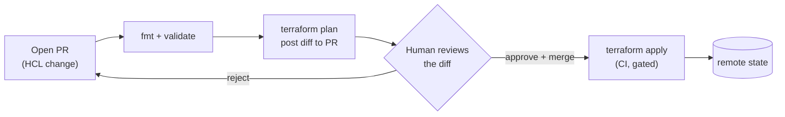
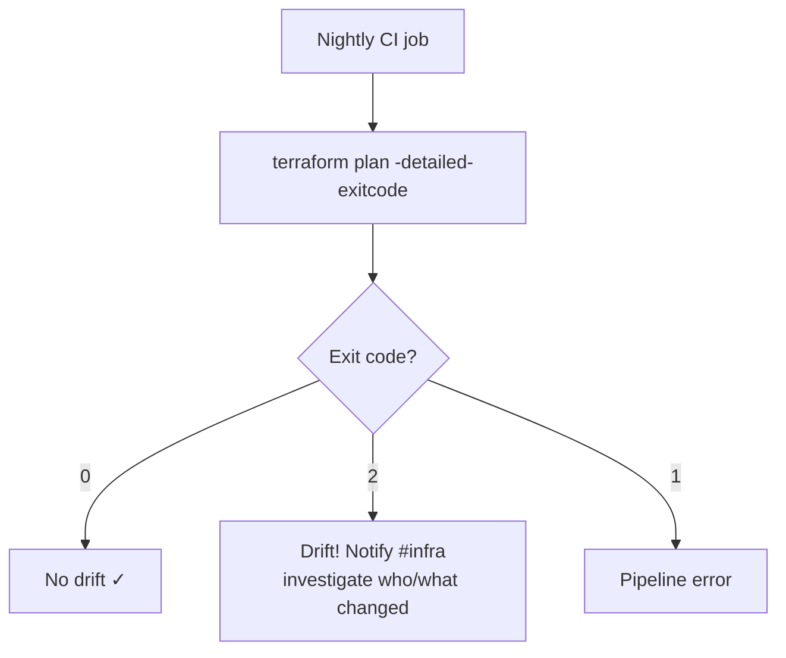
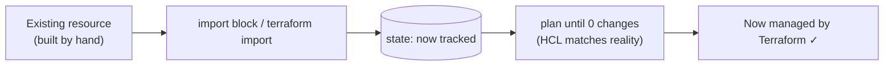

# Day 19 — Terraform in Practice

> Series: Cloud & DevOps Engineering
> Goal: Run Terraform like a team in production — multiple environments, plan-in-CI with gated apply, drift detection, importing existing infra, keeping secrets out of code, and knowing when Terragrunt helps.

---

## Table of Contents

1. [Environments: dev / staging / prod](#1-environments-dev--staging--prod)
2. [Workspaces vs directories](#2-workspaces-vs-directories)
3. [Plan-in-CI + apply gating](#3-plan-in-ci--apply-gating)
4. [Drift detection](#4-drift-detection)
5. [Importing existing resources](#5-importing-existing-resources)
6. [Secrets in Terraform](#6-secrets-in-terraform)
7. [Terragrunt (brief)](#7-terragrunt-brief)
8. [Lab: terraform plan in GitHub Actions](#8-lab-terraform-plan-in-github-actions)
9. [Self-Check](#9-self-check)
10. [Tomorrow](#10-tomorrow)

---

## 1. Environments: dev / staging / prod

**In plain words:** You don't test new furniture arrangements in the room where guests are sitting. You try them in an empty spare room first. Dev/staging/prod are those rooms for infrastructure: identical shapes, isolated blast radius, so a mistake in dev never touches paying customers in prod.

**Why:** Isolation of blast radius, safe rehearsal of changes, and per-environment sizing (dev = tiny/cheap, prod = big/redundant).

**What:** Separate, isolated copies of your infrastructure, each with its **own state file** and its own variable values.

**When:** Any system with real users. The instant "oops" costs money or trust, you need a place to make "oops" for free.

**How — the golden rule:** *Same code, different variables and different state.* The topology is identical; only the parameters (size, count, domain) differ.

```hcl
# dev.tfvars
environment    = "dev"
instance_type  = "t3.micro"
min_replicas   = 1

# prod.tfvars
environment    = "prod"
instance_type  = "m6i.large"
min_replicas   = 3
```

| Concern | dev | staging | prod |
|---|---|---|---|
| Purpose | fast iteration | prod-like rehearsal | real users |
| Sizing | tiny/cheap | prod-ish | full/redundant |
| Who applies | any engineer | CI on merge | CI, gated + approved |
| Blast radius | nobody cares | internal only | customers |

> 🤔 **"Can't I just have one environment and be careful?"**
> "Be careful" is not an isolation strategy — it's a hope. Without staging, every prod change is also its first-ever test in prod. One bad `apply` and customers are down. Separate environments convert "careful" (a human property that fails at 2am) into "isolated" (a structural property that holds regardless). The cost of a dev environment is a rounding error against one prod outage.

**✅ Good scenario:** A team upgrades their RDS engine version in staging. It triggers a `-/+ replace` (downtime). They catch it, plan a maintenance window, rehearse the migration — *before* prod. Staging absorbed the surprise.

**❌ Bad scenario (the pain):** A startup runs "prod only." An engineer bumps a subnet CIDR to "clean things up," applies, and takes down the payment service during peak hours. There was no safe place to see the plan blow up first.

**When NOT to:** A pure personal project with no users can live with one environment. Everything real needs at least dev+prod; add staging when changes get scary.

---

## 2. Workspaces vs directories

**In plain words:** Two ways to hold multiple environments. **Workspaces** = one config, Terraform swaps which state file is active (`default`, `dev`, `prod`). **Directory-per-env** = literally separate folders, each with its own backend and tfvars. The industry has largely settled on directories for prod separation.

**Workspaces:**

```bash
terraform workspace new dev          # create
terraform workspace new prod
terraform workspace select prod      # switch active state
terraform workspace list             # * marks current
terraform apply -var-file=prod.tfvars
# In HCL you can branch on terraform.workspace:
#   count = terraform.workspace == "prod" ? 3 : 1
```

**Directory-per-environment (recommended for prod isolation):**

```
environments/
  dev/    -> main.tf (backend key=dev/...),  dev.tfvars
  staging/-> main.tf (backend key=staging/...)
  prod/   -> main.tf (backend key=prod/...), prod.tfvars
modules/  -> shared modules called by each
```

| | Workspaces | Directory-per-env |
|---|---|---|
| Isolation | Same backend, different state key | Fully separate backends/state |
| Blast radius | Easy to `apply` to wrong workspace | Hard to cross environments |
| Backend config | Shared | Per-env (different buckets/keys) |
| Provider config | Shared | Per-env (different accounts!) |
| Best for | ephemeral/feature envs, quick spins | **prod-grade env separation** |
| Risk | Wrong-workspace apply to prod | More duplication |

> 🤔 **"Workspaces sound easier — why does everyone warn against them for prod?"**
> Because the *only* thing separating dev from prod is which workspace you selected — one forgotten `workspace select` and you `apply` a dev change to prod using prod credentials. They also share one backend config and one provider, so you can't put dev and prod in *different AWS accounts* (a core security boundary). Directories make crossing environments require editing a different folder — friction exactly where you want it. Use workspaces for *ephemeral* things (PR preview envs), directories for the dev/staging/prod backbone.

**✅ Good scenario:** A team uses directory-per-env with dev in AWS account A and prod in account B. A dev mistake *cannot* reach prod — different credentials, different backend, different folder. Structural safety.

**❌ Bad scenario:** A team relies on workspaces. An engineer runs `apply` believing they're on `dev`, but `prod` was still selected from earlier. Prod gets the untested change. The classic workspace footgun.

**When NOT to:** Don't use workspaces to model dev/staging/prod in a company with real prod. Do use them for short-lived, throwaway environments (per-PR, per-feature).

---

## 3. Plan-in-CI + apply gating

**In plain words:** On a team, nobody should `apply` from their laptop with unreviewed changes and unknown credentials. Instead: a pull request runs `plan` automatically, the diff is posted for humans to review, and `apply` only runs after merge/approval — from CI, with locked-down credentials.

**Why:** Review the diff before it touches reality, centralize credentials (no prod keys on laptops), and get an audit trail (who approved what).

**The pipeline:**



*Plan on PR, human reviews the diff, apply only after approval — from CI, not a laptop.*

**Core stages:**

```bash
terraform fmt -check          # fail if not formatted
terraform init -input=false
terraform validate            # type/syntax check
terraform plan -out=tfplan -input=false   # SAVE the plan
# ... post the plan to the PR as a comment ...
# After approval + merge, on main:
terraform apply -input=false tfplan        # apply the EXACT reviewed plan
```

**Gating techniques:**

- **Branch protection**: require PR review before merge to `main`.
- **GitHub Environments** with **required reviewers**: `apply` job pauses for a manual approval.
- **Saved plan artifact**: apply the *same* `tfplan` that was reviewed (no re-diff drift between plan and apply).
- **OIDC**: CI assumes a cloud role via short-lived tokens — no long-lived secrets in CI.

| | Laptop apply | Plan-in-CI + gated apply |
|---|---|---|
| Diff reviewed? | Maybe | Always (posted to PR) |
| Credentials | On laptops | Central, OIDC, short-lived |
| Audit trail | None | PR + approval history |
| Consistency | "works on my machine" | One runner, one toolchain |

> 🤔 **"If plan and apply both run in CI, why save the plan file — why not just `apply` fresh?"**
> Because between the reviewed plan and a fresh apply, reality can shift (someone changed something, a data source moved). Applying the *saved* `tfplan` guarantees you execute exactly what a human approved — no last-second surprise diff. Re-planning at apply time reintroduces the "the thing I approved isn't what ran" risk that gating exists to kill.

**✅ Good scenario:** A PR's plan shows an unexpected `- destroy` on a security group. A reviewer catches it in the PR comment, the author fixes it, and prod is never touched. The gate did its job in code review, not in an incident.

**❌ Bad scenario (the pain):** No CI. An engineer runs `apply -auto-approve` from their laptop using a personal admin key. It half-fails (network blip), leaving partial state. No diff was reviewed, credentials were over-scoped, and there's no record of what was attempted.

**When NOT to:** For a solo sandbox, full CI gating is overkill. For anything a team or customer depends on, it's mandatory.

---

## 4. Drift detection

**In plain words:** Drift is when reality wanders away from your code — someone hotfixed a security group in the console, an autoscaler changed a count, a provider mutated something. **Drift detection** is running `plan` on a schedule to catch these divergences *before* your next deploy trips over them.

**Why:** Undetected drift means your Git no longer describes prod. Your next `apply` might "correct" a critical manual fix, or a manual change silently breaks assumptions.

**How:**

```bash
terraform plan -detailed-exitcode
# Exit codes:
#   0 = no changes (no drift)
#   2 = changes present (DRIFT or pending config changes)
#   1 = error
# Wire exit-code 2 to alert Slack/PagerDuty on a nightly schedule.
```

```bash
terraform plan -refresh-only     # show ONLY reality-vs-state drift, ignore config changes
```



*Scheduled plans turn silent drift into a loud alert you catch on your terms.*

> 🤔 **"If Terraform auto-corrects drift on the next apply, why detect it separately?"**
> Because auto-correction can be *exactly the wrong thing*. Suppose an on-call engineer manually widened a security group to stop an outage. Your next unrelated `apply` would silently *revert* that emergency fix — re-triggering the outage. Detecting drift on a schedule lets you decide deliberately: codify the manual change, or revert it — instead of Terraform surprising you mid-deploy.

**✅ Good scenario:** Nightly drift job flags that a prod S3 bucket's public-access-block was disabled manually. Security investigates, finds a misconfiguration (or an attacker), and re-secures it — days before the next planned deploy would have masked the signal.

**❌ Bad scenario:** No drift detection. An engineer bumped a prod DB parameter in the console during an incident. Two weeks later an unrelated Terraform apply reverts it (config never updated). The incident recurs, and nobody connects it to the "unrelated" deploy.

**When NOT to:** Resources you deliberately let something else manage (autoscaling group `desired_capacity`) should use `ignore_changes` so they don't show as perpetual drift noise.

```hcl
resource "aws_autoscaling_group" "app" {
  # ...
  lifecycle { ignore_changes = [desired_capacity] }  # the autoscaler owns this, not TF
}
```

---

## 5. Importing existing resources

**In plain words:** Half the real world was built by ClickOps before anyone wrote Terraform. **Import** adopts those existing resources into Terraform's state so you can manage them going forward — without deleting and recreating them.

**Why:** Bring legacy/hand-built infra under IaC control safely (no destroy/recreate, no downtime).

**How — two ways:**

Classic CLI import (state only; you still write the HCL):

```bash
# 1) Write the resource block first (empty-ish is fine)
#    resource "aws_instance" "legacy" { ... }
# 2) Import the real ID into that address:
terraform import aws_instance.legacy i-0abc123def456
# 3) terraform plan  -> tweak your HCL until the plan shows NO changes (matches reality)
```

Modern **import block** (declarative, generates config — TF 1.5+ / OpenTofu):

```hcl
import {
  to = aws_instance.legacy
  id = "i-0abc123def456"
}
```
```bash
terraform plan -generate-config-out=generated.tf   # scaffolds the HCL for you!
terraform apply   # adopts it into state
```



*Import adopts reality into state; then you tune HCL until the plan is empty.*

> 🤔 **"Can't I just delete the old resource and let Terraform recreate it cleanly?"**
> For a stateless resource maybe. For anything with data or traffic — a database, a load balancer with a live IP, an S3 bucket with objects — destroy-and-recreate means downtime and/or data loss. Import is the non-destructive path: the resource keeps running while Terraform simply starts *tracking* it. The goal is `plan` showing zero changes, meaning your HCL now faithfully describes what already exists.

**✅ Good scenario:** A company inherits a hand-built prod VPC. They import it resource by resource, tuning HCL until `plan` is clean. Now it's version-controlled and reviewable — zero downtime during the migration.

**❌ Bad scenario:** An engineer, impatient with import, `destroy`s a hand-built prod load balancer to "let Terraform rebuild it properly." The public IP changes, DNS still points at the old one, and the site is down until propagation. Import existed precisely to avoid this.

**When NOT to:** Truly trivial, disposable resources are faster to recreate than import. Import shines for stateful/critical/hard-to-recreate resources.

---

## 6. Secrets in Terraform

**In plain words:** Terraform touches secrets constantly (DB passwords, API keys). The danger: secrets sneak into your Git repo (in `.tf` or `.tfvars`) and into the state file (always plaintext). The rule: **never commit secrets; fetch them at runtime from a secrets manager.**

**Why:** A leaked prod credential in Git history is forever (rewriting history rarely fully cleans it) and is a top breach vector.

**How — the layered defenses:**

```hcl
# 1) NEVER do this:
resource "aws_db_instance" "bad" {
  password = "hunter2"          # <-- ends up in Git AND plaintext in state. NO.
}

# 2) Fetch from a secrets manager at plan/apply time via a DATA source:
data "aws_secretsmanager_secret_version" "db" {
  secret_id = "prod/db/password"
}
resource "aws_db_instance" "good" {
  password = data.aws_secretsmanager_secret_version.db.secret_string
  # still lands in STATE in plaintext -> so protect state (encrypt + IAM)
}
```

```hcl
# 3) Or Vault provider:
data "vault_kv_secret_v2" "db" { mount = "secret", name = "prod/db" }
# password = data.vault_kv_secret_v2.db.data["password"]
```

Defenses checklist:

- Add `*.tfvars` and `*.tfstate*` to `.gitignore` (except example files).
- Store secrets in **AWS SSM Parameter Store / Secrets Manager / HashiCorp Vault**; reference via data sources or provider auth.
- **Encrypt remote state** (SSE on S3, or OpenTofu's native state encryption) and lock it down with IAM — because secrets pass through state regardless.
- Use CI **OIDC** so even cloud credentials aren't stored as long-lived CI secrets.
- Scan commits with `git-secrets` / `trufflehog` / pre-commit hooks.

| Approach | Secret in Git? | Secret in state? | Verdict |
|---|---|---|---|
| Hardcode in `.tf` | Yes ❌ | Yes ❌ | Never |
| Plaintext `.tfvars` committed | Yes ❌ | Yes ❌ | Never |
| `.tfvars` gitignored | No ✓ | Yes ⚠️ | OK-ish, protect state |
| Secrets manager via data source | No ✓ | Yes ⚠️ | Good — encrypt state |
| Manager + encrypted state + IAM | No ✓ | Encrypted ✓ | Best |

> 🤔 **"If I use Secrets Manager, my secret is safe — right?"**
> Not fully — because whatever value Terraform *reads* also gets written into the **state file in plaintext**. Using a secrets manager keeps the secret out of *Git* (huge), but the state still holds it. That's why "secrets manager" and "encrypt + lock down state" are two halves of one defense, not alternatives. Skip the second half and your S3 state bucket becomes the leak.

**✅ Good scenario:** DB password lives in Secrets Manager; Terraform reads it via data source; state is SSE-encrypted in S3 with tight IAM. No secret ever hits Git, and state access is audited. A leaked repo exposes nothing.

**❌ Bad scenario (real breaches happen this way):** A dev commits `prod.tfvars` with the real DB password "just to get CI working." It's in Git history forever. Six months later the repo is shared with a contractor. Now rotate everything and pray. This exact pattern has caused public incidents.

**When NOT to:** There is no "when not to" protect secrets. The only tradeoff is convenience vs. safety, and safety wins for anything real.

> **Dark Side note:** `terraform.tfstate` is a secrets file in disguise. Anyone with read access to your state bucket can read every password Terraform ever handled. Treat state-bucket access like production database access.

---

## 7. Terragrunt (brief)

**In plain words:** As you grow to many environments and many modules, you start copy-pasting backend config, provider blocks, and variable wiring across dozens of folders. **Terragrunt** is a thin wrapper around Terraform/OpenTofu that keeps that boilerplate DRY and orchestrates dependencies between components.

**Why:** Terraform alone gets repetitive at scale — every env folder repeats the same `backend "s3" {}` and provider config. Terragrunt generates them from one place and manages apply order across components.

**What it adds:**

- **DRY backend/provider**: define once in a root `terragrunt.hcl`, generate into every child.
- **Dependency graph** between components (`dependency` blocks) with ordered `run-all apply`.
- **Per-env inputs** without duplicating module wiring.

```hcl
# terragrunt.hcl (root) — generates backend for every child, keyed by path
remote_state {
  backend = "s3"
  generate = { path = "backend.tf", if_exists = "overwrite" }
  config = {
    bucket         = "acme-tfstate"
    key            = "${path_relative_to_include()}/terraform.tfstate"
    region         = "us-east-1"
    dynamodb_table = "acme-tf-locks"
    encrypt        = true
  }
}
```

```hcl
# environments/prod/vpc/terragrunt.hcl
include "root" { path = find_in_parent_folders() }
terraform { source = "../../../modules//vpc" }
inputs = { cidr = "10.0.0.0/16", name = "prod-vpc" }
```

```bash
terragrunt plan                 # per component
terragrunt run-all apply        # applies many components in dependency order
```

| | Plain Terraform | Terragrunt |
|---|---|---|
| Backend boilerplate | Repeated per folder | Generated from root (DRY) |
| Cross-component deps | Manual / separate applies | `dependency` + `run-all` |
| Learning curve | Lower | Extra layer to learn |
| When | Few envs/modules | Many envs/modules at scale |

> 🤔 **"Do I need Terragrunt to be a real DevOps engineer?"**
> No — plenty of large shops run pure Terraform (or use Terraform Cloud/Spacelift/Env0 instead). Terragrunt solves *repetition at scale*; if you have three environments and a handful of modules, native Terraform is simpler and one less tool. Learn *why* it exists (DRY backends, ordered multi-component applies) so you recognize the pain it addresses — then adopt it only when that pain is real. Note: in 2026 many teams weigh Terragrunt against native features and SaaS orchestrators; it's a "know it exists" tool, not a day-one requirement.

**When NOT to:** Small setups. Adding Terragrunt to a 3-folder project is complexity you'll pay for and rarely use.

---

## 8. Lab: terraform plan in GitHub Actions

**Goal:** Wire a GitHub Actions pipeline that runs `fmt`, `validate`, and `plan` on every PR, posts the plan, and only `apply`s after merge to `main` — using OIDC (no static keys).

### Step 1 — Repo layout

```
.
├── main.tf            # your Day 18 module-based config (S3 backend)
├── variables.tf
├── prod.tfvars
└── .github/workflows/terraform.yml
```

### Step 2 — The workflow

`.github/workflows/terraform.yml`:

```yaml
name: terraform
on:
  pull_request:            # plan on PRs
  push:
    branches: [main]       # apply on merge to main

permissions:
  id-token: write          # needed for OIDC (no long-lived AWS keys!)
  contents: read
  pull-requests: write     # to comment the plan on the PR

jobs:
  terraform:
    runs-on: ubuntu-latest
    steps:
      - uses: actions/checkout@v4

      - name: Configure AWS via OIDC
        uses: aws-actions/configure-aws-credentials@v4
        with:
          role-to-assume: arn:aws:iam::<ACCOUNT_ID>:role/gha-terraform
          aws-region: us-east-1

      - uses: hashicorp/setup-terraform@v3
        with:
          terraform_version: "1.15.0"   # pin your toolchain (or use OpenTofu setup action)

      - run: terraform fmt -check
      - run: terraform init -input=false
      - run: terraform validate

      # PLAN on every push/PR
      - name: Plan
        id: plan
        run: terraform plan -input=false -var-file=prod.tfvars -out=tfplan

      # APPLY only on main (after merge). Gate further with a GitHub Environment + reviewers.
      - name: Apply
        if: github.ref == 'refs/heads/main' && github.event_name == 'push'
        run: terraform apply -input=false tfplan
```

### Step 3 — Add a real approval gate

- In GitHub → Settings → **Environments** → create `production` with **Required reviewers**.
- Add `environment: production` to the `apply` job (or split apply into its own job) so it *pauses* for a human click before touching prod.

```yaml
  apply:
    needs: terraform
    if: github.ref == 'refs/heads/main'
    runs-on: ubuntu-latest
    environment: production      # <-- requires reviewer approval before running
    steps:
      - run: echo "gated apply runs here"
```

### Step 4 — Prove it

```bash
git checkout -b test-change
# edit instance_type in prod.tfvars
git commit -am "bump size" && git push origin test-change
# Open a PR -> watch the Actions "plan" run. Read the diff in the logs.
# Merge -> "apply" job waits on the production environment reviewer -> approve -> applies.
```

### Success criteria

- PR triggers `fmt`/`validate`/`plan`; the plan diff is visible in the run.
- `apply` does NOT run on the PR, only after merge.
- The `apply` job pauses for a required-reviewer approval.
- No static AWS keys stored — OIDC assumes the role.

**Stretch:** Add a nightly `schedule:` trigger running `terraform plan -detailed-exitcode` and fail (alert) on exit code 2 — that's your drift detector from §4.

---

## 9. Self-Check

1. State the golden rule for dev/staging/prod in Terraform (what's shared, what differs).
2. Why is directory-per-environment preferred over workspaces for prod separation? Give the credential-isolation reason.
3. When *are* workspaces the right tool?
4. Why apply a saved `tfplan` rather than re-planning at apply time in CI?
5. What does `terraform plan -detailed-exitcode` return, and how do you use exit code 2?
6. Give a concrete example where auto-correcting drift is the *wrong* thing to do.
7. Why import an existing resource instead of destroying and recreating it? Name a resource where this matters.
8. A secret is in AWS Secrets Manager, fetched via a data source. Is it fully safe? Where does it still appear in plaintext?
9. List three defenses that keep secrets out of Git and state.
10. What problem does Terragrunt solve, and when is adding it a mistake?

---

## 10. Tomorrow

**Day 20 — Kubernetes Fundamentals.** We pivot from *provisioning infrastructure* to *orchestrating containers*. You containerized apps back on Docker Days 6-8; now imagine running hundreds of those containers across many machines — scheduling them, healing them when they crash, scaling them under load. That's Kubernetes. Tomorrow: the problem it actually solves, its control-plane/node architecture, **Pods**, and the single most important idea in all of Kubernetes — the **desired-state reconciliation loop** (which, notice, is the exact same mental model you just learned in Terraform). We'll spin up a local cluster and run your first pod.
