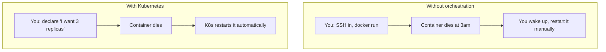
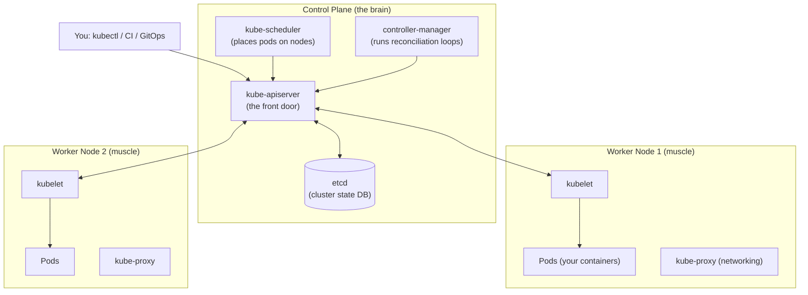
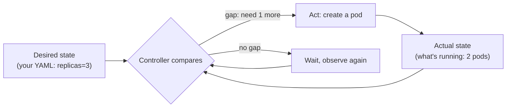

# Day 20 — Kubernetes Fundamentals

> Series: Cloud & DevOps Engineering
> Goal: Understand the problem Kubernetes solves, its architecture (control plane + nodes), what a Pod is, and the one mental model that unlocks everything — the desired-state reconciliation loop. Run a local cluster and your first pod.

---

## Table of Contents

1. [The problem Kubernetes solves](#1-the-problem-kubernetes-solves)
2. [Architecture: control plane + nodes](#2-architecture-control-plane--nodes)
3. [Pods: the smallest deployable unit](#3-pods-the-smallest-deployable-unit)
4. [The reconciliation loop (THE mental model)](#4-the-reconciliation-loop-the-mental-model)
5. [kubectl basics](#5-kubectl-basics)
6. [Managed Kubernetes: EKS / GKE / AKS](#6-managed-kubernetes-eks--gke--aks)
7. [Lab: local cluster + first pod](#7-lab-local-cluster--first-pod)
8. [Self-Check](#8-self-check)
9. [Tomorrow](#9-tomorrow)

---

## 1. The problem Kubernetes solves

**In plain words:** Back on Docker Days 6-8 you learned to run one container on one machine with `docker run`. Now imagine you have 200 containers that must run across 20 machines, survive crashes, scale up on Black Friday, roll out new versions without downtime, and find each other over the network. Doing that by hand — SSHing into boxes, restarting dead containers, load-balancing manually — is a full-time job that no human can do reliably at 3am. Kubernetes is the robot that does it for you.

**Why:** Containers solved "it works on my machine." They did *not* solve "run thousands of them reliably across a fleet." That gap is **orchestration**.

**What Kubernetes provides:**

- **Scheduling**: decides which machine each container runs on (bin-packing by CPU/memory).
- **Self-healing**: a container crashes → K8s restarts it; a whole machine dies → K8s reschedules its containers elsewhere.
- **Scaling**: add/remove container replicas by policy or metrics.
- **Rolling updates & rollbacks**: ship a new version gradually; revert instantly if it's bad.
- **Service discovery & load balancing**: containers find each other by name; traffic spreads across replicas.
- **Declarative config**: you describe the desired state; K8s makes it so (sound familiar? — Terraform).

**When:** Many services, many replicas, need for HA/scaling/zero-downtime deploys, a platform multiple teams share.

**Where:** On-prem, or managed (EKS/GKE/AKS — §6). Local for learning (kind/minikube).



*Orchestration replaces the human-in-the-loop with a control loop that never sleeps.*

> 🤔 **"I already have Docker Compose — isn't that enough?"**
> Compose orchestrates containers on *one machine* — great for local dev and small single-host deploys. It has no answer for "spread across 20 machines," "reschedule when a node dies," "roll out to 3% of traffic," or "autoscale on CPU." Kubernetes is Compose's problems solved at *fleet* scale, across many hosts, with self-healing and declarative reconciliation. Compose is a laptop tool; Kubernetes is a datacenter tool.

**✅ Good scenario:** A streaming company runs 300 microservice replicas. A node's disk fails at midnight. Kubernetes notices within seconds, reschedules those pods onto healthy nodes, and traffic keeps flowing. Nobody gets paged. The control loop handled it.

**❌ Bad scenario (the pain without it):** A startup runs containers via `docker run` on three EC2 boxes with a cron job to "restart if dead." A box reboots during a deploy; half the containers don't come back; the restart script races and double-starts others. Customers see 502s for an hour while an engineer manually untangles which box runs what.

**When NOT to:** A single small app with modest traffic does **not** need Kubernetes — a managed platform (ECS Fargate, Cloud Run, Render, Fly.io) or even one well-managed VM is simpler, cheaper, and far less to operate. Kubernetes is heavy; adopt it when the fleet-scale problems above are *actually* yours.

> **Dark Side note:** Kubernetes is famous for **accidental complexity**. Teams adopt it for a 2-service app and drown in YAML, upgrades, and networking arcana. "You are not Google" is a valid design principle. Match the tool to the scale.

---

## 2. Architecture: control plane + nodes

**In plain words:** A Kubernetes cluster has a **brain** (the control plane — makes decisions) and **muscle** (worker nodes — run your containers). You talk to the brain; the brain tells the muscle what to do. The brain constantly compares "what you asked for" to "what's actually running" and fixes the difference.



*You talk only to the API server; every component reads/writes cluster state through it.*

### Control plane components (the brain)

| Component | Role | Analogy |
|---|---|---|
| **kube-apiserver** | The only front door. All reads/writes go through it (REST). Validates & persists to etcd. | Reception desk — everything routes through it |
| **etcd** | The cluster's database. Stores *all* state (desired + observed). Highly consistent key-value store. | The system of record / the ledger |
| **kube-scheduler** | Assigns newly-created pods to nodes based on resources, constraints, affinity. | Seating host deciding which table each guest gets |
| **kube-controller-manager** | Runs the control loops (Deployment, ReplicaSet, Node controllers…) that reconcile desired→actual. | Floor managers keeping reality matching the plan |
| **cloud-controller-manager** | Integrates with the cloud (load balancers, volumes, node lifecycle). | Liaison to AWS/GCP/Azure |

### Node components (the muscle)

| Component | Role |
|---|---|
| **kubelet** | The node agent. Talks to the API server, starts/stops containers via the container runtime, reports health. |
| **kube-proxy** | Implements Service networking rules (routes traffic to the right pods) on each node. |
| **container runtime** | Actually runs containers (containerd, CRI-O). Docker's runtime under the hood historically. |

> 🤔 **"Where does my application container actually run — in the control plane?"**
> No. Your app containers run in **Pods on worker nodes** (the muscle). The control plane only makes *decisions* (schedule, reconcile, store state) — you generally don't put workloads there (managed clusters hide the control plane from you entirely). Confusing "the brain that decides" with "the muscle that runs" is a classic beginner mix-up. You *ask* the API server; your code *runs* on nodes.

**✅ Good scenario:** A node's kubelet stops heartbeating (machine died). The node controller (in controller-manager) marks it NotReady; the scheduler places its pods on healthy nodes; etcd records the new reality. Five moving parts, one self-healing outcome.

**❌ Bad scenario:** On a self-managed cluster, someone runs a single etcd instance with no backups. The disk corrupts. etcd is the *entire* cluster state — losing it means losing the cluster's memory of what should exist. This is why etcd is quorum-replicated (3/5 nodes) and backed up in real clusters (and why managed K8s exists — the cloud runs etcd for you).

**When NOT to (self-manage):** Unless you have a strong platform team, don't run your own control plane/etcd — use managed K8s (§6) and let the cloud own the hard, stateful, security-critical brain.

---

## 3. Pods: the smallest deployable unit

**In plain words:** You might expect the smallest unit to be a container. It's not — it's a **Pod**: a wrapper around one (usually) or more tightly-coupled containers that share a network address and storage. Think of a Pod as a "logical host" for containers that must live and die together.

**Why a Pod, not a bare container?** Some helpers must run right next to the main container — sharing `localhost` and volumes (a log shipper, a proxy sidecar). A Pod is the unit that co-schedules them on the same node with shared networking.

**What's shared inside a Pod:**

- **One IP address** — containers reach each other on `localhost`.
- **Shared volumes** — mounted into multiple containers.
- **Lifecycle** — scheduled together, on the same node.

```yaml
apiVersion: v1
kind: Pod
metadata:
  name: web
  labels:
    app: web            # labels: how everything selects this pod later
spec:
  containers:
    - name: nginx
      image: nginx:1.27
      ports:
        - containerPort: 80
    # A second (sidecar) container would share this pod's IP + volumes:
    # - name: log-shipper
    #   image: fluent-bit:latest
```

```bash
kubectl apply -f pod.yaml      # create the pod
kubectl get pods               # STATUS: Pending -> ContainerCreating -> Running
kubectl describe pod web       # events, why it's pending, image pulls, etc.
```

**The crucial caveat — Pods are cattle, not pets:** Pods are **ephemeral and mortal**. They get a new IP each time, and if one dies, Kubernetes does *not* resurrect *that* pod — a higher-level controller (Deployment) creates a *new* one. You almost never create bare Pods in production.

| | Bare Pod | Managed by a Deployment (Day 21) |
|---|---|---|
| Self-healing | No (dies = gone) | Yes (recreated) |
| Scaling | Manual, one at a time | `replicas: N` |
| Rolling updates | No | Yes |
| Use in prod | Rarely (debugging) | Standard |

> 🤔 **"If a Pod is basically a container wrapper, why not just deal in containers?"**
> Because the real unit of *co-location* is often more than one container: a main app plus its sidecars that must share an IP and disk and live on the same node. The Pod is that atomic scheduling unit. Also, Pods add the Kubernetes-level concepts containers lack — labels, a stable spec, probes, a place for the scheduler to reason about. Containers are the *runtime*; Pods are how Kubernetes *thinks*.

**✅ Good scenario:** An app pod runs the API container plus an Envoy sidecar for mTLS. They share `localhost`, so the app talks plaintext to `localhost:15001` and Envoy encrypts outbound. Co-scheduled by the Pod — impossible to express with lone containers.

**❌ Bad scenario:** A beginner creates 5 bare Pods for their web app. A node reboots; all its pods vanish and *stay* gone (no controller to recreate them). The app is now down at reduced capacity with no self-healing. Lesson: use a Deployment, never bare pods for real workloads.

**When NOT to (bare Pod):** Only for one-off debugging (`kubectl run --rm -it`), Jobs, or learning. Real workloads always sit under a controller.

---

## 4. The reconciliation loop (THE mental model)

**In plain words:** This is the single idea that makes Kubernetes click. You never tell Kubernetes *how* to do things step by step. You declare a **desired state** ("I want 3 replicas of this image"). Controllers run an endless loop: *observe actual state → compare to desired → act to close the gap → repeat*. Forever. It's a thermostat: you set 21°C (desired); it measures the room (actual); it heats or cools to match; it never stops checking.

**Why it matters:** Every Kubernetes object — Deployments, Services, autoscalers, your own operators — is *some* controller running this loop. Understand the loop and you understand the whole system. And notice: **this is the exact same declarative reconciliation you learned in Terraform** — desired vs. actual, close the gap. The difference: Terraform reconciles on-demand when you `apply`; Kubernetes reconciles *continuously*.



*The thermostat of Kubernetes: observe, compare, act, repeat — continuously, forever.*

**Concretely:**

```bash
kubectl scale deployment web --replicas=3   # you set DESIRED = 3
# One pod crashes -> ACTUAL drops to 2 -> ReplicaSet controller sees the gap ->
# creates a new pod -> ACTUAL back to 3. You did nothing. The loop did.
```

| Imperative thinking (wrong) | Declarative/reconciliation (right) |
|---|---|
| "Start a container" | "3 replicas should exist" |
| "Restart it if it dies" | (controller does this forever) |
| "Route traffic to these IPs" | "Send traffic to pods labeled app=web" |
| You track state | The cluster tracks state |

> 🤔 **"So if I manually `kubectl delete` a pod that a Deployment manages, is it gone for good?"**
> No — and this surprises everyone. The Deployment's desired state still says "3 replicas." Delete one and actual drops to 2; the controller notices the gap within seconds and creates a replacement. You cannot win a fight against a reconciliation loop by deleting things — you have to change the *desired state* (scale down, delete the Deployment). This is the loop protecting you from transient failures, working exactly as designed.

**✅ Good scenario:** A cosmic-ray bit-flip crashes a pod. Nobody's awake. The ReplicaSet controller observes 2/3, creates the third, and by the time on-call wakes up, the incident already self-resolved and is just a line in the event log.

**❌ Bad scenario (fighting the loop):** An engineer keeps `kubectl delete pod` on a crash-looping pod, frustrated it "won't stay dead." It keeps coming back because the Deployment demands 3. They're fighting the wrong layer — the fix is to change desired state or fix the image, not delete pods. Understanding the loop turns confusion into control.

**When NOT to:** The loop assumes your desired state is *correct*. If you declare a broken image, the loop faithfully keeps trying to run broken pods (CrashLoopBackOff). Reconciliation guarantees convergence to *what you asked for* — garbage in, garbage reconciled.

---

## 5. kubectl basics

**In plain words:** `kubectl` ("kube-control" or "kube-cuttle") is your remote control for the cluster. It's a REST client to the API server. 90% of daily Kubernetes is a dozen `kubectl` verbs.

```bash
# --- Discover ---
kubectl cluster-info                 # is the cluster reachable?
kubectl get nodes                    # list machines in the cluster
kubectl get pods -A                  # all pods, all namespaces (-A = --all-namespaces)
kubectl get pods -o wide             # + node + IP columns
kubectl get all -n default           # everything in a namespace

# --- Inspect (your debugging bread & butter) ---
kubectl describe pod web             # events, conditions, why it's stuck (READ THIS FIRST)
kubectl logs web                     # container stdout/stderr
kubectl logs web -f --tail=100       # follow, last 100 lines
kubectl logs web -c sidecar          # a specific container in a multi-container pod

# --- Interact ---
kubectl exec -it web -- sh           # shell INTO a running container
kubectl port-forward pod/web 8080:80 # tunnel local:8080 -> pod:80 (test without a Service)

# --- Change state (prefer declarative apply over imperative create) ---
kubectl apply -f manifest.yaml       # DECLARATIVE: reconcile to this file (idempotent)
kubectl delete -f manifest.yaml      # remove what the file declares
kubectl scale deployment web --replicas=5

# --- Context (which cluster am I even talking to?!) ---
kubectl config get-contexts          # list clusters
kubectl config use-context prod      # SWITCH clusters — check this before any prod command
```

**The apply-vs-create distinction:**

| | `kubectl create -f` | `kubectl apply -f` |
|---|---|---|
| Model | Imperative (create once) | Declarative (reconcile to file) |
| Re-run on existing | Errors ("already exists") | Updates to match (idempotent) |
| Tracks intent | No | Yes (last-applied annotation) |
| Use | rarely | **default** — matches the declarative model |

> 🤔 **"kubectl apply and I are done — why did nothing change?"**
> `apply` submits *desired state* to the API server, which stores it; then **controllers** reconcile asynchronously. `apply` returning success means "the cluster accepted your intent," not "the pods are running yet." That's why you follow every `apply` with `kubectl get`/`describe` to *watch* the loop converge. Confusing "accepted" with "done" is the root of half of beginner debugging.

**When NOT to (imperative kubectl):** In production, avoid imperative `kubectl edit`/`scale`/`create` for permanent changes — they drift from your Git YAML (the same ClickOps problem from Terraform). Change the YAML, `apply` it, ideally via GitOps (Day 24). Imperative kubectl is for *debugging*, not *managing*.

---

## 6. Managed Kubernetes: EKS / GKE / AKS

**In plain words:** Running your own control plane (API server, etcd, upgrades, security patches, HA) is genuinely hard and thankless. The big clouds run the brain *for* you — you just bring worker nodes and workloads. That's **managed Kubernetes**: EKS (AWS), GKE (Google), AKS (Azure).

**Why:** The control plane is the hard, stateful, security-critical part. Offloading it lets your team focus on apps, not on babysitting etcd quorum and API-server certs.

**What they manage vs. you:**

| Layer | Self-managed (kubeadm/kops) | Managed (EKS/GKE/AKS) |
|---|---|---|
| API server, etcd, scheduler | **You** (HA, backups, upgrades) | **Cloud** |
| Control-plane security patches | **You** | **Cloud** |
| Worker nodes | You | You (or fully managed via Fargate/Autopilot) |
| Networking/LB integration | You wire it | Built-in (cloud LB, CNI) |
| Your workloads & configs | You | You |

| | EKS (AWS) | GKE (Google) | AKS (Azure) |
|---|---|---|---|
| Origin | AWS | Google (K8s' creators) | Microsoft |
| Fully-managed nodes | Fargate | Autopilot | virtual nodes / node auto-provision |
| Control-plane cost | hourly per cluster | free/near-free tier historically | free tier historically |
| Reputation | ubiquitous in AWS shops | most "batteries-included" | strong in enterprise/MS shops |

```bash
# You don't kubectl-create a managed cluster — you provision it (Terraform!) or CLI:
eksctl create cluster --name demo --nodes 2 --region us-east-1   # AWS
gcloud container clusters create demo --num-nodes 2              # GCP
az aks create -g rg -n demo --node-count 2                       # Azure
# Then wire kubectl to it:
aws eks update-kubeconfig --name demo    # merges cluster creds into ~/.kube/config
kubectl get nodes                         # now talking to the managed cluster
```

> 🤔 **"If the cloud manages the control plane, is Kubernetes now easy?"**
> Easier, not easy. Managed K8s removes the *control-plane* burden (a big deal), but you still own workload YAML, networking policy, autoscaling, RBAC, cost, upgrades of your node pools, and the general operational depth of Kubernetes. It's like renting a managed apartment vs. building the building — you don't pour concrete, but you still furnish, clean, and pay rent. Managed K8s is the right default; it just isn't a magic "no ops" button.

**✅ Good scenario:** A 15-person startup runs on GKE Autopilot. Google handles the control plane *and* node provisioning; the team ships apps and never thinks about etcd. Right-sized: real K8s benefits, minimal ops.

**❌ Bad scenario:** A team insists on self-managing K8s on raw EC2 "to save money." A control-plane cert expires; the API server goes down; nobody knows how to rotate it; the whole cluster is unreachable for hours. The "savings" evaporated in one incident that managed K8s would have prevented.

**When NOT to (managed / K8s at all):** If your workload fits a serverless container platform (Cloud Run, ECS Fargate, Fly.io), you may not need Kubernetes' complexity at all. Reach for managed K8s when you need K8s' portability, ecosystem, and control — not by default.

---

## 7. Lab: local cluster + first pod

**Goal:** Spin up a real Kubernetes cluster on your laptop with **kind** (or minikube), run your first pod, watch the reconciliation loop heal it, and access it via port-forward.

### Step 1 — Install tools

```bash
# kubectl (talk to any cluster)
# macOS:  brew install kubectl kind
# Windows (choco): choco install kubernetes-cli kind
# Linux: see kubernetes.io/docs/tasks/tools

kubectl version --client
kind version        # or: minikube version
```

### Step 2 — Create a local cluster

```bash
kind create cluster --name day20      # spins a K8s cluster inside Docker containers
# (minikube alt:)  minikube start --nodes 1

kubectl cluster-info --context kind-day20
kubectl get nodes                     # 1 control-plane node, STATUS Ready
```

### Step 3 — Run your first Pod

`pod.yaml`:

```yaml
apiVersion: v1
kind: Pod
metadata:
  name: hello
  labels:
    app: hello
spec:
  containers:
    - name: web
      image: nginx:1.27
      ports:
        - containerPort: 80
```

```bash
kubectl apply -f pod.yaml
kubectl get pods -w              # -w = watch: Pending -> ContainerCreating -> Running
kubectl describe pod hello       # scroll to Events: image pull, scheduled to node, started
```

### Step 4 — Access it (no Service yet)

```bash
kubectl port-forward pod/hello 8080:80   # tunnel localhost:8080 -> pod:80
# In another shell / browser:
curl localhost:8080              # <-- nginx welcome HTML. Your pod is serving!
```

### Step 5 — Feel the difference: bare Pod has NO self-healing

```bash
kubectl delete pod hello         # a BARE pod: it's gone and STAYS gone
kubectl get pods                 # empty — no controller to recreate it. (Contrast Day 21.)
```

### Step 6 — Quick imperative pod (debug pattern)

```bash
kubectl run tmp --image=busybox --rm -it --restart=Never -- sh   # throwaway debug shell
# inside: wget -qO- http://<something>  ; then exit -> pod auto-deleted (--rm)
```

### Step 7 — Clean up

```bash
kind delete cluster --name day20     # (minikube: minikube delete)
```

### Success criteria

- `kubectl get nodes` showed a Ready node.
- Your pod reached `Running`; `describe` showed the scheduling + image-pull events.
- `port-forward` + `curl` returned nginx HTML.
- Deleting the bare pod left *nothing* behind (proving bare pods don't self-heal — the setup for tomorrow's Deployment).

**Stretch:** Add a second `busybox` sidecar container to the pod that just `sleep`s, then `kubectl exec -it hello -c web -- sh` and `curl localhost` — see both containers share the pod's network.

---

## 8. Self-Check

1. Name four things Kubernetes does for you that plain `docker run` (or Compose) does not.
2. Draw the control-plane vs. node split. Which components are the "brain," which the "muscle"?
3. What does etcd store, and why is it backed up / quorum-replicated?
4. What is a Pod, and what do containers inside one Pod share?
5. Why are Pods described as "cattle, not pets"? What happens when a bare Pod's node dies?
6. Explain the reconciliation loop in one sentence, and give the thermostat analogy.
7. You `kubectl delete` a pod managed by a Deployment. What happens and why?
8. Difference between `kubectl create -f` and `kubectl apply -f`? Which matches the declarative model?
9. In managed K8s (EKS/GKE/AKS), what does the cloud own vs. what do you own?
10. When is Kubernetes the *wrong* choice, and what might you use instead?

---

## 9. Tomorrow

**Day 21 — K8s Workloads & Networking.** Today's bare pod had no self-healing — deleting it left nothing. Tomorrow we fix that with **Deployments** (and the ReplicaSets they manage): declare `replicas: 3` and watch the loop keep exactly three alive, roll out new versions with zero downtime, and roll back instantly. Then we make pods reachable: **Services** (ClusterIP/NodePort/LoadBalancer), **Ingress** for HTTP routing, cluster **DNS**, and how **labels/selectors** are the glue wiring it all together. This is where a pile of pods becomes an actual application.
