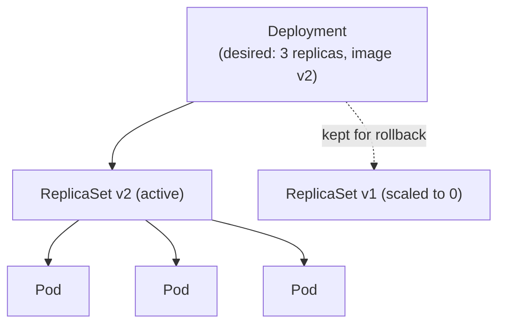
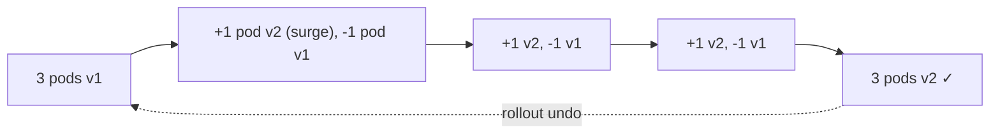
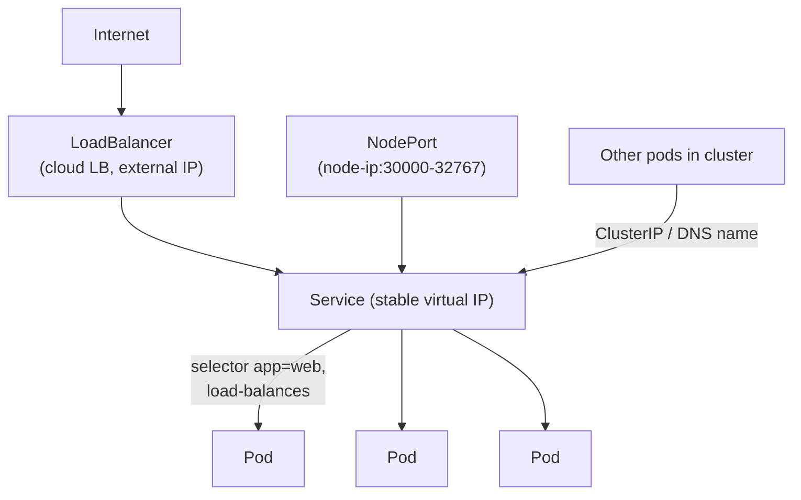
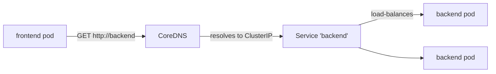
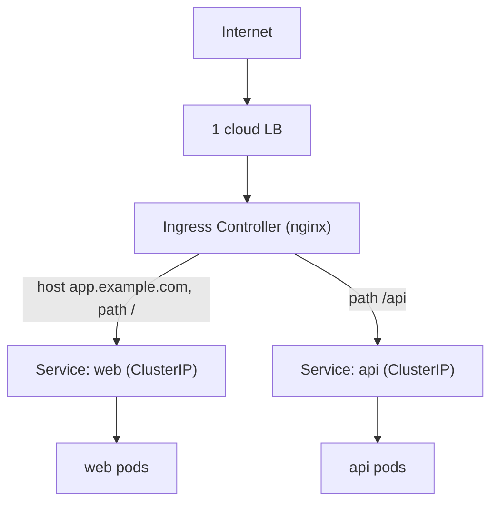

# Day 21 — K8s Workloads & Networking

> Series: Cloud & DevOps Engineering
> Goal: Turn a pile of pods into a real, reachable application — Deployments/ReplicaSets, rolling updates & rollbacks, Services, Ingress, cluster DNS, and the labels/selectors/namespaces that wire it all together.

---

## Table of Contents

1. [Deployments & ReplicaSets](#1-deployments--replicasets)
2. [Rolling updates & rollbacks](#2-rolling-updates--rollbacks)
3. [Labels, selectors, namespaces](#3-labels-selectors-namespaces)
4. [Services: ClusterIP / NodePort / LoadBalancer](#4-services-clusterip--nodeport--loadbalancer)
5. [Cluster DNS & service discovery](#5-cluster-dns--service-discovery)
6. [Ingress](#6-ingress)
7. [Lab: Deployment + Service + Ingress](#7-lab-deployment--service--ingress)
8. [Self-Check](#8-self-check)
9. [Tomorrow](#9-tomorrow)

---

## 1. Deployments & ReplicaSets

**In plain words:** Yesterday's bare Pod died and stayed dead. A **Deployment** is the manager that says "I always want N healthy copies of this pod" and enforces it forever via the reconciliation loop. It does this through a **ReplicaSet** — the component that literally keeps the replica count correct. You write Deployments; ReplicaSets are the machinery underneath.

**Why:** Self-healing, scaling, and versioned rollouts — none of which a bare Pod gives you.

**What the layers mean:**

- **Deployment** — your desired app: image, replica count, update strategy. Manages ReplicaSets.
- **ReplicaSet** — ensures exactly N pods matching a selector exist. One per app *version*.
- **Pod** — the actual running container(s).



*A Deployment manages ReplicaSets; each ReplicaSet keeps its pod count correct. Old ones linger for rollback.*

```yaml
apiVersion: apps/v1
kind: Deployment
metadata:
  name: web
spec:
  replicas: 3                     # DESIRED count — the loop enforces this
  selector:
    matchLabels:
      app: web                    # which pods this Deployment owns (MUST match template labels)
  template:                       # the Pod blueprint stamped out N times
    metadata:
      labels:
        app: web
    spec:
      containers:
        - name: web
          image: nginx:1.27
          ports:
            - containerPort: 80
```

```bash
kubectl apply -f deploy.yaml
kubectl get deploy,rs,pods        # see the Deployment -> ReplicaSet -> 3 Pods hierarchy
kubectl delete pod <one-pod>      # watch it get RECREATED within seconds (self-healing!)
kubectl scale deployment web --replicas=5   # desired=5 -> loop creates 2 more
```

| | Bare Pod (Day 20) | Deployment |
|---|---|---|
| Self-healing | No | Yes |
| Scaling | Manual, per-pod | `replicas: N` |
| Rolling updates | No | Yes |
| Rollback | No | Yes (keeps old ReplicaSets) |
| Prod-ready | No | Yes |

> 🤔 **"Do I ever create a ReplicaSet directly?"**
> Almost never. You create Deployments; the Deployment creates and manages ReplicaSets for you — including keeping old ones around (scaled to 0) so it can roll back. Creating a ReplicaSet by hand gives you self-healing but *not* rolling updates/rollback, which is the whole reason you're here. Deployment is the layer humans work at; ReplicaSet is plumbing.

**✅ Good scenario:** A node crashes taking 2 of 6 web pods with it. The ReplicaSet observes 4/6, the scheduler places 2 new pods on healthy nodes, and the app is back to full capacity in seconds — no human involved.

**❌ Bad scenario:** A team runs bare Pods "because it's simpler." A rolling node upgrade drains nodes; pods vanish and never return. The app degrades pod by pod as the cluster is maintained. Deployments exist precisely to survive routine cluster operations.

**When NOT to (Deployment):** Stateful workloads that need stable identity/storage (databases) want a **StatefulSet** (Day 22), and per-node agents want a **DaemonSet**. Deployments are for *stateless* replicas.

---

## 2. Rolling updates & rollbacks

**In plain words:** When you ship a new version, you don't want to kill all pods at once (downtime) or hope for the best (risk). A **rolling update** replaces pods gradually — a few new ones up, a few old ones down — so the app stays available throughout. If the new version is bad, **rollback** flips you back to the previous ReplicaSet instantly.

**Why:** Zero-downtime deploys and a fast escape hatch.

**How it works — the two knobs:**

```yaml
spec:
  strategy:
    type: RollingUpdate
    rollingUpdate:
      maxUnavailable: 1    # at most 1 pod below desired during rollout (availability floor)
      maxSurge: 1          # at most 1 pod above desired during rollout (extra capacity)
```

```bash
# Trigger a rollout by changing the pod template (e.g., the image):
kubectl set image deployment/web web=nginx:1.28   # or edit YAML + kubectl apply
kubectl rollout status deployment/web             # watch it progress, blocks until done
kubectl get rs                                    # old RS scales down as new RS scales up
kubectl rollout history deployment/web            # revisions (for rollback)

# It went bad? Roll back:
kubectl rollout undo deployment/web               # revert to previous revision (instant-ish)
kubectl rollout undo deployment/web --to-revision=3
```



*Pods are swapped a few at a time so the service never fully drops; rollback re-activates the old ReplicaSet.*

| Strategy | Behavior | Downtime | Use |
|---|---|---|---|
| **RollingUpdate** (default) | Gradual pod-by-pod swap | None (if probes right) | Standard |
| **Recreate** | Kill all, then start new | Yes (brief) | When old+new can't coexist (schema/singleton) |

> 🤔 **"A rolling update is zero-downtime, so I can't cause an outage during deploy — right?"**
> You very much can, and the culprit is usually **missing readiness probes** (Day 22). Without them, Kubernetes considers a pod "ready" the instant the container starts — before your app has actually loaded/connected to its DB — and routes traffic to it. A rolling update then cheerfully shifts users onto not-yet-ready pods → 502s mid-deploy. Rolling updates are zero-downtime *only if* pods honestly report readiness. The strategy is necessary but not sufficient.

**✅ Good scenario:** A team ships v2, it passes readiness, rolls out over 90 seconds with no error blip. Monitoring then flags elevated latency; `kubectl rollout undo` reverts to v1 in ~15 seconds while they investigate. Deploy safety net working as designed.

**❌ Bad scenario:** No readiness probe. v2's pods take 20s to connect to the DB but report "ready" immediately. The rollout routes 1/3 of traffic to pods returning 500s for 20 seconds each. "Zero-downtime" turned into a partial outage because readiness lied.

**When NOT to (RollingUpdate):** Use `Recreate` when two versions genuinely cannot run simultaneously (e.g., an exclusive lock, an incompatible on-disk format). Accept the brief downtime rather than corrupt state.

---

## 3. Labels, selectors, namespaces

**In plain words:** Kubernetes has no hard-wired connections. Everything finds everything else by **labels** (key/value tags on objects) and **selectors** (queries over those labels). A Service doesn't point at pods by IP — it says "route to anything labeled `app=web`." Labels are the universal glue. **Namespaces** are folders that group and isolate objects.

**Labels & selectors:**

```yaml
metadata:
  labels:
    app: web
    tier: frontend
    env: prod
```

```bash
kubectl get pods -l app=web                 # selector: pods labeled app=web
kubectl get pods -l 'env in (prod,staging)' # set-based selector
kubectl get pods -l app=web,tier=frontend   # AND
kubectl label pod hello team=payments       # add a label on the fly
```

The Service→Pod and Deployment→Pod links are *entirely* label-based:

```yaml
# Service selects pods by label — NOT by name or IP:
spec:
  selector:
    app: web        # any pod with label app=web receives this Service's traffic
```

> 🤔 **"If a Service finds pods by label, what happens if two different apps share a label by accident?"**
> The Service will happily send traffic to *both* — because labels are the *only* wiring. A stray `app: web` on an unrelated pod silently joins it to the web Service, causing bizarre "random 500s from a pod that shouldn't exist here." Labels are powerful *because* they're loose, and dangerous for the same reason. Discipline (consistent label schemes) is how teams avoid label-collision gremlins.

**Namespaces — logical partitions:**

```bash
kubectl get namespaces                        # default, kube-system, kube-public...
kubectl create namespace payments
kubectl apply -f deploy.yaml -n payments      # deploy INTO a namespace
kubectl get pods -n payments
kubectl config set-context --current --namespace=payments  # set default ns
```

| Use namespaces for | Not for |
|---|---|
| Team/tenant separation | Strong security isolation (use clusters/policies) |
| dev/staging in one cluster | Every tiny app (overhead) |
| Scoping RBAC, quotas, network policy | Replacing labels |

> **Dark Side note:** Namespaces are *soft* isolation — they scope names, RBAC, and quotas, but pods in different namespaces can still reach each other over the network by default. Real network isolation needs **NetworkPolicies**. "Namespace" ≠ "sandbox."

**✅ Good scenario:** A platform team gives each product team a namespace with a ResourceQuota and RBAC. Teams deploy freely without stepping on each other, and one team can't accidentally read another's Secrets.

**❌ Bad scenario:** A team treats namespaces as a security boundary and puts an untrusted tenant in one. Without NetworkPolicies, that tenant's pod scans and reaches services in other namespaces. Namespaces alone were never a security wall.

**When NOT to (namespaces):** Don't over-fragment — a namespace per micro-thing adds RBAC/quota management overhead. Group by team/environment/lifecycle, not per object.

---

## 4. Services: ClusterIP / NodePort / LoadBalancer

**In plain words:** Pods are mortal and get new IPs constantly — you can't hand out a pod IP as an address. A **Service** is a *stable* name + virtual IP in front of a *changing* set of pods (selected by label). It also load-balances across them. There are three flavors, differing in *who can reach it*.



*A Service is a stable front for shifting pods; the type decides who can reach it (in-cluster, node, or internet).*

```yaml
apiVersion: v1
kind: Service
metadata:
  name: web
spec:
  type: ClusterIP           # default; internal-only virtual IP
  selector:
    app: web                # front these pods
  ports:
    - port: 80              # the Service port
      targetPort: 80        # the pod's containerPort
```

| Type | Reachable from | How | Typical use |
|---|---|---|---|
| **ClusterIP** (default) | Inside cluster only | Virtual IP + DNS name | Service-to-service (backend, DB) |
| **NodePort** | Any node's IP on a high port (30000-32767) | Opens a port on every node | Dev/testing, behind an external LB |
| **LoadBalancer** | Internet | Provisions a *cloud* load balancer (needs cloud) | Public entrypoint (one LB per service) |
| **(Headless)** `clusterIP: None` | Inside cluster | Returns pod IPs directly (no LB) | StatefulSets, direct pod addressing |

```bash
kubectl expose deployment web --port=80 --type=ClusterIP   # quick imperative Service
kubectl get svc                                            # see CLUSTER-IP / EXTERNAL-IP
kubectl get endpoints web                                  # the actual pod IPs behind it
# type=LoadBalancer on a cloud cluster -> EXTERNAL-IP populates after ~1 min
```

> 🤔 **"Why not give each microservice its own LoadBalancer and be done?"**
> Because each `type: LoadBalancer` provisions a *separate cloud load balancer* — real money and real management, per service. Forty services = forty cloud LBs = forty bills, forty sets of TLS certs, forty DNS entries. That's why real clusters use **one** LoadBalancer (or a few) feeding an **Ingress** (§6) that routes to many internal ClusterIP services by hostname/path. LoadBalancer-per-service is the beginner pattern that explodes your cloud bill.

**✅ Good scenario:** A backend `payments` Service is `ClusterIP` — invisible to the internet, reachable only by other pods via `payments.default.svc.cluster.local`. Attack surface minimized; the DB tier isn't even NodePort.

**❌ Bad scenario:** A team sets every service to `type: LoadBalancer`. The cloud bill shows 30 load balancers at ~$18/mo each plus data charges, and security review finds internal-only services accidentally exposed to the internet. One Ingress would have replaced all of it.

**When NOT to (LoadBalancer):** Don't use it for internal services (use ClusterIP) or for many HTTP services (use one Ingress). Reserve LoadBalancer for a small number of true public entrypoints or non-HTTP protocols.

---

## 5. Cluster DNS & service discovery

**In plain words:** How does one pod find another when IPs change constantly? Kubernetes runs an internal **DNS** (CoreDNS). Every Service gets a stable DNS name. Pods just call the *name*; DNS resolves it to the Service's virtual IP, which load-balances to healthy pods. No IP hardcoding, ever.

**The naming scheme:**

```
<service>.<namespace>.svc.cluster.local
```

```bash
# From inside any pod:
curl http://web                      # same namespace: short name works
curl http://web.default              # cross-namespace: service.namespace
curl http://web.default.svc.cluster.local   # fully-qualified (FQDN)

# Verify DNS from a debug pod:
kubectl run dns-test --image=busybox --rm -it --restart=Never -- \
  nslookup web.default.svc.cluster.local
```



*Call services by name; CoreDNS + the Service virtual IP handle discovery and load-balancing.*

> 🤔 **"Should my app config point at a pod's IP for speed?"**
> Never hardcode a pod IP — pods are recreated constantly with new IPs, so it'll break within hours. Point at the *Service name* instead: it's stable for the life of the Service and load-balances across all current healthy pods. The tiny DNS lookup cost buys you a connection that survives pod churn, scaling, and rollouts. Service DNS names are *the* way services talk in Kubernetes.

**✅ Good scenario:** A frontend calls `http://api.backend.svc.cluster.local`. The backend scales from 2 to 10 pods during a spike; the frontend's config never changes; DNS + Service spread the load automatically.

**❌ Bad scenario:** A dev hardcodes a backend pod IP into a config map "to test quickly," forgets, and ships it. The next deploy recreates that pod with a new IP; the frontend gets connection-refused in prod. Service DNS exists to make this impossible.

**When NOT to:** Headless services (`clusterIP: None`) return pod IPs directly for cases needing per-pod addressing (StatefulSet members) — there you *do* address pods, but via stable DNS names, not raw IPs.

---

## 6. Ingress

**In plain words:** A Service of type LoadBalancer gets you *one* public entrypoint per service — expensive and crude. **Ingress** is an HTTP(S) router at the edge: one load balancer, many rules. "`api.example.com` → api service, `example.com/shop` → shop service." It also centralizes TLS. You need an **Ingress Controller** (nginx, Traefik, cloud ALB controller) running in the cluster to make Ingress objects do anything.

**Why:** Consolidate many services behind one entrypoint, route by host/path, terminate TLS once.

```yaml
apiVersion: networking.k8s.io/v1
kind: Ingress
metadata:
  name: app
  annotations:
    nginx.ingress.kubernetes.io/rewrite-target: /
spec:
  ingressClassName: nginx           # which controller handles this
  rules:
    - host: app.example.com
      http:
        paths:
          - path: /
            pathType: Prefix
            backend:
              service:
                name: web           # -> the ClusterIP Service
                port:
                  number: 80
          - path: /api
            pathType: Prefix
            backend:
              service:
                name: api
                port:
                  number: 8080
  tls:
    - hosts: ["app.example.com"]
      secretName: app-tls           # TLS cert (often from cert-manager)
```



*One entrypoint, TLS terminated once, routed by host/path to many internal services.*

| | LoadBalancer Service | Ingress |
|---|---|---|
| Entrypoints | One cloud LB *per service* | One LB for *many* services |
| Routing | L4 (port) | L7 (host/path, HTTP) |
| TLS | Per service | Centralized |
| Cost at scale | High (many LBs) | Low (one) |
| Needs | cloud LB | an Ingress Controller running |

> 🤔 **"I created an Ingress object but nothing works — where's my traffic?"**
> An Ingress object is *just a rulebook* — inert until an **Ingress Controller** (a pod running nginx/Traefik/etc.) is installed to read those rules and actually route traffic. Managed clusters don't always ship one by default. The #1 Ingress gotcha: writing the Ingress YAML but never installing a controller (or omitting `ingressClassName`), then wondering why the address never populates. Object = intent; controller = the thing that fulfills it. (This is the reconciliation-loop pattern again: your Ingress is desired state, the controller reconciles it.)

**✅ Good scenario:** A company runs 25 HTTP services behind one nginx Ingress with cert-manager auto-issuing Let's Encrypt certs. One LB, one place for TLS and routing rules, `$18/mo` instead of `$450/mo` of per-service LBs.

**❌ Bad scenario:** A team writes Ingress YAML on a fresh cluster with no controller installed. The Ingress shows no ADDRESS; traffic 404s. Hours lost before realizing the controller was never deployed. (In 2026, note the **Gateway API** is the emerging successor to Ingress for richer L7 routing — Ingress remains the ubiquitous baseline to learn.)

**When NOT to (Ingress):** Non-HTTP traffic (raw TCP/UDP, gRPC streaming edge cases) may need a LoadBalancer Service or Gateway API instead. Ingress is HTTP(S)-centric.

---

## 7. Lab: Deployment + Service + Ingress

**Goal:** Deploy an app with 3 replicas, front it with a ClusterIP Service, expose it via Ingress, do a rolling update, and roll back.

### Step 0 — Cluster with an Ingress controller (kind)

```bash
kind create cluster --name day21 --config - <<'EOF'
kind: Cluster
apiVersion: kind.x-k8s.io/v1alpha4
nodes:
  - role: control-plane
    kubeadmConfigPatches:
      - |
        kind: InitConfiguration
        nodeRegistration:
          kubeletExtraArgs:
            node-labels: "ingress-ready=true"
    extraPortMappings:
      - { containerPort: 80, hostPort: 80, protocol: TCP }
EOF

# Install the nginx ingress controller (the thing that fulfills Ingress objects):
kubectl apply -f https://raw.githubusercontent.com/kubernetes/ingress-nginx/main/deploy/static/provider/kind/deploy.yaml
kubectl wait --namespace ingress-nginx --for=condition=ready pod \
  --selector=app.kubernetes.io/component=controller --timeout=120s
```

### Step 1 — Deployment

`app.yaml`:

```yaml
apiVersion: apps/v1
kind: Deployment
metadata:
  name: web
spec:
  replicas: 3
  selector: { matchLabels: { app: web } }
  template:
    metadata: { labels: { app: web } }
    spec:
      containers:
        - name: web
          image: hashicorp/http-echo:1.0
          args: ["-text=hello from v1", "-listen=:5678"]
          ports: [{ containerPort: 5678 }]
---
apiVersion: v1
kind: Service
metadata:
  name: web
spec:
  selector: { app: web }          # label-based wiring
  ports: [{ port: 80, targetPort: 5678 }]
---
apiVersion: networking.k8s.io/v1
kind: Ingress
metadata:
  name: web
spec:
  ingressClassName: nginx
  rules:
    - http:
        paths:
          - path: /
            pathType: Prefix
            backend: { service: { name: web, port: { number: 80 } } }
```

```bash
kubectl apply -f app.yaml
kubectl get deploy,rs,pods,svc,ingress
```

### Step 2 — Verify each layer

```bash
kubectl get endpoints web           # 3 pod IPs behind the Service
curl localhost/                     # -> "hello from v1" (via Ingress -> Service -> pods)
kubectl delete pod -l app=web --field-selector … 2>/dev/null; \
  kubectl delete pod $(kubectl get pod -l app=web -o name | head -1)
kubectl get pods                    # the deleted pod was RECREATED (self-healing)
```

### Step 3 — Rolling update

```bash
kubectl set image deployment/web web=hashicorp/http-echo:1.0   # (change args instead:)
kubectl patch deployment web --type=json -p='[{"op":"replace",
  "path":"/spec/template/spec/containers/0/args","value":["-text=hello from v2","-listen=:5678"]}]'
kubectl rollout status deployment/web
kubectl get rs                      # old RS scaled to 0, new RS at 3
for i in $(seq 5); do curl -s localhost/; done   # -> "hello from v2"
```

### Step 4 — Rollback

```bash
kubectl rollout history deployment/web
kubectl rollout undo deployment/web
kubectl rollout status deployment/web
curl localhost/                     # -> back to "hello from v1"
```

### Step 5 — Clean up

```bash
kind delete cluster --name day21
```

### Success criteria

- 3 pods running; deleting one recreated it (self-healing).
- `curl localhost/` reached pods *through* Ingress → Service.
- Rolling update swapped v1→v2 with old/new ReplicaSets visible.
- `rollout undo` reverted to v1.

**Stretch:** Add a second Deployment+Service (`api`) and a path rule `/api` in the Ingress. Curl both paths and confirm host/path routing.

---

## 8. Self-Check

1. Explain the Deployment → ReplicaSet → Pod hierarchy. Which layer do you author?
2. Why does deleting a Deployment-managed pod recreate it, but deleting a bare pod doesn't?
3. What do `maxUnavailable` and `maxSurge` control during a rolling update?
4. How can a "zero-downtime" rolling update still cause an outage? (Hint: probes.)
5. How are Services wired to Pods — by IP, name, or label? What's the collision risk?
6. Are namespaces a security boundary? What do you need for real network isolation?
7. Compare ClusterIP vs NodePort vs LoadBalancer — who can reach each?
8. Why is LoadBalancer-per-service an anti-pattern at scale, and what replaces it?
9. What's the FQDN pattern for a Service, and why call it by name instead of pod IP?
10. Why does an Ingress object do nothing on its own? What must also be running?

---

## 9. Tomorrow

**Day 22 — K8s Config, State & Storage.** Your app is running and reachable — but its config is baked into the image and it has no persistent storage. Tomorrow: **ConfigMaps** and **Secrets** (and the uncomfortable truth that K8s Secrets are only base64, not encrypted, by default), **Volumes/PV/PVC** for persistent storage, **StatefulSets** for databases (why Deployments are wrong for stateful apps), **resource requests/limits** to stop noisy neighbors, and **liveness/readiness/startup probes** — the exact mechanism that makes yesterday's rolling updates actually safe. This is where apps become configurable and durable.
