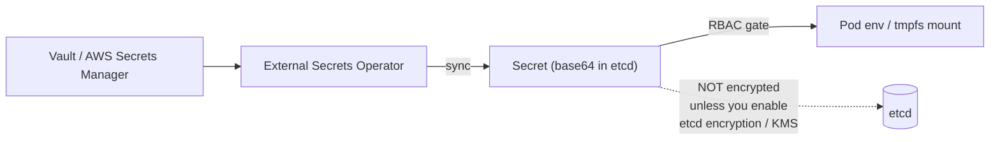
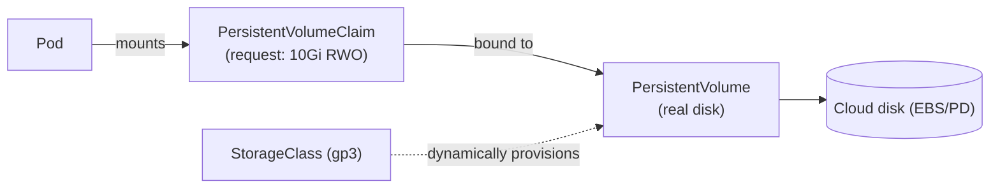
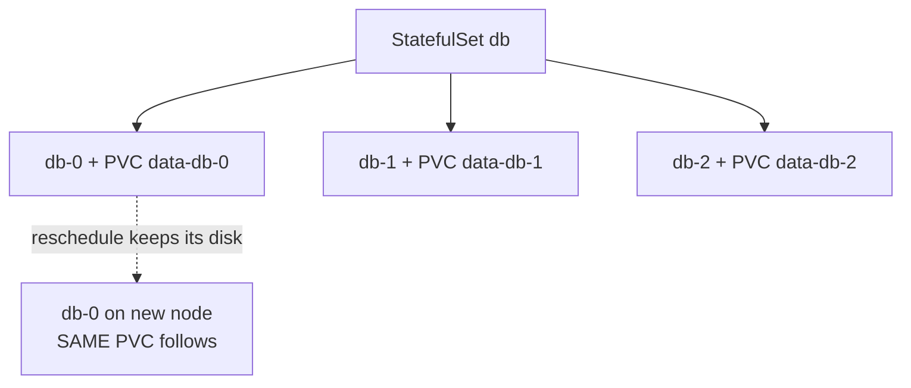
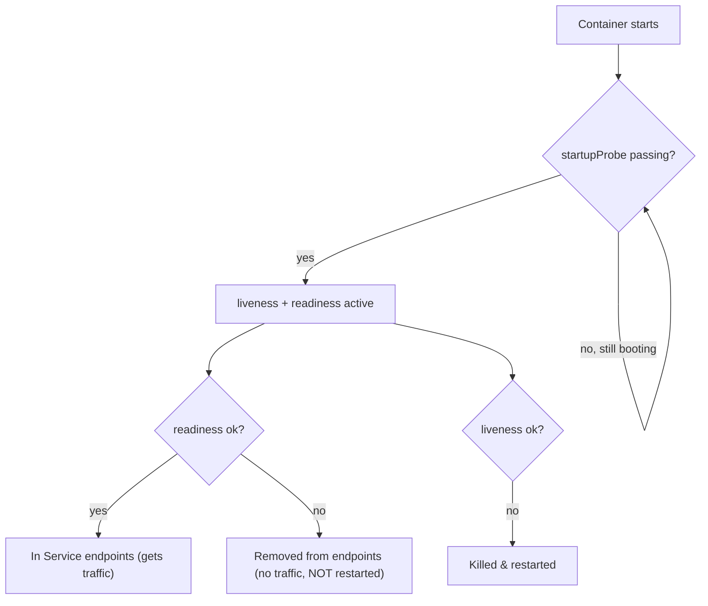

# Day 22 — K8s Config, State & Storage

> Series: Cloud & DevOps Engineering
> Goal: Make apps configurable and durable — ConfigMaps & Secrets (and why Secrets are only base64), Volumes/PV/PVC, StatefulSets vs Deployments, resource requests/limits, and liveness/readiness/startup probes.

---

## Table of Contents

1. [ConfigMaps: externalized configuration](#1-configmaps-externalized-configuration)
2. [Secrets (and the base64 truth)](#2-secrets-and-the-base64-truth)
3. [Volumes, PV & PVC](#3-volumes-pv--pvc)
4. [StatefulSets vs Deployments](#4-statefulsets-vs-deployments)
5. [Resource requests & limits](#5-resource-requests--limits)
6. [Probes: liveness, readiness, startup](#6-probes-liveness-readiness-startup)
7. [Lab: externalize config + probes + limits](#7-lab-externalize-config--probes--limits)
8. [Self-Check](#8-self-check)
9. [Tomorrow](#9-tomorrow)

---

## 1. ConfigMaps: externalized configuration

**In plain words:** Baking config (DB host, feature flags, log level) into your container image is like printing your home address on a T-shirt — change the address, reprint the shirt. A **ConfigMap** pulls that config *out* of the image so the same image runs in dev, staging, and prod with different settings. Build once, configure per environment.

**Why:** One immutable image across environments; change config without rebuilding/redeploying the image; keep config in Git separate from code.

**How — two ways to consume it (env vars or files):**

```yaml
apiVersion: v1
kind: ConfigMap
metadata:
  name: app-config
data:
  LOG_LEVEL: "info"
  DB_HOST: "postgres.default.svc.cluster.local"
  app.properties: |          # a whole file
    cache.ttl=300
    feature.newUI=true
```

```yaml
# In a Pod: inject as ENV VARS
spec:
  containers:
    - name: app
      image: myapp:1.0
      envFrom:
        - configMapRef: { name: app-config }   # all keys become env vars
      # or pick one:
      env:
        - name: LOG_LEVEL
          valueFrom:
            configMapKeyRef: { name: app-config, key: LOG_LEVEL }
      # or MOUNT as files:
      volumeMounts:
        - { name: cfg, mountPath: /etc/app }
  volumes:
    - name: cfg
      configMap: { name: app-config }          # keys become files in /etc/app
```

```bash
kubectl create configmap app-config --from-literal=LOG_LEVEL=info \
  --from-file=app.properties          # imperative alternative
kubectl get configmap app-config -o yaml
```

| Consume as | Good for | Note |
|---|---|---|
| Env vars (`envFrom`) | Simple key/value settings | Not updated live — needs pod restart |
| Mounted files (volume) | Config files, larger blobs | Updated ~live (with delay), app must reload |

> 🤔 **"If I update a ConfigMap, do my running pods pick up the change automatically?"**
> Mostly no. Env-var-injected values are frozen at pod start — the pod must be restarted to see changes. Mounted-file values *do* update in the pod's filesystem (after a sync delay), but only if your *app* re-reads the file; most apps read config once at boot. So a ConfigMap change usually needs a rollout (`kubectl rollout restart deployment/app`). Treat config changes as deploys, not live edits — which is exactly what GitOps (Day 24) formalizes.

**✅ Good scenario:** The same `myapp:2.3` image ships to dev/staging/prod; each environment's ConfigMap sets its own DB host and log level. One image, three behaviors, zero rebuilds.

**❌ Bad scenario:** A team bakes `DB_HOST=prod-db` into the image. To point staging at a staging DB they rebuild a *separate* image — now dev/staging/prod run *different binaries*, and "works in staging" no longer proves "works in prod." Config-in-image quietly destroys environment parity.

**When NOT to:** Don't put secrets in a ConfigMap (they're plaintext, unencrypted, readable by anyone with get access) — that's what Secrets are for (§2).

---

## 2. Secrets (and the base64 truth)

**In plain words:** A Kubernetes **Secret** looks like a ConfigMap for sensitive data (passwords, tokens, TLS keys). But here's the uncomfortable truth every engineer must know: **by default, Secrets are only base64-encoded, not encrypted.** Base64 is *encoding*, not *security* — anyone can decode it in one command. Secrets are "secret" mainly by *access control* (RBAC) and optional at-rest encryption, not by the format.

**Why they exist (despite the caveat):** They're handled more carefully than ConfigMaps — not shown in `describe`, can be RBAC-restricted separately, mounted in tmpfs (memory) rather than disk, and *can* be encrypted at rest in etcd if you enable it.

```yaml
apiVersion: v1
kind: Secret
metadata:
  name: db-secret
type: Opaque
data:
  password: aHVudGVyMg==      # base64("hunter2") — NOT encryption!
# stringData lets you write plaintext; K8s base64s it for you:
stringData:
  username: admin
```

```bash
echo -n 'hunter2' | base64            # aHVudGVyMg==   (anyone can do this)
echo 'aHVudGVyMg==' | base64 -d       # hunter2        (…and reverse it)

kubectl create secret generic db-secret --from-literal=password=hunter2
kubectl get secret db-secret -o jsonpath='{.data.password}' | base64 -d   # trivially readable
```

Consume it like a ConfigMap:

```yaml
env:
  - name: DB_PASSWORD
    valueFrom:
      secretKeyRef: { name: db-secret, key: password }
```



*Base64 is encoding, not protection. Real security = RBAC + etcd encryption + an external secrets manager.*

**Making Secrets actually secure (2026 practice):**

- **Enable encryption at rest** for etcd (EncryptionConfiguration + a KMS provider). Managed clusters often offer this as a toggle (EKS+KMS, GKE, AKS).
- **Lock down RBAC** — very few roles should `get`/`list` secrets.
- **Don't commit Secret YAML to Git** in plaintext. Use **Sealed Secrets** (encrypt so it's safe in Git) or the **External Secrets Operator** (sync from Vault/AWS Secrets Manager/GCP SM at runtime).

| | ConfigMap | Secret (default) | Secret + encryption + ESO |
|---|---|---|---|
| Encoding | plaintext | base64 (not secure) | base64 in pod, encrypted at rest + external source |
| Encrypted at rest | No | No (unless enabled) | Yes |
| Safe in Git | Non-secret only | No | Sealed/ESO patterns |
| For | config | sensitive-ish | production secrets |

> 🤔 **"Kubernetes Secrets are encrypted, so my passwords are safe — right?"**
> This is the single most dangerous misconception in Kubernetes. Out of the box, a Secret is **base64-encoded, which is reversible by anyone in one command** — it is *not* encryption. Its protection comes from (a) RBAC limiting who can read it and (b) etcd encryption-at-rest *if you explicitly enabled it*. Assuming Secrets are safe by default leads to committing base64 "secrets" to Git (trivially decoded) and skipping etcd encryption. Treat a default Secret as "obscured, not protected."

**✅ Good scenario:** A team enables EKS envelope encryption (KMS) for etcd, restricts secret-read RBAC to the app's service account, and syncs real secrets from AWS Secrets Manager via ESO. A leaked etcd backup is useless without KMS; a leaked manifest holds no plaintext.

**❌ Bad scenario (extremely common):** A dev base64-encodes a prod DB password into a Secret YAML and commits it to Git "because it's encoded." A contractor clones the repo, runs `base64 -d`, and now has prod. Encoding fooled them into treating a plaintext secret as safe.

**When NOT to:** Don't rely on default Secrets for anything truly sensitive without etcd encryption + tight RBAC. For serious workloads, source secrets externally (Vault/ESO) rather than storing them in the cluster at all.

---

## 3. Volumes, PV & PVC

**In plain words:** A container's filesystem is ephemeral — restart the pod and any files it wrote are gone. For data that must survive (a database, uploads), you need **persistent storage**. Kubernetes models this with a supply-and-demand pair: a **PersistentVolume (PV)** is a piece of real storage (an EBS disk, an NFS share); a **PersistentVolumeClaim (PVC)** is a pod's *request* for storage ("I need 10Gi, read-write"). Kubernetes binds a claim to a volume.

**Why the two-object dance:** It decouples *who needs storage* (app developers write PVCs) from *what storage exists* (cluster/cloud provides PVs). With **StorageClasses**, PVs are even provisioned automatically on demand (dynamic provisioning).



*The pod asks (PVC); the cluster supplies (PV), often auto-provisioned via a StorageClass.*

```yaml
apiVersion: v1
kind: PersistentVolumeClaim
metadata:
  name: data
spec:
  accessModes: ["ReadWriteOnce"]     # one node can mount read-write
  storageClassName: gp3              # dynamic provisioning (cloud creates the disk)
  resources:
    requests:
      storage: 10Gi
---
# In a Pod:
spec:
  containers:
    - name: db
      image: postgres:16
      volumeMounts:
        - { name: data, mountPath: /var/lib/postgresql/data }
  volumes:
    - name: data
      persistentVolumeClaim: { claimName: data }
```

```bash
kubectl get pvc,pv                   # see the claim bound to a volume
kubectl get storageclass             # available provisioners
```

| Volume type | Lifetime | Use |
|---|---|---|
| `emptyDir` | Pod lifetime (dies with pod) | scratch space, cache between containers |
| `configMap`/`secret` | From an object | config/secret files |
| **PVC → PV** | Independent of pod | databases, uploads, anything durable |
| `hostPath` | Node's disk (avoid) | node-level agents only; not portable |

Access modes: **RWO** (ReadWriteOnce — one node), **ROX** (ReadOnlyMany), **RWX** (ReadWriteMany — needs shared storage like NFS/EFS).

> 🤔 **"Can I just write to the container's filesystem and skip all this PV/PVC stuff?"**
> You can *write*, but it won't *persist*. The container filesystem is ephemeral: a pod restart, reschedule, or rolling update gives you a brand-new empty filesystem, and your data is gone. That's *fine* for stateless apps (that's the point — they hold no state) but catastrophic for a database. PV/PVC exists to attach storage whose life is *independent* of any pod. If losing the data on restart would hurt, you need a PVC.

**✅ Good scenario:** A Postgres pod mounts a PVC backed by an EBS gp3 volume. The pod is rescheduled to another node during maintenance; the volume detaches and re-attaches to the new node; the database comes back with all data intact.

**❌ Bad scenario:** Someone runs a database in a Deployment writing to the container filesystem (or `emptyDir`). A rolling update replaces the pod — and silently wipes the entire database. Every byte gone, no error, because the storage was never persistent.

**When NOT to (PVC):** Stateless apps shouldn't have PVCs — statelessness is a feature (any replica is disposable and interchangeable). Add persistence only where state genuinely must survive.

---

## 4. StatefulSets vs Deployments

**In plain words:** A Deployment treats its pods as *identical, interchangeable, disposable* (great for stateless web servers). But a database *cluster* needs the opposite: each member needs a **stable identity** (`db-0`, `db-1`), **stable storage** (its own disk that follows it), and **ordered** startup/shutdown. A **StatefulSet** provides exactly that. Use it for databases, message queues, and anything where "which pod am I" matters.

**Why:** Stateful systems have identity and ordering requirements Deployments deliberately don't provide.

**What a StatefulSet guarantees:**

- **Stable network identity**: pods are `web-0`, `web-1`, `web-2` (not random hashes), each with a stable DNS name.
- **Stable storage**: each pod gets its *own* PVC that stays with *that ordinal* even across reschedules (`volumeClaimTemplates`).
- **Ordered operations**: created/scaled/updated `0, 1, 2…`; terminated in reverse. (A DB primary can come up before replicas.)

```yaml
apiVersion: apps/v1
kind: StatefulSet
metadata:
  name: db
spec:
  serviceName: db                 # a HEADLESS service for stable pod DNS
  replicas: 3
  selector: { matchLabels: { app: db } }
  template:
    metadata: { labels: { app: db } }
    spec:
      containers:
        - name: db
          image: postgres:16
          volumeMounts: [{ name: data, mountPath: /var/lib/postgresql/data }]
  volumeClaimTemplates:            # each pod gets its OWN PVC: data-db-0, data-db-1...
    - metadata: { name: data }
      spec:
        accessModes: ["ReadWriteOnce"]
        resources: { requests: { storage: 10Gi } }
```

```bash
kubectl get statefulset,pods,pvc
# pods: db-0, db-1, db-2 (stable names)
# pvcs: data-db-0, data-db-1, data-db-2 (each pinned to its pod ordinal)
# DNS:  db-0.db.default.svc.cluster.local  (stable per-pod address)
```

| | Deployment | StatefulSet |
|---|---|---|
| Pod identity | random hash, interchangeable | stable ordinal (`db-0`) |
| Storage | shared/none | per-pod PVC, sticky |
| Startup/shutdown | any order, parallel | ordered (0,1,2…) |
| DNS | one Service VIP | per-pod stable DNS (headless) |
| For | stateless (web/API) | databases, queues, clustered state |



*Each StatefulSet pod keeps its identity and its own disk, even across reschedules.*

> 🤔 **"Can't I just run my database in a Deployment with a PVC and call it done?"**
> For a *single* database instance with one PVC, it sort of works — but the moment you scale to `replicas: 2`, a Deployment gives both pods the *same* claim/identity, and they'll fight over one disk (or share it destructively). No stable names means no way for replica-1 to reliably find the primary. StatefulSets exist because clustered stateful systems need *per-pod* identity and storage and *ordered* lifecycle — properties a Deployment fundamentally doesn't offer. Single-instance? Deployment+PVC is tolerable. Clustered DB? StatefulSet.

**✅ Good scenario:** A 3-node PostgreSQL cluster runs as a StatefulSet. `db-0` (primary) always starts first; each replica keeps its own PVC across node failures; replicas find the primary by stable DNS (`db-0.db`). Reschedules are boring, not data-loss events.

**❌ Bad scenario:** A team runs a 3-replica database as a Deployment. All three pods try to bind the same RWO PVC; two get stuck; the one that mounts has no stable identity, so failover logic can't find "the primary." Data integrity is a coin flip.

**When NOT to (StatefulSet):** Don't use them for stateless apps — the ordering and per-pod storage slow down scaling and rollouts for no benefit. Also, for production databases, strongly consider a **managed database** (RDS/Cloud SQL) over self-hosting in K8s at all — running stateful data systems on Kubernetes is genuinely hard.

> **Dark Side note:** "Databases on Kubernetes" is a long-running debate. Operators (CloudNativePG, etc.) have matured, but for many teams a managed DB outside the cluster is safer and simpler than a self-run StatefulSet. Know the tradeoff before you host prod data on K8s.

---

## 5. Resource requests & limits

**In plain words:** Without limits, one greedy pod can eat all a node's CPU/RAM and starve its neighbors (the "noisy neighbor" problem). **Requests** tell the scheduler how much a pod *needs* (used to place it on a node with room). **Limits** are the hard ceiling the pod may *not* exceed. Together they make sharing a node fair and predictable.

**Why:** Reliable scheduling, protection from runaway pods, and predictable performance.

```yaml
spec:
  containers:
    - name: app
      image: myapp:1.0
      resources:
        requests:                 # scheduler reserves this; guaranteed minimum
          cpu: "250m"             # 0.25 of a core
          memory: "256Mi"
        limits:                   # hard ceiling
          cpu: "500m"             # throttled above this (CPU is compressible)
          memory: "512Mi"         # OOM-KILLED above this (memory is NOT compressible)
```

**Crucial difference — CPU vs memory over the limit:**

| Resource | Over the limit → | Because |
|---|---|---|
| **CPU** | **Throttled** (slowed) | CPU is compressible — you just get less |
| **Memory** | **OOMKilled** (pod killed) | Memory is incompressible — can't "slow" RAM usage |

**QoS classes** (how K8s decides who to evict under node pressure):

| QoS | Condition | Eviction priority |
|---|---|---|
| **Guaranteed** | requests == limits (all containers) | Last to be evicted |
| **Burstable** | requests < limits | Middle |
| **BestEffort** | no requests/limits | First to die |

```bash
kubectl top pods                     # actual CPU/mem usage (needs metrics-server)
kubectl describe node <node>         # Allocated resources vs capacity
kubectl get pod <p> -o jsonpath='{.status.qosClass}'
```

> 🤔 **"Should I just set limits really high (or omit them) so my app never gets throttled or killed?"**
> No — both extremes hurt. Omitting requests makes your pod **BestEffort**, first to be evicted when the node is squeezed. Setting limits sky-high lets one bug (a memory leak) consume the whole node and take *neighbors* down before OOM finally hits. The craft is *right-sizing*: set requests near the real steady-state usage (so scheduling is accurate) and limits with sane headroom (so a spike is contained, not fatal). Measure with `kubectl top`, don't guess. Note: over-tight memory limits cause spurious OOMKills; that's its own common outage.

**✅ Good scenario:** Every pod has requests≈usage and reasonable limits. The scheduler bin-packs nodes accurately, a leaking pod gets OOMKilled *alone* (contained), and critical pods set to Guaranteed survive node pressure. Predictable, fair cluster.

**❌ Bad scenario:** A team omits all requests/limits. A memory-leaking pod balloons, the node runs out of RAM, the kernel OOM-killer picks *random* processes (maybe critical ones), and the whole node goes unstable. One unbounded pod took down everything sharing its node.

**When NOT to:** Don't set memory limits *lower* than the app's real working set "to save resources" — you'll just cause CrashLoopBackOff via OOMKills. And avoid setting CPU *limits* aggressively on latency-sensitive apps (throttling adds tail latency); often set CPU *requests* but be cautious with CPU *limits*.

---

## 6. Probes: liveness, readiness, startup

**In plain words:** Kubernetes can't read your app's mind — it needs your app to *report* its health. **Probes** are health checks K8s runs on your container. Three kinds, three jobs: **liveness** ("are you alive, or should I restart you?"), **readiness** ("are you ready for traffic, or should I hold off?"), **startup** ("are you still booting? don't judge me yet"). These are what make yesterday's rolling updates actually safe.

**Why each exists:**

- **Readiness** — controls *traffic*. Fails → pod removed from Service endpoints (no traffic) but **not** restarted. This is what prevents routing to a not-yet-ready pod during a rollout.
- **Liveness** — controls *restarts*. Fails → K8s **kills and restarts** the container (deadlock/hung recovery).
- **Startup** — protects *slow starters*. While it's failing, liveness/readiness are paused, so a slow boot isn't mistaken for a hang.

```yaml
spec:
  containers:
    - name: app
      image: myapp:1.0
      startupProbe:               # give slow-booting apps time before liveness kicks in
        httpGet: { path: /healthz, port: 8080 }
        failureThreshold: 30      # 30 * periodSeconds = up to 5 min to boot
        periodSeconds: 10
      readinessProbe:             # gate traffic — the rolling-update safety net
        httpGet: { path: /ready, port: 8080 }
        initialDelaySeconds: 5
        periodSeconds: 5
      livenessProbe:              # restart if hung
        httpGet: { path: /healthz, port: 8080 }
        periodSeconds: 10
        failureThreshold: 3
```

Probe mechanisms: `httpGet` (2xx/3xx = pass), `tcpSocket` (port open = pass), `exec` (command exit 0 = pass), and `grpc`.



*Readiness gates traffic; liveness gates restarts; startup shields slow boots from both.*

| Probe | Fails → | Controls | Classic misuse |
|---|---|---|---|
| **Readiness** | removed from Service (no traffic) | traffic routing | omitting it → 502s during rollout |
| **Liveness** | container restarted | hang recovery | too aggressive → restart loops on slow deps |
| **Startup** | (holds off the others) | slow boot grace | omitting for slow apps → false liveness kills |

> 🤔 **"Aren't liveness and readiness basically the same health check — why not point both at /healthz?"**
> They answer *different questions* and pointing both at the same endpoint causes real outages. Readiness = "can I serve traffic *right now*?" (maybe not — a dependency is briefly down, so *stop sending traffic* but **don't restart me**). Liveness = "am I fundamentally broken?" (yes — *restart me*). If you make liveness fail whenever a *dependency* is down, a transient DB blip triggers a cluster-wide **restart storm** of otherwise-healthy pods — turning a small hiccup into an outage. Keep liveness about *your* process's health; keep readiness about *your ability to serve*.

**✅ Good scenario:** An app's readiness returns 503 until it's connected to its DB and warmed its cache. During a rolling update, new pods receive traffic only once truly ready — genuinely zero-downtime. Liveness only trips on a real internal deadlock.

**❌ Bad scenario (a real outage pattern):** A team wires liveness to an endpoint that checks the *database*. The DB has a 30-second blip. Every pod's liveness fails simultaneously; K8s restarts *all* of them at once; now nothing is up and the restart-storm prolongs the outage far beyond the original blip. Liveness should never depend on external systems.

**When NOT to:** Don't add a liveness probe that duplicates readiness or checks external deps. When unsure, start with a good *readiness* probe (biggest safety win) and add liveness only for genuine hang scenarios.

---

## 7. Lab: externalize config + probes + limits

**Goal:** Take an app, externalize its config to a ConfigMap and a Secret, add resource requests/limits, and wire all three probes — then prove readiness gates traffic and OOMKill happens over the memory limit.

### Step 1 — Cluster + metrics

```bash
kind create cluster --name day22
# metrics-server (for kubectl top) on kind needs --kubelet-insecure-tls:
kubectl apply -f https://github.com/kubernetes-sigs/metrics-server/releases/latest/download/components.yaml
kubectl patch deployment metrics-server -n kube-system --type=json \
  -p='[{"op":"add","path":"/spec/template/spec/containers/0/args/-","value":"--kubelet-insecure-tls"}]'
```

### Step 2 — Config + Secret + Deployment with probes/limits

`app.yaml`:

```yaml
apiVersion: v1
kind: ConfigMap
metadata: { name: app-config }
data:
  LOG_LEVEL: "info"
  GREETING: "hello from configmap"
---
apiVersion: v1
kind: Secret
metadata: { name: app-secret }
type: Opaque
stringData:
  API_TOKEN: "s3cr3t-token"      # K8s base64s it (remember: NOT encryption)
---
apiVersion: apps/v1
kind: Deployment
metadata: { name: app }
spec:
  replicas: 2
  selector: { matchLabels: { app: app } }
  template:
    metadata: { labels: { app: app } }
    spec:
      containers:
        - name: app
          image: nginxdemos/hello:plain-text   # simple HTTP echo on :80
          ports: [{ containerPort: 80 }]
          envFrom:
            - configMapRef: { name: app-config }
          env:
            - name: API_TOKEN
              valueFrom: { secretKeyRef: { name: app-secret, key: API_TOKEN } }
          resources:
            requests: { cpu: "100m", memory: "64Mi" }
            limits:   { cpu: "250m", memory: "128Mi" }
          readinessProbe:
            httpGet: { path: /, port: 80 }
            initialDelaySeconds: 3
            periodSeconds: 5
          livenessProbe:
            httpGet: { path: /, port: 80 }
            periodSeconds: 10
          startupProbe:
            httpGet: { path: /, port: 80 }
            failureThreshold: 10
            periodSeconds: 3
```

```bash
kubectl apply -f app.yaml
kubectl get pods -w                       # watch readiness gate: 0/1 -> 1/1 READY
kubectl exec deploy/app -- printenv | grep -E 'LOG_LEVEL|GREETING|API_TOKEN'  # config injected
```

### Step 3 — Prove readiness gates traffic

```bash
kubectl expose deployment app --port=80
# Break readiness: point the probe at a missing path, apply, and watch pods go NOT READY:
kubectl patch deployment app --type=json \
  -p='[{"op":"replace","path":"/spec/template/spec/containers/0/readinessProbe/httpGet/path","value":"/nope"}]'
kubectl get pods                          # READY 0/1 — but NOT restarted (liveness still ok-ish)
kubectl get endpoints app                 # empty! no traffic routed to not-ready pods
# revert:
kubectl patch deployment app --type=json \
  -p='[{"op":"replace","path":"/spec/template/spec/containers/0/readinessProbe/httpGet/path","value":"/"}]'
```

### Step 4 — Prove memory limit → OOMKilled

```bash
# Run a pod that allocates more than its 20Mi memory limit:
kubectl run oom --image=polinux/stress --restart=Never \
  --limits='memory=20Mi' -- stress --vm 1 --vm-bytes 50M --vm-hang 1
kubectl get pod oom -w                     # -> OOMKilled (memory is incompressible)
kubectl describe pod oom | grep -A2 "Last State"   # Reason: OOMKilled
kubectl delete pod oom
```

### Step 5 — Observe usage & QoS

```bash
kubectl top pods                           # actual CPU/mem
kubectl get pod -l app=app \
  -o custom-columns=NAME:.metadata.name,QOS:.status.qosClass   # Burstable (req<lim)
```

### Step 6 — Clean up

```bash
kind delete cluster --name day22
```

### Success criteria

- Config + secret values appear as env vars in the pod.
- Breaking readiness emptied the Service endpoints (no traffic) without restarting the pod.
- Exceeding the memory limit produced `OOMKilled`.
- `kubectl top` and QoS class confirmed your requests/limits took effect.

**Stretch:** Decode the Secret yourself: `kubectl get secret app-secret -o jsonpath='{.data.API_TOKEN}' | base64 -d`. Feel how "secret" it really is, then read up on enabling etcd encryption / Sealed Secrets.

---

## 8. Self-Check

1. Why externalize config into a ConfigMap instead of baking it into the image?
2. If you edit a ConfigMap, do running pods pick it up? What's the difference between env-var and mounted-file consumption?
3. What is a Kubernetes Secret encoded as by default, and why is that *not* security?
4. Name two ways to make Secrets actually secure in production.
5. Why is the container filesystem the wrong place for a database's data? What replaces it?
6. Explain the PVC → PV relationship and what a StorageClass adds.
7. Give three things a StatefulSet provides that a Deployment doesn't. When must you use one?
8. What happens when a pod exceeds its CPU limit vs its memory limit, and why the difference?
9. Compare liveness vs readiness — which controls traffic, which controls restarts?
10. Why is making a liveness probe depend on an external database dangerous?

---

## 9. Tomorrow

**Day 23 — K8s Scaling, Packaging (Helm) & Ops.** Your app is configurable, durable, and health-checked. Tomorrow we make it *scale itself* and *ship as a package*: **HPA** (scale pods on metrics) plus cluster/node autoscaling, **scheduling controls** (taints/tolerations, affinity, nodeSelector) to place pods where they belong, **Helm** — the package manager that templates all this YAML into reusable, versioned charts — and a real **debugging playbook** for the failures you'll actually hit: CrashLoopBackOff, ImagePullBackOff, OOMKilled, and Pending. This is the operations day.
