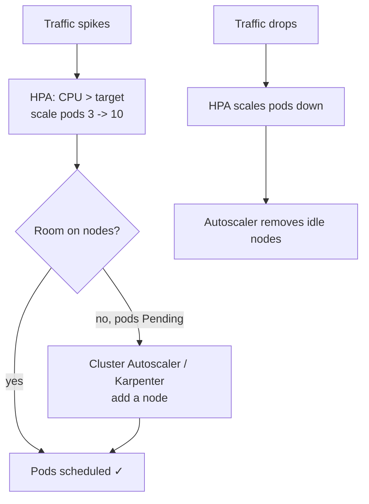
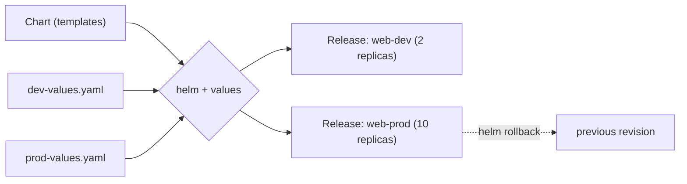
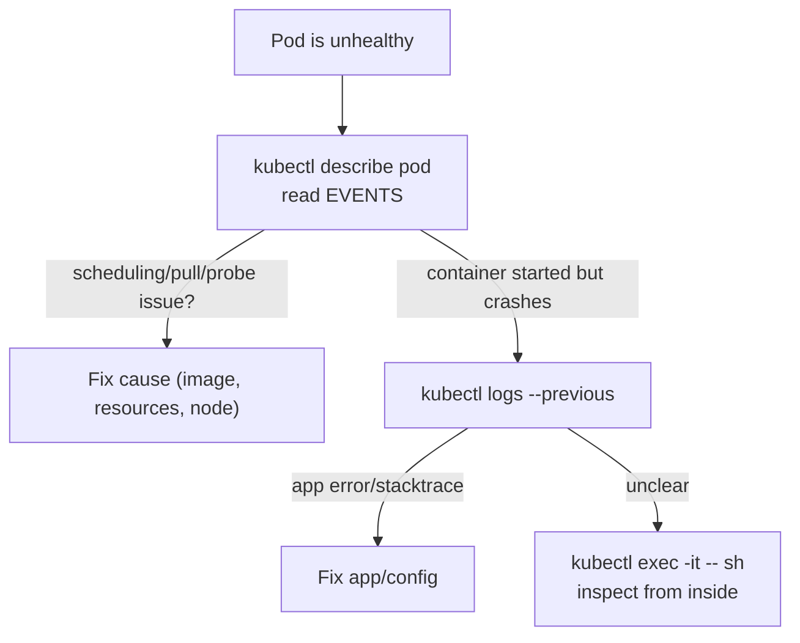
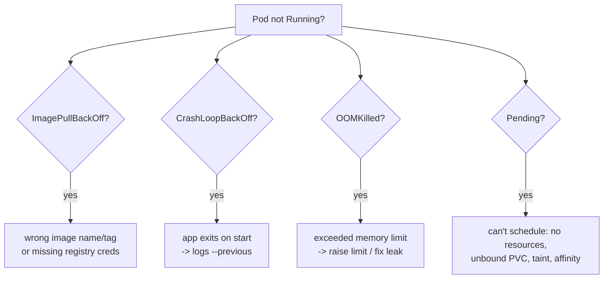

# Day 23 — K8s Scaling, Packaging (Helm) & Ops

> Series: Cloud & DevOps Engineering
> Goal: Make workloads scale themselves, place pods deliberately, package apps as reusable Helm charts, and debug the failures you'll actually hit in production.

---

## Table of Contents

1. [Autoscaling: HPA + cluster/node autoscaling](#1-autoscaling-hpa--clusternode-autoscaling)
2. [Scheduling: taints, tolerations, affinity, nodeSelector](#2-scheduling-taints-tolerations-affinity-nodeselector)
3. [Helm: the Kubernetes package manager](#3-helm-the-kubernetes-package-manager)
4. [Debugging: describe, logs, exec](#4-debugging-describe-logs-exec)
5. [Common failures & fixes](#5-common-failures--fixes)
6. [Lab: Helm chart + HPA](#6-lab-helm-chart--hpa)
7. [Self-Check](#7-self-check)
8. [Tomorrow](#8-tomorrow)

---

## 1. Autoscaling: HPA + cluster/node autoscaling

**In plain words:** Traffic isn't constant — quiet at 3am, spiking at noon. Manually running `kubectl scale` all day is absurd. Kubernetes autoscales at two levels: the **Horizontal Pod Autoscaler (HPA)** adds/removes *pods* based on metrics (CPU, memory, custom), and the **Cluster Autoscaler** (or Karpenter on AWS) adds/removes *nodes* when pods can't fit. They work together: HPA wants more pods → no room → cluster autoscaler adds a node → pods schedule.

**Why:** Match capacity to demand automatically — handle spikes without over-provisioning (and paying) for peak 24/7.



*Two loops: HPA scales pods to demand; the node autoscaler scales the fleet to fit the pods.*

**The three autoscalers:**

| Scaler | Scales | Trigger | Note |
|---|---|---|---|
| **HPA** | pod *replicas* | CPU/mem/custom metrics | needs metrics-server; needs **requests** set |
| **VPA** | pod *size* (requests/limits) | historical usage | right-sizes; can conflict with HPA on same metric |
| **Cluster Autoscaler / Karpenter** | *nodes* | unschedulable (Pending) pods | Karpenter (AWS) is faster/flexible |

```yaml
apiVersion: autoscaling/v2
kind: HorizontalPodAutoscaler
metadata: { name: web }
spec:
  scaleTargetRef:
    apiVersion: apps/v1
    kind: Deployment
    name: web
  minReplicas: 2
  maxReplicas: 10
  metrics:
    - type: Resource
      resource:
        name: cpu
        target:
          type: Utilization
          averageUtilization: 60      # add pods to keep avg CPU ~60% of the REQUEST
```

```bash
kubectl autoscale deployment web --cpu-percent=60 --min=2 --max=10   # imperative
kubectl get hpa                       # TARGETS shows current% / target%
kubectl describe hpa web              # scaling decisions & events
```

> 🤔 **"I set an HPA on CPU but it never scales — what's wrong?"**
> Almost always one of two things: (1) **no CPU `requests`** on the pods — HPA computes utilization as a percentage *of the request*, so with no request there's nothing to divide by and it can't act; or (2) **metrics-server isn't installed/working** — HPA has no data. The fix is set resource requests (Day 22) and confirm `kubectl top pods` returns numbers. "HPA does nothing" is nearly always missing requests or missing metrics, not the HPA itself.

**✅ Good scenario:** A checkout service runs 2 pods overnight. Morning traffic pushes CPU past 60%; HPA scales to 8 pods; that overflows the nodes; Karpenter adds a node in ~40s; everything schedules; by evening it all scales back down. Nobody touched a thing; the bill tracks demand.

**❌ Bad scenario:** A team sets HPA `maxReplicas: 100` but forgets node autoscaling. A spike makes HPA request 60 pods; there's only room for 12; the other 48 sit `Pending` forever; the service is under-capacity *despite* "autoscaling." HPA scales pods, not nodes — you need both.

**When NOT to:** Don't autoscale on CPU for workloads that aren't CPU-bound (a queue worker should scale on queue depth — a custom metric). And don't combine HPA and VPA on the *same* metric — they fight.

---

## 2. Scheduling: taints, tolerations, affinity, nodeSelector

**In plain words:** By default the scheduler puts pods wherever they fit. Often you need control: "GPU jobs only on GPU nodes," "keep these two replicas on different nodes for HA," "reserve these nodes for one team." Kubernetes gives you a toolkit: **nodeSelector** (simple match), **affinity/anti-affinity** (rich rules), and **taints/tolerations** (nodes *repel* pods unless they tolerate it).

**The mental split:**

- **nodeSelector / node affinity** — the *pod* is picky about nodes ("put me on SSD nodes").
- **taints / tolerations** — the *node* is picky about pods ("only special pods allowed here").
- **pod affinity / anti-affinity** — pods care about *each other* ("spread my replicas apart" / "co-locate with cache").

```yaml
# nodeSelector: simplest — pod runs only on nodes with this label
spec:
  nodeSelector:
    disktype: ssd
---
# Taint a node so ONLY tolerating pods land there:
# kubectl taint nodes gpu-node dedicated=gpu:NoSchedule
spec:
  tolerations:
    - key: dedicated
      operator: Equal
      value: gpu
      effect: NoSchedule           # this pod tolerates the taint -> allowed on gpu-node
---
# Anti-affinity: spread replicas across nodes (HA)
spec:
  affinity:
    podAntiAffinity:
      requiredDuringSchedulingIgnoredDuringExecution:
        - labelSelector:
            matchLabels: { app: web }
          topologyKey: kubernetes.io/hostname   # no two web pods on the same node
```

| Tool | Who's picky | Effect |
|---|---|---|
| **nodeSelector** | pod → node | hard match on node labels |
| **node affinity** | pod → node | soft/hard, richer expressions |
| **taint + toleration** | node → pod | node repels pods unless tolerated |
| **pod (anti-)affinity** | pod → pod | co-locate or spread relative to other pods |

Taint effects: `NoSchedule` (block new), `PreferNoSchedule` (avoid if possible), `NoExecute` (evict existing too).

> 🤔 **"A toleration guarantees my pod lands on the tainted node — right?"**
> No — and this trips people constantly. A **toleration only removes the repulsion**; it says "I'm *allowed* here," not "put me here." To actually *attract* the pod to those nodes you also need **node affinity / nodeSelector**. Taint+toleration alone means the pod *may* schedule on the tainted node *or anywhere else that fits*. The common recipe for dedicated nodes is **taint the node** (keep others off) **plus** node affinity on the pod (pull it toward them) — two mechanisms, one goal.

**✅ Good scenario:** GPU nodes are tainted `dedicated=gpu:NoSchedule`; ML pods carry the toleration *and* node affinity for GPU nodes. Regular pods can't waste GPU capacity, and ML pods reliably land on GPUs. Pod anti-affinity also spreads the API replicas across nodes so one node failure never takes all of them.

**❌ Bad scenario:** A team taints their expensive GPU nodes but forgets that their DaemonSet/monitoring pods lack tolerations — so node agents can't run there, and those nodes have no logging/metrics. Or: they use anti-affinity `required` with more replicas than nodes, so extra pods sit `Pending` forever (can't satisfy "all on different nodes").

**When NOT to:** Don't over-constrain. Aggressive `required` affinity + few nodes = unschedulable `Pending` pods. Prefer `preferred` (soft) rules unless you truly need hard guarantees; let the scheduler do its job where you don't care.

---

## 3. Helm: the Kubernetes package manager

**In plain words:** You've been writing raw YAML — a Deployment, a Service, an Ingress, a ConfigMap, an HPA — per app, per environment, copy-pasted and hand-edited. That doesn't scale. **Helm** is `apt`/`npm` for Kubernetes: it packages all those manifests into a **chart** (a templated bundle), lets you set differences via **values**, and installs/upgrades/rolls back the whole thing as one versioned **release**.

**Why:** Templating (one chart, many environments), packaging/sharing (a chart is a distributable unit), and lifecycle management (install/upgrade/rollback/history as atomic releases).

**The vocabulary:**

- **Chart** — the package: templates + default values + metadata.
- **Values** — the knobs (`values.yaml`, overridable per install/env).
- **Template** — a manifest with `{{ }}` placeholders filled from values.
- **Release** — one installed instance of a chart, tracked and versioned.

```
mychart/
  Chart.yaml          # name, version, appVersion
  values.yaml         # default configuration (the knobs)
  templates/
    deployment.yaml   # templated manifests
    service.yaml
    _helpers.tpl      # reusable template snippets
```

```yaml
# templates/deployment.yaml — values become {{ }} placeholders
spec:
  replicas: {{ .Values.replicaCount }}
  template:
    spec:
      containers:
        - name: {{ .Chart.Name }}
          image: "{{ .Values.image.repository }}:{{ .Values.image.tag }}"
          resources:
            {{- toYaml .Values.resources | nindent 12 }}
```

```yaml
# values.yaml — defaults
replicaCount: 2
image:
  repository: nginx
  tag: "1.27"
resources:
  requests: { cpu: 100m, memory: 128Mi }
```

```bash
helm create mychart               # scaffold a chart
helm lint mychart                 # validate
helm template mychart             # render YAML locally (see what WILL be applied — do this!)
helm install web ./mychart        # create a release named "web"
helm install web ./mychart -f prod-values.yaml   # per-env overrides (DRY across envs)
helm install web ./mychart --set replicaCount=5  # inline override
helm upgrade web ./mychart --set image.tag=1.28  # ship a new version
helm rollback web 1               # revert to revision 1 (instant)
helm history web                  # release revisions
helm list                         # installed releases
# Public charts (like registry modules in Terraform):
helm repo add bitnami https://charts.bitnami.com/bitnami
helm install pg bitnami/postgresql --version 15.x
```



*One chart + different values = many environment-specific releases, each versioned and rollback-able.*

| | Raw YAML + kubectl | Helm | Kustomize (alt) |
|---|---|---|---|
| Per-env variation | copy-paste/edit | values files | overlays/patches |
| Templating | none | Go templates `{{ }}` | patch-based, no templating |
| Packaging/sharing | manual | charts + repos | none (built into kubectl) |
| Rollback | manual | `helm rollback` | via git/kubectl |
| Complexity | low (few apps) | medium | low-medium |

> 🤔 **"Isn't Helm just string-templating YAML — why not a bash loop with sed?"**
> Helm is templating *plus* three things sed can't give you: **release management** (it tracks what's installed as a versioned, atomic unit you can `upgrade`/`rollback`/`history`), **packaging/distribution** (a chart is a shareable, versioned artifact — the whole Bitnami/community ecosystem), and **dependency management** (charts can depend on charts). The templating is the visible part; the *lifecycle and packaging* are why it won. That said, in 2026 many teams prefer **Kustomize** (patch-based, no templating language) for their own apps and reserve Helm for installing *third-party* software — know both.

**✅ Good scenario:** A platform team ships one internal chart; 30 app teams install it with a 15-line values file each. A security fix to the chart + `helm upgrade` rolls to everyone. A bad release? `helm rollback` in seconds. One artifact, consistent everywhere.

**❌ Bad scenario:** A team goes template-crazy: deeply nested `{{ if }}`/`{{ range }}` logic, values 12 levels deep, `_helpers.tpl` sprawl. Nobody can predict what a given install renders. `helm template` output is a surprise every time. Helm became write-only YAML-generating spaghetti. Always `helm template` to see reality before install.

**When NOT to:** For a single simple app you control, raw YAML or Kustomize may be clearer than a chart. Don't Helm-ify one Deployment. Helm earns its keep for reuse-across-envs, distribution, and third-party software.

---

## 4. Debugging: describe, logs, exec

**In plain words:** When a pod misbehaves, three commands solve most of it. **`describe`** shows *events* (why K8s can't schedule/start it). **`logs`** shows what your *app* said. **`exec`** drops you *inside* to poke around. Learn the order: describe → logs → exec.

```bash
# 1) DESCRIBE first — the Events section explains scheduling/pull/probe failures
kubectl describe pod <pod>            # scroll to "Events:" at the bottom — read it!
kubectl get events --sort-by=.lastTimestamp   # cluster-wide recent events

# 2) LOGS — your application's own words
kubectl logs <pod>                    # current container
kubectl logs <pod> --previous         # the PREVIOUS (crashed) container — key for CrashLoop!
kubectl logs <pod> -c <container>     # a specific container in a multi-container pod
kubectl logs -l app=web --tail=50     # across all pods of a label

# 3) EXEC — get inside a running container
kubectl exec -it <pod> -- sh          # shell in; check env, curl deps, ls files
kubectl exec <pod> -- env             # dump env vars (did config inject?)

# When the container itself won't start / has no shell — ephemeral debug container:
kubectl debug <pod> -it --image=busybox --target=<container>

# Networking / API sanity:
kubectl port-forward pod/<pod> 8080:80
kubectl get endpoints <svc>           # is the Service actually pointing at pods?
```



*Describe for cluster-level events, logs for app output, exec for inside-the-container reality.*

> 🤔 **"My pod is CrashLoopBackOff and `kubectl logs` is empty — where do I look?"**
> The container that crashed is *gone*, so `kubectl logs <pod>` shows the *new* (also-crashing or not-yet-started) one. Add **`--previous`**: `kubectl logs <pod> --previous` shows the *dead* container's final output — usually the actual error/stacktrace. And always `kubectl describe pod` first: the Events section often names the cause outright (bad image, OOMKilled, failed mount) before you even reach logs. "Empty logs" almost always means you're reading the wrong (current) container instead of `--previous`.

**When NOT to (exec in prod):** `exec` into a running prod pod mutates it and can mask the bug (you "fix" it live, it recurs on next deploy). Prefer reproducing in a copy (`kubectl debug` clones a pod), and treat exec as read-only investigation.

---

## 5. Common failures & fixes

**In plain words:** Four pod states cause ~80% of Kubernetes pages. Recognize them on sight and you'll debug fast.



*The four horsemen of pod failure — each has a signature cause.*

| Symptom | Meaning | Likely cause | First moves |
|---|---|---|---|
| **ImagePullBackOff** / ErrImagePull | Can't pull the image | typo in image/tag; private registry, no `imagePullSecret`; rate limit | `describe` → check image name; add pull secret; verify tag exists |
| **CrashLoopBackOff** | Container starts then exits, repeatedly (backoff grows) | app crashes on boot; bad config/env; missing dependency; wrong command | `logs --previous`; check env/ConfigMap/Secret; run image locally |
| **OOMKilled** | Killed for exceeding memory limit | limit too low; memory leak; big spike | `describe` (Last State: OOMKilled); raise memory limit or fix leak; `kubectl top` |
| **Pending** | Not scheduled to any node | insufficient CPU/mem; unbound PVC; taint w/o toleration; unsatisfiable affinity | `describe` Events (scheduler message says exactly why); add capacity / fix constraint |
| CreateContainerConfigError | Container config invalid | missing ConfigMap/Secret referenced | `describe`; create the missing object |
| Init:Error / Init:CrashLoop | An initContainer failed | init logic broken | `logs <pod> -c <init>` |

**Concrete triage:**

```bash
# ImagePullBackOff
kubectl describe pod <p> | grep -A5 Events     # "Failed to pull image ... not found"
# -> fix the image tag, or:
kubectl create secret docker-registry regcred --docker-server=... --docker-username=... --docker-password=...

# CrashLoopBackOff
kubectl logs <p> --previous                    # the real error
kubectl get pod <p> -o jsonpath='{.status.containerStatuses[0].lastState.terminated.reason}'

# OOMKilled
kubectl describe pod <p> | grep -A3 "Last State"   # Reason: OOMKilled
# raise limits.memory or fix the leak

# Pending
kubectl describe pod <p> | grep -A10 Events    # "0/3 nodes available: insufficient cpu" etc.
kubectl get pvc                                # is a PVC stuck Pending (no provisioner)?
```

> 🤔 **"CrashLoopBackOff and ImagePullBackOff both say 'BackOff' — same problem?"**
> No — opposite phases. **ImagePullBackOff** = the image never even *downloaded* (wrong name/tag or auth) — the container hasn't started. **CrashLoopBackOff** = the image pulled and the container *started* but *exited*, and K8s is backing off before retrying (delays grow: 10s, 20s, 40s…). The word "BackOff" just means "K8s is waiting before retrying"; *what* it's retrying differs. Pull failure → check the image reference/registry. Crash loop → check `logs --previous` for why your app died.

**✅ Good scenario:** A deploy shows CrashLoopBackOff. The engineer runs `logs --previous`, sees "FATAL: database DB_HOST not set," realizes the ConfigMap key was misspelled, fixes it, re-applies. Five-minute fix because they read the crashed container's logs, not the empty current ones.

**❌ Bad scenario:** A pod is `Pending`; the team assumes a bug and restarts it repeatedly. `describe` would have said "insufficient memory: 0/3 nodes available" in plain English — it was a capacity problem needing a bigger node or lower requests, not a restart. They ignored the one command that answers "why."

**When NOT to:** Don't blindly bump memory limits on every OOMKill — if it's a *leak*, you're just delaying the crash and wasting RAM. Diagnose leak vs. genuinely-undersized before raising limits.

---

## 6. Lab: Helm chart + HPA

**Goal:** Package an app as a Helm chart with configurable replicas/resources, install it, add an HPA, generate load, and watch it scale.

### Step 1 — Cluster + metrics-server

```bash
kind create cluster --name day23
kubectl apply -f https://github.com/kubernetes-sigs/metrics-server/releases/latest/download/components.yaml
kubectl patch deployment metrics-server -n kube-system --type=json \
  -p='[{"op":"add","path":"/spec/template/spec/containers/0/args/-","value":"--kubelet-insecure-tls"}]'
kubectl -n kube-system rollout status deploy/metrics-server
```

### Step 2 — Scaffold and trim a chart

```bash
helm create webapp        # generates a full starter chart
```

Edit `webapp/values.yaml` to a CPU-friendly demo:

```yaml
replicaCount: 1
image:
  repository: k8s.gcr.io/hpa-example    # a CPU-burning demo image
  tag: latest
  pullPolicy: IfNotPresent
service:
  type: ClusterIP
  port: 80
resources:
  requests: { cpu: "200m", memory: "64Mi" }   # requests REQUIRED for HPA %
  limits:   { cpu: "500m", memory: "128Mi" }
autoscaling:
  enabled: true
  minReplicas: 1
  maxReplicas: 10
  targetCPUUtilizationPercentage: 50
```

The default chart already includes an HPA template gated on `autoscaling.enabled`. Verify the container port matches (hpa-example serves on 80).

### Step 3 — Render, then install

```bash
helm lint webapp
helm template webapp | less           # SEE exactly what will be applied (habit!)
helm install web ./webapp
helm list
kubectl get deploy,hpa,pods
```

### Step 4 — Generate load and watch HPA scale

```bash
# In one shell, watch:
kubectl get hpa web-webapp -w         # TARGETS climbs; REPLICAS grows toward max
# In another shell, hammer it:
kubectl run -it --rm load --image=busybox --restart=Never -- \
  /bin/sh -c "while true; do wget -q -O- http://web-webapp; done"
# Watch REPLICAS rise 1 -> ... as CPU passes 50%. Stop the load (Ctrl-C) -> scales back down (after cooldown).
```

### Step 5 — Upgrade & rollback via Helm

```bash
helm upgrade web ./webapp --set replicaCount=3   # (note: HPA will still own replicas when enabled)
helm history web
helm rollback web 1
helm history web
```

### Step 6 — Practice a failure

```bash
# Cause ImagePullBackOff on purpose:
helm upgrade web ./webapp --set image.tag=doesnotexist
kubectl get pods                       # ImagePullBackOff
kubectl describe pod -l app.kubernetes.io/name=webapp | grep -A5 Events
helm rollback web                      # recover
```

### Step 7 — Clean up

```bash
helm uninstall web
kind delete cluster --name day23
```

### Success criteria

- `helm template` showed the rendered manifests before install.
- The release installed; `helm list` showed it.
- Under load, HPA increased replicas; after load, it scaled back.
- `helm rollback` recovered from the bad image tag.

**Stretch:** Add `podAntiAffinity` (hostname topology) to the chart's deployment template so replicas spread across nodes — then `helm upgrade` and observe placement (use a multi-node kind cluster).

---

## 7. Self-Check

1. What does HPA scale, what does Cluster Autoscaler/Karpenter scale, and how do they cooperate?
2. Your HPA never scales. Name the two most common causes.
3. Differentiate nodeSelector, node affinity, taints/tolerations, and pod anti-affinity — who is "picky" in each?
4. Does a toleration *attract* a pod to a tainted node? What else do you need for dedicated nodes?
5. Define chart, values, template, and release in Helm.
6. Why is Helm "more than templated YAML"? Name two capabilities sed/bash can't give you.
7. In debugging, what's the right order of describe/logs/exec, and why describe first?
8. A CrashLoopBackOff pod shows empty `kubectl logs`. What flag fixes that and why?
9. Contrast ImagePullBackOff vs CrashLoopBackOff — which phase failed in each?
10. Why is blindly raising memory limits on every OOMKilled a bad reflex?

---

## 8. Tomorrow

**Day 24 — GitOps with Kubernetes.** You can now scale, schedule, package, and debug. But how do changes actually *reach* the cluster in a real org — surely not engineers running `helm upgrade` from laptops? Tomorrow, the final piece: **GitOps** — making Git the single source of truth, with an in-cluster agent (**ArgoCD** or **Flux**) that continuously *pulls* the desired state from Git and reconciles the cluster to match (the reconciliation loop, one level up). We'll draw the clean split between **infra GitOps** (Terraform/OpenTofu) and **app GitOps** (ArgoCD), touch **progressive delivery** with **Argo Rollouts** (canary), and you'll install ArgoCD and sync a live app straight from a Git repo. This is how modern teams ship to Kubernetes.
