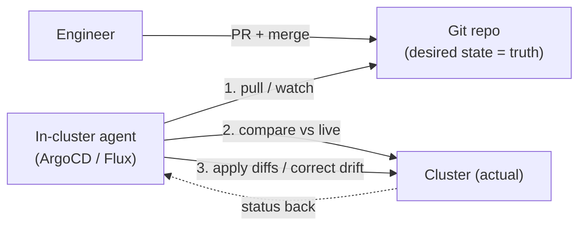
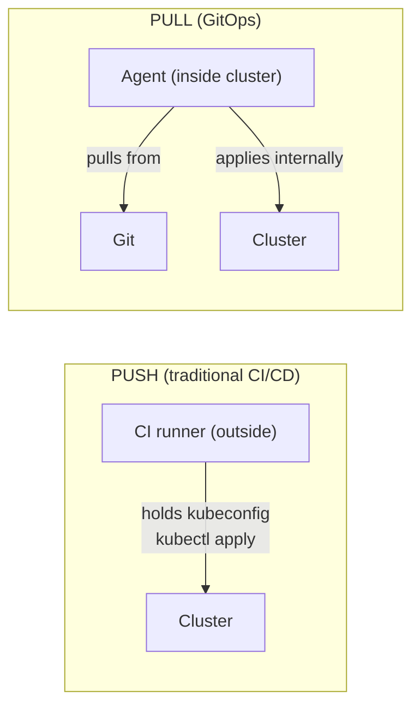
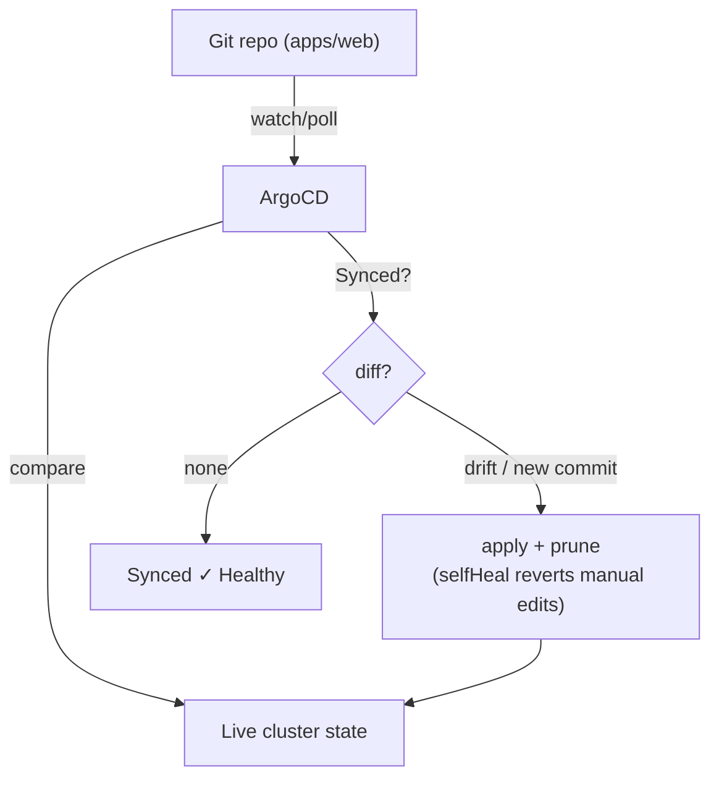
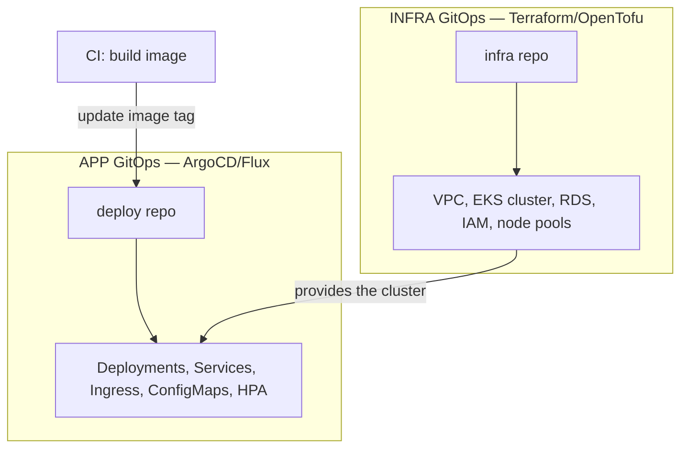
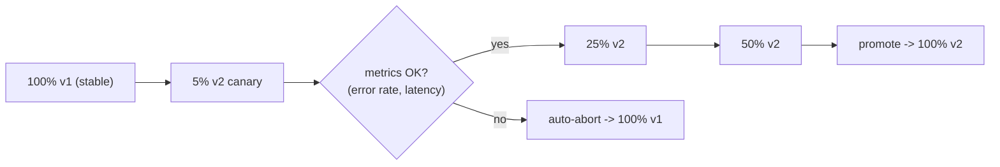

# Day 24 — GitOps with Kubernetes

> Series: Cloud & DevOps Engineering
> Goal: Make Git the single source of truth for your cluster — understand GitOps principles, how ArgoCD/Flux pull-reconcile Git→cluster, the clean infra-vs-app GitOps split, and progressive delivery with Argo Rollouts. Install ArgoCD and sync a live app from Git.

---

## Table of Contents

1. [GitOps principles](#1-gitops-principles)
2. [Pull vs push delivery](#2-pull-vs-push-delivery)
3. [ArgoCD & Flux: how they sync Git → cluster](#3-argocd--flux-how-they-sync-git--cluster)
4. [Infra GitOps vs App GitOps (the clean split)](#4-infra-gitops-vs-app-gitops-the-clean-split)
5. [Progressive delivery: Argo Rollouts (canary)](#5-progressive-delivery-argo-rollouts-canary)
6. [Lab: install ArgoCD, sync an app from Git](#6-lab-install-argocd-sync-an-app-from-git)
7. [Self-Check](#7-self-check)
8. [Series wrap-up](#8-series-wrap-up)

---

## 1. GitOps principles

**In plain words:** For 8 days you've run `kubectl apply` and `helm upgrade` from your laptop. That's ClickOps with extra steps — no reliable record of *what's actually deployed*, no easy rollback, drift creeping in every time someone hotfixes live. **GitOps** flips it: your Git repo *is* the deployment. You never touch the cluster directly. You change a file, open a PR, merge — and an agent *inside* the cluster notices Git changed and reconciles the cluster to match. Git becomes the steering wheel; the cluster just follows.

**Why:** Everything good about Git applied to operations — reviewable changes (PRs), full audit history (`git log` = who deployed what, when, why), trivial rollback (`git revert`), and *continuous drift correction* (the agent fixes anything that diverges from Git).

**The four GitOps principles (OpenGitOps):**

1. **Declarative** — the entire system is described declaratively (K8s YAML, Helm, Kustomize). (You've done this all week.)
2. **Versioned & immutable** — that description lives in Git; every change is a commit.
3. **Pulled automatically** — an agent *pulls* the desired state from Git into the system.
4. **Continuously reconciled** — the agent constantly compares Git (desired) to cluster (actual) and corrects drift.



*Nobody deploys to the cluster. They change Git; the agent reconciles Git → cluster, forever.*

> 🤔 **"Isn't GitOps just 'CI runs kubectl apply after merge'?"**
> No — that's a *push* pipeline (CI reaches into the cluster), and it lacks the two defining GitOps properties: **pull** (the agent lives *in* the cluster and fetches Git; CI never needs cluster credentials) and **continuous reconciliation** (the agent keeps correcting drift *between* deploys, not just at merge time). A CI push job deploys once and walks away — if someone `kubectl edit`s live, nothing notices. A GitOps agent notices within minutes and reverts to Git. GitOps = Git-as-truth *plus* a live control loop, not just "automated apply."

**✅ Good scenario:** An on-call engineer, mid-incident, `kubectl edit`s a Deployment to bump replicas. It stabilizes things — but now live ≠ Git. The ArgoCD agent flags the app **OutOfSync**, showing the exact diff. The team then makes the change *properly* in Git (PR), and the cluster converges. The manual change was visible, reviewed, and captured — not lost tribal knowledge.

**❌ Bad scenario (the pain without it):** A team deploys via ad-hoc `helm upgrade` from laptops. Prod has drifted from Git over months of hotfixes nobody committed. A disaster forces a rebuild from Git — and it comes up *wrong*, because Git never described the real prod. Days of archaeology follow. GitOps makes "Git describes prod" a continuously-enforced invariant, not a hope.

**When NOT to:** For a solo experiment or a fast-moving dev sandbox, full GitOps ceremony (PR per change, agent, sync) can slow you down. Its value scales with team size, prod-criticality, and how much drift/audit pain you feel.

---

## 2. Pull vs push delivery

**In plain words:** Two ways deployments reach a cluster. **Push** (traditional CI/CD): the pipeline holds cluster credentials and runs `kubectl apply` *at* the cluster from outside. **Pull** (GitOps): an agent *inside* the cluster reaches *out* to Git and applies changes itself. The direction flip has real security and reliability consequences.



*Push: outside-in with cluster creds in CI. Pull: inside-out, creds stay in the cluster.*

| | Push (CI does `kubectl apply`) | Pull (GitOps agent) |
|---|---|---|
| Cluster credentials | in CI (external, broad blast radius) | stay *inside* cluster (agent uses local SA) |
| Drift correction | none (fire-and-forget) | continuous |
| Source of truth | pipeline logs / whatever ran | Git, always |
| Multi-cluster | CI needs creds to each | each cluster pulls its own repo/path |
| Audit | pipeline history | Git history + agent sync log |
| Rollback | re-run pipeline | `git revert` |

> 🤔 **"Push seems simpler and works fine — why is pull considered more secure?"**
> The credential surface is the crux. In **push**, your CI system holds powerful cluster credentials — a CI compromise (a poisoned dependency, a leaked token) becomes a *cluster* compromise, and every cluster you deploy to widens the blast radius. In **pull**, the agent runs *inside* the cluster with a local service account and reaches *out* to read Git — CI never needs cluster access at all, and the cluster's credentials never leave it. Fewer places hold the keys, and the keys don't traverse the network to an external system. That inversion is the security win.

**✅ Good scenario:** A company runs 12 clusters across regions. Each runs an ArgoCD agent that pulls its own path from one Git repo. CI only builds images and updates Git — it has *zero* kubeconfig. A compromised CI token can't touch a single cluster directly.

**❌ Bad scenario:** A push setup stores admin kubeconfigs for prod in CI secrets. A supply-chain attack on a build dependency exfiltrates them. Now the attacker has direct prod cluster access from anywhere. Pull-based GitOps would have kept those credentials off CI entirely.

**When NOT to (pull):** Some steps are genuinely imperative and don't fit pull GitOps — one-off DB migrations, batch jobs, or the *image build* itself. Push CI still builds/tests and *updates Git*; the pull agent handles *deployment*. They coexist: CI builds and writes to Git, GitOps deploys from Git.

---

## 3. ArgoCD & Flux: how they sync Git → cluster

**In plain words:** ArgoCD and Flux are the two dominant GitOps agents — both implement the pull-reconcile loop; they differ in shape. **ArgoCD** is a full app with a slick web UI and a central "Application" model (great for humans watching many apps). **Flux** is a set of controllers, lighter and more Kubernetes-native/API-driven (great for automation-first shops). Both watch Git, both correct drift.

**The ArgoCD `Application` — its core object:**

```yaml
apiVersion: argoproj.io/v1alpha1
kind: Application
metadata:
  name: web
  namespace: argocd
spec:
  project: default
  source:
    repoURL: https://github.com/acme/deploy   # WHERE the manifests live
    path: apps/web                              # WHICH folder (K8s YAML / Helm / Kustomize)
    targetRevision: main                        # which branch/tag/commit
  destination:
    server: https://kubernetes.default.svc      # WHICH cluster
    namespace: web                              # WHICH namespace
  syncPolicy:
    automated:
      prune: true        # delete resources removed from Git (true GitOps)
      selfHeal: true     # revert manual (drift) changes back to Git
    syncOptions:
      - CreateNamespace=true
```

```bash
kubectl apply -f application.yaml     # register the app with ArgoCD
argocd app get web                    # sync status: Synced / OutOfSync, health
argocd app sync web                   # manual sync (if not automated)
argocd app diff web                   # show live-vs-Git differences
argocd app rollback web <revision>    # roll back (or just git revert)
```



*ArgoCD continuously diffs Git against live and applies the delta — the reconciliation loop, one level above pods.*

| | ArgoCD | Flux |
|---|---|---|
| Model | App-centric, `Application` CRD | Controller set (Source/Kustomize/Helm) |
| UI | Rich web UI + dashboards | Minimal (CLI/API-first; third-party UIs) |
| Feel | "GitOps you can watch" | "GitOps as Kubernetes primitives" |
| Multi-tenancy | Projects, SSO/RBAC | via CRDs + RBAC |
| Progressive delivery | Argo Rollouts (same family) | Flagger |
| Latest (2026) | Argo CD 3.4.x (3.5 due Aug) | Flux 2.x |

> 🤔 **"With `selfHeal: true`, does GitOps make manual `kubectl edit` completely impossible?"**
> It makes it *futile*, not blocked. `selfHeal` means the agent reverts any live change back to Git within its sync interval (minutes) — so your `kubectl edit` "works" briefly, then vanishes when reconciliation runs. This is the point: it enforces Git as truth and kills silent drift. In a real emergency you *can* pause auto-sync or use ArgoCD's override, but the default posture is "the cluster always returns to what Git says." It's the same lesson as fighting a Deployment's ReplicaSet on Day 20 — you don't win against a reconciliation loop by editing live; you change the desired state (Git).

**✅ Good scenario:** A team runs ArgoCD with `selfHeal` + `prune`. Someone deletes a resource from Git in a PR; on merge, ArgoCD prunes it from the cluster. Someone else `kubectl scale`s a Deployment manually; ArgoCD reverts it within 3 minutes and shows the (now-healed) diff. Git and cluster are provably identical.

**❌ Bad scenario:** A team enables `prune: true` but keeps *some* resources only in the cluster (created by hand, never in Git). ArgoCD dutifully deletes them as "not in Git" — including a manually-made Secret an app depended on. Prune is powerful: it enforces that *everything* the app owns lives in Git. Half-in-Git setups get bitten.

**When NOT to (ArgoCD vs Flux):** Neither is "wrong." Choose ArgoCD when humans need visibility across many apps (most orgs); choose Flux when you want lean, composable controllers and an API-first/automation-heavy approach. Don't run both for the same apps.

---

## 4. Infra GitOps vs App GitOps (the clean split)

**In plain words:** GitOps applies to two different layers, and mixing them causes pain. **Infra GitOps** = the cloud foundation (VPCs, clusters, databases, IAM) — managed by **Terraform/OpenTofu** (Days 17-19). **App GitOps** = what runs *on* the cluster (Deployments, Services, config) — managed by **ArgoCD/Flux**. Keep them in separate repos/tools with a clear boundary: Terraform builds the *stage*, ArgoCD directs the *play*.

**Why separate them:**

- Different *cadence*: infra changes rarely and carefully (a VPC); apps change many times a day.
- Different *blast radius*: a bad app deploy affects one service; a bad infra change can nuke the cluster.
- Different *tools' strengths*: Terraform excels at cloud provisioning + state; ArgoCD excels at continuous in-cluster reconciliation.



*Terraform provisions the cluster and cloud plumbing; ArgoCD deploys workloads onto it. Clean handoff.*

| | Infra GitOps (Terraform/OpenTofu) | App GitOps (ArgoCD/Flux) |
|---|---|---|
| Manages | cloud: VPC, cluster, DB, IAM, DNS | in-cluster: Deployments, Services, config |
| Change cadence | low (careful, reviewed) | high (many deploys/day) |
| State model | Terraform state (S3+lock) | Git + live cluster (agent reconciles) |
| Reconciliation | on `apply` (on-demand) | continuous (agent) |
| Rollback | `git revert` + apply | `git revert` (agent auto-applies) |
| Blast radius | cluster/account-wide | usually one app |

> 🤔 **"Can't Terraform just deploy my app YAML too, using its kubernetes provider — one tool for everything?"**
> You *can* (Terraform has a `kubernetes` provider), and for a couple of bootstrap resources it's fine — but managing high-churn app manifests in Terraform is a known anti-pattern. Terraform's on-demand `apply` model fits *slow, careful* infra, not *many-times-a-day* app deploys; its state file becomes a contention point; and you lose ArgoCD's continuous drift correction and UI. The mature pattern: **Terraform provisions the cluster (and often bootstraps ArgoCD itself), then hands off** — ArgoCD owns everything running on the cluster. Right tool per layer, clean seam between them.

**✅ Good scenario:** Terraform stands up the EKS cluster, node pools, RDS, and *installs ArgoCD* as its last step. From then on, app teams never touch Terraform or `kubectl` — they PR YAML to the deploy repo and ArgoCD ships it. Infra team and app teams move at their own safe speeds.

**❌ Bad scenario:** A team crams app Deployments into Terraform alongside the VPC. Every routine app deploy now runs a full `terraform apply` against prod infra state — slow, lock-contended, and one fat-fingered app change sits in the same plan as the VPC. A trivial rollout risks the whole foundation. The layers should never share a state file.

**When NOT to (splitting):** For a tiny throwaway, one tool is simpler. But any real system benefits from the seam. Note the bootstrap exception: it's normal and good for *Terraform* to install the *ArgoCD* that then owns apps.

---

## 5. Progressive delivery: Argo Rollouts (canary)

**In plain words:** A rolling update (Day 21) swaps all pods to the new version fairly quickly — if v2 is subtly broken, *everyone* gets it before you notice. **Progressive delivery** ships new versions to a *small slice* of traffic first (a **canary**), watches metrics, and only proceeds if it's healthy — otherwise it auto-aborts. **Argo Rollouts** (Argo family; **Flagger** is the Flux-side equivalent) replaces the Deployment with a smarter controller that does this.

**Why:** Limit the blast radius of a bad release to 5% of users, catch regressions with real production traffic, and roll back automatically on bad metrics — before a full outage.

```yaml
apiVersion: argoproj.io/v1alpha1
kind: Rollout                        # drop-in replacement for a Deployment
metadata: { name: web }
spec:
  replicas: 5
  selector: { matchLabels: { app: web } }
  template:                          # same pod spec as a Deployment
    metadata: { labels: { app: web } }
    spec:
      containers: [{ name: web, image: myapp:2.0 }]
  strategy:
    canary:
      steps:
        - setWeight: 5               # 5% of traffic to v2
        - pause: { duration: 2m }    # bake; watch metrics (or analysis below)
        - setWeight: 25
        - pause: { duration: 5m }
        - setWeight: 50
        - pause: {}                  # pause indefinitely for a human "promote"
        # optional: analysis templates auto-abort on bad success-rate/latency
```

```bash
kubectl argo rollouts get rollout web --watch   # live canary progress
kubectl argo rollouts promote web               # advance to next step
kubectl argo rollouts abort web                 # bail out -> back to stable
```



*Ship to a sliver, measure, proceed or auto-roll-back — instead of betting everyone on the new version.*

| Strategy | New version exposure | Bad release impact | Complexity |
|---|---|---|---|
| **Recreate** | all at once (after downtime) | everyone | low |
| **RollingUpdate** | gradual pod swap, all users | most/all users | low |
| **Canary** (Argo Rollouts) | small % first, metric-gated | ~5% of users | medium (needs traffic + metrics) |
| **Blue/Green** | 100% switch after full parallel test | all, but instant flip-back | medium (2x resources briefly) |

> 🤔 **"Isn't a rolling update already gradual — why do I need canary on top?"**
> A rolling update is gradual in *pods*, not in *risk*: it still marches to 100% of users in a couple of minutes, with no metric gate to stop it. If v2 returns errors only under real traffic, a rolling update happily rolls the error out to everyone before your dashboards catch up. **Canary** adds the missing pieces: *traffic-percentage* control (5% not 100%) and an *automated metric gate* that halts/reverts on bad success-rate or latency. Rolling update = "replace pods safely." Canary = "prove the new version is good on a slice before betting the fleet." Different guarantees.

**✅ Good scenario:** A team ships v2 as a 5% canary. Argo Rollouts' analysis detects the canary's error rate at 4% vs stable's 0.2%, auto-aborts, and shifts 100% back to v1 — before most users ever hit v2. A regression that a rolling update would have made a full outage became a 5%, 2-minute blip.

**❌ Bad scenario:** A team adopts canary but sets no analysis/metrics and just `pause: {}` everywhere, promoting manually without looking. Now it's a slower rolling update with extra steps and no automated safety — the *point* (metric-gated auto-abort) was skipped. Canary without measurement is theater.

**When NOT to:** Canary needs enough traffic to be statistically meaningful and a metrics source to gate on. For low-traffic internal tools, a plain rolling update is simpler and a 5% slice is just noise. Reserve progressive delivery for high-traffic, user-facing, regression-sensitive services.

---

## 6. Lab: install ArgoCD, sync an app from Git

**Goal:** Install ArgoCD in a local cluster, point it at a Git repo of Kubernetes manifests, watch it sync, then prove continuous reconciliation by drifting the cluster and seeing ArgoCD heal it.

### Step 1 — Cluster + ArgoCD

```bash
kind create cluster --name day24
kubectl create namespace argocd
kubectl apply -n argocd -f https://raw.githubusercontent.com/argoproj/argo-cd/stable/manifests/install.yaml
kubectl -n argocd rollout status deploy/argocd-server   # wait until ready
```

### Step 2 — Access the ArgoCD UI/CLI

```bash
# Initial admin password:
kubectl -n argocd get secret argocd-initial-admin-secret \
  -o jsonpath='{.data.password}' | base64 -d; echo
# Port-forward the UI:
kubectl -n argocd port-forward svc/argocd-server 8080:443
# Browse https://localhost:8080  (user: admin). Or the CLI:
argocd login localhost:8080 --username admin --password <above> --insecure
```

### Step 3 — Register an app from Git (using ArgoCD's public example repo)

`web-app.yaml`:

```yaml
apiVersion: argoproj.io/v1alpha1
kind: Application
metadata:
  name: guestbook
  namespace: argocd
spec:
  project: default
  source:
    repoURL: https://github.com/argoproj/argocd-example-apps
    path: guestbook                 # a folder of plain K8s manifests
    targetRevision: HEAD
  destination:
    server: https://kubernetes.default.svc
    namespace: guestbook
  syncPolicy:
    automated:
      prune: true                   # delete what's removed from Git
      selfHeal: true                # revert manual drift back to Git
    syncOptions:
      - CreateNamespace=true
```

```bash
kubectl apply -f web-app.yaml
argocd app get guestbook            # status flows: OutOfSync -> Synced, Healthy
kubectl get pods -n guestbook       # ArgoCD created these straight from Git!
```

### Step 4 — Prove continuous reconciliation (self-heal)

```bash
# Drift the cluster by hand:
kubectl -n guestbook scale deployment guestbook-ui --replicas=5
kubectl get deploy -n guestbook     # shows 5 for a moment...
# ArgoCD detects live != Git and SELF-HEALS back to the Git-defined replica count:
argocd app get guestbook            # briefly OutOfSync -> then Synced again
kubectl get deploy -n guestbook -w  # replicas revert to what Git says (e.g. 1)
```

### Step 5 — Prove Git-as-truth (the real deploy path)

```bash
# The "right" way to change replicas is to change Git, not the cluster.
# (Fork the repo, edit guestbook/guestbook-ui-deployment.yaml replicas, push,
#  point repoURL at your fork.) Then:
argocd app sync guestbook           # or wait for auto-sync -> cluster matches new Git
argocd app history guestbook        # sync/deploy history (the audit trail)
```

### Step 6 — Roll back

```bash
argocd app rollback guestbook <PREVIOUS_ID>   # or simply: git revert + let it sync
argocd app get guestbook
```

### Step 7 — Clean up

```bash
argocd app delete guestbook --cascade
kind delete cluster --name day24
```

### Success criteria

- ArgoCD installed; UI/CLI reachable.
- The Application synced an app *from Git* into the cluster (you never `kubectl apply`ed the workload).
- Manually scaling the Deployment got **auto-reverted** by selfHeal (you saw continuous reconciliation).
- App history showed the audit trail; rollback worked.

**Stretch:** Install Argo Rollouts (`kubectl apply -k github.com/argoproj/argo-rollouts/manifests/crds` + controller), convert a Deployment to a `Rollout` with a canary `strategy`, and watch `kubectl argo rollouts get rollout <name> --watch` step through weights as you `promote`.

---

## 7. Self-Check

1. State the four GitOps principles. Which two distinguish GitOps from "CI runs kubectl apply"?
2. Why is pull-based delivery considered more secure than push? Where do cluster credentials live in each?
3. What does an ArgoCD `Application` object specify (name the source and destination fields)?
4. What do `prune: true` and `selfHeal: true` each do — and what's the risk of `prune` with half-in-Git setups?
5. If `selfHeal` is on and you `kubectl edit` a live resource, what happens and why?
6. Draw the infra-GitOps vs app-GitOps split. Which tool owns which layer, and where's the handoff?
7. Why is putting high-churn app manifests in Terraform an anti-pattern?
8. How does a canary (Argo Rollouts) differ from a plain rolling update in terms of *risk*, not just pods?
9. What two things does canary need to be meaningful, and when is it overkill?
10. Compare ArgoCD and Flux at a high level — when would you pick each?

---

## 8. Series wrap-up

You've closed the loop — literally. Notice the through-line of these 8 days: **declarative desired state + a reconciliation loop** shows up *everywhere*. Terraform reconciles cloud reality to your HCL on `apply`. Kubernetes controllers reconcile pods to your Deployment spec continuously. ArgoCD reconciles the cluster to Git continuously. Same mental model, three altitudes. Master that one idea and the entire modern DevOps stack stops being a pile of tools and becomes one coherent philosophy.

**Where you are now (job-ready checklist):**

- IaC with Terraform/OpenTofu: providers, state, remote backends, modules, CI-gated applies, drift, secrets. (Days 17-19)
- Kubernetes: architecture, Pods, the reconciliation loop, Deployments/Services/Ingress, config/secrets/storage, StatefulSets, probes, resources. (Days 20-22)
- Operations: autoscaling, scheduling, Helm packaging, and a real debugging playbook. (Day 23)
- GitOps: Git as truth, ArgoCD/Flux pull-reconcile, infra/app split, progressive delivery. (Day 24)

**Recommended next steps:** observability (Prometheus/Grafana/OpenTelemetry), security (RBAC deep-dive, NetworkPolicies, Pod Security, image scanning, OPA/Kyverno policy-as-code), service mesh (Istio/Linkerd) when you *actually* need it, cost management (Kubecost), and the CKA/CKAD certifications to formalize the K8s knowledge. Then build a portfolio repo: Terraform provisions a managed cluster, ArgoCD (installed by Terraform) deploys a Helm-packaged app with HPA and probes, shipped via canary. That single project demonstrates every concept in this series — and it's exactly the kind of thing that lands the interview.
