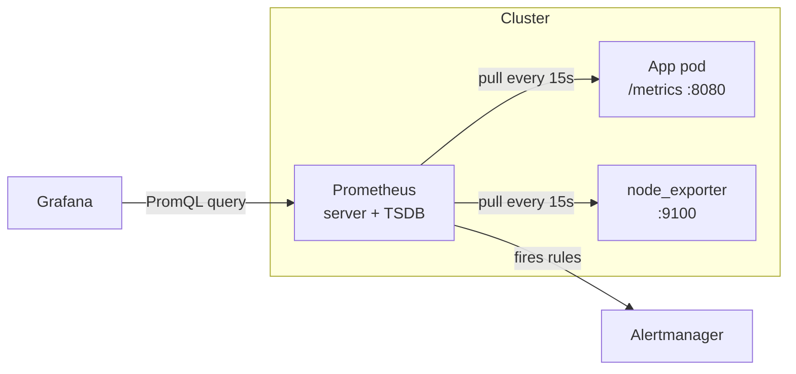
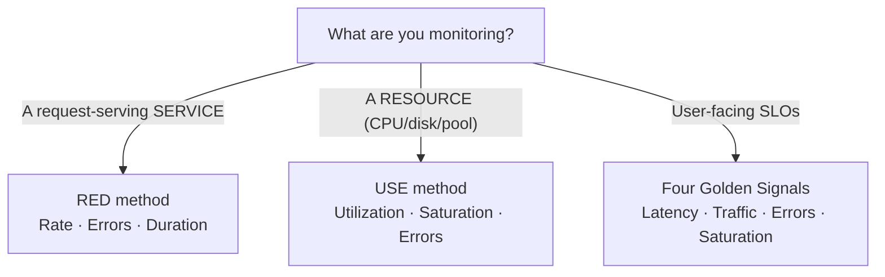

# Day 25 — Metrics & Monitoring

> Series: Cloud & DevOps Engineering
> Goal: Instrument a running app, scrape its metrics with Prometheus, and read the story your system is telling you on a Grafana dashboard — before your users tell it to you first.

---

## Table of Contents
1. [Where we are](#where-we-are)
2. [The 3 pillars recap (System Design Day 20)](#the-3-pillars)
3. [Metrics: the cheapest signal you own](#metrics-cheap)
4. [Prometheus: the pull/scrape model](#prometheus)
5. [Exporters: metrics from things you didn't write](#exporters)
6. [Metric types: counter / gauge / histogram / summary](#metric-types)
7. [PromQL basics](#promql)
8. [Grafana dashboards](#grafana)
9. [The methods: RED, USE, Four Golden Signals](#methods)
10. [Why p99, not average](#p99)
11. [Lab](#lab)
12. [Self-Check](#self-check)
13. [Tomorrow](#tomorrow)

---

## 1. Where we are <a name="where-we-are"></a>

We have shipped things. Docker (Day 6-8) packaged the app, CI/CD (Day 10) built and tested it, Terraform (Day 14, 17) laid the infrastructure, and Kubernetes (Day 20-24) is running it across a fleet of pods. It works. Traffic flows.

Now answer this: **is it healthy right now?** Not "is it up" — anyone can curl a `/health` endpoint. Is p99 latency creeping? Is one pod eating memory? Did error rate tick from 0.1% to 2% ten minutes ago? If you can't answer in seconds, you're flying blind, and the first person to notice will be a customer.

Monitoring is how you turn a running system into an *observable* one. Days 25-27 are the observability arc: metrics (today), logs and traces (Day 26), then alerting and SRE practice (Day 27).

---

## 2. The 3 pillars recap (System Design Day 20) <a name="the-3-pillars"></a>

**In plain words:** Imagine debugging a car. **Metrics** are the dashboard gauges — speed, RPM, fuel — cheap, always-on numbers. **Logs** are the mechanic's written notes — "at 3:04pm the engine coughed." **Traces** are following one specific trip end-to-end — where did *this* drive slow down, at which intersection?

You met these in System Design Day 20. Quick reload:

| Pillar | What it is | Cardinality/cost | Best at |
|--------|-----------|------------------|---------|
| **Metrics** | Numeric time-series (aggregated) | Cheap, small | "Is something wrong, and how bad?" |
| **Logs** | Discrete timestamped events (text/JSON) | Expensive at scale | "What exactly happened?" |
| **Traces** | One request's path across services | Medium | "Where did the time go?" |

> 🤔 **"If I have logs, why do I need metrics? Logs contain everything."**
> Because logs answer *what happened to one request* and metrics answer *what is happening to all of them, right now, cheaply*. Counting error lines in logs to get an error rate means scanning gigabytes every few seconds — metrics pre-aggregate that into a single number you can graph and alert on instantly. You need both. Metrics tell you the building is on fire; logs and traces tell you which room.

**Today is the metrics pillar.** Logs and traces are Day 26.

---

## 3. Metrics: the cheapest signal you own <a name="metrics-cheap"></a>

**In plain words:** A metric is a number that changes over time, sampled at a regular heartbeat — "requests per second," "bytes of memory used," "goroutines alive." Store the number + timestamp + a few labels, and you have a time-series you can chart, math on, and alert on.

- **Why:** Metrics are constant-cost. Whether you serve 10 or 10 million requests, `http_requests_total` is still *one counter per label combination*. That makes them the only pillar you can afford to keep *always on* at full resolution.
- **What:** A time-series = a metric name + a set of key/value labels + a stream of `(timestamp, value)` samples. Example: `http_requests_total{method="GET", status="200", path="/checkout"}`.
- **When:** Always. Instrument from day one. Retrofitting metrics into a system already on fire is the worst time to add them.
- **How:** Your app exposes a `/metrics` endpoint in a text format; a collector scrapes it on a schedule; a time-series database stores it; a dashboard/alerting layer reads it.
- **Where:** App code (client libraries), sidecar exporters, node agents, cloud provider integrations.

> 🤔 **"Can't I just add a label for user ID so I can slice by customer?"**
> No — that is the number-one way to blow up a metrics system. Every unique label *value* creates a new time-series. A `user_id` label with 5 million users = 5 million series *per metric*. This is called a **cardinality explosion** and it will OOM your Prometheus. Labels are for *bounded* dimensions: status code (~5 values), method (~7), route (a few dozen). High-cardinality identifiers belong in **logs and traces**, not metrics.

✅ **Good scenario (where it saves you):** Checkout latency p99 on your dashboard jumps from 120ms to 900ms at 14:02. You see it, correlate with a deploy at 14:01, roll back, and customers barely notice. Metrics gave you a 3-minute head start.

❌ **Bad scenario (the pain without it):** Support tickets pile up: "site is slow." You SSH into boxes, tail logs, guess. Forty minutes later you find one memory-leaking pod. Without a memory gauge trending upward, you never saw it coming and you had no idea which of 30 pods to blame.

**When NOT to:** Don't use metrics to store per-event detail (order IDs, error messages, stack traces). That's a logs/traces job. Metrics answer *how much / how many / how fast*, never *which specific one*.

---

## 4. Prometheus: the pull/scrape model <a name="prometheus"></a>

**In plain words:** Most monitoring tools you might expect the app to *push* its numbers out. Prometheus flips it: the Prometheus server reaches out and *pulls* — it visits each target's `/metrics` page every 15 seconds and writes down what it sees, like a nurse doing rounds and recording vitals.

Prometheus (CNCF-graduated; **v3.x** is the current 2026 line) is the de-facto open-source metrics standard. It is a time-series database + scraper + query engine + basic alerter in one binary.

- **Why pull, not push?** The scraper controls the schedule, so you can't accidentally DDoS your own monitoring by a buggy client. If a target stops responding, that *itself* is a signal (`up == 0`) — you know it's down. Service discovery finds targets automatically.
- **What:** A server process that reads a `scrape_configs` list, hits each target, stores samples in its TSDB, and answers PromQL queries.
- **When:** Any containerized/microservice environment. It is the default in Kubernetes (Day 20-24) via the Prometheus Operator / kube-prometheus-stack.
- **How:** See config below.
- **Where:** Runs as a Deployment/StatefulSet in your cluster, or managed (AWS Managed Prometheus / Grafana Cloud).

```yaml
# prometheus.yml — the scrape schedule and who to visit
global:
  scrape_interval: 15s        # visit every target every 15 seconds
  evaluation_interval: 15s    # re-check alert rules every 15 seconds

scrape_configs:
  - job_name: "prometheus"    # Prometheus scrapes itself (dogfooding)
    static_configs:
      - targets: ["localhost:9090"]

  - job_name: "my-api"        # our application
    metrics_path: /metrics    # default is already /metrics
    static_configs:
      - targets: ["api:8080"] # host:port exposing metrics
        labels:
          env: "prod"         # attach static labels to everything from this job

  - job_name: "node"          # node_exporter for host CPU/mem/disk
    static_configs:
      - targets: ["node-exporter:9100"]
```

```bash
# Run Prometheus locally against that config
docker run -d --name prometheus -p 9090:9090 \
  -v "$PWD/prometheus.yml:/etc/prometheus/prometheus.yml" \
  prom/prometheus:v3.1.0            # pin the version, never :latest in prod

# Check what targets it's scraping and whether they're UP
# Browse http://localhost:9090/targets — green = healthy, red = scrape failing
```

**In Kubernetes** you rarely hand-write `scrape_configs`. The Prometheus Operator lets you declare a `ServiceMonitor` and it wires the scrape for you:

```yaml
# ServiceMonitor — "Prometheus, scrape any Service labelled app=my-api"
apiVersion: monitoring.coreos.com/v1
kind: ServiceMonitor
metadata:
  name: my-api
  labels:
    release: kube-prometheus-stack   # matches the operator's selector
spec:
  selector:
    matchLabels:
      app: my-api            # target Services carrying this label
  endpoints:
    - port: metrics          # the named port on the Service
      interval: 15s
```


*Prometheus pulls from targets; Grafana queries it; Alertmanager (Day 27) handles the paging.*

> 🤔 **"Pull won't work for my short-lived batch job — it's gone before the scrape."**
> Correct, and that's the one exception. For jobs too short-lived to be scraped, Prometheus ships the **Pushgateway**: the job *pushes* its final metrics there, and Prometheus scrapes the Pushgateway. Use it *only* for batch/cron jobs — never as a general push firehose, or you reintroduce every problem pull was designed to avoid (stale metrics linger forever, no `up` signal).

---

## 5. Exporters: metrics from things you didn't write <a name="exporters"></a>

**In plain words:** You can't add Prometheus code to PostgreSQL, Redis, or the Linux kernel. An **exporter** is a little translator sidecar that talks to that system and republishes its stats in Prometheus format on a `/metrics` endpoint.

| Exporter | Exposes | Typical port |
|----------|---------|--------------|
| `node_exporter` | Host CPU, memory, disk, network | 9100 |
| `cAdvisor` | Per-container resource usage | 8080 |
| `postgres_exporter` | Connections, locks, replication lag | 9187 |
| `redis_exporter` | Hit rate, evictions, memory | 9121 |
| `blackbox_exporter` | Probes: HTTP/TCP/ICMP uptime from outside | 9115 |
| `kube-state-metrics` | K8s object state (deployments, pods, restarts) | 8080 |

✅ **Good scenario:** `postgres_exporter` surfaces `pg_stat_replication_lag`. You alert when replica lag > 10s and catch a failing replica before your read-heavy dashboard serves stale data to customers.

❌ **Bad scenario (when misused):** A team runs `node_exporter` but never `kube-state-metrics`, so they can see the *node* is fine while a Deployment silently has 0 ready replicas. They monitored the hardware and missed the app. **Instrument the layer that actually serves users.**

**When NOT to:** Don't write a custom exporter when an official one exists — the ecosystem has one for almost everything. Reinventing `redis_exporter` is wasted weeks.

---

## 6. Metric types: counter / gauge / histogram / summary <a name="metric-types"></a>

**In plain words:** Four shapes of number. A **counter** only goes up (like a car's odometer). A **gauge** goes up and down (like a speedometer). A **histogram** buckets observations to answer "how many were under X?" (like a distribution of trip durations). A **summary** is similar but computes quantiles client-side.

| Type | Direction | Example | Query with |
|------|-----------|---------|-----------|
| **Counter** | Monotonic up (resets on restart) | `http_requests_total` | `rate()` |
| **Gauge** | Up and down | `memory_bytes`, `queue_depth` | raw value, `avg()` |
| **Histogram** | Buckets + sum + count | `http_request_duration_seconds` | `histogram_quantile()` |
| **Summary** | Pre-computed quantiles | request latency | raw quantile |

```python
# Instrumenting a Python app with the official client (prometheus_client)
from prometheus_client import Counter, Gauge, Histogram, start_http_server

# Counter: total requests. NEVER decrement. Label with BOUNDED dimensions only.
REQS = Counter("http_requests_total", "Total HTTP requests",
               ["method", "status", "path"])

# Gauge: things that go up and down
INFLIGHT = Gauge("http_inflight_requests", "Requests currently being served")

# Histogram: latency. Buckets are in seconds; choose them around your SLO.
LATENCY = Histogram("http_request_duration_seconds", "Request latency",
                    ["path"],
                    buckets=[0.05, 0.1, 0.2, 0.5, 1, 2, 5])  # <- tune to your app

def handle(request):
    INFLIGHT.inc()
    with LATENCY.labels(path=request.path).time():   # times the block
        status = do_work(request)
    REQS.labels(method=request.method, status=status, path=request.path).inc()
    INFLIGHT.dec()

start_http_server(8080)   # exposes /metrics on :8080 for Prometheus to scrape
```

> 🤔 **"Why not just make everything a gauge? A gauge can hold any number."**
> Because a counter that only goes up survives restarts *meaningfully* — Prometheus's `rate()` knows a drop to zero means a process restart, not a real decrease, and handles it. If you track total requests as a gauge you set yourself, you lose that, you invite double-counting across instances, and you can't compute a clean per-second rate. **Match the type to the physics of the quantity.** Odometers aren't speedometers.

**Counter → rate is the golden pattern.** You almost never read a counter's raw value; you read its *rate of change*:

```promql
# Requests per second over the last 5 minutes, per path
rate(http_requests_total[5m])

# Error rate as a fraction: 5xx per second / total per second
sum(rate(http_requests_total{status=~"5.."}[5m]))
  /
sum(rate(http_requests_total[5m]))
```

---

## 7. PromQL basics <a name="promql"></a>

**In plain words:** PromQL is the query language for Prometheus — SQL's cousin for time-series. You pick a metric, filter by labels, and apply functions like `rate`, `sum`, `avg`, `histogram_quantile`.

```promql
# 1. Instant selector — current value, filtered by labels
http_inflight_requests{env="prod"}

# 2. Range selector [5m] + rate() — per-second rate over a window
rate(http_requests_total[5m])

# 3. Aggregation — collapse label dimensions with sum/avg/max, keep some with "by"
sum(rate(http_requests_total[5m])) by (path)   # RPS grouped per path

# 4. p99 latency from a histogram — THE most-used query in the business
histogram_quantile(0.99,
  sum(rate(http_request_duration_seconds_bucket[5m])) by (le, path))

# 5. Memory usage as a percentage of the limit (USE method, saturation)
100 * (container_memory_usage_bytes / container_spec_memory_limit_bytes)

# 6. Is a target down? (great for alerting on Day 27)
up{job="my-api"} == 0

# 7. Predict: will disk fill in the next 4 hours? (linear extrapolation)
predict_linear(node_filesystem_avail_bytes[1h], 4*3600) < 0
```

> 🤔 **"`rate()` gave me a weird spiky number that doesn't match my traffic."**
> Two classic causes. (1) Your range window is too small — `rate(...[30s])` with a 15s scrape has only ~2 samples and is noisy; use at least 4× the scrape interval (`[1m]` minimum, `[5m]` typical). (2) You forgot that `rate` needs a *counter*; applying it to a gauge produces nonsense. Rule of thumb: `rate([5m])` for graphs, and always `sum(rate(...))` *before* dividing, never the other way around.

---

## 8. Grafana dashboards <a name="grafana"></a>

**In plain words:** Prometheus stores and answers queries but its own UI is bare. Grafana is the pretty, shareable, multi-panel dashboard layer that sits on top and turns PromQL into graphs a human can read at a glance.

- **Why:** Humans read trends and shapes far faster than raw numbers. A wall of green that suddenly grows a red spike is instantly legible.
- **What:** Grafana (**v11.x** in 2026) connects to data sources (Prometheus, Loki, Tempo, CloudWatch, Datadog…) and renders panels defined by queries, arranged into dashboards.
- **When:** The moment you have more than one metric worth watching.
- **How:** Add Prometheus as a data source, build panels, or import a community dashboard by ID (e.g. **1860** for Node Exporter Full).
- **Where:** In-cluster (part of kube-prometheus-stack), or Grafana Cloud (managed).

```bash
# Run Grafana locally, point it at the Prometheus from section 4
docker run -d --name grafana -p 3000:3000 grafana/grafana:11.4.0
# Login admin/admin -> Connections -> Add data source -> Prometheus
# URL: http://host.docker.internal:9090  (or the container's network address)
# Then Dashboards -> Import -> paste ID 1860 for a ready-made node dashboard
```

**Provision dashboards as code** (never click-build prod dashboards — they vanish when the pod restarts):

```yaml
# grafana-datasource.yaml — provisioned, version-controlled, reproducible
apiVersion: 1
datasources:
  - name: Prometheus
    type: prometheus
    access: proxy
    url: http://prometheus:9090
    isDefault: true
```

> 🤔 **"A pretty dashboard means we're observable, right?"**
> A dashboard nobody looks at until an outage is a *museum*, not monitoring. Dashboards are for *investigation and exploration*; you should not be staring at them 24/7 hoping to catch a spike. The thing that wakes you up is an **alert** (Day 27), driven by the same PromQL. Build dashboards to *answer questions during an incident*, and alerts to *tell you an incident exists*. Confusing the two leads to "we had a dashboard but nobody was watching at 3am."

✅ **Good scenario:** During an incident, one Grafana dashboard shows RPS, error rate, p99 latency, and pod restarts side by side. You see error rate and restarts spike together → it's a crashing pod, not a load problem. Diagnosis in 30 seconds.

❌ **Bad scenario (when misused):** A team builds 40 dashboards with 300 panels. Nobody knows which one matters. During an outage they scroll through noise. **Fewer, opinionated dashboards beat a sprawling gallery.**

---

## 9. The methods: RED, USE, Four Golden Signals <a name="methods"></a>

**In plain words:** Left to your own devices you'll instrument random stuff. These three frameworks tell you *which* handful of metrics actually predict user pain, so you don't drown.


*Pick the lens that matches the thing: services → RED, resources → USE, SLOs → golden signals.*

**RED — for every request-driven service:**
| Signal | Meaning | Query |
|--------|---------|-------|
| **R**ate | Requests per second | `sum(rate(http_requests_total[5m]))` |
| **E**rrors | Failed requests per second | `sum(rate(http_requests_total{status=~"5.."}[5m]))` |
| **D**uration | Latency distribution (p50/p99) | `histogram_quantile(0.99, ...)` |

**USE — for every resource (CPU, memory, disk, connection pool):**
| Signal | Meaning | Example |
|--------|---------|---------|
| **U**tilization | % time busy | CPU % |
| **S**aturation | How much queued/waiting | run queue length, pool wait |
| **E**rrors | Error events | disk read errors, OOM kills |

**Four Golden Signals (Google SRE):** Latency, Traffic, Errors, Saturation. RED + the "saturation" of USE, essentially — the canonical starting set for a user-facing service.

> 🤔 **"Isn't RED just a rename of the Golden Signals?"**
> They overlap heavily and that's fine — the *point* isn't which acronym you chant, it's that you cover the same three or four dimensions instead of instrumenting 200 vanity metrics. RED is the service-centric subset; USE is resource-centric; Golden Signals blends both for user-facing SLOs. Learn one well, cover Rate/Errors/Duration/Saturation, and you're ahead of most teams.

**When NOT to:** Don't apply USE to a stateless HTTP service and call it done — a CPU-idle service can still be failing every request. Match the method to the subject.

---

## 10. Why p99, not average <a name="p99"></a>

**In plain words:** The average hides your worst-served customers. A percentile tells you what the *unlucky* users experience — and the unlucky ones are the ones who churn and tweet.

**Concrete example.** 100 requests. 99 of them take 50ms. One takes 5000ms (5s — a timeout retry, a cold cache, a lock).

```
Average = (99 × 50ms + 1 × 5000ms) / 100 = (4950 + 5000)/100 ≈ 99.5ms
```

The average says "~100ms, looks fine!" But **one in a hundred customers waited 5 full seconds.** At 1,000 requests/second that's *10 furious users every second*.

```
p50 (median) = 50ms      "typical user is fine"
p99          = 5000ms    "1% of users are having an awful time"  <- THIS is the truth
```

- **p50 / median:** the typical experience.
- **p95 / p99:** the tail — where timeouts, GC pauses, cold starts, and lock contention hide.
- **p99.9:** for very high-scale systems; at a billion requests, 0.1% is a million bad experiences.

> 🤔 **"Our average latency is great, so we're fast — why is support blowing up?"**
> Because averages are *dominated by the happy majority and blind to the suffering minority*. Every serious latency SLO (Day 27) is written against a percentile — "p99 < 300ms" — never an average. Averages also can't be aggregated safely across machines (the average of two averages is wrong unless the counts match). Graph p50 **and** p99 together: the gap between them *is* your tail-latency problem.

✅ **Good scenario:** You alert on p99 latency, not average. A slow database connection pool starts adding 2s to 3% of requests. Average barely moves; p99 doubles; you catch it. Customers on the tail never pile up.

❌ **Bad scenario (the pain without it):** You dashboard average latency only. A memory leak causes periodic 4s GC pauses affecting 2% of requests. Average stays "green" for a week while your NPS quietly craters and you have no idea why.

---

## 11. Lab <a name="lab"></a>

**Goal:** Instrument a tiny app, scrape it with Prometheus, and chart RED metrics in Grafana.

**Step 1 — a minimal instrumented app** (`app.py`):
```python
from prometheus_client import Counter, Histogram, start_http_server
import random, time
REQS = Counter("http_requests_total", "reqs", ["status"])
LAT = Histogram("http_request_duration_seconds", "latency",
                buckets=[0.05, 0.1, 0.2, 0.5, 1, 2])
start_http_server(8080)                    # /metrics on :8080
while True:
    with LAT.time():
        time.sleep(random.choice([0.05, 0.05, 0.05, 0.8]))  # inject a slow tail
    REQS.labels(status=random.choice(["200","200","200","500"])).inc()
    time.sleep(0.2)
```
```bash
pip install prometheus_client
python app.py &                            # runs the fake workload
curl -s localhost:8080/metrics | head      # confirm counters/histogram appear
```

**Step 2 — scrape it** (`prometheus.yml`):
```yaml
global: { scrape_interval: 5s }
scrape_configs:
  - job_name: "lab-app"
    static_configs:
      - targets: ["host.docker.internal:8080"]
```
```bash
docker run -d --name prom -p 9090:9090 \
  -v "$PWD/prometheus.yml:/etc/prometheus/prometheus.yml" \
  prom/prometheus:v3.1.0
# Visit http://localhost:9090/targets — lab-app should be UP (green)
```

**Step 3 — query in Prometheus** (http://localhost:9090/graph):
```promql
sum(rate(http_requests_total[1m]))                               # total RPS
sum(rate(http_requests_total{status="500"}[1m]))                # error RPS
histogram_quantile(0.99, sum(rate(http_request_duration_seconds_bucket[1m])) by (le))
```

**Step 4 — Grafana:**
```bash
docker run -d --name graf -p 3000:3000 grafana/grafana:11.4.0
# admin/admin -> add Prometheus data source (http://host.docker.internal:9090)
# New dashboard -> 3 panels: RPS, Error rate, p99 latency (paste queries above)
```

**Stretch:** Change the app's slow-tail probability, watch p99 move on the dashboard while the *average* barely does — you just proved section 10 with your own eyes.

---

## 12. Self-Check <a name="self-check"></a>

1. Why does Prometheus *pull* instead of push? Name one benefit and the one exception (Pushgateway).
2. You want to slice error rate by customer ID. Why is that a trap, and where should customer ID live instead?
3. Match the type: "current queue depth," "total bytes served," "request latency distribution."
4. Write the PromQL for error rate as a *fraction* of total requests.
5. An engineer applies `rate()` to a gauge. What's wrong and what do they see?
6. RED vs USE — which do you use for a Postgres connection pool, and which for the checkout API?
7. Average latency is 100ms, p99 is 4s, at 2,000 rps. How many users per second are having a bad time (roughly)?
8. Why provision Grafana dashboards as code instead of clicking them together?
9. What's the difference in *purpose* between a dashboard and an alert?
10. `up{job="my-api"} == 0` — what does this express and why is it valuable?

---

## 13. Tomorrow <a name="tomorrow"></a>

Metrics told you *that* something is wrong and *how bad*. Tomorrow — **Day 26: Logging & Tracing** — we get to *what exactly happened* and *where the time went*: centralized logging (ELK vs Loki), structured JSON logs, log discipline, and distributed tracing with OpenTelemetry and Jaeger so you can follow one slow request across five services. Plus the golden rule: what you must **never** log.
