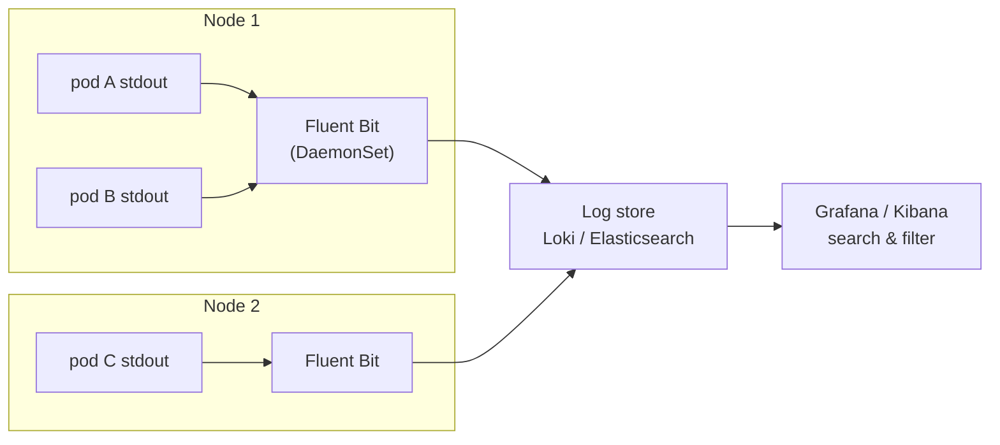
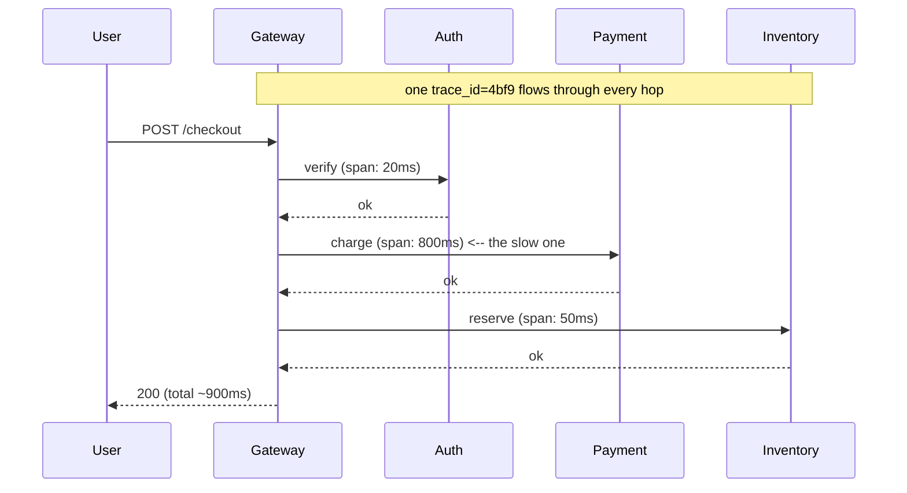
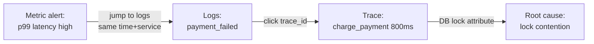

# Day 26 — Logging & Tracing

> Series: Cloud & DevOps Engineering
> Goal: Centralize every container's logs, make them structured and queryable, and stitch one request's journey across microservices into a single trace — so "why was this checkout slow?" takes 60 seconds, not 6 hours.

---

## Table of Contents
1. [From "how bad" to "what exactly"](#recap)
2. [Centralized logging: why you can't tail 300 pods](#centralized)
3. [ELK vs Loki](#elk-vs-loki)
4. [Structured JSON logs](#structured)
5. [Log levels: the discipline that saves 3am you](#levels)
6. [Log aggregation in Kubernetes](#k8s-logs)
7. [What you must NEVER log (secrets & PII)](#never-log)
8. [Distributed tracing: traces & spans](#tracing)
9. [OpenTelemetry & Jaeger](#otel)
10. [Correlating the three pillars](#correlate)
11. [Lab](#lab)
12. [Self-Check](#self-check)
13. [Tomorrow](#tomorrow)

---

## 1. From "how bad" to "what exactly" <a name="recap"></a>

Yesterday (Day 25) metrics told you error rate jumped to 3% and p99 latency doubled. Metrics are a *smoke alarm* — loud, cheap, but they can't tell you *which room* or *why*. For that you need the other two pillars from System Design Day 20:

- **Logs** — the discrete events. "At 14:02:11 order 88213 failed: `payment gateway timeout`." The *what exactly*.
- **Traces** — one request's full path across services, with timing per hop. The *where the time went*.

Today we make both production-grade.

---

## 2. Centralized logging: why you can't tail 300 pods <a name="centralized"></a>

**In plain words:** On one server, `tail -f app.log` is fine. In Kubernetes (Day 20-24) your app is 30 pods across 6 nodes, pods die and respawn hourly, and their logs vanish with them. Centralized logging ships every line off the box into one searchable place *before* the pod dies.

- **Why:** Pods are cattle, not pets (Day 20). When a pod crashes (CrashLoopBackOff, Day 22), its local logs die with it — exactly when you need them most. You also can't grep across 300 containers by hand.
- **What:** A pipeline — a collector agent on each node tails container stdout/stderr, ships it to a central store, indexed and queryable via one UI.
- **When:** The moment you have more than one replica or your containers are ephemeral. Which is: always, in modern infra.
- **How:** Agent (Fluent Bit / Promtail / Vector) → store (Loki / Elasticsearch) → UI (Grafana / Kibana).
- **Where:** In-cluster DaemonSet, or a managed backend (Grafana Cloud, Datadog, CloudWatch Logs, OpenSearch).


*One collector per node tails all pods and ships lines to a central, searchable store.*

> 🤔 **"My app writes to `/var/log/app.log` inside the container — isn't that logging?"**
> In containers, that's an anti-pattern. The **12-factor** rule is: **log to stdout/stderr, treat logs as an event stream**, and let the platform capture them. Writing to a file inside a container means the log dies with the container, fills the ephemeral filesystem, and the collector can't find it. Print to stdout; Docker/Kubernetes and your collector handle the rest.

✅ **Good scenario (where it saves you):** A pod OOM-crashes at 3am and restarts. Because Fluent Bit already shipped its logs to Loki, you search `{app="checkout"} |= "OutOfMemory"` in the morning and find the exact request that blew the heap — even though the pod that logged it is long gone.

❌ **Bad scenario (the pain without it):** No central logging. A customer reports a failed order from "sometime yesterday." The pod that served it was replaced twice since. Its logs are gone forever. You cannot reproduce, cannot diagnose, and close the ticket with "unable to reproduce" — which is engineer for *we were blind*.

**When NOT to:** Don't ship *everything* at DEBUG level to an indexed store — that's how a logging bill hits five figures a month (see section 5). Centralize, but be disciplined about volume.

---

## 3. ELK vs Loki <a name="elk-vs-loki"></a>

The two dominant open-source stacks. Choosing between them is a real interview question.

**ELK / Elastic Stack:** Elasticsearch (store + full-text index) + Logstash/Beats (ship) + Kibana (UI). Indexes the *full content* of every log line.

**Loki (Grafana):** "Prometheus, but for logs." Indexes only *labels* (like Prometheus), stores the log body compressed and unindexed. Query with **LogQL**, view in Grafana.

| Dimension | ELK (Elasticsearch) | Loki |
|-----------|--------------------|------|
| What's indexed | Full text of every line | Only labels (app, namespace, pod) |
| Query power | Rich full-text search, aggregations | Label filter + grep-style `\|=` |
| Storage cost | High (big indexes) | Low (compressed chunks in object storage) |
| Ops burden | Heavier (JVM, sharding, tuning) | Lighter |
| Best when | You need deep search/analytics on log content | You mostly filter by service + time, cost matters |
| UI | Kibana | Grafana (same pane as your metrics) |
| Ecosystem fit | Standalone | Pairs natively with Prometheus/Grafana (Day 25) |

```logql
# LogQL (Loki) — filter by label, then grep the body
{app="checkout", env="prod"} |= "error" != "healthcheck"

# Parse JSON logs and filter on a field
{app="checkout"} | json | status_code >= 500

# Turn logs into a metric: error lines per second (log-based alerting)
sum(rate({app="checkout"} |= "ERROR" [5m]))
```

> 🤔 **"Loki indexes less — doesn't that make it worse?"**
> No — it makes it *cheaper and often sufficient*. Most log queries in practice are "show me service X's logs around time T, containing string Y" — and Loki's label index + brute-force chunk scan handles that fine at a fraction of Elasticsearch's storage cost. Choose ELK when you genuinely need full-text analytics (security forensics, complex aggregations across arbitrary fields). For app troubleshooting alongside Prometheus, Loki usually wins on TCO. It's a trade-off, not a ranking.

✅ **Good scenario (Loki):** You already run Grafana for metrics (Day 25). Adding Loki means one UI for metrics + logs, click from a latency spike straight to the logs of that pod at that second, and your storage bill stays flat because chunks live in cheap S3.

❌ **Bad scenario (ELK misused):** A team indexes 2TB/day of DEBUG logs in Elasticsearch "just in case," pays more for logging than compute, and *still* can't find anything because there's too much noise. **Volume without discipline is expensive blindness.**

---

## 4. Structured JSON logs <a name="structured"></a>

**In plain words:** A plain-text log line (`"user 55 failed login from 1.2.3.4"`) is readable by humans but a nightmare for machines to filter. A structured log emits the same event as JSON with named fields — now you can query `status=500 AND user_id=55` without fragile regex.

- **Why:** Machines filter and aggregate fields, not prose. Structured logs turn your log store into a queryable database.
- **What:** Each log line is a JSON object with consistent keys: `timestamp`, `level`, `message`, `service`, `trace_id`, plus event-specific fields.
- **When:** Every service, from the start. Retrofitting structure into a million unstructured lines is painful.
- **How:** Use a structured logger (Python `structlog`, Go `zap`/`slog`, Node `pino`).
- **Where:** Application code, at the logging call site.

```python
# Unstructured — human-readable, machine-hostile
log.info(f"payment failed for order {order_id}: {err}")
# -> "payment failed for order 88213: gateway timeout"   (now write a regex...)

# Structured — one JSON object, every field queryable
import structlog
log = structlog.get_logger()
log.info("payment_failed",
         order_id=order_id,
         amount_cents=amount,
         gateway="stripe",
         error="gateway_timeout",
         trace_id=current_trace_id())   # <- ties this log to a trace (section 8)
```
```json
{"event":"payment_failed","level":"info","order_id":88213,
 "amount_cents":4999,"gateway":"stripe","error":"gateway_timeout",
 "trace_id":"4bf92f...","timestamp":"2026-07-26T14:02:11Z"}
```

Now in Loki: `{app="checkout"} | json | error="gateway_timeout" | gateway="stripe"` — instant, no regex.

> 🤔 **"Structured logs are ugly to read in the terminal — plain text is friendlier."**
> Use *both modes*: JSON in production (for the log store), pretty console output in local dev (most loggers auto-switch on a `LOG_FORMAT` env var). The five seconds of "ugliness" in prod buys you the ability to answer "how many payment timeouts to Stripe in the last hour, grouped by region?" with a query instead of a grep-and-pray. In dev, the same logger prints colorized human text.

**When NOT to:** Don't over-structure trivial debug prints into 15-field JSON blobs — signal-to-noise still matters. Structure the events you'll actually query.

---

## 5. Log levels: the discipline that saves 3am you <a name="levels"></a>

**In plain words:** Levels are the volume knob. `DEBUG` is a firehose for local dev; `INFO` is normal operation; `WARN` is "odd but handled"; `ERROR` is "a request failed"; `FATAL` is "the process is dying." Discipline here is what makes logs *usable* and *affordable*.

| Level | Use for | In prod? |
|-------|---------|----------|
| `DEBUG` | Verbose internal state, dev only | Off (or sampled) |
| `INFO` | Normal lifecycle events (started, served) | On, sparingly |
| `WARN` | Recoverable oddity (retry, fallback used) | On |
| `ERROR` | A request/operation failed | On, always |
| `FATAL/CRITICAL` | Process cannot continue | On, always |

```yaml
# Level is configurable at runtime via env var — never hard-coded
env:
  - name: LOG_LEVEL
    value: "INFO"    # flip to DEBUG temporarily during an incident, then back
```

> 🤔 **"More logs = safer, so I'll log everything at INFO."**
> The opposite. **Log noise is log blindness.** If every function logs "entering" and "leaving" at INFO, your real ERROR drowns in millions of lines, your store bill explodes, and on-call scrolls past the one line that mattered. Log *decisions and outcomes*, not every step. A good rule: if you'd never search for it, don't ship it. Reserve DEBUG for temporary deep-dives you can enable per-service during an incident and disable after.

✅ **Good scenario:** Levels are clean, so your alert (Day 27) fires on `rate({app="x"} |= "level=error")` and it *means something*. On-call opens the logs and sees 4 ERROR lines, not 40,000 INFO lines.

❌ **Bad scenario (when misused):** Someone left DEBUG on in prod after an incident. Loki ingests 20× normal volume, the bill triples, queries time out, and nobody notices until finance asks why observability costs more than the product. **Levels are a cost control, not just a filter.**

**When NOT to:** Don't log stack traces at INFO or below "to be safe" — traces are ERROR-level detail. And never log a full request/response body by default (section 7).

---

## 6. Log aggregation in Kubernetes <a name="k8s-logs"></a>

**In plain words:** In k8s (Day 20-24) you don't add logging code to each pod. You run *one* collector per node as a **DaemonSet** — it automatically tails every container's stdout on that node and enriches each line with pod/namespace/label metadata.

- **Why:** Nodes come and go; pods scale; you want zero per-app config. A DaemonSet guarantees exactly one collector per node, covering every pod automatically.
- **What:** Fluent Bit / Promtail / Vector running as a DaemonSet, reading `/var/log/containers/*.log`, adding Kubernetes metadata, shipping to Loki/Elasticsearch.
- **How:** Deploy via Helm (kube-prometheus-stack pairs with the Loki stack).

```yaml
# Promtail (Loki's agent) as a DaemonSet — one per node, tails all container logs
apiVersion: apps/v1
kind: DaemonSet
metadata:
  name: promtail
  namespace: logging
spec:
  selector:
    matchLabels: { app: promtail }
  template:
    metadata:
      labels: { app: promtail }
    spec:
      containers:
        - name: promtail
          image: grafana/promtail:3.3.0
          args: ["-config.file=/etc/promtail/config.yaml"]
          volumeMounts:
            - { name: varlog, mountPath: /var/log, readOnly: true }  # node's logs
            - { name: config, mountPath: /etc/promtail }
      volumes:
        - name: varlog
          hostPath: { path: /var/log }        # mount the host's container logs
        - name: config
          configMap: { name: promtail-config }
```

```bash
# The Helm way (what you'd actually run in 2026)
helm repo add grafana https://grafana.github.io/helm-charts
helm install loki grafana/loki-stack \
  --namespace logging --create-namespace \
  --set promtail.enabled=true          # deploys Loki + Promtail DaemonSet together

# Quick sanity check without any stack: raw pod logs
kubectl logs -f deploy/checkout -n prod          # single deployment, follows
kubectl logs --previous pod/checkout-abc -n prod # logs from the CRASHED container
```

> 🤔 **"Should I run a logging sidecar container in every pod instead?"**
> Almost never. A per-node **DaemonSet** collects all pods with one agent per node — far less overhead than a sidecar duplicated into every pod. Sidecars are only justified when an app *insists* on writing to a file it won't send to stdout, and you can't change it. Default to the DaemonSet; reach for sidecars as a last resort.

✅ **Good scenario:** `kubectl logs --previous` on a CrashLoopBackOff pod (foreshadowing Day 30's interview question) shows the panic that killed the *previous* container instance — the exact line you'd otherwise have lost.

❌ **Bad scenario:** No DaemonSet, app logs to a file inside the container. Pod crashes, file is gone, `kubectl logs` shows nothing useful, and you're reduced to guessing. **stdout + DaemonSet or it didn't happen.**

---

## 7. What you must NEVER log (secrets & PII) <a name="never-log"></a>

**In plain words:** Your logs are copied, indexed, retained, and read by many people and tools. Anything you log is effectively public inside your org and a breach waiting to happen. So some things must *never* touch a log line.

Reuse the security discipline from the AI course security days and IAM (Day 13): **least data, least exposure.**

**NEVER log:**
- Passwords, API keys, tokens, secrets, private keys (that's Day 28's whole topic)
- Full credit card numbers, CVVs (PCI violation), bank details
- Personally Identifiable Information in the clear: full SSN, national ID, health data
- Full request/response bodies of auth or payment endpoints
- Session cookies / JWTs (they're bearer credentials)

**Safe alternatives:** log a **reference**, not the secret. `user_id=55` not the email; `card_last4=4242` not the PAN; `token_id=abc` not the token.

```python
# ❌ DISASTER — leaks credentials into every log store, forever
log.info("login attempt", email=email, password=password, jwt=token)

# ✅ SAFE — references and redactions only
log.info("login_attempt",
         user_id=user.id,              # opaque reference, not email
         ip=request.ip,
         result="success",
         card_last4=card[-4:])         # last 4 is PCI-safe; full PAN is not
```

```python
# Belt-and-suspenders: a redaction processor so accidents get scrubbed
SENSITIVE = {"password", "token", "authorization", "card_number", "ssn"}
def redact(_, __, event):
    for k in list(event):
        if k.lower() in SENSITIVE:
            event[k] = "***REDACTED***"
    return event
structlog.configure(processors=[redact, structlog.processors.JSONRenderer()])
```

> 🤔 **"It's an internal log store behind auth — is logging a token really that bad?"**
> Yes. Logs get shipped to third-party SaaS (Datadog, an SIEM), exported for analysis, cached, backed up, and read during incidents by people who shouldn't see raw secrets. A leaked token in logs is a **standing breach** — anyone with log access has your credential, and it survives in backups long after rotation. GDPR/PCI/SOC2 auditors treat logs as in-scope data. Treat a log line as if you posted it publicly. When in doubt, redact.

✅ **Good scenario:** A redaction processor catches a developer's accidental `password=` field in staging before it ever reaches prod. Post-incident review shows zero secrets in the log store — auditors move on.

❌ **Bad scenario (real class of incident):** A payment service logs full request bodies at DEBUG "to debug an issue." Card numbers land in Elasticsearch for 90 days. A later access-review flags it; now it's a PCI reportable event, forced key rotation, and a very awkward customer notification. **One log line, six-figure cleanup.**

**When NOT to (invert it):** There is no "when it's fine to log secrets." The only debate is *how* you enforce redaction (code review, processors, DLP scanning), never *whether*.

---

## 8. Distributed tracing: traces & spans <a name="tracing"></a>

**In plain words:** In a microservice system one user click fans out to many services: gateway → auth → cart → payment → inventory. A **trace** follows that single request across all of them. Each hop is a **span** (a timed operation with a name, start, duration). Spans nest into a tree that shows *exactly where the 900ms went*.

- **Why:** Metrics say "checkout p99 is 900ms." Logs say "payment errored." But *which service ate the time?* Only a trace shows: auth 20ms, cart 30ms, **payment 800ms**, inventory 50ms → payment is the culprit.
- **What:** A **trace** = one `trace_id` shared by all spans of a request. A **span** = `{name, service, start, duration, parent_span_id, attributes}`. Context (the `trace_id`) is propagated across service calls via headers (`traceparent`, W3C standard).
- **When:** Any system with 2+ services in a request path. Single monolith? Metrics + logs may suffice.
- **How:** Instrument with OpenTelemetry; propagate context on every outbound call; export spans to Jaeger/Tempo.
- **Where:** Every service on the request path — one uninstrumented hop breaks the chain.


*One trace_id threads the whole request; the span durations reveal Payment as the bottleneck.*

Rendered in Jaeger, that trace is a waterfall — one long bar for Payment, tiny bars for the rest. You *see* the problem.

> 🤔 **"Can't I just correlate logs by timestamp to reconstruct a request's path?"**
> Not reliably. At scale, thousands of requests interleave per second; timestamps alone can't tell you *which* auth log belongs to *which* checkout. Tracing solves this with a propagated `trace_id` that's the *same* across every service and every log line (section 4 put `trace_id` in your logs for exactly this). That shared ID is what turns a pile of independent events into a coherent story. Timestamp correlation is guesswork; trace context is deterministic.

---

## 9. OpenTelemetry & Jaeger <a name="otel"></a>

**In plain words:** **OpenTelemetry (OTel)** is the vendor-neutral standard + SDKs for *generating* traces (and metrics and logs). **Jaeger** (or Grafana **Tempo**) is a backend that *stores and visualizes* them. OTel is the plug; Jaeger is the socket.

- **Why OTel:** One instrumentation standard, any backend. Instrument once with OTel; export to Jaeger today, Tempo or Datadog tomorrow, no re-instrumentation. It's a CNCF project and the 2026 default — the industry consolidated on it.
- **What:** SDKs (auto- and manual instrumentation) + the **OTel Collector** (receives, processes, exports telemetry) + the OTLP wire protocol.
- **Where:** SDK in each service; Collector as a DaemonSet/Deployment; Jaeger/Tempo as the store.

```python
# OpenTelemetry auto-instrumentation for a Python service (near-zero code)
# pip install opentelemetry-distro opentelemetry-exporter-otlp
# opentelemetry-bootstrap -a install   # auto-installs matching instrumentations

from opentelemetry import trace
tracer = trace.get_tracer(__name__)

def checkout(order):
    with tracer.start_as_current_span("checkout") as span:   # a span
        span.set_attribute("order.id", order.id)             # searchable attribute
        with tracer.start_as_current_span("charge_payment"): # nested child span
            charge(order)          # context auto-propagates to the payment service
```

```bash
# Run the whole app with auto-instrumentation, exporting to a Collector
export OTEL_EXPORTER_OTLP_ENDPOINT=http://otel-collector:4317
export OTEL_SERVICE_NAME=checkout
opentelemetry-instrument python app.py    # wraps common libs (Flask, requests, psycopg)

# Run Jaeger all-in-one locally to view traces
docker run -d --name jaeger -p 16686:16686 -p 4317:4317 \
  jaegertracing/all-in-one:1.62.0
# Open http://localhost:16686 -> pick service "checkout" -> see the waterfall
```

```yaml
# OTel Collector config — receive OTLP, batch, export to Jaeger
receivers:
  otlp:
    protocols: { grpc: { endpoint: 0.0.0.0:4317 } }
processors:
  batch: {}                       # batch spans for efficiency
  # tail_sampling could go here — keep slow/errored traces, drop boring ones
exporters:
  otlp/jaeger:
    endpoint: jaeger:4317
    tls: { insecure: true }
service:
  pipelines:
    traces:
      receivers: [otlp]
      processors: [batch]
      exporters: [otlp/jaeger]
```

> 🤔 **"Tracing every request will bury us in data and cost a fortune."**
> That's why you **sample**. Head sampling keeps, say, 1% of traces at random; smarter **tail sampling** (in the Collector) keeps *100% of slow or errored traces* and drops the boring fast ones — so you pay for signal, not noise. You rarely need every trace; you need the *interesting* ones. Start at 1-10% head sampling, add tail sampling for errors/latency as you grow.

✅ **Good scenario:** Checkout p99 spikes. You open Jaeger, filter service=checkout, sort by duration, click a slow trace: the waterfall shows `charge_payment` took 800ms waiting on a DB lock. Root cause in one minute, no guessing.

❌ **Bad scenario (when misused):** One team instruments the gateway and auth but not payment. Traces stop at the gateway→payment boundary — a black hole exactly where the latency lives. **A trace is only as complete as its least-instrumented hop.**

**When NOT to:** A single-process monolith with no downstream services gets limited value from distributed tracing — metrics + profiling may serve better. Tracing shines when work crosses process boundaries.

---

## 10. Correlating the three pillars <a name="correlate"></a>

The payoff of Days 25-26 is *linking* the pillars so one click leads to the next:


*Metric tells you something's wrong → logs tell you what → trace tells you where → you fix it.*

The glue is the **`trace_id`**: put it in every structured log (section 4) and every span (section 8). In Grafana you can then click from a metric spike to Loki logs to a Tempo trace without ever leaving the page. That workflow — **alert → log → trace → fix** — is the whole point of observability.

---

## 11. Lab <a name="lab"></a>

**Goal:** Ship container logs to a central store and view one distributed trace.

**Part A — centralized logging with Loki (local):**
```bash
# 1. Run Loki + Grafana
docker run -d --name loki -p 3100:3100 grafana/loki:3.3.0
docker run -d --name graf -p 3000:3000 grafana/grafana:11.4.0

# 2. Run an app that emits STRUCTURED JSON to stdout, shipped via Docker's loki driver
#    (install driver once): docker plugin install grafana/loki-docker-driver:latest
docker run -d --name webapp \
  --log-driver=loki \
  --log-opt loki-url="http://localhost:3100/loki/api/v1/push" \
  --log-opt loki-external-labels="app=webapp,env=lab" \
  your/json-logging-image:latest

# 3. In Grafana: add Loki data source (http://loki:3100), Explore:
#    {app="webapp"} | json | level="error"
```

**Part B — one trace through two services:**
```bash
# 1. Jaeger all-in-one
docker run -d --name jaeger -p 16686:16686 -p 4317:4317 \
  jaegertracing/all-in-one:1.62.0

# 2. Instrument a 2-service app (gateway -> backend) with OTel auto-instrumentation
export OTEL_EXPORTER_OTLP_ENDPOINT=http://localhost:4317
OTEL_SERVICE_NAME=gateway opentelemetry-instrument python gateway.py &
OTEL_SERVICE_NAME=backend opentelemetry-instrument python backend.py &

# 3. Send a request, then open http://localhost:16686
curl localhost:8000/checkout
# Pick service "gateway", find the trace, see gateway->backend spans + timings
```

**Stretch:** Put the same `trace_id` into your JSON logs and confirm you can jump from a Loki log line to the matching Jaeger trace. That's the correlation payoff from section 10.

---

## 12. Self-Check <a name="self-check"></a>

1. Why is writing to a file *inside* a container an anti-pattern, and what's the 12-factor alternative?
2. ELK vs Loki — which indexes full text, which indexes only labels, and how does that change the cost profile?
3. Convert this to a structured log call: "order 42 shipped to customer 9 via DHL."
4. DEBUG left on in prod — name two concrete harms.
5. Why a DaemonSet collector instead of a sidecar per pod?
6. List four things you must never put in a log line, and the safe alternative for each.
7. Define trace vs span in one sentence each. What propagates between services to link them?
8. Why is timestamp correlation of logs unreliable at scale, and what fixes it?
9. What does tail sampling keep that head sampling might drop, and why does that matter?
10. Describe the "alert → log → trace → fix" workflow and the single field that glues it together.

---

## 13. Tomorrow <a name="tomorrow"></a>

You can now *see* what's happening (metrics), *read* what happened (logs), and *follow* where time went (traces). But raw visibility isn't reliability. Tomorrow — **Day 27: Alerting & SRE** — we turn signals into action: SLIs/SLOs/error budgets, alerting on *symptoms not causes*, beating alert fatigue, on-call, runbooks, blameless postmortems, PagerDuty/Opsgenie, and the eternal build-vs-buy question (self-hosted Prometheus vs Datadog).
