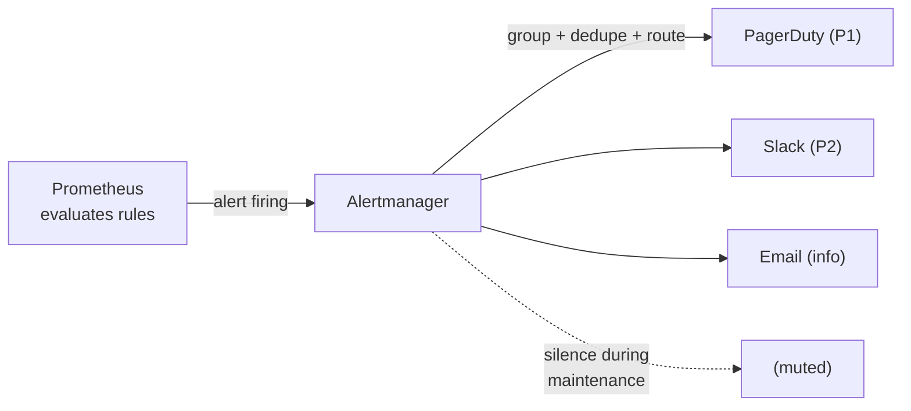
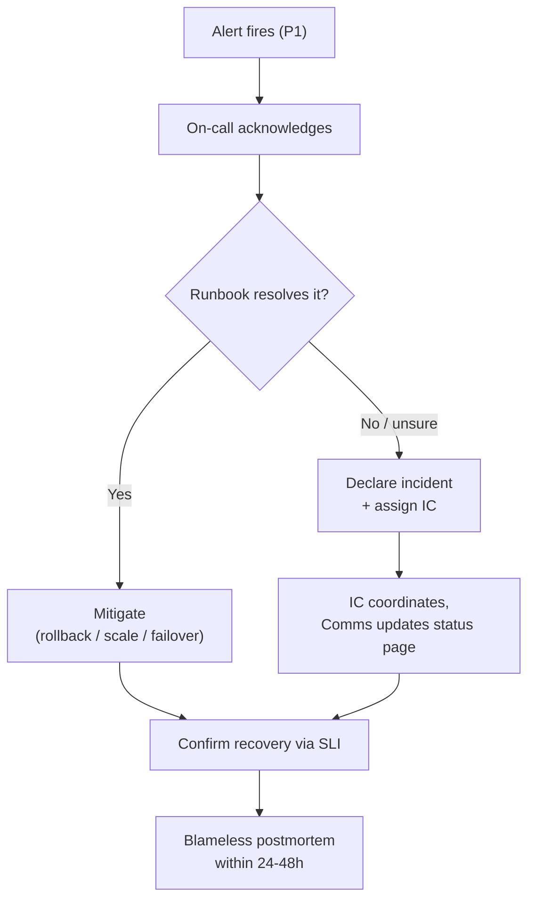

# Day 27 — Alerting & SRE

> Series: Cloud & DevOps Engineering
> Goal: Turn your observability (Days 25-26) into a reliability practice — define what "good enough" means with SLOs, alert only on things that hurt users, run humane on-call, and learn from failure without blaming people.

---

## Table of Contents
1. [Observability is not reliability](#recap)
2. [SLI, SLO, error budget](#sli-slo)
3. [A worked example (99.9% availability)](#worked)
4. [Alert on symptoms, not causes](#symptoms)
5. [Alert fatigue: the silent killer](#fatigue)
6. [Prometheus alerting + Alertmanager](#alerting)
7. [On-call, runbooks, incident response](#oncall)
8. [Blameless postmortems](#postmortem)
9. [PagerDuty vs Opsgenie](#paging)
10. [Build vs buy: Prometheus/Grafana vs Datadog](#build-buy)
11. [Lab](#lab)
12. [Self-Check](#self-check)
13. [Tomorrow](#tomorrow)

---

## 1. Observability is not reliability <a name="recap"></a>

Days 25-26 gave you *visibility* — metrics, logs, traces. But a system you can *see* failing is still failing. **SRE (Site Reliability Engineering)** — Google's discipline for running services — is how you turn visibility into *reliability*: agreeing on targets, alerting on the right things, responding calmly, and improving after every incident.

The core SRE mindset: **reliability is a feature with a budget, not a goal of "100%."** 100% is the wrong target — it's infinitely expensive and users can't even perceive it. The job is to be *reliable enough* while still shipping fast. That tension is what SLOs and error budgets resolve.

You met SLI/SLO in System Design Day 20. Today we make them operational.

---

## 2. SLI, SLO, error budget <a name="sli-slo"></a>

**In plain words:** An **SLI** is a *measurement* of how good the service is right now ("99.95% of requests succeeded today"). An **SLO** is the *target* you promise ("99.9% should succeed"). The **error budget** is the gap you're *allowed* to burn ("0.1% may fail — that's your budget for risk").

| Term | Full name | Is | Example |
|------|-----------|-----|---------|
| **SLI** | Service Level *Indicator* | A measured number | "99.95% of requests < 300ms this week" |
| **SLO** | Service Level *Objective* | Your internal target | "99.9% of requests < 300ms" |
| **SLA** | Service Level *Agreement* | Contract with $ penalties | "99.5% or we refund 10%" |
| **Error budget** | 100% − SLO | Allowed failure | 0.1% = ~43 min/month |

- **Why:** Without an agreed target, "is it reliable?" is an endless argument. An SLO makes it a number. The error budget makes reliability a *currency*: spend it on risky deploys and new features; when it's gone, you stop shipping and stabilize.
- **What:** Pick a few user-centric SLIs (availability, latency), set SLOs slightly above what users need, track the budget.
- **When:** For every user-facing service. Internal batch jobs get looser SLOs; the payment path gets strict ones.
- **How:** Compute SLIs from your Prometheus metrics (Day 25); alert when you're *burning budget too fast*.
- **Where:** Defined jointly by engineering + product; tracked on a Grafana SLO dashboard.

> 🤔 **"Why not just aim for 100% uptime? Isn't more reliability always better?"**
> No — and this is the most important idea in SRE. Each extra "nine" costs exponentially more (redundancy, review gates, slower releases) while users literally cannot tell 99.99% from 100% over their network. Worse, chasing 100% means *never taking risks* — no fast deploys, no experiments. The **error budget** reframes it: you have permission to fail 0.1% of the time, so *spend* that budget on velocity. Reliability and speed aren't enemies; the budget is the negotiated peace treaty between them.

✅ **Good scenario (where it saves you):** Product wants to ship a risky feature Friday. You check the SLO dashboard: 80% of this month's error budget is still unspent. Green light — if it breaks a little, you're within budget. Data replaces argument.

❌ **Bad scenario (without it):** No SLO. Every incident becomes a shouting match about whether "5 minutes of errors" was acceptable. Ops wants a freeze; product wants features; nobody has a number to point at. Reliability decisions become politics.

**When NOT to:** Don't set SLOs you don't measure — an SLO with no SLI feeding it is theater. And don't copy 99.99% from a blog; derive the target from what *your* users actually need.

---

## 3. A worked example (99.9% availability) <a name="worked"></a>

Let's make the error budget concrete. Say your SLO is **99.9% availability** over 30 days.

```
Error budget = 100% − 99.9% = 0.1% of the time allowed to fail.

Minutes in 30 days     = 30 × 24 × 60          = 43,200 minutes
Error budget (0.1%)    = 0.001 × 43,200        ≈ 43.2 minutes / month
```

So you may be "down" (or failing your SLO) for about **43 minutes a month** and still hit target. Compare the nines:

| SLO | Downtime / month | Downtime / year |
|-----|------------------|-----------------|
| 99% ("two nines") | ~7.2 hours | ~3.65 days |
| 99.9% ("three nines") | ~43 min | ~8.76 hours |
| 99.95% | ~21.6 min | ~4.38 hours |
| 99.99% ("four nines") | ~4.3 min | ~52.6 min |
| 99.999% ("five nines") | ~26 sec | ~5.26 min |

**Budget-burn framing for a request-based SLI.** If you serve 10M requests/month at a 99.9% success SLO, you're allowed `0.001 × 10,000,000 = 10,000` failed requests this month. A 5-minute incident that fails 3,000 requests just spent 30% of your budget. Now you can *decide* with data: slow down, or keep shipping.

```promql
# SLI: success ratio over 30 days (availability)
sum(rate(http_requests_total{status!~"5.."}[30d]))
  /
sum(rate(http_requests_total[30d]))
# Compare to 0.999. Below target => budget exhausted => freeze risky changes.
```

> 🤔 **"We hit 99.9% last month, so we're done — reliability is solved."**
> SLOs are a *rolling* commitment, not a trophy. Last month's budget resets; a bad deploy this week can burn a month's budget in an hour. The value isn't the certificate — it's the ongoing *decision loop*: are we burning budget too fast *right now*? That's what drives alerting (section 6) and the ship/freeze call. Treat the SLO as a live gauge, not a report card.

---

## 4. Alert on symptoms, not causes <a name="symptoms"></a>

**In plain words:** Alert on what the *user* feels (symptom: "checkout is failing"), not on every internal thing that *might* cause it (cause: "CPU is 85%"). High CPU with happy users is not an emergency. Failing checkout with idle CPU very much is.

- **Why:** Cause-based alerts fire constantly on conditions that don't hurt anyone (a brief CPU spike, one pod restart), training you to ignore alerts. Symptom-based alerts fire only when users are actually harmed — so every page means something.
- **What:** Page on SLO-threatening symptoms: elevated error rate, high latency, budget burning fast. Make *causes* into dashboards and context, not pages.
- **How:** Alert on the golden signals (Day 25): error rate, latency, saturation-of-user-impact — with **burn-rate** alerting tied to the SLO.

| Alert on (symptom) | Don't page on (cause) |
|--------------------|-----------------------|
| Error rate > SLO threshold | CPU > 80% (no user impact) |
| p99 latency > 300ms | A single pod restarted |
| Error budget burning fast | Memory at 70% |
| Endpoint returning 5xx | Disk 60% full (unless *filling fast*) |

```promql
# SYMPTOM alert: multi-window burn rate (Google SRE style).
# Fire if we're burning the 30-day budget 14.4x too fast over both a fast (5m)
# and slow (1h) window — catches real, sustained user pain, ignores blips.
(
  sum(rate(http_requests_total{status=~"5.."}[5m])) / sum(rate(http_requests_total[5m])) > 0.001 * 14.4
) and (
  sum(rate(http_requests_total{status=~"5.."}[1h])) / sum(rate(http_requests_total[1h])) > 0.001 * 14.4
)
```

> 🤔 **"But CPU at 90% *causes* outages — shouldn't I get paged for it?"**
> Put it on a *dashboard* and maybe a low-priority *ticket*, not a 3am *page*. High CPU with users unaffected is not an incident — it's context you'll want *after* a symptom fires. If high CPU is genuinely about to hurt users, your latency/error SLI will move, and *that* pages you. Paging on causes = paging on maybes = alert fatigue (next section). Page on user pain; investigate causes once awake.

✅ **Good scenario:** You page only on SLO burn rate. One quiet week, zero pages — because nothing hurt users, even though pods restarted and CPU spiked. On-call actually sleeps, and trusts that a page is real.

❌ **Bad scenario (the pain of cause-alerting):** A team alerts on CPU, memory, disk, pod restarts, and 20 other causes. On-call gets 40 pages a night, 39 harmless. They start ignoring the pager. The one page that was a real outage gets snoozed at 3am. **Cause-alerting caused the outage it was meant to prevent.**

**When NOT to:** A *few* cause-based alerts are legitimate when the cause is a guaranteed near-future symptom with no other signal — e.g. "disk will be full in 4 hours" (`predict_linear`, Day 25), certificate expiring in 7 days. These are "act before users feel it" cases, and they should be rare and high-confidence.

---

## 5. Alert fatigue: the silent killer <a name="fatigue"></a>

**In plain words:** If the pager cries wolf, humans stop listening. Alert fatigue is when so many low-value alerts fire that responders become numb — and miss the real one. It's a *reliability* problem disguised as a *human* problem.

- **Why it matters:** Every noisy alert erodes trust in the whole system. A pager that's 90% noise is worse than no pager, because it creates false confidence *and* burnout.
- **How to fight it:**
  - **Every alert must be actionable.** If there's nothing to do, it's not an alert — it's a metric. Delete it or make it a dashboard.
  - **Every alert links a runbook** (section 7). No runbook, no page.
  - **Route by severity.** Page (wake someone) only for user-impacting symptoms; everything else goes to a ticket queue or a Slack channel.
  - **Group and dedupe** (Alertmanager does this) so one incident is one page, not 200.
  - **Review alerts regularly.** Track which fire most and whether anyone acted. Prune ruthlessly.

| Severity | Channel | Wakes someone? | Example |
|----------|---------|----------------|---------|
| **Critical (P1)** | Page (phone) | Yes, now | Checkout down, SLO burning fast |
| **Warning (P2)** | Slack / ticket | No | Latency elevated but within budget |
| **Info** | Dashboard only | No | Deploy happened, cache flushed |

> 🤔 **"Isn't it safer to over-alert? Better to be paged for nothing than miss something."**
> That intuition is exactly backwards and it's how good teams burn out. Over-alerting *guarantees* you miss things, because responders learn the pager is usually noise and mentally filter it — including the real page. Reliability comes from a pager you *trust*, where every buzz means "a human is needed now." Fewer, sharper alerts = faster real response. Safety comes from signal, not volume.

✅ **Good scenario:** After an alert audit, a team cuts 60 alerts to 8, each actionable with a runbook. Pages drop 90%, mean-time-to-respond *improves* because every page is now believed and acted on immediately.

❌ **Bad scenario:** A "temporary" debug alert fires every 10 minutes for a month. On-call auto-acknowledges it reflexively. When a *real* alert arrives worded similarly, they auto-ack that too. Outage extends 45 minutes. **Muscle memory built on noise.**

---

## 6. Prometheus alerting + Alertmanager <a name="alerting"></a>

**In plain words:** Prometheus evaluates alert *rules* (PromQL that's true = firing). It hands firing alerts to **Alertmanager**, which does the human-facing part: grouping, deduping, silencing, and routing to the right channel (page, Slack, email).


*Prometheus decides WHAT is wrong; Alertmanager decides WHO gets told and HOW.*

```yaml
# alert-rules.yml — loaded by Prometheus. Note: symptom-based, tied to SLO.
groups:
  - name: slo-alerts
    rules:
      - alert: HighErrorRateBurn
        expr: |                       # burn-rate expression from section 4
          sum(rate(http_requests_total{status=~"5.."}[5m]))
            / sum(rate(http_requests_total[5m])) > 0.001 * 14.4
        for: 2m                        # must persist 2m to avoid flapping on blips
        labels:
          severity: critical           # -> routes to the pager in Alertmanager
        annotations:
          summary: "Checkout burning error budget 14x too fast"
          runbook: "https://runbooks.internal/checkout-error-rate"  # ALWAYS
          dashboard: "https://grafana.internal/d/checkout"

      - alert: TargetDown
        expr: up{job="checkout"} == 0
        for: 1m
        labels: { severity: critical }
        annotations: { summary: "Checkout target not scraping — is it down?" }
```

```yaml
# alertmanager.yml — routing, grouping, and dedupe (the anti-fatigue layer)
route:
  group_by: ["alertname", "service"]   # collapse many firing series into one notice
  group_wait: 30s                      # wait to batch related alerts
  group_interval: 5m
  repeat_interval: 4h                  # don't re-page the same thing constantly
  receiver: slack-warnings             # default channel
  routes:
    - matchers: ["severity=critical"]  # criticals escalate to the pager
      receiver: pagerduty-critical
      continue: false
receivers:
  - name: pagerduty-critical
    pagerduty_configs:
      - service_key: "<PD_INTEGRATION_KEY>"   # store as a secret (Day 28!), not here
  - name: slack-warnings
    slack_configs:
      - api_url: "<SLACK_WEBHOOK>"
        channel: "#alerts"
```

```bash
# Reload rules without restart; validate before shipping
promtool check rules alert-rules.yml     # lint the rules file in CI
curl -X POST http://localhost:9090/-/reload   # hot-reload Prometheus config
```

> 🤔 **"Why do I need Alertmanager? Prometheus already knows the alert is firing."**
> Because *detecting* an alert and *notifying humans well* are different jobs. Without Alertmanager, one bad deploy firing across 200 pods = 200 separate notifications at once. Alertmanager groups those into a single "checkout is down" page, dedupes repeats, lets you *silence* alerts during planned maintenance, and routes by severity. It's the layer that keeps section 5's fatigue at bay. Prometheus finds fires; Alertmanager runs the fire department.

**When NOT to:** Don't put `for: 0s` on flappy metrics — you'll page on transient blips. Use `for:` to require the condition to *persist*. And never hardcode integration keys in the config (that's Day 28).

---

## 7. On-call, runbooks, incident response <a name="oncall"></a>

**In plain words:** **On-call** is a rotation where one engineer is responsible for responding to pages. A **runbook** is a written recipe for a known problem so the responder doesn't improvise at 3am. **Incident response** is the choreographed way you handle a live outage.

**On-call, done humanely:**
- Rotate weekly, small teams (never one hero). Follow-the-sun for global teams.
- **Compensate it.** On-call is work; unpaid heroics breed burnout and attrition.
- A page must be *actionable* and *linked to a runbook* (sections 5-6). If on-call can't act, the alert is broken, not the person.

**Runbooks** — the on-call's best friend:
```markdown
## Runbook: Checkout error rate high (P1)
1. Confirm impact: Grafana dashboard "checkout" — is error rate really > SLO?
2. Recent change? Check deploys in last 30m (`kubectl rollout history`, Day 21).
3. If a bad deploy: `kubectl rollout undo deploy/checkout -n prod`  # instant rollback
4. Check downstream: is the payment gateway trace (Day 26) showing timeouts?
5. If DB: check connection pool saturation (USE method, Day 25).
6. Still broken after 15m or unsure? ESCALATE to secondary on-call + notify #incident.
7. Post-incident: open a postmortem doc (section 8) within 24h.
```

**Incident response roles (for bigger incidents):**
- **Incident Commander (IC):** coordinates, decides, does *not* fix — keeps the big picture.
- **Ops/Responder:** actually investigates and mitigates.
- **Comms/Scribe:** updates status page and stakeholders, records the timeline.


*Ack → runbook → mitigate or escalate → confirm via metrics → learn.*

> 🤔 **"Runbooks go stale — why bother writing them if they rot?"**
> Because a *slightly* stale runbook at 3am beats a blank page and a panicking engineer every time. And staleness is fixable: every incident's postmortem (section 8) has an action item to *update the runbook you just used*. The runbook improves precisely when it's exercised. A living runbook is one of the highest-leverage docs a team owns — it turns tribal knowledge into a repeatable, delegable procedure (this is exactly the kind of thing your ops runbook practice covers).

✅ **Good scenario:** A junior on-call gets paged for a known DB-pool exhaustion. The runbook says "scale the pool, restart, escalate if not fixed in 15m." They resolve it in 8 minutes without waking a senior. The recipe made a junior as effective as an expert.

❌ **Bad scenario:** No runbooks. Every incident requires the one senior who "knows the system." She goes on vacation; an outage lasts 3 hours because nobody else can navigate it. **Tribal knowledge is a single point of failure.**

**When NOT to:** Don't write runbooks for problems you should *fix permanently* instead. If a manual "restart the stuck worker every night" runbook exists, the real fix is automating away the bug — a runbook that runs nightly is a bug ticket in disguise.

---

## 8. Blameless postmortems <a name="postmortem"></a>

**In plain words:** After an incident, you write up what happened and why — focusing on *systems and process*, never on punishing a person. The goal is to make the *same failure impossible next time*, not to find someone to blame.

- **Why blameless:** If people fear blame, they hide mistakes, and you lose the information you need to improve. Psychological safety is a *reliability tool*: engineers who feel safe report near-misses, and you fix them before they become outages.
- **What's in one:** Timeline, impact (how much error budget burned), root cause(s), what went well, what went badly, and **concrete action items with owners and dates**.
- **The mantra:** *"Human error is a symptom of a system that allowed it."* If one wrong command took down prod, the fix isn't "be more careful" — it's "why did the system let one command do that?"

```markdown
# Postmortem: Checkout outage 2026-07-24 (P1, 22 min)
**Impact:** 22 min, ~4,100 failed checkouts. Burned 41% of July error budget.
**Timeline (UTC):**
- 14:01 Deploy v2.8 of checkout.
- 14:03 Error-rate burn alert fires (worked as designed).
- 14:06 On-call acks, opens runbook.
- 14:11 Identified bad DB migration in v2.8.
- 14:23 `kubectl rollout undo` — recovery confirmed via SLI at 14:25.
**Root cause:** Migration added a non-null column without a default; old pods errored.
**What went well:** Symptom alert fired fast; runbook rollback worked.
**What went badly:** Migration wasn't backward-compatible; no pre-deploy check caught it.
**Action items (owner, due):**
- [ ] Add CI check rejecting non-backward-compatible migrations (@alice, Aug 1)
- [ ] Runbook: add "check recent migrations" step (@bob, Jul 28)
- [ ] Adopt expand/contract migration pattern (@team, Aug 15)
```

> 🤔 **"Someone clearly messed up the deploy — isn't 'blameless' just letting them off the hook?"**
> Blameless ≠ accountability-free. It means you hold the *system* accountable, not the individual, because that's what actually prevents recurrence. Punishing the engineer who ran the deploy teaches everyone to hide mistakes — and the *next* person hits the same trap, because the trap is still there. The accountable, mature move is: "our process let a bad migration reach prod; here's how we make that structurally impossible." You fix the road, not the driver who hit the pothole everyone hits.

✅ **Good scenario:** A blameless postmortem produces a CI gate that blocks unsafe migrations. The *class* of incident never recurs. The engineer who caused it wrote the fix — because they felt safe owning it publicly.

❌ **Bad scenario:** Leadership blames the on-call engineer publicly. Next quarter, three near-misses go unreported because everyone's scared. One becomes a major outage nobody saw coming. **Blame buys silence, and silence buys outages.**

---

## 9. PagerDuty vs Opsgenie <a name="paging"></a>

**In plain words:** Alertmanager can email or Slack you, but for *waking a human at 3am with escalation* you want a dedicated incident platform. These manage on-call schedules, escalation policies (if primary doesn't ack in 5 min, page secondary), and incident timelines.

| Feature | PagerDuty | Opsgenie (Atlassian) |
|---------|-----------|---------------------|
| Core job | On-call scheduling, escalation, paging | Same |
| Ecosystem | Standalone, huge integration catalog | Tight Jira/Atlassian integration |
| Escalation policies | Yes, mature | Yes |
| Incident management | Rich (roles, comms, analytics) | Solid |
| Pricing | Premium | Often cheaper, bundled with Atlassian |
| Pick when | You want the market-leading incident platform | You already live in Jira/Confluence |

Both do the same essentials: **schedule → escalate → acknowledge → resolve → report**. Alertmanager (section 6) routes `severity=critical` alerts to them; they handle the human escalation chain.

```yaml
# Alertmanager -> PagerDuty (the P1 path from section 6)
receivers:
  - name: pagerduty-critical
    pagerduty_configs:
      - service_key: "<from a secret store, Day 28>"
        severity: critical
        description: "{{ .CommonAnnotations.summary }}"
```

✅ **Good scenario:** Primary on-call is asleep and misses the ack. After 5 minutes the escalation policy auto-pages the secondary, then the manager. The incident gets a responder in 6 minutes instead of festering till morning.

❌ **Bad scenario (misused):** Every P2 warning is wired to PagerDuty's phone-call escalation. On-call gets called at 3am for "latency slightly elevated, within budget." Section 5 fatigue, now with a ringing phone. **Reserve the phone call for things worth waking up for.**

**When NOT to:** A tiny team with business-hours-only service may not need a paid pager at all — a Slack channel with `@here` might suffice. Don't buy enterprise incident tooling before you have enterprise incident volume.

---

## 10. Build vs buy: Prometheus/Grafana vs Datadog <a name="build-buy"></a>

**In plain words:** You can *build* your observability from open-source parts (Prometheus + Grafana + Loki + Jaeger + Alertmanager — Days 25-27) and run them yourself, or *buy* an all-in-one SaaS like **Datadog** that does metrics + logs + traces + alerting in one product for a per-host/per-GB fee.

| Dimension | Build (Prometheus/Grafana/Loki/Jaeger) | Buy (Datadog / New Relic / Grafana Cloud) |
|-----------|----------------------------------------|-------------------------------------------|
| Upfront cost | Low $ (open-source), high *time* | Zero setup, high recurring $ |
| Ops burden | You run/scale/upgrade it | Vendor runs it |
| Integration | You wire the pillars together | Pre-integrated, one UI |
| Cost at scale | Predictable infra cost | Can balloon fast (per-host + per-GB logs) |
| Data control | Fully yours, on-prem possible | Data leaves to vendor |
| Lock-in | Low (open standards, OTel) | Higher (proprietary agents/queries) |
| Best for | Cost-sensitive, large scale, k8s-native, in-house expertise | Small teams, speed-to-value, no ops appetite |

- **Build** when: you have platform engineers, you're at a scale where SaaS bills hurt, you want data on-prem, or you're deeply k8s-native (kube-prometheus-stack is basically turnkey now).
- **Buy** when: you're a small/fast team, engineer time is more precious than SaaS dollars, and you'd rather ship product than run Elasticsearch clusters.

> 🤔 **"Datadog costs a fortune — building it ourselves is obviously cheaper, right?"**
> Only if you don't count *your own time*. Self-hosting Prometheus + Loki + Jaeger + Alertmanager means you now operate, scale, upgrade, and get paged for your *monitoring stack itself* — who watches the watchmen? For a 5-engineer startup, a Datadog bill is often cheaper than the fully-loaded cost of an engineer babysitting Elasticsearch. At 500 engineers and huge log volume, the math flips hard the other way. It's a genuine TCO calculation, not a slogan — and **OpenTelemetry (Day 26) is your insurance either way**, because instrumenting with OTel lets you switch backends without re-instrumenting.

✅ **Good scenario (buy):** A 6-person startup wires Datadog agents in an afternoon and gets metrics, logs, traces, and paging immediately. They ship product instead of running observability infra. Worth every dollar at their stage.

❌ **Bad scenario (buy, at scale):** A 300-engineer company ships terabytes of DEBUG logs (they skipped Day 26 discipline) to Datadog. The bill hits seven figures. **Buying doesn't excuse you from log discipline and sampling.**

**When NOT to:** Don't build a bespoke observability platform as a 3-person team "to save money" — you'll spend your runway operating Prometheus instead of finding product-market fit. And don't reflexively buy at 500 engineers without modeling the bill.

---

## 11. Lab <a name="lab"></a>

**Goal:** Define an SLO and wire a symptom-based Prometheus alert that respects it.

**Step 1 — write the SLO.** For the checkout service:
```
SLO: 99.9% of checkout requests succeed (non-5xx), measured over 30 days.
Error budget: 0.1% ≈ 43 min/month ≈ 10,000 failed requests at 10M/month volume.
```

**Step 2 — SLI query** (paste into Prometheus, Day 25 setup):
```promql
# current 30-day success ratio — is it above 0.999?
sum(rate(http_requests_total{status!~"5.."}[30d]))
  / sum(rate(http_requests_total[30d]))
```

**Step 3 — burn-rate alert rule** (`alert-rules.yml`):
```yaml
groups:
  - name: checkout-slo
    rules:
      - alert: CheckoutErrorBudgetBurn
        expr: |
          sum(rate(http_requests_total{status=~"5.."}[5m]))
            / sum(rate(http_requests_total[5m])) > 0.001 * 14.4
        for: 2m
        labels: { severity: critical }
        annotations:
          summary: "Checkout burning 30-day budget 14.4x too fast"
          runbook: "https://runbooks.internal/checkout-errors"
```
```bash
promtool check rules alert-rules.yml         # validate before shipping
# Point Prometheus at it (rule_files: in prometheus.yml), then reload:
curl -X POST http://localhost:9090/-/reload
```

**Step 4 — route it** with Alertmanager (`alertmanager.yml` from section 6): critical → Slack webhook (use a real test channel).

**Step 5 — prove it fires.** Make your Day 25 lab app return 500s for a couple of minutes, watch the alert go from *pending* → *firing* on `http://localhost:9090/alerts`, and see the Slack message land.

**Stretch:** Write the one-page runbook for this alert (section 7 template) and link it in the annotation. Then draft a mock blameless postmortem (section 8) for the incident you just simulated.

---

## 12. Self-Check <a name="self-check"></a>

1. Define SLI, SLO, SLA, and error budget in one line each.
2. Why is 100% the wrong reliability target? What does the error budget let you *do*?
3. 99.9% over 30 days — how many minutes of budget is that? Show the math.
4. Give one symptom you'd page on and one cause you would *not* page on, and why.
5. What is alert fatigue and what are three concrete ways to fight it?
6. What job does Alertmanager do that Prometheus does not?
7. Why must every page link a runbook? What makes a runbook "living" instead of stale?
8. Explain "blameless" without meaning "no accountability."
9. PagerDuty/Opsgenie add what capability beyond Alertmanager's Slack/email?
10. Build vs buy: name the hidden cost of "build" and the failure mode of "buy at scale."

---

## 13. Tomorrow <a name="tomorrow"></a>

Your alerting configs just referenced "store the PagerDuty key as a secret" three times — and we kept dodging *how*. Tomorrow — **Day 28: Secrets Management** — we face it head-on: the "secrets in Git" disaster (with real incidents), where secrets *should* live, Vault vs AWS Secrets Manager vs SSM Parameter Store, rotation, and how to inject secrets into containers, Kubernetes, and CI pipelines without leaking them (revisiting the k8s Secrets caveat from Day 22).
