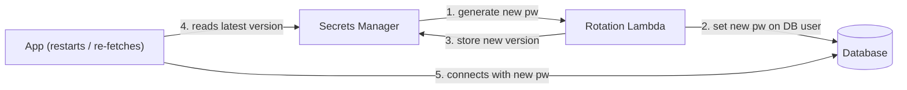

# Day 28 — Secrets Management

> Series: Cloud & DevOps Engineering
> Goal: Stop credentials from ever touching Git, put them where they belong (a real secret store), rotate them, and inject them into containers, Kubernetes, and CI at runtime — so a leaked repo or a stolen laptop doesn't hand over your database.

---

## Table of Contents
1. [Why secrets are their own discipline](#recap)
2. [The "secrets in Git" disaster](#git-disaster)
3. [Where secrets should live](#where)
4. [Vault vs AWS Secrets Manager vs SSM Parameter Store](#compare)
5. [Rotation](#rotation)
6. [Injecting secrets into containers](#containers)
7. [Kubernetes Secrets (the Day 22 caveat, resolved)](#k8s)
8. [Secrets in CI/CD](#ci)
9. [Least privilege for secrets (IAM Day 13)](#least-priv)
10. [Lab](#lab)
11. [Self-Check](#self-check)
12. [Tomorrow](#tomorrow)

---

## 1. Why secrets are their own discipline <a name="recap"></a>

A **secret** is any credential that grants access: database passwords, API keys, TLS private keys, OAuth client secrets, signing keys, the PagerDuty integration key you kept deferring in Day 27. Lose one and an attacker walks straight through your IAM (Day 13), your infra (Terraform Day 17), and your data.

Secrets are different from config. Config (a feature flag, a log level, a hostname) can live in Git — it's not sensitive. Secrets **cannot**, ever, in plaintext. This day is about the gap between "the app needs the DB password at runtime" and "the DB password must never be written down anywhere an attacker can read it."

This builds directly on the AI course security days ("never log secrets/PII," Day 26) and IAM least-privilege (Day 13).

---

## 2. The "secrets in Git" disaster <a name="git-disaster"></a>

**In plain words:** Committing a secret to Git is like writing your house key's cut-pattern on the front door. Git never forgets — even if you delete the line and force-push, the secret lives in history, in every clone, in every fork, in the reflog, and (for public repos) in the caches of a dozen bots that scrape GitHub within *seconds* of a push.

- **Why it's catastrophic:** Git is distributed history. `git rm` + commit does *not* remove it — the old blob is still reachable. Anyone who ever cloned has it. Public-repo secrets are scanned and abused by automated bots **within minutes**. Rotating the secret is the *only* real remediation; scrubbing history is secondary cleanup.
- **What actually happens:** AWS keys committed to public repos have led to attackers spinning up thousands of dollars of crypto-mining GPU instances *within hours* — a whole genre of incident. Uber's 2016 breach traced to credentials in a private repo. These aren't hypotheticals; they're a recurring headline.
- **How they get there:** A hardcoded `password = "..."`, a committed `.env` file, an AWS key pasted into a config, a `terraform.tfvars` with the DB password, a Kubernetes manifest with a base64 "secret" (section 7).

```bash
# ❌ The disaster in three lines
echo 'DB_PASSWORD=hunter2' >> .env       # secret in a file...
git add .env                             # ...staged...
git commit -m "add db config"            # ...now in history FOREVER, in every clone

# Deleting it later does NOT help — the blob is still in history:
git rm .env && git commit -m "oops"      # secret is STILL reachable via old commits
```

**Defenses (layered):**
```bash
# 1. .gitignore secrets and env files from day one
printf ".env\n*.tfvars\n*.pem\ncredentials.json\n" >> .gitignore

# 2. Pre-commit secret scanning (blocks the commit locally)
pip install detect-secrets
detect-secrets scan > .secrets.baseline
# add a pre-commit hook so 'git commit' fails if a new secret appears

# 3. gitleaks in CI (Day 29 covers this fully) — fails the pipeline on a leak
gitleaks detect --source . --redact --exit-code 1
```

> 🤔 **"I force-pushed to remove the secret and rewrote history — so it's gone and safe now, right?"**
> No. Assume it was captured the instant it was pushed. Rewriting history doesn't recall the clones, forks, CI logs, or scraper caches that already saw it. The **only** correct response to a leaked secret is: **rotate it immediately** (invalidate the old one, issue a new one), *then* clean history as hygiene. If you rewrite history and skip rotation, you've hidden the evidence while leaving the door unlocked. Treat every committed secret as compromised, period.

✅ **Good scenario:** A pre-commit `detect-secrets` hook blocks a developer's accidental `AWS_SECRET_ACCESS_KEY=` before it ever leaves their laptop. Zero exposure, five-second fix.

❌ **Bad scenario (the classic):** An intern commits an AWS key to a public repo Friday evening. By Saturday, bots have launched 200 GPU instances mining crypto in three regions. Monday's bill is $48,000 (foreshadowing Day 30's "bill doubled overnight" question). The key was in history for 40 hours. **Every minute a live secret sits in a repo is a minute an attacker can use it.**

**When NOT to (invert):** There is no acceptable case for a plaintext secret in Git. The only debate is *which* scanning layers you stack, never *whether*.

---

## 3. Where secrets should live <a name="where"></a>

**In plain words:** Secrets belong in a **purpose-built secret store** — a vault that encrypts them at rest, controls *who* can read *which* secret via fine-grained access policies, logs every access, and hands them out at *runtime* to the app that needs them. Never in code, never in images, never in plain env files checked into anything.

**The hierarchy, worst to best:**

| Where | Verdict |
|-------|---------|
| Hardcoded in source | ☠️ Never |
| Committed `.env` / config file | ☠️ Never |
| Baked into a Docker image | ☠️ Never (image layers are readable; `docker history` shows them) |
| Plain env var set by a human on a box | ⚠️ Better than Git, still weak (leaks to logs, `ps`, crash dumps) |
| CI/CD encrypted secrets | ✅ OK for pipeline-time secrets (Day 29) |
| **Dedicated secret store** (Vault / Secrets Manager / SSM) | ✅✅ The answer |

**What a proper secret store gives you:**
- **Encryption at rest** (and in transit).
- **Access control** — IAM/policy says exactly which identity can read which secret (Day 13 least privilege).
- **Audit log** — every read is recorded (who, when).
- **Rotation** — change the value without touching apps (section 5).
- **Runtime injection** — the secret reaches the app as a memory value at start/request time, never persisted in the repo or image.

> 🤔 **"An environment variable isn't in Git — isn't that already secure enough?"**
> It's a rung up, but env vars leak in ways people forget: they appear in `/proc/<pid>/environ`, in `docker inspect`, in crash dumps, in error trackers that capture the environment, and often get printed by well-meaning debug logging (Day 26). More importantly, a bare env var has *no access control, no rotation, no audit* — if someone can read the process, they have the secret forever. A secret store gives you the *governance*: who read it, when, and the ability to revoke. Env-var *injection from a store at runtime* is fine; env vars *as your source of truth* is not.

✅ **Good scenario:** Your app fetches the DB password from AWS Secrets Manager at startup using its IAM role (Day 13). The secret is never in the repo, never in the image, and every read is logged. Rotate it and pods pick up the new value on restart — no redeploy of code.

❌ **Bad scenario (baked into image):** A team `ENV DB_PASSWORD=...` in their Dockerfile "for convenience." Anyone who can `docker pull` the image runs `docker history` and reads it in plaintext from the layer metadata. The image is in a registry a hundred people can access. **Images are not private; treat them as public artifacts.**

**When NOT to:** Don't reach for Vault for a hobby project's single API key — that's over-engineering. Match store sophistication to blast radius (section 4).

---

## 4. Vault vs AWS Secrets Manager vs SSM Parameter Store <a name="compare"></a>

**In plain words:** Three common stores. **HashiCorp Vault** is the powerful, cloud-agnostic Swiss Army knife (also does *dynamic* secrets). **AWS Secrets Manager** is the managed, rotation-friendly AWS-native option. **SSM Parameter Store** is the cheaper, simpler AWS option (config + secrets) without built-in rotation.

| Dimension | HashiCorp Vault | AWS Secrets Manager | SSM Parameter Store |
|-----------|-----------------|--------------------|--------------------|
| Hosting | Self-host or HCP (managed) | Fully managed AWS | Fully managed AWS |
| Cloud lock-in | None (multi/hybrid cloud) | AWS | AWS |
| Built-in rotation | Yes + **dynamic secrets** | Yes (Lambda-driven) | No (DIY) |
| Dynamic/short-lived creds | Yes (its superpower) | No | No |
| Cost | Ops cost (self-host) or HCP fee | ~$0.40/secret/mo + API | Free (standard) / cheap (advanced) |
| Complexity | High (you run it) | Low | Lowest |
| Audit | Rich | CloudTrail | CloudTrail |
| Best for | Multi-cloud, dynamic creds, high security bar | AWS-native apps needing rotation | AWS-native, cost-sensitive, config+simple secrets |

**Vault's killer feature — dynamic secrets:** instead of a long-lived DB password, Vault generates a *fresh, short-lived* credential per app/session and auto-revokes it. A leaked credential is useless in an hour. That's a different security posture entirely.

```bash
# AWS Secrets Manager — store and read (managed, AWS-native)
aws secretsmanager create-secret \
  --name prod/checkout/db \
  --secret-string '{"username":"app","password":"S3cr3t!"}'   # JSON payload

aws secretsmanager get-secret-value \
  --secret-id prod/checkout/db \
  --query SecretString --output text        # app reads this at runtime via its IAM role
```

```bash
# SSM Parameter Store — SecureString is KMS-encrypted; cheaper, no auto-rotation
aws ssm put-parameter --name /prod/checkout/db_password \
  --value 'S3cr3t!' --type SecureString      # encrypted with KMS

aws ssm get-parameter --name /prod/checkout/db_password \
  --with-decryption --query Parameter.Value --output text
```

```bash
# Vault — dynamic database credentials (short-lived, auto-revoked)
vault read database/creds/checkout-role
# -> returns a username/password valid for e.g. 1h, then Vault revokes it. A leak
#    of that credential expires itself. This is Vault's dynamic-secrets superpower.
```

> 🤔 **"They all store secrets — why not always pick the most powerful one, Vault?"**
> Because power has an operational tax. Self-hosting Vault means you now run, seal/unseal, back up, and secure a *critical* cluster whose downtime locks every app out of its secrets — you've added a high-stakes system to babysit. For an AWS-only shop that just needs encrypted, rotatable secrets, **Secrets Manager** gives 90% of the value with zero ops. Reach for Vault when you genuinely need its differentiators: multi-cloud, or *dynamic* short-lived credentials. Match the tool to the threat model, not to the feature list.

✅ **Good scenario (Vault dynamic):** A high-security fintech uses Vault dynamic DB creds. Every service gets a unique 1-hour credential. When a pod is compromised, the stolen credential expires before the attacker can pivot. Blast radius: minutes.

❌ **Bad scenario (over/under-fit):** A 4-person startup self-hosts Vault, misconfigures the unseal keys, and one day the Vault cluster restarts and won't unseal — *every* service is locked out of its secrets simultaneously. A managed store would have had no such failure mode. **Don't run critical infra you can't operate.**

---

## 5. Rotation <a name="rotation"></a>

**In plain words:** Rotation = regularly changing a secret's value (and immediately after any suspected leak). A password that changes every 30 days is a moving target; a static one that's been the same for 3 years is a gift to anyone who ever glimpsed it.

- **Why:** Limits the *window* a leaked secret is useful. Rotation turns "compromised forever" into "compromised until next rotation." It's also a compliance requirement (SOC2/PCI).
- **What:** Scheduled rotation (e.g. every 30-90 days) + immediate rotation on incident. The store generates a new value, updates the source (e.g. the DB user's password), and serves the new value to apps.
- **How:** Managed stores automate it; Secrets Manager runs a rotation Lambda; Vault issues short-lived creds so rotation is *continuous by design*.
- **Where:** DB passwords, API keys, TLS certs, signing keys — anything long-lived.

```bash
# AWS Secrets Manager — turn on automatic rotation (a Lambda changes DB + secret)
aws secretsmanager rotate-secret \
  --secret-id prod/checkout/db \
  --rotation-lambda-arn arn:aws:lambda:...:function:SecretsManagerRDSRotation \
  --rotation-rules AutomaticallyAfterDays=30    # rotate monthly, hands-off
```


*Rotation swaps the credential everywhere without a human copy-pasting it into config.*

> 🤔 **"Rotation is risky — if I change the password, won't every app break?"**
> Only if you rotate *naively*. The safe pattern is **overlap**: create the new credential, let apps pick it up (both old and new valid briefly), *then* retire the old one — so there's no gap where nothing works. Managed rotation (Secrets Manager) and Vault dynamic secrets handle this handshake for you. The alternative — *never* rotating because it's scary — means a single leak is permanent. Automated, overlapped rotation is far less risky than a static secret rotting for years.

✅ **Good scenario:** A secret is suspected leaked in a log (Day 26). Because rotation is one command and apps re-fetch on restart, you rotate in 2 minutes and the leaked value is dead. Incident closed.

❌ **Bad scenario:** A DB password hasn't changed in 4 years and is hardcoded in 6 services. A departed employee still knows it. Rotating means a coordinated redeploy of all 6 with downtime, so nobody dares. **Un-rotatable secrets are a debt that compounds.**

**When NOT to:** Don't rotate so aggressively that apps spend more time reconnecting than serving — match cadence to risk. And don't rotate manually at scale; if it isn't automated, it won't happen.

---

## 6. Injecting secrets into containers <a name="containers"></a>

**In plain words:** The container needs the secret at *runtime*, but it must not be *in* the image. So you inject it when the container starts — as an env var pulled from the store, a mounted file, or fetched by the app on boot.

**Ways to inject, best-ish to worst:**

```bash
# ❌ WORST: baked into the image (readable via `docker history`)
# Dockerfile:  ENV DB_PASSWORD=hunter2      <-- never do this

# ⚠️ OK for local dev only: pass at runtime (not in image, but visible in inspect)
docker run -e DB_PASSWORD="$(aws secretsmanager get-secret-value \
  --secret-id prod/checkout/db --query SecretString --output text)" myapp
# ^ fetched from the store, injected as env at launch — not stored in the image

# ✅ BETTER: app fetches from the store itself at startup, using its IAM role.
# The container image contains ONLY code; the credential to reach the store is the
# instance/task IAM role (Day 13) — no secret material in the image at all.
```

```python
# In-app fetch at startup — image ships zero secrets, only the SDK + IAM role
import boto3, json
def load_db_secret():
    sm = boto3.client("secretsmanager")
    raw = sm.get_secret_value(SecretId="prod/checkout/db")["SecretString"]
    return json.loads(raw)          # {"username":..., "password":...}
# The app's IAM role grants ONLY secretsmanager:GetSecretValue on THIS secret (Day 13)
```

> 🤔 **"If the container fetches the secret with an IAM role, isn't the role itself a secret I have to inject?"**
> No — and this is the elegant part. On AWS, the ECS task or EC2 instance (or EKS pod via IRSA) gets an IAM *role* automatically via the instance metadata service, with *no long-lived key* to inject anywhere. The SDK transparently obtains short-lived, auto-rotating credentials from the metadata endpoint. So the "secret to get the secret" is a temporary, machine-issued token you never handle. That's why role-based access (Day 13) is the foundation of secret injection: it removes the bootstrap secret entirely.

**When NOT to:** Don't inject secrets as build-time `ARG`/`ENV` — build args land in image layers and history. Runtime only.

---

## 7. Kubernetes Secrets (the Day 22 caveat, resolved) <a name="k8s"></a>

**In plain words:** Kubernetes has a `Secret` object, but here's the trap from Day 22: **base64 is not encryption.** A default k8s Secret is just base64-encoded (trivially reversible) and, unless you turn it on, stored *unencrypted* in etcd. Anyone with etcd or broad API access can read every secret.

```yaml
# A k8s Secret — the "opaque" value is base64, NOT encrypted
apiVersion: v1
kind: Secret
metadata: { name: db-secret }
type: Opaque
data:
  password: aHVudGVyMg==      # <-- this is just base64("hunter2"), decode instantly:
                              #     echo aHVudGVyMg== | base64 -d  ->  hunter2
```
```bash
echo aHVudGVyMg== | base64 -d      # prints: hunter2   (see? not secret at all)
```

**How to make k8s Secrets actually safe:**

1. **Enable encryption at rest for etcd** (EncryptionConfiguration with a KMS provider) — so the stored blob is truly encrypted, not just base64.
2. **RBAC least privilege** (Day 13/22) — only the pods/service accounts that need a secret can `get` it.
3. **Never commit the Secret YAML to Git** — the base64 is plaintext. Use one of:
   - **External Secrets Operator (ESO):** syncs from AWS Secrets Manager / Vault into k8s Secrets automatically, so the source of truth stays in the real store.
   - **Sealed Secrets (Bitnami):** encrypt the secret so the *encrypted* form is safe to commit; only the in-cluster controller can decrypt.
   - **Vault Agent / CSI Secrets Store driver:** mount secrets from Vault/Secrets Manager directly as files, never creating a k8s Secret at all.

```yaml
# External Secrets Operator — source of truth is AWS Secrets Manager, synced into k8s
apiVersion: external-secrets.io/v1beta1
kind: ExternalSecret
metadata: { name: db-secret }
spec:
  refreshInterval: 1h                    # re-sync (picks up rotations, section 5)
  secretStoreRef: { name: aws-sm, kind: ClusterSecretStore }
  target: { name: db-secret }            # creates/updates a k8s Secret named db-secret
  data:
    - secretKey: password                # key in the resulting k8s Secret
      remoteRef:
        key: prod/checkout/db            # the AWS Secrets Manager secret
        property: password
```

```yaml
# Consume it in a pod as an env var (value comes from the synced Secret)
spec:
  containers:
    - name: app
      image: myapp:1.4.2
      env:
        - name: DB_PASSWORD
          valueFrom:
            secretKeyRef: { name: db-secret, key: password }
```


*Real store stays the source of truth; ESO syncs into an encrypted k8s Secret; rotation flows through automatically.*

> 🤔 **"kubectl create secret encrypts my password, right? It says 'Secret'."**
> It does *not* — the name is misleading. By default it's **base64 encoded** (a format, not a cipher) and stored in etcd. Base64 is reversible by anyone in one command, as the snippet above shows. To actually protect it you must (a) enable etcd encryption-at-rest, (b) lock down RBAC, and (c) keep the real secret in an external store synced via ESO/CSI. Treat a raw k8s Secret as "obfuscated," never "encrypted." This is the single most common k8s security misunderstanding.

✅ **Good scenario:** ESO syncs from Secrets Manager, etcd encryption is on, RBAC scopes each secret to its one service account. Rotation in Secrets Manager (section 5) propagates to pods within the refresh interval. Nothing sensitive is ever in Git.

❌ **Bad scenario (Day 22 trap realized):** A team commits `secret.yaml` with base64 "encrypted" passwords to their GitOps repo, thinking it's safe. It's plaintext to anyone with repo access — which is the whole engineering org. **base64 in Git is the same disaster as section 2, just wearing a costume.**

**When NOT to:** Don't hand-manage k8s Secret YAML at scale — use ESO/Sealed Secrets/CSI so the source of truth is the real store and rotation flows automatically.

---

## 8. Secrets in CI/CD <a name="ci"></a>

**In plain words:** Your pipeline (GitHub Actions, Day 10) needs secrets too — to push images, deploy to k8s, call cloud APIs. These go in the CI platform's *encrypted secret store*, injected as masked env vars at runtime, never printed, never committed.

- **Why:** CI runs untrusted-ish code and logs everything; a secret echoed in a build log is leaked to everyone who can read the run.
- **How:** Store in GitHub Actions Secrets / OIDC federation; reference via `${{ secrets.X }}`; the platform masks them in logs.
- **Best practice 2026 — OIDC, not stored keys:** Instead of storing long-lived AWS keys in CI, use **OIDC federation** — the pipeline exchanges a short-lived signed token for temporary AWS credentials via an IAM role (Day 13). No static cloud keys in CI at all.

```yaml
# GitHub Actions — OIDC federation: NO stored AWS keys, short-lived creds instead
permissions:
  id-token: write        # allow the workflow to request an OIDC token
  contents: read
jobs:
  deploy:
    runs-on: ubuntu-latest
    steps:
      - uses: aws-actions/configure-aws-credentials@v4
        with:
          role-to-assume: arn:aws:iam::123456789:role/ci-deployer  # trusts GitHub OIDC
          aws-region: us-east-1
          # ^ no aws-access-key-id / secret — creds are minted short-lived per run

      - name: Use a repo secret safely (masked in logs automatically)
        env:
          REGISTRY_TOKEN: ${{ secrets.REGISTRY_TOKEN }}   # encrypted, never printed
        run: ./deploy.sh          # NEVER: run: echo "$REGISTRY_TOKEN"  (leaks to log)
```

> 🤔 **"CI secrets are stored encrypted by GitHub — so I can just echo them to debug, they're masked, right?"**
> Masking is a safety net, not a strategy — and it's defeatable. Split a secret across lines, base64 it, or pass it to a command that reformats it, and the masker misses it, dumping plaintext into a public log. Never *intentionally* print a secret. And prefer **OIDC** over stored keys entirely: a short-lived credential minted per run can't be exfiltrated for later use the way a stored static AWS key can. Fewer standing secrets = smaller attack surface. (Day 29 adds secret-scanning to catch leaks in CI.)

✅ **Good scenario:** The deploy pipeline uses OIDC — zero static cloud keys stored anywhere. Even if the repo is compromised, there's no long-lived AWS key to steal; the worst an attacker gets is a role scoped to exactly what CI needs (Day 13).

❌ **Bad scenario:** A team stores a broad `AdministratorAccess` AWS key as a CI secret. A malicious dependency in the build (Day 29 supply chain) exfiltrates it. Now an attacker has admin over the whole account. **A stored key is a standing liability; scope it tight or eliminate it with OIDC.**

**When NOT to:** Don't grant CI roles more than the pipeline needs (least privilege, section 9). A deploy pipeline needs deploy permissions, not admin.

---

## 9. Least privilege for secrets (IAM Day 13) <a name="least-priv"></a>

**In plain words:** Every identity should be able to read *only the secrets it actually needs* — nothing more. The checkout service reads the checkout DB secret and no others. This is IAM least privilege (Day 13) applied to the secret store.

- **Why:** It bounds the blast radius. If checkout is compromised, the attacker gets *one* secret, not the whole vault. Broad read access turns any single breach into a total breach.
- **How:** Scope IAM policies / Vault policies to specific secret paths and specific principals.

```json
// IAM policy: this role may read ONLY the checkout DB secret (Day 13 least privilege)
{
  "Version": "2012-10-17",
  "Statement": [{
    "Effect": "Allow",
    "Action": "secretsmanager:GetSecretValue",
    "Resource": "arn:aws:secretsmanager:us-east-1:123456789:secret:prod/checkout/db-*"
  }]
  // NOT "Resource": "*"  <-- that would let one breach read every secret you own
}
```

> 🤔 **"It's easier to give every service read on all secrets and be done — they're all internal anyway."**
> That single `Resource: "*"` is how a minor breach becomes a company-ending one. If any one service with wildcard secret access is popped, the attacker drains *every* credential — database, payment keys, signing keys — in one call. Scoping each identity to its own secret means a compromise is contained to that service's blast radius. The five extra minutes to write a tight policy is the difference between "one service leaked" and "the entire company's secrets exfiltrated." Least privilege isn't bureaucracy; it's blast-radius insurance (Day 13).

✅ **Good scenario:** Tight per-service policies plus audit logs. A compromised analytics pod can read *only* the analytics read-replica secret. Payment keys are untouchable from it. The incident is annoying, not existential.

❌ **Bad scenario:** All services share one IAM role with `secretsmanager:GetSecretValue` on `*`. One SSRF bug in a low-value service leaks the *entire* secret store. **Wildcard access converts any hole into the deepest hole.**

**When NOT to:** Don't scope so granularly that you drown in unmanageable policies for a 3-service app — use sensible grouping (per-service, per-environment). Least privilege, not zero usability.

---

## 10. Lab <a name="lab"></a>

**Goal:** Store a DB password in AWS Secrets Manager and inject it into a container at runtime — never touching Git or the image.

**Step 1 — store the secret:**
```bash
aws secretsmanager create-secret \
  --name prod/lab/db \
  --secret-string '{"username":"app","password":"S3cr3t-Rotate-Me!"}'
```

**Step 2 — scope an IAM policy (least privilege, section 9):**
```bash
# Attach to the task/instance role a policy allowing GetSecretValue on ONLY this ARN
aws iam put-role-policy --role-name lab-app-role \
  --policy-name read-lab-db --policy-document '{
    "Version":"2012-10-17",
    "Statement":[{"Effect":"Allow","Action":"secretsmanager:GetSecretValue",
    "Resource":"arn:aws:secretsmanager:us-east-1:'"$ACCOUNT"':secret:prod/lab/db-*"}]}'
```

**Step 3 — app fetches at startup (no secret in image):**
```python
import boto3, json, os
sm = boto3.client("secretsmanager")
creds = json.loads(sm.get_secret_value(SecretId="prod/lab/db")["SecretString"])
print("connecting as", creds["username"])   # never print the password!
# use creds["password"] to connect; it lived only in memory, never on disk or in Git
```

**Step 4 — confirm nothing leaked:**
```bash
grep -r "S3cr3t" .              # should find NOTHING in your source tree
git log -p | grep -i "S3cr3t"   # should find NOTHING in history
docker history myapp:lab | grep -i "S3cr3t"   # should find NOTHING in image layers
```

**Step 5 — rotate and observe:**
```bash
aws secretsmanager put-secret-value --secret-id prod/lab/db \
  --secret-string '{"username":"app","password":"NEW-S3cr3t!"}'
# Restart the app -> it fetches the NEW value with zero code/image changes.
```

**Stretch (k8s):** Install External Secrets Operator, create an `ExternalSecret` (section 7) that syncs `prod/lab/db` into a k8s Secret, and consume it via `secretKeyRef`. Then base64-decode the k8s Secret to *prove* to yourself it's not encrypted by default — the whole point of section 7.

---

## 11. Self-Check <a name="self-check"></a>

1. Why does deleting a committed secret and force-pushing *not* fix a leak? What's the only real fix?
2. Rank these worst→best: baked in image, dedicated secret store, hardcoded in source, plain env var.
3. Name three things a proper secret store gives you that a plain env var does not.
4. Vault vs Secrets Manager vs SSM — which offers *dynamic* short-lived credentials, and why does that shrink blast radius?
5. What does "overlap" mean in rotation and why does it avoid downtime?
6. On AWS, what is the "secret to get the secret" and why isn't it actually a secret you inject?
7. A k8s Secret's value looks like `aHVudGVyMg==`. Is it encrypted? Prove your answer.
8. Name two tools that make k8s secrets actually safe and what each does.
9. What is OIDC federation in CI and why is it better than a stored AWS key?
10. Why is `Resource: "*"` on `GetSecretValue` a blast-radius disaster?

---

## 12. Tomorrow <a name="tomorrow"></a>

We've been sprinkling security controls across every day — scan for secrets, scope IAM, don't log PII. Tomorrow — **Day 29: DevSecOps** — we make security a *pipeline stage*, not an afterthought: shift-left, image scanning (Trivy), dependency scanning (Snyk), IaC scanning (tfsec/Checkov on your Terraform from Day 17), secret scanning in CI, supply-chain security (SBOM, image signing with cosign), and least-privilege everywhere (Day 13). Then Day 30 ties the whole 30-day journey into one capstone.
