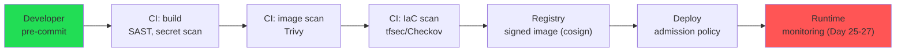
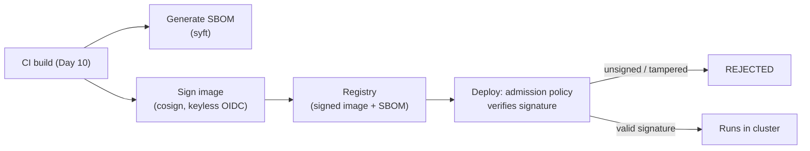
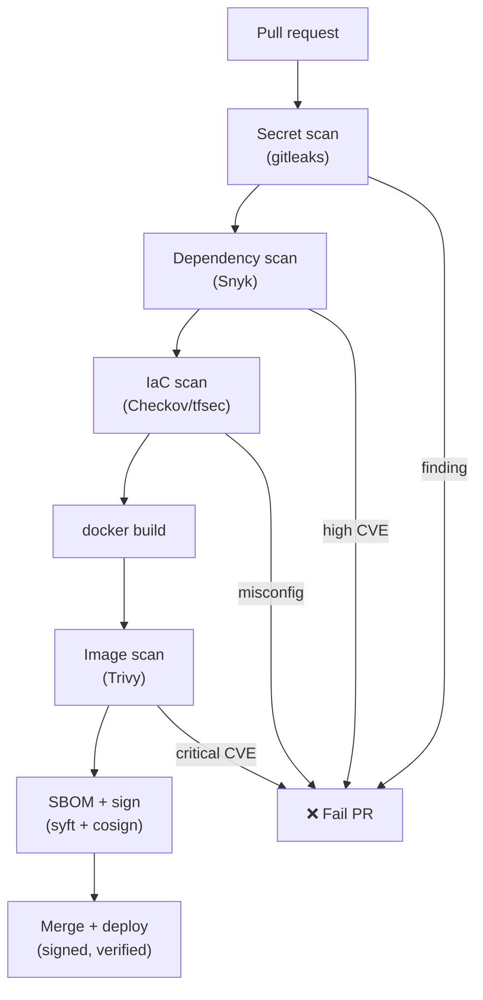

# Day 29 — DevSecOps

> Series: Cloud & DevOps Engineering
> Goal: Move security *left* — into the pipeline — so vulnerabilities, leaked secrets, and misconfigured infra are caught by automated gates at commit and build time, not by an attacker in production.

---

## Table of Contents
1. [Security as a pipeline stage](#recap)
2. [Shift-left security](#shift-left)
3. [Image scanning (Trivy)](#trivy)
4. [Dependency scanning (Snyk)](#snyk)
5. [IaC scanning (tfsec / Checkov)](#iac)
6. [Secret scanning in CI](#secret-scan)
7. [Supply-chain security: SBOM & signing (cosign)](#supply-chain)
8. [Least privilege everywhere (IAM Day 13)](#least-priv)
9. [Putting it in the pipeline](#pipeline)
10. [Lab](#lab)
11. [Self-Check](#self-check)
12. [Tomorrow](#tomorrow)

---

## 1. Security as a pipeline stage <a name="recap"></a>

**In plain words:** Traditional security was a gate at the *end* — a security team that reviewed things right before launch and said "no." DevSecOps folds security *into* the development pipeline (Day 10) as automated checks that run on every commit, so security is everyone's job, continuous, and fast.

You've already met the pieces scattered across the course: don't log secrets (Day 26), keep secrets out of Git (Day 28), least-privilege IAM (Day 13). Today we assemble them into a *pipeline* — a set of automated gates that fail the build when something's insecure, the same way a failing test does.

The theme: **security controls are just tests.** A test checks correctness; a security gate checks safety. Both belong in CI (Day 10), both should be fast, both should fail loudly and early.

---

## 2. Shift-left security <a name="shift-left"></a>

**In plain words:** "Left" is early in the timeline (code → build → deploy → prod, drawn left to right). Shifting left means catching problems as far left as possible — ideally at the developer's keyboard — because the cost of fixing a vulnerability grows exponentially the further right it's found.

- **Why:** A bug caught in a pre-commit hook costs seconds. The same bug caught in prod after a breach costs incident response, customer notification, regulatory fines, and reputation. Same defect, wildly different price.
- **What:** Automated security checks at every stage: IDE/pre-commit → CI (build) → registry → deploy → runtime.
- **When:** Continuously, on every change. Not a quarterly pentest (those still matter, but they're the backstop, not the front line).
- **How:** Scanners wired into pre-commit hooks and CI (Day 10) that fail the pipeline on findings.
- **Where:** Every layer — code, dependencies, images, IaC, secrets.


*Cheaper to fix on the green (left) end than the red (right) end — shift the checks left.*

**The cost-of-fix curve:**
| Found at | Relative cost to fix |
|----------|---------------------|
| Developer's IDE / pre-commit | 1x |
| CI build | ~5x |
| Staging / QA | ~10x |
| Production | ~30x |
| After a breach | ~100x+ (fines, notification, reputation) |

> 🤔 **"Won't security gates in CI just slow every developer down and block shipping?"**
> Only if you configure them badly. Done right, shift-left *speeds you up*: a scanner that flags a critical CVE in 20 seconds at commit time saves the days you'd lose to an incident later. The keys are (1) **fail only on high/critical**, not every informational finding, so gates aren't noise (same lesson as alert fatigue, Day 27); (2) make them *fast* (seconds, cached); (3) give developers the fix inline. A well-tuned gate is like a good linter — invisible until it saves you. A badly-tuned one that blocks on 400 low findings is the security equivalent of a flaky test, and teams rightly disable it.

✅ **Good scenario:** A Trivy gate blocks a base image with a critical `openssl` CVE at build time. The developer bumps the base image tag in 5 minutes. That vulnerability never reaches a registry, let alone prod.

❌ **Bad scenario (without shift-left):** Security is a manual review right before launch. The team has already built everything on a vulnerable base image and a leaky IAM policy. "Fixing it" now means re-architecting under deadline pressure — so it ships anyway with a "we'll fix it later" that becomes next quarter's breach.

**When NOT to:** Don't gate the pipeline on *every* low/medium finding on day one — you'll train everyone to bypass the gate. Start by failing on critical/high, ratchet stricter over time.

---

## 3. Image scanning (Trivy) <a name="trivy"></a>

**In plain words:** Your Docker image (Day 7) is built from a base image plus OS packages plus your app's dependencies — any of which can carry known vulnerabilities (CVEs). Image scanning inventories everything in the image and cross-checks it against vulnerability databases, so you know *before shipping* if you're carrying a known hole.

- **Why:** Most of your image is code you didn't write (the base OS, system libraries). A `python:3.11` image from six months ago has accumulated CVEs. You need to know.
- **What:** **Trivy** (Aqua Security, open-source, the 2026 default) scans container images, filesystems, and even IaC/secrets. Fast, no server, one binary.
- **When:** On every image build in CI (Day 10), and periodically re-scan pushed images (new CVEs are disclosed daily against images that didn't change).
- **How:** `trivy image <ref>`, fail the build on HIGH/CRITICAL.
- **Where:** CI pipeline, right after `docker build`.

```bash
# Scan an image for OS + library vulnerabilities
trivy image myapp:1.4.2

# CI gate: fail the pipeline ONLY on HIGH/CRITICAL that have a fix available
trivy image \
  --severity HIGH,CRITICAL \      # ignore LOW/MEDIUM noise (tune over time)
  --ignore-unfixed \             # don't fail on CVEs with no patch yet (unactionable)
  --exit-code 1 \                # non-zero -> fails the CI job
  myapp:1.4.2

# Also scans your filesystem and IaC — Trivy is multi-purpose
trivy fs --scanners vuln,secret,misconfig .   # deps + leaked secrets + IaC in one pass
```

> 🤔 **"I scanned my image and it passed — so it's secure, right?"**
> Passing a scan means *no known CVEs in the databases today*, not "secure." Three gaps: (1) **zero-days** aren't in any database yet; (2) a CVE disclosed *tomorrow* against your unchanged image means yesterday's pass is stale — that's why you *re-scan pushed images on a schedule*, not just at build; (3) scanning finds *known package* vulns, not *your* logic bugs (that's SAST's job). A green scan is a necessary hygiene floor, not a security guarantee. Keep the base image slim (distroless/alpine) to shrink the attack surface in the first place (Day 7).

✅ **Good scenario:** Trivy runs on every build *and* nightly against the deployed image. A newly-disclosed critical CVE in a base library trips the nightly scan; you rebuild and redeploy within the SLA, ahead of any exploit wave.

❌ **Bad scenario:** A team scans once at build, never again. Their year-old image accumulates a dozen critical CVEs that were disclosed *after* the build. They're wide open and their green build badge gives false confidence. **A scan is a point-in-time snapshot; threats are continuous.**

**When NOT to:** Don't fail builds on unfixable CVEs (`--ignore-unfixed`) — blocking on something with no patch just teaches teams to disable the gate. Track those separately.

---

## 4. Dependency scanning (Snyk) <a name="snyk"></a>

**In plain words:** Your app pulls in dozens of third-party libraries (npm, pip, Maven), each pulling in *their* dependencies — the "transitive" tree. Any of them can have a known vulnerability. Dependency scanning (Software Composition Analysis, SCA) reads your lockfile, walks the whole tree, and flags vulnerable packages, often with a one-click upgrade fix.

- **Why:** Modern apps are ~80% third-party code. The Log4Shell (Log4j) crisis was a single transitive dependency that put the entire internet at risk. You must know your dependency tree's exposure.
- **What:** **Snyk** (developer-first SCA, the common 2026 choice) or open-source alternatives (`npm audit`, Trivy's SCA, OWASP Dependency-Check, GitHub Dependabot). Scans manifests/lockfiles against vuln databases.
- **When:** On every PR (Day 10) and continuously (Snyk re-scans and opens PRs when a new CVE hits an existing dependency).
- **How:** `snyk test` in CI; `snyk monitor` for continuous watch.

```bash
# Test the project's dependency tree against known vulnerabilities
snyk test --severity-threshold=high      # fail the build on high+ severity

# Continuous monitoring: Snyk re-checks and alerts/PRs when NEW CVEs land
snyk monitor                             # snapshots deps for ongoing watch

# Open-source alternatives you can use for free
npm audit --audit-level=high             # Node's built-in SCA
trivy fs --scanners vuln .               # Trivy also does dependency scanning
```

| Scan type | Looks at | Catches | Tools |
|-----------|----------|---------|-------|
| **Image scan** | Built container (OS + libs) | Vulnerable OS packages, base image CVEs | Trivy |
| **Dependency scan (SCA)** | Source lockfiles/manifests | Vulnerable app libraries + transitive | Snyk, Dependabot, npm audit |
| **SAST** | Your source code | Your own logic bugs (injection, etc.) | Semgrep, CodeQL, Snyk Code |

> 🤔 **"I don't use that vulnerable library directly — I only depend on something that depends on it. Not my problem, right?"**
> It is entirely your problem. **Transitive dependencies run in your process with your privileges.** Log4Shell hit thousands of apps that never wrote `import log4j` — it arrived four layers deep through something they *did* import. Attackers exploit *your running code*, and they don't care whose name is in your `package.json`. This is why SCA walks the *whole* tree, and why pinning lockfiles (Day 7 reproducible builds) matters: you can only secure a dependency graph you can actually see.

✅ **Good scenario:** Snyk opens an automated PR bumping a transitive dependency the day a critical CVE is disclosed. You review and merge in minutes. You were patched before most of the industry even noticed.

❌ **Bad scenario (Log4Shell class):** No SCA. A critical RCE lands in a transitive dependency. You have no inventory, so you can't even *tell* if you're affected — spending the crisis weekend manually grepping repos while attackers scan the internet for exactly your exposure.

**When NOT to:** Don't auto-merge dependency-bump PRs blindly — a compromised package update is itself a supply-chain attack (section 7). Review, and rely on lockfile pinning + tests.

---

## 5. IaC scanning (tfsec / Checkov) <a name="iac"></a>

**In plain words:** Your infrastructure is code now (Terraform, Day 17). Code can have security bugs — a wide-open security group, an unencrypted S3 bucket, a public database. IaC scanning statically analyzes your Terraform *before* `apply` and flags insecure configurations, catching a misconfigured firewall before it's ever provisioned.

- **Why:** The most common cloud breaches aren't exotic exploits — they're *misconfigurations*: a public S3 bucket, a `0.0.0.0/0` SSH rule, an unencrypted volume. IaC scanning catches these at code review, before they exist in the cloud.
- **What:** **tfsec** (fast, Terraform-focused, now part of Trivy) and **Checkov** (Bridgecrew/Prisma, multi-IaC: Terraform, CloudFormation, k8s, Dockerfile). Both ship hundreds of built-in policies.
- **When:** On every IaC PR (Day 10), before `terraform plan`/`apply` (Day 17).
- **How:** Run against your `.tf` files; fail on high-severity findings.

```bash
# tfsec — scan Terraform for insecure config (now under the Trivy umbrella)
tfsec ./infra                 # flags public buckets, open SGs, missing encryption
trivy config ./infra          # equivalent via Trivy's misconfig scanner

# Checkov — multi-framework IaC scanner, hundreds of policies
checkov -d ./infra                        # scan a directory of Terraform
checkov -d ./infra --compact --quiet \
  --check CKV_AWS_20,CKV_AWS_18            # run specific policies if you want
```

```hcl
# ❌ What IaC scanners catch — Terraform (Day 17) with insecure defaults
resource "aws_security_group_rule" "ssh" {
  type        = "ingress"
  from_port   = 22
  to_port     = 22
  protocol    = "tcp"
  cidr_blocks = ["0.0.0.0/0"]   # <-- tfsec: SSH open to the ENTIRE internet. Flagged.
}

resource "aws_s3_bucket" "data" {
  bucket = "my-app-data"
  # <-- checkov: no encryption, no public-access block. Flagged.
}
```

> 🤔 **"IaC scanning duplicates my cloud provider's own security checks — why run it too?"**
> Because the provider tells you *after* the misconfiguration is live in production — the door is already open, possibly for hours before anyone looks at Security Hub. IaC scanning tells you *in the pull request*, before `terraform apply` ever runs, so the insecure resource is never created. It's the difference between "we prevented the public bucket" and "we detected the public bucket (that was public for six hours)." Shift-left (section 2): catch it in the diff, not in the dashboard. Provider tools are the backstop; IaC scanning is the front line.

✅ **Good scenario:** Checkov blocks a PR that would have created a publicly-readable S3 bucket for customer uploads. The reviewer sees the finding inline, adds the encryption + public-access-block, and the bucket is born secure. The breach that never happened.

❌ **Bad scenario (real breach class):** No IaC scanning. A Terraform change opens a database security group to `0.0.0.0/0` "temporarily for debugging." It ships, nobody reverts it, and an internet scan finds the exposed DB within days. **The most common cloud breach is a misconfiguration a scanner would have caught in the diff.**

**When NOT to:** Don't blanket-suppress findings to make the scan pass — use inline `# tfsec:ignore` / `# checkov:skip` *with a justification comment* for genuine, reviewed exceptions only.

---

## 6. Secret scanning in CI <a name="secret-scan"></a>

**In plain words:** Day 28 was about keeping secrets out of Git. Secret scanning is the *automated enforcement* — a scanner that reads every commit/PR and fails the build if it finds something that looks like a credential (an AWS key pattern, a private key block, a high-entropy string).

- **Why:** Humans commit secrets by accident constantly (a `.env`, a pasted key). A scanner is the safety net that catches it before it merges — or, in a full-history scan, tells you what already leaked (Day 28's disaster).
- **What:** **gitleaks** and **TruffleHog** (open-source), plus GitHub's built-in **push protection** / secret scanning. They match known credential patterns and entropy.
- **When:** Pre-commit (local, Day 28), on every PR (CI), and as a full-history audit.
- **How:** `gitleaks detect` in CI; enable GitHub push protection so leaks are blocked *at push*.

```bash
# gitleaks — scan the working tree and full history for secrets
gitleaks detect --source . --redact --exit-code 1   # fails CI if a secret is found
#   --redact hides the matched value in output so the scan itself doesn't leak it

# TruffleHog — also VERIFIES if a found credential is actually live
trufflehog git file://. --only-verified               # reduces false positives

# Best of all: GitHub push protection blocks the secret AT push time (before CI)
#   Settings -> Code security -> Secret scanning -> Push protection: ON
```

```yaml
# .pre-commit-config.yaml — catch it on the developer's machine (leftmost, Day 2 shift)
repos:
  - repo: https://github.com/gitleaks/gitleaks
    rev: v8.21.0
    hooks:
      - id: gitleaks       # 'git commit' fails locally if a secret is detected
```

> 🤔 **"If a secret scanner catches it in CI, the damage is done — the secret's already in a commit. What's the point?"**
> Two points. (1) **Push protection** (GitHub/GitLab) blocks at *push*, so it never reaches the remote at all — that genuinely prevents exposure. (2) Even a CI-stage catch on a private repo turns a silent leak into a *known* leak you can remediate *immediately* (rotate, per Day 28) instead of discovering it months later in a breach. And a *full-history* scan is how you find the secrets committed before you had scanning — you can't rotate what you don't know leaked. Detection you act on beats blindness every time.

✅ **Good scenario:** GitHub push protection rejects a developer's push containing a Stripe key with a clear message. The developer removes it, moves the key to Secrets Manager (Day 28), and nothing ever hit the remote. Exposure: zero.

❌ **Bad scenario:** No scanning. An AWS key sits in a private repo's history for a year. An ex-contractor's still-cloned copy is the leak vector. The first anyone hears of it is a surprise $40k bill (Day 30's interview question). **What you don't scan for, you find out about from the attacker.**

**When NOT to:** Don't rely *only* on scanning and skip Day 28's discipline — scanning is the net, not the plan. Keep secrets out of Git by design; scan to catch the accidents.

---

## 7. Supply-chain security: SBOM & signing (cosign) <a name="supply-chain"></a>

**In plain words:** You need to trust that the image running in prod is *exactly* the one your pipeline built — not something an attacker swapped in the registry — and to know *everything* that's inside it. An **SBOM** (Software Bill of Materials) is the ingredient list. **Signing** (cosign) is the tamper-proof seal proving the image is authentic and unmodified.

- **Why:** Supply-chain attacks (SolarWinds, malicious npm packages, poisoned base images) compromise you through your *build inputs and artifacts*, not your code. An SBOM lets you answer "am I affected by CVE-X?" instantly. Signing prevents a swapped/tampered image from being deployed.
- **What:**
  - **SBOM** — a machine-readable inventory of every component + version in an artifact (SPDX or CycloneDX format).
  - **Image signing** — **cosign** (Sigstore project) cryptographically signs images; a k8s admission policy can *refuse to run unsigned images*.
  - **Provenance/attestation** (SLSA framework) — verifiable record of *how* the artifact was built.

```bash
# Generate an SBOM for an image (Syft; Trivy can also emit SBOMs)
syft myapp:1.4.2 -o cyclonedx-json > sbom.json   # the "ingredient list"
trivy image --format cyclonedx --output sbom.json myapp:1.4.2   # alt via Trivy

# Later: given a new CVE, query your SBOM instantly instead of guessing
grep -i "log4j" sbom.json        # am I affected? Answer in seconds, not a weekend

# Sign the image with cosign (keyless, via OIDC — no key to manage/leak, Day 28)
COSIGN_EXPERIMENTAL=1 cosign sign myapp:1.4.2

# Verify before deploy — fails if unsigned or tampered
cosign verify myapp:1.4.2 \
  --certificate-identity-regexp ".*" \
  --certificate-oidc-issuer https://token.actions.githubusercontent.com
```

```yaml
# k8s admission policy: REFUSE to run any image that isn't signed (Sigstore policy-controller)
# Only images with a valid cosign signature from our CI's OIDC identity may run.
apiVersion: policy.sigstore.dev/v1beta1
kind: ClusterImagePolicy
spec:
  images:
    - glob: "myregistry.io/myapp*"
  authorities:
    - keyless:
        identities:
          - issuer: https://token.actions.githubusercontent.com   # our CI (Day 10)
            subject: "https://github.com/myorg/myapp/.github/workflows/build.yml@refs/heads/main"
```


*SBOM answers "what's inside?"; signing + admission control answers "is this really ours?"*

> 🤔 **"My CI built the image and pushed it — of course prod runs my image. Why sign it?"**
> Because the gap between "your CI pushed it" and "prod pulled it" is a registry an attacker might compromise, a tag someone could re-point, or a mirror that could serve a poisoned copy. Signing + admission verification closes that gap cryptographically: the cluster runs the image *only* if it carries a valid signature from your CI's identity. Without it, "we deploy `myapp:latest`" trusts that nobody, anywhere in the chain, swapped what `latest` points to — a trust the SolarWinds victims also had. The SBOM is the complementary half: when the next Log4Shell drops, you *query* your exposure instead of *guessing* it.

✅ **Good scenario:** A new critical CVE drops. You query every service's SBOM and know in 10 minutes exactly which 3 services are affected. Meanwhile your admission policy has been silently rejecting a mis-tagged image someone accidentally tried to deploy. You're precise and protected.

❌ **Bad scenario:** No SBOMs, no signing. A CVE crisis hits and you spend two days manually auditing what's in each image. Separately, a compromised base image (poisoned upstream) runs in prod for weeks because nothing verified provenance. **You can't defend a supply chain you can't see or verify.**

**When NOT to:** Don't build a full SLSA-level-3 provenance program for a side project — start with SBOMs + basic signing, mature toward attestation as your risk grows.

---

## 8. Least privilege everywhere (IAM Day 13) <a name="least-priv"></a>

**In plain words:** Every identity — a human, a service, a CI pipeline, a pod — should have the *minimum* permissions to do its job and nothing more. This is the same IAM least-privilege principle from Day 13 and Day 28, applied as a *pervasive* posture, not a one-off. It's the control that bounds the damage of *every other* failure.

- **Why:** Least privilege is the blast-radius limiter. When (not if) something is compromised — a leaked key, a popped pod, a malicious dependency — least privilege decides whether the attacker gets *one service's data* or *the whole account*. It makes every other control's failure survivable.
- **What:** Scoped IAM roles (Day 13), scoped k8s RBAC (Day 22), scoped secret access (Day 28), scoped CI roles via OIDC (Day 28), read-only where possible, time-bound where possible.
- **Where:** Cloud IAM, k8s RBAC, database grants, CI/CD, secret stores — everywhere an identity meets a resource.

```json
// CI deploy role — scoped to deploy actions, NOT AdministratorAccess (Day 13/28)
{
  "Effect": "Allow",
  "Action": ["ecr:PutImage", "ecs:UpdateService", "eks:DescribeCluster"],
  "Resource": ["arn:aws:ecs:us-east-1:123:service/prod/checkout"]
  // NOT Action:"*" Resource:"*" — a compromised pipeline should not own the account
}
```

> 🤔 **"Least privilege is tedious to maintain — can't I grant broad access now and tighten it 'later'?"**
> "Later" is the word that precedes most breaches. Broad-now-tighten-later almost always stays broad, because nothing forces the tightening and it's invisible until exploited. The pragmatic path is the reverse: start from *deny*, grant exactly what breaks, and let the failures tell you the minimum needed (tools like AWS Access Analyzer can even *generate* least-privilege policies from observed usage). Yes it's more work up front — and it's the single highest-leverage security decision you make, because it caps the damage of every mistake in every other layer (Days 26-28). Every other control reduces the *chance* of compromise; least privilege reduces the *cost*.

✅ **Good scenario:** A malicious npm package (section 4) exfiltrates the CI role's credentials. But the role can only update *one* ECS service — the attacker can't touch secrets, other services, or IAM. The incident is contained to a re-deploy and rotation. Least privilege turned a catastrophe into a chore.

❌ **Bad scenario:** Every service and pipeline shares an admin role "to move fast." One SSRF bug in a minor service yields account-wide admin. The attacker reads every secret, spins up mining instances, and deletes backups. **Broad privilege converts any single failure into a total one.**

**When NOT to:** Don't over-fragment to the point of unmanageable policy sprawl — group sensibly (per-service, per-env). Least privilege, not zero productivity.

---

## 9. Putting it in the pipeline <a name="pipeline"></a>

Here's the whole DevSecOps toolkit assembled as GitHub Actions gates (Day 10) — this is what "shift-left" looks like concretely:

```yaml
# .github/workflows/security.yml — every check fails the build on real findings
name: security
on: [pull_request]
permissions:
  id-token: write        # for OIDC (Day 28) + keyless signing (cosign)
  contents: read
jobs:
  secops:
    runs-on: ubuntu-latest
    steps:
      - uses: actions/checkout@v4

      # 1. Secret scanning (section 6)
      - name: Gitleaks
        uses: gitleaks/gitleaks-action@v2

      # 2. Dependency scanning / SCA (section 4)
      - name: Snyk deps
        uses: snyk/actions/node@master
        with: { args: --severity-threshold=high }

      # 3. IaC scanning (section 5) — your Terraform from Day 17
      - name: Checkov
        uses: bridgecrewio/checkov-action@v12
        with: { directory: infra/, soft_fail: false }   # hard-fail on findings

      # 4. Build, then image scan (section 3)
      - name: Build
        run: docker build -t myapp:${{ github.sha }} .
      - name: Trivy image scan
        uses: aquasecurity/trivy-action@0.28.0
        with:
          image-ref: myapp:${{ github.sha }}
          severity: HIGH,CRITICAL
          ignore-unfixed: true
          exit-code: 1                          # fail the build on high/critical

      # 5. SBOM + signing (section 7) — only on main, after checks pass
      - name: Generate SBOM
        run: trivy image --format cyclonedx --output sbom.json myapp:${{ github.sha }}
      - name: Sign image (keyless)
        run: cosign sign --yes myapp:${{ github.sha }}
```


*Five gates, each fails the PR early — security is now just another set of tests.*

---

## 10. Lab <a name="lab"></a>

**Goal:** Add image scanning and IaC scanning to your CI pipeline (Day 10), and prove each gate catches a real problem.

**Step 1 — image scanning locally first:**
```bash
# Build a deliberately old base image and watch Trivy light up
cat > Dockerfile <<'EOF'
FROM python:3.9-slim         # older tag -> some known CVEs
COPY . /app
CMD ["python","/app/app.py"]
EOF
docker build -t lab-app:vuln .
trivy image --severity HIGH,CRITICAL lab-app:vuln    # see the findings
# Now bump to a current slim/distroless base, rebuild, rescan -> fewer/zero criticals
```

**Step 2 — IaC scanning:**
```bash
# A deliberately insecure Terraform snippet (Day 17)
mkdir infra && cat > infra/main.tf <<'EOF'
resource "aws_s3_bucket" "data" { bucket = "lab-data" }   # no encryption/public block
resource "aws_security_group_rule" "ssh" {
  type = "ingress"; from_port = 22; to_port = 22; protocol = "tcp"
  cidr_blocks = ["0.0.0.0/0"]                              # SSH to the world
}
EOF
tfsec infra/          # or: checkov -d infra/   -> both flag the two issues
# Fix them (add encryption + restrict CIDR), re-run, watch findings clear
```

**Step 3 — secret scanning:**
```bash
echo 'AWS_SECRET_ACCESS_KEY=AKIAIOSFODNN7EXAMPLEkey' > leak.env
gitleaks detect --source . --redact --exit-code 1   # non-zero: gate would fail CI
rm leak.env                                          # never commit it (Day 28)
```

**Step 4 — wire it into CI:** add the `security.yml` from section 9 to `.github/workflows/`. Open a PR that (a) uses an old base image and (b) has a `0.0.0.0/0` rule. Confirm the PR check fails on both. Fix them; confirm it goes green.

**Stretch:** Generate an SBOM (`trivy image --format cyclonedx`), then `grep` it for a package to simulate answering "are we affected by CVE-X?" in seconds. Then sign the image with `cosign` keyless.

---

## 11. Self-Check <a name="self-check"></a>

1. What does "shift-left" mean and why does the cost of a fix grow the further right you find it?
2. A Trivy scan passes. Name three reasons that does *not* mean "secure."
3. Why must dependency scanning walk *transitive* dependencies? Give the canonical example.
4. Image scanning vs SCA vs SAST — what does each look at?
5. Why run IaC scanning when your cloud provider already flags misconfigurations?
6. What does GitHub *push protection* do that a CI-stage secret scan does not?
7. What is an SBOM and what question does it let you answer instantly during a CVE crisis?
8. Why sign images with cosign if your own CI built and pushed them?
9. Least privilege reduces the *cost* of compromise, not the *chance* — explain the distinction.
10. Order the five pipeline gates from section 9 and say what each fails on.

---

## 12. Tomorrow <a name="tomorrow"></a>

You now have every piece: containers (Day 7), CI/CD (Day 10), IAM (Day 13), Terraform (Day 17), Kubernetes (Day 20-24), observability (Days 25-27), secrets (Day 28), and security gates (today). Tomorrow — **Day 30: Capstone + Interview Prep** — we assemble *all of it* into one end-to-end system: a sample app Dockerized, provisioned with Terraform, deployed to k8s via a CI/CD pipeline, monitored and alerted, with secrets managed and scanning enforced. Then we drill the interview questions that turn this knowledge into a job offer — and map your roadmap beyond the course.
