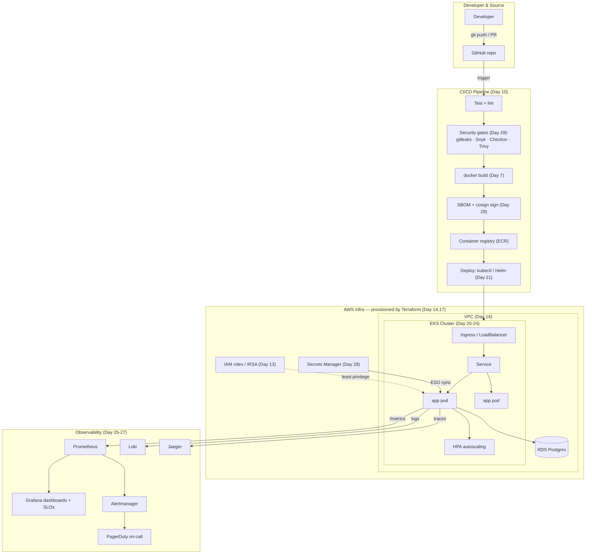
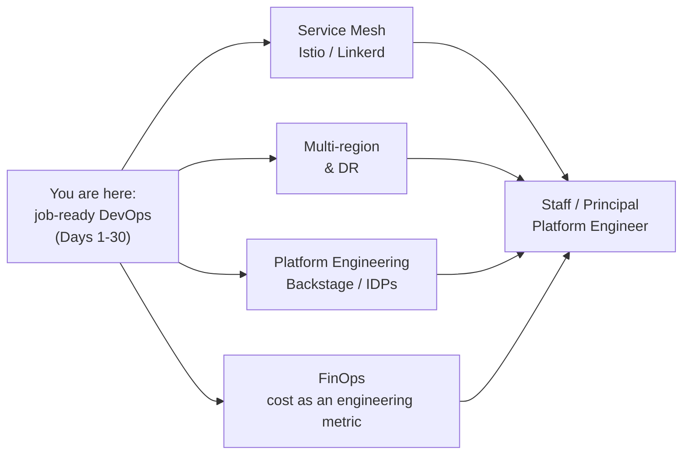

# Day 30 — Capstone + Interview Prep

> Series: Cloud & DevOps Engineering
> Goal: Assemble everything from the last 30 days into one production-grade system — then walk into a DevOps interview able to explain, defend, and debug it under pressure.

---

## Table of Contents
1. [What this day is](#what)
2. [The capstone: the whole course in one system](#capstone)
3. [Capstone architecture (big picture)](#architecture)
4. [Step-by-step build outline](#build)
5. [Interview prep: the questions that actually get asked](#interview)
   - [Q1: What happens when you `git push` to prod?](#q1)
   - [Q2: Design a CI/CD pipeline](#q2)
   - [Q3: How do you do zero-downtime deployment?](#q3)
   - [Q4: Debug a pod stuck in CrashLoopBackOff](#q4)
   - [Q5: Your bill doubled overnight — what do you check?](#q5)
   - [Q6: A service is slow. How do you find out why?](#q6)
   - [Q7: How do you keep secrets out of your pipeline?](#q7)
   - [Behavioral & rapid-fire round](#rapid)
6. [Gap-analysis template (all 9 stages)](#gap)
7. [The "beyond" roadmap](#beyond)
8. [Graduation: back to Day 1](#graduation)
9. [Self-Check](#self-check)

---

## 1. What this day is <a name="what"></a>

This is not a normal lab day. There is no single new concept. Instead we do the two things that turn 30 days of learning into a *job*:

1. **The Capstone** — a single system that uses every tool you've learned, wired together the way a real product company runs it. Building (or being able to *describe*) this end-to-end is what separates "I did some tutorials" from "I can run production."
2. **Interview Prep** — the questions interviewers actually ask, with model answers that show you understand the *why*, not just the commands. Plus a gap-analysis to find your weak spots and a roadmap for what's next.

Everything below cross-references the day it came from. If a section feels shaky, that's your gap-analysis (section 6) telling you where to review.

---

## 2. The capstone: the whole course in one system <a name="capstone"></a>

**In plain words:** Take a simple app — say a URL shortener or a todo API with a database — and put it through the *entire* modern DevOps lifecycle you've learned. Not because the app is impressive, but because the *pipeline around it* is what a company pays you for.

Here's the full stack of what you're demonstrating, and where each came from:

| Capability | Tool | Learned in |
|-----------|------|-----------|
| Package the app | Docker (multi-stage, slim base) | Day 6-8 |
| Version control + collaboration | Git + PRs | Day 2-3 |
| Provision infrastructure | Terraform (VPC, EKS, RDS) | Day 14, 17 |
| Networking / VPC | Subnets, security groups | Day 14 |
| Identity & access | IAM roles, least privilege | Day 13 |
| Orchestrate containers | Kubernetes (Deployments, Services, Ingress) | Day 20-24 |
| Automate build → test → deploy | CI/CD (GitHub Actions) | Day 10 |
| Metrics & dashboards | Prometheus + Grafana | Day 25 |
| Logs & traces | Loki + OpenTelemetry/Jaeger | Day 26 |
| Alerting & SLOs | Alertmanager + PagerDuty | Day 27 |
| Secrets | AWS Secrets Manager + ESO | Day 28 |
| Security gates | Trivy, Snyk, Checkout, cosign | Day 29 |

That table *is* a DevOps engineer's job description. The capstone proves you can operate all of it together.

---

## 3. Capstone architecture (big picture) <a name="architecture"></a>

**In plain words:** A developer pushes code. Automated pipelines build it, scan it, and deploy it safely to a Kubernetes cluster running on cloud infrastructure that Terraform created — all observable, secured, and self-healing.


*One diagram, thirty days: push → pipeline (build, scan, sign) → Terraform-built EKS in a VPC → observed, alerted, secured.*

The story the diagram tells: **code flows left-to-right through automated quality and security gates into a self-healing, observable cluster, on infrastructure defined as code, with secrets and identity locked down.** If you can draw this on a whiteboard and narrate each arrow, you can pass a DevOps interview.

---

## 4. Step-by-step build outline <a name="build"></a>

Build it in this order — each step depends on the previous, mirroring how you'd bootstrap a real environment.

**Stage 1 — App + container (Day 6-8):**
```bash
# A minimal app (todo API + Postgres). Multi-stage, slim/distroless base (Day 7).
docker build -t todo-api:0.1.0 .
docker run -p 8080:8080 todo-api:0.1.0        # runs locally, exposes /metrics + /health
# Instrument metrics (Day 25), structured JSON logs (Day 26), OTel tracing (Day 26)
```

**Stage 2 — Infrastructure as code (Day 14, 17):**
```bash
# Terraform modules: VPC (Day 14), EKS cluster (Day 20), RDS, ECR, IAM roles (Day 13)
terraform init
terraform plan -out=tfplan      # review what will be created
terraform apply tfplan          # provisions VPC, subnets, EKS, RDS, ECR, IAM
# Remote state in S3 + DynamoDB lock (Day 17) so the team shares one source of truth
```

**Stage 3 — Secrets (Day 28):**
```bash
aws secretsmanager create-secret --name prod/todo/db \
  --secret-string '{"username":"app","password":"<generated>"}'
# Install External Secrets Operator; ExternalSecret syncs it into a k8s Secret
# App reads DB creds at runtime via IRSA (Day 13) — nothing sensitive in Git or image
```

**Stage 4 — Kubernetes deploy (Day 20-24):**
```bash
# Deployment (rolling update), Service, Ingress, HPA, readiness/liveness probes
helm upgrade --install todo ./chart -n prod \
  --set image.tag=0.1.0
kubectl rollout status deploy/todo -n prod     # wait for healthy rollout (Day 21)
```

**Stage 5 — CI/CD pipeline (Day 10 + 29):**
```yaml
# .github/workflows/deploy.yml (abbreviated — full security in Day 29)
on: { push: { branches: [main] } }
jobs:
  ship:
    permissions: { id-token: write, contents: read }   # OIDC, no stored keys (Day 28)
    steps:
      - uses: actions/checkout@v4
      - run: make test                                  # unit + integration tests
      - uses: gitleaks/gitleaks-action@v2               # secret scan (Day 29)
      - run: snyk test --severity-threshold=high        # SCA (Day 29)
      - run: checkov -d infra/                          # IaC scan (Day 29)
      - run: docker build -t $ECR/todo:$GITHUB_SHA .    # build (Day 7)
      - uses: aquasecurity/trivy-action@0.28.0          # image scan (Day 29)
        with: { image-ref: "$ECR/todo:$GITHUB_SHA", severity: HIGH,CRITICAL, exit-code: 1 }
      - run: cosign sign --yes $ECR/todo:$GITHUB_SHA    # sign (Day 29)
      - run: helm upgrade --install todo ./chart --set image.tag=$GITHUB_SHA  # deploy
```

**Stage 6 — Observability (Day 25-27):**
```bash
# Install kube-prometheus-stack (Prometheus + Grafana + Alertmanager) + Loki + Jaeger
helm install kps prometheus-community/kube-prometheus-stack -n monitoring --create-namespace
helm install loki grafana/loki-stack -n logging --create-namespace
# ServiceMonitor scrapes the app's /metrics (Day 25)
# Grafana dashboards: RED metrics + SLO (Day 25, 27)
# Alertmanager -> PagerDuty on SLO burn (Day 27)
```

**Stage 7 — Verify the whole loop:**
```bash
# Push a change, watch it flow: PR -> scans -> build -> sign -> deploy -> healthy
# Break something on purpose (return 500s) -> watch the SLO burn alert fire (Day 27)
# Roll back instantly: kubectl rollout undo deploy/todo -n prod   (Day 21)
```

**The capstone deliverable** isn't just "it runs" — it's being able to *narrate every arrow*: why multi-stage builds, why remote Terraform state, why least-privilege IRSA, why symptom-based alerts, why signed images. That narration is the interview.

---

## 5. Interview prep: the questions that actually get asked <a name="interview"></a>

DevOps interviews test *understanding*, not memorization. They ask open-ended, scenario-based questions and watch how you reason. Below are the five most common, with model answers that demonstrate depth. Structure every answer as: **restate → walk the flow → name trade-offs → mention failure modes.**

---

### Q1: "Walk me through what happens when you `git push` and it reaches prod." <a name="q1"></a>

**Why they ask:** It's the single best test of whether you understand the *whole* pipeline end to end. A strong answer touches every day of this course.

**Model answer:**
> "I push to a feature branch and open a PR. That triggers CI (Day 10): it runs unit and integration tests, then security gates (Day 29) — gitleaks for secrets, Snyk for dependency CVEs, Checkov for Terraform misconfigs. If those pass and the PR is reviewed and merged to main, the pipeline builds a Docker image (Day 7) tagged with the commit SHA — not `latest`, so it's immutable and traceable. Trivy scans the image; if it's clean of high/critical CVEs, we generate an SBOM and sign the image with cosign (Day 29) and push to ECR.
>
> Deployment is a `helm upgrade` that updates the Kubernetes Deployment (Day 21) to the new image tag. Kubernetes does a **rolling update**: it spins up new pods, waits for their readiness probes to pass, shifts traffic, and only then terminates old pods — so there's zero downtime (Q3). An admission policy verifies the cosign signature before the pods run (Day 29). The app fetches its DB credentials from Secrets Manager via its IAM role (Day 28, 13) — no secrets in the image.
>
> Once live, Prometheus scrapes its metrics (Day 25), and if error rate or latency breaches our SLO, Alertmanager pages on-call (Day 27). If the deploy is bad, I roll back instantly with `kubectl rollout undo`. The whole path from push to prod is automated, gated, observable, and reversible."

**What this shows:** You understand the full lifecycle, the *why* behind each gate, and that safety (rollback, zero-downtime, signing) is built in, not bolted on.

---

### Q2: "Design a CI/CD pipeline." <a name="q2"></a>

**Why they ask:** Tests whether you can architect, not just operate. They want to hear stages, gates, and trade-offs.

**Model answer — name the stages and the reasoning:**
> "I'd structure it as **CI** (on every PR) and **CD** (on merge to main).
>
> **CI stages:** checkout → lint → unit tests → build → integration tests → security scans (secrets, SCA, IaC, image — Day 29). Fast feedback is critical, so I parallelize independent jobs and cache dependencies. CI must be *fast* (minutes) or developers route around it.
>
> **CD stages:** build a signed, immutable image tagged by SHA → push to registry → deploy to **staging** automatically → run smoke/e2e tests → deploy to **prod** with a gate (manual approval or automated if confidence is high). I'd use progressive delivery — canary or blue-green (Q3) — so a bad release affects 5% of traffic, not 100%.
>
> **Key principles:** immutable artifacts (build once, promote the *same* image through environments — never rebuild per environment), everything as code (pipeline in the repo), least-privilege deploy credentials via OIDC (Day 28), and automated rollback triggers tied to SLOs (Day 27).
>
> **Trade-offs:** fully-automated prod deploys maximize velocity but need strong tests and fast rollback; a manual gate adds safety but slows delivery. I'd start with a manual prod gate and remove it as confidence and test coverage grow."

**What this shows:** Architectural thinking, the immutable-artifact principle, environment promotion, and awareness that pipeline design is a velocity-vs-safety trade-off.

---

### Q3: "How do you do zero-downtime deployment?" <a name="q3"></a>

**Why they ask:** Core production skill. Tests knowledge of deployment strategies and their trade-offs.

**Model answer — compare the strategies:**

| Strategy | How | Pro | Con |
|----------|-----|-----|-----|
| **Rolling update** | Replace pods gradually, gated by readiness probes | Simple, k8s default, no extra infra | Both versions live at once; slow rollback |
| **Blue-green** | Full new env (green), switch traffic, keep blue | Instant rollback (flip back), no mixed versions | 2x resources during deploy |
| **Canary** | Send 5% → 25% → 100% to new version, watch metrics | Limits blast radius, data-driven promotion | More complex, needs good metrics (Day 25) |

> "The default in Kubernetes (Day 21) is a **rolling update**: new pods come up, their *readiness probes* must pass before they get traffic, and old pods drain only after new ones are healthy — so users always hit a working pod. The keys to making it truly zero-downtime are (1) correct readiness/liveness probes, (2) `preStop` hooks + graceful shutdown so in-flight requests finish, and (3) **backward-compatible database migrations** (expand/contract) — because during the rollout, old and new code run *simultaneously* against the same DB.
>
> For higher-risk changes I'd use **canary**: route a small percentage of traffic to the new version and watch the SLO metrics (Day 27); if error rate or latency degrades, auto-rollback before most users are affected. **Blue-green** gives the fastest rollback — flip a switch back to the old environment — at the cost of double resources during the switch. I pick based on risk: rolling for routine changes, canary for risky ones, blue-green when instant rollback justifies the cost."

**What this shows:** You know multiple strategies, the readiness-probe mechanics, the *migration compatibility* gotcha (a senior-level detail), and how to choose.

---

### Q4: "A pod is stuck in CrashLoopBackOff. How do you debug it?" <a name="q4"></a>

**Why they ask:** The most common real Kubernetes failure (Day 22). Tests hands-on troubleshooting methodology.

**Model answer — a systematic walk:**
> "CrashLoopBackOff means the container starts, exits/crashes, and Kubernetes keeps restarting it with exponential backoff. I debug top-down:
>
> ```bash
> kubectl get pods -n prod                       # confirm state + restart count
> kubectl describe pod <pod> -n prod             # Events: why it's restarting
> kubectl logs <pod> -n prod                     # current attempt's logs
> kubectl logs <pod> -n prod --previous          # logs from the CRASHED container (key!)
> ```
>
> The `--previous` logs (Day 26) are the goldmine — they show *why the last attempt died*. Common causes I check in order:
> 1. **App error on startup** — bad config, can't reach the DB, missing secret (Day 28). The logs show the exception.
> 2. **Failing liveness probe** — probe is too aggressive or the app is slow to start; k8s kills a healthy-but-slow app. Check `describe` events and probe settings.
> 3. **OOMKilled** — `describe` shows `Reason: OOMKilled`; the pod exceeded its memory limit. Fix the limit or the leak (Day 25 memory gauge would have warned).
> 4. **Missing dependency/secret** — the ExternalSecret didn't sync, or an env var is absent.
> 5. **Bad image / wrong command** — `exec format error`, wrong entrypoint.
>
> I correlate with metrics (Day 25) and traces (Day 26). If it started after a deploy, I `kubectl rollout undo` (Day 21) to stop the bleeding, then debug the root cause calmly. And I'd write it into a runbook (Day 27) so the next person resolves it in minutes."

**What this shows:** A *methodology*, knowledge of `--previous`, the specific common causes (especially OOMKilled and liveness probes), and the instinct to mitigate first (rollback) then diagnose.

---

### Q5: "Your cloud bill doubled overnight. What do you check?" <a name="q5"></a>

**Why they ask:** Tests cost awareness (FinOps), security instinct, and structured investigation — increasingly asked as cloud costs balloon.

**Model answer — structured triage:**
> "First I'd reframe: a bill doubling overnight is either a **legitimate scaling event**, a **misconfiguration**, or a **security incident** — and I'd rule out the scariest one fast.
>
> **1. Check the cost breakdown** (Cost Explorer / billing dashboard) — *which service and which region* spiked? That immediately narrows it. Compute? Data transfer? A specific new resource?
>
> **2. Security first — is it a breach?** A sudden spike in a region you don't use, or hundreds of GPU/large instances, screams **compromised credentials** — the classic leaked-AWS-key-mines-crypto incident (Day 28, 29). I'd check CloudTrail for unfamiliar API calls, look for resources launched by unknown principals, and if confirmed, rotate all keys immediately and lock down IAM (Day 13, 28). This is why we scan for secrets (Day 29) and use least privilege — to bound exactly this.
>
> **3. Misconfiguration?** Common culprits: an HPA (Day 25) that scaled to hundreds of pods due to a bad metric or a traffic loop; a runaway `terraform apply` that created duplicate resources; log volume exploding because someone left DEBUG on (Day 26) and the logging/data-transfer bill spiked; an unbounded autoscaling group; forgotten resources in a test account left running.
>
> **4. Legitimate?** A traffic surge, a launch, a batch job. I'd confirm against our metrics (Day 25) — did real traffic actually double?
>
> **Then act:** kill/scale-down the offending resource, set up **billing alerts and budgets** so this can't surprise us again, and add cost guardrails (tagging, budget policies). The permanent fix is FinOps discipline — cost as a monitored metric, not a monthly surprise."

**What this shows:** You lead with security (the right instinct), you know the specific failure modes (compromised keys, runaway HPA, DEBUG logging), you tie it to earlier days, and you finish with prevention (billing alerts, FinOps).

---

### Q6: "A service is slow. How do you find out why?" <a name="q6"></a>

**Why they ask:** Tests whether you can wield all three observability pillars (Days 25-26) as a coherent debugging workflow, not just name the tools.

**Model answer — the alert → log → trace → fix loop:**
> "I'd work the three pillars in order (Day 25-26). First, **metrics** to scope it: on the Grafana dashboard (Day 25), *what* is slow and *how* slow? I look at p99, not average (Day 25) — the average hides the tail where the pain lives. Is it all endpoints or one? Did it start at a specific time — correlating with a deploy?
>
> Second, **traces** to localize it: I open Jaeger (Day 26), filter to the slow service, sort by duration, and open a slow trace. The waterfall shows *which span* ate the time — is it the DB call, a downstream service, an external API? This turns 'checkout is slow' into 'the payment span waits 800ms on a DB lock.'
>
> Third, **logs** to explain it: I filter Loki (Day 26) to that service and time window — `| json | duration > 500` — to see the specific errors or slow queries, correlating by `trace_id` (Day 26).
>
> Common root causes I'd expect: a slow/locked DB query (check the USE method — is the connection pool saturated?, Day 25), a downstream dependency degrading, a memory leak triggering GC pauses (Day 25's p99 example), a cache miss storm, or resource throttling (CPU limits too low). Then I fix the specific cause and, if it was a regression, roll back (Day 21) while I do."

**What this shows:** A repeatable methodology, correct use of percentiles, the trace-waterfall instinct, and correlation via `trace_id` — the exact observability workflow from Days 25-26.

---

### Q7: "How do you keep secrets out of your pipeline and your code?" <a name="q7"></a>

**Why they ask:** Security is now table stakes. Tests Days 28-29 as a practiced discipline, not trivia.

**Model answer — defense in depth:**
> "Layered, because any single control fails eventually (Day 28-29):
>
> **Prevention:** secrets never live in Git. `.gitignore` for `.env`/`.tfvars`, and secrets live in a dedicated store — AWS Secrets Manager or Vault (Day 28) — injected at *runtime* via the app's IAM role, never baked into the image (which is readable via `docker history`, Day 28).
>
> **Enforcement:** pre-commit `detect-secrets` hooks on developer machines, gitleaks in CI, and GitHub push protection to block a secret *at push* before it reaches the remote (Day 29). For CI credentials themselves, OIDC federation (Day 28) so there are *no* long-lived cloud keys stored anywhere — the pipeline mints short-lived creds per run.
>
> **Containment:** least-privilege IAM (Day 13) so each identity reads only its own secret — a compromise leaks one credential, not the vault (Day 28). Rotation (Day 28) so even a leaked secret has a short useful life, plus never logging secrets/PII (Day 26).
>
> **If one leaks anyway:** rotate immediately — that's the only real fix; scrubbing Git history doesn't recall the clones and scrapers (Day 28)."

**What this shows:** You think in defense-in-depth (prevent/enforce/contain/respond), you know the base64-is-not-encryption and images-are-readable gotchas, and you know rotation is the real remediation.

---

### Behavioral & rapid-fire round <a name="rapid"></a>

Interviews also include quick-fire and behavioral questions. Have crisp answers ready:

**Rapid-fire (one-liners they expect fast):**
- *Difference between a container and a VM?* Containers share the host kernel and isolate at the process level (lightweight, fast); VMs virtualize hardware with their own kernel (heavier, stronger isolation). (Day 6)
- *What does Kubernetes actually give you?* Desired-state orchestration: self-healing, scaling, rolling deploys, service discovery. You declare *what* you want; it reconciles reality to match. (Day 20)
- *Terraform `plan` vs `apply`?* `plan` shows the diff between desired and actual state; `apply` executes it. Always review the plan. (Day 17)
- *Why immutable infrastructure?* Replace, don't mutate — reproducible, no config drift, easy rollback. (Day 17, 21)
- *What's a readiness vs liveness probe?* Readiness gates traffic (is it ready to serve?); liveness restarts a wedged container (is it alive?). (Day 22, Q4)
- *SLI vs SLO vs SLA?* Indicator (measured), Objective (internal target), Agreement (contract with penalties). (Day 27)
- *Stateless vs stateful — which is easier to scale and why?* Stateless: any replica handles any request, so you just add pods. State needs replication/sharding. (Day 20)

**Behavioral (use STAR — Situation, Task, Action, Result):**
- *"Tell me about a production incident you handled."* Walk the incident-response flow (Day 27): how you detected it (alert), mitigated (rollback/scale), and what the blameless postmortem changed. Emphasize learning, not heroics.
- *"A deploy you made broke prod — what happened?"* Show ownership without blame-shifting: what the gap was, how you rolled back, and the *systemic* fix (a CI gate, a test) so it can't recur. This directly demonstrates the blameless mindset (Day 27) interviewers screen for.
- *"How do you handle disagreement on an architecture decision?"* Data over opinion: prototype, measure, use SLOs/cost as the tiebreaker. Reference an ADR (architecture decision record) if you've written one.

> **Interview meta-tip:** For *every* answer, end with a trade-off or a failure mode. "I'd use X — the cost is Y, and it breaks if Z." That single habit signals seniority more than any tool name, because it proves you've actually run this stuff in production, not just read about it.

---

## 6. Gap-analysis template (all 9 stages) <a name="gap"></a>

**In plain words:** Honestly rate your confidence on every stage of the course. Anywhere you're a 1-3, that's your study list *before* interviews. Be brutally honest — an interviewer will find the gaps you hide from yourself.

Rate 1 (shaky) to 5 (could teach it). Fill in an action for anything under 4.

| # | Stage | Days | Confidence (1-5) | Action if < 4 |
|---|-------|------|:---:|---------------|
| 1 | Linux / Git / shell fundamentals | 1-5 | ___ | Redo core commands; script something real |
| 2 | Docker & containers | 6-9 | ___ | Multi-stage build from scratch; slim an image |
| 3 | CI/CD pipelines | 10-12 | ___ | Build a full GitHub Actions pipeline end-to-end |
| 4 | Cloud & IAM (AWS, VPC, IAM) | 13-16 | ___ | Draw a VPC; write a least-privilege IAM policy |
| 5 | Infrastructure as Code (Terraform) | 17-19 | ___ | Provision + destroy a stack; use remote state |
| 6 | Kubernetes | 20-24 | ___ | Deploy, scale, debug CrashLoopBackOff (Q4) |
| 7 | Metrics & observability | 25-26 | ___ | Instrument an app; write PromQL; add a trace |
| 8 | Alerting & SRE | 27 | ___ | Define an SLO; write a burn-rate alert |
| 9 | Secrets & DevSecOps | 28-29 | ___ | Add scans to CI; inject a secret at runtime |

**How to use it:** Any row under 4 → do the action → re-rate. Target: every row ≥ 4 before interviewing. The capstone (section 4) exercises *all nine at once* — if you can build and narrate it, you're a 4+ across the board.

---

## 7. The "beyond" roadmap <a name="beyond"></a>

**In plain words:** Thirty days makes you job-ready for a DevOps/SRE/Platform role at a product company. Here's what's next as you grow into senior and staff levels — the topics that come *after* you've mastered the fundamentals.


*Four directions out of job-ready, converging on senior platform roles.*

- **Service mesh (Istio / Linkerd):** When you have dozens of microservices, a mesh handles mutual TLS, traffic shifting (canary at the network layer), retries, and per-service observability *without* changing app code. It's the next layer above Kubernetes networking (Day 23). Learn it when service-to-service complexity outgrows what Ingress + Services give you.
- **Multi-region & disaster recovery:** Single-region is a single point of failure. Multi-region means data replication, global load balancing, failover automation, and grappling with the CAP theorem (System Design). Understand RTO/RPO — how much downtime and data loss the business can tolerate — and design backups/failover to meet them.
- **Platform Engineering / Internal Developer Platforms (Backstage):** The 2026 evolution of DevOps — instead of every team wiring their own pipelines, a *platform team* builds a self-service internal platform (often on Backstage) so product developers ship via golden paths. This is where senior DevOps careers are heading: build the paved road, not just walk it.
- **FinOps:** Cost as a first-class engineering metric (Q5). Rightsizing, spot instances, autoscaling tuning, showback/chargeback, and cost-aware architecture. As cloud bills grow, engineers who can cut spend without cutting reliability are highly valued.

**Also worth exploring:** GitOps (ArgoCD/Flux — declarative deploys from Git as source of truth), chaos engineering (deliberately breaking things to prove resilience), eBPF-based observability (Cilium, Pixie), and policy-as-code at scale (OPA/Gatekeeper).

---

## 8. Graduation: back to Day 1 <a name="graduation"></a>

**In plain words:** Thirty days ago, on Day 1, "DevOps" was probably a vague cloud of buzzwords — containers, pipelines, Kubernetes, "the cloud." Look at what those words mean to you now.

On **Day 1** you learned that DevOps isn't a tool — it's a *culture* of shortening the loop between writing code and running it reliably in production, breaking down the wall between "dev" and "ops." Everything since was that idea made concrete:

- You **package** code so it runs anywhere (Docker, Day 6-8).
- You **automate** the path to production so humans don't hand-deploy (CI/CD, Day 10).
- You **define infrastructure as code** so environments are reproducible, not artisanal (Terraform, Day 14-19).
- You **orchestrate** at scale with self-healing systems (Kubernetes, Day 20-24).
- You **observe** everything so you know before your users do (Days 25-27).
- You **secure** it end to end so one mistake isn't fatal (Days 13, 28-29).

That's the whole loop: **build → ship → run → observe → secure → improve**, automated and reversible. The capstone (section 3) is that loop drawn as one diagram. The interview questions (section 5) are that loop, narrated under pressure.

You came in able to *program*. You leave able to *run software in production* — which is a fundamentally different, and rarer, skill. The gap between "I can write the app" and "I can deploy, scale, monitor, secure, and debug it live at 3am" is exactly the gap this course closed.

**A word on how to keep learning.** DevOps moves fast — new tools ship monthly. But notice: this course taught you *principles*, and principles outlast tools. Pull-vs-push, symptom-vs-cause alerting, immutable artifacts, least privilege, shift-left, blast-radius thinking, error budgets — these don't change when Prometheus becomes something else or Terraform gets a competitor. When a shiny new tool appears, ask the questions this course trained: *What problem does it solve? What's the trade-off? What's the failure mode? When would I NOT use it?* That habit — the same one behind every "🤔 misconception" and "When NOT to" in these files — is what makes you durable, not just employable.

**You're job-ready.** Now go build the capstone with your own hands, put it on your GitHub with a README that narrates the architecture, and walk into interviews able to draw section 3 from memory and answer section 5 without flinching. The roadmap (section 7) is your next mountain — but today, you graduated. Well done.

---

## 9. Self-Check <a name="self-check"></a>

1. From memory, draw the capstone architecture (section 3) and name what each arrow does.
2. Narrate `git push` → prod in under two minutes, touching build, scan, sign, deploy, observe (Q1).
3. Immutable artifacts: why build the image *once* and promote the same one through environments?
4. Rolling vs blue-green vs canary — one advantage and one cost of each. When do you pick which?
5. Why must DB migrations be backward-compatible during a rolling update?
6. Give the five things you check, in order, for a CrashLoopBackOff pod. Which log flag is the goldmine?
7. Your bill doubled overnight — what's the *first* thing you rule out and why?
8. On your gap-analysis, which stage scored lowest, and what's your action for it?
9. What problem does a service mesh solve that plain Kubernetes networking (Day 23) does not?
10. In one sentence, what does "DevOps" mean to you now versus Day 1?

---

**End of the Cloud & DevOps Engineering series.** You built it, you understand it, you can defend it. Go get the job.
