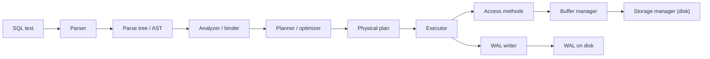
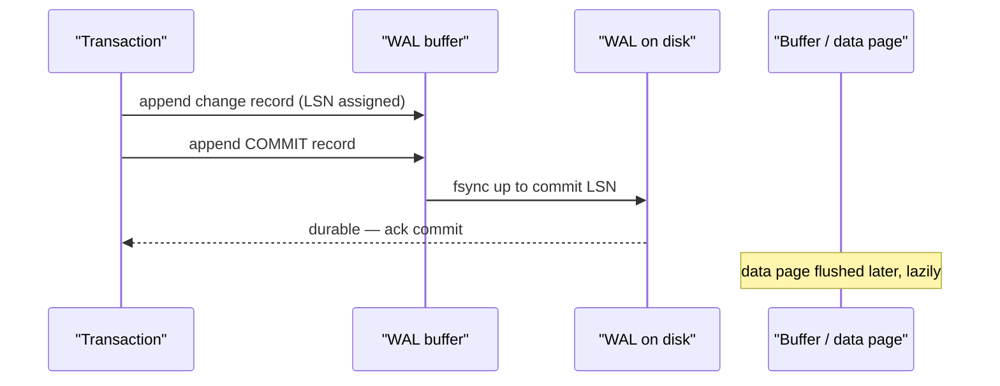
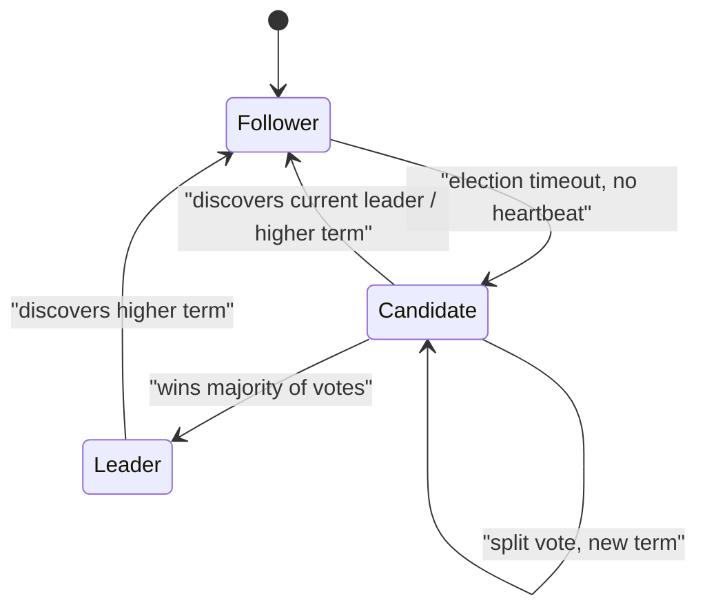
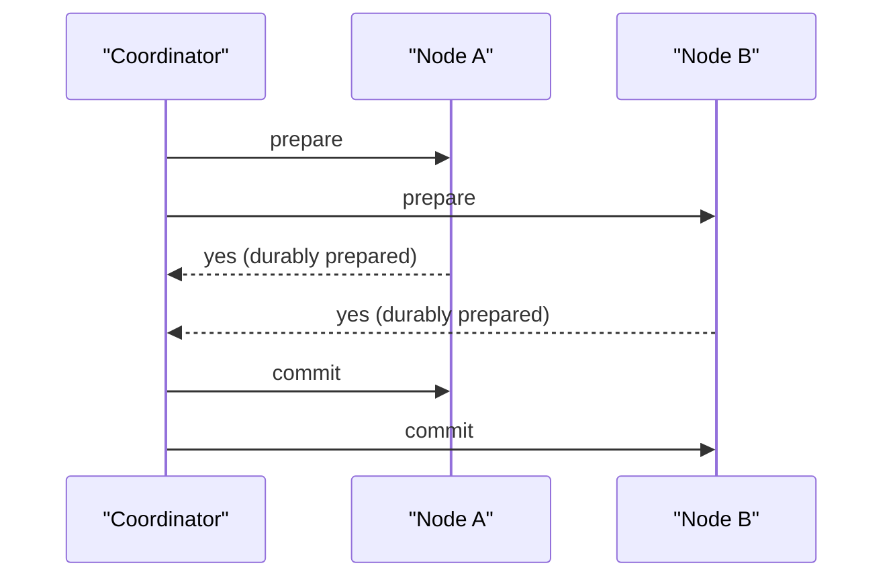
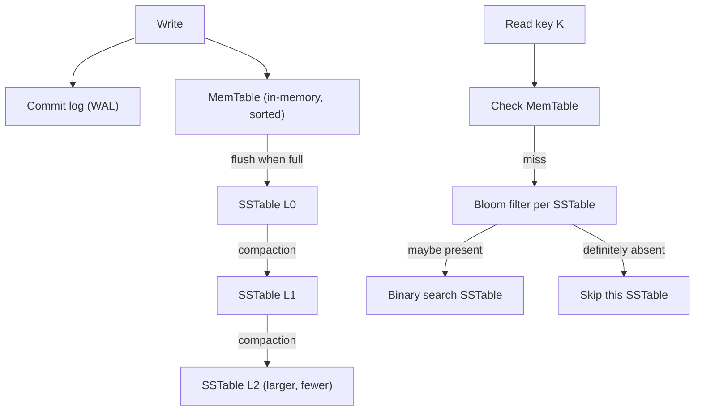
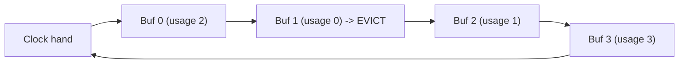
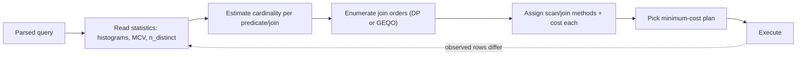
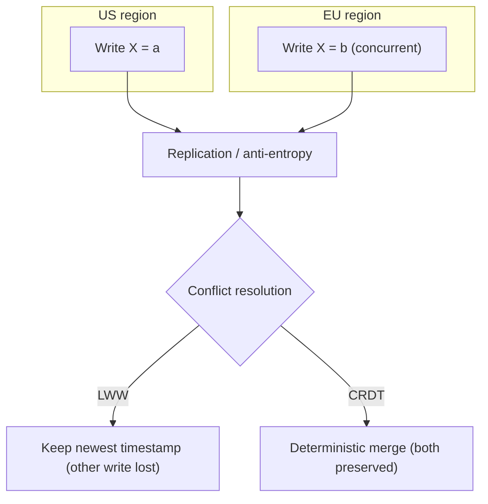
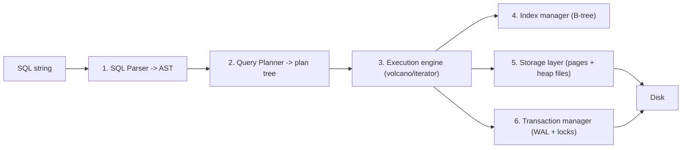
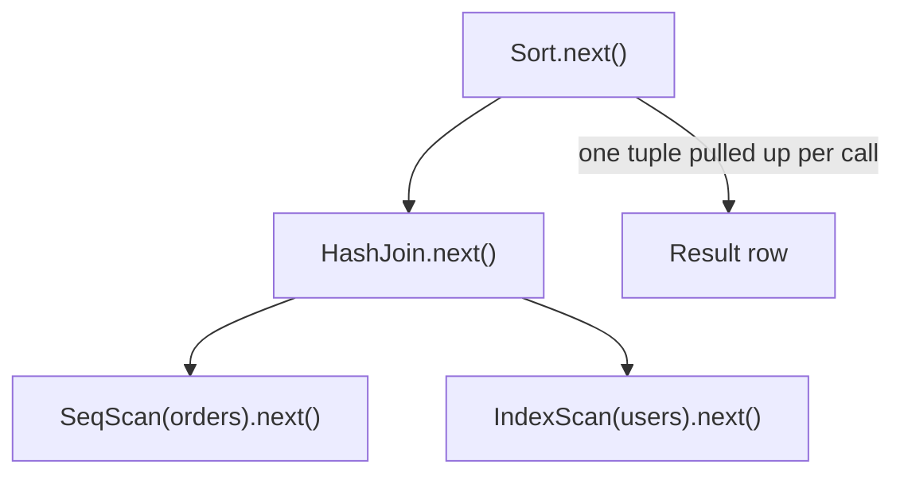

# Advanced Track — Database Systems Engineering (Optional / Specialist)

> ⚠️ **OPTIONAL — only for aspiring database KERNEL engineers** (people building Postgres, CockroachDB, Snowflake, RocksDB, etc.). **NOT needed for backend or DB-application/infrastructure roles** — the 30-day core already made you strong there. Read this only if your goal is to build databases themselves. Per the "don't rabbit-hole on the rarely-used" rule, skip unless this is genuinely your path.

> Series: Database Engineering

**Goal:** Understand how a database is built from the inside — engine, storage, consensus, optimizer, and OS interaction — well enough to contribute to (or write) a real database system.

---

## Table of Contents

- [How to use this track](#how-to-use-this-track)
- [A1 — Database Engine Architecture](#a1--database-engine-architecture)
- [A2 — Distributed Database Algorithms](#a2--distributed-database-algorithms)
- [A3 — Storage Engine Design](#a3--storage-engine-design)
- [A4 — Database ↔ OS Interaction](#a4--database--os-interaction)
- [A5 — Memory Management](#a5--memory-management)
- [A6 — Database Networking](#a6--database-networking)
- [A7 — Advanced Optimizer Theory](#a7--advanced-optimizer-theory)
- [A8 — Multi-Region Databases](#a8--multi-region-databases)
- [A9 — Building a Database](#a9--building-a-database)
- [Where to go next](#where-to-go-next)

---

## How to use this track

Each section follows the same shape as the core course:

1. **In plain words:** — an analogy to build intuition first.
2. **Why it exists / What it is / When you'd need it** — the substance.
3. **🤔 misconception hook** — the thing most people get wrong.
4. **Real systems** — who actually ships this.

These topics are advanced and theoretical, so instead of a full hands-on lab each section ends with a **Go deeper** pointer. The one exception is A9, which *is* the lab: building a toy database.

---

## A1 — Database Engine Architecture

**In plain words:** A SQL query is like an order at a restaurant. The **parser** reads your handwriting and checks it's a real dish. The **planner/optimizer** is the head chef deciding the fastest way to cook it (which station, what order). The **executor** is the line cooks actually doing the work. The **storage manager** is the pantry, and the **WAL** is the receipt book that lets the kitchen recover if the power goes out mid-service.

**Why it exists:** A database is not one program — it's a pipeline of specialized subsystems. Separating them lets each be optimized, tested, and reasoned about independently. This is the anatomy you must know before you can patch Postgres.

**What it is — the pipeline:**

- **Parser** — turns SQL text into a parse tree; catches syntax errors. In Postgres this is a Bison/Flex grammar (`gram.y`).
- **Analyzer / binder** — resolves table and column names against the catalog, checks types, expands `*`.
- **Planner / optimizer** — enumerates candidate plans, estimates cost, picks the cheapest. (See A7.)
- **Executor** — walks the plan tree, pulling rows through operators (see the volcano model in A9).
- **Access methods** — the code that reads/writes heap tuples and index entries (seq scan, index scan, bitmap scan).
- **Buffer manager** — caches disk pages in memory (shared buffers), tracks dirty pages, decides eviction. (See A5.)
- **Lock manager** — grants and queues locks (row, page, table, and lightweight locks / latches) to enforce isolation.
- **Storage manager** — maps logical page numbers to files/offsets on disk; handles extension and free space.

**WAL internals (Write-Ahead Logging).** The cardinal rule: *the log record describing a change must reach durable storage before the changed data page does.* This gives you atomicity and durability without flushing every data page on every commit.

- Every WAL record carries an **LSN** (log sequence number). A page's LSN must be ≤ the flushed WAL LSN before that page can hit disk (the WAL rule).
- On crash recovery the engine **redoes** WAL from the last checkpoint forward, then **undoes** uncommitted transactions (ARIES-style: Analysis → Redo → Undo).

**Checkpoint algorithm.** A checkpoint bounds recovery time by flushing all dirty pages up to a point and recording that point in WAL. On restart you only replay WAL *after* the last checkpoint, not from the beginning of time. Postgres spreads checkpoint I/O over time (`checkpoint_completion_target`) so it doesn't cause a write storm.

> 🤔 **Misconception:** "COMMIT writes my rows to the data files." No — COMMIT only guarantees the **WAL** is durably flushed. The actual data pages may sit dirty in memory for minutes and are written by the background writer / checkpointer. Durability comes from the log, not from the table file.

**When you'd need it:** Contributing to Postgres/MySQL internals, writing an access method or a custom storage engine, or debugging recovery and replication at the byte level.

**Real systems:** PostgreSQL, MySQL/InnoDB, SQL Server — all follow parser → optimizer → executor with WAL (Postgres) or redo+undo logs (InnoDB).

**Go deeper:** Read the PostgreSQL source `src/backend/` top-down: `parser/`, `optimizer/`, `executor/`, `access/transam/xlog.c` (WAL). Pair with the ARIES paper (Mohan et al., 1992).

---

## A2 — Distributed Database Algorithms

**In plain words:** Imagine five friends who must always agree on a single shared to-do list, even if some are asleep or the group chat drops messages. **Consensus** is the rulebook that lets the awake majority keep making decisions everyone will later accept as official. **Raft** and **Paxos** are two versions of that rulebook.

**Why it exists:** A single machine can fail. To stay available *and* consistent across replicas you need the nodes to agree on an ordered log of operations — without a human referee, over an unreliable network. That is the consensus problem.

**Leader election & quorums.** Most practical systems elect a single **leader** that orders writes; followers replicate its log. A write (or read) is safe once a **quorum** (usually a majority, ⌊N/2⌋+1) acknowledges it. With N=5, quorum=3, so the system survives 2 node failures. Quorum reads and writes overlap by at least one node, which is what guarantees you never miss the latest committed value.

**Raft state machine** — Raft was designed to be *understandable* (Paxos's reputation for opacity was the motivation). Every node is a Follower, Candidate, or Leader:

- **Terms** are logical clocks; each election increments the term.
- The leader sends **AppendEntries** (also the heartbeat). Followers replicate; an entry commits once a majority stores it.
- **Safety:** a candidate can only win if its log is at least as up-to-date as the voter's — this prevents a stale node from erasing committed entries.

**Paxos** solves the same problem but as a family of protocols (Basic Paxos for one value, Multi-Paxos for a log). It's more general and older, but famously harder to implement correctly, which is why many new systems chose Raft.

| | **Paxos (Multi)** | **Raft** |
|---|---|---|
| Year / origin | 1998, Lamport | 2014, Ongaro & Ousterhout |
| Design priority | Generality, minimal assumptions | Understandability |
| Leader | Optional/emergent (Multi-Paxos) | Strong, explicit, central |
| Log structure | Can have holes | Contiguous, no holes |
| Learning curve | Steep | Gentle |
| Used by | Chubby, Spanner (Paxos groups), Cassandra LWT | etcd, CockroachDB, TiKV, Consul |

**Distributed transactions — 2PC.** To make a transaction atomic across multiple nodes, use **Two-Phase Commit**: a coordinator asks all participants to *prepare* (phase 1); if all vote yes, it tells them to *commit* (phase 2).

2PC's flaw: it's **blocking**. If the coordinator crashes after participants prepared but before deciding, participants hold locks and wait — indefinitely. **Three-Phase Commit (3PC)** adds a pre-commit phase and timeouts to make it non-blocking under synchronous assumptions, but it's rarely used in practice because it fails under network partitions and adds a round trip.

**Saga pattern.** Instead of holding locks across services, a **Saga** is a sequence of local transactions, each with a **compensating** action. If step 3 fails, you run the compensations for steps 2 and 1 (semantic undo, e.g. "refund the payment"). Sagas trade atomicity for availability — you get eventual consistency, not isolation.

| | **2PC** | **Saga** |
|---|---|---|
| Consistency | Strong / atomic | Eventual |
| Locks held | Across whole transaction | Only per local step |
| Failure handling | Abort all | Run compensations |
| Blocking risk | Yes (coordinator failure) | No |
| Latency | Higher (2 sync rounds) | Lower |
| Best for | Few tightly-coupled nodes | Long-running microservice flows |

> 🤔 **Misconception:** "Consensus (Raft/Paxos) and 2PC are the same thing." They solve different problems. Consensus makes *replicas of one shard* agree on an ordered log and is fault-tolerant (survives minority failure). 2PC makes *different shards* commit one transaction atomically and is **not** fault-tolerant — one crash can block everyone. Modern systems (Spanner, CockroachDB) layer 2PC on top of per-shard Raft/Paxos groups to get both.

**Real systems:** etcd/Kubernetes (Raft), CockroachDB & TiKV (Raft + 2PC), Google Spanner (Paxos + 2PC + TrueTime), Cassandra lightweight transactions (Paxos).

**Go deeper:** Read the Raft paper ("In Search of an Understandable Consensus Algorithm") and visit raft.github.io's interactive visualization. Then skim "Paxos Made Simple."

---

## A3 — Storage Engine Design

**In plain words:** A **B+ tree** is a well-organized filing cabinet — everything is always in its sorted place, so reads are fast, but every insert means opening a drawer and shuffling folders (random writes). An **LSM tree** is like tossing every new note into an inbox tray and only periodically sorting the whole pile into the cabinet — writes are blindingly fast, but a lookup might have to check several trays before the cabinet.

**Why it exists:** The two dominant on-disk data structures make opposite trade-offs. Which you choose defines your database's whole write/read personality.

**B+ tree.** A balanced tree where all values live in leaf nodes, linked left-to-right for range scans. Internal nodes hold only keys for navigation. Updates happen **in place**, which means random I/O and read-modify-write of pages. This is what Postgres, MySQL/InnoDB, and SQLite use by default.

**LSM tree (Log-Structured Merge).** Writes go to an in-memory sorted structure (the **MemTable**); when full it's flushed as an immutable **SSTable** (Sorted String Table) on disk. Background **compaction** merges SSTables, discarding overwritten/deleted keys.

- **MemTable** — sorted in-memory buffer (skip list or balanced tree). Backed by a WAL so a crash doesn't lose it.
- **SSTable** — immutable, sorted, with a sparse index and often block compression.
- **Bloom filter** — a probabilistic bitset per SSTable answering "is key K *possibly* here?" No false negatives, some false positives. Lets reads skip most SSTables without touching disk. This is what makes LSM reads tolerable.
- **Compaction** — merges/rewrites SSTables. Strategy (size-tiered vs leveled) controls the amplification trade-off.

**Amplification — the three costs:**
- **Write amplification** — bytes written to disk ÷ bytes of user data. LSM rewrites data during compaction, so WA can be 10–30x.
- **Read amplification** — pages read per logical read. LSM may probe many SSTables; Bloom filters and leveling reduce it.
- **Space amplification** — disk used ÷ live data. Old versions linger until compacted.
- There is no free lunch: the **RUM conjecture** says you can optimize at most two of Read, Update, Memory overhead. LSM trades read/space for write; B-tree trades write for read.

| | **B+ tree** | **LSM tree** |
|---|---|---|
| Write path | In-place, random I/O | Append + sequential flush |
| Write throughput | Moderate | Very high |
| Read latency | Predictable, one path | Variable (multiple SSTables) |
| Write amplification | Low–moderate | High (compaction) |
| Space amplification | Low | Higher (dead versions) |
| Range scans | Excellent (linked leaves) | Good (merge across SSTables) |
| Best for | Read-heavy, OLTP | Write-heavy, time-series, ingest |
| Used by | Postgres, InnoDB, SQLite | RocksDB, LevelDB, Cassandra, ScyllaDB |

> 🤔 **Misconception:** "LSM trees are just faster than B-trees." They're faster *at writes*, at the cost of read/space amplification and background CPU/IO for compaction. A read-heavy OLTP workload often runs better on a B-tree. The right question is never "which is faster" but "which amplification can my workload afford."

**When you'd need it:** Building or tuning a storage engine, choosing a backing store for a write-heavy service, or debugging compaction stalls in Cassandra/RocksDB.

**Real systems:** RocksDB & LevelDB (LSM, embeddable), Cassandra & ScyllaDB (LSM), Postgres/InnoDB (B+ tree). Many databases embed RocksDB as their engine (CockroachDB historically, TiKV, Kafka Streams state stores).

**Go deeper:** Read the LevelDB source (small and legible) and the RocksDB wiki on compaction styles. Chapters 6–7 of *Database Internals* cover both structures deeply.

---

## A4 — Database ↔ OS Interaction

**In plain words:** A database is a control freak that doesn't fully trust the operating system. The OS offers helpful conveniences — caching, buffering, lazy writes — but the database needs *guarantees* about what's actually on the platter, so it has to know exactly which OS calls truly force data to durable storage and which merely promise to "get to it eventually."

**Why it exists:** Durability and performance live at the syscall boundary. Get the OS interaction wrong and you either lose committed data or leave enormous performance on the table.

**Key mechanisms:**
- **`mmap()`** — maps a file into the process's address space so you read it like memory, letting the OS page cache do the I/O. Elegant, but you lose fine control over *when* dirty pages are written back, and error handling on write-back is invisible to your process. (SQLite offers mmap; Postgres deliberately avoids relying on it for the main heap — see the misconception.)
- **`fsync()`** — forces a file's dirty pages from the OS page cache to durable storage and (should) not return until the device confirms. This is the linchpin of durability: after a successful `fsync` of the WAL, a commit is safe.
- **Page cache** — the OS keeps recently used file pages in RAM. A database's own buffer pool sits *on top of* this, so data can be double-cached (once by Postgres shared_buffers, once by the OS).
- **NUMA** — on multi-socket servers, memory attached to a remote CPU socket is slower. A database that ignores NUMA can thrash by allocating buffers on the wrong node. Tuning: pin memory/threads to nodes, or interleave.
- **Huge pages** — using 2 MB (or 1 GB) pages instead of 4 KB reduces TLB misses for a large buffer pool. Postgres supports `huge_pages=on`.
- **SSD vs HDD** — HDDs punish random I/O (seek time), which historically favored sequential-write LSM designs. SSDs make random reads cheap but have write endurance limits and their own write amplification (garbage collection), so minimizing writes still matters.

> 🤔 **Misconception:** "`fsync()` obviously flushes my data — durability is trivial." The infamous **"fsyncgate" (2018)** proved otherwise: on Linux, if a write-back error occurred, the kernel could **clear the dirty bit and report the error only once**, so a *subsequent* `fsync()` would return success even though data was lost. Postgres was calling `fsync` and trusting the return code; the fix was to treat any fsync failure as fatal and `PANIC` (crash-restart into recovery) rather than risk silently committing lost data. Correct durability is genuinely hard, and it lives in these details.

**When you'd need it:** Writing the durability layer, chasing "we lost data after a power failure" bugs, or squeezing throughput on high-core-count / multi-socket servers.

**Real systems:** PostgreSQL (`wal_sync_method`, `huge_pages`), MySQL/InnoDB (`innodb_flush_method`, O_DIRECT to bypass the page cache), MongoDB/WiredTiger, and every serious engine's storage layer.

**Go deeper:** Read the PostgreSQL "fsync errors" thread and the follow-up "Fsyncgate" write-ups; read `man 2 fsync`, `man 2 mmap`, and the InnoDB `innodb_flush_method` docs.

---

## A5 — Memory Management

**In plain words:** The database is a librarian with a small desk (RAM) and a huge basement (disk). **Shared buffers** are the books already up on the desk. When the desk fills, the librarian must decide which book to send back down — the **replacement algorithm**. **work_mem** is the scratch space for a single task like sorting a cart of returns.

**Why it exists:** Disk is orders of magnitude slower than RAM. Every design choice about which pages to keep, how to evict them, and how much scratch memory to give each operation directly drives throughput.

**Shared buffers (buffer pool).** A fixed region of shared memory holding cached data/index pages. A read first checks the buffer pool; a hit avoids disk entirely. Dirty pages are written back by the background writer/checkpointer, not synchronously on eviction (usually).

**Buffer replacement — LRU vs clock-sweep:**
- **LRU** (Least Recently Used) evicts the page unused for the longest. Conceptually simple, but a strict LRU needs a lock/list update on *every* access — a contention nightmare at scale — and a single large sequential scan can flush the whole cache ("cache pollution").
- **Clock-sweep** (a.k.a. second-chance) approximates LRU cheaply. Buffers sit in a ring; each has a *usage counter*. A "hand" sweeps around; on each page it decrements the counter, and evicts the first page whose counter hits zero. Frequently used pages keep getting their counter bumped and survive. Postgres uses a clock-sweep variant precisely because it avoids per-access list manipulation.

**Memory contexts.** Postgres groups allocations into hierarchical **memory contexts** (per-query, per-tuple, per-transaction). Instead of freeing thousands of tiny allocations individually, it resets an entire context at once when a query or row finishes. This prevents leaks and makes cleanup O(1) — a pattern worth stealing for any long-running C program.

**Temp memory / work_mem.** `work_mem` is the memory budget for a *single* sort, hash, or hash-join operation. Below it, sorting happens in RAM; above it, the operation **spills to disk** (external merge sort), which is far slower. The catch: a complex query with several sorts/hashes and many parallel workers can use *many multiples* of `work_mem` simultaneously — so setting it too high risks OOM. It is per-operation, not per-query and not global.

> 🤔 **Misconception:** "Just set `work_mem` and `shared_buffers` huge — more memory is always faster." Both have sharp trade-offs. Oversized `shared_buffers` double-buffers against the OS page cache and can worsen checkpoint write spikes; oversized `work_mem` multiplied across concurrent connections and parallel workers can exhaust RAM and trigger the OOM killer. Memory tuning is about *balance and concurrency*, not maximums.

**When you'd need it:** Writing a buffer manager, tuning a memory-bound OLAP box, or diagnosing "why did this query spill to disk / why did the OOM killer fire."

**Real systems:** PostgreSQL (clock-sweep, memory contexts, work_mem), MySQL/InnoDB (LRU with a midpoint-insertion "young/old" list to resist scan pollution), Oracle (SGA/PGA).

**Go deeper:** Read `src/backend/storage/buffer/freelist.c` (clock-sweep) and `src/backend/utils/mmgr/` (memory contexts) in Postgres.

---

## A6 — Database Networking

**In plain words:** Before your query reaches the engine, it travels a defined "language" over a socket — the **wire protocol** — like a diplomatic protocol for how client and server greet, authenticate, and exchange messages. And because opening a fresh connection is expensive, a **connection pooler** acts like a receptionist who reuses a small set of phone lines for thousands of callers.

**Why it exists:** Databases are network servers. The efficiency of the protocol and of connection handling often matters as much as query speed — a Postgres backend is a whole OS process, so 10,000 idle client connections can crush a server that would happily serve 200 active ones.

**PostgreSQL wire protocol (v3).** A message-oriented binary protocol over TCP (or a Unix socket):
- **Startup / authentication** — client sends parameters; server negotiates auth (scram-sha-256, etc.).
- **Simple query** — one `Query` message, server streams `RowDescription`, `DataRow`s, `CommandComplete`.
- **Extended query (prepared statements)** — `Parse` → `Bind` → `Execute`, separating the plan from parameters. This enables server-side prepared statements and prevents SQL injection by keeping values out of the SQL text.

**Connection multiplexing & PgBouncer.** Each Postgres connection = one backend process with its own memory. A **pooler** keeps a small set of real server connections and multiplexes many client connections onto them. **PgBouncer** is the canonical lightweight pooler; its pool modes trade reuse aggressiveness against feature compatibility:

| Pool mode | A server connection is returned to the pool… | Reuse | Caveat |
|---|---|---|---|
| **Session** | when the client disconnects | Lowest | Safe; behaves like a direct connection |
| **Transaction** | at the end of each transaction | High | Most common; breaks session-level features (some prepared statements, `SET`, advisory locks, `LISTEN/NOTIFY`) |
| **Statement** | after each single statement | Highest | No multi-statement transactions allowed at all |

Transaction pooling is what lets a serverless app with thousands of short-lived connections talk to a Postgres that only wants a few hundred backends.

**TCP optimization.** `TCP_NODELAY` disables Nagle's algorithm so small query/response packets aren't delayed waiting to coalesce (databases are latency-sensitive and send small messages). Keepalives detect dead peers; large socket buffers help bulk `COPY`. Local clients should use Unix domain sockets to skip the TCP stack entirely.

> 🤔 **Misconception:** "A connection pool just saves the TCP handshake." The bigger cost in Postgres is the **backend process itself** — memory, fork overhead, and the load of thousands of idle-but-alive processes on the scheduler and shared memory. Pooling is primarily about capping the number of real backends, not about the handshake. This is also why "just raise `max_connections`" is often the wrong fix.

**When you'd need it:** Building a proxy/pooler, implementing a driver, or diagnosing "we hit max_connections" and connection-storm outages.

**Real systems:** PgBouncer, Pgpool-II, the AWS RDS Proxy, Amazon Aurora's connection management, and Postgres 14+'s own improvements to idle connection scaling.

**Go deeper:** Read the "Frontend/Backend Protocol" chapter of the Postgres docs and the PgBouncer `config` docs on pool modes.

---

## A7 — Advanced Optimizer Theory

**In plain words:** The optimizer is a travel planner choosing a route across many cities (tables) it can visit in many orders, by many roads (scan/join methods). It has never actually driven any of them — it guesses travel times from old maps (**statistics**). Its single hardest job is guessing how many travelers (**rows**) will show up at each stop; small errors there snowball into catastrophically wrong routes.

**Why it exists:** For any non-trivial query there are exponentially many equivalent plans with wildly different costs. The optimizer's job is to pick a *good* one *quickly*, using estimates, without executing anything.

**Cost estimation.** Each physical operator (seq scan, index scan, nested loop, hash join, sort) has a cost model in abstract units combining estimated I/O and CPU. Postgres exposes the knobs: `seq_page_cost`, `random_page_cost`, `cpu_tuple_cost`, etc. The planner sums operator costs over a candidate plan tree and picks the minimum.

**Cardinality estimation — the hardest problem.** Cost is driven by *how many rows* flow between operators. Estimating that requires guessing the selectivity of each predicate and, worse, of *combinations* of predicates and joins. Errors compound multiplicatively up the plan tree: a 10x underestimate at a leaf can become a 1000x error at the top, turning a hash join into a disastrous nested loop. Decades of research and this is still the field's central unsolved problem (see the "How Good Are Query Optimizers, Really?" study).

**Statistics, histograms & correlation.** To estimate selectivity the optimizer collects:
- **Histograms** — bucketed distribution of a column's values, for range predicates.
- **Most-common-values (MCV)** lists — for skewed columns.
- **n_distinct** — number of distinct values, for equality/grouping.
Postgres gathers these via `ANALYZE`. The classic failure is the **independence assumption**: it assumes `WHERE city='NYC' AND state='NY'` multiplies selectivities as if independent, badly underestimating correlated columns. **Extended statistics** (`CREATE STATISTICS`) capture multi-column dependencies to fix this.

**Join ordering & search space.** With N tables there are a huge number of possible join orders (the number of shapes grows super-exponentially). Postgres uses **dynamic programming** (System-R style bottom-up) for small N, and switches to a **genetic algorithm** (GEQO) beyond `geqo_threshold` (default 12 tables) because exhaustive search becomes infeasible.

**Predicate pushdown.** Push filters as close to the data source as possible — evaluate `WHERE` before joins, push predicates into subqueries and into foreign/columnar scans — so fewer rows travel up the pipeline. A cornerstone optimization, especially for columnar and distributed engines.

**Adaptive query optimization.** Because static estimates are so error-prone, modern engines correct course at runtime: re-optimize based on observed cardinalities, adjust join methods mid-flight, or feed execution feedback back into statistics. Oracle's Adaptive Plans and SQL Server's Intelligent Query Processing are production examples.

> 🤔 **Misconception:** "A slow query means the query is badly written." Very often the query is fine and the **optimizer picked a bad plan from a bad row estimate** — usually because statistics are stale or columns are correlated. The fix is frequently `ANALYZE`, extended statistics, or a planner hint, not rewriting the SQL. `EXPLAIN ANALYZE` (comparing *estimated* vs *actual* rows) is how you catch it.

**When you'd need it:** Working on a query optimizer, building an analytics engine, or being the person a team calls when the planner "goes stupid" on a big join.

**Real systems:** PostgreSQL planner, the Cascades framework (SQL Server, Greenplum's Orca, CockroachDB's optimizer), Oracle CBO, and every columnar warehouse (Snowflake, BigQuery).

**Go deeper:** Read the "How Good Are Query Optimizers, Really?" (Leis et al., VLDB 2015) paper and the Postgres "Planner/Optimizer" and "Row Estimation Examples" chapters.

---

## A8 — Multi-Region Databases

**In plain words:** Running a strongly-consistent database across continents is like coordinating a globe-spanning meeting where every message takes a real, unavoidable fraction of a second. The killer problem is **time itself** — no two machines agree on the exact instant, so deciding "which write happened first" across regions becomes a genuinely deep problem.

**Why it exists:** Users are global; regulations demand data locality; a whole region can fail. Multi-region databases keep data close to users and survive regional outages — but the speed of light and clock disagreement make strong consistency across regions expensive.

**Global replication.** Data is replicated across regions either synchronously (strong consistency, high write latency — a cross-region round trip per commit) or asynchronously (low latency, but the remote replica lags and can lose recent writes on failover). Most systems let you pick per-table or per-transaction.

**Clock synchronization & TrueTime.** To order events globally you'd love a perfect clock; you can't have one. **Google Spanner's TrueTime** is the landmark idea: instead of pretending clocks are exact, TrueTime exposes time as an **interval** `[earliest, latest]` with a bounded uncertainty ε (backed by GPS and atomic clocks in every datacenter). To guarantee external consistency, Spanner **"commit-waits"** — it deliberately waits out the uncertainty ε (a few milliseconds) before releasing locks, so that any transaction that starts later is guaranteed a strictly greater timestamp. Correctness is bought with a little latency and expensive hardware.

**Multi-master replication.** Allow writes in multiple regions simultaneously (no single leader). Great for write availability and latency, but now two regions can concurrently modify the same row — creating **conflicts** that must be resolved.

**Conflict resolution — LWW vs CRDTs:**
- **Last-Write-Wins (LWW)** — attach a timestamp to each write; on conflict, the highest timestamp wins. Simple, but it **silently discards** the losing write, and clock skew can pick the "wrong" winner. Cassandra uses LWW per column.
- **CRDTs (Conflict-free Replicated Data Types)** — data structures mathematically designed so concurrent updates *merge deterministically* without coordination (e.g., a grow-only counter, an OR-Set, a sequence for collaborative text). Every replica converges to the same state regardless of message order. The trade-off is metadata overhead and that not every operation has a natural CRDT.

> 🤔 **Misconception:** "Multi-master means you get strong consistency everywhere with no downside." Multi-master gives you write availability, not free consistency — you either accept conflicts (LWW loses data, CRDTs cost overhead and can't express every constraint like global uniqueness) or you serialize through consensus and pay cross-region latency. **CAP and PACELC are non-negotiable:** under a partition you choose consistency or availability, and *even without a partition* you trade latency against consistency.

**When you'd need it:** Building a globally distributed database, designing a multi-region deployment with real consistency SLAs, or choosing a conflict strategy for offline-capable / collaborative apps.

**Real systems:** Google Spanner & CockroachDB (external consistency via TrueTime / hybrid-logical clocks + Raft), DynamoDB global tables (LWW), Cassandra (LWW), Riak & Redis CRDTs, Automerge/Yjs (CRDTs for collaborative editing).

**Go deeper:** Read the Spanner paper ("Spanner: Google's Globally-Distributed Database", OSDI 2012) and Shapiro et al.'s CRDT paper; then look at CockroachDB's hybrid-logical-clock docs as a no-atomic-clock alternative to TrueTime.

---

## A9 — Building a Database

**In plain words:** The best way to truly understand a database is to build a small one. You don't need distributed consensus or a cost-based optimizer on day one — you need the *spine*: turn SQL text into a plan, pull rows through operators, read/write pages, and not corrupt data on crash. Everything in A1–A8 is an elaboration of this spine.

**Why it exists here:** This section is the track's real lab. Implementing even a toy engine converts all the theory above into permanent, load-bearing intuition.

**The spine — six components to build, in order:**

1. **SQL parser** — tokenize (lexer) then build an AST for a starter subset: `CREATE TABLE`, `INSERT`, `SELECT ... WHERE ... ORDER BY`. Add `JOIN` later. A hand-written recursive-descent parser is the most educational; a generator (ANTLR, lalrpop, PEG) is faster to ship.

2. **Query planner** — turn the AST into a tree of physical operators (scan, filter, project, sort, join). Start rule-based (always push filters down, always index-scan if an index exists); add cost-based choices only once it works.

3. **Execution engine — the volcano / iterator model.** Every operator implements the same interface: `open()`, `next()` (returns one tuple or EOF), `close()`. Operators nest; calling `next()` on the root pulls one row up through the whole tree on demand. This "pull" model is elegant and composable (later, learn vectorized/batched execution for OLAP speed).

4. **Index manager** — implement a **B+ tree** over your pages (see A3): search, insert with node split, delete with merge, range scan via leaf links. This is where you feel why balanced trees matter.

5. **Storage layer** — a page abstraction (fixed-size, e.g. 4–8 KB), a slotted-page layout for variable-length tuples, heap files, a free-space map, and a buffer pool with an eviction policy (clock-sweep from A5).

6. **Transaction manager** — WAL (A1) for atomicity/durability, a lock manager (or MVCC) for isolation, and crash recovery (replay WAL on startup). This is the hardest and most rewarding part.

**Suggested build path (progressive):**
- **Weekend 1:** in-memory key-value store with a real B-tree index and range scans.
- **Weekend 2:** persist it — pages, a heap file, a buffer pool.
- **Weekend 3:** a SQL-subset parser + volcano executor over your storage.
- **Weekend 4:** WAL + crash recovery; verify durability by `kill -9` mid-write and restarting.
- **Later:** MVCC, a cost-based planner, then replication.

> 🤔 **Misconception:** "You can't understand real databases without building a distributed one." Backwards. Every distributed database is a *single-node* database with consensus and sharding bolted on. Build the single-node spine first — parser, executor, B-tree, WAL — and A2/A8 will finally make sense. Start with SQLite's architecture, not Spanner's.

**Real systems to read (small enough to grok):** SQLite (the gold standard of a legible, complete engine), LevelDB (LSM storage), and teaching databases like CMU's BusTub, Berkeley's toy DBs, and community projects like `chidb`, `simpledb`, or "Build Your Own Database" tutorials.

**Go deeper (this is the lab):** Do the **CMU 15-445** projects (BusTub) — buffer pool → B+ tree → query execution → concurrency control. Or follow the "Let's Build a Simple Database" (sqlite clone in C) tutorial end to end.

---

## Where to go next

If you finished the 30-day core and want to go from *using* databases to *building* them, these are the canonical resources:

- **📘 *Database Internals* — Alex Petrov.** The single best bridge from application engineer to kernel engineer. Part I: storage engines (B-trees, LSM). Part II: distributed systems (consensus, replication, transactions). It maps almost one-to-one onto this track.
- **🎓 CMU Database Group — Andy Pavlo's lectures (15-445 Intro, 15-721 Advanced).** Free on YouTube with the BusTub coding projects. The best structured DB systems education available anywhere.
- **🐘 The PostgreSQL source code.** A world-class, readable, production database. Start in `src/backend/` and read the developer README files in each subsystem directory.
- **📄 The Raft paper** ("In Search of an Understandable Consensus Algorithm", Ongaro & Ousterhout, 2014) — the clearest entry into consensus, plus the interactive visualization at raft.github.io.
- **📄 The Spanner paper** ("Spanner: Google's Globally-Distributed Database", OSDI 2012) — TrueTime and globally-consistent transactions.
- **Bonus classics:** the ARIES paper (recovery), "Architecture of a Database System" (Hellerstein/Stonebraker/Hamilton), and "Designing Data-Intensive Applications" (Kleppmann) as the systems-level companion.

**A closing note:** No one masters all nine of these areas — even inside a database company, engineers specialize (storage, distribution, optimizer, execution). **Deeply mastering even 2–3 of these sections is exactly what distinguishes a database *kernel* engineer from a database *user*.** Pick the ones that pull at you, build the toy database in A9, and let curiosity — not completionism — set the pace. And remember the banner: if this isn't your path, the core course already made you strong. This track is a door, not a requirement.
