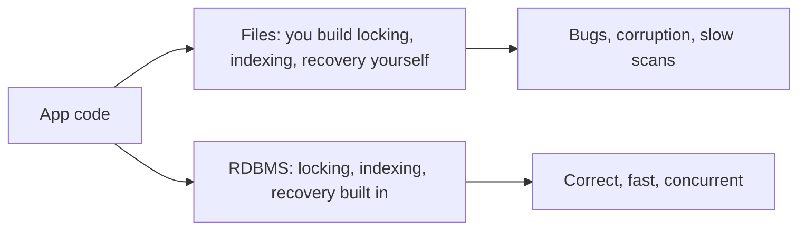
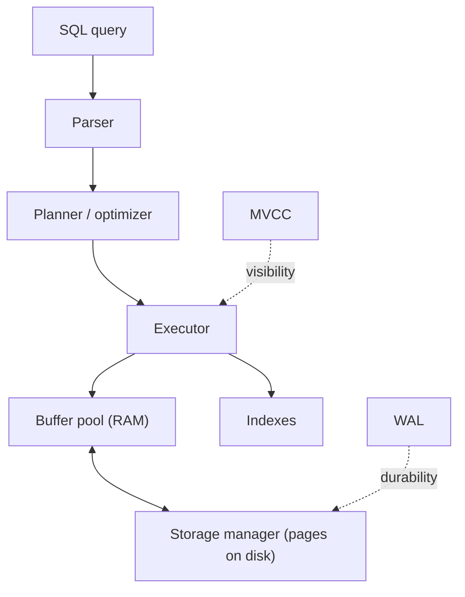
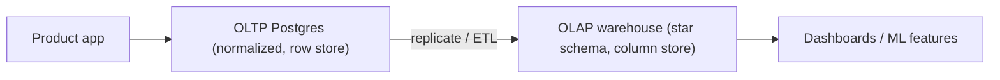

# Day 1 — Why Databases; RDBMS; OLTP vs OLAP

> Series: Database Engineering
> **Goal:** Understand *why* databases exist at all, what a relational database really guarantees, and the deep split between transactional (OLTP) and analytical (OLAP) worlds — so you stop *using* a DB blindly and start *engineering* one.

## Table of Contents
1. [Why not just files?](#1-why-not-just-files)
2. [The relational model](#2-the-relational-model)
3. [RDBMS: what the engine actually does for you](#3-rdbms-what-the-engine-actually-does-for-you)
4. [OLTP vs OLAP](#4-oltp-vs-olap)
5. [ACID at a glance](#5-acid-at-a-glance)
6. [The DB-engineer mindset](#6-the-db-engineer-mindset)
7. [Lab (hands-on)](#7-lab-hands-on)
8. [Self-Check](#8-self-check)
9. [Tomorrow](#9-tomorrow)

---

## 1. Why not just files?

**In plain words:** A pile of text files is like a garage where everyone throws tools on the floor. It works for one person on a quiet day. Add ten people grabbing tools at once, a fire-safety inspector, and a rule that no tool may ever go missing — and you need shelving, labels, a checkout log, and a guard. A database *is* that guard.

- **Why:** Applications need to store data that outlives a process, is shared by many users, must never silently corrupt, and must be found *fast* among billions of rows. Flat files give you none of that for free.
- **What:** A database is a system that stores data **durably**, enforces **structure and rules**, allows **concurrent** access safely, and answers **queries** efficiently.
- **When:** The moment more than one writer, or more than a trivial amount of data, or any correctness guarantee is on the line.
- **How:** By adding layers files lack — a query language, a transaction manager, a lock manager, indexes, a write-ahead log, a buffer pool. (Days 6-10 are exactly these layers.)
- **Where:** Every product company: the orders table behind checkout, the users table behind login, the events table behind analytics.

| Concern | Plain files | Relational database |
|---|---|---|
| Concurrent writers | You hand-roll locks, usually wrong | MVCC + lock manager, correct by design |
| Find one row in 10M | Full scan every time | B-tree index → microseconds |
| Crash mid-write | Half-written garbage | WAL replays to a consistent state |
| "Every order must have a valid user" | App code, forgotten somewhere | Foreign key, enforced always |
| Ad-hoc question | Write a script | One SQL query |
| Partial update of 3 records | Might leave 1 done, 2 not | Transaction: all or nothing |

> 🤔 **"We're a small startup — can't we just use JSON files or a spreadsheet until we scale?"**
> You can, right up until the day two requests write the same file at once and one silently wins, or a crash truncates it, or someone asks "how many active users last Tuesday?" and you write a 200-line script. The database isn't a scale decision; it's a *correctness* decision. Postgres runs fine on a laptop. Start with it.

✅ **Good scenario (where it saves you):** Checkout at an e-commerce company. 500 people buy the last 300 units of a flash-sale item. The DB serializes inventory decrements inside transactions; you sell exactly 300, reject the rest cleanly. No oversell, no support tickets, no refunds.

❌ **Bad scenario (the pain without it):** The same checkout backed by a JSON file. Two Node workers read `stock: 1`, both write `stock: 0`, both confirm the order. You sold one unit twice. Now it's a manual refund, an angry customer, and an incident review.

**When NOT to:** A single-user CLI tool caching config, or a build artifact — a file is genuinely simpler and correct. Don't reach for Postgres to store one `settings.json`.


*Files push hard problems up into your app; a database absorbs them.*

---

## 2. The relational model

**In plain words:** Data as tidy tables — rows are records, columns are attributes — connected by shared keys. Like a set of spreadsheets that *know* how they relate to each other and refuse to let the relationships break.

- **Why:** Edgar Codd (1970) showed that modeling data as **relations** (tables) with a mathematical foundation lets you ask arbitrary questions declaratively, without hard-coding access paths.
- **What:** A *relation* = a table. A *tuple* = a row. An *attribute* = a column. A *domain* = the type of a column. A *key* = attribute(s) that uniquely identify a row.
- **When:** Almost always the default for structured, related business data (users, orders, payments).
- **How:** You describe *what* you want (SQL), the engine decides *how* to get it (the planner — Day 9).
- **Where:** OLTP systems overwhelmingly; also the backbone of most data warehouses.

Key property: **declarative**. You say `SELECT ... WHERE ...`; you do *not* say "open this file, seek to byte 4096, loop." That separation is what lets the engine optimize freely.

```sql
-- A relation (table) with typed columns (domains)
CREATE TABLE customers (
  customer_id BIGINT PRIMARY KEY,   -- key: uniquely identifies a tuple (row)
  email       TEXT NOT NULL UNIQUE, -- domain constraint + uniqueness
  created_at  TIMESTAMPTZ NOT NULL DEFAULT now()
);
```

> **MySQL note:** MySQL uses `AUTO_INCREMENT` and defaults to the InnoDB storage engine; Postgres uses `GENERATED ... AS IDENTITY` or `BIGSERIAL`. Postgres has one storage engine (with pluggable table access methods since v12); MySQL historically shipped several (InnoDB, MyISAM). Assume InnoDB.

---

## 3. RDBMS: what the engine actually does for you

**In plain words:** An RDBMS is not "a place to put tables." It's a stack of specialized machines cooperating: a parser, a planner, an executor, a storage manager, a lock manager, a log manager, a cache. Days 6-10 open each box.

- **Why:** These subsystems are the hard, decade-refined parts you'd otherwise reinvent badly.
- **What:** The major components you'll meet in this course:

| Subsystem | Job | Covered on |
|---|---|---|
| Parser | Turn SQL text into a tree | Day 9 |
| Planner / optimizer | Choose the cheapest execution plan | Day 9 |
| Executor | Run the plan (scans, joins) | Day 9 |
| Storage manager | Pages, heap, TOAST on disk | Day 6 |
| Index manager | B-tree/GIN/GiST/BRIN | Days 7-8 |
| Buffer pool | Cache hot pages in RAM | Day 10 |
| WAL / log manager | Durability + crash recovery | Day 10 |
| MVCC / transaction mgr | Isolation, visibility | Day 10 (+ Day 14) |

- **When / Where:** Every query touches most of these. Understanding them is the difference between "the query is slow, add an index and pray" and "the planner chose a seq scan because the row estimate was off — let me `ANALYZE`."


*The subsystems you'll spend Days 6-10 taking apart.*

---

## 4. OLTP vs OLAP

**In plain words:** OLTP is the cash register — many tiny, fast, precise transactions. OLAP is the accountant at month-end — a few huge scans that summarize everything. Same data, opposite physics.

- **Why:** The two workloads pull hardware and design in opposite directions. Trying to serve both from one box, one schema, one index strategy is a classic source of pain.
- **What:** OLTP = Online Transaction Processing. OLAP = Online Analytical Processing.
- **When:** OLTP powers the live product (checkout, login). OLAP powers dashboards, BI, ML feature pipelines.
- **How:** OLTP → normalized schema, row storage, many small indexes, short transactions. OLAP → denormalized/star schema, columnar storage, big sequential scans, few concurrent users.
- **Where:** OLTP = Postgres/MySQL behind the app. OLAP = Snowflake/BigQuery/Redshift/ClickHouse, or Postgres with columnar extensions.

| Dimension | OLTP | OLAP |
|---|---|---|
| Typical query | "Get order 8821" | "Revenue by region by month, 3 years" |
| Rows touched | 1 to a few | Millions to billions |
| Reads vs writes | Balanced, write-heavy | Read-heavy, batch loads |
| Latency target | Single-digit ms | Seconds to minutes OK |
| Concurrency | Thousands of users | Dozens of analysts |
| Schema | Normalized (Day 3) | Star / denormalized |
| Storage | Row-oriented | Column-oriented |
| Indexing | Many selective indexes | Few; scans dominate |
| Consistency | Strict (ACID) | Often eventual / batch |
| Example engines | Postgres, MySQL | Snowflake, BigQuery, ClickHouse |

> 🤔 **"Can't I just run my analytics queries on the production Postgres to save money?"**
> You can for a while, and many companies do early on. But a single `SELECT ... GROUP BY` over 200M rows will evict your hot OLTP pages from the buffer pool, hold table-level read pressure, and spike checkout latency during a board demo. The clean pattern: replicate to a read replica or ETL to a warehouse, and keep heavy analytics off the box customers depend on.

✅ **Good scenario (where the split saves you):** Product OLTP stays on a lean, well-indexed Postgres; nightly ETL loads a star schema into BigQuery. Analysts run monster queries all day; checkout p99 never moves. Two workloads, two engines, zero interference.

❌ **Bad scenario (when misused):** A "we'll do everything in one Postgres" shop. The finance team's quarter-end 40-minute aggregation runs at 9am, floods the buffer pool, and checkout p99 jumps from 8ms to 900ms. Sales drop for an hour. The postmortem action item is: separate OLAP.

**When NOT to (over-splitting):** A 5-person startup with 50k rows does *not* need a warehouse. Run analytics on a read replica. Split when data volume or contention actually hurts — not on day one.


*Serve customers from OLTP; answer questions from OLAP. Keep them apart.*

---

## 5. ACID at a glance

**In plain words:** ACID is the four promises that make a transaction trustworthy. Think of a bank transfer: money must leave one account *and* arrive in the other — never half.

- **A — Atomicity:** All statements in a transaction commit together or none do. No half-transfers.
- **C — Consistency:** A transaction moves the DB from one valid state to another; constraints (keys, checks) always hold at commit.
- **I — Isolation:** Concurrent transactions don't step on each other; each sees a coherent snapshot (Day 10 MVCC, Day 14 isolation levels).
- **D — Durability:** Once committed, it survives a crash/power loss — guaranteed by the WAL (Day 10).

```sql
BEGIN;
  UPDATE accounts SET balance = balance - 100 WHERE id = 1;  -- debit
  UPDATE accounts SET balance = balance + 100 WHERE id = 2;  -- credit
COMMIT;  -- atomic: both apply, or (on error/ROLLBACK) neither does
```

> 🤔 **"Isolation sounds expensive — do real high-throughput systems actually keep it on?"**
> Yes, but not blindly. Postgres defaults to READ COMMITTED, a pragmatic level that's cheap and correct for most work. You dial *up* to REPEATABLE READ or SERIALIZABLE only where a specific invariant needs it (Day 14). The skill isn't "max isolation everywhere"; it's knowing the minimum level each operation truly requires.

✅ **Good scenario:** Payment capture wrapped in a transaction with a uniqueness constraint on `idempotency_key`. A retried request can't double-charge; the second insert fails the constraint and you return the first result.

❌ **Bad scenario (durability misconfigured):** A team sets `synchronous_commit = off` for speed, then a power loss loses the last few seconds of commits — including a confirmed payment. The customer was charged; your DB forgot. Understand the durability knobs before you turn them (Day 10).

**When NOT to (relax ACID):** Analytics/event-log ingestion where approximate, eventually-consistent counts are fine can trade strict ACID for throughput. Never for money or inventory.

---

## 6. The DB-engineer mindset

**In plain words:** A user asks "what SQL gives me this result?" An engineer asks "what will the engine *do* to produce it, and what will that cost at 100x the data?"

Shift these habits:
- From "add an index" → "which index type, and will the planner even use it?" (Days 7-9)
- From "it's slow" → "read the `EXPLAIN ANALYZE`; is it a seq scan, a bad estimate, or bloat?" (Days 8-9)
- From "store it" → "how does this row lay out on a page; will it TOAST; will updates bloat it?" (Day 6)
- From "it committed" → "did the WAL fsync; when's the next checkpoint?" (Day 10)
- From "one big DB" → "OLTP vs OLAP, normalize vs denormalize, on purpose." (Days 3-4)

> **Cross-reference:** In the System Design course, databases appear as a *black box* you pick (SQL vs NoSQL, replication, sharding). Here we open the box. When System Design Day 10 says "add an index to speed reads," this course (Days 7-8) shows *which* index, *why* the planner picks it, and *when* it silently hurts writes.

---

## 7. Lab (hands-on)

**Goal:** Install PostgreSQL and load a sample schema you'll reuse all course.

```bash
# macOS (Homebrew)
brew install postgresql@17 && brew services start postgresql@17

# Ubuntu/Debian
sudo apt-get update && sudo apt-get install -y postgresql

# Docker (portable, recommended)
docker run --name dbeng -e POSTGRES_PASSWORD=pw -p 5432:5432 -d postgres:17
```
> Verify the current major version when you build — Postgres ships a new major yearly. `SELECT version();`

```sql
-- Create a playground DB and a tiny e-commerce schema
CREATE DATABASE shop;
\c shop

CREATE TABLE customers (
  customer_id BIGINT GENERATED ALWAYS AS IDENTITY PRIMARY KEY,
  email       TEXT NOT NULL UNIQUE,
  created_at  TIMESTAMPTZ NOT NULL DEFAULT now()
);

CREATE TABLE orders (
  order_id    BIGINT GENERATED ALWAYS AS IDENTITY PRIMARY KEY,
  customer_id BIGINT NOT NULL REFERENCES customers(customer_id),  -- FK
  total_cents INTEGER NOT NULL CHECK (total_cents >= 0),
  placed_at   TIMESTAMPTZ NOT NULL DEFAULT now()
);

-- Seed some data
INSERT INTO customers (email) VALUES ('a@x.com'), ('b@x.com'), ('c@x.com');
INSERT INTO orders (customer_id, total_cents)
SELECT (random()*2+1)::int, (random()*10000)::int
FROM generate_series(1, 1000);   -- 1000 fake orders

-- Prove OLTP-style vs OLAP-style queries feel different
SELECT * FROM orders WHERE order_id = 42;                 -- OLTP: one row
SELECT customer_id, count(*), sum(total_cents)            -- OLAP-ish: aggregate all
FROM orders GROUP BY customer_id ORDER BY sum(total_cents) DESC;
```

**Tasks:**
1. Run both queries; note which feels instant and which scans everything.
2. Try `EXPLAIN SELECT * FROM orders WHERE order_id = 42;` — read the plan (you'll master this Day 9).
3. Break atomicity on purpose: in a `BEGIN`, insert an order for a non-existent `customer_id` and watch the FK reject it; `ROLLBACK` and confirm nothing was added.

---

## 8. Self-Check
1. Name three guarantees a database gives that a flat file does not.
2. In the relational model, what are a relation, a tuple, and a domain?
3. Why is "declarative" the key word in SQL, and what does it enable the engine to do?
4. Give two ways OLTP and OLAP schemas differ, and why.
5. What breaks if you run heavy OLAP queries on a live OLTP box?
6. Expand ACID and give a one-line meaning for each letter.
7. Which ACID property does the WAL primarily protect?
8. Postgres's default isolation level is ______, and why is that a pragmatic default?
9. Give one legitimate case where a plain file beats a database.
10. State one habit that separates a DB *engineer* from a DB *user*.

---

## 9. Tomorrow
**Day 2 — Data Modeling & Keys:** we turn fuzzy business requirements into a precise schema. ER diagrams, entities and relationships, cardinality, and the keys that hold it all together — primary, foreign, composite, and the eternal surrogate-vs-natural debate.
